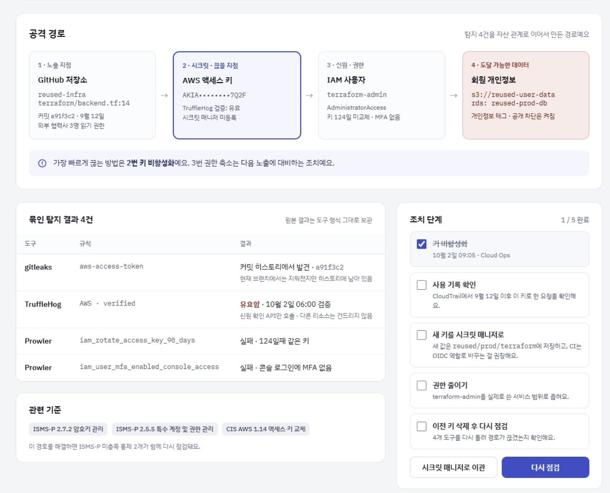
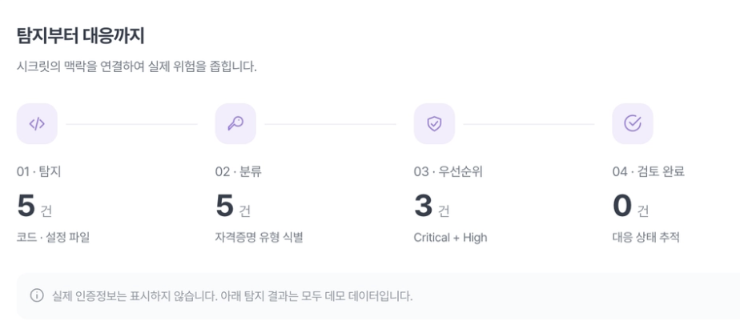
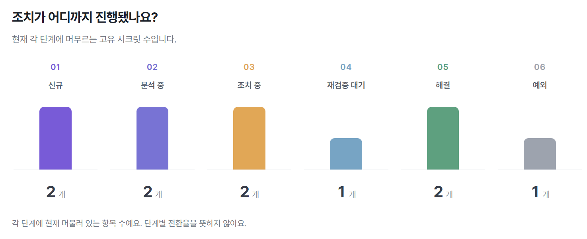
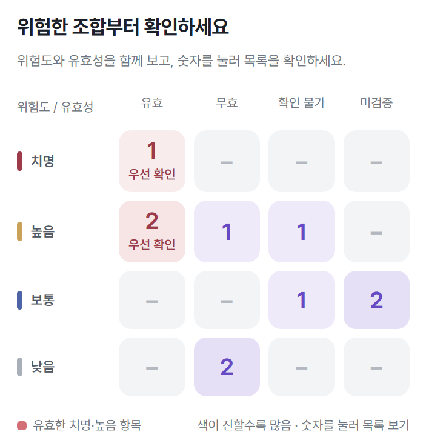
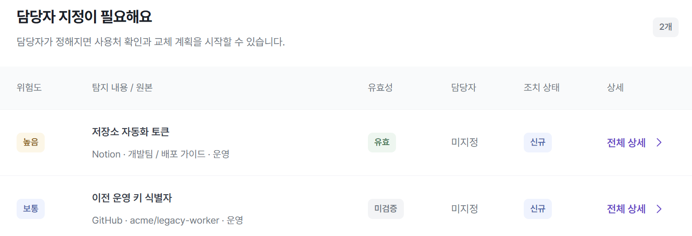

# 대시보드 화면 설계

기준: [PRD](../01-requirements/PRD.md), 화면 이미지 71~75는 기능 참고 자료

## 1. 통합 화면의 위치

기존 통합 현황 `/overview`에서 시크릿 관련 요약을 제공하고, `/secrets`에서 탐지 결과, 분류, 조치, 담당자 흐름을 연결하는 안이다. 로그인, 공통 레이아웃, 세션 인증은 기존 구현을 따른다. 페이지 배치와 신규 API는 Proposed이다.

통합 현황의 100점 보안 점수는 Critical/High/Medium/Low 심각도 분포와 건수 표시로 전환한다. 하나의 대표 등급이 필요하다면 별도 집계 규칙을 정하며, 총건수를 임의 점수나 등급으로 바꾸지 않는다. 심각도 4등급과 조치 4단계는 서로 다른 축이다.

통합 현황에서 시크릿 요약을 열고 결과 목록을 필터링한다. 상세 화면에서 탐지 근거와 영향 범위를 확인한 뒤 검토, 담당자 지정, 외부 조치 기록, 재검증을 진행한다. 아래 이미지 71~75는 각 화면 영역의 참고 자료다. 개별 위젯의 수치는 동일 필터와 동일 집계 기준시점에서 계산한다.

## 2. 공통 화면 정보

| 영역 | 표시, 동작 |
|---|---|
| 범위 | 발견 소스와 키 발급자를 별도 필터로 제공. 환경이 확인되지 않으면 미확인 표시 |
| 최신성 | 마지막 수집 성공, 마지막 유효성 판정, 최근 검사 시도, 다음 예정, 지연, 실패 |
| 집계 단위 | 기본 제안은 고유 key set. 노출 위치 수와 엔진 탐지 수는 상세에서 분리 |
| 값 보호 | 전체 비밀 값은 표시하지 않음. 식별용 마스킹과 내부 ID 사용 |
| 상태 | 로딩, 빈 결과, 연결 미설정, 일부 수집 실패, 권한 부족을 구별 |
| 행동 | 검토, 담당자 지정, 기록 저장, 재검증 요청. 외부 키 변경은 실행하지 않음 |

## 3. image 71 — 상세, 영향 경로, 조치

- 상단: 제목, 발견 위치, 발급자, 키 유형, 심각도, 유효성 및 검사 시각, 검토, 조치 상태, 담당자.
- 탐지 근거: 엔진, 룰, 버전, 마스킹한 문맥, 커밋, 페이지, 리소스 위치, 최초, 최근 발견 시각. 원문 링크도 사용자 접근 권한을 확인한다.
- 유효성: 검사 방법, 결과, 실패, 제한 사유. ‘유효’와 ‘실제 사용 중’을 구분한다.
- 영향 범위: 확인한 IAM 주체, 권한, 대상 리소스. 확인된 연결과 추정 연결을 구분하고 근거 시각을 표시한다.
- 대응: 공급자별 절차와 체크리스트, 외부에서 수행한 조치 기록, 재검증 요청.
- 검토 완료는 검토 이력만 변경하며 해결 상태를 자동 변경하지 않는다.

이미지의 GitHub→AWS 키→IAM 사용자→S3/RDS 경로는 예시다. 실제 접근 가능성을 확인하지 못하면 완성된 공격 경로로 표시하지 않는다. Prowler 결과는 선택적 보강 근거이며 키 유효성, 실제 침해를 증명하지 않는다. 그림의 규정 태그는 검증된 준수 판정으로 승계하지 않는다.

‘Secret Manager로 이관’ 같은 버튼은 **이관 가이드 열기**로 설계한다. 새 키 발급, 기존 키 폐기, 권한 변경은 수행하지 않는다. 이미지의 06:00 검사와 09:05 비활성화 기록처럼 시점이 다르면 ‘조치 이후 미검증’을 함께 표시한다.

## 4. image 72 — 탐지에서 검토까지 진행 지표

| 카드 | 제안 정의 | 클릭 후 |
|---|---|---|
| 탐지 | 현재 필터에 속하는 고유 key set | 전체 탐지 목록 |
| 분류 | 키 유형, 유효성 분류가 기록된 항목. UNKNOWN 포함 여부를 범례에 명시 | 분류 결과 목록 |
| 우선순위 | CRITICAL/HIGH로 평가된 대응 대상 | 해당 심각도 필터 |
| 검토 완료 | REVIEWED 항목 | 검토 완료 목록 |

네 값은 서로 겹친다. 합계가 전체 탐지 수와 같아야 하는 조치 상태 막대가 아니다. 카드별 구체적 분모와 ‘분류 완료’ 조건은 집계 API 설계 때 확정한다.

## 5. image 73 — 조치 현황: 확정 4단계 + 별도 예외

**원본 이미지는 이전 6단계 참고안이다. 실제 화면은 아래 PRD 기준을 적용한다.**

| 막대 | 포함 상태 | 표시 원칙 |
|---|---|---|
| 1. 신규 및 분석 | OPEN | 신규와 분석을 합산 |
| 2. 조치 중 | IN_PROGRESS | 담당자가 외부에서 대응 중 |
| 3. 재검증 대기 | REVALIDATION_PENDING 제안 | 조치 이후 결과를 다시 확인해야 함 |
| 4. 해결 | RESOLVED | 해결 근거가 기록됨 |
| 별도 표시: 예외 | 승인된 위험 수용 등 | 네 막대에 중복 집계하지 않음. 사유, 승인자, 재검토 시점 |

막대 클릭은 해당 목록으로 이동한다. 예외는 네 막대와 중복 집계하지 않는다. 대응 단위와 대표 상태의 세부 계산은 데이터 계약에서 정한다. 오탐과 대상 제외는 위험 수용과 구별한다. 만료 또는 폐기 기록 전체를 ‘해결’로 넣지 않으며 대응 사례가 생성되지 않은 보존 이력은 조치 막대 분모 밖이다.

## 6. image 74 — 심각도 × 유효성

행은 CRITICAL/HIGH/MEDIUM/LOW, 열은 유효/무효/확인 불가/미검증이다. 심각도 **미평가**는 별도 건수, 필터로 제공한다. 확인 불가를 낮은 심각도로 간주하지 않는다. 셀 선택 시 해당 조건이 목록에 적용되며, 이력 포함 여부와 기준시점을 표시한다.

무효 건이 매트릭스에 보이는 것은 이력 조회다. 신규 사고, 미해결 대응 건수는 별도 정책으로 계산한다. 색상만으로 의미를 전달하지 않고 등급, 상태 텍스트를 병기한다.

## 7. image 75 — 미지정 목록과 담당자 지정

목록 열은 심각도, 제목, 발견 위치, 유효성, 담당 팀, 개인, 조치 상태, 상세 보기로 구성한다. 미지정 여부는 팀 문자열의 유무만으로 판단하지 않는다. 담당자 모델은 Open이다.

담당자 지정 화면은 제공 이미지에 없으므로 다음을 제안한다.

1. 선택한 항목 요약과 현재 담당 팀, 개인을 표시한다.
2. 권한 있는 사용자가 지정 가능한 담당자를 선택하고 필요시 메모를 작성한다.
3. 저장 결과와 변경 이력을 표시한다. 저장 실패 시 화면에서만 변경된 것처럼 보이지 않게 한다.
4. 검토 완료, 담당자 지정, 조치 상태 변경은 각각 별도 동작으로 기록한다.

## 8. 선택 기능 및 수용 기준

공격 경로는 근거 확보가 가능한 경우에 추가한다. AI 요약은 비밀 제거 데이터만 사용할 수 있도록 정책을 먼저 정하며, 탐지, 유효성 판정, 자동 조치를 맡기지 않는다.

- 같은 집계 단위에서 4단계 막대와 별도 예외의 합은 명시된 조치 추적 대상 수와 일치한다.
- 같은 필터의 카드, 목록, 매트릭스가 동일 기준시점과 단위를 사용한다.
- 검토, 지정, 조치 기록을 저장한 뒤 새로고침해도 상태와 이력이 유지된다.
- 실패한 재검증은 기존 성공 시각을 갱신하지 않는다. 마지막 확정 결과와 최근 시도를 구분한다.
- 원문 비밀 값이 화면, 브라우저 API 응답, 프론트 로그에 포함되지 않는다.

관련: [상태, 집계](workflow-and-states.md), [현재 코드 차이](../04-integration/current-implementation-and-gaps.md).
