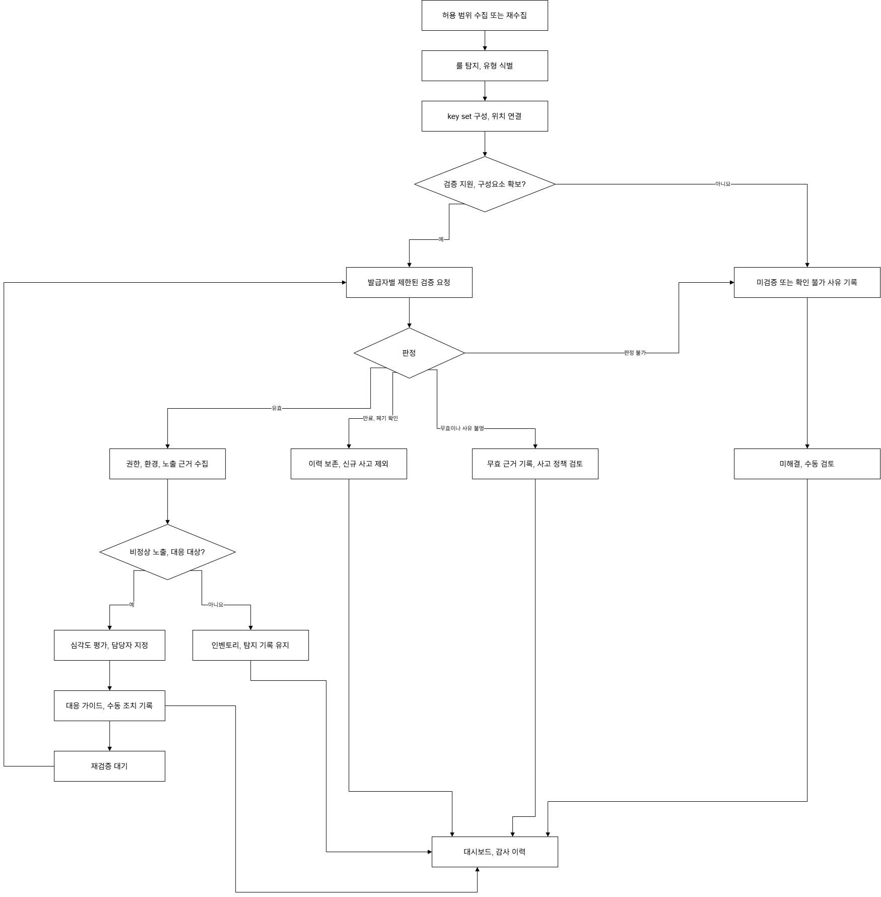

# 탐지에서 대응까지의 처리 흐름

기준: [PRD](../01-requirements/PRD.md), [전체 시스템 구성](system-overview.md)

그림은 허용 범위 수집부터 탐지, 유효성 판정, 영향 평가, 대응과 이력 기록까지의 분기를 보여준다. 기본 6시간마다 수집과 탐지를 다시 실행하고 해당 주기에 발견한 자격 증명을 검증한다. 수동 재검증은 정기 전체 검사와 별도로 요청할 수 있다.

## 단계별 입력과 기록

| 단계 | 입력과 처리 | 남길 정보 |
|---|---|---|
| 수집 | 승인된 연결의 파일, 문서, 설정, Secret 및 지원 메타데이터를 읽는다 | 실행 ID, 수집 위치와 범위, 시각, 성공, 실패, 누락 |
| 탐지와 정규화 | 룰로 후보를 찾고 키 유형과 구성요소를 식별해 key set 및 발견 위치를 연결한다 | 엔진과 룰 버전, 유형, 마스킹된 근거, 최초와 최근 발견 시각 |
| 검증 가능성 판단 | 유형별 검증 지원, 필수 구성요소, 원문 접근 가능 여부를 확인한다 | 미지원, 불완전 키, 원문 부재 등 미검증 사유 |
| 유효성 검증 | 발급자별 승인된 엔드포인트에서 제한된 요청을 수행한다 | VALID, INVALID, UNKNOWN, UNCHECKED, 사유, 시도 및 성공 시각 |
| 영향 평가 | 확인된 권한, 자원, 환경, 노출과 지원되는 사용 메타데이터를 연결한다 | 확인과 추정의 구분, 심각도 또는 미평가, 근거 시각 |
| 대응 | 비정상 노출이면 담당자를 지정하고 가이드, 외부 조치 기록, 재검증 요청을 제공한다 | 담당자, 조치 단계, 수행자, 변경 내용, 증거와 감사 이력 |

## 판정별 경로

- **검증 미지원 또는 구성요소 부족:** 미검증 또는 확인 불가 사유를 기록하고 수동 검토 대상으로 남긴다.
- **유효:** 권한과 노출 근거를 확인한다. 정상 보관 위치는 인벤토리와 탐지 이력으로 유지하고, 대응이 필요한 노출은 심각도를 평가해 담당자를 지정한다.
- **만료 또는 폐기 확인:** 근거와 발견 이력을 보존하고 신규 사고에서 제외한다. 기존 대응 건은 과거 악용이나 잔여 노출의 해결 근거 없이 자동 종결하지 않는다.
- **무효이나 사유 불명:** 무효 근거를 남기고 사고 정책에 따라 검토한다. 만료나 폐기로 추정하지 않는다.
- **판정 불가:** 공급자 오류, 호출 제한, 권한 부족 또는 통신 실패를 UNKNOWN으로 남긴다. 이전 성공 판정의 시각을 갱신하지 않는다.

담당자가 외부 시스템에서 조치한 뒤에는 재검증 대기를 표시한다. 승인된 수집 범위 전체를 기본 6시간 주기로 다시 읽고 후보 탐지와 발견한 자격 증명의 유효성 및 지원되는 사용 메타데이터 확인을 이어서 수행한다. 수동 재검증 요청이나 대응 버튼은 외부 키 변경 API를 호출하지 않는다.

화면에 표시할 독립 상태와 집계 규칙은 [기능 설계](../02-functional-design/workflow-and-states.md), 수집원과 유형별 검증 계약은 [수집원과 검증기 계약](source-and-validator-contract.md)을 따른다.
