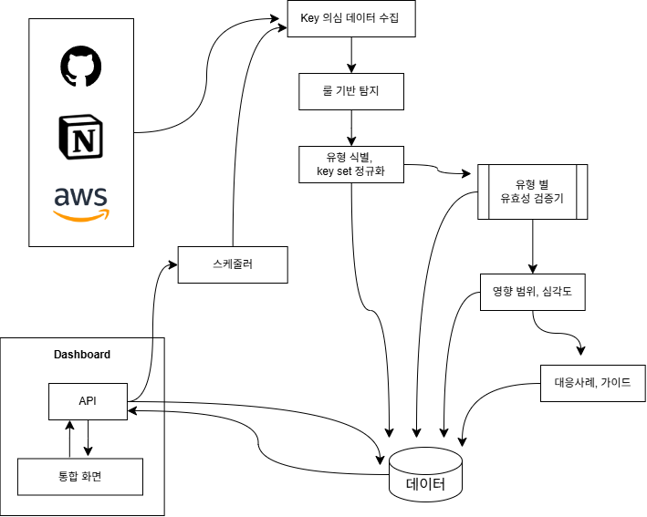

# 전체 시스템 구성

기준: [PRD](../01-requirements/PRD.md)

이 그림은 수집원부터 대시보드까지의 전체 구성과 주요 데이터 이동을 나타낸다. 각 상자는 논리 역할이며 독립 서비스나 물리 저장소의 수를 뜻하지 않는다.

실행 경계는 [ADR-S008](adr/ADR-S008.md)에 따라 React, TypeScript 화면, Java 21 Spring Boot API, 분리된 Java 수집 및 검증 워커, PostgreSQL로 구성한다. Gitleaks는 워커가 호출하는 룰 기반 탐지 실행 파일이다. 제품 기능을 Python 서비스로 구현하는 구조는 사용하지 않는다.

## 구성요소와 책임

| 구성요소 | 책임 | 경계 |
|---|---|---|
| 수집원과 수집기 | 승인된 AWS, GitHub, Notion, K8s 위치에서 콘텐츠와 메타데이터를 읽고 수집 범위, 성공, 실패, 누락을 기록 | 연결별 권한과 콘텐츠 범위를 구분한다. 같은 플랫폼이 코드 저장소, CI/CD, 배포 환경 또는 키 발급자 역할을 함께 할 수 있다. |
| 스케줄러 | 수집, 재수집, 유효성 재검사 작업을 요청하고 시도, 성공, 실패, 다음 예정과 지연을 추적 | 전체 재수집 주기와 기본 6시간 유효성 재검사 주기는 별개다. |
| 룰 기반 탐지와 정규화 | 자격 증명 후보를 찾고 유형, key set, 발견 위치를 연결 | 불완전 구성요소를 완전한 키로 표시하지 않고 동일 키의 여러 위치를 보존한다. |
| 유형별 검증기 | 발급자와 키 유형에 맞는 승인된 방법으로 유효성을 확인 | 발견 위치와 발급자를 구분한다. 검증 불가는 무효로 바꾸지 않으며 외부 키를 변경하지 않는다. |
| 영향 평가 | 확인된 주체, 권한, 자원, 노출 환경과 사용 메타데이터를 바탕으로 심각도를 산정 | 인증 성공만으로 실제 업무 사용이나 침해를 단정하지 않고 근거 부족은 미평가로 남긴다. |
| 대응 사례와 가이드 | 담당자 지정, 절차 안내, 체크리스트, 외부 조치 기록, 재검증 요청을 관리 | 제품에서 외부 키 교체, 폐기, 재발급 또는 권한 변경을 직접 실행하지 않는다. |
| 데이터와 대시보드 API | 탐지, 검증, 평가, 대응 이력을 연결하고 권한에 맞는 결과를 화면에 제공 | 그림의 데이터 원통은 논리 저장 영역이다. 발견한 원문은 영속 보관하지 않으며 단일 DB나 모든 단계의 직접 쓰기 권한을 뜻하지 않는다. |

## 그림에서 생략된 경계

그림 왼쪽에는 GitHub, Notion, AWS만 표시되어 있다. PRD의 초기 범위에는 **K8s 내부 Secret 수집**도 포함된다. K8s는 다른 수집원과 같은 승인 범위 관리 및 수집 실패 기록을 거쳐 탐지 단계로 들어간다.  

수집용 연결 자격 증명과 발견된 비밀은 별도 접근 경계로 다룬다. 발견한 원문은 영속 보관하지 않고 화면, 일반 API 조회 응답, 일반 DB 필드, 로그와 AI 입력으로 전달하지 않는다. 재취득 및 검증 경계는 [ADR-S005](adr/ADR-S005.md)를 따른다.

처리 단계별 분기와 재검증 흐름은 [처리 흐름](processing-flow.md), 결정별 근거와 남은 선택은 [ADR 목록](adr/README.md)에 둔다.
