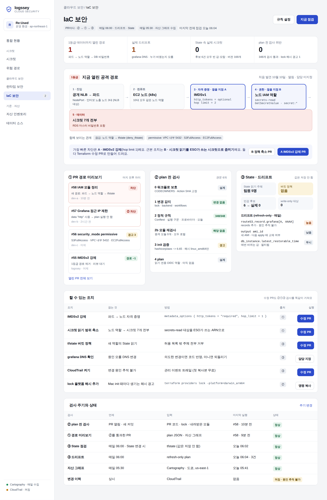
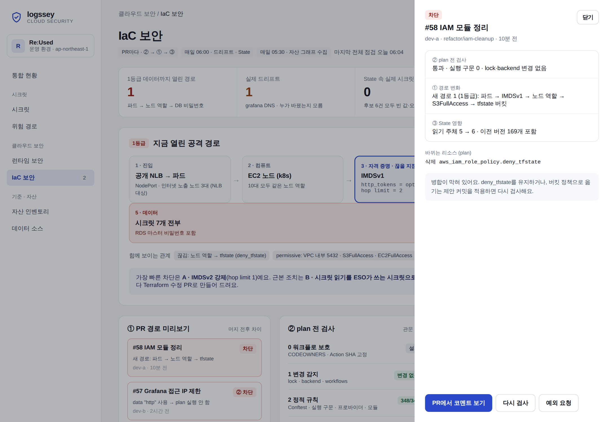
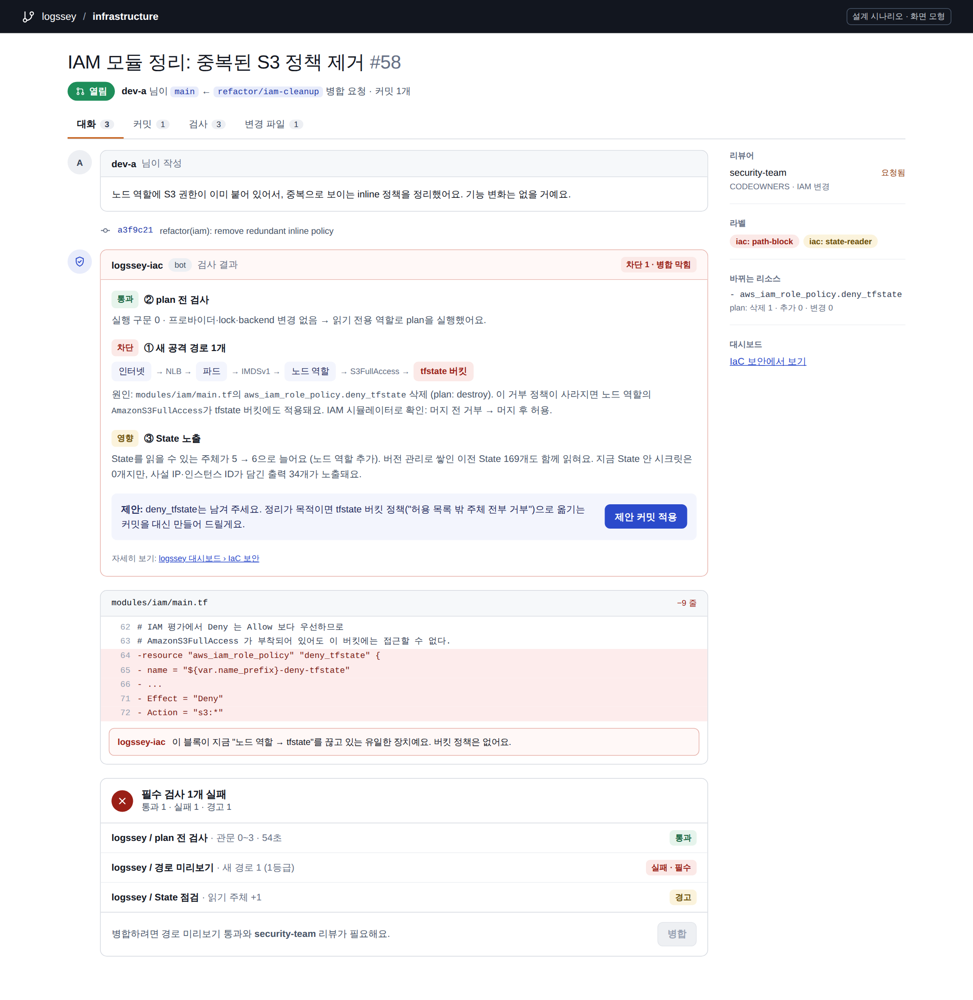

# 화면 설계서

## 공통: 심각도 표시

**모든 발견 건에 강도 배지와 심각도 배지를 함께 표시.** 강도·심각도 기준은 [규칙 명세](rule-spec.md)를 따름.

- 강도 배지(차단·경고·정보)는 PR에서 무슨 일이 일어나는지, 심각도 배지(CRITICAL·HIGH·MEDIUM·LOW)는 위험 크기를 보여줌
- 심각도 배지는 Secret과 같은 통합 대시보드 공통 배지 컴포넌트를 씀
- 심각도 "없음"(실행 오류·개선)은 심각도 배지를 표시하지 않고 위험 집계에서 뺌
- 통합 현황에는 IaC 열린 발견 건의 CRITICAL·HIGH·MEDIUM·LOW 건수를 Secret과 같은 형식으로 제공 (`GET /summary`의 심각도별 건수)
- 아래 시안 3장은 심각도 도입 전에 만든 것이라 심각도 배지가 없음. 구현 때 이 절의 규칙을 따름

## S-01 IaC 보안 탭

**통합 대시보드의 클라우드 보안 › IaC 보안 한 화면에서 "지금 열린 위험 → 들어오는 PR → 할 수 있는 조치"를 위에서 아래로 표시.**

- 색·글꼴은 통합 대시보드 테마를 따름
- 화면 수치는 10/6~10/10 점검 결과, PR 목록은 시나리오
- 구현: dashboard-frontend `src/iac/` (10/21). 아래 표는 구현 기준

| 영역 | 표시 내용 | 데이터 (API) | 동작 |
|---|---|---|---|
| A 상단 상태줄 | 검사 주기 태그, 마지막 전체 점검 시각, 그래프 기준 시각 | `GET /summary` | 지금 점검(`POST /jobs/{job}/trigger`로 `enrich-graph`·`check-state` 등록. 수집·드리프트는 배포 전이라 제외), 규칙 보기(레포 `policy/` 링크, 변경은 PR로만) |
| B 지표 4개 | 1등급까지 열린 경로, 실제 드리프트, State 속 실제 시크릿, ② 위반(main 기준). 지표 아래에 열린 발견 건의 심각도별 건수 | `GET /summary` | 누르면 해당 영역(C 경로, F State·드리프트, E ② 검사) 제목으로 스크롤하고 포커스를 옮김. 키보드로도 같음 |
| C 지금 열린 공격 경로 | 단계별 경로(진입 → 컴퓨트 → 자격 증명 → 권한 → 데이터), 경로의 심각도와 대상 등급 | `GET /paths?status=OPEN`, `GET /paths/{pathId}` | "끊을 지점"을 누르면 오른쪽 패널에 단계와 끊을 수 있는 관계, 관계별 수정 방법 안내. 수정 PR 생성은 다음 단계(FR-D2) |
| D ① PR 경로 미리보기 | PR별 최신 커밋의 판정(차단·경고·정보·통과, 판정 전이면 실행 상태), 가장 높은 심각도, 변화(경로 +N·경로 −N·State 읽기 주체 증가), 대표 규칙 이름. 경로 수는 S-02의 "사라진 경로 N개"와 같게 세고, 같은 자격 증명으로 묶이면 갈래 수를 덧붙임(예: 경로 −60 (1갈래)). 대표 규칙에는 경로 없는 ① 발견 건(`path.imds_v1_added`)도 포함 최근 50개 | `GET /prs` | "상세"를 누르면 S-02 패널 |
| E ② plan 전 검사 | 관문 5개(0-1, 2, 2b, 3, 4. 0과 1은 `gate.sh`에서 한 단계)별 main 위반 수, 최근 7일 PR 차단 수, 관문의 규칙 이름과 공급망 요약(main 기준). main 검사 기록이 없으면 0 대신 "기록 없음" | `GET /gates` | 없음 |
| F ③ State·드리프트 | tfstate 버킷별 읽기 주체, 버킷 정책, 민감 후보 → 실제(아직 계산 안 해 —), 드리프트 목록(높음·중간·낮음, 주소·바뀐 속성 이름, 노이즈는 숨김) | `GET /state/summary`, `GET /drifts?status=OPEN` | 드리프트 담당 지정(`PATCH /findings/{id}`): MVP는 "내가 맡기"·"담당 해제"만. 다른 사람 지정은 사용자 목록 API가 생기면 |
| G 할 수 있는 조치 | 조치, 끊는 경로 수(1등급 수), 방법, 출처(① 경로·③ State) | `GET /remediations/suggested` | 없음 (방법 안내만). 담당 지정·명령 복사는 조치에 발견 건 ID·명령이 없어 다음 단계. 수정 PR은 다음 단계(FR-D2) |
| H 검사 주기와 상태 | 작업별 주기, 입력, 마지막 실행, 상태(CloudTrail 포함) | `GET /jobs` | 없음 (주기는 gitops의 CronJob에서 변경) |

**표시 규칙**

- 강도 색: 차단·1등급 = 빨강, 경고·높음 = 주황, 정보·낮음 = 회색, 경로 감소·정상 = 초록. 색만으로 구분하지 않고 글자를 함께 표시
- 심각도 색: 통합 대시보드 공통 배지 색을 따름. 강도 배지 옆에 글자와 함께 표시
- 자산 그래프가 24시간보다 오래되면 상단에 "기준 시각" 경고
- 빈 상태: 열린 경로가 없으면 "1등급 데이터까지 열린 경로 없음 · 마지막 계산 시각" 표시
- 시크릿 값은 어느 영역에도 표시 안 함. 주소·속성 이름·개수만
- 아직 계산하지 않는 값은 0이 아니라 — 로 표시 (0은 "없음"으로 읽힘)

## S-02 PR 상세 패널

**S-01에서 PR을 누르면 오른쪽에 열리는 패널.**

- 대시보드는 판정을 보고 조치하는 곳이고, 리뷰와 병합은 PR에서 함
- 데이터는 `GET /prs/{number}` 하나로 채움

| 항목 | 내용 |
|---|---|
| 머리 | 판정 배지, 가장 높은 심각도, PR 번호, 커밋, 마지막 검사 시각. 제목은 API가 받게 되면 표시 (작성자·브랜치는 표시 안 함, GitHub에서 확인) |
| ② plan 전 검사 | 통과 또는 차단 규칙과 위치, 규칙별 심각도 |
| ① 경로 변화 | 경로 없는 ① 발견 건(IMDSv1 인스턴스 추가)과 원인 리소스, 새로 생긴·짧아진 경로와 원인 리소스(변경 종류), IAM 시뮬레이터 판정, 경로별 심각도. 사라진 경로는 "사라진 경로 N개"로 접어 둠 (② 차단이면 "계산 안 함") |
| ③ State 영향 | State 읽기 주체 변화, 민감 값 추가 여부 |
| 바뀌는 리소스 | plan의 추가·변경·삭제 수 (주소는 ① 원인 리소스로 표시, plan 원문은 표시 안 함) |
| 다음 할 일 | 걸린 규칙별 템플릿 문구 (`ruleId`로 화면이 만듦) |
| 버튼 | 닫기, PR에서 보기(GitHub 링크, 레포 이름은 고정하고 번호만 받아 만듦). 다시 검사는 두지 않음: 재실행은 GitHub에서 하고 대시보드는 읽기 전용(GitHub App에 Actions 쓰기 권한 없음). 예외 요청(`POST /exceptions`)은 다음 단계(FR-D3) |

## S-03 PR 코멘트·검사 결과 (GitHub)

**PR 화면에는 검사 결과 3개, 요약 코멘트 1개, 원인 코드 줄 코멘트가 붙음.**

- 모두 logssey GitHub App이 등록
- 아래는 #58 시나리오 모형(GitHub 화면 구조만 참고, 브랜드 요소 없음)
- 시안의 "제안 커밋 적용" 버튼은 수정 PR 생성 기능이라 다음 단계(FR-D2). MVP 코멘트에는 제안 문구만 표시

| 요소 | 규칙 |
|---|---|
| 검사 `logssey / plan 전 검사` | 차단 규칙 1개 이상이면 실패. 필수 검사 |
| 검사 `logssey / 경로 미리보기` | 1등급 새 경로면 실패, 경고만 있으면 중립, 없으면 성공. 필수 검사. ②에서 막혔으면 "건너뜀"이 아니라 실패로 등록(필수 검사가 비어 병합되는 것 방지) |
| 검사 `logssey / State 점검` | State 읽기 주체 증가·민감 값 추가면 중립(경고). 필수 아님 |
| 요약 코멘트 | 순서: 요약 배지 → ② → ①(경로, 원인 파일·리소스, 시뮬레이터 근거) → ③ → 제안 → 대시보드 링크. 항목마다 강도와 심각도를 함께 표시. 숨은 표식 `<!-- logssey-iac -->`으로 찾아 새 커밋마다 덮어씀 |
| 코드 줄 코멘트 | 차단 원인이 된 리소스의 변경 줄에만 한 개씩 |
| 라벨·리뷰어 | `iac:path-block`, `iac:state-reader`, `iac:lock-changed`. IAM·backend·워크플로 등 지정 경로 변경은 CODEOWNERS로 security-team 리뷰 필수. 그 밖의 경로에서 차단이 나오면 App이 security-team에 리뷰를 요청 |

| 항목 | 내용 |
|---|---|
| 작성자 | Jay(김종민) |
| 작성일 | 2026-10-12 |
| 수정일 | 2026-11-04 |
