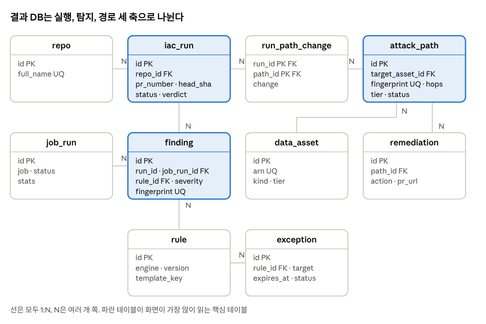

# ERD

## 개요

**IaC 결과는 대시보드 PostgreSQL에 `iac_` 테이블로 추가하고, 기존 `dashboard_users`·`assets`와 FK로 연결.** 자산 그래프는 별도 Neo4j에 두고, 여기에는 판정 결과와 이력만 저장.

- 구현 위치: [dashboard-backend](https://github.com/Logssey/dashboard-backend)의 Flyway 후속 마이그레이션 `V{n}__create_iac_tables.sql`. 기존 `V1`은 수정하지 않음 (ADR-11)
- 같은 방식을 쓰는 [Secret 스키마](../../secret-management/03-architecture/database-schema.md)와 규약을 맞춤
    - 테이블 이름은 `iac_` 접두사
    - PK는 `BIGINT GENERATED ALWAYS AS IDENTITY`, 시각은 `TIMESTAMPTZ`
    - 값 목록은 대문자 `VARCHAR` + `CHECK` (기존 `detection_events`와 같음). API도 같은 값을 그대로 반환
- 확인한 기존 스키마: `dashboard-backend`의 `V1__create_tables.sql` (`dashboard_users`, `assets`, `detection_events`)



## 기존 스키마와 경계

| 기존 테이블 | IaC에서 쓰는 방식 |
|---|---|
| `dashboard_users` | 담당자, 수동 실행 요청자, 감사 행위자의 FK 대상. 현재 역할은 `ADMIN` 하나 |
| `assets` | 데이터 등급표(`iac_data_assets`)가 기존 자산과 명확히 대응할 때만 선택적으로 연결 |
| `detection_events` | 쓰지 않음. 통합 현황은 API가 `detection_events`, Secret, IaC 조회 결과를 합성 (Secret과 같은 방식) |

## 테이블 구성

| 축 | 테이블 | 역할 |
|---|---|---|
| 기준 | `iac_repos`, `iac_rules`, `iac_data_assets` | 검사 대상 레포, 규칙 등록부, 데이터 등급표 |
| 실행 | `iac_runs`, `iac_jobs`, `iac_plan_payloads` | PR 검사 1회, 워커 작업 대기열, 분석 전 임시 plan JSON |
| 결과 | `iac_findings`, `iac_attack_paths`, `iac_run_path_changes` | 탐지 결과, 현재 열린 경로, PR이 만든 경로 차이 |
| 기록 | `iac_audit_events` | 변경·실행 감사 기록 (추가 전용) |
| 다음 단계 | `iac_remediations`, `iac_exceptions` | 수정 PR(FR-D2), 예외(FR-D3). MVP에서는 만들지 않음 |

**설계에서 고친 점** (이전 초안 대비)

- 경로 차이: PR이 새로 만드는 경로는 아직 현재 그래프에 없음. 그래서 `iac_run_path_changes`가 경로 내용(`hops`, 등급, 심각도, 원인)을 직접 저장하고, `path_id`는 기존 경로를 없애거나 줄일 때만 채움
- 작업 대기열: API가 받은 plan JSON을 Java 워커가 가져가도록 `iac_jobs`(PostgreSQL 대기열, `FOR UPDATE SKIP LOCKED`)를 둠. Secret의 `secret_jobs`와 같은 방식
- plan JSON 보관: 분석 전까지 `iac_plan_payloads`에만 두고, 분석이 끝나거나 1시간이 지나면 행을 삭제 (SR-5)
- 담당자·감사 행위자: 자유 텍스트 대신 `dashboard_users` FK

## 테이블 정의

### 기준

| 테이블 | 컬럼 | 제약과 의미 |
|---|---|---|
| `iac_repos` | `repo_id BIGINT PK`, `full_name VARCHAR(200) NOT NULL UQ`, `default_branch VARCHAR(100) NOT NULL`, `environment VARCHAR(10) NOT NULL`, `enabled BOOLEAN NOT NULL`, `created_at TIMESTAMPTZ NOT NULL` | 검사 대상 레포 허용 목록. `environment`는 `PROD`, `DEV`. CI OIDC의 `repository` 클레임을 여기서 대조 |
| `iac_rules` | `rule_id VARCHAR(80) PK`, `engine VARCHAR(20) NOT NULL`, `default_enforcement VARCHAR(10) NOT NULL`, `default_severity VARCHAR(10)`, `template_key VARCHAR(80) NOT NULL`, `version VARCHAR(40) NOT NULL`, `enabled BOOLEAN NOT NULL`, `updated_at TIMESTAMPTZ NOT NULL` | 규칙 등록부. 원본은 레포의 `policy/`이고 배포 때 이 표로 동기화. `rule_id`는 `gate.exec_data_source` 같은 식별자. `engine`은 `CONFTEST`, `GIT`, `TERRAFORM`, `HASH`, `KICS`, `PATH`, `STATE`, `DRIFT` |
| `iac_data_assets` | `data_asset_id BIGINT PK`, `arn VARCHAR(300) NOT NULL UQ`, `kind VARCHAR(20) NOT NULL`, `tier SMALLINT NOT NULL`, `asset_id BIGINT FK`, `owner_team VARCHAR(50)`, `updated_at TIMESTAMPTZ NOT NULL` | 데이터 등급표. `kind`는 `RDS`, `SECRET`, `S3`, `TFSTATE`. `CHECK(tier BETWEEN 1 AND 3)`. `asset_id`는 기존 `assets`와 대응할 때만. 환경마다 값이 달라 마이그레이션에 넣지 않고 SQL로 등록 (로컬은 dashboard-backend `iac-worker/local/register-prod-assets.sql`, 12개). 등록 API·화면은 MVP에 없음 |

### 실행

| 테이블 | 컬럼 | 제약과 의미 |
|---|---|---|
| `iac_runs` | `run_id BIGINT PK`, `repo_id BIGINT NOT NULL FK`, `pr_number INTEGER`, `head_sha VARCHAR(40) NOT NULL`, `trigger_type VARCHAR(10) NOT NULL`, `status VARCHAR(20) NOT NULL`, `verdict VARCHAR(10)`, `highest_severity VARCHAR(10)`, `graph_as_of TIMESTAMPTZ`, `superseded_by_run_id BIGINT FK`, `requested_by_user_id BIGINT FK`, `created_at TIMESTAMPTZ NOT NULL`, `finished_at TIMESTAMPTZ` | PR 검사 1회. `trigger_type`은 `PR`, `PUSH`(main 병합 후 ② 재검사), `MANUAL`(대시보드 재검사). `status`는 API 명세의 실행 상태와 같음. `verdict`는 `BLOCK`, `WARN`, `INFO`, `PASS`. `CHECK(trigger_type <> 'PR' OR pr_number IS NOT NULL)` |
| `iac_jobs` | `job_id BIGINT PK`, `kind VARCHAR(20) NOT NULL`, `trigger_type VARCHAR(10) NOT NULL`, `run_id BIGINT FK`, `requested_by_user_id BIGINT FK`, `status VARCHAR(20) NOT NULL`, `attempt_no INTEGER NOT NULL`, `max_attempts INTEGER NOT NULL`, `available_at TIMESTAMPTZ NOT NULL`, `lease_owner VARCHAR(120)`, `lease_until TIMESTAMPTZ`, `stats JSONB`, `last_error_code VARCHAR(80)`, `created_at TIMESTAMPTZ NOT NULL`, `finished_at TIMESTAMPTZ` | 워커 작업과 매일 작업 기록. `kind`는 `ANALYZE_RUN`, `COLLECT_GRAPH`, `ENRICH_GRAPH`, `CHECK_DRIFT`, `CHECK_STATE`. `ANALYZE_RUN`이면 `run_id` 필수. `status`는 `PENDING`, `LEASED`, `SUCCEEDED`, `FAILED`, `CANCELLED`. `trigger_type`은 `SCHEDULED`, `MANUAL`, `PR` |
| `iac_plan_payloads` | `run_id BIGINT PK FK`, `content BYTEA NOT NULL`, `size_bytes INTEGER NOT NULL`, `received_at TIMESTAMPTZ NOT NULL`, `expires_at TIMESTAMPTZ NOT NULL` | 민감값을 지운 plan JSON(gzip). `CHECK(size_bytes <= 20971520)`. 분석이 끝나거나 `expires_at`이 지나면 행 삭제 |

### 결과

| 테이블 | 컬럼 | 제약과 의미 |
|---|---|---|
| `iac_findings` | `finding_id BIGINT PK`, `rule_id VARCHAR(80) NOT NULL FK`, `source VARCHAR(10) NOT NULL`, `enforcement VARCHAR(10) NOT NULL`, `severity VARCHAR(10)`, `environment VARCHAR(10) NOT NULL`, `resource_address VARCHAR(500)`, `params JSONB NOT NULL`, `fingerprint VARCHAR(64) NOT NULL UQ`, `last_run_id BIGINT FK`, `last_job_id BIGINT FK`, `status VARCHAR(10) NOT NULL`, `assignee_user_id BIGINT FK`, `version BIGINT NOT NULL`, `first_seen_at`, `last_seen_at TIMESTAMPTZ NOT NULL` | 모든 탐지 결과. `source`는 `GATE`, `RULE`, `PATH`, `STATE`, `DRIFT`. `status`는 `OPEN`, `FIXED`, `ACCEPTED`. `CHECK(last_run_id IS NOT NULL OR last_job_id IS NOT NULL)`. `params`에는 속성 이름·개수만, 값 없음. `version`은 담당 지정 등 변경 시 낙관적 잠금 |
| `iac_attack_paths` | `path_id BIGINT PK`, `fingerprint VARCHAR(64) NOT NULL UQ`, `entry VARCHAR(200) NOT NULL`, `target_data_asset_id BIGINT NOT NULL FK`, `tier SMALLINT NOT NULL`, `severity VARCHAR(10) NOT NULL`, `environment VARCHAR(10) NOT NULL`, `hops JSONB NOT NULL`, `length SMALLINT NOT NULL`, `status VARCHAR(10) NOT NULL`, `last_job_id BIGINT FK`, `first_seen_at`, `last_seen_at TIMESTAMPTZ NOT NULL` | 현재 그래프에서 열린 경로. S-01 C. `status`는 `OPEN`, `CLOSED`. `fingerprint`는 진입+단계+대상의 해시. `hops`는 단계 배열 `[{kind, id, name}]` (`kind`는 Cartography 라벨, `id`는 ARN) |
| `iac_run_path_changes` | `change_id BIGINT PK`, `run_id BIGINT NOT NULL FK`, `change VARCHAR(10) NOT NULL`, `rule_id VARCHAR(80) NOT NULL FK`, `path_id BIGINT FK`, `path_fingerprint VARCHAR(64) NOT NULL`, `tier SMALLINT NOT NULL`, `severity VARCHAR(10)`, `hops JSONB NOT NULL`, `cause_address VARCHAR(500)`, `evidence JSONB` | PR이 만든 경로 차이. S-02 ①. `change`는 `ADDED`, `REMOVED`, `SHORTENED`. `UQ(run_id, path_fingerprint)`. `ADDED`면 `path_id`는 NULL. `rule_id`는 이 변화가 걸린 규칙(`path.tier1.added`, `path.removed` 등). PR 목록의 대표 사유와 다음 할 일에 씀. `hops`는 `iac_attack_paths`와 같은 모양. `evidence`에는 IAM 시뮬레이터 판정(`simulator.before`·`after`: `explicitDeny`, `allowed` 등)과 원인 변경 종류(`causeAction`: `CREATE`, `UPDATE`, `DELETE`, `REPLACE`)만 |

### 기록

| 테이블 | 컬럼 | 제약과 의미 |
|---|---|---|
| `iac_audit_events` | `audit_id BIGINT PK`, `actor_kind VARCHAR(10) NOT NULL`, `actor_user_id BIGINT FK`, `entity_type VARCHAR(30) NOT NULL`, `entity_id BIGINT NOT NULL`, `event_type VARCHAR(50) NOT NULL`, `before_safe JSONB`, `after_safe JSONB`, `occurred_at TIMESTAMPTZ NOT NULL` | 재검사·지금 점검·담당 지정 등 변경 기록 (SR-10). `actor_kind`는 `USER`, `CI`, `WORKER`, `SYSTEM`. 일반 API 계정에는 UPDATE·DELETE 권한을 주지 않음 |

### 다음 단계 (MVP 제외)

| 테이블 | 컬럼 | 제약과 의미 |
|---|---|---|
| `iac_remediations` | `remediation_id BIGINT PK`, `action VARCHAR(30) NOT NULL`, `path_id BIGINT FK`, `finding_id BIGINT FK`, `pr_number INTEGER`, `pr_url VARCHAR(300)`, `status VARCHAR(20) NOT NULL`, `created_by_user_id BIGINT NOT NULL FK`, `created_at TIMESTAMPTZ NOT NULL` | 수정 PR 생성 이력 (FR-D2). `action`은 API 명세의 값 목록 |
| `iac_exceptions` | `exception_id BIGINT PK`, `rule_id VARCHAR(80) NOT NULL FK`, `target VARCHAR(500) NOT NULL`, `reason TEXT NOT NULL`, `requested_by_user_id BIGINT NOT NULL FK`, `approved_by_user_id BIGINT FK`, `status VARCHAR(10) NOT NULL`, `expires_at TIMESTAMPTZ NOT NULL`, `created_at TIMESTAMPTZ NOT NULL` | 예외 (FR-D3). 만료되면 다시 판정에 포함. 승인 권한 분리는 역할 확장과 함께 |

### 강도·심각도 컬럼

| 컬럼 | 값 | 기준 |
|---|---|---|
| `iac_rules.default_enforcement`, `iac_findings.enforcement` | `BLOCK`, `WARN`, `INFO`, `IGNORE` | 규칙 명세의 강도 |
| `iac_rules.default_severity`, `iac_findings.severity`, `iac_attack_paths.severity`, `iac_run_path_changes.severity`, `iac_runs.highest_severity` | `CRITICAL`, `HIGH`, `MEDIUM`, `LOW`, 없음은 NULL | 규칙 명세의 심각도. NULL은 위험 집계에서 제외 |

## 통합 현황 집계 기준

- 집계 대상: 운영 기준 결과만
    - `iac_attack_paths`에서 `status = 'OPEN'`인 경로
    - `iac_findings`에서 `status = 'OPEN'`이고 `severity IS NOT NULL`이며 `last_job_id`가 있는 것 (매일 작업·main 기준 결과)
- 열린 PR의 결과는 아직 병합 전이라 통합 현황 건수에 넣지 않음. IaC 탭의 PR 영역에서만 표시
- `environment`는 대시보드 공통 쿼리 `environment` 필터에 그대로 씀

## 중복 방지와 수명

- `fingerprint`는 같은 문제가 매일·PR마다 새 행으로 쌓이지 않게 하는 키
    - PR 결과: `rule_id` + `resource_address` + 레포 + PR 번호의 해시
    - 매일 작업 결과: `rule_id` + `resource_address` + 레포 + `MAIN`의 해시
- 같은 지문이면 `last_seen_at`과 `last_run_id`·`last_job_id`만 갱신
- 다음 실행에서 안 보이면 `FIXED`(탐지)·`CLOSED`(경로)로 변경
- PR이 병합·종료되면 그 PR의 열린 결과를 `FIXED`로 닫음

## DB 계정과 접근 경계

| 계정 | 권한 |
|---|---|
| API (dashboard-backend) | IaC 테이블 조회, `iac_runs`·`iac_jobs`·`iac_plan_payloads` 쓰기, `iac_findings`의 담당·상태 변경, `iac_audit_events` 추가 |
| 워커 (Java) | `iac_jobs` 선점·완료, `iac_plan_payloads` 읽기·삭제, 결과 테이블 적재, `iac_audit_events` 추가 |

- 두 계정 모두 `iac_audit_events`의 UPDATE·DELETE 권한 없음
- 저장 위치(운영 DB 서버)는 ADR-D005를 따름. 이 문서는 테이블과 접근 경계만 정함

## DDL 초안

구현 때 `V{n}__create_iac_tables.sql`로 옮김. 번호는 Secret 마이그레이션과의 순서를 보고 정함. 다음 단계 테이블 두 개는 넣지 않음.

```sql
-- IaC 보안 테이블 (설계: security-solution-docs/iac-security/03-architecture/database-schema.md)

CREATE TABLE iac_repos (
    repo_id         BIGINT GENERATED ALWAYS AS IDENTITY PRIMARY KEY,
    full_name       VARCHAR(200) NOT NULL UNIQUE,
    default_branch  VARCHAR(100) NOT NULL,
    environment     VARCHAR(10)  NOT NULL CHECK (environment IN ('PROD', 'DEV')),
    enabled         BOOLEAN      NOT NULL DEFAULT TRUE,
    created_at      TIMESTAMPTZ  NOT NULL DEFAULT now()
);

CREATE TABLE iac_rules (
    rule_id              VARCHAR(80) PRIMARY KEY,
    engine               VARCHAR(20) NOT NULL CHECK (engine IN ('CONFTEST', 'GIT', 'TERRAFORM', 'HASH', 'KICS', 'PATH', 'STATE', 'DRIFT')),
    default_enforcement  VARCHAR(10) NOT NULL CHECK (default_enforcement IN ('BLOCK', 'WARN', 'INFO', 'IGNORE')),
    default_severity     VARCHAR(10) CHECK (default_severity IN ('CRITICAL', 'HIGH', 'MEDIUM', 'LOW')),
    template_key         VARCHAR(80) NOT NULL,
    version              VARCHAR(40) NOT NULL,
    enabled              BOOLEAN     NOT NULL DEFAULT TRUE,
    updated_at           TIMESTAMPTZ NOT NULL DEFAULT now()
);

CREATE TABLE iac_data_assets (
    data_asset_id  BIGINT GENERATED ALWAYS AS IDENTITY PRIMARY KEY,
    arn            VARCHAR(300) NOT NULL UNIQUE,
    kind           VARCHAR(20)  NOT NULL CHECK (kind IN ('RDS', 'SECRET', 'S3', 'TFSTATE')),
    tier           SMALLINT     NOT NULL CHECK (tier BETWEEN 1 AND 3),
    asset_id       BIGINT REFERENCES assets (asset_id) ON DELETE SET NULL,
    owner_team     VARCHAR(50),
    updated_at     TIMESTAMPTZ  NOT NULL DEFAULT now()
);

CREATE TABLE iac_runs (
    run_id                BIGINT GENERATED ALWAYS AS IDENTITY PRIMARY KEY,
    repo_id               BIGINT      NOT NULL REFERENCES iac_repos (repo_id),
    pr_number             INTEGER,
    head_sha              VARCHAR(40) NOT NULL,
    trigger_type          VARCHAR(10) NOT NULL CHECK (trigger_type IN ('PR', 'PUSH', 'MANUAL')),
    status                VARCHAR(20) NOT NULL CHECK (status IN ('QUEUED', 'GATE_FAILED', 'PLANNING', 'ANALYZING', 'DONE', 'ERROR', 'SUPERSEDED')),
    verdict               VARCHAR(10) CHECK (verdict IN ('BLOCK', 'WARN', 'INFO', 'PASS')),
    highest_severity      VARCHAR(10) CHECK (highest_severity IN ('CRITICAL', 'HIGH', 'MEDIUM', 'LOW')),
    graph_as_of           TIMESTAMPTZ,
    superseded_by_run_id  BIGINT REFERENCES iac_runs (run_id),
    requested_by_user_id  BIGINT REFERENCES dashboard_users (user_id),
    created_at            TIMESTAMPTZ NOT NULL DEFAULT now(),
    finished_at           TIMESTAMPTZ,
    CHECK (trigger_type <> 'PR' OR pr_number IS NOT NULL)
);

CREATE INDEX idx_iac_runs_repo_pr ON iac_runs (repo_id, pr_number, created_at DESC);

CREATE TABLE iac_jobs (
    job_id                BIGINT GENERATED ALWAYS AS IDENTITY PRIMARY KEY,
    kind                  VARCHAR(20) NOT NULL CHECK (kind IN ('ANALYZE_RUN', 'COLLECT_GRAPH', 'ENRICH_GRAPH', 'CHECK_DRIFT', 'CHECK_STATE')),
    trigger_type          VARCHAR(10) NOT NULL CHECK (trigger_type IN ('SCHEDULED', 'MANUAL', 'PR')),
    run_id                BIGINT REFERENCES iac_runs (run_id),
    requested_by_user_id  BIGINT REFERENCES dashboard_users (user_id),
    status                VARCHAR(20) NOT NULL DEFAULT 'PENDING' CHECK (status IN ('PENDING', 'LEASED', 'SUCCEEDED', 'FAILED', 'CANCELLED')),
    attempt_no            INTEGER     NOT NULL DEFAULT 0,
    max_attempts          INTEGER     NOT NULL DEFAULT 3,
    available_at          TIMESTAMPTZ NOT NULL DEFAULT now(),
    lease_owner           VARCHAR(120),
    lease_until           TIMESTAMPTZ,
    stats                 JSONB,
    last_error_code       VARCHAR(80),
    created_at            TIMESTAMPTZ NOT NULL DEFAULT now(),
    finished_at           TIMESTAMPTZ,
    CHECK (kind <> 'ANALYZE_RUN' OR run_id IS NOT NULL),
    CHECK (attempt_no >= 0 AND max_attempts > 0)
);

CREATE INDEX idx_iac_jobs_pending ON iac_jobs (available_at) WHERE status = 'PENDING';

CREATE TABLE iac_plan_payloads (
    run_id       BIGINT      PRIMARY KEY REFERENCES iac_runs (run_id) ON DELETE CASCADE,
    content      BYTEA       NOT NULL,
    size_bytes   INTEGER     NOT NULL CHECK (size_bytes <= 20971520),
    received_at  TIMESTAMPTZ NOT NULL DEFAULT now(),
    expires_at   TIMESTAMPTZ NOT NULL
);

CREATE TABLE iac_findings (
    finding_id        BIGINT GENERATED ALWAYS AS IDENTITY PRIMARY KEY,
    rule_id           VARCHAR(80)  NOT NULL REFERENCES iac_rules (rule_id),
    source            VARCHAR(10)  NOT NULL CHECK (source IN ('GATE', 'RULE', 'PATH', 'STATE', 'DRIFT')),
    enforcement       VARCHAR(10)  NOT NULL CHECK (enforcement IN ('BLOCK', 'WARN', 'INFO', 'IGNORE')),
    severity          VARCHAR(10)  CHECK (severity IN ('CRITICAL', 'HIGH', 'MEDIUM', 'LOW')),
    environment       VARCHAR(10)  NOT NULL CHECK (environment IN ('PROD', 'DEV')),
    resource_address  VARCHAR(500),
    params            JSONB        NOT NULL DEFAULT '{}',
    fingerprint       VARCHAR(64)  NOT NULL UNIQUE,
    last_run_id       BIGINT REFERENCES iac_runs (run_id),
    last_job_id       BIGINT REFERENCES iac_jobs (job_id),
    status            VARCHAR(10)  NOT NULL DEFAULT 'OPEN' CHECK (status IN ('OPEN', 'FIXED', 'ACCEPTED')),
    assignee_user_id  BIGINT REFERENCES dashboard_users (user_id),
    version           BIGINT       NOT NULL DEFAULT 0,
    first_seen_at     TIMESTAMPTZ  NOT NULL,
    last_seen_at      TIMESTAMPTZ  NOT NULL,
    CHECK (last_run_id IS NOT NULL OR last_job_id IS NOT NULL)
);

CREATE INDEX idx_iac_findings_open ON iac_findings (status, severity);

CREATE TABLE iac_attack_paths (
    path_id               BIGINT GENERATED ALWAYS AS IDENTITY PRIMARY KEY,
    fingerprint           VARCHAR(64)  NOT NULL UNIQUE,
    entry                 VARCHAR(200) NOT NULL,
    target_data_asset_id  BIGINT       NOT NULL REFERENCES iac_data_assets (data_asset_id),
    tier                  SMALLINT     NOT NULL CHECK (tier BETWEEN 1 AND 3),
    severity              VARCHAR(10)  NOT NULL CHECK (severity IN ('CRITICAL', 'HIGH', 'MEDIUM', 'LOW')),
    environment           VARCHAR(10)  NOT NULL CHECK (environment IN ('PROD', 'DEV')),
    hops                  JSONB        NOT NULL,
    length                SMALLINT     NOT NULL,
    status                VARCHAR(10)  NOT NULL DEFAULT 'OPEN' CHECK (status IN ('OPEN', 'CLOSED')),
    last_job_id           BIGINT REFERENCES iac_jobs (job_id),
    first_seen_at         TIMESTAMPTZ  NOT NULL,
    last_seen_at          TIMESTAMPTZ  NOT NULL
);

CREATE TABLE iac_run_path_changes (
    change_id         BIGINT GENERATED ALWAYS AS IDENTITY PRIMARY KEY,
    run_id            BIGINT      NOT NULL REFERENCES iac_runs (run_id) ON DELETE CASCADE,
    change            VARCHAR(10) NOT NULL CHECK (change IN ('ADDED', 'REMOVED', 'SHORTENED')),
    rule_id           VARCHAR(80) NOT NULL REFERENCES iac_rules (rule_id),
    path_id           BIGINT REFERENCES iac_attack_paths (path_id),
    path_fingerprint  VARCHAR(64) NOT NULL,
    tier              SMALLINT    NOT NULL CHECK (tier BETWEEN 1 AND 3),
    severity          VARCHAR(10) CHECK (severity IN ('CRITICAL', 'HIGH', 'MEDIUM', 'LOW')),
    hops              JSONB       NOT NULL,
    cause_address     VARCHAR(500),
    evidence          JSONB,
    UNIQUE (run_id, path_fingerprint),
    CHECK (change <> 'ADDED' OR path_id IS NULL)
);

CREATE TABLE iac_audit_events (
    audit_id       BIGINT GENERATED ALWAYS AS IDENTITY PRIMARY KEY,
    actor_kind     VARCHAR(10) NOT NULL CHECK (actor_kind IN ('USER', 'CI', 'WORKER', 'SYSTEM')),
    actor_user_id  BIGINT REFERENCES dashboard_users (user_id),
    entity_type    VARCHAR(30) NOT NULL,
    entity_id      BIGINT      NOT NULL,
    event_type     VARCHAR(50) NOT NULL,
    before_safe    JSONB,
    after_safe     JSONB,
    occurred_at    TIMESTAMPTZ NOT NULL DEFAULT now(),
    CHECK (actor_kind <> 'USER' OR actor_user_id IS NOT NULL)
);
```

- 구현 검증: 빈 DB와 기존 `V1` 위 적용, 잘못된 FK·값 거부, 같은 지문 중복 거부, 큐 동시 선점 시 한 워커만 작업을 가져가는지, plan JSON 행이 분석 후 남지 않는지 확인

## 그래프 스키마 (Neo4j)

**노드·관계는 대부분 Cartography 것을 그대로 사용하고, 경로 계산에 빠진 관계 4개와 가상 노드 1개만 보강.** Neo4j는 PostgreSQL과 따로 두는 그래프 저장소 (ADR-10).

- 보강 관계에는 `_source = 'logssey'`와 `lastupdated`를 붙여 Cartography 관계와 구분하고, 다음 실행에서 확인 안 된 것은 삭제
- 라벨은 공식 스키마 기준(AWS 접두). 10/7 수집에서는 `EC2Instance`·`S3Bucket` 같은 이전 라벨도 함께 붙어 있었음
- 데이터 노드의 등급(`tier`)은 `iac_data_assets`를 기준으로 매일 보강 단계에서 그래프에 붙임
- 노드→EC2 연결 (10/13 확인): Kubespray 노드 6개 모두 `providerID`가 비어 있어 Cartography가 `IS_INSTANCE`를 만들지 못함. `KubernetesNode`에는 IP 속성도 없으므로, 보강 단계에서 k8s API로 노드 InternalIP를 읽어 `AWSEC2Instance.privateipaddress`와 매칭해 `IS_INSTANCE`를 추가
- 매일 수집은 AWS와 Kubernetes 모듈을 함께 실행 (10/10 수집은 `--selected-modules aws`라 Kubernetes 노드·파드가 빠져 있었음)

| 구분 | 이름 | 출처 |
|---|---|---|
| 노드 | `AWSEC2Instance`, `AWSRole`, `AWSInstanceProfile`, `AWSPolicy`, `AWSPolicyStatement`, `AWSS3Bucket`, `AWSRDSInstance`, `AWSLoadBalancerV2`, `AWSEC2SecurityGroup`, `AWSCloudFrontDistribution`, `AWSSecretsManagerSecret` | Cartography AWS 모듈 |
| 노드 | `KubernetesCluster`, `KubernetesNode`, `KubernetesPod` | Cartography Kubernetes 모듈 |
| 노드 | `LogsseyInternet` (가상 노드 1개, `id = 'internet'`, 경로 출발점. `hops`에는 `kind: Internet`으로 나감) | logssey 보강 |
| 관계 | `INSTANCE_PROFILE`, `ASSOCIATED_WITH`, `POLICY`, `STATEMENT`, `EXPOSE`(LB→EC2), `MEMBER_OF_EC2_SECURITY_GROUP`, `RUNS_ON`(파드→노드), `IS_INSTANCE`(노드→EC2, `providerID` 기준. 현재 클러스터에서는 만들어지지 않음, 아래 보강으로 대체) | Cartography |
| 관계 | `CAN_READ`·`CAN_WRITE`(주체→S3·시크릿, 거부 반영) | Cartography 권한 매핑 + 사용자 정의 매핑 파일 |
| 관계 | `ORIGIN`(CloudFront→LB), `HAS_CREDS_OF`(EC2→역할, IMDS 조건), `CAN_REACH {port}`(네트워크 도달), `IS_INSTANCE` 대체(노드 InternalIP ↔ `AWSEC2Instance.privateipaddress` 매칭) | logssey 보강 |

- `ORIGIN`: Cartography의 CloudFront 노드에는 origin이 없어, 보강 단계에서 AWS API(`cloudfront:ListDistributions`, 읽기 전용)로 배포별 origin 도메인을 읽음. 그 도메인이 LB의 `dnsname`과 같거나, 같은 이름의 Route53 레코드가 LB를 가리키면(`DNS_POINTS_TO`) 연결
- 경로 쿼리는 `LogsseyInternet`에서 출발해 `tier`가 붙은 데이터 노드까지 최대 6단계 탐색, 결과는 `iac_attack_paths`에 저장
- PR 분석은 이 그래프를 워커 메모리에 읽어 둔 스냅샷에 plan 변경을 얹어 계산하고 원본은 수정 안 함. 결과는 `iac_run_path_changes`에 저장

| 항목 | 내용 |
|---|---|
| 작성자 | Jay(김종민) |
| 작성일 | 2026-10-12 |
| 수정일 | 2026-10-21 |
