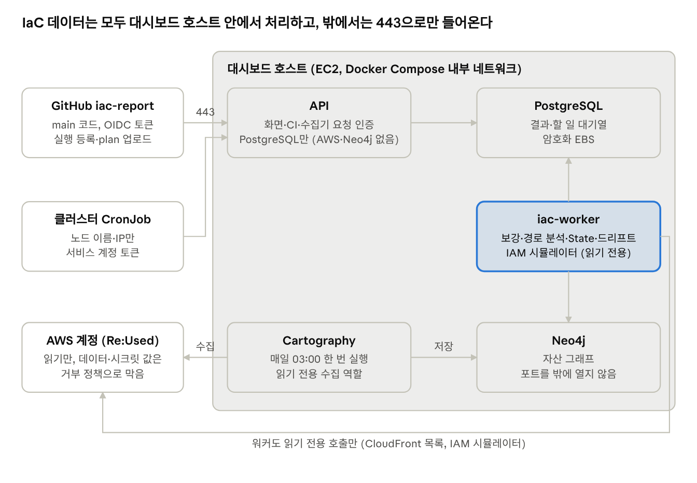
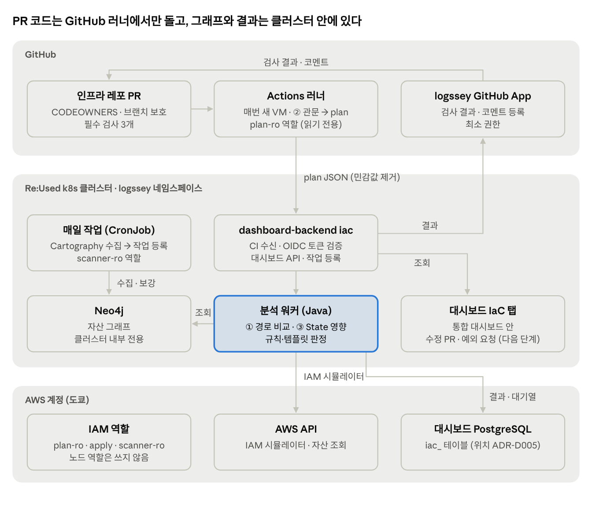

# 아키텍처 설계서

## 구성 요소

**원칙 두 가지**

- PR 코드는 매번 새로 뜨는 GitHub 러너에서만 실행
- 그래프와 결과는 대시보드 호스트 내부에만 보관 (11/17 ADR-13. 이전 설계는 클러스터 내부)

악성 PR이 실행돼도 대시보드 호스트와 그래프에는 닿지 못함.

**구현 위치**: 별도 서비스를 만들지 않고 기존 대시보드 백엔드(dashboard-backend, Spring Boot)에 `iac` 모듈로 통합. 분석만 별도 Java 워커로 분리 (ADR-11). Secret과 같은 구조.

| 구성 요소 | 위치 | 역할 |
|---|---|---|
| 인프라 레포 | GitHub | Terraform 코드, CODEOWNERS, 브랜치 보호(필수 검사) |
| PR 워크플로 | GitHub 호스티드 러너 | plan 전 검사 관문(Conftest, 변경 감지, init 검증) → plan(plan-ro 역할) → 민감값을 지운 plan JSON 업로드 |
| 로컬 plan 래퍼 | 개발자 PC, 컨테이너 | `make plan`: CI와 같은 plan 전 검사(2b 포함) → 홈 디렉터리 없는 컨테이너에서 읽기 전용 임시 키로 plan. 강제가 아니라 기본 경로 (ADR-12, [위협 모델·범위](../01-requirements/threat-model.md)) |
| logssey GitHub App | GitHub | 검사 결과, 요약 코멘트 등록. 개인 키는 main 전용 environment(`iac-app`)의 secret. `iac-report`(main 코드)만 사용 |
| 결과 전송 (`iac-report`) | GitHub 호스티드 러너, main 코드 | iac-gate가 끝나면 아티팩트를 검사하고, GitHub OIDC 토큰(aud `logssey-iac`)으로 API에 실행 등록·plan 업로드. 분석이 끝나면 "경로 분석" 검사·코멘트 등록 (ADR-13) |
| dashboard-backend `iac` 모듈 | 대시보드 호스트, 기존 API 컨테이너 | `/api/v1/iac`. CI 요청(GitHub OIDC 토큰 검증), 쿠버네티스 노드 정보(서비스 계정 토큰 검증), 대시보드 API(로그인 세션), `iac_jobs`에 작업 등록. 밖에서는 대시보드 ALB(`logssey.re-used.store`)로만 들어옴. Neo4j·AWS 권한 없음 |
| 분석 워커 (Java) | 대시보드 호스트, 별도 컨테이너 | `iac_jobs`에서 작업을 가져가 경로 비교, State 영향, 그래프 보강, IAM 시뮬레이터 호출. 결과는 DB에만 씀 |
| Cartography | 대시보드 호스트, 매일 03:00 작업 컨테이너 | AWS 수집(외부 도구, AWS 모듈만). 끝나면 보강·드리프트·State 점검 작업을 등록 |
| 노드 정보 CronJob | k8s, 작은 CronJob | 노드 이름·내부 IP·providerID만 API로 보냄 (노드 ↔ EC2 연결용) |
| Neo4j | 대시보드 호스트, 내부 네트워크만 | 자산 그래프 (Cartography에 맞춰 5.x). 포트를 밖에 열지 않음 |
| 결과 DB | 대시보드 PostgreSQL의 `iac_` 테이블 | 실행, 작업 대기열, 판정, 경로, 드리프트 ([ERD](database-schema.md)). 대시보드 호스트의 PostgreSQL (ADR-D010) |
| IAM 역할 | AWS | plan-ro(PR, 읽기 전용), apply(main 머지 후, 팀 일정), 수집용·워커용 IaC 역할(대시보드 호스트 역할이 받음, 읽기 전용) |
| 대시보드 화면 | 기존 logssey 대시보드 프런트엔드 | 클라우드 보안 › IaC 보안 탭 |

## 배포 구조 (11/17, ADR-13)

IaC 데이터는 모두 대시보드 호스트 안에서 처리하고, 밖에서는 443으로 API에만 들어온다.

- 호스트는 들어오는 연결을 열지 않음. GitHub(`iac-report`)와 클러스터(노드 정보 CronJob)는 ALB를 거쳐 API로만 보내고, 각각 GitHub OIDC·서비스 계정 토큰으로 인증함
- AWS에는 Cartography와 워커가 읽기 전용 역할로만 나감. 데이터·시크릿 값 읽기는 거부 정책으로 막음
- API와 워커는 PostgreSQL 대기열(`iac_jobs`)로만 주고받고, DB 계정과 권한을 나눔

## 전체 아키텍처 (설계 당시, 10/13)

PR 코드는 GitHub 러너에서만 돌고, 그래프와 결과는 클러스터 안에 있다. **배포 위치는 위 배포 구조(ADR-13)가 대체**하고, PR → plan → 분석 → 결과의 흐름은 같다.

- 러너는 plan JSON만 보내고, 받는 쪽은 PR 코드를 실행하지 않음.
- AWS 자격 증명은 용도별 읽기 전용 역할로 나누고 노드 역할은 쓰지 않음.

## 데이터 흐름

PR 분석은 매일 보강한 그래프의 복사본 위에서 돈다.

- 매일 흐름이 만든 그래프를 PR 분석이 복사해서 쓰고, 원본 그래프는 바꾸지 않음.
- 드리프트로 현재 그래프를 먼저 보정해서, 콘솔에서 바꾼 것을 PR 탓으로 돌리지 않음.

| 데이터 | 만드는 곳 | 쓰는 곳 | 보관 |
|---|---|---|---|
| plan JSON (민감값 제거) | 러너 | 분석 워커 | `iac_plan_payloads`에 임시 보관, 분석 후 또는 1시간 뒤 삭제 |
| 자산 그래프 | 매일 작업 | 분석 워커, 대시보드 | Neo4j, 매일 갱신 |
| 분석 결과 | 분석 워커 | GitHub App, 대시보드 | `iac_findings`·`iac_run_path_changes`에 결과만 |
| 드리프트·State 결과 | 분석 워커 (매일 작업이 등록) | 대시보드 | `iac_findings`, 주소·속성 이름만 (값 없음) |

| 항목 | 내용 |
|---|---|
| 작성자 | Jay(김종민) |
| 작성일 | 2026-10-12 |
| 수정일 | 2026-11-17 |
