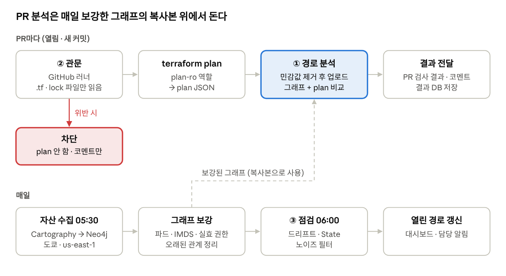

# 아키텍처 설계서

## 구성 요소

**원칙 두 가지**

- PR 코드는 매번 새로 뜨는 GitHub 러너에서만 실행
- 그래프와 결과는 클러스터 내부에만 보관

악성 PR이 실행돼도 클러스터와 그래프에는 닿지 못함.

**구현 위치**: 별도 서비스를 만들지 않고 기존 대시보드 백엔드(dashboard-backend, Spring Boot)에 `iac` 모듈로 통합. 분석만 별도 Java 워커로 분리 (ADR-11). Secret과 같은 구조.

| 구성 요소 | 위치 | 역할 |
|---|---|---|
| 인프라 레포 | GitHub | Terraform 코드, CODEOWNERS, 브랜치 보호(필수 검사) |
| PR 워크플로 | GitHub 호스티드 러너 | ② 관문(Conftest, 변경 감지, init 검증) → plan(plan-ro 역할) → 민감값을 지운 plan JSON 업로드 |
| logssey GitHub App | GitHub | 검사 결과 3개, 요약 코멘트, 코드 줄 코멘트 등록. 개인 키는 Secrets Manager에 보관 |
| dashboard-backend `iac` 모듈 | k8s, 기존 대시보드 백엔드 | `/api/v1/iac`. CI 요청 수신(GitHub OIDC 토큰 검증), 대시보드 API(세션 인증), `iac_jobs`에 분석 작업 등록. CI용 경로만 기존 CloudFront → 공개 NLB로 외부 노출 |
| 분석 워커 (Java) | k8s, API와 별도 Deployment | `iac_jobs`에서 작업을 가져가 ① 경로 비교, ③ State 영향, 그래프 보강, IAM 시뮬레이터 호출. 분석이 끝나면 GitHub App으로 검사 결과·코멘트 등록 |
| 매일 작업 (CronJob) | k8s | Cartography 수집(AWS + Kubernetes, 외부 도구) 후 보강·드리프트·State 점검 작업을 `iac_jobs`에 등록 (scanner-ro 역할) |
| Neo4j | k8s, 내부 전용 | 자산 그래프 (Cartography에 맞춰 5.x) |
| 결과 DB | 대시보드 PostgreSQL의 `iac_` 테이블 | 실행, 작업 대기열, 판정, 경로, 드리프트. 운영 DB 서버 위치는 ADR-D005 ([ERD](database-schema.md)) |
| IAM 역할 3개 | AWS | plan-ro(PR, 읽기 전용), apply(main 머지 후), scanner-ro(매일 작업, 읽기 전용) |
| 대시보드 화면 | 기존 logssey 대시보드 프런트엔드 | 클라우드 보안 › IaC 보안 탭 |

## 전체 아키텍처

PR 코드는 GitHub 러너에서만 돌고, 그래프와 결과는 클러스터 안에 있다.

- 러너는 plan JSON만 클러스터로 보내고, 클러스터는 PR 코드를 실행하지 않음.
- AWS 자격 증명은 용도별 읽기 전용 역할로 나누고 노드 역할은 쓰지 않음.
- 호스티드 러너가 dashboard-backend에 닿아야 하므로 CI용 경로는 외부에 열리고, OIDC 토큰 검증과 요청 제한으로 보호함.
- API와 워커는 PostgreSQL 대기열(`iac_jobs`)로만 주고받고, DB 계정과 권한을 나눔.

## 데이터 흐름

PR 분석은 매일 보강한 그래프의 복사본 위에서 돈다.

- 매일 흐름이 만든 그래프를 PR 분석이 복사해서 쓰고, 원본 그래프는 바꾸지 않음.
- 드리프트로 현재 그래프를 먼저 보정해서, 콘솔에서 바꾼 것을 PR 탓으로 돌리지 않음.

| 데이터 | 만드는 곳 | 쓰는 곳 | 보관 |
|---|---|---|---|
| plan JSON (민감값 제거) | 러너 | 분석 워커 | `iac_plan_payloads`에 임시 보관, 분석 후 또는 1시간 뒤 삭제 |
| 자산 그래프 | 매일 작업 | 분석 워커, 대시보드 | Neo4j, 매일 갱신 |
| 분석 결과 | 분석 워커 | GitHub App, 대시보드 | `iac_findings`·`iac_run_path_changes`에 결과만 |
| 드리프트·State 결과 | 분석 워커 (매일 작업이 등록) | 대시보드 | `iac_findings`, 주소·속성 이름만 (값 없음) |

| 항목 | 내용 |
|---|---|
| 작성자 | Jay(김종민) |
| 작성일 | 2026-10-12 |
