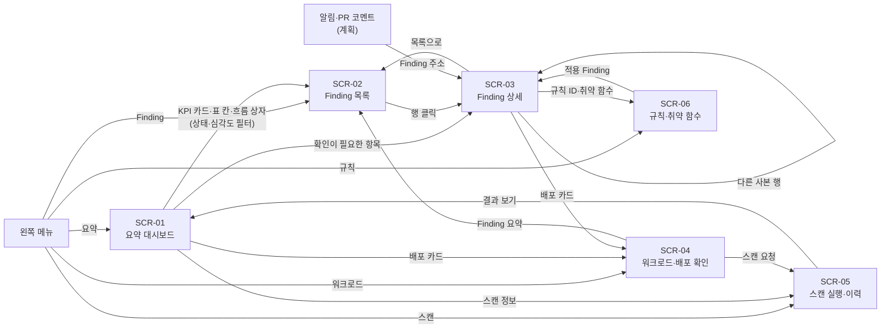
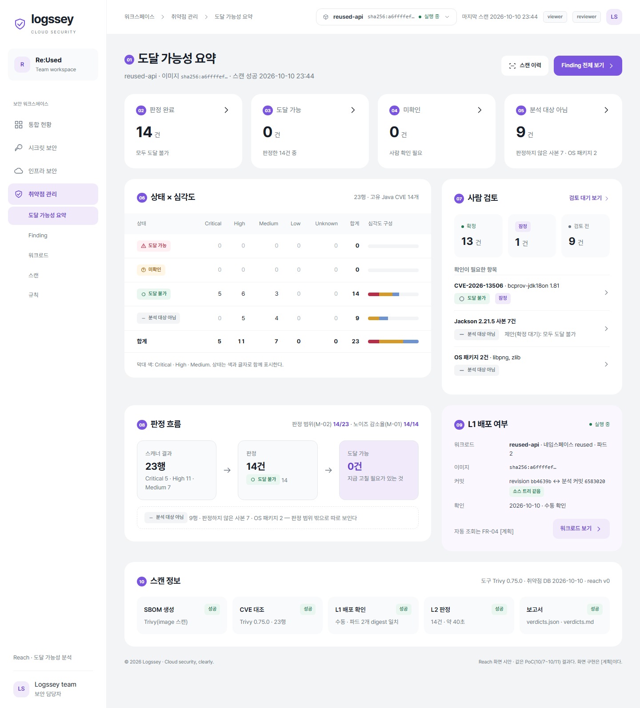
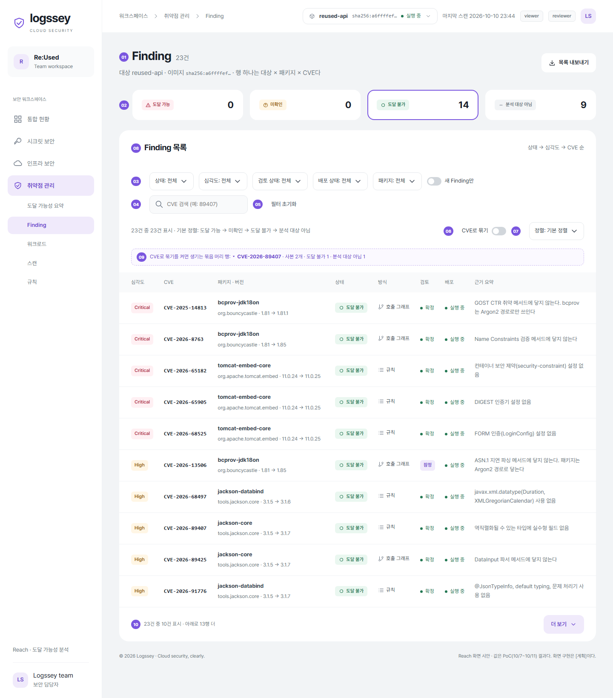
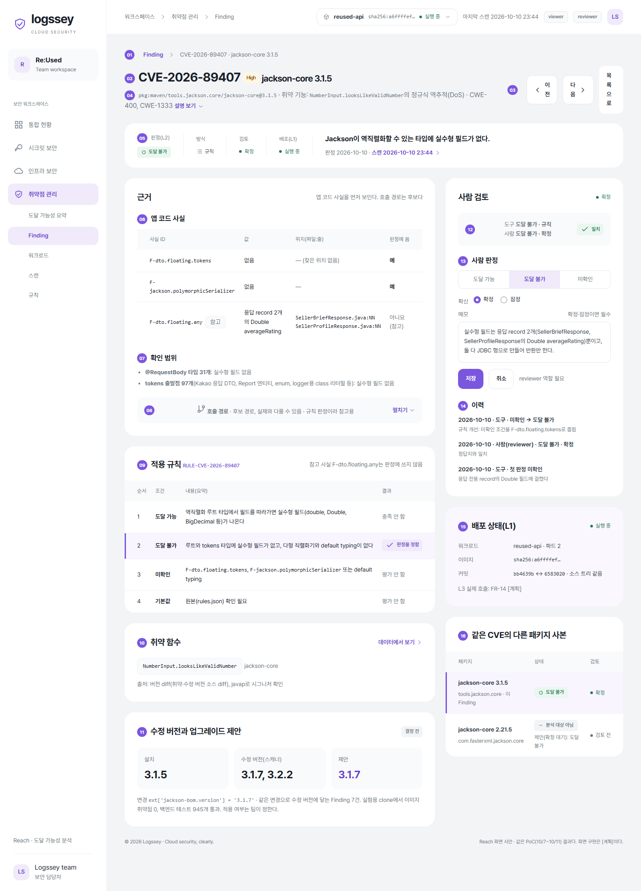
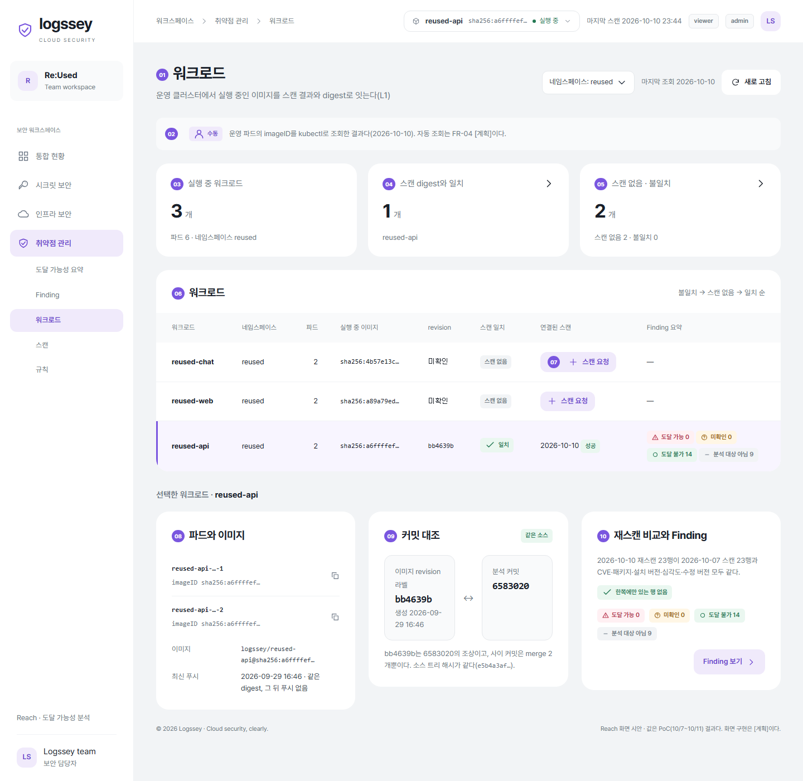
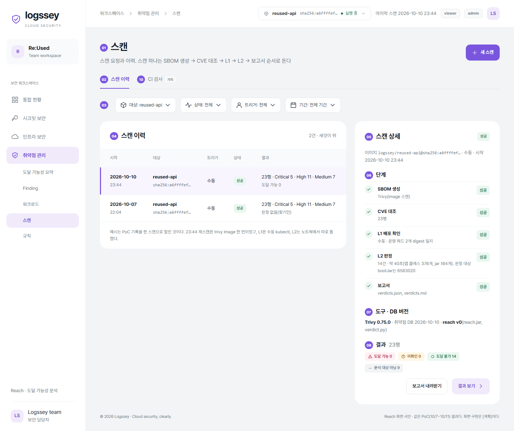
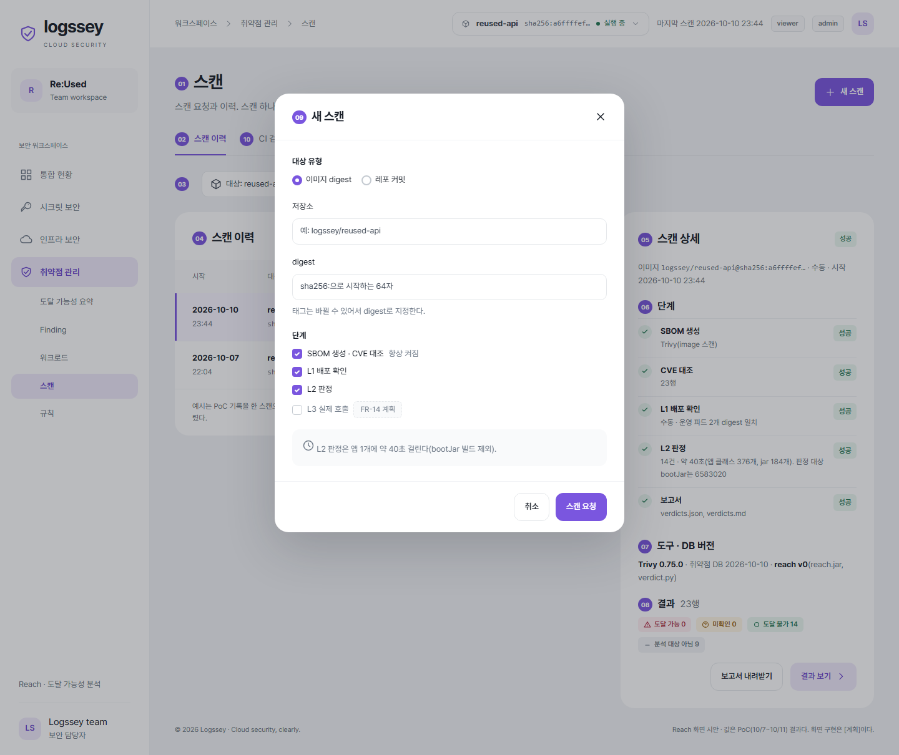
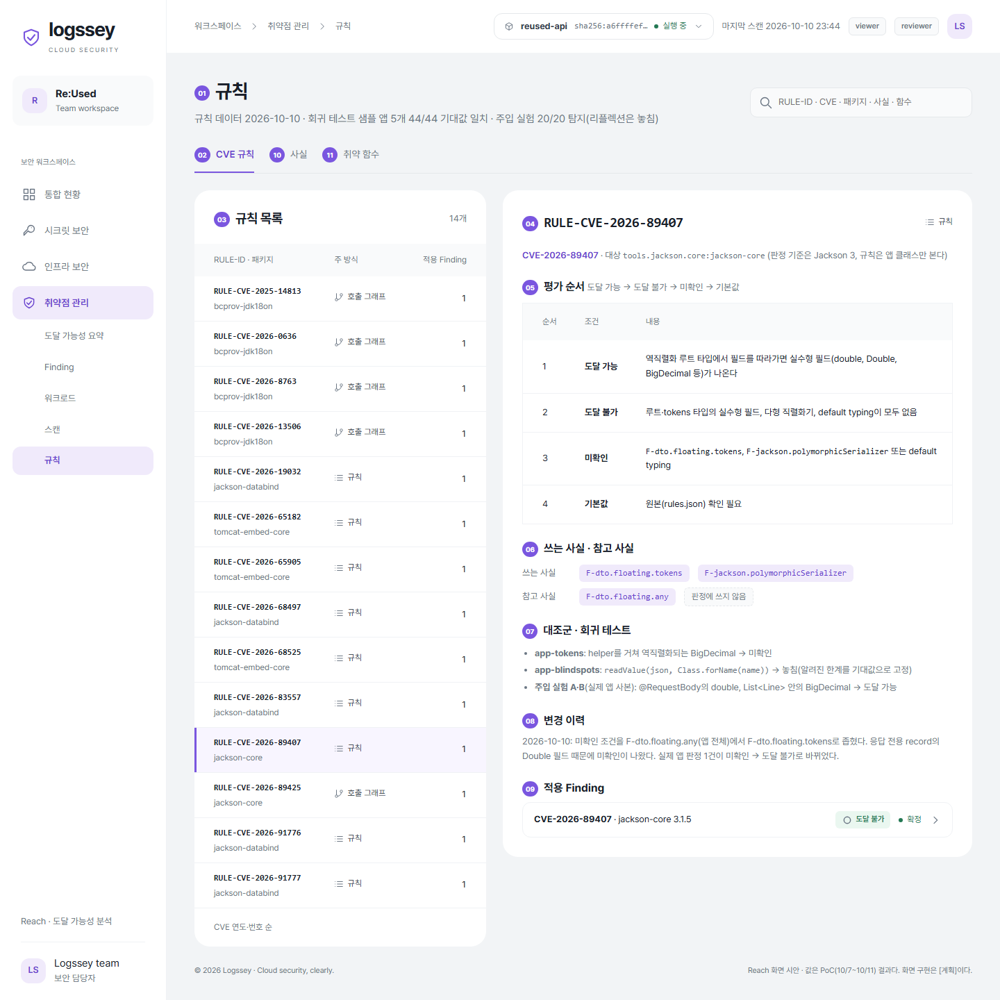

# 화면 명세서

**한 줄 요약**: Logssey 대시보드 안에 들어갈 Reach 화면 6개(SCR-01~06)가 무엇을, 어디에, 어떻게 보여 줄지 정한다. 화면은 모두 [계획]이다. 지금은 CLI와 스크립트가 같은 정보를 JSON과 Markdown 보고서로 낸다.

**상태 표기**: [완료] PoC로 구현·검증됨 / [부분] 일부만 구현되었거나 수동 / [계획] 아직 없음(설계)

## 1. 개요

### 1-1. 목적과 범위

- **목적**: 스캐너가 찾은 CVE 중 실제로 우리 코드에 닿는 것을 먼저 보게 한다. 판정마다 방식과 근거를 함께 보여 주고, 사람이 판정을 확정하거나 잠정으로 남기게 한다.
- **지금 상태**: Reach의 구현은 CLI와 스크립트다(reach.jar, verdict.py, run-reach.sh). 판정은 `verdicts.json`·`verdicts.md`에, PoC의 사람 판정은 `answer-key.md`(정답지)에 있다. 운영 화면의 사람 검토(`reviewState`)는 정답지와 다르다(PRD 1절 "용어와 공통 열거값", M-03). 이 문서는 같은 정보를 화면으로 옮기는 설계다.
- **범위**: Reach 화면 6개다. Logssey 공통 틀(로그인, 다른 모듈 메뉴, 공통 Finding 화면)은 범위 밖이다.
- **공통 틀과의 관계**: 로그인, 공통 레이아웃(상단 바, 왼쪽 메뉴), 통합 현황은 [대시보드 설계 문서](https://github.com/Logssey/dashboard-design-docs)가 정한다(ADR-D003, ADR-D007). Reach 화면은 그 안의 "취약점 관리" 메뉴에 들어간다. 이 문서는 Reach 화면의 본문과 하위 메뉴, 대상 선택을 정한다. 2-2의 COM-01~05는 공통 틀에 Reach가 필요로 하는 것을 적은 것이고, 공통 틀과 다르면 공통 틀을 따른다(미결 6). 화면은 API 필드 이름과 열거값을 그대로 쓰고 표시 글자만 바꾼다(대시보드 API 공통 규약 0.6).

**화면 원칙**

| 원칙 | 화면에서 하는 것 | 근거 |
|---|---|---|
| 결과를 지우지 않는다 | 도달 불가도 목록에 남긴다. 수정 버전도 계속 보여 준다. 도달 불가는 "삭제"가 아니라 "보류"다 | FR-07 |
| 확신이 없으면 미확인 | 미확인을 도달 불가와 섞지 않는다. KPI 카드와 필터를 따로 둔다 | NFR-01 |
| 모든 판정에 방식과 근거 | 판정 상태 옆에 방식 태그와 근거 요약을 항상 둔다 | NFR-02 |
| 사실 먼저, 경로는 후보 | 상세에서 앱 코드 사실(파일:줄)을 먼저 보여 준다. 호출 경로에는 "후보 경로, 실제와 다를 수 있음"을 붙인다 | FR-07 |
| 사본은 따로 | 같은 CVE라도 패키지 사본이 다르면 다른 행이다. 상세에서 다른 사본으로 바로 간다 | FR-07 |
| AI는 판정에 쓰지 않는다 | 판정·근거 영역에 AI가 만든 내용을 넣지 않는다 | NFR-04 |
| 색에 기대지 않는다 | 배지는 항상 글자와 함께 쓴다. 표와 차트는 숫자를 직접 쓴다 | 4절 |

### 1-2. 사용자와 권한

| 사용자 | 하는 일 | 주로 쓰는 화면 |
|---|---|---|
| 보안 담당자 | 대상별 판정을 보고 고칠 순서를 정한다. 판정을 확정하거나 잠정으로 남긴다. 스캔을 요청한다 | SCR-01, SCR-02, SCR-03, SCR-05 |
| 개발자 | 자기 서비스의 Finding, 근거, 수정 버전, 업그레이드 제안을 본다. PR 검사 결과를 본다 | SCR-02, SCR-03, SCR-05(CI 검사 탭, [계획]) |
| 인프라 운영자 | 실행 중인 워크로드가 스캔한 이미지와 같은지 본다 | SCR-04 |
| 규칙 작성자(보안 담당자) | CVE 규칙, 사실, 취약 함수 데이터를 확인한다 | SCR-06 |

권한은 대시보드 공통을 따른다(ADR-D003, API 명세서 2-2). MVP는 `ADMIN` 하나라 로그인한 사용자는 모든 화면을 보고 모든 동작을 쓴다.

| 동작 | MVP(`ADMIN`) | 역할을 나눈 뒤(다음 단계, 제안) |
|---|---|---|
| 모든 화면 조회 | 가능 | 조회 전용 역할도 가능 |
| 사람 검토 저장 (SCR-03, API-06) | 가능 | 검토자 역할만 |
| 스캔 요청·다시 실행 (SCR-05, API-01) | 가능 | 스캔 요청 역할만 |
| 스캔 요청 바로가기 (SCR-01 빈 상태, SCR-04) | 가능 | 스캔 요청 역할만 |

- 역할을 나누는 시점과 이름은 대시보드 공통 역할 체계와 함께 정한다(API 명세서 1-5). 그때를 위해 화면은 "권한이 없는 동작은 숨기지 않고 비활성으로 두고, 마우스를 올리거나 포커스를 주면 필요한 권한을 보여 준다"는 규칙을 지금부터 지킨다.
- CI는 대시보드 화면을 쓰지 않는다. CI 토큰으로는 조회 API와 사람 검토를 부를 수 없다(API 명세서 2-2).
- 로그인하지 않았으면 조회 API가 401이라 대시보드 공통 로그인으로 보낸다(2-4).
- 규칙과 취약 함수는 화면에서 고치지 않는다. 데이터 파일로 추가한다(NFR-07).

### 1-3. 화면 목록

여섯 화면 모두 [계획]이다. "지금 대응하는 것"은 화면이 생기기 전까지 같은 정보를 주는 CLI 산출물이다.

| ID | 화면 | 주 사용자 | 주요 API | 관련 FR | 지금 대응하는 것 | 주소(제안) |
|---|---|---|---|---|---|---|
| SCR-01 | 요약 대시보드 | 보안 담당자 | API-08, API-03 | FR-12 | `verdicts.md` 머리말 | `/reach` |
| SCR-02 | Finding 목록 | 보안 담당자, 개발자 | API-04 | FR-07, FR-12 | `verdicts.json`, `verdicts.md` | `/reach/findings` |
| SCR-03 | Finding 상세(판정 근거, 사람 검토 패널 포함) | 보안 담당자, 개발자 | API-05, API-06 | FR-05~08, FR-13 | `verdicts.json` 한 항목, `answer-key.md` | `/reach/findings/{findingId}` |
| SCR-04 | 워크로드·배포 확인(L1) | 인프라 운영자 | API-07 | FR-04, FR-15 | l1 스크립트, 수동 kubectl, `sca-eval/l1/result.md` | `/reach/workloads` |
| SCR-05 | 스캔 실행·이력 | 보안 담당자 | API-01~03, API-12 | FR-01, FR-11 | `run-reach.sh` | `/reach/scans` |
| SCR-06 | 규칙·취약 함수 데이터 | 규칙 작성자(보안 담당자) | API-09, API-10 | FR-06, FR-09 | `data/rules.json`, `data/vuln-functions.json` | `/reach/rules` |

- 필터, 정렬, 선택한 대상은 주소의 쿼리로 남긴다. 예: `/reach/findings?status=UNKNOWN&severity=HIGH`. 주소를 공유하면 같은 화면이 열린다.
- 주소는 제안이다. Logssey 공통 틀의 주소 규칙이 있으면 그것을 따른다.

### 1-4. 화면 흐름

- 상단 대상 선택(COM-02)을 바꾸면 SCR-01·SCR-02는 새 대상으로 다시 불러온다. SCR-03에서 바꾸면 그 Finding은 이전 대상에 묶여 있으므로 SCR-02로 간다.
- SCR-02에서 필터를 건 채로 SCR-03에 들어가면 [이전]·[다음]이 그 필터와 정렬 순서를 따른다. 불러온 행의 끝에서 [다음]을 누르면 `nextCursor`로 다음 행을 받는다. 주소로 바로 들어오면 두 버튼은 비활성이다.
- 알림, PR 코멘트, Logssey 공통 화면은 SCR-03 주소로 바로 들어온다. 이 진입은 FR-11 [계획]과 함께 생긴다.

## 2. 공통 레이아웃

### 2-1. 화면 틀 (1440×900)

데스크톱 1440×900을 기준으로 한다. 좌표는 화면 왼쪽 위가 (0, 0)이고 단위는 px다.

| 영역 | 위치(x, y) | 크기(폭×높이) | 내용 |
|---|---|---|---|
| 상단 바 (COM-01) | 0, 0 | 1440×56 | Logssey 로고, 모듈 이름 "Reach", 대상 선택, 마지막 스캔 시각, 사용자와 권한 |
| 왼쪽 메뉴 (COM-04) | 0, 56 | 220×844 | 요약 / Finding / 워크로드 / 스캔 / 규칙. 아래쪽에 배지·용어 안내 |
| 본문 | 220, 56 | 1220×844 | 안쪽 여백 24. 콘텐츠 폭 1172(x 244~1416) |
| 페이지 머리말 | 244, 80 | 1172×40 | 화면 제목(20px 굵게), 보조 정보(12px), 오른쪽 끝에 동작 버튼 |
| 콘텐츠 시작 | 244, 136 | 1172×가변 | 카드와 표. 아래 여백 24(y 876에서 끝나면 한 화면에 들어간다) |

- **격자**: 12열, 열 폭 83, 열 간격 16(12×83 + 11×16 = 1172). 자주 쓰는 폭은 3열 281(KPI 카드), 4열 380(오른쪽 보조 열), 8열 776(왼쪽 주 열), 12열 1172다. 두 열 화면은 왼쪽 열 x 244\~1020, 오른쪽 열 x 1036\~1416이다.
- **바탕**: 상단 바와 왼쪽 메뉴는 흰색에 1px 경계선. 본문 배경은 `#F9FAFB`. 카드는 흰색, 1px 테두리 `#EAECF0`, 모서리 8px, 안쪽 여백 16, 카드 사이 16. 카드 제목은 16px 굵게.
- **버튼**: 주 버튼은 배경 `#175CD3`에 흰 글자(5.99:1), 높이 36. 보조 버튼은 흰 배경, 테두리 `#D0D5DD`, 글자 `#344054`. 텍스트 버튼은 테두리 없이 글자만 쓴다.
- **스크롤**: 상단 바와 왼쪽 메뉴는 고정하고 본문만 스크롤한다. 표 머리 행은 스크롤해도 남는다. 표 안에 따로 스크롤을 두지 않는다.
- **번호 규칙**: 구성 요소 번호는 위에서 아래, 왼쪽에서 오른쪽 순서로 붙인다. 두 열 화면은 전체 폭 영역 다음에 왼쪽 열을 위에서 아래로, 그다음 오른쪽 열을 붙인다.

### 2-2. 공통 구성 요소

공통 구성 요소의 ID(COM-)는 이 문서 안에서만 쓴다.

| ID | 이름 | 위치·크기 | 내용 | 동작과 데이터 |
|---|---|---|---|---|
| COM-01 | 상단 바 | 0, 0 / 1440×56 | x 24부터 Logssey 로고(약 112×24), 세로 구분선, "Reach"(16px 굵게)와 그 아래 "도달 가능성 분석"(12px) | 로고 클릭 → Logssey 첫 화면(범위 밖). 모듈 이름은 누를 수 없다 |
| COM-02 | 대상 선택 | 상단 바 안 x 320, y 10 / 360×36 | 드롭다운. 닫힌 상태 글자: "reused-api · 이미지 sha256:a6ffffef…"와 배포 배지. 펼치면 앱별로 묶은 대상 목록 | 고르면 SCR-01·02를 새 대상으로 다시 부른다. 데이터: API-02의 대상별 최신 스캔(`target.displayName`, `target.type`, `target.image.digest` 또는 `target.repo.commit`). 배포 배지는 API-07에서 같은 digest의 `deployment`를 받는다. 대상 목록 API는 미결 7 |
| COM-03 | 마지막 스캔·사용자 | 상단 바 오른쪽 끝에서 24 안쪽 / 약 380×36 | "마지막 스캔 2026-10-10 23:44"(12px), 도움말 아이콘, 사용자 이름(대시보드 공통 틀의 사용자 표시) | MVP는 권한이 `ADMIN` 하나라 권한 배지를 두지 않는다. 역할을 나누면 배지를 더한다 |
| COM-04 | 왼쪽 메뉴 | 0, 56 / 220×844 | 위 여백 16, 항목 5개(각 높이 40, 아이콘 20 + 글자 14px): 요약, Finding, 워크로드, 스캔, 규칙. "Finding" 오른쪽에 도달 가능+미확인 건수 배지(예: 0). 현재 항목은 왼쪽 3px 막대 + 굵은 글자 + 배경 `#EEF4FF` | 클릭 → SCR-01, 02, 04, 05, 06. 건수 배지: API-08 `byStatus`의 `REACHABLE` + `UNKNOWN` |
| COM-05 | 배지·용어 안내 | 왼쪽 메뉴 아래쪽 x 12, y 852 / 196×32 | 텍스트 버튼 "배지·용어 안내" | 클릭 → 오른쪽에서 400px 패널이 열린다. 2-3 배지 표와 4-5 용어 표를 보여 준다 |
| COM-06 | 알림(토스트) | 오른쪽 위 x 1056, y 72 / 360×56 | 저장 성공, 요청 접수, 오류 같은 짧은 알림. 글자와 아이콘을 함께 쓴다 | 성공 알림은 5초 뒤 사라진다. 오류 알림은 닫을 때까지 남는다. 화면 낭독기에 알린다 |

### 2-3. 상태 배지

- 배지는 항상 글자를 쓴다. 색과 아이콘은 보조다. 회색조로 인쇄해도 글자와 모양으로 구분된다.
- 종류마다 모양이 다르다. 판정 상태 = 채운 알약, 검토 상태 = 테두리만 있는 알약, 배포 상태 = 채운 알약과 작은 원, 심각도 = 네모 칩과 왼쪽 4px 막대, 판정 방식 = 회색 네모 태그, 스캔 상태 = 채운 알약.
- 배지 높이는 표 안 22px(글자 12px 굵게), 상세의 판정 요약 28px(글자 14px 굵게)이다. 아이콘은 글자 왼쪽에 12px로 둔다.
- 글자와 배경의 대비는 모두 4.5:1 이상이다. 테두리·막대는 흰 배경 대비 3:1 이상이다. 아래 대비 값은 WCAG 공식으로 계산해 확인했다.

| 필드 | 값 | 화면 글자 | 모양·아이콘 | 글자색 / 배경 | 대비 |
|---|---|---|---|---|---|
| `status` | `REACHABLE` | 도달 가능 | 채운 알약, 느낌표 삼각형 | `#B42318` / `#FEE4E2` | 5.45:1 |
| `status` | `UNKNOWN` | 미확인 | 채운 알약, 물음표 | `#93370D` / `#FEF0C7` | 6.62:1 |
| `status` | `UNREACHABLE` | 도달 불가 | 채운 알약, 빈 원(경로 없음) | `#05603A` / `#D1FADF` | 6.73:1 |
| `status` | `NOT_ANALYZED` | 분석 대상 아님 | 점선 테두리(`#667085`) 알약, 가로줄 | `#475467` / `#F2F4F7` | 6.98:1 |
| `method` | `CALLGRAPH` | 호출 그래프 | 회색 네모 태그, 갈래 아이콘 | `#344054` / `#F9FAFB` | 10.01:1 |
| `method` | `RULE` | 규칙 | 회색 네모 태그, 목록 아이콘. 툴팁 "설정·타입 규칙" | `#344054` / `#F9FAFB` | 10.01:1 |
| `method` | `MANUAL` | 사람 | 회색 네모 태그, 사람 아이콘 | `#344054` / `#F9FAFB` | 10.01:1 |
| `reviewState` | `UNREVIEWED` | 검토 전 | 테두리(`#667085`) 알약, 빈 원 | `#475467` / `#FFFFFF` | 7.69:1 |
| `reviewState` | `PROVISIONAL` | 잠정 | 테두리(`#B54708`) 알약, 반쯤 찬 원 | `#93370D` / `#FFFFFF` | 7.52:1 |
| `reviewState` | `CONFIRMED` | 확정 | 테두리(`#175CD3`) 알약, 체크 | `#1849A9` / `#FFFFFF` | 8.19:1 |
| `deployment` | `RUNNING` | 실행 중 | 채운 알약, 채운 원 | `#3538CD` / `#EEF4FF` | 7.32:1 |
| `deployment` | `NOT_RUNNING` | 실행 안 함 | 채운 알약, 빈 원 | `#475467` / `#F2F4F7` | 6.98:1 |
| `deployment` | `UNKNOWN` | 확인 못 함 | 점선 테두리(`#667085`) 알약, 물음표 | `#475467` / `#FFFFFF` | 7.69:1 |
| `severity` | `CRITICAL` | CRITICAL | 네모 칩, 왼쪽 막대 `#7A271A` | `#101828` / `#FFFFFF` | 17.75:1 (막대 9.85:1) |
| `severity` | `HIGH` | HIGH | 네모 칩, 왼쪽 막대 `#C4320A` | `#101828` / `#FFFFFF` | 17.75:1 (막대 5.52:1) |
| `severity` | `MEDIUM` | MEDIUM | 네모 칩, 왼쪽 막대 `#B54708` | `#101828` / `#FFFFFF` | 17.75:1 (막대 5.43:1) |
| `severity` | `LOW` | LOW | 네모 칩, 왼쪽 막대 `#175CD3` | `#101828` / `#FFFFFF` | 17.75:1 (막대 5.99:1) |
| `severity` | `UNKNOWN` | UNKNOWN | 네모 칩, 왼쪽 막대 `#667085` | `#101828` / `#FFFFFF` | 17.75:1 (막대 4.97:1) |
| `scanStatus` | `QUEUED` | 대기 | 채운 알약, 시계 | `#475467` / `#F2F4F7` | 6.98:1 |
| `scanStatus` | `RUNNING` | 진행 중 | 채운 알약, 회전 화살표 | `#175CD3` / `#EFF8FF` | 5.57:1 |
| `scanStatus` | `SUCCEEDED` | 성공 | 채운 알약, 체크 | `#05603A` / `#D1FADF` | 6.73:1 |
| `scanStatus` | `FAILED` | 실패 | 채운 알약, 엑스 | `#B42318` / `#FEE4E2` | 5.45:1 |

- 도달 불가의 초록은 "안전"이 아니라 "호출 경로가 없다"는 뜻이다. 화면 어디에도 "안전", "해결됨"이라고 쓰지 않는다.
- 판정 방식에는 우열이 없어 색을 쓰지 않는다.
- 심각도는 스캐너 값을 그대로 쓴다(PRD 1절 "용어와 공통 열거값"). 판정 상태보다 덜 눈에 띄게 글자는 검정으로 두고 색은 막대에만 쓴다.
- 판정 상태 `UNKNOWN`(미확인)과 배포 상태 `UNKNOWN`(확인 못 함)은 값이 같아도 글자가 다르다. 스캔 상태 `RUNNING`은 배포 상태 "실행 중"과 헷갈리지 않게 "진행 중"으로 쓴다.
- 점선 테두리는 `#667085`(흰 배경 대비 4.97:1)로 그린다. 더 연한 `#98A2B3`(2.58:1)은 테두리 기준에 못 미쳐 쓰지 않는다.

**그 밖의 열거값과 화면 글자**

API 명세서 3-11의 "이 문서에서만 쓰는 값" 가운데 화면에 보이는 값이다. 값은 화면에 그대로 쓰지 않고 아래 글자로 쓴다.

| 필드 | 값 | 화면 글자 | 쓰는 곳 |
|---|---|---|---|
| Verdict `notAnalyzedReason` | `UNANALYZED_COPY` / `OS_PACKAGE` / `NO_VULN_FUNCTION_DATA` / `UNSUPPORTED_ECOSYSTEM` | 판정하지 않은 사본 / OS 패키지 / 취약 함수 데이터 없음 / 지원하지 않는 생태계 | SCR-01-05, SCR-02 근거 요약, SCR-03-05 |
| Scan `trigger` | `MANUAL` / `PR` / `IMAGE_BUILD` / `SCHEDULE` | 수동 / PR / 이미지 빌드 / 일정 | SCR-05 |
| Scan `stages[].name` | `SBOM` / `MATCH` / `L1` / `L2` / `REPORT` | SBOM 생성 / CVE 대조 / L1 배포 확인 / L2 판정 / 보고서 | SCR-01-10, SCR-05-06 |
| Evidence `matchedCondition` | `REACHABLE` / `UNREACHABLE` / `UNKNOWN` / `DEFAULT` | 도달 가능 조건 / 도달 불가 조건 / 미확인 조건 / 기본값 | SCR-03-09 |
| Workload `source` | `MANUAL` / `CLUSTER_READER` | 수동 / 자동 조회 | SCR-01-09, SCR-03-15, SCR-04 |
| VulnFunction `provenance` | `VERSION_DIFF` / `FIX_COMMIT_DIFF` | 버전 diff / 수정 커밋 diff | SCR-03-10, SCR-06-11 |
| VulnFunction `candidateSource` | `MANUAL` / `PROSPECTOR` / `AI` | 사람 / Prospector / AI | SCR-06-11 비고 |
| CI 검사 `mode` | `PR` / `IMAGE_BUILD` / `SCHEDULE` / `MANUAL` | PR / 이미지 빌드 / 일정 / 수동 | SCR-05-10 |
| CI 검사 `policy` | `REPORT_ONLY` / `GATE` | 리포트 전용 / 게이트 | SCR-05-10 |
| CI 검사 `gate.result` | `PASS` / `WARN` / `FAIL` | 통과 / 경고 / 실패 | SCR-05-10 |
| Workload `scanMatch.status` | `MATCH` / `MISMATCH` / `NO_SCAN` | 일치 / 불일치 / 스캔 없음 | SCR-04 |

### 2-4. 공통 상태

| 상태 | 언제 | 표시 | 비고 |
|---|---|---|---|
| 로딩 | 응답을 기다릴 때 | 카드·표 자리에 회색 뼈대(skeleton). 표는 뼈대 행 5개. 0.3초 안에 응답이 오면 뼈대를 그리지 않는다 | 스피너만 단독으로 쓰지 않는다. 화면 낭독기에 "불러오는 중"을 알린다 |
| 빈 데이터 | 결과가 0건일 때 | 영역 가운데에 아이콘(48px), 한 줄 설명, 다음 동작 버튼 | "필터 때문에 비었다"와 "데이터가 없다"를 다른 문구로 쓴다 |
| 오류 | 서버 오류, 연결 실패 | 영역 위에 빨간 테두리 띠: 오류 문구, 오류 코드(API 명세서의 E- 코드), [다시 시도] | 이미 받은 데이터는 지우지 않고 흐리게 남긴다. "마지막으로 받은 시각"을 함께 쓴다 |
| 권한 없음 | 401, 403 | 401은 대시보드 공통 로그인으로 보낸다. 화면 전체가 403이면 자물쇠 아이콘과 "이 화면을 볼 권한이 없다", 필요한 권한을 쓴다. 동작 하나가 403이면 그 버튼만 비활성 + 툴팁 | MVP 권한은 `ADMIN` 하나(API 명세서 2-2). 403은 주로 CSRF 토큰 문제다 |
| 찾을 수 없음 | 404 (NOT_FOUND) | "찾을 수 없다. 주소가 바뀌었거나 지워졌을 수 있다." + [목록으로] | SCR-03, SCR-06 상세에서 주로 생긴다 |
| 기능 미연결 | 뒤쪽 기능이 아직 [계획]인 영역 | 회색 카드에 "아직 연결되지 않았다"와 관련 FR(예: FR-11 [계획]) | 버튼은 누를 수 없게 한다. 빈 데이터와 구분한다 |

### 2-5. 와이어프레임 작성 기준

- 캔버스는 1440×900이다. 세로로 긴 화면은 레이아웃 표에 적은 캔버스 크기로 그리고, y=900에 점선을 그어 첫 화면 경계를 표시한다.
- 회색조 선 그림에 강조색 `#2F6FAE` 하나만 쓴다. 번호 원, 선택 메뉴, 주 버튼, 링크가 이 색이다. 배지는 회색 농도, 모양(채움, 테두리, 점선), 아이콘, 글자로 구분한다. 색 값(2-3)은 화면 디자인 단계에서 쓴다.
- 구성 요소마다 왼쪽 위 바깥에 지름 24px 번호 원을 붙인다. 원 안에는 ID 끝 두 자리를 쓴다(SCR-03-05 → 05). 카드 안 하위 요소는 카드 왼쪽 테두리 위에 붙인다. 원은 왼쪽 메뉴 경계(x 220)와 글자에 겹치지 않게 둔다.
- 공통 구성 요소(COM-01~05)는 SCR-01 그림에만 COM 표시를 붙인다. 다른 화면은 표시 없이 같은 모양으로 그린다. COM-06(알림 토스트)은 상태 예시라 그리지 않는다.
- 기본 상태에서 보이지 않는 요소(SCR-02-09 묶음 머리 행, SCR-02-10 [더 보기])는 강조색 점선 설명 상자로 그린다.
- 글자는 각 화면의 예시 데이터를 그대로 쓴다. 값이 없는 칸은 "—"로, 줄 번호 자리는 `NN`으로 둔다.
- 그림의 사용자는 "보안 담당자"다. 시안 이미지의 상단 바에 있는 권한 배지(viewer, reviewer)는 대시보드 공통 규약에 맞추기 전(10/14)에 그린 것이다. MVP 화면에는 권한 배지가 없고 모든 동작이 활성이다(1-2). 그림의 필드 값과 열거값도 소문자 시절 표기일 수 있으며, 글과 다르면 글을 따른다.
- 글자 크기는 4-1을 따른다.

## 3. 화면별 명세

예시 데이터는 PoC 실제 값이다(PRD 2-2). 대상은 운영에서 실행 중인 reused-api 이미지(`sha256:a6ffffef…`)다. 표시 데이터의 필드 이름은 API 명세서 3·4절을 따른다. API에 없는 값은 비고에 "API 추가 필요"로 적고 5절의 "API에 추가가 필요한 값" 표에 모았다(미결 1).

## SCR-01. 요약 대시보드

### 개요

| 항목 | 내용 |
|---|---|
| 목적 | 선택한 대상의 판정 결과를 한 화면에서 본다. "스캐너가 찾은 것"과 "실제로 닿는 것"의 차이를 숫자로 보여 준다 |
| 주 사용자 | 보안 담당자 |
| 진입 경로 | 왼쪽 메뉴 "요약", Reach 첫 화면, 상단 대상 선택 변경, SCR-05 [결과 보기] |
| 관련 FR·API | FR-12 [계획]. API-08(요약), API-03(스캔 상태·요약), API-04(확인이 필요한 항목), API-07(배포 상태) |
| 대상 선택 | 따른다. 대상을 바꾸면 다시 불러온다 |

### 레이아웃

캔버스 1440×900. 스크롤 없이 한 화면에 들어간다.

| 영역 | 위치(x, y) | 크기 | 내용 |
|---|---|---|---|
| 페이지 머리말 | 244, 80 | 1172×40 | 왼쪽: 제목 "요약", 그 옆에 대상·스캔 요약 한 줄(12px). 오른쪽: [Finding 전체 보기], [스캔 이력] (각 약 140×36) |
| KPI 카드 4개 | x 244 / 541 / 838 / 1135, y 136 | 각 281×112 | 한 줄로 놓는다. 카드마다 위에서 아래로 제목(14px), 큰 숫자(32px 굵게)와 단위, 보조 설명(12px) |
| 상태 × 심각도 표 | 244, 264 | 776×280 | 카드 제목 아래 표. 행: 판정 상태 4개 + 합계. 열: 상태 이름(140), 심각도 5열(각 68), 합계(64), 가로 누적 막대(232) |
| 사람 검토 카드 | 1036, 264 | 380×280 | 위: 검토 상태별 개수 3칸(각 약 108×64). 아래: "확인이 필요한 항목" 최대 3줄(각 40) |
| 판정 흐름 | 244, 560 | 776×176 | 카드 제목 줄 오른쪽에 지표 한 줄(12px): 판정 범위(M-02), 노이즈 감소율(M-01). 그 아래 왼쪽에서 오른쪽으로 상자 3개(각 224×64)와 화살표 2개(각 36): 스캐너 결과 → 판정 → 도달 가능. 첫 상자와 둘째 상자 사이 아래로 점선 갈래 상자 1개(약 348×32): 분석 대상 아님 |
| 배포 상태(L1) | 1036, 560 | 380×176 | 배포 배지와 "L1 배포 여부", 정보 4줄(워크로드·파드, digest, 커밋 대조, 확인 방식·날짜), 오른쪽 아래 [워크로드 보기] |
| 스캔 정보 | 244, 752 | 1172×124 | 카드 제목 줄 오른쪽에 도구·DB 버전 한 줄(12px). 그 아래 가로 단계 표시 5칸(각 약 212×60, 칸 사이 화살표): SBOM 생성 → CVE 대조 → L1 배포 확인 → L2 판정 → 보고서. 칸마다 상태 배지와 한 줄 결과 |

SCR-01 요약 대시보드 · Logssey UI 템플릿 시안

[이전 와이어프레임(SVG)](../assets/dashboard/scr-01-summary-dashboard-old.svg)

### 구성 요소

| ID | 이름 | 유형 | 표시 데이터(API 응답 필드) | 동작 | 비고 |
|---|---|---|---|---|---|
| SCR-01-01 | 페이지 머리말 | 머리말, 버튼 2개 | API-03 `target.displayName`, `target.type`, `target.image.digest`(레포는 `target.repo.commit`), `scanStatus`, `finishedAt`. 기준 스캔은 API-08 `scope.scanId` | [Finding 전체 보기] → SCR-02. [스캔 이력] → SCR-05 | 스캔 상태는 배지로 쓴다 |
| SCR-01-02 | KPI: 판정 완료 | 카드 | API-08 `byStatus` | 클릭 → SCR-02(status = REACHABLE, UNKNOWN, UNREACHABLE) | 값은 Finding 건수다. 판정 완료 = `REACHABLE` + `UNREACHABLE` + `UNKNOWN`(화면에서 계산). 보조 줄에 판정 결과 구성을 쓴다 |
| SCR-01-03 | KPI: 도달 가능 | 카드 | API-08 `byStatus.reachable` | 클릭 → SCR-02(status = REACHABLE) | 1 이상이면 카드 왼쪽에 4px 막대와 "먼저 고칠 것" 글자를 단다. 0이어도 숫자를 그대로 쓴다 |
| SCR-01-04 | KPI: 미확인 | 카드 | API-08 `byStatus.unknown` | 클릭 → SCR-02(status = UNKNOWN) | 보조 줄 "사람 확인 필요" |
| SCR-01-05 | KPI: 분석 대상 아님 | 카드 | API-08 `byStatus.NOT_ANALYZED`, `byNotAnalyzedReason` | 클릭 → SCR-02(status = NOT_ANALYZED) | 보조 줄에 사유별 개수를 쓴다(글자는 2-3). API는 네 사유를 0까지 모두 주므로 0인 사유는 뺀다 |
| SCR-01-06 | 상태 × 심각도 표 | 표 + 가로 누적 막대 | API-08 `severityByStatus`(`include=matrix`), `bySeverity`, `totals.findings` | 숫자 칸 클릭 → SCR-02(status, severity 필터) | API는 0인 칸을 뺀다. 화면이 0으로 채워 "0"을 쓴다. 막대는 칸 숫자의 보조이고, 막대만으로 값을 읽게 하지 않는다 |
| SCR-01-07 | 사람 검토 | 카드(개수 3칸 + 목록) | API-08 `byReviewState`. 확인이 필요한 항목은 API-04를 조건별로 불러 만든다(`status=REACHABLE,UNKNOWN`, `disagreesWithTool=true`, `reviewState=PROVISIONAL`, `status=NOT_ANALYZED`). 쓰는 필드: `id`, `vulnerability.id`, `component.name`, `component.version`, `verdict.status`, `verdict.notAnalyzedReason`, `verdict.summary`, `review.reviewState`, `review.proposal` | 한 건 항목 클릭 → SCR-03. 묶음 항목 클릭 → SCR-02(해당 필터) | 목록 순서: 도달 가능 → 미확인 → 도구와 불일치 → 잠정 → 분석 대상 아님. 같은 사유의 분석 대상 아님은 한 줄로 묶는다. 묶음에 판정 제안(`review.proposal`)이 있으면 "제안(확정 대기)"와 제안 내용을 함께 쓴다(4-5) |
| SCR-01-08 | 판정 흐름 | 흐름 그림 + 지표 줄 | API-08 `totals.findings`, `bySeverity`, `byStatus`, `coverage`(판정 범위, M-02: `judged`, `total`), `noiseReduction`(노이즈 감소율, M-01: `unreachable`, `judged`). 사유별 개수는 SCR-01-05와 같다 | 상자 클릭 → SCR-02(해당 상태). 지표 옆 "i" 아이콘 → 정의 툴팁 | 지표는 분수로만 쓰고 백분율은 쓰지 않는다. 정의: 판정 범위(M-02) = 판정한 Finding ÷ 전체 Finding, 노이즈 감소율(M-01) = `UNREACHABLE` ÷ (`REACHABLE` + `UNREACHABLE` + `UNKNOWN`) |
| SCR-01-09 | 배포 상태(L1) | 카드 | API-07(`digest` = 대상 digest): `deployment`, `name`, `namespace`, `replicas.ready`, `replicas.desired`, `image.digest`, `scanMatch`(`deployedRevision`, `analyzedCommit`, `sourceTreeEqual`), `observedAt`, `source` | [워크로드 보기] → SCR-04 | `source`가 `MANUAL`이면 "수동 확인" 태그를 단다(FR-04 [부분]). 파드 수는 "준비/원하는 수"(`replicas.ready`/`replicas.desired`)로 쓰고, `desired`가 없으면 준비된 수만 쓴다 |
| SCR-01-10 | 스캔 정보 | 단계 표시(가로 5칸) | API-03 `stages[]`(`name`, `status`, `message`), `tools`(`trivy`, `trivyDbUpdatedAt`, `reach`) | 클릭 → SCR-05(이 스캔의 상세) | 단계는 API의 다섯 단계다(`SBOM`, `MATCH`, `L1`, `L2`, `REPORT`). 실패한 단계는 엑스 아이콘과 "실패" 글자 |

### 예시 데이터 (PoC 값)

KPI 한 줄: **판정한 Java CVE 14 / 도달 가능 0 / 미확인 0 / 분석 대상 아님 9** (9 = Jackson 2 사본 7 + OS 패키지 2).

| 구성 요소 | 예시 값 |
|---|---|
| SCR-01-01 머리말 | 요약 · reused-api · 이미지 sha256:a6ffffef… · [성공] 2026-10-10 23:44 |
| SCR-01-02 판정 완료 | **14**건 · "모두 도달 불가" |
| SCR-01-03 도달 가능 | **0**건 · "판정한 14건 중" |
| SCR-01-04 미확인 | **0**건 · "사람 확인 필요" |
| SCR-01-05 분석 대상 아님 | **9**건 · "판정하지 않은 사본 7 · OS 패키지 2" |
| SCR-01-07 사람 검토 | 확정 13 · 잠정 1 · 검토 전 9 확인이 필요한 항목: ① CVE-2026-13506 · bcprov-jdk18on 1.81 · 도달 불가 · 잠정 ② Jackson 2.21.5 사본 7건 · 분석 대상 아님 · 제안(확정 대기): 모두 도달 불가 ③ OS 패키지 2건(libpng, zlib) · 분석 대상 아님 |
| SCR-01-08 판정 흐름 | 제목 줄 오른쪽: 판정 범위(M-02) 14/23 · 노이즈 감소율(M-01) 14/14 [스캐너 결과 23행: CRITICAL 5 · HIGH 11 · MEDIUM 7] → [판정 14건: 도달 불가 14] → [도달 가능 0건]. 갈래: [분석 대상 아님 9행: 판정하지 않은 사본 7 · OS 패키지 2] |
| SCR-01-09 배포 상태 | [실행 중] reused-api(네임스페이스 reused) 파드 2 · sha256:a6ffffef… · revision bb4639b ↔ 분석 커밋 6583020: 소스 트리 같음 · 2026-10-10 수동 확인 |
| SCR-01-10 스캔 정보 | SBOM 생성 [성공] Trivy(image 스캔) → CVE 대조 [성공] Trivy 0.75.0, 23행 → L1 배포 확인 [성공] 수동, 파드 2개 digest 일치 → L2 판정 [성공] 14건, 약 40초 → 보고서 [성공] verdicts.json·verdicts.md 제목 줄 오른쪽: 도구 Trivy 0.75.0 · 취약점 DB 2026-10-10 · reach v0 따로 돈 PoC 기록을 한 스캔으로 합친 예시다(SCR-05 예시 아래 설명) |

SCR-01-06 상태 × 심각도 표:

| 상태 | CRITICAL | HIGH | MEDIUM | LOW | UNKNOWN | 합계 |
|---|---|---|---|---|---|---|
| 도달 가능 | 0 | 0 | 0 | 0 | 0 | 0 |
| 미확인 | 0 | 0 | 0 | 0 | 0 | 0 |
| 도달 불가 | 5 | 6 | 3 | 0 | 0 | 14 |
| 분석 대상 아님 | 0 | 5 | 4 | 0 | 0 | 9 |
| 합계 | 5 | 11 | 7 | 0 | 0 | 23 |

- 분석 대상 아님의 HIGH 5는 Jackson 2 사본(89407, 89425, 68497, 91776, 91777)이고, MEDIUM 4는 Jackson 2 사본 2(19032, 83557)와 OS 패키지 2(libpng, zlib)다.
- 확정 13은 처음 10개와 추가 3개(0636, 19032, 83557)다. 잠정 1은 13506이다. 검토 전 9는 분석 대상 아님 9건이다.
- Jackson 2 사본 7행은 판정 제안이 있지만 사람이 확정하기 전이라 분석 대상 아님·검토 전으로 센다(4-5). 확정하면 이 예시의 숫자를 고친다(미결 4).
- 배포 상태의 파드 수는 준비된 수(2)만 쓴다. PoC L1은 파드 목록만 조회해 원하는 파드 수(`replicas.desired`)가 없다(API 명세서 API-07 예시).

### 상태와 권한

| 상태 | 표시 |
|---|---|
| 로딩 | KPI 카드 4개, 표, 카드 자리에 뼈대 |
| 스캔 없음 | 본문 전체가 빈 상태: "이 대상은 아직 스캔하지 않았다." [스캔 요청] (→ SCR-05 새 스캔 대화상자) |
| 스캔 진행 중 | 머리말에 [진행 중] 배지, SCR-01-10에 진행 중인 단계 표시. 숫자는 이전 성공 스캔 값을 흐리게 보이고 "이전 스캔 기준"을 붙인다 |
| 스캔 실패 | 머리말에 [실패] 배지와 실패한 단계 이름, [스캔 이력에서 보기]. 숫자는 마지막 성공 스캔 값 |
| 도달 가능 0 | 숫자 0을 그대로 쓴다. "안전", 축하 문구를 쓰지 않는다 |
| 오류 | 2-4 공통 오류 띠 |

- 권한별 차이: 없다(MVP는 `ADMIN` 하나). 역할을 나누면 빈 상태의 [스캔 요청]만 스캔 요청 역할에 활성이다.

## SCR-02. Finding 목록

### 개요

| 항목 | 내용 |
|---|---|
| 목적 | 대상의 Finding을 상태·심각도·검토·배포·패키지로 걸러 보고, 상세로 들어간다 |
| 주 사용자 | 보안 담당자, 개발자 |
| 진입 경로 | 왼쪽 메뉴 "Finding", SCR-01의 KPI 카드·표 칸·흐름 상자(필터가 걸린 채로), SCR-03 [목록으로], SCR-04 Finding 요약 |
| 관련 FR·API | FR-07 [완료], FR-12 [계획]. API-04(Finding 목록), API-08(상태 요약 칩) |
| 대상 선택 | 따른다. 대상을 바꾸면 다시 불러온다 |

### 레이아웃

캔버스 1440×900. 표는 페이지와 함께 스크롤한다. 페이지 번호는 두지 않는다. 다음 행은 표 아래 [더 보기]로 붙인다(API 명세서 2-4 커서 방식). 와이어프레임은 첫 화면의 10행을 그리고, 10행 아래에 "⋯ 13행 더"를 쓴 뒤 목록 끝 줄(SCR-02-10)을 붙인다. PoC 23행은 한 번(`size` 50)에 모두 받아 [더 보기]가 없으므로, 버튼 자리는 점선 설명 상자로 그린다.

| 영역 | 위치(x, y) | 크기 | 내용 |
|---|---|---|---|
| 페이지 머리말 | 244, 80 | 1172×40 | 제목 "Finding", 건수 "23건", 대상 이름(12px) |
| 상태 요약 칩 | 244, 136 | 1172×32 | 칩 4개(각 약 200×32) 왼쪽 정렬: 도달 가능 0 · 미확인 0 · 도달 불가 14 · 분석 대상 아님 9 |
| 필터 막대 | 244, 184 | 1172×40 | 드롭다운 5개(각 140, 간격 8): 상태, 심각도, 검토 상태("도구와 불일치"·"재검토 필요" 포함), 배포 상태, 패키지 → "새 Finding만" 토글(110) → CVE 검색 입력(200) → [필터 초기화] (텍스트 버튼) |
| 보조 막대 | 244, 236 | 1172×32 | 왼쪽: "23건 중 23건 표시". 오른쪽: "CVE로 묶기" 토글, 정렬 드롭다운(200) |
| 표 머리 | 244, 280 | 1172×40 | 열 8개(아래 열 정의) |
| 표 본문 | 244, 320 | 1172×520 | 행 높이 52(2줄), 첫 화면 10행 |
| 목록 끝 | 244, 852(첫 화면 그림 기준) | 1172×32 | 왼쪽: "⋯ 13행 더"(그림에서 접은 행). 오른쪽: "23건 중 23건"과 \[더 보기\](다음 행이 있을 때만) |

**표 열 정의** (폭 합계 1172)

| 열 | 폭 | 필드 | 표시 |
|---|---|---|---|
| 심각도 | 96 | `vulnerability.severity` | 심각도 칩 |
| CVE | 148 | `vulnerability.id`, `firstSeenAt` | CVE ID 전체. 새 Finding이면 "새" 태그 |
| 패키지·버전 | 260 | `component.name`, `component.version`, `component.purl`, `vulnerability.fixedVersions` | 1줄: 이름(굵게) · 그룹(회색 12px, 길면 말줄임. purl의 네임스페이스에서 뽑는다). 2줄: 설치 버전 → 가장 가까운 수정 버전. 마우스를 올리면 purl 전체. AI로 식별한 구성요소는 이름 옆에 "구성요소 추정" 태그(FR-02) |
| 상태 | 128 | `verdict.status` | 판정 상태 배지 |
| 방식 | 104 | `verdict.method` | 방식 태그. 분석 대상 아님은 "—" |
| 검토 | 88 | `review.reviewState`, `review.disagreesWithTool` | 검토 배지. 사람 판정이 도구 판정과 다르면 배지 아래에 "≠ 불일치" 태그. 이어받은 검토가 되돌려졌으면(`review.resetReason`) "재검토 필요" 태그(FR-08) |
| 배포 | 104 | `deployment` | 배포 배지 |
| 근거 요약 | 244 | `verdict.summary`, `verdict.notAnalyzedReason`, `review.proposal`(`status`, `summary`) | 2줄까지, 넘치면 말줄임. 분석 대상 아님은 사유를 쓴다. 판정 제안(`review.proposal`)이 있으면 "제안(확정 대기)"와 제안 내용을 함께 쓴다(4-5) |

- **가장 가까운 수정 버전**: `vulnerability.fixedVersions` 중 설치 버전보다 큰 값 가운데 가장 작은 값이다. 전체 목록은 SCR-03에서 보인다.
- **기본 정렬**: 상태(도달 가능 → 미확인 → 도달 불가 → 분석 대상 아님) → 심각도(CRITICAL → UNKNOWN) → CVE 연도·번호 오름차순(번호는 숫자로 비교). API-04 `sort` 기본값(`-status,-severity,cve`)과 같은 순서다.
- **새 Finding**: `firstSeenAt`이 직전 성공 스캔의 `finishedAt`보다 늦은 Finding이다. 직전 스캔은 API-02로 찾는다. PoC는 10/10 재스캔 23행이 10/7 스캔과 모두 같아 "새" 태그가 없다.

SCR-02 Finding 목록 · Logssey UI 템플릿 시안

[이전 와이어프레임(SVG)](../assets/dashboard/scr-02-finding-list-old.svg)

### 구성 요소

| ID | 이름 | 유형 | 표시 데이터(API 응답 필드) | 동작 | 비고 |
|---|---|---|---|---|---|
| SCR-02-01 | 페이지 머리말 | 머리말 | API-04 `totalCount`(`include=total`), 상단에서 고른 대상의 `target.displayName` | - | 건수는 필터를 건 뒤의 수 |
| SCR-02-02 | 상태 요약 칩 | 칩 4개 | API-08 `byStatus` | 클릭하면 그 상태만 걸러진다. 다시 누르면 풀린다 | 칩 안에 판정 상태 배지 모양을 그대로 쓴다. 칩 숫자는 대상 전체의 수이고 다른 필터를 따르지 않는다 |
| SCR-02-03 | 필터 막대 | 드롭다운 5개(여러 값 선택), 토글 1개 | 요청 쿼리 `status`, `severity`, `reviewState`, `deployment`, `package`. 검토 상태의 "도구와 불일치"는 `disagreesWithTool=true`, "새 Finding만" 토글은 `firstSeenAfter`(직전 성공 스캔의 `finishedAt`). 검토 상태의 "재검토 필요"는 판정이나 근거가 바뀌어 검토 전으로 되돌려진 Finding(`review.resetReason` = `VERDICT_CHANGED`·`EVIDENCE_CHANGED`, FR-08)이다. API 추가 필요: 이 값으로 거르는 쿼리 | 고르면 바로 다시 부른다. 고른 값은 주소 쿼리에 남는다 | `target`은 상단 대상 선택이 정한다(API-04 `target` 쿼리) |
| SCR-02-04 | CVE 검색 | 입력 | 요청 쿼리 `cveContains` | 입력이 멈추고 0.3초 뒤 검색한다. "CVE-2026-89407"과 "89407" 모두 찾는다 | `cveContains`는 부분 일치이고 대소문자를 가리지 않는다. API-04 `cve`는 CVE ID 완전 일치라 검색에는 쓰지 않는다 |
| SCR-02-05 | 필터 초기화 | 텍스트 버튼 | - | 모든 필터를 지운다 | 걸린 필터가 없으면 비활성 |
| SCR-02-06 | CVE로 묶기 | 토글 | `items[].vulnerability.id` | 켜면 같은 CVE의 행을 묶음 머리(SCR-02-09) 아래로 모은다 | 기본은 꺼짐. 묶어도 사본은 각각 별도 행이다(FR-07). 묶기는 불러온 행 안에서 한다 |
| SCR-02-07 | 정렬 | 드롭다운 | 요청 쿼리 `sort` | 기본 정렬(`-status,-severity,cve`) / 심각도 먼저(`-severity,-status,cve`) / CVE 순(`cve`) / 패키지 순(`package,cve`) | CVE는 연도·번호를 숫자로 비교한다 |
| SCR-02-08 | Finding 표 | 표 | API-04 `items[]`(열 정의 표의 필드) | 행 클릭 또는 행에서 Enter → SCR-03(`id`). 행에 마우스를 올리면 배경 `#F9FAFB` | 머리 행은 스크롤해도 남는다 |
| SCR-02-09 | 묶음 머리 행 | 표 행(접기·펴기) | `vulnerability.id`, 사본 수, 사본별 `verdict.status` | 클릭하면 접고 편다 | 예: "CVE-2026-89407 · 사본 2개 · 도달 불가 1 · 분석 대상 아님 1" |
| SCR-02-10 | 목록 끝·더 보기 | 글자, 버튼 | API-04 `nextCursor`·`hasNext`, `totalCount`(`include=total`) | [더 보기] → 같은 필터·정렬로 `cursor`를 넣어 다음 행을 표 아래에 붙인다 | 한 번에 `size` 50을 받는다(API 기본은 20, 최대 100). `hasNext`가 false면 버튼을 숨긴다. 왼쪽에 "23건 중 23건"(필터 결과 중 불러온 행 수) |

### 예시 데이터 (PoC 값)

배포 이미지 스캔 23행 전체를 기본 정렬로 놓은 것이다. 배포는 23행 모두 "실행 중"이라 열을 줄였다. 그룹 이름은 줄여 썼다(tomcat = org.apache.tomcat.embed, BC = org.bouncycastle, tools = tools.jackson.core, fasterxml = com.fasterxml.jackson.core).

| 심각도 | CVE | 패키지·버전 | 상태 | 방식 | 검토 | 근거 요약 |
|---|---|---|---|---|---|---|
| CRITICAL | CVE-2025-14813 | bcprov-jdk18on · BC 1.81 → 1.81.1 | 도달 불가 | 호출 그래프 | 확정 | GOST CTR 취약 메서드에 닿지 않는다. bcprov는 Argon2 경로로만 쓰인다 |
| CRITICAL | CVE-2026-8763 | bcprov-jdk18on · BC 1.81 → 1.85 | 도달 불가 | 호출 그래프 | 확정 | Name Constraints 검증 메서드에 닿지 않는다. BC provider·CertPathValidator 참조 없음 |
| CRITICAL | CVE-2026-65182 | tomcat-embed-core · tomcat 11.0.24 → 11.0.25 | 도달 불가 | 규칙 | 확정 | 컨테이너 보안 제약(security-constraint, @ServletSecurity) 없음 |
| CRITICAL | CVE-2026-65905 | tomcat-embed-core · tomcat 11.0.24 → 11.0.25 | 도달 불가 | 규칙 | 확정 | DIGEST 인증기 설정 없음 |
| CRITICAL | CVE-2026-68525 | tomcat-embed-core · tomcat 11.0.24 → 11.0.25 | 도달 불가 | 규칙 | 확정 | FORM 인증(LoginConfig) 설정 없음 |
| HIGH | CVE-2026-13506 | bcprov-jdk18on · BC 1.81 → 1.85 | 도달 불가 | 호출 그래프 | 잠정 | ASN.1 지연 파싱 메서드에 닿지 않는다. 패키지는 Argon2 경로로 닿는다 |
| HIGH | CVE-2026-68497 | jackson-databind · tools 3.1.5 → 3.1.6 | 도달 불가 | 규칙 | 확정 | javax.xml.datatype(Duration, XMLGregorianCalendar) 사용 없음 |
| HIGH | CVE-2026-89407 | jackson-core · tools 3.1.5 → 3.1.7 | 도달 불가 | 규칙 | 확정 | 역직렬화될 수 있는 타입에 실수형 필드 없음 |
| HIGH | CVE-2026-89425 | jackson-core · tools 3.1.5 → 3.1.7 | 도달 불가 | 호출 그래프 | 확정 | DataInput 파서 메서드에 닿지 않는다. DataInput 사용 없음 |
| HIGH | CVE-2026-91776 | jackson-databind · tools 3.1.5 → 3.1.7 | 도달 불가 | 규칙 | 확정 | @JsonTypeInfo, default typing, 문제 처리기 사용 없음 |
| HIGH | CVE-2026-91777 | jackson-databind · tools 3.1.5 → 3.1.7 | 도달 불가 | 규칙 | 확정 | @JsonIdentityInfo 사용 없음 |
| MEDIUM | CVE-2026-0636 | bcprov-jdk18on · BC 1.81 → 1.84 | 도달 불가 | 호출 그래프 | 확정 | LDAP 저장소 메서드(parseDN, search)에 닿지 않는다 |
| MEDIUM | CVE-2026-19032 | jackson-databind · tools 3.1.5 → 3.1.6 | 도달 불가 | 규칙 | 확정 | 역직렬화 타입에 Path 필드 없음 |
| MEDIUM | CVE-2026-83557 | jackson-databind · tools 3.1.5 → 3.1.6 | 도달 불가 | 규칙 | 확정 | @JsonTypeInfo 사용 없음 |
| HIGH | CVE-2026-68497 | jackson-databind · fasterxml 2.21.5 → 2.21.6 | 분석 대상 아님 | — | 검토 전 | Jackson 2 사본. 제안(확정 대기): 도달 불가(발동 조건 없음) |
| HIGH | CVE-2026-89407 | jackson-core · fasterxml 2.21.5 → 2.21.7 | 분석 대상 아님 | — | 검토 전 | Jackson 2 사본. 제안(확정 대기): 도달 불가 |
| HIGH | CVE-2026-89425 | jackson-core · fasterxml 2.21.5 → 2.21.7 | 분석 대상 아님 | — | 검토 전 | Jackson 2 사본. 제안(확정 대기): 도달 불가 |
| HIGH | CVE-2026-91776 | jackson-databind · fasterxml 2.21.5 → 2.21.7 | 분석 대상 아님 | — | 검토 전 | Jackson 2 사본. 제안(확정 대기): 도달 불가(발동 조건 없음) |
| HIGH | CVE-2026-91777 | jackson-databind · fasterxml 2.21.5 → 2.21.7 | 분석 대상 아님 | — | 검토 전 | Jackson 2 사본. 제안(확정 대기): 도달 불가(발동 조건 없음) |
| MEDIUM | CVE-2026-19032 | jackson-databind · fasterxml 2.21.5 → 2.21.6 | 분석 대상 아님 | — | 검토 전 | Jackson 2 사본. 제안(확정 대기): 도달 불가(발동 조건 없음) |
| MEDIUM | CVE-2026-46675 | libpng · apk(Alpine 3.24.2) 1.6.58-r1 → 1.6.59-r0 | 분석 대상 아님 | — | 검토 전 | OS 패키지. Java 호출 그래프로 판정하지 않는다 |
| MEDIUM | CVE-2026-83557 | jackson-databind · fasterxml 2.21.5 → 2.21.6 | 분석 대상 아님 | — | 검토 전 | Jackson 2 사본. 제안(확정 대기): 도달 불가(발동 조건 없음) |
| MEDIUM | CVE-2026-85091 | zlib · apk(Alpine 3.24.2) 1.3.2-r0 → 1.3.2-r1 | 분석 대상 아님 | — | 검토 전 | OS 패키지. Java 호출 그래프로 판정하지 않는다 |

- 수정 버전은 2026-10-10 재스캔의 스캐너 값에서 고른 것이다. 예: bcprov CVE-2025-14813의 스캐너 수정 버전은 "1.80.2, 1.81.1, 1.84"라 1.81.1을 보인다.
- "CVE로 묶기"를 켜면 묶음 7개(Jackson CVE 7개, 각 사본 2개)와 단독 9행(Tomcat 3, bcprov 4, OS 2)이 된다.
- 와이어프레임 첫 화면 10행은 위 표의 1~10행이다.
- Jackson 2 사본 7행은 도구 판정(분석 대상 아님)과 검토 상태(검토 전)를 그대로 두고, 근거 요약에 판정 제안을 함께 쓴다(4-5). 89407·89425는 "도달 불가", 나머지 5개는 "도달 불가(발동 조건 없음)"이다.
- PoC에는 도구와 사람 판정이 다른 Finding이 없어 "≠ 불일치" 태그가 없다.

### 상태와 권한

| 상태 | 표시 |
|---|---|
| 로딩 | 표 머리는 그대로 두고 본문에 뼈대 행 5개 |
| 대상에 Finding 없음 | "이 대상에서 찾은 취약점이 없다." 스캔 시각을 함께 쓴다 |
| 필터 결과 없음 | "조건에 맞는 Finding이 없다." + [필터 초기화]. PoC에서 상태 필터를 "도달 가능"으로 두면 이 화면이 나온다 |
| 오류 | 표 위에 공통 오류 띠. 이전 결과가 있으면 흐리게 남긴다 |

- 권한별 차이: 없다. 조회 전용 화면이다.

## SCR-03. Finding 상세 (판정 근거, 사람 검토 패널 포함)

가장 중요한 화면이다. 판정을 믿을 수 있는지 사람이 여기서 판단한다.

### 개요

| 항목 | 내용 |
|---|---|
| 목적 | Finding 한 건의 판정과 근거를 보고, 사람이 확정하거나 잠정으로 남긴다. 고칠 방법(수정 버전, 업그레이드 제안)과 배포 여부도 함께 본다 |
| 주 사용자 | 보안 담당자(판정 확인·검토), 개발자(근거·수정 방법) |
| 진입 경로 | SCR-02 행, SCR-01 확인이 필요한 항목, SCR-03 다른 사본 행, SCR-06 적용 Finding, 외부 링크(알림·PR 코멘트, [계획]) |
| 관련 FR·API | FR-05 [완료] v0, FR-06 [완료] v0, FR-07 [완료], FR-08 [부분], FR-13 [부분], FR-04 [부분]. API-05(상세), API-06(사람 검토 저장), API-04(다른 사본), API-07(배포 상태) |
| 대상 선택 | Finding은 대상에 묶여 있다. 대상을 바꾸면 SCR-02로 간다 |

### 레이아웃

캔버스 1440×1320(본문 스크롤). y=900에 첫 화면 경계 점선을 긋는다. 첫 화면에 판정 요약, 근거, 사람 검토 패널이 모두 들어온다. 와이어프레임은 아래 예시 A 값으로 그린다.

| 영역 | 위치(x, y) | 크기 | 내용 |
|---|---|---|---|
| 이동 경로 | 244, 80 | 1172×20 | "Finding › CVE-2026-89407 · jackson-core 3.1.5"(12px) |
| 제목 줄 | 244, 104 | 1172×40 | 왼쪽: CVE ID(24px 굵게), 심각도 칩, 패키지 이름·버전(16px), purl 복사 아이콘. 오른쪽: [◀ 이전] [다음 ▶] [목록으로] |
| 부제 | 244, 148 | 1172×20 | 취약 기능 한 줄, CWE, [설명 보기] (12px 텍스트 버튼) |
| 판정 요약 띠 | 244, 184 | 1172×96 | 칸 4개(각 180, 간격 16): 판정(L2) 큰 배지, 방식, 검토, 배포(L1). 오른쪽 나머지(388): 한 줄 결론(14px)과 그 아래 판정 날짜·스캔 링크(12px) |
| 근거 카드(왼쪽 열) | 244, 296 | 776×404 | 위에서 아래로 ① 앱 코드 사실 표 → ② 확인 범위 → ③ 호출 경로(접힘) |
| 적용 규칙 카드(왼쪽 열) | 244, 716 | 776×216 | 제목 줄에 RULE-ID 링크와 참고 사실 한 줄(오른쪽), 그 아래 평가 순서 표 4행 |
| 취약 함수 카드(왼쪽 열) | 244, 948 | 776×132 | 취약 함수 목록(고정폭 13px), 출처, [데이터에서 보기] |
| 수정 버전·업그레이드 카드(왼쪽 열) | 244, 1096 | 776×200 | 버전 3칸(설치 / 수정 버전(스캐너) / 제안), 변경 내용 한 줄(코드), 같은 변경으로 해결되는 Finding, 실험 결과, 결정 상태 |
| 사람 검토 패널(오른쪽 열) | 1036, 296 | 380×572 | 위에서 아래로 비교 줄 → 입력 폼 → 이력(최근 3건). y 868에서 끝나 첫 화면 안에 들어온다 |
| 배포 상태 카드(오른쪽 열) | 1036, 884 | 380×200 | 배포 배지, 워크로드·파드, digest, 커밋 대조, 확인 방식·날짜, L3 한 줄, [워크로드 보기] |
| 다른 패키지 사본 카드(오른쪽 열) | 1036, 1100 | 380×200 | 같은 CVE의 Finding 표(패키지 156, 상태 116, 검토 76) |

**근거 카드 안 배치** (안쪽 폭 744)

- 카드 제목 "근거"와 회색 안내 "앱 코드 사실을 먼저 보여 준다. 호출 경로는 후보다." 그림에서는 소제목의 ①②③ 대신 번호 원 06~08을 단다.
- ① "앱 코드 사실" 소제목과 표: 열은 사실 ID(200), 값(216), 위치 파일:줄(232), 판정에 씀(96). 머리 32, 행 40.
- ② "확인 범위" 소제목과 목록 2~3줄. "무엇을 얼마나 확인했는데 없었는지"를 쓴다.
- ③ 접힌 띠(높이 44, 배경 `#FFFAEB`, 글자 `#93370D`, 7.21:1): "호출 경로 · 후보 경로, 실제와 다를 수 있음" + 패키지 도달·취약 메서드 도달 요약 + [펼치기 ▾]. 방식이 호출 그래프면 처음부터 펼친다.
- 펼친 경로: 단계마다 한 줄(순번, `클래스.메서드`, 위치). 앱 코드 단계는 파일:줄, 라이브러리 단계는 jar 이름을 쓴다. 약한 경로 간선에는 "약한 경로" 태그를 단다. 첫 단계에 진입점 종류(1단계 Spring 진입점 / 2단계 앱 메서드)를 쓴다.
- 판정과 호출 그래프 결과가 달라 보이면 띠 아래에 "판정과 달라 보이는 이유"를 쓴다. 예: jackson-databind 3.1.5의 68497·91776·91777은 취약 메서드 도달이 "예"지만, RTA의 가상 호출 과대근사로 나온 경로이고 판정은 규칙이 정했다. Tomcat은 Spring Boot가 리플렉션으로 띄워 패키지 도달이 "아니요"로 나오지만 실제로는 쓰이고, 판정은 규칙이 정했다.

**사람 검토 패널 안 배치** (안쪽 폭 348)

- 제목 "사람 검토"와 현재 검토 배지.
- 비교 줄(높이 56): "도구: 도달 불가 · 규칙" / "사람: 도달 불가 · 확정" / 결과 태그 "일치" 또는 "불일치". 불일치는 ≠ 아이콘과 글자로 쓴다.
- 폼: "사람 판정" 세그먼트 버튼 3개(도달 가능 / 도달 불가 / 미확인, 각 108×32) → "확신" 라디오 2개(확정 / 잠정) → "메모" 입력(348×96, 라벨 오른쪽에 "확정·잠정이면 필수", 오른쪽 아래 글자 수) → [저장] (주 버튼 96×36), [취소].
- 이력: 최근 3건(각 40)과 [모두 보기]. 항목마다 날짜 · 주체(도구 / 사람) · 변경 · 메모 첫 줄.

SCR-03 Finding 상세 · Logssey UI 템플릿 시안

[이전 와이어프레임(SVG)](../assets/dashboard/scr-03-finding-detail-old.svg)

### 구성 요소

전체 폭 영역(01\~05) 다음에 왼쪽 열(06\~11), 오른쪽 열(12\~16) 순서다.

| ID | 이름 | 유형 | 표시 데이터(API 응답 필드) | 동작 | 비고 |
|---|---|---|---|---|---|
| SCR-03-01 | 이동 경로 | 텍스트 링크 | `vulnerability.id`, `component.name`, `component.version` | "Finding" 클릭 → SCR-02(이전 필터 유지) | - |
| SCR-03-02 | 제목 줄 | 제목, 칩, 아이콘 버튼 | `vulnerability.id`, `vulnerability.severity`, `vulnerability.severityNote`, `component.name`, `component.version`, `component.purl` | 복사 아이콘 → purl을 복사하고 알림(COM-06) | 심각도는 스캐너 값 그대로. 출처마다 값이 다르면 칩 옆 "i" 툴팁에 `vulnerability.severityNote`를 쓴다(예: CVE-2025-14813은 Trivy CRITICAL, CNA CVSS 벡터 7.5 HIGH). AI로 식별한 구성요소면 패키지 이름 옆에 "구성요소 추정" 태그를 달고, 툴팁에 출처와 신뢰도를 쓴다. 사람이 확인하기 전에는 이 Finding을 도달 불가로 확정하지 않는다(FR-02). 이미지 SBOM과 레포 SBOM의 좌표가 다르면 "좌표 차이" 태그를 달고 두 좌표를 툴팁에 쓴다(레포 SBOM 우선). API 추가 필요: 구성요소 추정 여부·출처·신뢰도, 좌표 차이 |
| SCR-03-03 | 이전·다음·목록 | 버튼 3개 | SCR-02의 현재 필터·정렬 순서 | [◀ 이전]·[다음 ▶] → 옆 Finding. [목록으로] → SCR-02 | 주소로 바로 들어오면 이전·다음은 비활성 |
| SCR-03-04 | 부제(취약점 정보) | 텍스트 + 펼침 | `vulnerability.affectedFeature`, `vulnerability.cwe`, `vulnerability.title`, `vulnerability.description`, `vulnerability.references` | [설명 보기] → 스캐너 설명 원문과 참고 링크를 펼친다 | 설명은 스캐너 원문(`vulnerability.description`, 영어)을 그대로 쓰고 "스캐너 설명"이라고 밝힌다 |
| SCR-03-05 | 판정 요약 띠 | 요약 띠(칸 4개 + 결론) | `verdict.status`, `verdict.method`, `verdict.notAnalyzedReason`, `review.reviewState`, `review.proposal`, `deployment`, `verdict.summary`, `verdict.analyzedAt`, `scanId` | 스캔 링크 → SCR-05(그 스캔 상세) | 판정 칸 제목 "판정(L2)", 배포 칸 제목 "배포(L1)". 도달 가능이면 띠 왼쪽에 4px 막대. 분석 대상 아님은 결론 자리에 사유(`verdict.notAnalyzedReason`)를 쓴다. 판정 제안(`review.proposal`)이 있으면 결론 아래에 "제안(확정 대기)"와 제안 내용을 쓴다(4-5) |
| SCR-03-06 | 근거 ① 앱 코드 사실 | 표 | `verdict.evidence[]` 중 `kind=FACT`(`factId`, `value`, `summary`, `locations[]`(`file`, `line`), `informational`) | 파일:줄 클릭 → 저장소의 해당 줄([계획], 저장소 연결이 있을 때) | 판정에 쓴 사실을 먼저, 참고 사실(`informational`이 true)을 나중에 둔다. 참고 사실은 "참고" 태그. "판정에 씀" 칸은 `informational`의 반대다 |
| SCR-03-07 | 근거 ② 확인 범위 | 목록 | `verdict.evidence[]`의 `checkedAbsent`, `checkedCount`, `summary` | - | 도달 불가의 근거는 "확인했지만 없던 것"이다. 확인한 개수(`checkedCount`)를 꼭 쓴다 |
| SCR-03-08 | 근거 ③ 호출 경로 | 접힘 띠 + 단계 목록 | `verdict.callgraph`(`packageReached`, `vulnFunctionPresent`, `vulnFunctionReached`, `entryStage`, `weakOnly`), `verdict.evidence[]` 중 `kind=PATH`(`path`, `pathTarget`, `candidate`, `entryStage`, `weak`)와 `kind=NOTE`(`summary`) | [펼치기 ▾]·[접기 ▴]. 단계의 앱 코드 위치 클릭 → 저장소([계획]) | 띠 글자 "후보 경로, 실제와 다를 수 있음"은 항상 보인다. 가장 짧은 후보 경로 하나만 보인다. "판정과 달라 보이는 이유"는 `kind=NOTE` 근거다. API 추가 필요: 경로 단계별 위치(파일:줄, jar 이름)와 간선 단위 약한 경로 표시(지금은 경로 단위 `weak`) |
| SCR-03-09 | 적용 규칙 | 카드(표 4행) | `verdict.ruleId`, `verdict.rule`(`include=rule`. Rule의 `id`, `evaluationOrder`, `facts`, `infoFacts`), `verdict.evidence[]` 중 `kind=RULE`(`matchedCondition`) | RULE-ID 클릭 → SCR-06(그 규칙 상세). 사실 ID 클릭 → SCR-06 사실 탭 | 평가 순서는 도달 가능 조건 → 도달 불가 조건 → 미확인 조건 → 기본값이다. `matchedCondition`과 같은 줄에 왼쪽 막대와 "판정을 정함" 태그를 단다. 그 앞 줄은 "충족 안 함", 뒤 줄은 "평가 안 함"이다. 조건 원문은 API-09 `include=definition`. API 추가 필요: 조건별 한 줄 설명 |
| SCR-03-10 | 취약 함수 | 카드(목록) | `verdict.vulnFunctions`(`include=vulnFunctions`. VulnFunction의 `class`, `method`, `descriptor`, `fixCommits`, `provenance`, `verifiedWith`). 제외한 함수는 API-10 `include=excluded`의 `excluded`, `exclusionReason` | [데이터에서 보기] → SCR-06 취약 함수 탭 | 제외한 함수가 있으면 이유와 함께 회색으로 쓴다. 출처 글자는 2-3(`provenance`) |
| SCR-03-11 | 수정 버전과 업그레이드 제안 | 카드 | `component.version`, `vulnerability.fixedVersions`, `upgrade`(`suggestedVersion`, `change`, `note`) | "같은 변경으로 해결" 클릭 → SCR-02(해당 Finding들) | FR-13 [부분]. 도달 불가여도 수정 버전을 보인다. "적용한다"고 쓰지 않는다. 결정 상태는 "결정 전(팀 결정)". 변경 내용은 `upgrade.change`, 실험 결과는 `upgrade.note` 글로 보인다. API 추가 필요: 같은 변경으로 해결되는 Finding, 결정 상태 |
| SCR-03-12 | 사람 검토: 비교 줄 | 요약 줄 | `verdict.status`, `verdict.method`, `review.status`, `review.reviewState`, `review.disagreesWithTool`, `review.carriedFrom`, `review.resetReason` | - | 도구 판정과 사람 판정이 다르면(`disagreesWithTool`) "불일치" 태그와 "검증 세트 후보" 표시(FR-08). 이전 스캔에서 이어받은 검토면 "이전 스캔에서 이어받음(`carriedFrom.reviewedAt` 날짜)"을 회색 글자로 쓴다. 근거가 바뀌어 되돌려졌으면(`resetReason`) "재검토 필요: 판정 바뀜" 또는 "재검토 필요: 근거 바뀜" 태그를 달고, 이전 검토는 이력(SCR-03-14)에서 본다. 대표 상태 규칙은 미결 2 |
| SCR-03-13 | 사람 검토: 입력 폼 | 세그먼트 버튼, 라디오, 입력, 버튼 | 현재 값: `review.status`, `review.reviewState`, `review.note`, `review.version`. 저장 요청(API-06 본문): `reviewState`(`PROVISIONAL` 또는 `CONFIRMED`), `status`, `note`, `version`(지금 `review.version`) | [저장] → API-06. 성공하면 알림과 이력 갱신 | 사람 판정(확정·잠정)을 저장하면 메모가 필수다(API-06). 도구 판정과 다르게 고르면 다르게 본 이유를 쓴다. "검토 전"으로 되돌리기는 API-06이 받지만 이 화면에서는 고를 수 없다. 저장은 reviewer 역할이 있어야 한다 |
| SCR-03-14 | 검토·판정 이력 | 목록 | 사람 기록은 `review.history`(`include=reviewHistory`: `reviewedAt`, `reviewer`, `reviewState`, `status`, `note`, `proposal`). 도구 판정 기록은 `verdict.history`(`include=verdictHistory`: `analyzedAt`, `status`, `method`, `summary`) | [모두 보기] → 패널 안에서 전체 이력 펼침 | 두 이력을 시각순으로 합쳐 새것을 위에 둔다. 주체는 `review.history` 항목이 사람, `verdict.history` 항목이 도구다. 도구 판정이 바뀐 기록(규칙 개선 등)도 같은 목록에 쓴다 |
| SCR-03-15 | 배포 상태(L1) | 카드 | `deployment`. 나머지는 API-07을 대상 digest로 불러 받는다(`name`, `namespace`, `replicas.ready`, `replicas.desired`, `image.digest`, `scanMatch`(`deployedRevision`, `analyzedCommit`, `sourceTreeEqual`), `observedAt`, `source`) | [워크로드 보기] → SCR-04(그 워크로드 선택) | 맨 아래 회색 한 줄: "L3 실제 호출(능동 관측: 스테이징·로컬·CI, 운영 제외): FR-14 [계획]". 파드 수는 SCR-01-09와 같이 쓴다 |
| SCR-03-16 | 같은 CVE의 다른 패키지 사본 | 표 | `sameCveFindings`(Finding ID 목록). 각 사본의 `component`, `verdict.status`, `verdict.summary`, `review.reviewState`, `review.proposal`은 API-04를 `cve`로 불러 받는다 | 행 클릭 → 그 사본의 SCR-03 | 지금 보는 Finding도 첫 행에 굵게 넣고 "이 Finding" 태그를 단다. 판정 제안이 있는 사본은 "제안(확정 대기)"와 제안 내용을 함께 쓴다(4-5) |

### 예시 데이터 (PoC 값)

- 예시 A가 와이어프레임의 기준이다. 예시 B~D는 같은 틀에서 달라지는 부분만 쓴다.
- 파일 경로와 줄 번호는 원자료(노션 기록)에 없어 `파일.java:NN` 형식만 보인다. 실제 값은 API-05 응답(`verdict.evidence[].locations`)으로 채운다.

**예시 A: CVE-2026-89407 × jackson-core 3.1.5** (규칙 판정, 확정)

| 구성 요소 | 예시 값 |
|---|---|
| SCR-03-02 제목 줄 | CVE-2026-89407 · HIGH · jackson-core 3.1.5 · `pkg:maven/tools.jackson.core/jackson-core@3.1.5` |
| SCR-03-04 부제 | 취약 기능: `NumberInput.looksLikeValidNumber`의 정규식 역추적. 입력 길이의 제곱에 비례해 처리 시간이 늘어난다(DoS) · CWE-400, CWE-1333 |
| SCR-03-05 판정 요약 | 판정(L2) [도달 불가] · 방식 [규칙] · 검토 [확정] · 배포(L1) [실행 중] · "Jackson이 역직렬화할 수 있는 타입에 실수형 필드가 없다." · 판정 2026-10-10 |
| SCR-03-07 확인 범위 | @RequestBody 타입 31개: 실수형 필드 없음 tokens 출발점 97개(Kakao 응답 DTO, `Report` 엔티티, enum, logger용 class 리터럴 등): 실수형 필드 없음 |
| SCR-03-08 호출 경로 | 접힌 상태. "규칙 판정이라 호출 경로는 참고용이다." 패키지 도달·취약 메서드 도달 값은 원자료에 없어 "—"로 그린다 |
| SCR-03-10 취약 함수 | `NumberInput.looksLikeValidNumber` (jackson-core). 출처: 버전 diff(취약·수정 버전 소스 diff), `javap`로 시그니처 확인 |
| SCR-03-11 수정·업그레이드 | 설치 3.1.5 · 수정 버전(스캐너) 3.1.7, 3.2.2 · 제안 3.1.7 변경: `ext['jackson-bom.version'] = '3.1.7'` (build.gradle) 같은 변경으로 수정 버전에 닿는 Finding 7건(jackson-core·jackson-databind 3.1.5 전부) 실험(실험용 clone, 전체 최소 업그레이드: Jackson 3·2, Tomcat 관리 버전, bcprov 1.85, Dockerfile `apk upgrade`): 이미지 취약점 0, 백엔드 테스트 945개 통과. 돌리지 않은 것: marketplaceE2E, 실제 기동 확인 결정: [결정 전] 적용 여부는 팀이 정한다 |
| SCR-03-12 비교 줄 | 도구: 도달 불가 · 규칙 / 사람: 도달 불가 · 확정 / [일치] |
| SCR-03-13 입력 폼(현재 값) | 사람 판정 = 도달 불가, 확신 = 확정 메모: "실수형 필드는 응답 record 2개(`SellerBriefResponse`, `SellerProfileResponse`의 `Double averageRating`)뿐이고, 둘 다 JDBC 행으로 만들어 반환만 한다. @RequestBody 타입 31개에는 실수형 필드가 없다. 외부 입력을 readTree하는 `CursorCodec`은 `numberValue()`만 써서 문자열→숫자 변환을 타지 않는다." |
| SCR-03-15 배포 상태 | [실행 중] reused-api(네임스페이스 reused) 파드 2 · sha256:a6ffffef… · revision bb4639b ↔ 분석 커밋 6583020: 소스 트리 같음 · 2026-10-10 수동 확인 · L3 실제 호출(능동 관측: 스테이징·로컬·CI): FR-14 [계획] |

SCR-03-06 앱 코드 사실:

| 사실 ID | 값 | 위치(파일:줄) | 판정에 씀 |
|---|---|---|---|
| F-dto.floating.tokens | 없음 | — (찾은 위치 없음) | 예 |
| F-jackson.polymorphicSerializer | 없음 | — | 예 |
| F-dto.floating.any | 응답 record 2개의 `Double averageRating` | `SellerBriefResponse.java:NN` `SellerProfileResponse.java:NN` | 아니요(참고) |

SCR-03-09 적용 규칙(RULE-CVE-2026-89407). 조건 문장은 배치용 요약이고, 정확한 조건은 규칙명세서가 기준이다. 실제 앱은 2번 도달 불가 조건에서 판정이 정해진다. 기본값은 원자료에 없어 "원본(rules.json) 확인 필요"로 둔다.

| 순서 | 조건 | 내용(요약) | 결과 |
|---|---|---|---|
| 1 | 도달 가능 | 역직렬화 루트 타입(@RequestBody 등)에서 필드를 따라가면 실수형 필드(`double`, `Double`, `BigDecimal` 등)가 나온다 | 충족 안 함 |
| 2 | 도달 불가 | 루트와 tokens의 타입에 실수형 필드가 없고, 다형 직렬화기와 default typing이 없다 | **판정을 정함** |
| 3 | 미확인 | F-dto.floating.tokens, F-jackson.polymorphicSerializer 또는 default typing | 평가 안 함 |
| 4 | 기본값 | 원본(rules.json) 확인 필요 | 평가 안 함 |

참고 사실: F-dto.floating.any(판정에 쓰지 않음, 보고서에만 보인다).

SCR-03-14 이력(새것이 위). 같은 날 기록이라 시각이 없고, 순서는 원자료의 서술 순서를 따른다.

| 날짜 | 주체 | 변경 | 메모 |
|---|---|---|---|
| 2026-10-10 | 도구 | 미확인 → 도달 불가 | 규칙 개선: 미확인 조건을 F-dto.floating.any(앱 전체)에서 F-dto.floating.tokens로 좁혔다 |
| 2026-10-10 | 사람 | 사람 판정 도달 불가 · 확정 | PoC 정답지에서 옮긴 기록. 메모는 위 입력 폼과 같다 |
| 2026-10-10 | 도구 | 첫 판정 미확인 | 응답 전용 record의 `Double averageRating`에 걸렸다 |

SCR-03-16 같은 CVE의 다른 패키지 사본:

| 패키지 | 상태 | 검토 |
|---|---|---|
| **jackson-core 3.1.5** · tools.jackson.core [이 Finding] | 도달 불가 | 확정 |
| jackson-core 2.21.5 · com.fasterxml.jackson.core | 분석 대상 아님 · 제안(확정 대기): 도달 불가 | 검토 전 |

**예시 B: CVE-2026-13506 × bcprov-jdk18on 1.81** (호출 그래프 판정, 잠정)

| 구성 요소 | 예시 B 값 |
|---|---|
| SCR-03-02 제목 줄 | CVE-2026-13506 · HIGH · bcprov-jdk18on 1.81 · `pkg:maven/org.bouncycastle/bcprov-jdk18on@1.81` |
| SCR-03-04 부제 | 취약 기능: ASN.1 지연 파싱에서 중첩 깊이 제한이 초기화된다. 깊게 중첩된 입력으로 StackOverflowError(DoS) |
| SCR-03-05 판정 요약 | [도달 불가] · [호출 그래프] · [잠정] · [실행 중] · "취약 메서드 3개에 닿는 경로가 없다. 패키지는 Argon2 경로로 닿는다." |
| SCR-03-06 앱 코드 사실 | 호출 그래프 판정이라 판정에 쓴 앱 코드 사실이 없다. 원자료에 도구의 사실 출력도 없어 카드는 "이 항목은 값이 없다"로 줄인다 |
| SCR-03-07 확인 범위 | 도달 메서드 67,091개(10/10 실제 앱 분석) 중 취약 메서드 0개 클래스 단위(jdeps)로는 Argon2 경로 안에 `LazyEncodedSequence`가 있어 배제할 수 없다. 메서드 단위로만 배제된다 |
| SCR-03-08 호출 경로 | 펼친 상태. 패키지 도달: 예 / 취약 메서드 도달: 아니요 실제 앱에 대한 도구의 경로 출력은 원자료에 없어 경로 줄은 비워 그린다(미결 10). 참고로 10/9 사람 조사 경로는 `PasswordEncoderConfig` → `Argon2PasswordEncoder`(spring-security-crypto 7.1.1) → bcprov의 Argon2 구현(`org.bouncycastle.crypto.generators`)이다. 도구 출력이 아니므로 후보 경로로 보이지 않는다 |
| SCR-03-09 적용 규칙 | RULE-CVE-2026-13506. 호출 그래프 기본 조건으로 정한다(규칙명세서 4절): 강한 경로로 취약 메서드 도달 → 도달 가능 / 취약 메서드가 jar에 있고 닿지 않음 → 도달 불가(판정을 정함) / 약한 경로로만 도달, 취약 메서드가 jar에 없음 → 미확인 / 2단계 진입점에서만 닿는 경우는 원본 확인 필요. 대조군: 지연 파싱 코드를 넣은 샘플 앱과 실제 앱 사본은 도달 가능 |
| SCR-03-10 취약 함수 | `LazyEncodedSequence.force`, `LazyEncodedSequence.getObjects`, `LazyConstructionEnumeration.<init>` 출처: 수정 커밋 diff(`bcgit/bc-java@77454da9`), 1.81 jar에서 `javap`로 확인 제외: `ASN1InputStream.buildObject`(일반 파싱과 공유해서 넣으면 오탐) |
| SCR-03-11 수정·업그레이드 | 설치 1.81 · 수정 버전(스캐너) 1.85 · 제안 1.85: `implementation 'org.bouncycastle:bcprov-jdk18on:1.85'` · 같은 변경으로 수정 버전에 닿는 Finding 4건(bcprov 전부) · [결정 전] |
| SCR-03-12 비교 줄 | 도구: 도달 불가 · 호출 그래프 / 사람: 도달 불가 · 잠정 / [일치]. 패널 맨 위에 띠: "잠정 판정이다. 근거를 확인한 뒤 확정으로 바꾼다." |
| SCR-03-13 입력 폼 | 사람 판정 = 도달 불가, 확신 = 잠정. 메모는 원자료에 없어 비워 그린다 |
| SCR-03-16 다른 사본 | 빈 상태: "같은 CVE의 다른 패키지 사본이 없다." |

**예시 C: 도달 가능 표시** (주입 실험 사본의 CVE-2026-89407. 실제 앱이 아니다)

| 구성 요소 | 예시 C 값 |
|---|---|
| SCR-03-05 판정 요약 | [도달 가능] · [규칙] · [검토 전] · [실행 안 함] (실험 사본은 배포하지 않았다). 띠 왼쪽에 4px 막대 |
| SCR-03-06 앱 코드 사실 | 역직렬화 루트에서 실수형 필드까지의 타입 경로: `order(@body) → OrderRequest.lines → OrderLine.unitPrice` · 위치: 넣은 probe 코드의 줄(`:NN`) · 판정에 씀: 예 |
| SCR-03-12 비교 줄 | 사람 판정이 없어 "검토 필요" 태그를 제목 옆에 단다 |

**예시 D: 분석 대상 아님** (CVE-2026-89407 × jackson-core 2.21.5, Jackson 2 사본)

| 구성 요소 | 예시 D 값 |
|---|---|
| SCR-03-05 판정 요약 | [분석 대상 아님] · 방식 — · [검토 전] · [실행 중] · "판정하지 않은 패키지 사본이다." 그 아래 "제안(확정 대기): 도달 불가" |
| SCR-03-06~09 근거·규칙 | 근거 카드에는 사유 한 줄과 제안 상자(`review.proposal`)를 쓴다. 제안 상자: "제안(확정 대기): 도달 불가(운영 기본과 anthropic을 켠 경우 모두). 운영 기본에서는 외부 입력을 Jackson 2로 읽는 경로가 없다. 상세는 규칙명세서 9-1, 근거는 PoC 작업 기록 15-7절." 호출 경로와 적용 규칙은 "판정하지 않음"으로 접는다 |
| SCR-03-12·13 사람 검토 | 도구: 분석 대상 아님 / 사람: 검토 전. 입력 폼은 비어 있다. 제안을 확정하려면 도달 불가와 확정을 고르고 메모를 쓴다. 저장하면 판정이 도달 불가 · 방식 사람 · 확정으로 바뀌고, 제안은 이력에 남는다(API 명세서 API-06 처리 규칙) |
| SCR-03-11 수정·업그레이드 | 설치 2.21.5 · 수정 버전(스캐너) 2.18.11, 2.21.7, 2.22.3 · 제안 2.21.7: `ext['jackson-2-bom.version'] = '2.21.7'` · [결정 전] |
| SCR-03-16 다른 사본 | jackson-core 3.1.5 · 도달 불가 · 확정 → 누르면 판정한 사본(예시 A)으로 간다 |

### 상태와 권한

| 상태 | 표시 |
|---|---|
| 로딩 | 판정 요약 띠와 카드마다 뼈대. 검토 폼은 데이터가 올 때까지 비활성 |
| 찾을 수 없음(404, NOT_FOUND) | "Finding을 찾을 수 없다." + [목록으로] |
| 근거 일부 없음 | 값이 없는 카드는 "이 항목은 값이 없다"로 줄인다. 빈 값을 지어내지 않는다. 규칙 판정이 아니면 규칙 카드는 호출 그래프 판정 기준만 보인다(예시 B) |
| 저장 중 | [저장]에 진행 표시, 폼 잠금 |
| 저장 실패 | 폼 위에 오류 띠. 입력한 판정·메모는 지우지 않는다. 메모가 없으면 입력칸 아래에 "메모를 입력한다" |
| 동시 저장 충돌(409, CONFLICT) | "다른 검토자가 먼저 저장했다." 최신 `review`를 다시 불러오고, 내가 입력한 값은 폼에 남긴다. 다시 저장하면 새 `version`으로 보낸다 |
| 오류 | 2-4 공통 오류 띠 |

| 권한 | 차이 |
|---|---|
| `ADMIN`(MVP) | 검토를 저장할 수 있다 |
| 역할을 나눈 뒤 검토자가 아닌 사람 | 검토 패널은 읽기 전용이다. 세그먼트 버튼, 라디오, 메모, [저장]이 비활성이고 툴팁 "검토 권한이 필요하다"를 보인다. 비교 줄과 이력은 보인다 |

## SCR-04. 워크로드·배포 확인 (L1)

### 개요

| 항목 | 내용 |
|---|---|
| 목적 | 운영 클러스터에서 실행 중인 워크로드의 이미지 digest가 스캔한 이미지와 같은지 확인한다. 같으면 그 스캔의 판정이 실제 배포물에 그대로 적용된다 |
| 주 사용자 | 인프라 운영자 |
| 진입 경로 | 왼쪽 메뉴 "워크로드", SCR-01 배포 카드, SCR-03 배포 카드 |
| 관련 FR·API | FR-04 [부분] (api는 수동 확인 완료, 자동화는 [계획]). API-07(워크로드), API-03·API-08(연결된 스캔의 상태와 개수) |
| 대상 선택 | 따르지 않는다(네임스페이스 단위). 선택한 대상과 연결된 행을 굵게 표시한다 |

### 레이아웃

캔버스 1440×900. 와이어프레임은 reused-api 행을 고른 상태로 그린다.

| 영역 | 위치(x, y) | 크기 | 내용 |
|---|---|---|---|
| 페이지 머리말 | 244, 80 | 1172×40 | 왼쪽: 제목 "워크로드", 네임스페이스 선택(200, 기본 `reused`). 오른쪽: "마지막 조회 2026-10-10"(12px), [새로 고침] |
| 안내 띠 | 244, 136 | 1172×40 | 회색 띠: 확인 방식 태그 "수동"과 설명 한 줄 |
| 요약 카드 3개 | x 244 / 640 / 1036, y 192 | 각 380×96 | 제목(14px)과 큰 숫자(32px), 보조 줄(12px). 미등록 카드(SCR-04-11)는 FR-15 대상 목록이 생기면 네 번째로 넣고, 그때 카드를 4개(각 281)로 바꾼다. 지금 그림에는 없다 |
| 워크로드 표 | 244, 304 | 1172×208 | 머리 40 + 행 3개(각 56). 고른 행은 왼쪽 4px 막대와 배경 `#EEF4FF` |
| 선택한 워크로드 상세 | 244, 528 | 1172×348 | 제목 줄(32) 아래 세 칸(각 380, x 244 / 640 / 1036): 파드와 이미지 / 커밋 대조 / 재스캔 비교와 Finding |

**표 열 정의** (폭 합계 1172)

| 열 | 폭 | 필드 | 표시 |
|---|---|---|---|
| 워크로드 | 180 | `name` | 디플로이먼트 이름. 대상 목록(FR-15)에 없으면 "미등록" 태그(SCR-04-11) |
| 네임스페이스 | 110 | `namespace` | - |
| 파드 | 80 | `replicas.ready`, `replicas.desired` | "준비/원하는 수"(예: 2/2). `desired`가 없으면 준비된 수만 쓴다 |
| 실행 중 이미지 | 150 | `image.digest` | `sha256:` + 앞 8자리 + "…" |
| revision | 110 | `image.revision` | 이미지 revision 라벨의 커밋 앞 7자리. 없으면 "미확인" |
| 스캔 일치 | 110 | `scanMatch.status` | 배지: 일치(체크) / 불일치(경고) / 스캔 없음(점선) |
| 연결된 스캔 | 180 | `scanMatch.scanId`. 날짜와 상태는 API-03의 `finishedAt`, `scanStatus` | 날짜와 스캔 상태 배지. 스캔이 없으면 [스캔 요청] |
| Finding 요약 | 252 | API-08 `byStatus`(`scanId` = `scanMatch.scanId`) | 상태별 개수 한 줄 |

- 스캔 일치 배지는 2-3 모양을 다시 쓴다. 일치 = `SUCCEEDED` 모양, 불일치 = `UNKNOWN`(미확인) 모양, 스캔 없음 = `NOT_ANALYZED` 모양. 글자는 "일치", "불일치", "스캔 없음"이다.
- `scanMatch.status`가 `MISMATCH`면 `scanMatch.scanId`는 그 앱의 최신 성공 스캔이다. 그 판정을 배포물에 그대로 쓸 수 없다(API 명세서 3-6). `NO_SCAN`이면 `scanMatch`에 `status`만 온다.
- L1 조인: 실행 중 파드의 imageID(digest)와 스캔 대상 digest를 맞추고, 이미지의 revision 라벨로 커밋을 확인한다(FR-04).

SCR-04 워크로드·배포 확인(L1) · Logssey UI 템플릿 시안

[이전 와이어프레임(SVG)](../assets/dashboard/scr-04-workload-l1-old.svg)

### 구성 요소

| ID | 이름 | 유형 | 표시 데이터(API 응답 필드) | 동작 | 비고 |
|---|---|---|---|---|---|
| SCR-04-01 | 페이지 머리말 | 머리말, 드롭다운, 버튼 | 요청 쿼리 `namespace`, 응답의 `observedAt`(가장 최근 값) | 네임스페이스를 바꾸면 다시 부른다. [새로 고침] → API-07 다시 부름 | [새로 고침]은 저장된 마지막 조회 결과를 다시 받는다. 클러스터를 새로 조회하는 일은 자동화(FR-04 [계획], 방식은 미결 5)가 한다 |
| SCR-04-02 | 안내 띠 | 띠 | `source`, `observedAt` | - | `source`가 `MANUAL`이면 "운영 파드의 imageID를 kubectl로 조회한 결과다. 자동 조회는 FR-04 [계획]이다." |
| SCR-04-03 | 요약: 실행 중 워크로드 | 카드 | `items[]` 수, `replicas.ready` 합계 | - | - |
| SCR-04-04 | 요약: 스캔 digest와 일치 | 카드 | `scanMatch.status` = `MATCH` 수 | 클릭 → 표를 일치 행만 거른다 | - |
| SCR-04-05 | 요약: 스캔 없음·불일치 | 카드 | `scanMatch.status` = `NO_SCAN`, `MISMATCH` 수 | 클릭 → 표를 해당 행만 거른다 | 불일치가 1 이상이면 카드 왼쪽에 4px 막대와 "불일치 n" |
| SCR-04-06 | 워크로드 표 | 표 | API-07 `items[]`(열 정의 표의 필드) | 행 클릭 → 아래 상세에 그 워크로드 | 기본 정렬은 불일치 → 스캔 없음 → 일치, 같은 묶음 안에서는 이름 순. API-07 기본 정렬(`namespace,name`)과 달라 화면이 다시 정렬한다 |
| SCR-04-07 | 스캔 요청 | 표 안 작은 버튼 | `name`, `image.repository`, `image.digest` | 클릭 → SCR-05 새 스캔 대화상자(이미지 저장소와 digest를 채운 채로) | 스캔 없음 행에만 있다 |
| SCR-04-08 | 상세: 파드와 이미지 | 목록 | `pods[]`(`name`, `imageId`)(`include=pods`), `image.repository`, `image.digest` | digest 옆 복사 아이콘 → 전체 digest 복사 | 파드마다 imageID가 다르면 그 파드 줄에 "다른 이미지" 태그. API 추가 필요: 레지스트리 최신 푸시 시각(`registryPushedAt`) |
| SCR-04-09 | 상세: 커밋 대조 | 목록 | `scanMatch`(`deployedRevision`, `analyzedCommit`, `sourceTreeEqual`), 이미지 생성 시각은 API-03 `target.image.createdAt` | - | 소스 트리가 같으면 "같은 소스" 태그. 다르면 "소스 다름" 태그와 설명. API 추가 필요: 커밋 관계(조상 여부, 사이 커밋) |
| SCR-04-10 | 상세: 재스캔 비교와 Finding | 목록, 버튼 | API-08 `byStatus`(`scanId` = `scanMatch.scanId`) | [Finding 보기] → SCR-02(이 대상) | API 추가 필요: 재스캔 비교(같은 행, 한쪽에만 있는 행) |
| SCR-04-11 | 미등록 워크로드 표시 | 태그, 카드 | 워크로드의 등록 여부(FR-15 대상 목록에 있는지) | 요약에 "미등록 n" 카드. 클릭 → 표를 미등록 행만 거른다. 표의 미등록 행에는 "미등록" 태그 | 등록하지 않은 서비스가 매일 스캔과 L1에서 조용히 빠지지 않게 드러낸다(FR-15). 등록 여부는 API-07의 `registered`([계획])로 받는다. 지금은 대상 목록 파일이 없어 표시하지 않는다(FR-15 [부분]) |

### 예시 데이터 (PoC 값)

2026-10-10 밤 수동 조회 결과다. reused-web, reused-chat은 같은 조회에서 본 값이며 확장 대상이라 스캔이 없다.

| 워크로드 | 네임스페이스 | 파드 | 실행 중 이미지 | revision | 스캔 일치 | 연결된 스캔 | Finding 요약 |
|---|---|---|---|---|---|---|---|
| reused-chat | reused | 2 | sha256:4b57e13c… | 미확인 | 스캔 없음 | [스캔 요청] | — |
| reused-web | reused | 2 | sha256:a89a79ed… | 미확인 | 스캔 없음 | [스캔 요청] | — |
| **reused-api** | reused | 2 | sha256:a6ffffef… | bb4639b | 일치 | 2026-10-10 · 성공 | 도달 가능 0 · 미확인 0 · 도달 불가 14 · 분석 대상 아님 9 |

- 행 순서는 SCR-04-06의 기본 정렬(불일치 → 스캔 없음 → 일치, 같은 묶음 안에서는 이름 순)을 따른다. 고른 행인 reused-api는 굵게 쓴다.
- PoC 조회는 읽기 명령만 썼지만 관리자 kubeconfig로 실행했다. 읽기 전용 계정은 [계획]이다(NFR-05).
- PoC는 파드 목록만 조회해 원하는 파드 수(`replicas.desired`)가 없다. 그래서 파드 열에 준비된 수만 쓴다(API 명세서 API-07 예시).

| 구성 요소 | 예시 값 |
|---|---|
| SCR-04-02 안내 띠 | [수동] 운영 파드의 imageID를 kubectl로 조회한 결과다(2026-10-10). 자동 조회는 FR-04 [계획]이다. |
| SCR-04-03~05 요약 | 실행 중 워크로드 3(파드 6) / 스캔 digest와 일치 1 / 스캔 없음 2 · 불일치 0 |
| SCR-04-08 파드와 이미지 | `reused-api-…-1`: sha256:a6ffffef… `reused-api-…-2`: sha256:a6ffffef… 이미지 `logssey/reused-api@sha256:a6ffffef…` · 레지스트리 최신 푸시 2026-09-29 16:46(같은 digest, 그 뒤 푸시 없음) |
| SCR-04-09 커밋 대조 | revision 라벨 bb4639b(이미지 생성 2026-09-29 16:46) ↔ 분석 커밋 6583020 bb4639b는 6583020의 조상이고, 사이 커밋은 merge 2개뿐이다 소스 트리 해시가 같다(e5b4a3af…) → [같은 소스] |
| SCR-04-10 재스캔 비교 | 2026-10-10 재스캔 23행이 2026-10-07 스캔 23행과 CVE·패키지·설치 버전·심각도·수정 버전 모두 같다. 한쪽에만 있는 행 없음 Finding: 도달 가능 0 · 미확인 0 · 도달 불가 14 · 분석 대상 아님 9 · [Finding 보기] |

- 운영 파드 이름은 문서에 싣지 않고 `reused-api-…-1`처럼 형식만 쓴다. digest는 앞 8자리까지만 쓴다.

### 상태와 권한

| 상태 | 표시 |
|---|---|
| 로딩 | 요약 카드와 표에 뼈대 |
| 워크로드 없음 | "이 네임스페이스에서 실행 중인 워크로드가 없다." 네임스페이스 선택을 다시 보라는 안내 |
| 클러스터 조회 실패 | 오류 띠 "클러스터에 연결하지 못했다." 마지막 성공 결과를 흐리게 남기고 "2026-10-10 조회 결과"처럼 날짜를 쓴다 |
| Reach의 클러스터 권한 없음 | "Reach가 클러스터를 조회할 권한이 없다. 읽기 전용 권한이 필요하다(NFR-05)." 사용자 권한 문제(2-4)와 문구를 나눈다 |
| 불일치 | 행 왼쪽 4px 막대와 "불일치" 배지. 상세에 "실행 중 이미지가 스캔한 이미지와 다르다. 이 스캔의 판정을 배포물에 그대로 쓸 수 없다." |
| 오래된 조회 | 마지막 조회가 24시간을 넘으면 머리말 날짜 옆에 "오래됨" 태그(기준 시간은 미결 5) |

- 권한별 차이: 없다(MVP는 `ADMIN` 하나). 역할을 나누면 [스캔 요청]만 스캔 요청 역할에 활성이다.

## SCR-05. 스캔 실행·이력

### 개요

| 항목 | 내용 |
|---|---|
| 목적 | 스캔을 요청하고, 진행 상태와 이력을 본다. CI(PR) 검사 결과도 여기서 본다 |
| 주 사용자 | 보안 담당자(CI 검사 탭은 개발자도 본다) |
| 진입 경로 | 왼쪽 메뉴 "스캔", SCR-01 [스캔 이력]·스캔 정보, SCR-03 스캔 링크, SCR-04 [스캔 요청] |
| 관련 FR·API | FR-01 [부분] (스크립트로 실행), FR-11 [계획]. API-01(스캔 요청), API-02(이력), API-03(상태·요약), API-12(CI 검사) |
| 대상 선택 | 이력 필터의 기본값으로만 쓴다 |

### 레이아웃

캔버스 1440×900. 와이어프레임은 "스캔 이력" 탭에서 첫 행을 고른 상태로 그린다. 새 스캔 대화상자(SCR-05-09)는 같은 크기의 두 번째 그림으로 그린다.

| 영역 | 위치(x, y) | 크기 | 내용 |
|---|---|---|---|
| 페이지 머리말 | 244, 80 | 1172×40 | 왼쪽: 제목 "스캔". 오른쪽: [새 스캔] (주 버튼, 120×36) |
| 탭 | 244, 136 | 1172×40 | "스캔 이력" / "CI 검사"(옆에 [계획] 태그). 현재 탭은 아래 2px 막대와 굵은 글자 |
| 필터 | 244, 192 | 1172×40 | 대상(240), 상태(160), 트리거(160), 기간(240) |
| 스캔 이력 표(왼쪽 열) | 244, 248 | 776×(40 + 56×행 수) | 열 5개(아래 열 정의). 고른 행은 왼쪽 4px 막대와 배경 `#EEF4FF` |
| 스캔 상세(오른쪽 열) | 1036, 248 | 380×628 | 위에서 아래로 머리(72) → 단계 표시(세로 5단계, 단계마다 결과 줄 수에 맞춘 높이) → 도구·DB 버전(96) → 결과 요약과 버튼(120) |
| 새 스캔 대화상자 | 440, 190 | 560×520 | 화면 가운데. 뒤 화면은 어둡게 덮는다 |

**스캔 이력 표 열 정의** (폭 합계 776)

| 열 | 폭 | 필드 | 표시 |
|---|---|---|---|
| 시작 | 132 | `startedAt`(없으면 `createdAt`) | YYYY-MM-DD HH:mm. 시각 기록이 없으면 날짜만 |
| 대상 | 232 | `target.type`, `target.displayName`, `target.image.digest` 또는 `target.repo.commit` | 유형 아이콘(이미지 / 레포) + 이름 + digest 앞 8자리 또는 커밋 앞 7자리 |
| 트리거 | 72 | `trigger` | 수동 / PR / 일정 |
| 상태 | 96 | `scanStatus` | 스캔 상태 배지 |
| 결과 | 244 | `counts.total`, `counts.bySeverity`, `counts.byStatus.reachable` | "23행 · CRITICAL 5 · HIGH 11 · MEDIUM 7 · 도달 가능 0". 판정 단계가 없었으면 "판정 없음(찾기만)" |

SCR-05 스캔 실행·이력 · Logssey UI 템플릿 시안

[이전 와이어프레임(SVG)](../assets/dashboard/scr-05-scan-history-old.svg)

SCR-05 새 스캔 대화상자 · Logssey UI 템플릿 시안

[이전 와이어프레임(SVG)](../assets/dashboard/scr-05-new-scan-dialog-old.svg)

### 구성 요소

| ID | 이름 | 유형 | 표시 데이터(API 응답 필드) | 동작 | 비고 |
|---|---|---|---|---|---|
| SCR-05-01 | 페이지 머리말·새 스캔 | 머리말, 주 버튼 | - | [새 스캔] → 대화상자(SCR-05-09) | - |
| SCR-05-02 | 탭 | 탭 2개 | - | 탭 전환. 주소에 탭을 남긴다 | CI 검사 탭은 FR-11 [계획] |
| SCR-05-03 | 필터 | 드롭다운 3개 + 기간 선택 | API-02 요청 쿼리 `target`, `scanStatus`, `trigger`, `from`, `to` | 고르면 다시 부른다 | 대상 기본값은 상단 대상 선택 |
| SCR-05-04 | 스캔 이력 표 | 표 | API-02 `items[]`(`id`와 열 정의 표의 필드), `nextCursor` | 행 클릭 → 오른쪽 상세에 그 스캔 | 새것이 위(API-02 기본 정렬 `-createdAt`). 진행 중인 행은 10초마다 상태를 다시 받는다. 다음 행은 표 아래 [더 보기]로 붙인다(SCR-02-10과 같다) |
| SCR-05-05 | 스캔 상세: 머리 | 머리 | API-03 `id`, `target`(`displayName`, `image.repository`, `image.digest`), `scanStatus`, `trigger`, `startedAt`, `finishedAt` | - | 스캔 ID(`scn_…`) 형식은 API 명세서를 따른다 |
| SCR-05-06 | 스캔 상세: 단계 표시 | 세로 단계 표시 | API-03 `stages[]`(`name`, `status`, `message`, `durationSeconds`) | - | 단계: SBOM 생성 → CVE 대조 → L1 배포 확인 → L2 판정 → 보고서(API의 다섯 단계). L3는 FR-14 [계획]이라 넣지 않는다 |
| SCR-05-07 | 스캔 상세: 도구·DB 버전 | 목록 | API-03 `tools`(`trivy`, `trivyDbUpdatedAt`, `grype`, `cdxgen`, `reach`, `rulesVersion`, `vulnFunctionsVersion`) | - | 스캐너와 DB 버전을 남겨 재현성을 확인한다(NFR-04, NFR-05). 값이 없는 도구는 줄을 뺀다 |
| SCR-05-08 | 스캔 상세: 결과와 버튼 | 요약 + 버튼 2개 | API-03 `counts`(`total`, `byStatus`) | [결과 보기] → SCR-01(이 스캔의 대상). [다시 실행] → API-01(같은 대상) | [다시 실행]은 실패한 스캔에서만 보인다 |
| SCR-05-09 | 새 스캔 대화상자 | 대화상자(라디오, 입력, 체크, 버튼) | API-01 본문: `target.type`, `target.image.repository`·`target.image.digest` 또는 `target.repo.name`·`target.repo.commit`, `options.l1`, `options.l2`. 헤더 `Idempotency-Key` | [스캔 요청] → API-01. 성공하면 닫고 표 맨 위에 "대기" 행을 넣는다. [취소] 또는 Esc → 닫기 | `Idempotency-Key`는 대화상자를 열 때 한 번 만든다. 같은 요청을 다시 보내도 스캔이 하나만 생긴다. 아래 "대화상자 배치" 참고 |
| SCR-05-10 | CI 검사 탭 | 빈 상태 카드 + 실행 계획 표 | API-12 결과(`pullRequest.number`, `repository`, `headCommit`, `mode`, `policy`, `gate.result`, `gate.newFindings`(`total`, `byStatus.reachable`), `finishedAt`) | - | 지금은 기능 미연결 상태(2-4)로 그린다. API-12는 실행과 단건 결과 조회만 있고 검사 목록 조회가 없다(미결 7) |

**대화상자 배치** (560×520, 안쪽 여백 24)

- 제목 "새 스캔"(16px 굵게)과 닫기 아이콘.
- "대상 유형" 라디오 2개: 이미지 digest / 레포 커밋.
- 이미지를 고르면: 저장소 입력(예: `logssey/reused-api`), digest 입력(`sha256:`으로 시작하는 64자). 태그는 받지 않는다. 안내: "태그는 바뀔 수 있어 digest로 지정한다."
- 레포를 고르면: 저장소 선택(예: service-backend), 커밋 SHA 입력(40자, API-01).
- "단계" 체크 4개: SBOM 생성·CVE 대조(항상 켜짐, 끌 수 없음), L1 배포 확인(`options.l1`), L2 판정(`options.l2`), L3 실제 호출(비활성, FR-14 [계획]).
- 회색 안내: "L2 판정은 앱 1개에 약 40초 걸린다(bootJar 빌드 제외)." 기준은 NFR-03(1분 이내).
- 오른쪽 아래 [취소] (보조), [스캔 요청] (주).

**CI 검사 탭 배치** (FR-11 [계획])

- 위: 기능 미연결 카드 "CI 연동은 아직 연결되지 않았다(FR-11 [계획])."
- 아래: 실행 계획 표(설계, PRD FR-11). PR마다 빠른 CVE 대조(`mode` = `PR`) / 이미지 빌드 때(ECR push 전, `mode` = `IMAGE_BUILD`) 이미지 SBOM 생성·대조·L2 판정과 L3 능동 관측(백엔드 테스트에 커버리지 에이전트, FR-14) / 하루 1번 저장된 SBOM 재대조와 재판정(`SCHEDULE`) / 필요할 때 수동 실행(`MANUAL`, L3 직접 호출 포함). 네 줄 모두 [계획]. 이미지 빌드 시점은 API 명세서 3-11의 `IMAGE_BUILD`다.
- 연결되면 보여 줄 표의 열: PR, 커밋, 실행(PR / 이미지 빌드 / 일정 / 수동), 새 Finding, 도달 가능, 정책(리포트 전용 / 게이트), 결과(통과 / 경고 / 실패), 예외(승인자·사유·만료일), 시각.
- 처음에는 리포트 전용(`REPORT_ONLY`)이다. 게이트(`GATE`)로 바꾸면 PR에서 새로 생긴 Finding만 보고, 조건은 API 명세서 6-2를 따른다(PRD FR-11 "게이트 전환"). 실패한 PR은 보안 담당자(MVP는 `ADMIN`)가 사유와 만료일을 남겨 예외로 통과시킬 수 있고, PR 작성자 본인은 승인할 수 없다(ARD SR-10). 전환 시점은 ARD Q-07에서 팀이 정한다. 화면은 그 결정을 따르고 조건을 따로 정하지 않는다.

### 예시 데이터 (PoC 값)

PoC 실행 기록을 스캔 이력 형식으로 옮겼다. 2026-10-07 스캔 시각은 원자료(`sca-eval/baseline/reused-api.json`의 `CreatedAt`, KST)에서 옮겼다.

| 시작 | 대상 | 트리거 | 상태 | 결과 |
|---|---|---|---|---|
| 2026-10-10 23:44 | 이미지 reused-api · sha256:a6ffffef… | 수동 | 성공 | 23행 · CRITICAL 5 · HIGH 11 · MEDIUM 7 · 도달 가능 0 |
| 2026-10-07 22:04 | 이미지 reused-api · sha256:a6ffffef… | 수동 | 성공 | 23행 · CRITICAL 5 · HIGH 11 · MEDIUM 7 · 판정 없음(찾기만) |

첫 행을 골랐을 때 상세:

| 구성 요소 | 예시 값 |
|---|---|
| SCR-05-05 머리 | 이미지 `logssey/reused-api@sha256:a6ffffef…` · [성공] · 수동 · 2026-10-10 23:44 |
| SCR-05-06 단계 | ① SBOM 생성 [성공] Trivy(image 스캔) ② CVE 대조 [성공] 23행 ③ L1 배포 확인 [성공] 수동, 운영 파드 2개 digest 일치 ④ L2 판정 [성공] 14건, 약 40초(앱 클래스 376개, 라이브러리 jar 184개, bootJar 빌드 제외). 판정 대상 bootJar는 커밋 6583020이고 배포 커밋 bb4639b와 소스 트리가 같다 ⑤ 보고서 [성공] verdicts.json, verdicts.md |
| SCR-05-07 도구·DB | Trivy 0.75.0 · 취약점 DB 2026-10-10 · reach v0(reach.jar, verdict.py) |
| SCR-05-08 결과 | 23행 · 도달 가능 0 · 미확인 0 · 도달 불가 14 · 분석 대상 아님 9 · [결과 보기] |

- 첫 행은 따로 돈 PoC 기록을 한 스캔 형식으로 합친 예시다. 2026-10-10 23:44 재스캔은 `trivy image` 한 번이었다(SBOM 생성과 대조를 나누지 않았다). L1은 사람이 kubectl로 확인했고, L2는 10/10에 노트북에서 커밋 6583020의 bootJar로 따로 돌렸다. 보고서(`verdicts.json`, `verdicts.md`)는 그 L2 실행에서 `verdict.py`가 만들었다.
- 둘째 행(2026-10-07)의 도구·DB: Trivy 0.75.0, 취약점 DB 2026-10-07 07:38 UTC, Java DB 2026-10-05. 단계는 SBOM 생성과 CVE 대조뿐이다.
- 배포물과 다른 대상을 스캔한 기록(예: 10/9 로컬 빌드 이미지)은 대상 칸에 "배포 digest와 다름" 태그를 단다.

### 상태와 권한

| 상태 | 표시 |
|---|---|
| 로딩 | 표와 상세에 뼈대 |
| 이력 없음 | "아직 스캔이 없다." [새 스캔] |
| 대기·진행 중 | 행 상태 배지 "대기"·"진행 중". 상세의 단계 표시가 단계별로 바뀐다(10초마다 API-03) |
| 실패 | 행 상태 "실패". 상세에서 실패한 단계에 엑스 아이콘과 오류 문구(`failure.message`). [다시 실행] |
| 입력 오류(대화상자) | 입력칸 아래에 문구. 예: "digest는 sha256:로 시작하는 64자다." |
| 요청 실패 | 대화상자 안 오류 띠. 입력 값은 지우지 않는다 |

- 권한별 차이: 없다(MVP는 `ADMIN` 하나). 역할을 나누면 [새 스캔], [다시 실행]만 스캔 요청 역할에 활성이고, 없으면 비활성과 툴팁 "스캔 요청 권한이 필요하다"를 보인다.

## SCR-06. 규칙·취약 함수 데이터

### 개요

| 항목 | 내용 |
|---|---|
| 목적 | CVE 규칙, 사실, 취약 함수 데이터를 조회한다. 판정이 어떤 조건과 데이터로 나왔는지 거슬러 확인한다 |
| 주 사용자 | 규칙 작성자(보안 담당자) |
| 진입 경로 | 왼쪽 메뉴 "규칙", SCR-03 적용 규칙·사실 ID·취약 함수 링크 |
| 관련 FR·API | FR-06 [완료] v0, FR-09 [완료] v0. API-09(규칙), API-10(취약 함수), API-04(적용 Finding) |
| 대상 선택 | 따르지 않는다 |

- 화면은 조회 전용이다. 규칙과 취약 함수는 데이터 파일로 추가한다(NFR-07). 취약 함수 데이터는 조사 파일에서 생성 스크립트(`scripts/make_spec.py`)로 만든다(FR-09).

### 레이아웃

캔버스 1440×900. 와이어프레임은 "CVE 규칙" 탭에서 RULE-CVE-2026-89407을 고른 상태로 그린다. 사실·취약 함수 탭은 목록과 상세 대신 전체 폭 표 하나를 쓴다.

| 영역 | 위치(x, y) | 크기 | 내용 |
|---|---|---|---|
| 페이지 머리말 | 244, 80 | 1172×40 | 왼쪽: 제목 "규칙", "규칙 데이터 2026-10-10"(12px). 오른쪽: 검색 입력(280) |
| 탭 | 244, 136 | 1172×40 | CVE 규칙 / 사실 / 취약 함수. 오른쪽에 회귀 테스트·주입 실험 보조 줄(12px) |
| 규칙 목록(왼쪽 열) | 244, 192 | 380×684 | 머리 32 + 행 14개(각 44). 열: RULE-ID와 그 아래 패키지 이름(200), 주 방식(100), 적용 Finding 수(80) |
| 규칙 상세(오른쪽 열) | 640, 192 | 776×684 | 위에서 아래로 머리(72) → 평가 순서 표(200) → 쓰는 사실·참고 사실(96) → 대조군·회귀 테스트(96) → 변경 이력(96) → 적용 Finding(88) |
| 사실 표 / 취약 함수 표(다른 탭) | 244, 192 | 1172×684 | 전체 폭 표. 머리 40, 행 44 |

SCR-06 규칙·취약 함수 데이터 · Logssey UI 템플릿 시안

[이전 와이어프레임(SVG)](../assets/dashboard/scr-06-rules-vuln-functions-old.svg)

### 구성 요소

| ID | 이름 | 유형 | 표시 데이터(API 응답 필드) | 동작 | 비고 |
|---|---|---|---|---|---|
| SCR-06-01 | 페이지 머리말·검색 | 머리말, 입력 | 규칙 데이터 갱신 날짜(API-09 `updatedAt`의 최댓값) | 검색어로 RULE-ID, CVE, 패키지, 사실 ID, 함수 이름을 찾는다 | 규칙·취약 함수 데이터가 작아 받은 목록 안에서 찾는다 |
| SCR-06-02 | 탭 | 탭 3개 | - | 탭 전환. 주소에 탭을 남긴다 | - |
| SCR-06-03 | 규칙 목록 | 목록 표 | API-09 목록: `id`, `cve`, `packages`, `updatedAt`. 주 방식과 적용 Finding 수는 API-04를 규칙들의 `cve`로 한 번 불러, 규칙의 `packages`에 맞는 Finding의 `verdict.method`와 개수로 센다 | 행 클릭 → 오른쪽 상세 | CVE 연도·번호 순(`sort=cve`, 번호는 숫자로 비교). Rule에는 주 방식과 적용 Finding 수가 없어 화면이 센다 |
| SCR-06-04 | 규칙 상세: 머리 | 머리 | API-09 상세: `id`, `cve`, `packages`, `summary`. 주 방식은 SCR-06-03과 같다 | CVE 클릭 → SCR-02(그 CVE) | RULE-ID 20px 굵게 |
| SCR-06-05 | 규칙 상세: 평가 순서 | 표 4행 | `evaluationOrder`, 조건 원문 `definition`(`include=definition`) | 사실 ID 클릭 → 사실 탭에서 그 행 | 순서: 도달 가능 → 도달 불가 → 미확인 → 기본값. 규칙 상세에는 결과 칸이 없다(판정을 정한 줄은 Finding마다 다르다, SCR-03-09). API 추가 필요: 조건별 한 줄 설명 |
| SCR-06-06 | 규칙 상세: 쓰는 사실·참고 사실 | 태그 목록 | `facts`, `infoFacts` | 클릭 → 사실 탭 | 참고 사실은 "판정에 쓰지 않음" 태그. `infoFacts`는 `rules.json`의 `info`다 |
| SCR-06-07 | 규칙 상세: 대조군·회귀 테스트 | 목록 | `regressionApps`(샘플 앱 이름) | - | 대조군은 일부러 취약 조건을 넣은 샘플 앱이나 앱 사본이다(PRD 1절 "용어와 공통 열거값"). API 추가 필요: 앱별 기대값, 주입 실험 결과 |
| SCR-06-08 | 규칙 상세: 변경 이력 | 목록 | 규칙 변경 이력(날짜, 변경, 이유), API-09 `version`, `updatedAt` | - | 규칙이 바뀌어 판정이 달라진 Finding이 있으면 그 수를 쓴다. API 추가 필요: 규칙 변경 이력(지금 API는 `version`, `updatedAt`만 준다) |
| SCR-06-09 | 규칙 상세: 적용 Finding | 목록 | API-04를 `cve`와 `package`(규칙의 `packages`)로 불러 받은 `id`, `vulnerability.id`, `component.name`, `component.version`, `verdict.status`, `review.reviewState` | 행 클릭 → SCR-03 | 없으면 "이 규칙을 쓴 Finding이 아직 없다." |
| SCR-06-10 | 사실 표 | 표(사실 탭) | API-09 목록의 `facts`·`infoFacts`를 모아 사실 ID와 쓰는 규칙을 만든다(한 사실을 쓰는 규칙은 `FACT` 쿼리로도 찾는다) | 쓰는 규칙 클릭 → 규칙 탭에서 그 규칙 | 사실 목록 API가 없다(미결 7). API 추가 필요: 사실의 뜻·수집 범위. 내용의 기준은 규칙명세서 7절이다. 열: 사실 ID(240), 뜻(420), 수집 범위(200), 쓰는 규칙(312) |
| SCR-06-11 | 취약 함수 표 | 표(취약 함수 탭) | API-10 `items[]`(`cve`, `package`, `class`, `method`, `descriptor`, `fixCommits`, `provenance`, `verifiedWith`, `candidateSource`). 제외한 함수는 `include=excluded`의 `excluded`, `exclusionReason` | CVE 클릭 → 규칙 탭에서 그 규칙 | API는 함수 한 개가 한 행이다. 화면은 `cve`로 묶어 CVE 한 개를 한 행으로 보이고, 행을 펼치면 함수별 줄이 나온다. API 데이터는 사람이 확인한 것만 있어(FR-09) "후보" 배지를 두지 않는다. 후보를 낸 곳(`candidateSource`)이 AI나 Prospector면 비고에 쓴다. 열: CVE(150), 패키지(190), 취약 함수(460), 출처·확인(220), 비고(152) |

### 예시 데이터 (PoC 값)

규칙 목록(SCR-06-03). PoC에서 판정한 CVE 14개다. 적용 Finding은 판정한 사본(Jackson은 3.1.5 사본) 1건씩이다. 목록의 정확한 구성과 조건은 규칙명세서가 기준이다.

| RULE-ID | 패키지 | 주 방식 | 적용 Finding |
|---|---|---|---|
| RULE-CVE-2025-14813 | bcprov-jdk18on | 호출 그래프 | 1 |
| RULE-CVE-2026-0636 | bcprov-jdk18on | 호출 그래프 | 1 |
| RULE-CVE-2026-8763 | bcprov-jdk18on | 호출 그래프 | 1 |
| RULE-CVE-2026-13506 | bcprov-jdk18on | 호출 그래프 | 1 |
| RULE-CVE-2026-19032 | jackson-databind | 규칙 | 1 |
| RULE-CVE-2026-65182 | tomcat-embed-core | 규칙 | 1 |
| RULE-CVE-2026-65905 | tomcat-embed-core | 규칙 | 1 |
| RULE-CVE-2026-68497 | jackson-databind | 규칙 | 1 |
| RULE-CVE-2026-68525 | tomcat-embed-core | 규칙 | 1 |
| RULE-CVE-2026-83557 | jackson-databind | 규칙 | 1 |
| **RULE-CVE-2026-89407** | jackson-core | 규칙 | 1 |
| RULE-CVE-2026-89425 | jackson-core | 호출 그래프 | 1 |
| RULE-CVE-2026-91776 | jackson-databind | 규칙 | 1 |
| RULE-CVE-2026-91777 | jackson-databind | 규칙 | 1 |

규칙 상세(RULE-CVE-2026-89407을 고른 상태):

| 구성 요소 | 예시 값 |
|---|---|
| SCR-06-04 머리 | RULE-CVE-2026-89407 · CVE-2026-89407 · 대상 tools.jackson.core:jackson-core(판정 기준은 Jackson 3, 규칙은 앱 클래스만 본다) · [규칙] |
| SCR-06-05 평가 순서 | SCR-03 예시 A의 적용 규칙 표에서 결과 칸을 뺀 것과 같다(도달 가능: 역직렬화 루트 타입의 실수형 필드 / 도달 불가: 루트·tokens 타입의 실수형 필드, 다형 직렬화기, default typing이 모두 없음 / 미확인: F-dto.floating.tokens, F-jackson.polymorphicSerializer 또는 default typing / 기본값: 원본(rules.json) 확인 필요) |
| SCR-06-06 사실 | 쓰는 사실: F-dto.floating.tokens, F-jackson.polymorphicSerializer 참고 사실: F-dto.floating.any [판정에 쓰지 않음] |
| SCR-06-07 대조군·회귀 테스트 | app-tokens: helper를 거쳐 역직렬화되는 BigDecimal → 미확인 app-blindspots: `readValue(json, Class.forName(name))` → 놓침(알려진 한계를 기대값으로 고정) 주입 실험 A·B(실제 앱 사본): @RequestBody의 `double`, `List<Line>` 안의 `BigDecimal` → 도달 가능 |
| SCR-06-08 변경 이력 | 2026-10-10: 미확인 조건을 F-dto.floating.any(앱 전체)에서 F-dto.floating.tokens로 좁혔다. 이유: 응답 전용 record의 `Double` 필드 때문에 미확인이 나왔다. 실제 앱 판정 1건이 미확인 → 도달 불가로 바뀌었다 |
| SCR-06-09 적용 Finding | CVE-2026-89407 · jackson-core 3.1.5 · [도달 불가] · [확정] |

사실 표(SCR-06-10)의 일부. 사실 이름과 뜻은 규칙명세서(F-)가 기준이다.

| 사실 ID | 뜻 | 수집 범위 | 쓰는 규칙 |
|---|---|---|---|
| F-dto.floating.tokens | Jackson에 타입을 알려줄 수 있는 자리(역직렬화 루트, class 리터럴, TypeReference 제네릭, Jackson 어노테이션의 클래스 값, @Cacheable·@CachePut 반환 타입)에 나온 타입의 실수형 필드 | 앱 코드 | RULE-CVE-2026-89407(미확인 조건) |
| F-dto.floating.any | 앱 클래스 어디든 있는 실수형 필드 | 앱 코드 | RULE-CVE-2026-89407(참고) |
| F-jackson.polymorphicSerializer | `GenericJackson(2)JsonRedisSerializer`처럼 `@class`로 아무 타입이나 정할 수 있는 직렬화기 사용 | 앱 코드 | RULE-CVE-2026-89407(미확인 조건) |
| F-jsonIdentityInfo.any | 앱 코드의 `@JsonIdentityInfo`(mix-in에 붙은 것 포함) | 앱 코드(범위가 앱 전체인지는 원본 확인 필요) | RULE-CVE-2026-91777(미확인 조건) |

취약 함수 표(SCR-06-11). 처음 10개 CVE는 취약·수정 버전 소스 diff(버전 diff, `VERSION_DIFF`)로 정했다. Tomcat은 보안 페이지의 수정 커밋과 태그 diff를 대조했다. 13506과 MEDIUM 3개(0636, 19032, 83557)는 수정 커밋 diff(`FIX_COMMIT_DIFF`)로 정했다. 모두 `javap`로 시그니처를 확인했다.

| CVE | 패키지 | 취약 함수 | 출처·확인 | 비고 |
|---|---|---|---|---|
| CVE-2025-14813 | bcprov-jdk18on | `G3413CTRBlockCipher.generateCRT` | 버전 diff, javap | GOST3412-2015 CTR 모드 |
| CVE-2026-0636 | bcprov-jdk18on | `LDAPStoreHelper`·`X509LDAPCertStoreSpi`의 `parseDN`, `search` | 수정 커밋 diff, javap | `CertStore.getInstance`만 있으면 미확인 |
| CVE-2026-8763 | bcprov-jdk18on | `PKIXNameConstraintValidator.emailIsConstrained` 등 | 버전 diff, javap | 런타임 provider 순서는 따로 확인한다 |
| CVE-2026-13506 | bcprov-jdk18on | `LazyEncodedSequence.force`, `LazyEncodedSequence.getObjects`, `LazyConstructionEnumeration.<init>` | 수정 커밋 diff(`bcgit/bc-java@77454da9`), javap | 제외: `ASN1InputStream.buildObject`(일반 파싱과 공유, 오탐) |
| CVE-2026-19032 | jackson-databind | `JDKFromStringDeserializer$NioPathHelper.deserialize` | 수정 커밋 diff, javap | - |
| CVE-2026-65182 | tomcat-embed-core | `RealmBase.findSecurityConstraints` | 버전 diff(보안 페이지의 수정 커밋과 태그 diff 대조), javap | 요청마다 실행되지만 제약이 없으면 취약 구간에 안 들어간다 → 규칙으로 판정 |
| CVE-2026-65905 | tomcat-embed-core | `DigestAuthenticator$NonceInfo.nonceCountValid` | 버전 diff(보안 페이지의 수정 커밋과 태그 diff 대조), javap | - |
| CVE-2026-68497 | jackson-databind | `CoreXMLDeserializers$Std._deserialize` | 버전 diff, javap | - |
| CVE-2026-68525 | tomcat-embed-core | `FormAuthenticator.restoreRequest` | 버전 diff(보안 페이지의 수정 커밋과 태그 diff 대조), javap | - |
| CVE-2026-83557 | jackson-databind | `DefaultBaseTypeLimitingValidator.isUnsafeBaseType`·`isSafeSubType` | 수정 커밋 diff, javap | - |
| CVE-2026-89407 | jackson-core | `NumberInput.looksLikeValidNumber` | 버전 diff, javap | - |
| CVE-2026-89425 | jackson-core | `UTF8DataInputJsonParser._reportInvalidToken` | 버전 diff, javap | - |
| CVE-2026-91776 | jackson-databind | `TypeDeserializerBase._findDeserializer` | 버전 diff, javap | - |
| CVE-2026-91777 | jackson-databind | Collection·MapDeserializer의 참조 누적기 | 버전 diff, javap | - |

- 출처 글자는 2-3의 `provenance` 글자를 따른다: `VERSION_DIFF` = 버전 diff, `FIX_COMMIT_DIFF` = 수정 커밋 diff.
- 회귀 테스트 현황(샘플 앱 5개, 44/44 기대값 일치)과 주입 실험(20/20 탐지, 리플렉션은 놓침)은 탭 줄 오른쪽 보조 줄에 쓴다. 44/44는 탐지율이 아니라 기대값 일치 수다. 알려진 놓침 2건과 도달 불가 기대값도 일치로 센다.

### 상태와 권한

| 상태 | 표시 |
|---|---|
| 로딩 | 목록과 상세에 뼈대 |
| 규칙 없음 | "등록된 규칙이 없다." |
| 검색 결과 없음 | "검색어에 맞는 항목이 없다." + [검색 지우기] |
| 규칙을 찾을 수 없음(404) | 상세 영역에 "규칙을 찾을 수 없다." 목록은 그대로 둔다 |
| 오류 | 2-4 공통 오류 띠 |

- 권한별 차이: 없다. 편집 버튼을 두지 않는다(미결 9).

## 4. 접근성과 표기 규칙

### 4-1. 대비와 글자 크기

기준은 WCAG 2.1 AA다.

| 항목 | 기준 |
|---|---|
| 본문 글자 대비 | 4.5:1 이상. 본문 `#101828`(17.75:1), 보조 `#475467`(7.69:1), 힌트 `#667085`(4.97:1, 12px 이상에만) |
| 큰 글자 대비 | 18px 이상, 또는 14px 이상 굵은 글자는 3:1 이상 |
| 배지 | 글자와 배경 4.5:1 이상(2-3 표의 값) |
| 테두리·아이콘·막대 | 흰 배경 대비 3:1 이상. 점선 테두리는 `#667085`. `#98A2B3`(2.58:1)은 쓰지 않는다 |
| 포커스 표시 | 2px `#175CD3` 외곽선(5.99:1), 요소에서 2px 띄운다. 마우스로 눌러도 키보드 포커스 표시는 지우지 않는다 |
| 글자 크기 | 페이지 제목 20px, 카드 제목 16px, 본문 14px, 표 13px, 보조 12px(최소). KPI 숫자 32px. 줄 높이 1.5 |
| 고정폭 글꼴 | purl, 메서드 이름, digest, 커밋, 파일:줄은 고정폭 13px. 한글 글꼴은 Logssey 공통 틀을 따른다 |
| 누르는 영역 | 최소 24×24px, 권장 32×32px |
| 확대 | 브라우저 200% 확대에서 글자가 잘리지 않는다. 표는 가로 스크롤을 허용한다 |

### 4-2. 색에 기대지 않기

- 배지는 글자와 아이콘을 함께 쓴다(2-3). 같은 색을 다른 뜻으로 쓰는 경우(판정 상태 미확인과 검토 상태 잠정)는 모양(채움 / 테두리)과 글자로 나뉜다.
- 표에서 강조하는 행은 배경색과 함께 왼쪽 4px 막대나 굵은 글자를 쓴다.
- 차트(SCR-01 상태 × 심각도)는 칸마다 숫자를 쓴다. 막대만으로 값을 읽게 하지 않는다.
- "일치 / 불일치", "판정을 정함", "후보 경로" 같은 표시는 글자 태그로 쓴다.

### 4-3. 키보드와 화면 낭독기

- Tab 순서: 상단 바 → 왼쪽 메뉴 → 본문(위에서 아래, 왼쪽에서 오른쪽). 맨 앞에 "본문으로 건너뛰기" 링크를 둔다.
- 표 행은 Tab으로 옮겨 가고 Enter로 상세를 연다. 접힘 띠와 묶음 행은 Enter·Space로 접고 편다.
- 대화상자와 오른쪽 패널은 열린 동안 포커스를 안에 가두고, Esc로 닫는다. 닫으면 연 버튼으로 포커스를 돌려준다.
- 배지는 글자를 그대로 읽는다. 아이콘은 장식으로 처리해 읽지 않는다. 예: "판정 도달 불가, 방식 규칙, 검토 확정".
- 로딩, 저장 결과, 오류는 화면 낭독기에 알린다(예: "검토를 저장했다").
- 깜빡이거나 3초 넘게 움직이는 효과를 쓰지 않는다. 진행은 정적인 단계 표시로 보여 준다.

### 4-4. 날짜·숫자·식별자 형식

| 항목 | 형식 | 예 |
|---|---|---|
| 날짜 | YYYY-MM-DD | 2026-10-10 |
| 날짜와 시각 | YYYY-MM-DD HH:mm, 24시간, KST | 2026-10-10 23:44 |
| 시각이 없는 기록 | 날짜만 쓴다. 시각을 지어내지 않는다 | 2026-10-10(L1 수동 확인) |
| API 시각 | API는 ISO 8601 UTC로 준다(API 명세서 2-3). 화면이 KST로 바꾼다 | - |
| 걸린 시간 | 초·분 단위. 측정값이 대략이면 "약" | 약 40초, 5분 49초 |
| 개수 | 천 단위 쉼표와 단위. CVE는 "개", Finding은 "건", 스캔 결과 행은 "행" | 67,091개, 14건, 23행 |
| 비율 | 분수를 먼저 쓴다. 백분율을 쓸 때는 정수 | 0/14, 10/10 일치 |
| 버전 | 스캐너 값 그대로 | 3.1.5, 1.6.58-r1 |
| CVE | 전체 ID. 화면에서는 줄이지 않는다(검색 입력은 번호만 받아도 된다) | CVE-2026-89407 |
| 이미지 digest | `sha256:` + 앞 8자리 + "…". 전체 값은 복사 버튼으로만 준다 | sha256:a6ffffef… |
| 커밋 | 앞 7자리 | 6583020 |
| purl | 목록에서는 툴팁과 복사, 상세에서는 제목 줄에 전체 | `pkg:maven/org.apache.tomcat.embed/tomcat-embed-core@11.0.24` |
| 파일 위치 | 파일:줄 | `SellerBriefResponse.java:NN`(형식 예) |
| 메서드 | `클래스.메서드`. 내부 클래스는 `$`로 잇는다 | `DigestAuthenticator$NonceInfo.nonceCountValid` |

### 4-5. 한국어 용어

화면 글자는 PRD 1절 "용어와 공통 열거값"의 용어를 쓴다.

| 용어(PRD 1절) | 화면 표기 | 쓰지 않는 말 |
|---|---|---|
| 스캔(Scan) | 스캔 | 검사(단, API-12 화면 탭 이름 "CI 검사"는 예외) |
| 대상(Target) | 대상 | 타깃 |
| 구성 요소(Component) | 표 머리는 "패키지", 설명 문장은 "구성 요소" | 컴포넌트 |
| 취약점(Vulnerability) | 취약점 | 취약성 |
| Finding | Finding(번역하지 않는다) | 발견, 이슈 |
| 판정(Verdict) | 판정 | 결과(단독으로) |
| 근거(Evidence) | 근거 | 증거 |
| 사실(Fact) | 사실 | 팩트 |
| 규칙(Rule) | 규칙 | 룰 |
| 취약 함수(Vulnerable function) | 취약 함수(경로 설명 문장에서는 "취약 메서드"도 쓴다) | 취약 API |
| 진입점(Entry point) | 진입점(1단계 Spring 진입점 / 2단계 앱 메서드) | 엔트리 포인트 |
| 약한 경로(Weak edge) | 약한 경로 | 약한 간선 |
| 워크로드(Workload) | 워크로드 | - |
| L1 / L2 / L3 | L1 배포 여부 / L2 호출 경로 / L3 실제 호출 | - |
| 정답지(Answer key) | 정답지 | 운영 사람 검토(`reviewState`)를 정답지라 부르지 않는다(M-03은 정답지·검증 세트로만 잰다) |
| 대조군 | 대조군 | - |

- 열거값의 화면 글자는 2-3 표를 따른다. 값(`REACHABLE` 등)은 화면에 그대로 쓰지 않고 툴팁과 내보내기에만 쓴다. 심각도만 스캐너 값 그대로 쓴다.
- 도달 불가를 "안전", "해결됨", "오탐"으로 쓰지 않는다. 분석 대상 아님을 "문제 없음"으로 쓰지 않는다.
- Jackson 2 사본 7행은 "제안(확정 대기)"로 쓴다. 사람이 확정하기 전에는 판정 배지를 "분석 대상 아님", 검토 배지를 "검토 전"으로 두고, 그 위에 "제안(확정 대기)" 글자와 제안 내용(`review.proposal`)을 함께 보인다. 제안 내용은 89407·89425가 "도달 불가", 나머지 5개가 "도달 불가(발동 조건 없음)"이다. 화면은 `review.proposal.status`로 판정 글자를 쓰고, `summary`가 "발동 조건 없음"으로 시작하면 "(발동 조건 없음)"을 붙인다. 상세는 규칙명세서 9-1이다. 사람이 확정하면 사람 판정과 확정으로 바뀐다(미결 4).
- 업그레이드는 "제안"과 "실험 결과"로만 쓴다. "적용한다"고 쓰지 않는다(팀 결정).
- 과장하는 말("완벽", "혁신적", "100% 차단")을 쓰지 않는다.

## 5. 미결 사항

| # | 내용 | 지금 설계 | 정할 곳 |
|---|---|---|---|
| 1 | 화면에 필요하지만 API 명세서에 아직 없는 값 | 아래 "API에 추가가 필요한 값" 표에 모았다. 값이 생기기 전에는 표의 "없을 때 화면" 칸대로 보인다 | API 명세서 |
| 2 | 도구 판정과 사람 판정이 다를 때 목록·요약에 보일 대표 상태 | 도구 판정(`verdict.status`)을 보이고 "≠ 불일치" 태그를 단다. 사람 판정은 SCR-03에서 나란히 보인다(API-06 처리 규칙). 규칙명세서 GR-19는 사람이 확정한 판정을 우선한다고 해서, 목록에서 어느 쪽을 먼저 보일지 맞춰야 한다 | PRD(FR-08), 규칙명세서 |
| 3 | 같은 앱을 새 digest·커밋으로 다시 스캔하면 Finding이 새로 생긴다. 이전 사람 검토(확정·잠정, 메모)를 이어받을지, 어떤 조건(같은 purl·CVE, 같은 규칙 결과)에서 이어받을지 | PRD FR-08(수용 기준 7·8)이 정했다. 같은 서비스의 같은 purl·CVE면 검토 상태와 메모를 이어받고, 도구 판정이나 근거가 바뀌면 검토 전으로 되돌린다(`resetReason`). 화면은 SCR-03-12(이어받음·재검토 필요)와 SCR-02 검토 열·필터에 보인다 | PRD, ARD |
| 4 | Jackson 2 사본 7행의 제안을 사람이 확정하면 예시 데이터와 그림을 고친다 | 지금은 "제안(확정 대기)"로 쓴다(4-5). 고칠 곳: SCR-01 KPI·상태 × 심각도 표·검토 카드·판정 흐름, SCR-02 상태 칩과 해당 7행, SCR-03 예시 A의 다른 사본 행과 예시 D, SCR-04·05의 Finding 개수, 와이어프레임 | 사람 검토(FR-08) |
| 5 | L1 자동 조회: 조회 방식, 클러스터 읽기 전용 권한, 조회 주기, "오래됨" 기준. 방식 선택지는 PRD 12절·ARD 7-3(Q-03)을 따른다: A 클러스터 안 수집기(CronJob, 권장) / B SSM 경유 조회(차선) / C 모니터링 메트릭(Grafana) | 수동 조회 결과와 날짜를 보인다. "오래됨"은 24시간으로 가정. 구현은 수집 하루 1번(ARD 7-3)을 전제로, 마지막 조회가 48시간을 넘으면 Finding `deployment`를 `UNKNOWN`으로 바꾼다(6시간마다 다시 계산, 규칙명세서 10-2). 화면 "오래됨" 기준과 이 48시간을 맞출지, 더 자주 수집할지 정한다 | FR-04, NFR-05, ARD |
| 6 | Logssey 공통 틀과의 관계. 로그인·상단 바·왼쪽 메뉴는 대시보드 공통이 그린다(dashboard-design-docs, ADR-D007). 남은 것: 대상 선택(COM-02)을 공통 틀에 둘지 Reach 본문에 둘지, 공통 Finding(OCSF) 합의 뒤 SCR-01·02 일부가 통합 현황으로 옮겨질지 | Reach는 "취약점 관리" 메뉴 안 본문과 하위 메뉴만 그린다. COM-01~05는 공통 틀에 바라는 것으로 읽는다 | FR-10, FR-12, 대시보드 문서 |
| 7 | API에 없는 조회: 상단 대상 목록, 사실(F-) 목록, CI 검사 목록(API-12는 실행과 단건 결과 조회만 있다) | 대상 목록은 API-02에서 대상별 최신 스캔을 모은다. 사실은 API-09 응답에서 모은다. CI 검사 탭은 기능 미연결로 그린다. PR 검사가 만든 스캔은 API-02(`trigger=PR`)로 볼 수 있지만, 게이트 결과는 검사 ID로만 받는다 | API 명세서 |
| 8 | OCSF 내보내기(API-11, FR-10) 버튼의 위치 | 이 문서에는 넣지 않았다. 스키마 합의 뒤 SCR-05 스캔 상세에 두는 안 | FR-10 |
| 9 | 규칙·취약 함수를 화면에서 고칠지 | 조회 전용. 데이터 파일로 관리한다(NFR-07). 편집 API가 생기면 역할을 나눈 뒤 규칙 작성자에게만 연다 | PRD, 규칙명세서 |
| 10 | 예시 값의 빈칸: 사실의 파일 경로와 줄 번호, 89407의 호출 그래프 값(패키지·취약 메서드 도달), 13506의 잠정 메모와 실제 앱에 대한 도구의 경로 출력 | `:NN`, "—", 빈 메모, 빈 경로 줄로 그린다. `verdicts.json`과 정답지에서 실제 값을 옮기면 예시와 그림을 고친다 | 이 문서 |
| 11 | web·chat(npm) 확장 때 판정 방식과 근거 형식이 Java와 다를 수 있다 | Java 기준으로만 설계했다. 지금 web·chat(npm)을 스캔하면 분석 대상 아님(`UNSUPPORTED_ECOSYSTEM`, 지원하지 않는 생태계)으로 보인다. 파일:줄, 취약 함수 형식의 차이를 확인한다 | PRD, 규칙명세서 |
| 12 | AI 설명을 화면에 넣을지. 제안서는 판정 결과 설명에 AI를 쓸 수 있다고 본다 | 넣지 않았다. 넣는다면 판정·근거 영역과 분리하고 "AI 설명, 판정에 쓰지 않음"을 붙인다(NFR-04) | PRD |
| 13 | 1440보다 좁은 화면 | 정하지 않았다. 1280 이하에서 오른쪽 열을 아래로 내리는 안 | 이 문서 |

**API에 추가가 필요한 값**

구성 요소 표의 비고에 "API 추가 필요"로 적은 값을 모았다(미결 1). 이름은 제안이고, 정하는 곳은 API 명세서다. 나머지 표시 데이터는 API 명세서 3·4절의 이름 그대로다.

| API(스키마) | 필요한 값(이름은 제안) | 쓰는 구성 요소 | 없을 때 화면 |
|---|---|---|---|
| API-07(3-6 Workload) | 레지스트리 최신 푸시 시각 `registryPushedAt` | SCR-04-08 | 그 줄을 뺀다 |
| API-07(3-6 Workload의 `scanMatch`) | 배포 커밋과 분석 커밋의 관계(조상 여부, 사이 커밋) | SCR-04-09 | 소스 트리 비교(`sourceTreeEqual`)만 보인다 |
| API-03(3-1 Scan) | 직전 스캔과의 비교(같은 행 수, 한쪽에만 있는 행) | SCR-04-10 | 비교 줄을 빼고 Finding 개수만 보인다 |
| API-05(3-5 Evidence, `kind=PATH`) | 경로 단계별 위치(앱 코드는 파일:줄, 라이브러리는 jar 이름), 간선 단위 약한 경로 표시 | SCR-03-08 | 단계 이름(`path`)만 쓰고, 약한 경로 태그는 경로 단위(`weak`)로 단다 |
| API-05·API-09(3-7 Rule) | 조건별 한 줄 설명 | SCR-03-09, SCR-06-05 | 조건 원문(`definition`, `include=definition`)을 그대로 보인다 |
| API-05(3-3 Finding의 `upgrade`) | 같은 변경으로 해결되는 Finding, 결정 상태 | SCR-03-11 | 해결 Finding 줄을 빼고, 결정 상태는 "결정 전(팀 결정)"으로 쓴다 |
| API-09(3-7 Rule) | 대조군 앱별 기대값, 주입 실험 결과 | SCR-06-07 | 샘플 앱 이름(`regressionApps`)만 보인다 |
| API-09(3-7 Rule) | 규칙 변경 이력(날짜, 변경, 이유, 판정이 바뀐 Finding 수) | SCR-06-08 | `version`, `updatedAt`만 보인다 |
| 새 조회(사실 목록, 미결 7) | 사실의 뜻, 수집 범위 | SCR-06-10 | 사실 ID와 쓰는 규칙만 보이고, 뜻·수집 범위는 규칙명세서 7절을 가리킨다 |
| API-04·API-05(3-3 Finding의 `component`) | 구성요소 추정 여부와 출처·신뢰도, 이미지·레포 SBOM 좌표 차이(FR-02) | SCR-02-08, SCR-03-02 | "구성요소 추정"·"좌표 차이" 태그를 달지 않는다 |
| API-04(요청 쿼리) | 재검토 필요(`review.resetReason`이 있는 것)로 거르는 쿼리(FR-08) | SCR-02-03 | 검토 상태 필터에 "재검토 필요"를 넣지 않는다. 행의 태그는 보인다 |
| API-12 | 게이트 예외(승인자, 사유, 만료일)(FR-11, PRD 12절) | SCR-05-10 | 예외 열을 뺀다 |

| 항목 | 내용 |
|---|---|
| 작성자 | 김진섭 |
| 작성일 | 2026-10-11 |
| 수정일 | 2026-10-18 |
