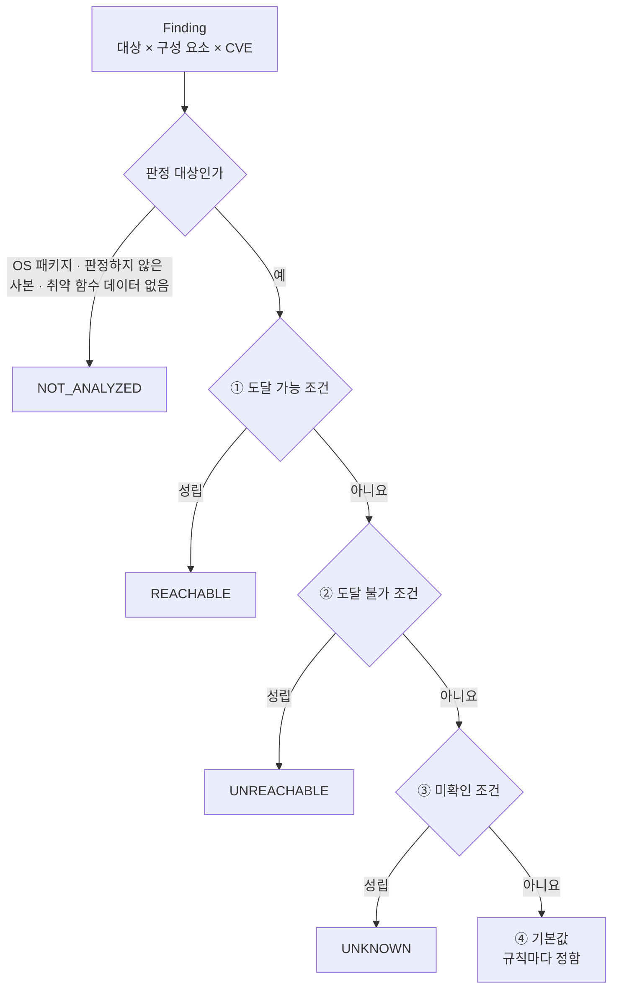

# 규칙 명세서

**한 줄 요약**: Reach가 Finding마다 `REACHABLE`·`UNREACHABLE`·`UNKNOWN`·`NOT_ANALYZED` 중 하나를 정하는 규칙이다. 기준은 Java·Spring Boot bootJar다. api의 Java CVE 14개를 이 규칙으로 판정했고, 14개 모두 `UNREACHABLE`이다.

**상태 표기**: [완료] PoC로 구현·검증됨 / [구현] develop·운영에 들어감 / [부분] 일부만 구현되었거나 수동 / [계획] 아직 없음(설계). 지금 규칙은 분석기가 읽는 데이터 파일(dashboard-backend `src/main/resources/reach/rules.json`, `vuln-functions.json`)과 사실 수집 코드(`Facts.java`)로 돌아간다. API(API-01~14)와 대시보드 화면(SCR-01~06)은 운영 중이고, API-09·10은 분석기와 같은 데이터 파일을 읽는다.

## 1. 목적과 적용 범위

**목적**

- Reach가 Finding 하나에 판정(상태, 방식, 근거)을 붙이는 조건을 한곳에 고정한다.
- 규칙 작성자는 이 문서의 절차(12절)로 규칙을 더한다. 검토자는 판정 근거를 이 문서와 대조한다.

**적용 범위**

| 구분 | 범위 | 상태 |
|---|---|---|
| L2 판정 대상 | Java·Spring Boot bootJar. PoC 대상은 api(`service-backend`, Spring Boot 4.1.1, Java 21, Gradle) | [완료] v0 |
| 입력 | bootJar의 앱 클래스(`BOOT-INF/classes`)와 라이브러리 jar(`BOOT-INF/lib`), Trivy 결과, `vuln-functions.json`, `rules.json` | [완료] |
| 도구 | `reach.jar`(Java 21 + ASM): 호출 그래프, 취약 함수 도달, 사실 수집<br>`verdict.py`(Python, 외부 라이브러리 없음): reach 결과·Trivy 결과·규칙을 합쳐 CVE별 판정과 보고서 생성 | [완료] v0 |
| 출력 | `verdicts.json`, `verdicts.md`(보고서), `reach-result.json` | [완료] |
| L1 배포 여부 | 실행 중 파드의 imageID와 스캔 digest 조인 (10절) | [구현] 클러스터 수집기(CronJob)가 6시간마다 조회 |
| OS 패키지(apk) | Java 호출 그래프로 판정하지 않고 `NOT_ANALYZED`로 표시 (9절) | [완료] 표시만 |
| 다른 생태계 | web(정적 프론트, npm), chat(Node). 분석기 플러그인으로 더한다(NFR-07) | [계획] |
| L3 실제 호출 | 능동 관측: CI 러너에서 스캔한 이미지를 띄우고 시나리오를 보내, 커버리지 에이전트로 취약 구간(`vuln-functions.json`의 `l3`)이 실행됐는지 본다. L2 판정 옆에 놓는 근거이고, 취약 구간이 실행됐으면 판정 상태(2-1)를 `REACHABLE`로, 취약 함수는 실행됐는데 구간을 확인하지 못했으면 `UNREACHABLE`을 `UNKNOWN`으로 올린다(서버가 결과를 받을 때, API 명세 3-12). 실행되지 않았다는 것만으로 `UNREACHABLE`을 만들지 않는다(FR-14, API 명세 3-12). 네이티브(maps·uprobe)는 [계획], 운영 상시 관측(Tetragon 등)은 비목표다 | [구현] Java |

- 관련 요구사항: FR-05(호출 그래프 판정), FR-06(규칙 판정), FR-07(판정·근거 출력), FR-08(사람 검토), FR-09(취약 함수 데이터), FR-04(L1).
- 규칙 조회는 API-09, 취약 함수 조회는 API-10, 규칙 화면은 SCR-06이다. 모두 운영 중이고, 분석기와 같은 데이터 파일을 읽는다.
- 범위 밖: 우리 코드 자체의 취약점(SAST), 스캐너가 찾지 못한 구성 요소(13-1).

## 2. 판정 어휘

값은 다섯 산출물이 같이 쓴다. API 필드(API-04, API-05)와 화면 표시(SCR-02, SCR-03)가 이 값이다. 대시보드 공통 규약에 따라 대문자로 쓴다(ADR-D008). 지금 CLI(`verdict.py`)와 데이터 파일(`rules.json`)은 PoC 때의 소문자 값(`unreachable` 등)을 쓰고, 서버가 저장할 때 대문자로 바꾼다(ARD AD-18). 뜻은 같다.

### 2-1. 상태 `status`

| 값 | 뜻 | 출력 조건 | 근거로 남기는 것 |
|---|---|---|---|
| `REACHABLE` | 도달 가능. 취약 코드가 우리 앱에서 실행될 수 있다 | 규칙의 도달 가능 조건이 성립한다. 호출 그래프 방식이면 진입점에서 취약 메서드까지 강한 경로가 있다 | 조건을 만족한 앱 코드 줄, 호출 경로(후보) |
| `UNREACHABLE` | 도달 불가. 확인한 범위에서 닿지 않는다 | 규칙의 도달 불가 조건이 성립한다. 호출 그래프 방식이면 취약 메서드가 jar에 있고, 진입점에서 닿지 않는다 | 이유와 "확인했지만 없던 것" |
| `UNKNOWN` | 미확인. 판단할 근거가 모자라다 | 규칙의 미확인 조건이 성립한다. 또는 약한 경로로만 닿는다(GR-09), 취약 메서드가 jar에 없다(GR-08), 그 밖에 확신이 없다(GR-01) | 미확인으로 둔 이유 |
| `NOT_ANALYZED` | 분석 대상 아님. 이 Finding에는 판정 규칙을 적용하지 않았다 | OS 패키지(GR-13), 판정하지 않은 패키지 사본(GR-12), 취약 함수 데이터 없음(GR-14), 지원하지 않는 생태계(npm 등, [계획]) | 대상이 아닌 이유. API에서는 `notAnalyzedReason`(`OS_PACKAGE` / `UNANALYZED_COPY` / `NO_VULN_FUNCTION_DATA` / `UNSUPPORTED_ECOSYSTEM`)이다(API 명세서 3-4) |

### 2-2. 방식 `method`

| 값 | 뜻 | 쓰는 경우 | 지금 api에서 |
|---|---|---|---|
| `CALLGRAPH` | 호출 그래프로 취약 메서드 도달을 본다 | 앱 코드가 라이브러리를 직접 부를 때 (5-1) | 5개: CVE-2025-14813, CVE-2026-8763, 13506, 0636, 89425 |
| `RULE` | 앱 코드 사실로 설정·타입 조건을 본다 | 컨테이너나 프레임워크가 스스로 실행할 때 (5-1, 6절) | 9개: Tomcat 3개, Jackson 6개 |
| `MANUAL` | 사람이 판정한다 | 도구가 판정하지 않은 것을 사람이 정할 때 | 없음. 10/9 수동 판정에서 CVE-2025-14813·CVE-2026-8763을 `MANUAL`로 적었고, 지금은 도구가 판정한다. Jackson 2 사본 7행은 사람이 제안을 확정하면 `MANUAL`이 된다(9-1) |

### 2-3. 사람 검토 `reviewState`

| 값 | 뜻 | 출력 조건 | 예 |
|---|---|---|---|
| `UNREVIEWED` | 검토 전 | 사람 판정이 없다 | Jackson 2 사본 7행. 제안(확정 대기)이 있어도 확정 전이다(9-1) |
| `PROVISIONAL` | 잠정 | 사람이 판정했지만 확인할 항목이 남았다 | 10/9 CRITICAL 5개(노트북 확인 전), CVE-2026-13506(지금) |
| `CONFIRMED` | 확정 | 근거에 필요한 확인 항목을 모두 확인했다 | 처음 10개(10/10, `verify-laptop.sh` 결과로 정리), 0636·19032·83557 |

자세한 기준은 11절. 운영 Finding의 검토는 API-06(검토 패널 SCR-03)으로 남긴다(FR-08). 정답지는 `docs/answer-key.md`에 적는다.

### 2-4. 판정 기록 형식

원자료의 예시(종합 정리 6-2). CLI 출력이라 소문자 값과 원래 필드 이름 그대로다:

```json
{
  "cve": "CVE-2026-68525",
  "purl": "pkg:maven/org.apache.tomcat.embed/tomcat-embed-core@11.0.24",
  "status": "unreachable",
  "method": "rule",
  "evidence": "FORM 인증(LoginConfig) 설정 없음"
}
```

| 항목 | 내용 | 출처 |
|---|---|---|
| `cve`, `purl`, `status`, `method`, `evidence` | 위 예시의 필드 | 종합 정리 6-2 |
| 패키지 도달, 취약 메서드 도달 | 보고서 열. 호출 그래프 결과를 판정과 따로 보여준다 | 작업 기록 11-2절 |
| 앱 코드 사실(파일·줄), 호출 경로(후보) | 사실을 먼저, 경로를 나중에 보여준다(GR-05) | 작업 기록 14-3절 |
| `info` | 판정에 쓰지 않고 "참고"로만 보여주는 사실. API에서는 Rule의 `infoFacts`, Evidence의 `informational`로 보인다(API 명세서 3-5·3-7) | 작업 기록 12절 |
| `dto_type_tokens` | tokens 출발점 목록(6-1). 사람이 판정 근거를 확인하는 데 쓴다 | 작업 기록 12절 |
| `reviewState` | 사람 검토 상태. 지금(PoC)은 판정 파일이 아니라 정답지에 따로 적는다. 운영에서는 검토 기록(API-06)에 남기고, 정답지와 구분한다(11절) | FR-08 |

필드 이름과 전체 구조는 원본(`verdict.py`, `verdicts.json`) 확인 필요.

## 3. 일반 원칙 (GR)

모든 CVE 규칙이 따르는 원칙이다. 원자료에 근거가 있는 것만 적었다. 출처의 "기록"은 PoC 작업 기록, "종합"은 종합 정리 및 향후 계획이다.

### 3-1. 판정 일반

| ID | 원칙 | 이유 | 출처 | 상태 |
|---|---|---|---|---|
| GR-01 | 확신이 없으면 `UNKNOWN`으로 둔다. 거짓 `UNREACHABLE`을 내지 않는다 | PoC 성공 기준: 틀리더라도 거짓 `UNREACHABLE`이 아니라 `UNKNOWN`이어야 한다(NFR-01) | 종합 3-2·6-2, 기록 4절 | [완료] |
| GR-02 | 결과를 지우지 않는다. 모든 Finding을 네 상태 중 하나로 표시한다 | 도달 불가는 삭제가 아니라 보류다(업계 공통 원칙) | 종합 3-2, 스프린트 10/8 1-3 | [완료] |
| GR-03 | 판정 단위는 메서드다. 패키지·클래스 단위 도달은 참고로만 보여준다 | bcprov는 패키지로는 닿지만(Argon2) 취약 메서드에는 닿지 않는다. 13506은 클래스 단위로는 배제되지 않고 메서드 단위로만 배제된다 | 종합 4-4, 기록 5·14-4절 | [완료] |
| GR-04 | 모든 판정에 방식(`method`)과 근거를 남긴다. `REACHABLE`은 호출 경로나 코드 줄, `UNREACHABLE`은 이유와 "확인했지만 없던 것"을 낸다 | 설명 가능성(NFR-02) | 종합 3-2·6-2 | [완료] |
| GR-05 | 근거는 앱 코드 사실(파일·줄)을 먼저, 호출 경로를 나중에 보여준다. 경로에는 "가장 짧은 후보 경로이며 실제 경로와 다를 수 있다"를 붙인다 | RTA 과대근사로 판정이 맞아도 경로가 엉뚱할 수 있다(89425 실험 B) | 기록 14-3·16절 | [완료] |
| GR-06 | 규칙으로 판정했는데 호출 그래프 결과가 판정과 달라 보이면 이유(과대근사, 프레임워크가 실행하는 코드)를 붙인다 | jackson-databind는 그래프상 취약 메서드 도달이 "예"인데 판정은 `UNREACHABLE`이고, Tomcat은 그래프상 패키지 도달이 "아니요"다. 보고서만 보면 헷갈린다 | 기록 11-2·14-3절 | [완료] |

### 3-2. 입력과 수집

| ID | 원칙 | 이유 | 출처 | 상태 |
|---|---|---|---|---|
| GR-07 | 사실은 앱 코드(`BOOT-INF/classes`)에서만 수집한다 | 프레임워크 내부 코드는 앱과 무관하게 같은 일을 한다. 판정을 가르는 것은 "앱이 무엇을 설정·호출하는가"다 | 기록 4절 | [완료] |
| GR-08 | 취약 메서드가 jar에 없으면 `UNKNOWN`이다 | 버전에 따라 메서드 이름이 바뀐다(예: BC 1.84). 못 찾았다고 도달 불가로 쓰면 위험하다 | 기록 4절 | [완료] |
| GR-09 | 약한 경로(Object 메서드 호출, JDK 콜백)로만 닿으면 `UNKNOWN`이다 | 첫 시험에서 "Jackson 날짜 포맷 → Object.equals → BC 권한 클래스" 같은 의미 없는 경로가 근거로 나왔다 (5-3) | 기록 4절 | [완료] |
| GR-10 | 리플렉션, 동적 프록시, JNI는 모델링하지 않는다. JDK 내부 코드도 분석하지 않고, JDK가 다시 부를 수 있는 메서드는 약한 경로로 가정한다. 2단계 진입점과 규칙으로 보완하고, 놓치는 모양은 회귀 테스트로 고정한다(13절) | 알려진 한계다. 주입 실험 C에서 실제로 놓쳤다 | 기록 4·13절, 종합 7절 | [완료] 한계 고정 |
| GR-11 | AI는 취약 함수 후보 생성, 구성요소 식별 후보(FR-02), 판정 설명에만 쓴다. CVE 대조와 최종 판정에는 쓰지 않는다. 후보는 사람이 확인한 것만 쓴다. 취약 함수 후보를 만들 때 AI에는 공개 공지와 수정 커밋만 보내고, 우리 앱 소스 코드는 보내지 않는다(FR-09, ARD SR-11). AI 후보로만 식별한 구성요소는 "구성요소 추정"으로 표시하고, 그 Finding은 `UNREACHABLE`로 확정하지 않는다(FR-02) | 정답이 DB와 코드에 있어 규칙이 더 정확하다. AI 결과는 재현할 수 없다(NFR-04) | 종합 3-3 | [완료] 판정 도구(`reach.jar`, `verdict.py`)는 AI를 쓰지 않는다 |

### 3-3. 판정 대상과 행 구성

| ID | 원칙 | 이유 | 출처 | 상태 |
|---|---|---|---|---|
| GR-12 | 같은 CVE라도 패키지 사본이 다르면 행을 나눈다. 판정 행에는 판정한 패키지의 설치·수정 버전을 쓴다. 판정하지 않은 사본은 `NOT_ANALYZED` 행으로 드러낸다. 스캐너가 CVE를 데이터 좌표와 groupId·버전이 같은 다른 jar에 붙인 행은 사본이 아니고 데이터 좌표의 판정을 받는다(근거 맨 앞에 그 사실을 적은 메모). groupId가 다르면(Jackson 2 `com.fasterxml.*` ↔ 데이터 Jackson 3 `tools.jackson.*`) 다른 코드라, 버전이 다르면 분석기가 읽은 jar가 아니라 사본이다 | CVE당 한 줄이던 보고서에서는 판정하지 않은 사본(Jackson 2.21.5)이 보이지 않았고, 다른 패키지의 버전이 표시될 수 있었다. 스캐너마다 CVE를 붙이는 jar가 다르다(Grype는 Anchore의 CVE별 보정을 따라 73180을 `tomcat-embed-core`에, GitHub 권고는 42498을 core에). 취약 함수는 클래스 이름으로 모든 jar에서 찾으므로 판정은 어느 jar인지와 상관없다 | 기록 14-2절, 73180 조사(11/24) | [완료] |
| GR-13 | OS 패키지는 Java 호출 그래프로 판정하지 않는다(`NOT_ANALYZED`) | Java 호출 그래프의 대상이 아니다 | 기록 11-2절 | [완료] |
| GR-14 | 취약 함수 데이터가 없는 CVE는 `NOT_ANALYZED`로 둔다. `UNREACHABLE`로 쓰지 않는다 | 취약 함수가 호출 그래프 판정의 목표 지점이다. 공지 중 취약 함수를 적은 것은 2%뿐이라(Endor Labs 2024, 회사 자체 조사 기준) 데이터를 직접 만들어야 한다 | 기록 11-2절, 종합 3-3. 종합 7절 위험 표는 "못 찾으면 unknown"으로 적었지만, 도구 출력(기록 11-2)은 `NOT_ANALYZED`다 | [완료] |
| GR-15 | 판정 대상(bootJar, 이미지 digest)을 보고서에 적는다. 이미지를 직접 만들면 이미지 안 jar의 sha256을 분석한 bootJar와 비교한다 | 로컬 이미지에 오래된 jar가 들어가 라이브러리가 102개(이미지) 대 185개(레포 bootJar)로 달랐다(10/10 `verify-laptop.sh` 확인). 실제 앱 분석의 라이브러리 jar 184개(5-4)와 1개 차이가 나는 원인은 확인 필요 | 종합 7절, 기록 11-1·14-1절 | [부분] 수동 비교. 보고서 표기 형식은 원본(`verdict.py`) 확인 필요 |

### 3-4. 배포 여부 (L1, 자세한 것은 10절)

| ID | 원칙 | 이유 | 출처 | 상태 |
|---|---|---|---|---|
| GR-16 | 실행 중 파드의 `status.containerStatuses[].imageID`(digest)와 스캔 digest를 조인한다. 태그는 신뢰하지 않는다 | ECR 태그가 MUTABLE이고 `pullPolicy: IfNotPresent`라 gitops 태그로는 실행 중 이미지를 확정할 수 없다. `docker images`의 IMAGE ID도 digest가 아니다 | 스프린트 10/7 2절, 자산 인벤토리 1절 | [부분] |
| GR-17 | 이미지의 revision 라벨(`org.opencontainers.image.revision`)로 커밋을 찾는다. 분석 커밋과 다르면 조상 관계와 소스 트리 해시를 비교한다 | CI가 이 라벨을 붙인다. 커밋이 달라도 소스 트리가 같으면 같은 코드다. 예: 라벨 `bb4639b`와 분석 커밋 `6583020`은 커밋이 다르지만 소스 트리가 같다(10-3) | 기록 15-4·15-6절 | [부분] |
| GR-18 | 배포 digest를 다시 스캔해, 판정에 쓴 스캔과 행(CVE·패키지·설치 버전·심각도·수정 버전)이 같을 때 판정을 배포물에 적용한다. 다르면 그 결과를 배포물 판정으로 쓰지 않는다 | 운영에서 실제로 도는 이미지에 맞아야 최종 결과로 쓸 수 있다. 로컬에서 만든 이미지는 오래된 jar가 들어가 bcprov 등이 빠져 있었다 | 기록 14-1·15-6절, 종합 4-5 | [부분] |

### 3-5. 사람 검토와 검증

| ID | 원칙 | 이유 | 출처 | 상태 |
|---|---|---|---|---|
| GR-19 | 사람이 확정한 판정이 도구 판정보다 우선한다. 정답지는 도구와 독립적으로 만든 판정(PoC 정답지, 검증 세트)이고, 도구를 채점하는 기준이다(M-03). 운영 Finding의 사람 검토(`reviewState`)는 정답지가 아니다. 둘이 다르면 원인을 조사해 틀린 쪽을 고친다(11-3) | 확정은 사람이 한다 | 기록 7·11-2·15-2절 | [부분] 문서(`answer-key.md`)로 관리 |
| GR-20 | 대조군 기대값은 도구를 돌리기 전에 적는다. 판정만이 아니라 근거가 가리키는 줄도 확인한다 | 판정만 맞고 이유가 틀릴 수 있다 | 기록 5·13절 | [완료] |
| GR-21 | 알려진 놓침은 회귀 테스트의 기대값으로 고정한다. 누가 한계를 해결하면 테스트가 실패해 문서를 고치게 한다 | 문서의 한계와 도구 동작을 맞춰 둔다 | 기록 13절, 종합 7절 | [완료] |

### 3-6. 취약 함수 데이터

| ID | 원칙 | 이유 | 출처 | 상태 |
|---|---|---|---|---|
| GR-22 | 취약 함수는 diff에서 실제로 바뀐 메서드로 정한다. 처음 10개는 취약·수정 버전 소스 diff(Tomcat은 수정 커밋과 태그 diff를 대조), 13506과 MEDIUM 3개는 수정 커밋 diff다. 설치 버전 jar에서 `javap`로 시그니처를 확인한다. 일반 경로와 함께 쓰는 메서드는 빼고, 뺀 이유를 남긴다(FR-09) | `ASN1InputStream.buildObject`는 일반 파싱과 공유해서 넣으면 오탐이 난다(13506) | 기록 3·14-4·15-1절 | [완료] |
| GR-23 | `vuln-functions.json`은 조사 파일에서 `make_spec.py`로만 만든다. 생성 파일을 직접 고치지 않는다 | 13506을 직접 넣었다가 조사 파일로 옮기고 다시 생성했다 | 기록 15-1절 | [완료] |

## 4. 평가 순서

CVE 규칙은 "도달 가능 조건 → 도달 불가 조건 → 미확인 조건 → 기본값" 순서로 평가한다(기록 4절). 그 전에 판정 대상인지부터 가른다.

| 순서 | 단계 | 성립하면 | 예 |
|---|---|---|---|
| 0 | 대상 확인: OS 패키지, 판정하지 않은 패키지 사본, 취약 함수 데이터 없음 | `NOT_ANALYZED` | libpng·zlib, Jackson 2.21.5 사본 (9절) |
| 1 | 도달 가능 조건 | `REACHABLE` | 요청 본문 타입에 실수형 필드(89407), 강한 경로로 취약 메서드 도달(14813) |
| 2 | 도달 불가 조건 | `UNREACHABLE` | FORM 인증기 사용 없음(68525), 취약 메서드 미도달(13506) |
| 3 | 미확인 조건 | `UNKNOWN` | `F-dto.floating.tokens`(89407), `CertStore.getInstance`만 있음(0636), 약한 경로로만 도달, 취약 메서드가 jar에 없음 |
| 4 | 기본값 | 규칙마다 정한 값(`rules.json`의 `otherwise`) | 지금 40개 규칙 중 39개가 `UNREACHABLE`, 77756만 `UNKNOWN` |

- 먼저 성립한 단계의 결과를 쓰고 뒤 단계는 보지 않는다(추정: "순서로 평가한다"의 뜻. 원본(`verdict.py`) 확인 필요). 그래서 도달 가능 조건이 다른 조건보다 앞선다.
- **설정을 보지 못하면 도달 불가로 두지 않는다.** 규칙이 레포 사실(`F-repo.*`, 7절)을 조건에 쓰는데 설정 파일을 하나도 읽지 못했으면(소스 레포도, 앱 jar 안 설정 파일도 없음) ②·④에서 나온 `UNREACHABLE`을 `UNKNOWN`으로 바꾼다. 없는 설정이 아니라 못 본 설정이기 때문이다. 근거에 그 이유(NOTE)를 남기고, 규칙 근거의 맞은 조건은 `UNKNOWN`이다. 지금 해당하는 규칙: 65182·65905·68525·8763·65637·86350·101296·101356·65183·65927·66422·68569·68763·73581·74048·75973·77762·78437·88041·93446
- **규칙이 없는 CVE의 기본 규칙**: 강한 경로로 취약 함수 도달 → `REACHABLE`, 취약 함수가 jar에 없거나(`sinks_missing`) **약한 경로로만 닿으면**(`sink_weak`) → `UNKNOWN`, 그 밖 → `UNREACHABLE`. 약한 경로(Object 메서드 호출, JDK 콜백)는 닿는다고도 안 닿는다고도 할 수 없어서다. 지금 판정 데이터의 40개는 모두 자기 규칙이 있어 이 기본 규칙을 쓰지 않는다
- Jackson 타입 규칙(89407·68497·91776·91777·19032·83557)은 도달 불가 조건(앱에 그 타입·설정이 없음)이 미확인 조건(`sink`)보다 앞선다. JSON을 받는 앱이면 호출 그래프는 거의 늘 Jackson 내부의 취약 함수에 닿기 때문에(샘플 앱 `app-like`에서도 강한 경로가 있다) 경로만으로는 가를 수 없고, 역직렬화되는 타입으로 가른다. 타입은 요청 본문·리스너·클라이언트 응답 같은 출발점(6-1)과, 앱 코드 어디에든 나오는 클래스 리터럴·TypeReference(tokens)로 넓게 모은다. 그래서 `readValue(json, clazz)`처럼 타입을 변수로 받아도, 그 변수에 넘기는 `Foo.class`가 앱 코드에 있으면 tokens에 잡혀 미확인이 된다
- `RULE` 방식에서는 규칙의 사실 조건이 판정을 정하고, 호출 그래프 결과는 보고서에 참고로 보인다(기록 11-2절). 규칙이 그래프 결과를 조건에 함께 쓰는지는 원본(`rules.json`) 확인 필요.



**개념 의사코드** (실제 이름·구조는 다를 수 있다. 원본(`verdict.py`) 확인 필요)

```python
def judge(finding):
    if finding.is_os_package:                                   # GR-13
        return Verdict("not_analyzed", reason="OS 패키지")
    if finding.package not in judged_packages(finding.cve):     # GR-12
        if same_group_and_version(finding.package, judged_packages(finding.cve)):
            return judge(finding.as_data_coordinate())          # 스캐너가 같은 그룹의 다른 jar에 붙임
        return Verdict("not_analyzed", reason="판정하지 않은 패키지 사본")
    if finding.cve not in vuln_functions:                       # GR-14
        return Verdict("not_analyzed", reason="취약 함수 데이터 없음")

    rule  = rules[finding.cve]
    facts = collect_facts(bootjar.app_classes)                  # GR-07: 앱 코드에서만
    cg    = callgraph(bootjar, vuln_functions[finding.cve])
    # cg: strong(강한 경로 도달) / weak_only(약한 경로로만) / none(미도달) / missing(jar에 없음)

    for status, cond in [("reachable",   rule.reachable_if),
                         ("unreachable", rule.unreachable_if),
                         ("unknown",     rule.unknown_if)]:
        if cond(facts, cg):                                     # 먼저 성립한 것을 쓴다
            return Verdict(status, rule.method,
                           evidence=evidence(facts, cg),         # GR-04, GR-05
                           info=rule.info(facts))                # 판정에 쓰지 않는 참고 사실
    return Verdict(rule.default, rule.method, evidence=evidence(facts, cg))
```

**호출 그래프 방식의 기본 조건**

| 호출 그래프 결과 | 판정 | 원칙 |
|---|---|---|
| 진입점에서 강한 경로로 취약 메서드에 닿음 | `REACHABLE` | 경로는 후보로 표시 (GR-05) |
| 약한 경로로만 닿음 | `UNKNOWN` | GR-09 |
| 취약 메서드가 jar에 없음 | `UNKNOWN` | GR-08 |
| 취약 메서드가 jar에 있고 닿지 않음 | `UNREACHABLE` | 확인한 범위를 근거로 남김 (GR-04) |
| 2단계 진입점(모든 앱 메서드)에서만 닿음 | 원본(`reach.jar`, `verdict.py`) 확인 필요 | - |

## 5. 호출 그래프 규칙

### 5-1. 방식 선택 기준

라이브러리를 우리 코드가 부르면 호출 그래프, 프레임워크가 스스로 실행하면 설정 규칙이다(종합 4-5).

| 호출 주체 | 방식 | 이유 | CVE |
|---|---|---|---|
| 앱 코드가 라이브러리를 직접 부름 | `CALLGRAPH` | 코드가 취약 클래스를 직접 부르는 구조라 경로가 그래프에 나온다 | CVE-2025-14813, CVE-2026-8763, 13506, 0636 (bcprov), 89425 (jackson-core) |
| 컨테이너(Tomcat)가 스스로 실행 | `RULE` (설정) | Spring Boot 내장 Tomcat은 기본 인증기(`NonLoginAuthenticator`) 때문에 `AuthenticatorBase.invoke`·`RealmBase.findSecurityConstraints`를 요청마다 실행한다. 제약 목록이 비어 있어 취약 구간에는 들어가지 않으므로, 함수 도달만 보면 오탐이 난다. Tomcat은 리플렉션으로 떠서 그래프에 잡히지도 않는다 | 65182, 65905, 68525 |
| 프레임워크(Spring MVC의 Jackson 변환)가 타입에 따라 실행 | `RULE` (역직렬화 타입) | `readValue`를 한 번이라도 부르면 그래프상 거의 모든 역직렬화기에 닿는다(가상 호출 과대근사). 실제 경로는 어떤 타입을 역직렬화하느냐에 달렸다 | 89407, 68497, 91776, 91777, 19032, 83557 |

### 5-2. 그래프 만들기

| 항목 | 규칙 | 이유 |
|---|---|---|
| 입력 | bootJar 바이트코드(앱 클래스와 `BOOT-INF/lib`). ASM으로 읽는다 | v0는 작업 공간에서 SootUp을 받을 수 없어 ASM으로 직접 구현했다 |
| 알고리즘 | RTA(Rapid Type Analysis). 실제로 `new`한 클래스만 가상 호출 대상으로 본다 | CHA보다 정밀하고, 포인터 분석보다 가벼워 노트북에서 돈다 |
| 진입점 1단계 | Spring 진입점: 컨트롤러, `@Bean`, 리스너, 스케줄러(`@Scheduled`), 프레임워크 콜백 | "어느 API에서 시작하는지"를 보여준다 |
| 진입점 2단계 | 모든 앱 메서드 | 리플렉션으로 불리는 앱 메서드를 놓치지 않는다 |
| 약한 간선 | Object 메서드 호출(예: `Object.equals`), JDK 콜백. 탐색의 두 번째 단계로 미룬다 | 근거로 약하다 (5-3) |
| JDK 내부 | 분석하지 않는다. JDK가 다시 부를 수 있는 메서드는 약한 경로로 가정한다 | GR-10 |
| 교체 후보 | SootUp(같은 RTA 계열) | [계획] 정밀도를 높일 때 |

진입점 전체 목록, 진입점 단계와 약한 간선 단계를 조합하는 방식은 원본(`reach.jar`) 확인 필요.

### 5-3. 약한 경로를 분리한 이유

첫 시험에서 bcprov 도달 근거가 의미 없는 경로로 나왔다. 이 간선을 두 번째 단계로 미루자 근거가 실제 사용 경로로 바뀌었다. 약한 경로로만 닿으면 `UNKNOWN`이다(GR-09).

```text
분리 전: Jackson 날짜 포맷 → Object.equals → BC 권한 클래스
분리 후: AuthController.signup → EmailAuthService.signup → … → Argon2BytesGenerator
```

### 5-4. 경로 출력

- 가장 짧은 후보 경로 하나를 보여주고 "가장 짧은 후보 경로이며 실제 경로와 다를 수 있다"를 붙인다(GR-05).
- 앱 코드 사실(정확한 줄)을 경로보다 먼저 보여준다.
- 대표 경로 (app-positive, 실제 BouncyCastle 바이트코드):

```text
CVE-2025-14813: RiskyController.encrypt → LegacyCrypto.gostEncrypt → StreamBlockCipher.processBytes
                → G3413CTRBlockCipher.calculateByte → G3413CTRBlockCipher.generateCRT
CVE-2026-8763 : CertReview.review → PKIXCertPathReviewer.isValidCertPath → doChecks → checkNameConstraints
                → PKIXNameConstraintValidator.checkPermitted → … → emailIsConstrained
```

**과대근사 사례**

| 사례 | 무엇이 나왔나 | 처리 |
|---|---|---|
| 89425 실험 B | 경로가 `AuditLogController.list → … → readTree → UTF8DataInputJsonParser`로 나왔다. probe가 DataInput 파서를 한 번 만들자 RTA가 앱 전체의 `nextToken()` 호출이 그 파서로 갈 수 있다고 봤다 | 판정은 맞았다. 사실을 먼저 보여주고 경로를 후보로 표시한다 |
| jackson-databind 3개(실제 앱) | 취약 메서드 도달이 "예"인데 판정은 `UNREACHABLE` | 규칙이 판정을 정했다는 이유를 붙인다 (GR-06) |
| Tomcat(실제 앱) | 패키지 도달이 "아니요". Spring Boot가 Tomcat을 리플렉션으로 띄워 그래프에 안 잡힐 뿐 실제로는 쓰인다 | 규칙으로 판정하고 이유를 붙인다 (GR-06) |

**성능**: 실제 api 약 40초(앱 클래스 376개, 라이브러리 jar 184개, 도달 메서드 67,091개, 로딩 12초 포함, bootJar 빌드 제외). PR마다 돌릴 수 있다(NFR-03).

## 6. 역직렬화 타입 추적 규칙

Jackson CVE 대부분은 데이터 타입이 결정한다. 앱이 어떤 타입을 역직렬화하는지 찾고, 그 타입의 필드를 따라가 취약 기능을 쓰는 필드가 있는지 본다(기록 3·4·12절).

### 6-1. 범위 세 가지

| 범위 | 출발점 | 쓰는 곳 |
|---|---|---|
| 루트 | `@RequestBody`·`@RequestPart`·`@Payload`, 리스너 파라미터, `HttpEntity`, `readValue` 계열에 쓰인 class, `TypeReference`, Feign·HTTP Interface 응답 타입 | 도달 가능 조건(발동 조건 사실) |
| tokens | 루트 + 앱 코드 어디든 있는 class 리터럴 + `TypeReference` 제네릭 + Jackson 어노테이션의 클래스 값(`@JsonDeserialize(as=…)`, `@JsonSubTypes`) + `@Cacheable`·`@CachePut` 반환 타입 | 89407 미확인 조건(`F-dto.floating.tokens`) |
| any | 앱 클래스 전체 | 89407 참고(`F-dto.floating.any`, `info`) |

- tokens는 "Jackson에 타입을 알려줄 수 있는 자리에 나온 타입"이다. 루트 수집이 놓치는 경우(예: `Class<T>`를 받는 공용 helper에 `Foo.class`를 넘김)를 잡는다.
- 실제 앱의 tokens 출발점은 97개였다(Kakao 응답 DTO, `Report` 엔티티, enum, logger용 class 리터럴 등). 넓게 잡았는데도 실수형 필드는 없었다. "아무것도 안 봐서 없음"이 아니다.
- 출발점 목록은 결과 파일의 `dto_type_tokens`에 남긴다.

### 6-2. 필드 타입 따라가기

- 루트 타입에서 필드 타입을 따라간다. 컬렉션 원소 타입과 중첩 record도 따라간다(실험 B: `List<Line>` 안의 `BigDecimal`, 중첩 record의 `Duration`).
- 근거는 따라간 길을 그대로 쓴다. 예(실험 B, 89407): `order(@body) → OrderRequest.lines → OrderLine.unitPrice`.
- 어노테이션을 세는 자리(91777 수정 후): 타입 자체에 붙은 어노테이션은 91776 검사에서만 센다. 91777은 (1) 컬렉션·맵 필드의 원소 타입, (2) 루트 자체가 컬렉션·맵인 경우(`@RequestBody Map<String, Account>`, `TypeReference<List<Node>>`)의 원소 타입만 센다.
- **타입 변수로 받는 요청 본문**(11/19 수정): 공통 컨트롤러가 `create(@RequestBody T body)`처럼 본문을 타입 변수로 받으면, 하위 타입이 준 타입 인자를 루트로 삼는다. 예: `ItemController extends CrudController<ItemRequest>` → 루트 `ItemRequest`. 중간 제네릭 계층(`AuditedController<U> extends CrudController<U>`)과 제네릭 인터페이스의 default 메서드도 따라간다. 근거의 루트 이름은 `ItemController.create(@body param 0, T of CrudController)` 꼴이다.
  - 고치기 전에는 본문 타입이 `Object`로만 보여 DTO 필드를 보지 못했고, L3 PoC에서 실제로 실행되는 89407을 `UNREACHABLE`로 판정했다(거짓 unreachable). 고치기 전 jar로는 `app-generic` 테스트 6개 중 3개가 실패한다.
  - 풀지 못하는 경우: 타입 인자를 주지 않은 하위 타입(raw type), 메서드가 스스로 선언한 타입 변수(`<X> … (@RequestBody X body)`). 둘 다 Spring이 본문을 `Object`로 읽으므로 DTO가 없다. 핸들러 메서드가 앱 밖(라이브러리 jar)의 제네릭 클래스에 선언된 경우는 아직 보지 않는다(13절 한계).
- 그 밖의 제네릭, 상속, 맵 키 처리의 세부는 원본(`Facts.java`) 확인 필요.

### 6-3. 응답 전용 타입을 세지 않는 이유

- Jackson은 누군가 타입을 알려줘야만 그 타입으로 역직렬화한다. `new`로 만들어 반환만 하는 응답 record는 역직렬화될 방법이 없다.
- 실제 사례: `SellerBriefResponse`, `SellerProfileResponse`의 `Double averageRating`. JDBC 행으로 만들어 반환만 한다. 처음 안전망은 "앱 클래스 어디든 실수형 필드가 있으면 미확인"이라 이것에 걸렸고, 정답지와 9/10 일치에 그쳤다. 안전망을 tokens로 좁힌 뒤 10/10이 됐다.
- 대조군 `app-tokens`(helper를 거쳐서만 역직렬화되는 `BigDecimal`)는 `UNKNOWN`이 나온다. 좁힌 뒤에도 helper 경유는 놓치지 않는다.
- 한계: 일부러 넓게 잡아서, 실수형 필드가 있는 JPA 엔티티를 `em.find(Foo.class)`로 읽기만 해도 `UNKNOWN`이 된다.
- `GenericJackson(2)JsonRedisSerializer`는 `@class`로 아무 타입이나 지정할 수 있다. 이것이나 default typing이 있으면 `UNKNOWN`으로 남긴다(`F-jackson.polymorphicSerializer`).

## 7. 사실 목록 (F)

- 사실은 `reach.jar`가 앱 클래스 바이트코드에서 뽑는다(`Facts.java`, GR-07).
- 원자료 기준 사실은 **40개**다(처음 38개, 89407 규칙 개선 후 40개). 아래는 원자료에 나온 것만 적었다. 나머지와, CVE 4개를 더한 뒤(기록 14-4·15-1절)의 목록은 원본(`rules.json`) 확인 필요.
- 11/19에 CVE 2개(65637, 5598)를 더하면서 사실 5개와 레포 사실 3개를 더했다(사실 51개, 레포 사실 7개).
- 11/23에 Tomcat CVE 6개를 더하면서 사실 8개와 레포 사실 1개를 더했다(사실 59개, 레포 사실 8개).
- 11/23에 Tomcat CVE 18개를 더 더하면서 사실 16개와 레포 사실 6개를 더했다. 지금 `rules.json`은 사실 75개, 레포 사실 14개다.
- 이름이 원자료에 없는 사실은 "(이름 미정)"으로 두고 뜻만 적는다. 이름을 새로 짓지 않는다.

### 7-1. 이름이 확인된 사실

**레포 사실(`F-repo.*`)을 읽는 곳**: 두 곳을 모두 읽고 하나라도 찾으면 성립한다.
1. 소스 레포: 스캔한 커밋의 체크아웃(PR 검사, 레포 대상, 이미지의 `pr-<커밋>` 태그로 찾은 커밋). 빌드 폴더·`.git`은 건너뛰고, 심볼릭 링크는 따라가지 않는다(PR 체크아웃은 믿을 수 없는 입력)
2. 앱 jar 안의 설정 파일: `BOOT-INF/classes`, `WEB-INF` 등 앱 자신의 파일. 라이브러리 jar(`BOOT-INF/lib`, `WEB-INF/lib`)는 앱 설정이 아니라 보지 않는다. 그래서 커밋을 모르는 이미지(태그 없음, 대시보드 요청 스캔)도 빌드에 들어간 `application.properties`·`application.yml`·`web.xml`은 본다
- 둘 다 읽지 못하면 4절대로 `UNKNOWN`이다. 운영 환경 변수·ConfigMap·이미지 `ENV`는 어느 쪽에도 없어 보지 않는다(한계). 레포의 `Dockerfile*`·`*.env`에 적힌 것만 본다

| ID | 뜻 | 수집 방법 | 쓰는 규칙 |
|---|---|---|---|
| `F-dto.floating.tokens` | tokens 범위(6-1)의 타입에 실수형 필드가 있다 | tokens 출발점에서 필드 타입을 따라간다. 출발점 목록은 `dto_type_tokens`에 남는다 | RULE-CVE-2026-89407 미확인 조건 |
| `F-dto.floating.any` | 앱 클래스 전체에 실수형 필드가 있다 | 앱 클래스 전체 | RULE-CVE-2026-89407 `info`(참고). 12절 개선 전에는 미확인 조건이었다 |
| `F-jackson.polymorphicSerializer` | `@class`로 타입을 지정할 수 있는 직렬화기(`GenericJackson(2)JsonRedisSerializer`)를 쓴다 | 앱 코드에서 사용 여부 | RULE-CVE-2026-89407 미확인 조건. default typing이 이 사실에 들어가는지, 다른 규칙에서도 쓰는지는 원본(`rules.json`) 확인 필요 |
| `F-jar.springBoot4` | bootJar에 Spring Boot 4 jar(`spring-boot-4.x.y.jar`)가 있다 | 라이브러리 jar 파일 이름(정규식 `^spring-boot-4\.[0-9]+\.[0-9]+`) | RULE-CVE-2026-65182·65905·68525·65637·76183·86350·101296·101356·103119·65183·65927·66422·68569·68763·73180·73581·74048·75973·77762·77791·78383·78437·79677·87022·88041·93446 미확인 조건(`!F-jar.springBoot4`, 8-1) |
| `F-jsonIdentityInfo.any` | 앱 코드에 `@JsonIdentityInfo`가 있다(mix-in 클래스에 붙은 것 포함) | 앱 코드의 어노테이션. 범위가 앱 전체인지는 이름으로 본 추정이다. 원본(`Facts.java`) 확인 필요 | RULE-CVE-2026-91777 미확인 조건 |
| `F-repo.spring.http2Enabled` | 레포의 설정이 내장 서버의 HTTP/2를 켠다(`server.http2.enabled=true`, 환경 변수 `SERVER_HTTP2_ENABLED=true`) | 레포와 앱 jar 안 설정 파일(아래 "레포 사실을 읽는 곳")의 `*.properties`·`*.yml`·`*.yaml`·`*.env`·`Dockerfile*`을 줄 단위 정규식으로 본다. 배포할 때만 넣는 환경 변수는 레포에 없으면 보이지 않는다 | RULE-CVE-2026-65637 도달 가능 조건(`F-repo.spring.serverSsl`과 함께), 미확인 조건. RULE-CVE-2026-86350·101356·68763·77762·78437·88041 미확인 조건 |
| `F-repo.spring.http2Yaml` | `application*.yml`에 `http2:` 블록이 있다. 값이 다음 줄에 있어 켰는지는 알 수 없다 | 같은 방식 | RULE-CVE-2026-65637·86350·101356·68763·77762·78437·88041 미확인 조건 |
| `F-repo.spring.serverSsl` | 내장 서버가 TLS를 직접 받는다(`server.ssl.key-store`·`certificate`·`bundle`, `server.ssl.enabled=true`) | 같은 방식 | RULE-CVE-2026-65637 도달 가능 조건. RULE-CVE-2026-93446 미확인 조건 |
| `F-tomcat.http2ProtocolNew`, `F-tomcat.addUpgradeProtocol`, `F-spring.http2SetEnabled` | 앱 코드가 HTTP/2를 켠다 | 앱 코드의 `new Http2Protocol`, `Connector.addUpgradeProtocol` 호출, `Http2.setEnabled`·`setHttp2` 호출 | RULE-CVE-2026-65637·86350·101356·68763·77762·78437·88041 미확인 조건 |
| `F-bc.frodoString`, `F-bc.frodoJceSpec` | 앱 코드가 FrodoKEM을 JCE 이름으로 고른다 | 앱 코드의 문자열 상수(정규식 `(?i)^frodo`), `FrodoParameterSpec` 타입 참조 | RULE-CVE-2026-5598 미확인 조건 |
| `F-websocket.serverEndpointAnn`, `F-websocket.endpointExporterNew`, `F-websocket.addEndpoint` | 앱이 Tomcat WebSocket 컨테이너에 JSR-356 엔드포인트를 등록한다 | 앱 코드의 `@ServerEndpoint`(`jakarta.websocket.server`), `new ServerEndpointExporter`(Spring), `ServerContainer.addEndpoint` 호출 | RULE-CVE-2026-76183·73180·77791·87022 미확인 조건 |
| `F-jar.tomcatCoyoteFfm` | bootJar에 `tomcat-coyote-ffm` jar(OpenSSL FFM 구현)가 있다 | 라이브러리 jar 파일 이름(정규식 `^tomcat-coyote-ffm-`) | RULE-CVE-2026-86248 미확인 조건 |
| `F-tomcat.jndiRealmNew`, `F-tomcat.jndiRealmSubclass` | 앱 코드가 Tomcat `JNDIRealm`을 쓴다 | 앱 코드의 `new JNDIRealm`, `JNDIRealm` 하위 클래스 | RULE-CVE-2026-101296 미확인 조건 |
| `F-repo.tomcat.jndiRealm` | 레포의 설정이 Tomcat `JNDIRealm`을 쓴다 | 레포와 앱 jar 안 설정 파일의 `server.xml`·`context.xml`·`*.xml`에서 `org.apache.catalina.realm.JNDIRealm`을 찾는다 | RULE-CVE-2026-101296 미확인 조건 |
| `F-tomcat.ajpProtocolNew`, `F-tomcat.ajpConnectorString` | 앱 코드가 AJP 커넥터를 만든다 | 앱 코드의 `new AjpNioProtocol`·`new AjpNio2Protocol`, 문자열 상수(정규식 `^(AJP/1\.3\|org\.apache\.coyote\.ajp\.)`) | RULE-CVE-2026-103119·78383 미확인 조건 |
| `F-tomcat.udsPathString` | 앱 코드가 커넥터를 Unix 도메인 소켓으로 연다 | 앱 코드의 문자열 상수(정규식 `^unixDomainSocketPath(Permissions)?$`). 보통 `Connector.setProperty`에 이름으로 준다 | RULE-CVE-2026-65183 미확인 조건 |
| `F-repo.tomcat.udsPath` | 레포의 설정이 커넥터를 Unix 도메인 소켓으로 연다 | 레포와 앱 jar 안 설정 파일의 `server.xml`·`*.xml`에서 `unixDomainSocketPath`를 찾는다 | RULE-CVE-2026-65183 미확인 조건 |
| `F-tomcat.rewriteValveNew`, `F-tomcat.rewriteValveSubclass` | 앱 코드가 Tomcat `RewriteValve`를 쓴다 | 앱 코드의 `new RewriteValve`, `RewriteValve` 하위 클래스 | RULE-CVE-2026-65927 미확인 조건 |
| `F-repo.tomcat.rewriteValve` | 레포의 설정이 Tomcat `RewriteValve`를 쓴다 | 레포와 앱 jar 안 설정 파일의 `server.xml`·`context.xml`·`*.xml`에서 `org.apache.catalina.valves.rewrite.RewriteValve`를 찾는다 | RULE-CVE-2026-65927 미확인 조건 |
| `F-tomcat.dataSourceRealmNew`, `F-tomcat.dataSourceRealmSubclass` | 앱 코드가 Tomcat `DataSourceRealm`을 쓴다 | 앱 코드의 `new DataSourceRealm`, `DataSourceRealm` 하위 클래스 | RULE-CVE-2026-68569 미확인 조건 |
| `F-repo.tomcat.dataSourceRealm` | 레포의 설정이 Tomcat `DataSourceRealm`을 쓴다 | 레포와 앱 jar 안 설정 파일의 `server.xml`·`context.xml`·`*.xml`에서 `org.apache.catalina.realm.DataSourceRealm`을 찾는다 | RULE-CVE-2026-68569 미확인 조건 |
| `F-tomcat.crlCall` | 앱 코드가 인증서 폐기 목록(CRL)을 설정한다 | 앱 코드의 `SSLHostConfig.setCertificateRevocationListFile`·`setCertificateRevocationListPath` 호출 | RULE-CVE-2026-73581 미확인 조건 |
| `F-repo.tomcat.crl` | 레포의 설정이 CRL을 설정한다 | 레포와 앱 jar 안 설정 파일의 `server.xml`·`*.xml`에서 정규식 `certificateRevocationList(File\|Path)`를 찾는다 | RULE-CVE-2026-73581 미확인 조건 |
| `F-tomcat.opensslLifecycleListenerNew`, `F-tomcat.opensslListenerFips` | 앱 코드가 Tomcat `OpenSSLLifecycleListener`를 쓴다 | 앱 코드의 `new OpenSSLLifecycleListener`, `OpenSSLLifecycleListener.setFIPSMode` 호출 | RULE-CVE-2026-74048 미확인 조건 |
| `F-repo.tomcat.opensslListener` | 레포의 설정이 Tomcat `OpenSSLLifecycleListener`를 쓴다 | 레포와 앱 jar 안 설정 파일의 `server.xml`·`*.xml`에서 `org.apache.catalina.core.OpenSSLLifecycleListener`를 찾는다 | RULE-CVE-2026-74048 미확인 조건 |
| `F-tomcat.simpleAuthConfigProviderNew`, `F-tomcat.simpleAuthConfigProviderSubclass` | 앱 코드가 JASPIC(Jakarta Authentication)의 Tomcat `SimpleAuthConfigProvider`를 쓴다 | 앱 코드의 `new SimpleAuthConfigProvider`, `SimpleAuthConfigProvider` 하위 클래스 | RULE-CVE-2026-75973 미확인 조건 |
| `F-repo.tomcat.simpleAuthConfigProvider` | 레포의 설정이 `SimpleAuthConfigProvider`를 쓴다 | 레포와 앱 jar 안 설정 파일의 `jaspic-providers.xml`·`*.xml`에서 `org.apache.catalina.authenticator.jaspic.SimpleAuthConfigProvider`를 찾는다 | RULE-CVE-2026-75973 미확인 조건 |
| `F-websocket.springEnableAnn`, `F-websocket.springConfigurer` | 앱이 Spring WebSocket 서버를 설정한다 | 앱 코드의 `@EnableWebSocket`·`@EnableWebSocketMessageBroker`, `WebSocketConfigurer`·`WebSocketMessageBrokerConfigurer`·`WebSocketConfigurationSupport`·`WebSocketMessageBrokerConfigurationSupport`를 구현·상속한 클래스 | RULE-CVE-2026-73180·77791·87022 미확인 조건 |
| `F-websocket.asyncRemote`, `F-websocket.asyncSendTimeout` | 앱이 WebSocket 비동기 전송과 전송 시간 제한을 쓴다 | 앱 코드의 `Session.getAsyncRemote` 호출, `WebSocketContainer`·`RemoteEndpoint.Async`·`ServletServerContainerFactoryBean`의 `setAsyncSendTimeout`·`setSendTimeout` 호출 | RULE-CVE-2026-79677 미확인 조건(둘이 함께 있을 때) |
| `F-spring.setSsl`, `F-tomcat.sslHostConfigNew` | 앱 코드가 내장 서버의 TLS를 켠다 | 앱 코드의 `ConfigurableWebServerFactory.setSsl` 호출, `new SSLHostConfig` | RULE-CVE-2026-93446 미확인 조건 |

"실수형"에 드는 타입 목록은 원본(`Facts.java`) 확인 필요. 원자료에 나온 것은 `double`, `Double`, `BigDecimal`이다. 공지는 89407의 대상 타입으로 `BigDecimal`, `BigInteger`, `Double`, `Float`를 적는다.

### 7-2. 이름이 없는 사실

"수집 방법"에는 원자료에서 실제로 잡힌 모양을 적었다. 실험 A는 규칙 모양 그대로 넣은 것, B는 우회한 모양이다(13-3).

| ID | 뜻 | 수집 방법(원자료에 나온 모양) | 쓰는 규칙 |
|---|---|---|---|
| (이름 미정) | 컨테이너 보안 제약을 설정한다 | `SecurityConstraint`, `LoginConfig`, `@ServletSecurity`, `addConstraint` 등. 이 목록은 정답지(사람 판정)의 근거다. 사실이 잡는 모양은 원본(`rules.json`) 확인 필요 | RULE-CVE-2026-65182·66422 |
| (이름 미정) | Tomcat DIGEST 인증기를 쓴다 | `new DigestAuthenticator`(실험 A) | RULE-CVE-2026-65905 |
| (이름 미정) | Tomcat FORM 인증기와 메서드별 제약을 쓴다 | `new FormAuthenticator` + `addMethod`(실험 A) | RULE-CVE-2026-68525 |
| (이름 미정) | GOST CTR 모드를 쓴다 | `new G3413CTRBlockCipher`(실험 A), JCE 이름 `"GOST3412-2015/CTR"`(실험 B). 사실로 잡는지 그래프 모델로 잡는지는 원본(`rules.json`, `reach.jar`) 확인 필요 | RULE-CVE-2025-14813 |
| (이름 미정) | BC provider로 인증서 경로를 검증한다 | `CertPathValidator` + `new BouncyCastleProvider()`(실험 A), `addProvider(BC)` + `CertPathBuilder "BC"`(실험 B) | RULE-CVE-2026-8763 |
| (이름 미정) | BC LDAP 클래스를 만든다 | BC LDAP 클래스 생성. 대상 클래스 목록은 원본(`rules.json`) 확인 필요 | RULE-CVE-2026-0636 도달 가능 조건 |
| (이름 미정) | JCE 이름으로 인증서 저장소를 고른다 | `CertStore.getInstance` | RULE-CVE-2026-0636 미확인 조건 |
| (이름 미정) | 루트에서 따라간 타입에 실수형 필드가 있다 | `@RequestBody`의 `double`(실험 A), `List<Line>` 안의 `BigDecimal`(실험 B) | RULE-CVE-2026-89407 도달 가능 조건 |
| (이름 미정) | 루트에서 따라간 타입에 `javax.xml.datatype`의 `Duration`·`XMLGregorianCalendar` 필드가 있다 | `@RequestBody`의 `XMLGregorianCalendar`(실험 A), 중첩 record의 `Duration`(실험 B) | RULE-CVE-2026-68497 |
| (이름 미정) | 역직렬화 타입(타입 자체 또는 필드)에 `@JsonTypeInfo`와 대체 동작(`defaultImpl`)이 있다 | `@JsonTypeInfo(defaultImpl)`(실험 A), 필드에 붙인 `@JsonTypeInfo`(실험 B) | RULE-CVE-2026-91776 |
| (이름 미정) | 컬렉션·맵의 원소 타입에 `@JsonIdentityInfo`가 있다 | 컬렉션·맵 필드의 원소(`List<Node>`, 실험 A), 루트 자체가 컬렉션·맵(`Map<String, Account>`, 실험 B) | RULE-CVE-2026-91777 도달 가능 조건 |
| (이름 미정) | 역직렬화 타입에 `java.nio.file.Path` 필드가 있다 | 89407과 같은 모양(타입 추적) | RULE-CVE-2026-19032 |
| (이름 미정) | `@JsonTypeInfo`를 쓰고, `Comparable` 필드가 있다 | 앱 코드의 어노테이션과 필드 타입 | RULE-CVE-2026-83557 |
| (이름 미정) | default typing을 쓴다 | 원본(`Facts.java`) 확인 필요 | RULE-CVE-2026-89407 미확인 조건 |

실험 B의 Tomcat 우회 모양(Authenticator 하위 클래스, `@ServletSecurity`, `HttpMethodConstraintElement`)도 기대대로 잡혔다. 어느 사실이 어느 CVE에서 잡았는지는 원본(`rules.json`) 확인 필요.

### 7-3. 도구 밖에서 확인하는 사실

런타임 설정(`java.security`, 환경 변수)은 도구가 보지 못한다. 확인 스크립트(`verify-laptop.sh`)와 수동 조회로 따로 본다(기록 4·11-1절).

| 사실 | 확인 방법 | 쓰는 곳 |
|---|---|---|
| 런타임 provider 순서 | `verify-laptop.sh`. api 이미지는 SUN이 1순위이고 BouncyCastle은 목록에 없다 | RULE-CVE-2026-8763 |
| 실행 옵션 `-Djava.security.*` | `verify-laptop.sh`. api는 없다 | RULE-CVE-2026-8763 |
| `bctls`·`bcpkix` 포함 여부 | 이미지·bootJar의 jar 목록. api는 둘 다 없다. `okhttp` 4.12.0이 bcprov를 참조하지만 `bctls`가 없어 BC TLS를 쓰지 않는다 | RULE-CVE-2026-8763 |
| 이미지 안 jar와 분석한 bootJar의 일치 | sha256 비교 | GR-15 |
| 실행 중 파드의 `imageID`, 이미지의 revision 라벨 | `kubectl get pods` 조회와 이미지 라벨. 읽기 명령만 썼지만 관리자 kubeconfig로 실행했다. 읽기 전용 계정은 \[계획\](10-1) | 10절 |

### 7-4. 사실이 아닌 출력 항목

- `info`: 판정에 쓰지 않고 보고서에 "참고"로만 보여줄 사실. 89407은 `F-dto.floating.any`를 계속 보여준다.
- `dto_type_tokens`: tokens 출발점 목록. 판정 근거를 사람이 확인할 수 있게 남긴다.
- 취약 함수 데이터 규모: 10/10 오전 기준 CVE 10개, 취약 메서드 36개. CVE 4개를 더한 뒤의 수는 원본(`vuln-functions.json`) 확인 필요.

## 8. CVE별 규칙 (RULE)

- 배포 이미지(`a6ffffef…`) 스캔 23행 중 Java CVE 14개의 규칙이다. 판정 대상은 `service-backend` 커밋 `6583020`의 bootJar다. 이 커밋은 배포 이미지의 revision `bb4639b`와 소스 트리가 같다(10절).
- 조건 칸은 원자료에 나온 것만 적었다. 원자료가 규칙으로 설명한 조건은 그대로 옮겼다. 정답지(사람 판정)의 근거나 추론으로 채운 조건에는 "정확한 조건식은 원본(`rules.json`) 확인 필요"를 붙였다. 원자료에 없는 조건은 "원본(`rules.json`) 확인 필요"로만 두었다.
- 기본값(4절)은 40개 규칙 중 39개가 `UNREACHABLE`이고 77756만 `UNKNOWN`이다(`rules.json`의 `otherwise`). 표에는 89407과 77756에만 적었다.
- "공통"은 호출 그래프 기본 조건(약한 경로로만 닿음, 취약 메서드가 jar에 없음 → `UNKNOWN`, 4절)이다.
- 수정 버전은 배포 digest 재스캔(Trivy, 10/10)의 값이다. 우리 앱의 업그레이드 대상은 Tomcat 11.0.25, bcprov 1.85, Jackson 3.1.7 이상이다(기록 3절). 적용 여부는 팀이 정한다.
- "verify N절"은 노트북 확인 결과 `verify-report.txt`의 절 번호다.
- 11/19에 판정 데이터가 없던 2개(CVE-2026-65637, CVE-2026-5598)의 규칙을 더했다. 이 둘의 취약 함수는 판정 데이터 도구(12절)의 초안을 jar와 대조해 넣었고, 사람 판정(정답지)은 아직 없다.
- 11/23에 Tomcat CVE 6개(76183, 86248, 86350, 101296, 101356, 103119)의 규칙을 더했다. 판정 데이터 도구(12절)가 검토 전 GitHub 권고문, 공식 CVE 기록의 영향 버전, Tomcat 보안 페이지의 수정 커밋으로 자료를 모으고, AI 초안을 사람(jinseob123)이 검토해 넣었다(검토 기록 `reach-analyzer/research/vulndata/`). 사람 판정은 이 검토 기록뿐이고 정답지는 아직 없다.
- 11/23에 Re:Used api 운영 jar(Spring Boot 4.1.1, Tomcat 11.0.24)와 `service-backend` 소스로 분석기와 판정을 돌렸다. 6개 모두 `UNREACHABLE`이고, 호출 그래프는 6개의 취약 함수 어디에도 닿지 않았다.
- 11/23에 Tomcat CVE 18개(65183, 65927, 66422, 68569, 68763, 73180, 73581, 74048, 75973, 77756, 77762, 77791, 78383, 78437, 79677, 87022, 88041, 93446)의 규칙을 더 더했다. 판정 데이터·규칙은 40개가 됐다. 자료를 모으고 검토한 방법은 앞 6개와 같다(검토자 jinseob123). 사람 판정은 이 검토 기록뿐이고 정답지는 아직 없다.
- 같은 날 같은 운영 jar와 소스로 18개를 돌렸다. 17개가 `UNREACHABLE`, 77756이 `UNKNOWN`이고, 호출 그래프는 18개 CVE의 취약 함수 어디에도 닿지 않았다.

### 8-0. 요약

| RULE | 패키지·설치 버전 | 심각도 | 방식 | 도구 판정 | 사람 판정 |
|---|---|---|---|---|---|
| RULE-CVE-2026-65182 | tomcat-embed-core 11.0.24 | CRITICAL | `RULE` | `UNREACHABLE` | `UNREACHABLE` 확정 |
| RULE-CVE-2026-65905 | tomcat-embed-core 11.0.24 | CRITICAL | `RULE` | `UNREACHABLE` | `UNREACHABLE` 확정 |
| RULE-CVE-2026-68525 | tomcat-embed-core 11.0.24 | CRITICAL | `RULE` | `UNREACHABLE` | `UNREACHABLE` 확정 |
| RULE-CVE-2025-14813 | bcprov-jdk18on 1.81 | CRITICAL | `CALLGRAPH` | `UNREACHABLE` | `UNREACHABLE` 확정 |
| RULE-CVE-2026-8763 | bcprov-jdk18on 1.81 | CRITICAL | `CALLGRAPH` | `UNREACHABLE` | `UNREACHABLE` 확정 |
| RULE-CVE-2026-13506 | bcprov-jdk18on 1.81 | HIGH | `CALLGRAPH` | `UNREACHABLE` | `UNREACHABLE` **잠정** |
| RULE-CVE-2026-0636 | bcprov-jdk18on 1.81 | MEDIUM | `CALLGRAPH` | `UNREACHABLE` | `UNREACHABLE` 확정 |
| RULE-CVE-2026-89407 | jackson-core 3.1.5 | HIGH | `RULE` | `UNREACHABLE` | `UNREACHABLE` 확정 |
| RULE-CVE-2026-89425 | jackson-core 3.1.5 | HIGH | `CALLGRAPH` | `UNREACHABLE` | `UNREACHABLE` 확정 |
| RULE-CVE-2026-68497 | jackson-databind 3.1.5 | HIGH | `RULE` | `UNREACHABLE` | `UNREACHABLE` 확정 |
| RULE-CVE-2026-91776 | jackson-databind 3.1.5 | HIGH | `RULE` | `UNREACHABLE` | `UNREACHABLE` 확정 |
| RULE-CVE-2026-91777 | jackson-databind 3.1.5 | HIGH | `RULE` | `UNREACHABLE` | `UNREACHABLE` 확정 |
| RULE-CVE-2026-19032 | jackson-databind 3.1.5 | MEDIUM | `RULE` | `UNREACHABLE` | `UNREACHABLE` 확정 |
| RULE-CVE-2026-83557 | jackson-databind 3.1.5 | MEDIUM | `RULE` | `UNREACHABLE` | `UNREACHABLE` 확정 |
| RULE-CVE-2026-65637 | tomcat-embed-core 11.0.24 | CRITICAL | `RULE` | `UNREACHABLE` | 아직 없음 |
| RULE-CVE-2026-5598 | bcprov-jdk18on 1.81 | HIGH | `CALLGRAPH` | `UNREACHABLE` | 아직 없음 |
| RULE-CVE-2026-76183 | tomcat-embed-websocket 11.0.24 | CRITICAL | `RULE` | `UNREACHABLE` | 아직 없음 |
| RULE-CVE-2026-86248 | tomcat-embed-core 11.0.24 | CRITICAL | `RULE` | `UNREACHABLE` | 아직 없음 |
| RULE-CVE-2026-86350 | tomcat-embed-core 11.0.24 | CRITICAL | `RULE` | `UNREACHABLE` | 아직 없음 |
| RULE-CVE-2026-101296 | tomcat-embed-core 11.0.24 | CRITICAL | `RULE` | `UNREACHABLE` | 아직 없음 |
| RULE-CVE-2026-101356 | tomcat-embed-core 11.0.24 | CRITICAL | `RULE` | `UNREACHABLE` | 아직 없음 |
| RULE-CVE-2026-103119 | tomcat-embed-core 11.0.24 | CRITICAL | `RULE` | `UNREACHABLE` | 아직 없음 |
| RULE-CVE-2026-65183 | tomcat-embed-core 11.0.24 | HIGH | `RULE` | `UNREACHABLE` | 아직 없음 |
| RULE-CVE-2026-65927 | tomcat-embed-core 11.0.24 | HIGH | `RULE` | `UNREACHABLE` | 아직 없음 |
| RULE-CVE-2026-66422 | tomcat-embed-core 11.0.24 | HIGH | `RULE` | `UNREACHABLE` | 아직 없음 |
| RULE-CVE-2026-68569 | tomcat-embed-core 11.0.24 | HIGH | `RULE` | `UNREACHABLE` | 아직 없음 |
| RULE-CVE-2026-68763 | tomcat-embed-core 11.0.24 | HIGH | `RULE` | `UNREACHABLE` | 아직 없음 |
| RULE-CVE-2026-73180 | tomcat-embed-websocket 11.0.24 | MEDIUM | `RULE` | `UNREACHABLE` | 아직 없음 |
| RULE-CVE-2026-73581 | tomcat-embed-core 11.0.24 | MEDIUM | `RULE` | `UNREACHABLE` | 아직 없음 |
| RULE-CVE-2026-74048 | tomcat-embed-core 11.0.24 | MEDIUM | `RULE` | `UNREACHABLE` | 아직 없음 |
| RULE-CVE-2026-75973 | tomcat-embed-core 11.0.24 | HIGH | `RULE` | `UNREACHABLE` | 아직 없음 |
| RULE-CVE-2026-77756 | tomcat-embed-core 11.0.24 | LOW | `RULE` | `UNKNOWN` | 아직 없음 |
| RULE-CVE-2026-77762 | tomcat-embed-core 11.0.24 | HIGH | `RULE` | `UNREACHABLE` | 아직 없음 |
| RULE-CVE-2026-77791 | tomcat-embed-websocket 11.0.24 | HIGH | `RULE` | `UNREACHABLE` | 아직 없음 |
| RULE-CVE-2026-78383 | tomcat-embed-core 11.0.24 | HIGH | `RULE` | `UNREACHABLE` | 아직 없음 |
| RULE-CVE-2026-78437 | tomcat-embed-core 11.0.24 | HIGH | `RULE` | `UNREACHABLE` | 아직 없음 |
| RULE-CVE-2026-79677 | tomcat-embed-websocket 11.0.24 | HIGH | `RULE` | `UNREACHABLE` | 아직 없음 |
| RULE-CVE-2026-87022 | tomcat-embed-websocket 11.0.24 | HIGH | `RULE` | `UNREACHABLE` | 아직 없음 |
| RULE-CVE-2026-88041 | tomcat-embed-core 11.0.24 | HIGH | `RULE` | `UNREACHABLE` | 아직 없음 |
| RULE-CVE-2026-93446 | tomcat-embed-core 11.0.24 | HIGH | `RULE` | `UNREACHABLE` | 아직 없음 |

고유 CVE 기준 CRITICAL 12 · HIGH 21 · MEDIUM 6 · LOW 1(11/19에 더한 2개, 11/23에 더한 6개와 18개 포함). 처음 10개는 정답지와 10/10 일치, 추가 4개 중 13506만 사람 판정이 잠정이다. jackson-core·databind는 `tools.jackson.core` 좌표(Jackson 3)다.

### 8-1. Tomcat (`org.apache.tomcat.embed:tomcat-embed-core`, `org.apache.tomcat.embed:tomcat-embed-websocket` 11.0.24)

- 세 CVE 모두 컨테이너가 실행한다. Spring Boot 내장 Tomcat은 기본 인증기 때문에 `RealmBase.findSecurityConstraints`를 요청마다 실행하지만, 제약 목록이 비어 있어 취약 구간에 들어가지 않는다. 그래서 "앱이 제약·인증기를 설정했나"를 보는 `RULE`로 판정한다(5-1).
- "내장 Tomcat이 제약·인증기를 만들지 않는다"는 근거는 Spring Boot 4.0.8·4.1.1 소스로만 확인했다. 그래서 세 규칙 모두 Spring Boot 4가 아니면(`!F-jar.springBoot4`) 미확인 조건에 걸려 `UNREACHABLE`을 내지 않는다. Spring Boot 2·3, Spring Boot 없이 Tomcat을 쓰는 앱이 여기에 든다(GR-01, 거짓 `UNREACHABLE` 금지). 다른 버전을 소스로 확인하면 조건을 넓힌다. 공개 취약 앱(log4shell-vulnerable-app, Spring Boot 2.6.1 + Tomcat 9.0.55)에서 이 조건이 없을 때 세 CVE가 `UNREACHABLE`로 나온 것을 보고 더했다(2026-11-09).
- Trivy 수정 버전은 11.0.25, 10.1.58, 9.0.121이다. 10.1.58은 릴리스되지 않아 10.1.x의 수정 버전은 10.1.59다(기록 3절). 우리 앱은 11.0.25다.
- 11/23에 더한 6개(76183~103119)는 모두 `RULE`이고 모양이 같다. 기능을 켜는 사실이 있거나, 호출 그래프가 취약 함수에 닿거나(`sink`, `sink_weak`), Spring Boot 4가 아니면 `UNKNOWN`이다. 아니면 `UNREACHABLE`이다. 도달 가능 조건은 없다. 두 번째 조건(논블로킹 출력, SASL 방식, 잘못된 헤더 입력 등)은 정적으로 볼 수 없어서다. 86248만 Spring Boot 조건이 없다(jar 유무로 판정한다).
- 6개의 심각도는 CVE 기록의 CVSS 값이다. Tomcat 보안 페이지의 등급은 각 소절 첫 줄에 적었다.
- 11/23에 더 더한 18개(65183~93446)도 모두 `RULE`이고 앞 6개와 모양이 같다. 다른 것은 둘이다. 79677은 `sink` 조건이 없고, 비동기 전송 사실 둘이 함께 있거나 Spring Boot 4가 아니면 `UNKNOWN`이다. 77756은 조건이 없어 늘 `UNKNOWN`이다.
- WebSocket 4개(73180, 77791, 79677, 87022)는 tomcat-embed-websocket 좌표다. Grype는 73180을 `tomcat-embed-core`에 붙이는데, 같은 groupId·버전이라 이 판정을 그대로 받는다(GR-12). 73180·77791·87022는 Spring WebSocket(`@EnableWebSocket`, STOMP, `WebSocketConfigurer`)을 써도 해당으로 본다. Spring WebSocket도 Tomcat에서는 `ServerContainer.upgradeHttpToWebSocket`으로 업그레이드해(spring-websocket 7.0.9 `StandardWebSocketUpgradeStrategy` 138행) `WsSession`·`WsRemoteEndpointImplServer`·`PerMessageDeflate`를 지나기 때문이다. 76183은 이와 다르다. 76183의 취약 함수는 엔드포인트 매핑(`findMapping`)이고 Spring WebSocket은 그 경로를 쓰지 않아 뺐다. 79677은 Spring이 블로킹 전송만 써서 뺐다(11/23 결정).
- 18개의 심각도도 CVE 기록의 CVSS 값이다. Tomcat 보안 페이지 등급(Low·Moderate·Important)과 다른 것이 많다. 보안 페이지 등급은 각 소절 첫 줄에 적었다.

#### RULE-CVE-2026-65182

| 항목 | 내용 |
|---|---|
| 패키지·버전 | tomcat-embed-core 11.0.24 → 11.0.25 · CRITICAL |
| 취약 기능 | security-constraint 경로 매칭 우회 |
| 취약 함수 | `RealmBase.findSecurityConstraints` |
| 발동 조건 | 앱이 컨테이너 보안 제약을 추가하고, 한 컬렉션 안에서 긴 패턴이 짧은 패턴보다 먼저 온다. 호출 주체는 컨테이너 |
| reachable 조건 | 없음. 설계상 최대 판정이 `UNKNOWN`이다(실험 A) |
| unreachable 조건 | 앱 코드에 컨테이너 보안 제약 설정(`SecurityConstraint`, `LoginConfig`, `@ServletSecurity`, `addConstraint` 등)이 없다. 정확한 조건식은 원본(`rules.json`) 확인 필요. 괄호 안 목록은 정답지(사람 판정)의 근거다 |
| unknown 조건 | 컨테이너 보안 제약을 설정한다(실험 A에서 `UNKNOWN`). 또는 Spring Boot 4가 아니다(`!F-jar.springBoot4`, 8-1). 정확한 조건식은 원본(`rules.json`) 확인 필요 |
| 방식 | `RULE` |
| 현재 판정(api) | `UNREACHABLE` |
| 사람 판정 | `UNREACHABLE` 확정. 컨테이너 보안 설정이 없고, Spring Boot는 제약을 만들지 않는다(verify 6절) |
| 대조군 | 실험 A(직접 주입) → `UNKNOWN`(설계상 최대). app-boot2(Spring Boot 2) → `UNKNOWN` |

#### RULE-CVE-2026-65905

| 항목 | 내용 |
|---|---|
| 패키지·버전 | tomcat-embed-core 11.0.24 → 11.0.25 · CRITICAL |
| 취약 기능 | DIGEST 인증 재전송 |
| 취약 함수 | `DigestAuthenticator$NonceInfo.nonceCountValid` |
| 발동 조건 | Tomcat DIGEST 인증기를 설치한다. 호출 주체는 컨테이너 |
| reachable 조건 | 앱 코드가 DIGEST 인증기를 만든다(`new DigestAuthenticator`, 실험 A) |
| unreachable 조건 | `DigestAuthenticator` 사용이 없다(컨테이너 DIGEST 인증 미설정). Spring Boot는 `web.xml`을 읽지 않는다. 정확한 조건식은 원본(`rules.json`) 확인 필요. "Spring Boot는 …" 문장은 정답지(사람 판정)의 근거다 |
| unknown 조건 | Spring Boot 4가 아니다(`!F-jar.springBoot4`, 8-1). 그 밖의 조건식은 원본(`rules.json`) 확인 필요 |
| 방식 | `RULE` |
| 현재 판정(api) | `UNREACHABLE` |
| 사람 판정 | `UNREACHABLE` 확정. `DigestAuthenticator` 사용 없음(verify 6절) |
| 대조군 | app-positive(Tomcat DIGEST 인증), 실험 A → `REACHABLE`. app-boot2(Spring Boot 2) → `UNKNOWN` |

#### RULE-CVE-2026-68525

| 항목 | 내용 |
|---|---|
| 패키지·버전 | tomcat-embed-core 11.0.24 → 11.0.25 · CRITICAL |
| 취약 기능 | FORM 인증 제약 우회 |
| 취약 함수 | `FormAuthenticator.restoreRequest` |
| 발동 조건 | Tomcat FORM 인증기와 메서드별 제약. 호출 주체는 컨테이너 |
| reachable 조건 | FORM 인증기와 메서드별 제약을 함께 설정한다(`new FormAuthenticator` + `addMethod`, 실험 A) |
| unreachable 조건 | `FormAuthenticator` 사용이 없다(FORM 인증 `LoginConfig` 미설정). Spring Security의 `formLogin`은 별개 구현이다. 정확한 조건식은 원본(`rules.json`) 확인 필요. `formLogin` 문장은 정답지(사람 판정)의 근거다 |
| unknown 조건 | Spring Boot 4가 아니다(`!F-jar.springBoot4`, 8-1). 그 밖의 조건식은 원본(`rules.json`) 확인 필요 |
| 방식 | `RULE` |
| 현재 판정(api) | `UNREACHABLE` |
| 사람 판정 | `UNREACHABLE` 확정. `FormAuthenticator` 사용 없음(verify 6절) |
| 대조군 | app-positive(Tomcat FORM 인증), 실험 A → `REACHABLE`. app-boot2(Spring Boot 2) → `UNKNOWN` |

실험 B에서 Tomcat 3개는 Authenticator 하위 클래스, `@ServletSecurity`, `HttpMethodConstraintElement`로 우회해 넣었고 모두 기대대로 나왔다. CVE별 대응은 원본(`rules.json`) 확인 필요.

#### RULE-CVE-2026-65637

11/19에 더했다. 앞의 세 규칙과 달리 인증 설정이 아니라 HTTP/2와 TLS 설정을 본다.

| 항목 | 내용 |
|---|---|
| 패키지·버전 | tomcat-embed-core 11.0.24 → 11.0.25 · CRITICAL |
| 취약 기능 | HTTP/2 요청의 호스트 이름과 TLS SNI를 맞춰 보는 검사(strict SNI) 우회 |
| 취약 함수 | `org.apache.coyote.http2.Stream.receivedEndOfHeaders` |
| 발동 조건 | HTTP/2가 켜져 있고, Tomcat이 TLS를 직접 끝내고, `strictSni`(기본 켜짐)를 끄지 않았다. `:authority`와 `host`가 모두 없는 요청이 필수 헤더 검사를 통과한다. 호출 주체는 컨테이너 |
| reachable 조건 | 레포 설정이 HTTP/2와 내장 서버 TLS를 함께 켠다(`F-repo.spring.http2Enabled` + `F-repo.spring.serverSsl`) |
| unreachable 조건 | HTTP/2를 켜는 설정·코드가 없다. Spring Boot 내장 Tomcat은 `server.http2.enabled`가 true일 때만 `Http2Protocol`을 등록하고 기본값은 false다(Spring Boot 4.1.1의 `TomcatWebServerFactory`·`Http2` 바이트코드로 확인) |
| unknown 조건 | HTTP/2를 켜는 설정이나 코드가 있지만 TLS를 Tomcat이 끝내는지 레포에서 알 수 없다(`F-repo.spring.http2Enabled` 단독, `F-repo.spring.http2Yaml`, `F-tomcat.http2ProtocolNew`, `F-tomcat.addUpgradeProtocol`, `F-spring.http2SetEnabled`). 또는 Spring Boot 4가 아니다(`!F-jar.springBoot4`). 공통 |
| 방식 | `RULE` |
| 현재 판정(api) | `UNREACHABLE`. HTTP/2 설정이 레포와 배포 설정(gitops)에 없다 |
| 사람 판정 | 아직 없음 |
| 대조군 | app-positive(코드로 `Http2Protocol` 등록) → `UNKNOWN`. app-indirect(설정 파일로 HTTP/2 + TLS) → `REACHABLE`. app-boot2 → `UNKNOWN` |
| L3 | 취약 구간 없음. 수정이 필수 헤더 조건식에 항 하나를 더한 것이라 그 줄은 정상 HTTP/2 요청에서도 실행된다. 실행 기록으로는 구분할 수 없어 함수 실행까지만 근거로 남긴다 |

한계: 배포할 때만 넣는 환경 변수(`SERVER_HTTP2_ENABLED`)는 레포에 없으면 보이지 않는다(7-3과 같은 종류). SSLHostConfig가 하나뿐이면 검사를 건너뛰어도 결과가 같을 수 있는데 이 규칙은 그것을 보지 않는다.

#### RULE-CVE-2026-76183

11/23에 더했다. 앞 6개 중 이 CVE만 패키지가 `org.apache.tomcat.embed:tomcat-embed-websocket`이다(나머지는 tomcat-embed-core). Tomcat 보안 페이지 제목은 "Bypass of security constraints for WebSocket endpoints"(등급 Important), 수정 커밋은 `e182d86b`다.

| 항목 | 내용 |
|---|---|
| 패키지·버전 | tomcat-embed-websocket 11.0.24 → 11.0.26 · CRITICAL |
| 취약 기능 | WebSocket 엔드포인트의 컨테이너 보안 제약 우회. 요청 경로를 경로 템플릿(`{변수}`)으로 잘못 읽어, 중괄호를 넣은 경로가 다른 엔드포인트에 연결된다 |
| 취약 함수 | `org.apache.tomcat.websocket.server.WsServerContainer.findMapping` |
| 발동 조건 | 앱이 Tomcat WebSocket 컨테이너에 JSR-356 엔드포인트를 등록하고, 엔드포인트 경로에 템플릿 변수(`{id}` 등)가 있고, 그 경로를 Tomcat 컨테이너 보안 제약(`web.xml` security-constraint, `@ServletSecurity`, `Context.addConstraint`)으로 막는다. 등록된 엔드포인트가 없으면 `WsFilter`가 `findMapping`을 부르지 않는다(WsFilter 58행). 호출 주체는 컨테이너 |
| reachable 조건 | 없음. 템플릿 경로와 컨테이너 보안 제약을 함께 쓰는지는 사람이 확인한다 |
| unreachable 조건 | JSR-356 엔드포인트 등록이 없고, 호출 그래프가 `findMapping`에 닿지 않는다. Spring의 `@EnableWebSocket`·STOMP는 이 컨테이너에 엔드포인트를 등록하지 않는다 |
| unknown 조건 | 엔드포인트를 등록한다(`F-websocket.serverEndpointAnn`, `F-websocket.endpointExporterNew`, `F-websocket.addEndpoint`). 또는 호출 그래프가 `findMapping`에 닿는다(`sink`, `sink_weak`). 또는 Spring Boot 4가 아니다(`!F-jar.springBoot4`). Spring Security로 막는 경로는 이 우회의 대상이 아니다 |
| 방식 | `RULE` |
| 현재 판정(api) | `UNREACHABLE`. 엔드포인트 등록이 없고, 호출 그래프도 `findMapping`에 닿지 않는다 |
| 사람 판정 | 아직 없음 |
| 대조군 | 아직 없음 |
| L3 | `WsServerContainer.findMapping` 290행(요청 경로를 템플릿으로 읽는 줄). 정확히 맞는 엔드포인트가 없는 업그레이드 요청마다 실행되므로, 실행돼도 중괄호 경로나 우회를 보여주지는 않는다 |

#### RULE-CVE-2026-86248

11/23에 더했다. Tomcat 보안 페이지 제목은 "Fix for CVE-2026-34500 was incomplete. OCSP checks sometimes soft-fail with FFM even when soft-fail is disabled"(등급 Moderate), 수정 커밋은 `9aab7605`다.

취약한 코드(`org.apache.tomcat.util.net.openssl.panama.OpenSSLEngine.processOCSP`)는 tomcat-embed-core가 아니라 별도 jar `org.apache.tomcat:tomcat-coyote-ffm`에 있다. Grype가 이 CVE를 제품 이름(Apache Tomcat)으로 tomcat-embed-core에 붙인다. 그래서 데이터는 tomcat-embed-core 좌표로 두고, 대표 취약 함수와 jar 유무 규칙으로 판정한다(11/23 결정).

| 항목 | 내용 |
|---|---|
| 패키지·버전 | tomcat-embed-core 11.0.24 → 11.0.26 · CRITICAL. 코드는 tomcat-coyote-ffm에 있다 |
| 취약 기능 | OpenSSL을 FFM 방식으로 쓸 때, OCSP 확인을 끝내지 못해도 클라이언트 인증서 로그인(CLIENT_CERT)이 실패하지 않음(soft-fail을 끈 경우) |
| 취약 함수 | `org.apache.tomcat.util.net.SSLHostConfig.getOcspSoftFail`(대표, 확신 낮음). 수정에서 바뀐 메서드가 아니다. 고쳐진 코드는 tomcat-embed-core에 없다 |
| 발동 조건 | 앱에 tomcat-coyote-ffm jar가 있고, 내장 Tomcat이 TLS를 직접 받으며 SSL 구현으로 OpenSSL FFM을 쓰고, 클라이언트 인증서 확인과 OCSP를 켜고 `ocspSoftFail`을 껐다. 호출 주체는 컨테이너 |
| reachable 조건 | 없음. TLS·OCSP 설정은 사람이 확인한다 |
| unreachable 조건 | 앱에 tomcat-coyote-ffm jar가 없고, 호출 그래프가 대표 취약 함수에 닿지 않는다 |
| unknown 조건 | tomcat-coyote-ffm jar가 있다(`F-jar.tomcatCoyoteFfm`). 또는 호출 그래프가 대표 취약 함수에 닿는다(`sink`, `sink_weak`). 대표 함수는 JSSE로 OCSP를 켠 앱에서도 실행되니 판정은 jar 유무가 정한다. Spring Boot 조건은 없다 |
| 방식 | `RULE` |
| 현재 판정(api) | `UNREACHABLE`. tomcat-coyote-ffm jar가 없고, 호출 그래프도 `getOcspSoftFail`에 닿지 않는다 |
| 사람 판정 | 아직 없음 |
| 대조군 | 아직 없음 |
| L3 | 취약 구간 없음. 고쳐진 코드가 이 jar에 없어, tomcat-embed-core의 실행 기록으로는 보여줄 것이 없다 |

#### RULE-CVE-2026-86350

11/23에 더했다. Tomcat 보안 페이지 제목은 "Regression in fix for CVE-2026-41293 can trigger request header mix-up"(등급 Important), 수정 커밋은 `192bc749`다. 65637과 같은 HTTP/2 사실을 쓴다.

| 항목 | 내용 |
|---|---|
| 패키지·버전 | tomcat-embed-core 11.0.24 → 11.0.26 · CRITICAL. 영향 범위는 11.0.22~11.0.25다 |
| 취약 기능 | HTTP/2 요청 헤더 섞임. HPACK 허프만 해제 중 허용되지 않는 문자를 만나면 예외로 멈추고, 해석 상태가 정리되지 않아 같은 연결의 다른 요청과 헤더가 섞일 수 있다. CVE-2026-41293 수정에서 들어온 회귀다 |
| 취약 함수 | `org.apache.coyote.http2.HPackHuffman.decode` |
| 발동 조건 | HTTP/2를 받고, 요청 헤더 이름·값에 허용되지 않는 문자가 허프만 인코딩으로 들어온다. 호출 주체는 컨테이너 |
| reachable 조건 | 없음. 잘못된 헤더 입력은 정적으로 볼 수 없다 |
| unreachable 조건 | HTTP/2를 켜는 설정·코드가 없고, 호출 그래프가 `decode`에 닿지 않는다. Spring Boot 내장 Tomcat은 `server.http2.enabled`가 true일 때만 HTTP/2를 등록하고 기본값은 false다(65637에서 확인) |
| unknown 조건 | HTTP/2를 켜는 설정이나 코드가 있다(`F-repo.spring.http2Enabled`, `F-repo.spring.http2Yaml`, `F-tomcat.http2ProtocolNew`, `F-tomcat.addUpgradeProtocol`, `F-spring.http2SetEnabled`). 앞단 프록시가 HTTP/2를 끝내고 Tomcat에는 HTTP/1.1로 넘기는지 사람이 확인한다. 또는 호출 그래프가 `decode`에 닿는다(`sink`, `sink_weak`). 또는 Spring Boot 4가 아니다(`!F-jar.springBoot4`) |
| 방식 | `RULE` |
| 현재 판정(api) | `UNREACHABLE`. HTTP/2 설정이 레포에 없고, 호출 그래프도 `decode`에 닿지 않는다 |
| 사람 판정 | 아직 없음 |
| 대조군 | 아직 없음 |
| L3 | `HPackHuffman.decode`의 433~434, 439~440, 445~446, 472~473, 478~479, 484~485행(헤더 이름·값의 잘못된 문자에서 예외를 던지는 줄). 그런 입력에서만 실행돼 공격에 가깝지만, 헤더가 섞였다는 것까지 보여주지는 않는다 |

한계: 65637과 같다. 배포할 때만 넣는 환경 변수(`SERVER_HTTP2_ENABLED`)는 레포에 없으면 보이지 않는다.

#### RULE-CVE-2026-101296

11/23에 더했다. Tomcat 보안 페이지 제목은 "JNDIRealm bind credential validation fails open for non-GSSAPI SASL mechanisms"(등급 Important), 수정 커밋은 `e43453fc`다.

| 항목 | 내용 |
|---|---|
| 패키지·버전 | tomcat-embed-core 11.0.24 → 11.0.27 · CRITICAL |
| 취약 기능 | JNDIRealm(LDAP으로 로그인 확인)에 GSSAPI가 아닌 SASL 방식을 설정하면, 비밀번호가 틀려도 로그인이 통과할 수 있음 |
| 취약 함수 | `org.apache.catalina.realm.JNDIRealm.bindAsUser` |
| 발동 조건 | Tomcat에 JNDIRealm을 쓰고(CombinedRealm·LockOutRealm 안에 둔 것 포함), 사용자로 다시 붙어 비밀번호를 확인하는 bind 모드이고, `authentication`이 GSSAPI가 아닌 SASL 방식(DIGEST-MD5, EXTERNAL 등)이며, 컨테이너 인증(BASIC·FORM 등)으로 이 Realm에 로그인한다. 호출 주체는 컨테이너 |
| reachable 조건 | 없음. SASL 방식(`authentication` 설정)은 정적으로 알기 어렵다 |
| unreachable 조건 | 앱이 JNDIRealm을 만들거나 설정하지 않고, 호출 그래프가 `bindAsUser`에 닿지 않는다. Spring Boot 내장 Tomcat은 Realm을 따로 설정하지 않는다. Spring Security의 LDAP 인증은 다른 구현이라 해당 없다 |
| unknown 조건 | JNDIRealm을 쓴다(`F-tomcat.jndiRealmNew`, `F-tomcat.jndiRealmSubclass`, `F-repo.tomcat.jndiRealm`). 또는 호출 그래프가 `bindAsUser`에 닿는다(`sink`, `sink_weak`). 또는 Spring Boot 4가 아니다(`!F-jar.springBoot4`) |
| 방식 | `RULE` |
| 현재 판정(api) | `UNREACHABLE`. JNDIRealm 사용이 앱 코드와 레포에 없고, 호출 그래프도 `bindAsUser`에 닿지 않는다 |
| 사람 판정 | 아직 없음 |
| 대조군 | 아직 없음 |
| L3 | `JNDIRealm.bindAsUser` 1981~1982행(bind 전에 GSSAPI만 지우는 검사). bind 모드 로그인마다 실행되므로, 실행돼도 GSSAPI가 아닌 SASL 방식을 설정했다는 뜻은 아니다 |

#### RULE-CVE-2026-101356

11/23에 더했다. Tomcat 보안 페이지 제목은 "HTTP/2 request/response mix-up after error during async processing"(등급 Important), 수정 커밋은 `1dc6aa15`다. 65637과 같은 HTTP/2 사실을 쓴다.

| 항목 | 내용 |
|---|---|
| 패키지·버전 | tomcat-embed-core 11.0.24 → 11.0.27 · CRITICAL. 영향 범위는 11.0.22~11.0.26이다 |
| 취약 기능 | HTTP/2 비동기 요청에서 처리 중 오류가 나면, 요청 상태를 오류로 보지 못하고 객체를 다시 써서 다른 사용자의 요청·응답과 섞일 수 있음 |
| 취약 함수 | `org.apache.coyote.AsyncStateMachine.isAsyncError` |
| 발동 조건 | HTTP/2를 받고, 비동기 서블릿을 쓰고(Spring MVC의 `DeferredResult`·`Callable`·`SseEmitter`·`StreamingResponseBody` 등), 비동기 처리 중 오류가 나 상태가 `MUST_ERROR`가 된다. 호출 주체는 컨테이너 |
| reachable 조건 | 없음. 비동기 처리 중 오류는 정적으로 볼 수 없다. 비동기 사용을 보는 사실도 아직 없다 |
| unreachable 조건 | HTTP/2를 켜는 설정·코드가 없고, 호출 그래프가 `isAsyncError`에 닿지 않는다. 근거는 86350과 같다 |
| unknown 조건 | HTTP/2를 켜는 설정이나 코드가 있다(86350과 같은 사실 5개). 비동기 서블릿을 쓰는지와 앞단 프록시가 HTTP/2를 끝내는지 사람이 확인한다. 또는 호출 그래프가 `isAsyncError`에 닿는다(`sink`, `sink_weak`). 또는 Spring Boot 4가 아니다(`!F-jar.springBoot4`) |
| 방식 | `RULE` |
| 현재 판정(api) | `UNREACHABLE`. HTTP/2 설정이 레포에 없고, 호출 그래프도 `isAsyncError`에 닿지 않는다 |
| 사람 판정 | 아직 없음 |
| 대조군 | 아직 없음 |
| L3 | `AsyncStateMachine.isAsyncError` 220행. HTTP/1.1이든 HTTP/2든 비동기 요청에서 오류 여부를 물을 때마다 실행되므로, 실행돼도 HTTP/2나 오류를 보여주지는 않는다 |

#### RULE-CVE-2026-103119

11/23에 더했다. Tomcat 보안 페이지 제목은 "AJP response mix-up"(등급 Important), 수정 커밋은 `f13748ba`다. 권고문 설명과 수정 코드(`OutputBuffer.updateBytesWritten`, 모든 프로토콜이 같이 쓰는 코드)에는 AJP가 나오지 않는다. 제목을 따라 AJP 커넥터가 있을 때만 문제로 본다(11/23 결정).

| 항목 | 내용 |
|---|---|
| 패키지·버전 | tomcat-embed-core 11.0.24 → 11.0.27 · CRITICAL |
| 취약 기능 | 응답 길이(Content-Length)를 정한 응답을 논블로킹으로 쓸 때, 소켓에 다 보내기 전에 응답을 닫아 남은 본문이 같은 연결의 다음 응답으로 넘어감 |
| 취약 함수 | `org.apache.catalina.connector.OutputBuffer.updateBytesWritten` |
| 발동 조건 | AJP 커넥터로 받은 요청에(보안 페이지 제목 기준), Content-Length를 정한 응답을 논블로킹 출력(`ServletOutputStream.setWriteListener`, Tomcat 위의 Spring WebFlux)으로 쓰고, 같은 연결로 다음 요청이 들어온다. 호출 주체는 앱 코드와 컨테이너(`both`) |
| reachable 조건 | 없음. 논블로킹 출력은 정적으로 보지 않는다. Spring MVC만 쓰면 블로킹 출력이다 |
| unreachable 조건 | 앱이 AJP 커넥터를 만들지 않고, 호출 그래프가 `updateBytesWritten`에 닿지 않는다. Spring Boot 내장 Tomcat은 AJP를 기본으로 열지 않는다 |
| unknown 조건 | AJP 커넥터를 만든다(`F-tomcat.ajpProtocolNew`, `F-tomcat.ajpConnectorString`). 논블로킹 출력을 쓰는지 사람이 확인한다. 또는 호출 그래프가 `updateBytesWritten`에 닿는다(`sink`, `sink_weak`). 또는 Spring Boot 4가 아니다(`!F-jar.springBoot4`) |
| 방식 | `RULE` |
| 현재 판정(api) | `UNREACHABLE`. AJP 커넥터가 없고, 호출 그래프도 `updateBytesWritten`에 닿지 않는다 |
| 사람 판정 | 아직 없음 |
| 대조군 | 아직 없음 |
| L3 | `OutputBuffer.updateBytesWritten` 447~448행(수정이 바꾼 조건과 `close()`). Content-Length가 있는 모든 응답 쓰기에서 실행되므로, 실행돼도 논블로킹 출력을 보여주지는 않는다 |

#### RULE-CVE-2026-65183

11/23에 더했다. Tomcat 보안 페이지 제목은 "TOCTOU when setting specific permissions for Unix Domain Sockets"(등급 Low), 수정 커밋은 `4fb4523d`다.

| 항목 | 내용 |
|---|---|
| 패키지·버전 | tomcat-embed-core 11.0.24 → 11.0.25 · HIGH |
| 취약 기능 | Unix 도메인 소켓 커넥터의 권한 설정 틈(TOCTOU). 소켓 파일을 먼저 만들고 나중에 권한을 바꿔, 그 사이에 같은 서버의 다른 로컬 사용자가 접속할 수 있다 |
| 취약 함수 | `org.apache.tomcat.util.net.NioEndpoint.initServerSocket`. NIO 커넥터가 시작할 때마다 실행되고, 취약한 곳은 Unix 도메인 소켓 분기뿐이다 |
| 발동 조건 | 커넥터를 TCP 포트가 아니라 Unix 도메인 소켓으로 열고(`unixDomainSocketPath`), 소켓 권한(`unixDomainSocketPathPermissions`)을 정했고, 같은 호스트에 Tomcat 실행 계정이 아닌 로컬 사용자·프로세스가 있다. 호출 주체는 컨테이너 |
| reachable 조건 | 없음. 소켓 권한과 로컬 사용자는 사람이 확인한다 |
| unreachable 조건 | 앱이 Unix 도메인 소켓 커넥터를 설정하지 않고, 호출 그래프가 `initServerSocket`에 닿지 않는다. Spring Boot 내장 Tomcat은 TCP 커넥터만 만든다 |
| unknown 조건 | Unix 도메인 소켓을 설정한다(`F-tomcat.udsPathString`, `F-repo.tomcat.udsPath`). 또는 호출 그래프가 `initServerSocket`에 닿는다(`sink`, `sink_weak`). 또는 Spring Boot 4가 아니다(`!F-jar.springBoot4`) |
| 방식 | `RULE` |
| 현재 판정(api) | `UNREACHABLE`. Unix 도메인 소켓 설정이 앱 코드와 레포에 없고, 호출 그래프도 `initServerSocket`에 닿지 않는다 |
| 사람 판정 | 아직 없음 |
| 대조군 | 아직 없음 |
| L3 | `NioEndpoint.initServerSocket` 317~321행(소켓 파일을 만드는 bind와, 그 뒤 권한을 바꾸는 분기의 시작). Unix 도메인 소켓 커넥터면 실행되므로, 실행돼도 다른 로컬 사용자가 그 틈에 접속했다는 뜻은 아니다 |

#### RULE-CVE-2026-65927

11/23에 더했다. Tomcat 보안 페이지 제목은 "RewriteValve [N] restarts at the second rule and may bypass access control"(등급 Important), 수정 커밋은 `bce83410`·`b80929d6`이다. `bce83410`은 `[C]`·QSD 처리 등도 함께 고쳤지만, 보안 페이지 제목을 따라 `[N]`만 본다.

| 항목 | 내용 |
|---|---|
| 패키지·버전 | tomcat-embed-core 11.0.24 → 11.0.25 · HIGH |
| 취약 기능 | RewriteValve에서 `[N]`(next) 플래그 규칙이 맞으면 규칙을 처음이 아니라 두 번째부터 다시 돈다. 첫 규칙이 접근 제한이면 건너뛰어 제한을 우회할 수 있다 |
| 취약 함수 | `org.apache.catalina.valves.rewrite.RewriteValve.invoke` |
| 발동 조건 | Tomcat RewriteValve를 쓰고(Engine·Host·Context의 Valve), 규칙 중에 `[N]`(`[next]`) 플래그 규칙이 있고, 첫 규칙이 접근 제한(`[F]`, `[G]`, 리다이렉트 등)이다. 호출 주체는 컨테이너 |
| reachable 조건 | 없음. 규칙 내용(`rewrite.config`)은 사람이 확인한다 |
| unreachable 조건 | 앱이 RewriteValve를 만들거나 설정하지 않고, 호출 그래프가 `invoke`에 닿지 않는다. Spring Boot 내장 Tomcat은 RewriteValve를 붙이지 않는다 |
| unknown 조건 | RewriteValve를 쓴다(`F-tomcat.rewriteValveNew`, `F-tomcat.rewriteValveSubclass`, `F-repo.tomcat.rewriteValve`). 또는 호출 그래프가 `invoke`에 닿는다(`sink`, `sink_weak`). 또는 Spring Boot 4가 아니다(`!F-jar.springBoot4`) |
| 방식 | `RULE` |
| 현재 판정(api) | `UNREACHABLE`. RewriteValve 사용이 앱 코드와 레포에 없고, 호출 그래프도 `invoke`에 닿지 않는다 |
| 사람 판정 | 아직 없음 |
| 대조군 | 아직 없음 |
| L3 | `RewriteValve.invoke` 555행(`i = 0`, 규칙을 다시 도는 줄). `[N]` 규칙이 맞았을 때만 실행돼 공격에 가깝지만, 건너뛴 첫 규칙이 접근 제한이었다는 것까지 보여주지는 않는다 |

#### RULE-CVE-2026-66422

11/23에 더했다. Tomcat 보안 페이지 제목은 "Servlet role references can bypass declarative role constraints"(등급 Low), 수정 커밋은 `2c2c510a`다. 65182와 같은 컨테이너 보안 제약 사실을 쓴다.

| 항목 | 내용 |
|---|---|
| 패키지·버전 | tomcat-embed-core 11.0.24 → 11.0.25 · HIGH |
| 취약 기능 | 서블릿의 역할 별칭(`security-role-ref`)이 선언적 접근 제한(security-constraint의 auth-constraint) 확인에도 적용된다. 제한에 적힌 역할이 없는 사용자가 별칭으로 통과할 수 있다 |
| 취약 함수 | `org.apache.catalina.realm.RealmBase.hasRole`. `Request.isUserInRole`도 이 함수를 부르는데 그쪽은 별칭이 맞는 동작이다. 취약한 것은 `hasResourcePermission`에서 부를 때다 |
| 발동 조건 | Tomcat 컨테이너 인증과 Realm을 쓰고, 선언적 접근 제한(`web.xml` security-constraint, `@ServletSecurity`, `setServletSecurity`, `Context.addConstraint`)이 있고, 그 URL의 서블릿에 `security-role-ref` 별칭(또는 컨텍스트 역할 매핑)이 있다. 호출 주체는 컨테이너 |
| reachable 조건 | 없음. 별칭과 제약 역할의 이름이 겹치는지는 사람이 확인한다 |
| unreachable 조건 | 앱이 컨테이너 보안 제약을 추가하지 않고, 호출 그래프가 `hasRole`에 닿지 않는다. 제약이 없으면 우회할 것이 없다. Spring Security의 권한 확인은 Tomcat Realm을 쓰지 않는다 |
| unknown 조건 | 컨테이너 보안 제약을 추가한다(`F-tomcat.addConstraint`, `F-tomcat.securityCollection`, `F-tomcat.servletSecurityAnn`, `F-tomcat.setServletSecurity`, `F-repo.webxml.securityConstraint`). 또는 호출 그래프가 `hasRole`에 닿는다(`sink`, `sink_weak`). 또는 Spring Boot 4가 아니다(`!F-jar.springBoot4`) |
| 방식 | `RULE` |
| 현재 판정(api) | `UNREACHABLE`. 컨테이너 보안 제약이 앱 코드와 레포에 없고, 호출 그래프도 `hasRole`에 닿지 않는다 |
| 사람 판정 | 아직 없음 |
| 대조군 | 아직 없음 |
| L3 | `RealmBase.hasRole` 907행(`role = realRole`, 별칭을 적용하는 줄). 별칭이 있을 때만 실행되지만 `isUserInRole`에서도 실행되므로, 실행돼도 별칭이 보안 제약에 적용됐다는 뜻은 아니다 |

#### RULE-CVE-2026-68569

11/23에 더했다. Tomcat 보안 페이지 제목은 "Principal lookup could fail open in some cases"(등급 Important), 수정 커밋은 `790d6e2c`다.

| 항목 | 내용 |
|---|---|
| 패키지·버전 | tomcat-embed-core 11.0.24 → 11.0.25 · HIGH |
| 취약 기능 | DataSourceRealm(DB로 사용자 확인)이 이름만으로 사용자를 찾을 때(CLIENT-CERT·SPNEGO), DB에 그 사용자가 없거나 DB 연결이 실패해도 로그인한 사용자로 만든다 |
| 취약 함수 | `org.apache.catalina.realm.DataSourceRealm.getPrincipal(String)`, `DataSourceRealm.authenticate(Connection, String, String)`. 뒤의 것은 비밀번호 경로로, 같은 커밋이 역할 조회 실패를 로그인 실패로 바꿨다 |
| 발동 조건 | Tomcat에 DataSourceRealm을 쓰고(CombinedRealm·LockOutRealm 안에 둔 것 포함), CLIENT-CERT나 SPNEGO처럼 이름으로 사용자를 찾는 인증을 쓰고, 인증서·티켓의 사용자가 DB에 없거나 그때 DB 연결이 실패한다. 호출 주체는 컨테이너 |
| reachable 조건 | 없음. 인증 방식과 DB 상태는 사람이 확인한다 |
| unreachable 조건 | 앱이 DataSourceRealm을 만들거나 설정하지 않고, 호출 그래프가 두 함수에 닿지 않는다. Spring Boot 내장 Tomcat은 Realm을 따로 설정하지 않는다. Spring Security의 JDBC 인증은 다른 구현이라 해당 없다 |
| unknown 조건 | DataSourceRealm을 쓴다(`F-tomcat.dataSourceRealmNew`, `F-tomcat.dataSourceRealmSubclass`, `F-repo.tomcat.dataSourceRealm`). 또는 호출 그래프가 두 함수에 닿는다(`sink`, `sink_weak`). 또는 Spring Boot 4가 아니다(`!F-jar.springBoot4`) |
| 방식 | `RULE` |
| 현재 판정(api) | `UNREACHABLE`. DataSourceRealm 사용이 앱 코드와 레포에 없고, 호출 그래프도 두 함수에 닿지 않는다 |
| 사람 판정 | 아직 없음 |
| 대조군 | 아직 없음 |
| L3 | `DataSourceRealm.getPrincipal` 454행(DB 연결이 없을 때 사용자를 만드는 줄), 457행(사용자가 있는지 보지 않고 만드는 줄). 457행은 이름으로 찾는 모든 로그인에서 실행되므로, 실행돼도 DB에 없는 사용자라는 뜻은 아니다. 비밀번호 경로(`authenticate` 333행)는 넣지 않았다 |

#### RULE-CVE-2026-68763

11/23에 더했다. Tomcat 보안 페이지 제목은 "DoS via allocation leak in HTTP/2 backlog tracking when a stream is reset"(등급 Important), 수정 커밋은 `2a5ec806`다. 65637과 같은 HTTP/2 사실을 쓴다.

| 항목 | 내용 |
|---|---|
| 패키지·버전 | tomcat-embed-core 11.0.24 → 11.0.25 · HIGH |
| 취약 기능 | HTTP/2 흐름 제어 대기열(backlog)에 들어간 스트림이 리셋되면, 대기열의 스트림과 받아 둔 할당량을 치우지 않는다. 반복하면 연결의 전송 창이 줄어 응답을 보내지 못한다(서비스 거부) |
| 취약 함수 | `org.apache.coyote.http2.Http2UpgradeHandler.reserveWindowSize`, `Http2UpgradeHandler.replaceStream`, `Http2UpgradeHandler.allocate` |
| 발동 조건 | HTTP/2를 받고, 연결 창이 모자라 스트림이 대기열에 들어가고(클라이언트가 WINDOW_UPDATE를 보내지 않으면 만들 수 있다), 그 스트림을 클라이언트가 리셋한다. 호출 주체는 컨테이너 |
| reachable 조건 | 없음. 클라이언트의 동작은 정적으로 볼 수 없다 |
| unreachable 조건 | HTTP/2를 켜는 설정·코드가 없고, 호출 그래프가 세 함수에 닿지 않는다. 근거는 86350과 같다 |
| unknown 조건 | HTTP/2를 켜는 설정이나 코드가 있다(86350과 같은 사실 5개). 앞단 프록시가 HTTP/2를 끝내는지 사람이 확인한다. 또는 호출 그래프가 세 함수에 닿는다(`sink`, `sink_weak`). 또는 Spring Boot 4가 아니다(`!F-jar.springBoot4`) |
| 방식 | `RULE` |
| 현재 판정(api) | `UNREACHABLE`. HTTP/2 설정이 레포에 없고, 호출 그래프도 세 함수에 닿지 않는다 |
| 사람 판정 | 아직 없음 |
| 대조군 | 아직 없음 |
| L3 | `Http2UpgradeHandler.reserveWindowSize` 1088~1090, 1098~1103행(스트림을 대기열에 넣는 두 분기). 연결 창이 바닥났을 때만 실행되지만 느린 클라이언트에 큰 응답을 보낼 때도 그렇다. 실행돼도 대기열의 스트림이 리셋됐다는 뜻은 아니다. `replaceStream`(1974행)은 끝난 모든 스트림에서 실행돼 넣지 않았다 |

#### RULE-CVE-2026-73180

11/23에 더했다. Tomcat 보안 페이지 제목은 "Authenticated WebSocket session survives end of HTTP session"(등급 Low), 수정 커밋은 `e617a5d4`다. 76183의 WebSocket 사실에 Spring WebSocket 사실을 더해 쓴다(8-1 머리). 수정 커밋은 tomcat-catalina-ha의 `DeltaSession`도 고쳤지만, 그 jar는 Spring Boot에 없어(Spring Boot 4.1.1의 Tomcat 의존성은 tomcat-embed-core·el·websocket뿐) WebSocket 쪽만 본다. 클러스터 세션 복제(catalina-ha)를 쓰는 배포는 따로 본다.

| 항목 | 내용 |
|---|---|
| 패키지·버전 | tomcat-embed-websocket 11.0.24 → 11.0.25 · MEDIUM (Grype는 tomcat-embed-core에 붙인다. 그 행도 이 판정을 받는다, GR-12) |
| 취약 기능 | 로그인한 HTTP 세션에서 연 WebSocket이 그 HTTP 세션이 끝나도 닫히지 않는다. 연결 당시의 세션 ID로만 기억해서, 뒤에 세션 ID가 바뀌면 로그아웃·만료 뒤에도 연결이 남는다 |
| 취약 함수 | `org.apache.tomcat.websocket.server.WsServerContainer.registerAuthenticatedSession` |
| 발동 조건 | 앱이 Tomcat 위에서 WebSocket 서버를 쓰고(JSR-356 엔드포인트 또는 Spring WebSocket·STOMP), 핸드셰이크 요청에 사용자 principal과 HTTP 세션이 함께 있고(세션을 만들지 않는 토큰 인증이면 해당 없다), 연결 뒤 세션 ID가 바뀐 다음(`changeSessionId`, 세션 고정 방지 등) HTTP 세션이 끝난다. 호출 주체는 컨테이너 |
| reachable 조건 | 없음. 세션 기반 인증과 세션 ID 변경은 사람이 확인한다 |
| unreachable 조건 | 앱에 WebSocket 서버 코드가 없고, 호출 그래프가 `registerAuthenticatedSession`에 닿지 않는다. 업그레이드할 엔드포인트가 없으면 실행되지 않는다 |
| unknown 조건 | WebSocket 서버 코드가 있다(`F-websocket.serverEndpointAnn`, `F-websocket.endpointExporterNew`, `F-websocket.addEndpoint`, `F-websocket.springEnableAnn`, `F-websocket.springConfigurer`). 또는 호출 그래프가 `registerAuthenticatedSession`에 닿는다(`sink`, `sink_weak`). 또는 Spring Boot 4가 아니다(`!F-jar.springBoot4`) |
| 방식 | `RULE` |
| 현재 판정(api) | `UNREACHABLE`. WebSocket 서버 코드가 없고, 호출 그래프도 `registerAuthenticatedSession`에 닿지 않는다 |
| 사람 판정 | 아직 없음 |
| 대조군 | 아직 없음 |
| L3 | `WsServerContainer.registerAuthenticatedSession` 370행(핸드셰이크 때의 세션 ID로 WebSocket 세션 묶음을 찾는 줄). HTTP 세션이 있는 인증된 핸드셰이크마다 실행되므로, 실행돼도 세션 ID가 바뀌었거나 연결이 남았다는 뜻은 아니다 |

#### RULE-CVE-2026-73581

11/23에 더했다. Tomcat 보안 페이지 제목은 "OpenSSL and OpenSSL-FFM TLS implementations ignore CRLs when certificate uses a keystore"(등급 Moderate), 수정 커밋은 `15a76156`다. 커밋의 FFM(panama) 부분은 tomcat-embed-core에 없다(86248과 같다). 그래서 JNI(tomcat-native) 쪽 `OpenSSLContext.addCertificate`를 취약 함수로 두고, 판정은 CRL 설정으로 한다.

| 항목 | 내용 |
|---|---|
| 패키지·버전 | tomcat-embed-core 11.0.24 → 11.0.26 · MEDIUM |
| 취약 기능 | TLS를 OpenSSL(tomcat-native 또는 FFM)로 처리하고 서버 인증서를 키스토어로 주면, 설정한 인증서 폐기 목록(CRL)을 OpenSSL에 넣지 않는다. 클라이언트 인증서 확인에서 폐기된 인증서가 통과할 수 있다 |
| 취약 함수 | `org.apache.tomcat.util.net.openssl.OpenSSLContext.addCertificate`. tomcat-native(JNI)만이다. FFM 쪽 같은 코드는 tomcat-coyote-ffm에 있다 |
| 발동 조건 | 내장 Tomcat이 TLS를 직접 받고, SSL 구현이 OpenSSL이고(tomcat-native, 또는 tomcat-coyote-ffm + Java 22 이상), 서버 인증서를 키스토어로 주고, 클라이언트 인증서 확인과 CRL을 켰다. 호출 주체는 컨테이너 |
| reachable 조건 | 없음. SSL 구현과 인증서 형식은 사람이 확인한다 |
| unreachable 조건 | 앱이 CRL을 설정하지 않고, 호출 그래프가 `addCertificate`에 닿지 않는다. CRL이 없으면 무시될 것이 없다. Spring Boot 내장 Tomcat의 TLS는 기본으로 JSSE다 |
| unknown 조건 | CRL을 설정한다(`F-tomcat.crlCall`, `F-repo.tomcat.crl`). 또는 호출 그래프가 `addCertificate`에 닿는다(`sink`, `sink_weak`). 또는 Spring Boot 4가 아니다(`!F-jar.springBoot4`) |
| 방식 | `RULE` |
| 현재 판정(api) | `UNREACHABLE`. CRL 설정이 앱 코드와 레포에 없고, 호출 그래프도 `addCertificate`에 닿지 않는다 |
| 사람 판정 | 아직 없음 |
| 대조군 | 아직 없음 |
| L3 | `OpenSSLContext.addCertificate` 545~546행(키스토어 분기의 시작. CRL을 넣지 않고 끝나는 쪽). tomcat-native OpenSSL에서 키스토어 인증서마다 CRL 유무와 상관없이 실행된다. FFM 경로는 이 jar에 없어 보지 않는다 |

#### RULE-CVE-2026-74048

11/23에 더했다. Tomcat 보안 페이지 제목은 "OpenSSL-FFM FIPS failure does not prevent start-up"(등급 Low), 수정 커밋은 `db6d674b`다. 고친 코드는 tomcat-embed-core에 있고, tomcat-coyote-ffm jar가 없을 때도 실패 경로로 들어간다. 그래서 86248과 달리 jar 유무(`F-jar.tomcatCoyoteFfm`)로 가르지 않는다.

| 항목 | 내용 |
|---|---|
| 패키지·버전 | tomcat-embed-core 11.0.24 → 11.0.27 · MEDIUM |
| 취약 기능 | OpenSSLLifecycleListener에 FIPS 모드를 켰는데 FIPS 활성화가 실패해도 오류만 남기고 시작한다. FIPS가 아닌 TLS(JSSE)로 서비스한다 |
| 취약 함수 | `org.apache.catalina.core.OpenSSLLifecycleListener.lifecycleEvent` |
| 발동 조건 | OpenSSLLifecycleListener를 등록하고, FIPS 모드를 off가 아닌 값으로 정했고, Java 22 이상이고, FIPS 활성화가 실패한다(FIPS 모듈 없음 등). 호출 주체는 컨테이너 |
| reachable 조건 | 없음. FIPS 모드 값과 런타임 버전은 사람이 확인한다 |
| unreachable 조건 | 앱이 OpenSSLLifecycleListener를 만들거나 설정하지 않고, 호출 그래프가 `lifecycleEvent`에 닿지 않는다. Spring Boot 내장 Tomcat은 이 리스너를 붙이지 않는다 |
| unknown 조건 | OpenSSLLifecycleListener를 쓴다(`F-tomcat.opensslLifecycleListenerNew`, `F-tomcat.opensslListenerFips`, `F-repo.tomcat.opensslListener`). 또는 호출 그래프가 `lifecycleEvent`에 닿는다(`sink`, `sink_weak`). 또는 Spring Boot 4가 아니다(`!F-jar.springBoot4`) |
| 방식 | `RULE` |
| 현재 판정(api) | `UNREACHABLE`. OpenSSLLifecycleListener 사용이 앱 코드와 레포에 없고, 호출 그래프도 `lifecycleEvent`에 닿지 않는다 |
| 사람 판정 | 아직 없음 |
| 대조군 | 아직 없음 |
| L3 | `OpenSSLLifecycleListener.lifecycleEvent` 143~147행. FIPS 모드를 정했는데 활성화되지 않았을 때만 실행된다(고친 버전은 여기서 예외를 던진다). 실행되면 FIPS 실패 뒤에도 시작했다는 뜻이다 |

#### RULE-CVE-2026-75973

11/23에 더했다. Tomcat 보안 페이지 제목은 "Cross-context authentication mix-up with Jakarta Authentication configured"(등급 Low), 수정 커밋은 `2585fc79`다.

| 항목 | 내용 |
|---|---|
| 패키지·버전 | tomcat-embed-core 11.0.24 → 11.0.26 · HIGH |
| 취약 기능 | Jakarta Authentication(JASPIC)의 SimpleAuthConfigProvider를 여러 웹앱이 같이 쓰면, 처음 인증한 웹앱의 설정(Realm)을 모든 웹앱에 쓴다. 다른 웹앱의 사용자 정보로 로그인이 판정될 수 있다 |
| 취약 함수 | `org.apache.catalina.authenticator.jaspic.SimpleAuthConfigProvider.getServerAuthConfig` |
| 발동 조건 | JASPIC 공급자로 SimpleAuthConfigProvider를 쓰고, 그것을 기본 공급자로 등록해 여러 웹앱이 같이 쓰고, 웹앱마다 Realm이 다르다. 호출 주체는 컨테이너 |
| reachable 조건 | 없음. 웹앱 수와 등록 방식은 사람이 확인한다. Spring Boot 내장 Tomcat은 보통 웹앱이 하나다 |
| unreachable 조건 | 앱이 SimpleAuthConfigProvider를 쓰지 않고, 호출 그래프가 `getServerAuthConfig`에 닿지 않는다. Spring Boot 내장 Tomcat은 JASPIC 공급자를 설정하지 않는다 |
| unknown 조건 | SimpleAuthConfigProvider를 쓴다(`F-tomcat.simpleAuthConfigProviderNew`, `F-tomcat.simpleAuthConfigProviderSubclass`, `F-repo.tomcat.simpleAuthConfigProvider`). 또는 호출 그래프가 `getServerAuthConfig`에 닿는다(`sink`, `sink_weak`). 또는 Spring Boot 4가 아니다(`!F-jar.springBoot4`) |
| 방식 | `RULE` |
| 현재 판정(api) | `UNREACHABLE`. SimpleAuthConfigProvider 사용이 앱 코드와 레포에 없고, 호출 그래프도 `getServerAuthConfig`에 닿지 않는다 |
| 사람 판정 | 아직 없음 |
| 대조군 | 아직 없음 |
| L3 | `SimpleAuthConfigProvider.getServerAuthConfig` 73~74행(캐시한 설정을 읽는 줄). 웹앱이 하나여도 이 공급자로 인증할 때마다 실행되므로, 실행돼도 다른 웹앱의 설정을 받았다는 뜻은 아니다 |

#### RULE-CVE-2026-77756

11/23에 더했다. Tomcat 보안 페이지 제목은 "Transfer-Encoding honored for HTTP/1.0 requests"(등급 Low), 수정 커밋은 `1ad63de8`다. 앱 코드·설정으로 가를 사실이 없어 이 규칙은 늘 `UNKNOWN`이다. 확신이 없으면 `UNKNOWN`으로 둔다(GR-01, 11/23 결정).

| 항목 | 내용 |
|---|---|
| 패키지·버전 | tomcat-embed-core 11.0.24 → 11.0.26 · LOW |
| 취약 기능 | HTTP/1.0 요청의 Transfer-Encoding 헤더를 HTTP/1.1처럼 받아 본문 길이를 정한다. 앞단 리버스 프록시가 본문 길이를 다르게 읽으면 요청 경계가 어긋나(요청 스머글링), 같은 연결의 다른 사용자 요청이 실패할 수 있다 |
| 취약 함수 | `org.apache.coyote.http11.Http11Processor.prepareInputFilters`. 기본 커넥터의 모든 HTTP/1.x 요청에서 실행된다 |
| 발동 조건 | Tomcat 앞에 리버스 프록시가 있고, 그 프록시가 HTTP/1.0 + Transfer-Encoding 요청을 Tomcat과 다르게 해석해 그대로 넘기고, 연결을 여러 사용자의 요청이 같이 쓴다. 내장 Tomcat의 기본 HTTP/1.1 커넥터가 HTTP/1.0도 받으므로, Tomcat 쪽 조건에는 거의 모든 앱이 든다. 호출 주체는 컨테이너 |
| reachable 조건 | 없음 |
| unreachable 조건 | 없음. 이 기능을 끄는 앱 설정이 없다 |
| unknown 조건 | 늘 성립한다(조건 없이 `otherwise`가 `UNKNOWN`). 앞단 프록시가 HTTP/1.0 + Transfer-Encoding 요청을 그대로 넘기는지 사람이 확인한다 |
| 방식 | `RULE` |
| 현재 판정(api) | `UNKNOWN`. 규칙에 조건이 없어 늘 이렇다. 호출 그래프는 `prepareInputFilters`에 닿지 않았지만 판정에 쓰지 않는다 |
| 사람 판정 | 아직 없음 |
| 대조군 | 아직 없음 |
| L3 | `Http11Processor.prepareInputFilters` 827~831행(Transfer-Encoding 값을 읽고 입력 필터를 붙이는 줄). 보통의 HTTP/1.1 chunked 업로드에서도 실행되므로, 실행돼도 HTTP/1.0 요청이라는 뜻은 아니다 |

#### RULE-CVE-2026-77762

11/23에 더했다. Tomcat 보안 페이지 제목은 "Stale HPACK emitter injects trailers into recycled pooled Request"(등급 Low), 수정 커밋은 `fd309997`다. 65637과 같은 HTTP/2 사실을 쓴다.

| 항목 | 내용 |
|---|---|
| 패키지·버전 | tomcat-embed-core 11.0.24 → 11.0.26 · HIGH |
| 취약 기능 | HTTP/2 스트림이 끝나 요청 객체가 재사용 풀로 돌아간 뒤에도, 헤더 해석기(HPACK)가 옛 스트림을 계속 쥐고 있을 수 있다. 공격자가 그때 트레일러를 보내면, 그 요청 객체를 새로 받은 다른 사용자의 요청에 트레일러가 들어간다 |
| 취약 함수 | `org.apache.coyote.http2.Http2UpgradeHandler.replaceStream`, `org.apache.coyote.http2.HpackDecoder.emitHeader` |
| 발동 조건 | HTTP/2를 받고, 끝난 스트림으로 트레일러 HEADERS 프레임이 들어온다(경쟁 조건). 앱이 트레일러를 읽는지는 조건이 아니다. 호출 주체는 컨테이너 |
| reachable 조건 | 없음. 공격 입력과 타이밍은 정적으로 볼 수 없다 |
| unreachable 조건 | HTTP/2를 켜는 설정·코드가 없고, 호출 그래프가 두 함수에 닿지 않는다. 근거는 86350과 같다 |
| unknown 조건 | HTTP/2를 켜는 설정이나 코드가 있다(86350과 같은 사실 5개). 앞단 프록시가 HTTP/2를 끝내는지 사람이 확인한다. 또는 호출 그래프가 두 함수에 닿는다(`sink`, `sink_weak`). 또는 Spring Boot 4가 아니다(`!F-jar.springBoot4`) |
| 방식 | `RULE` |
| 현재 판정(api) | `UNREACHABLE`. HTTP/2 설정이 레포에 없고, 호출 그래프도 두 함수에 닿지 않는다 |
| 사람 판정 | 아직 없음 |
| 대조군 | 아직 없음 |
| L3 | `Stream.emitHeader` 508행(트레일러를 요청 객체에 넣는 줄). 고친 줄이 아니라 영향이 나타나는 줄이다. 정상 트레일러에서도 실행되므로, 실행돼도 스트림이 재사용됐다는 뜻은 아니다. 고친 줄(`replaceStream` 1974행, `HpackDecoder.emitHeader` 461행)은 모든 스트림·헤더에서 실행돼 넣지 않았다 |

#### RULE-CVE-2026-77791

11/23에 더했다. Tomcat 보안 페이지 제목은 "DoS via busy wait during WebSocket close"(등급 Important), 수정 커밋은 `ce291bbc`다. 73180과 같은 WebSocket 사실을 쓴다(8-1 머리).

| 항목 | 내용 |
|---|---|
| 패키지·버전 | tomcat-embed-websocket 11.0.24 → 11.0.26 · HIGH |
| 취약 기능 | 다른 스레드가 메시지를 보내는 중에 서버가 close 메시지를 보내야 하면, 앞 전송이 끝날 때까지 쉬지 않고 반복해서 확인하며 CPU를 쓴다. 앞 전송이 오래 걸리면 기본 20초까지 스레드가 묶인다(서비스 거부) |
| 취약 함수 | `org.apache.tomcat.websocket.server.WsRemoteEndpointImplServer.acquireMessagePartInProgressSemaphore` |
| 발동 조건 | 앱이 Tomcat 위에서 WebSocket 서버를 쓰고(JSR-356 엔드포인트 또는 Spring WebSocket·STOMP), 서버가 소켓 처리 스레드에서 close를 보내고(클라이언트 close에 응답, 콜백 안에서 `Session.close()`), 그때 다른 스레드가 같은 연결로 메시지를 보내는 중이다. 호출 주체는 컨테이너 |
| reachable 조건 | 없음. 스레드 사이의 동시 전송은 정적으로 단정하기 어렵다 |
| unreachable 조건 | 앱에 WebSocket 서버 코드가 없고, 호출 그래프가 `acquireMessagePartInProgressSemaphore`에 닿지 않는다 |
| unknown 조건 | WebSocket 서버 코드가 있다(73180과 같은 사실 5개). 또는 호출 그래프가 `acquireMessagePartInProgressSemaphore`에 닿는다(`sink`, `sink_weak`). 또는 Spring Boot 4가 아니다(`!F-jar.springBoot4`) |
| 방식 | `RULE` |
| 현재 판정(api) | `UNREACHABLE`. WebSocket 서버 코드가 없고, 호출 그래프도 `acquireMessagePartInProgressSemaphore`에 닿지 않는다 |
| 사람 판정 | 아직 없음 |
| 대조군 | 아직 없음 |
| L3 | `WsRemoteEndpointImplServer.acquireMessagePartInProgressSemaphore` 138행(대기 루프 안의 `Thread.yield()`. 수정은 이 줄을 `Thread.sleep(50)`으로 바꿨다). close가 다른 전송을 기다릴 때만 실행되지만 공격 없이도 잠깐 생길 수 있고, 루프가 얼마나 돌았는지는 보여주지 않는다 |

#### RULE-CVE-2026-78383

11/23에 더했다. Tomcat 보안 페이지 제목은 "AJP DoS via missing request body"(등급 Important), 수정 커밋은 `6dabd430`다. 103119와 같은 AJP 사실을 쓴다.

| 항목 | 내용 |
|---|---|
| 패키지·버전 | tomcat-embed-core 11.0.24 → 11.0.26 · HIGH |
| 취약 기능 | AJP 요청이 본문이 있다고 알리고 보내지 않으면, 오류로 끝나는 경우에도 본문 패킷을 기다리며 처리 스레드를 붙잡는다. 인증 없이 반복하면 AJP 처리 스레드가 모두 묶인다(서비스 거부) |
| 취약 함수 | `org.apache.coyote.ajp.AjpProcessor.finishResponse` |
| 발동 조건 | AJP 커넥터로 요청을 받고, 공격자가 AJP 포트에 직접 또는 앞단 프록시를 거쳐 닿는다. 호출 주체는 컨테이너 |
| reachable 조건 | 없음. AJP 포트에 누가 닿는지는 사람이 확인한다 |
| unreachable 조건 | 앱이 AJP 커넥터를 만들지 않고, 호출 그래프가 `finishResponse`에 닿지 않는다. Spring Boot 내장 Tomcat은 AJP를 기본으로 열지 않는다 |
| unknown 조건 | AJP 커넥터를 만든다(`F-tomcat.ajpProtocolNew`, `F-tomcat.ajpConnectorString`). 또는 호출 그래프가 `finishResponse`에 닿는다(`sink`, `sink_weak`). 또는 Spring Boot 4가 아니다(`!F-jar.springBoot4`) |
| 방식 | `RULE` |
| 현재 판정(api) | `UNREACHABLE`. AJP 커넥터가 없고, 호출 그래프도 `finishResponse`에 닿지 않는다 |
| 사람 판정 | 아직 없음 |
| 대조군 | 아직 없음 |
| L3 | `AjpProcessor.finishResponse` 1019행(읽지 않은 본문 패킷을 기다리는 줄). 앱이 본문을 읽지 않은 보통 AJP 요청에서도 실행되므로, 실행돼도 오류 응답이나 본문을 보내지 않는 클라이언트라는 뜻은 아니다 |

#### RULE-CVE-2026-78437

11/23에 더했다. Tomcat 보안 페이지 제목은 "HTTP/2 DoS via malformed request"(등급 Low), 수정 커밋은 `70579060`다. 65637과 같은 HTTP/2 사실을 쓴다.

| 항목 | 내용 |
|---|---|
| 패키지·버전 | tomcat-embed-core 11.0.24 → 11.0.26 · HIGH. 영향 범위는 11.0.19~11.0.25다 |
| 취약 기능 | HTTP/2 요청의 `:authority`·`host` 헤더 형식이 잘못되면 요청 객체에 '잘못된 요청' 표시가 남는다. 검사 단계 전에 스트림이 끝나면 표시가 지워지지 않은 채 재사용된다. 그 객체를 받은 다른 사용자의 요청이 400으로 실패할 수 있다 |
| 취약 함수 | `org.apache.coyote.http2.StreamProcessor.validateRequest`, `StreamProcessor.process` |
| 발동 조건 | HTTP/2를 받고, 잘못된 `:authority`·`host` 헤더를 보낸 스트림이 검사 전에 끝난다(리셋 등). 타이밍에 따라 다른 요청이 실패한다. 호출 주체는 컨테이너 |
| reachable 조건 | 없음. 공격 입력과 타이밍은 정적으로 볼 수 없다 |
| unreachable 조건 | HTTP/2를 켜는 설정·코드가 없고, 호출 그래프가 두 함수에 닿지 않는다. 근거는 86350과 같다 |
| unknown 조건 | HTTP/2를 켜는 설정이나 코드가 있다(86350과 같은 사실 5개). 앞단 프록시가 HTTP/2를 끝내는지 사람이 확인한다. 또는 호출 그래프가 두 함수에 닿는다(`sink`, `sink_weak`). 또는 Spring Boot 4가 아니다(`!F-jar.springBoot4`) |
| 방식 | `RULE` |
| 현재 판정(api) | `UNREACHABLE`. HTTP/2 설정이 레포에 없고, 호출 그래프도 두 함수에 닿지 않는다 |
| 사람 판정 | 아직 없음 |
| 대조군 | 아직 없음 |
| L3 | `Stream.parseAuthority` 535행, `Stream.compareAuthority` 563행(잘못된 헤더에 표시를 남기는 줄. 고친 줄은 아니다). 그런 입력에서만 실행돼 공격에 가깝지만, 스트림이 검사 전에 끝났거나 다른 요청이 실패했다는 것까지 보여주지는 않는다 |

#### RULE-CVE-2026-79677

11/23에 더했다. Tomcat 보안 페이지 제목은 "WebSocket DoS due to lost asynchronous write timeout"(등급 Moderate), 수정 커밋은 `7ab11d10`다. 다른 WebSocket 규칙과 달리 비동기 전송 사실만 보고, `sink` 조건이 없다(8-1 머리).

| 항목 | 내용 |
|---|---|
| 패키지·버전 | tomcat-embed-websocket 11.0.24 → 11.0.26 · HIGH |
| 취약 기능 | WebSocket 비동기 전송에 시간 제한을 걸면, 시간 제한을 볼 연결 목록(만료 시각 순 정렬)에서 항목이 빠지거나 검사가 중간에 멈춘다. 멈춘 전송이 정리되지 않고 쌓인다(서비스 거부) |
| 취약 함수 | `org.apache.tomcat.websocket.server.WsWriteTimeout.register`, `WsWriteTimeout.backgroundProcess` |
| 발동 조건 | 앱이 WebSocket 서버에서 비동기 전송(`Session.getAsyncRemote()`)을 쓰고, 비동기 전송 시간 제한을 0보다 크게 정했다(기본 -1). 블로킹 전송(`getBasicRemote`)은 `register`를 부르지 않는다. 호출 주체는 앱 코드와 컨테이너(`both`) |
| reachable 조건 | 없음. 시간 제한이 실제로 사라지는지는 정적으로 볼 수 없다 |
| unreachable 조건 | 앱이 비동기 전송과 시간 제한을 함께 쓰지 않는다. Spring WebSocket·STOMP는 블로킹 전송만 써서 해당하지 않는다(8-1 머리) |
| unknown 조건 | 비동기 전송과 시간 제한을 함께 쓴다(`F-websocket.asyncRemote` + `F-websocket.asyncSendTimeout`). 또는 Spring Boot 4가 아니다(`!F-jar.springBoot4`). 호출 그래프 조건(`sink`, `sink_weak`)은 넣지 않았다. 호출 그래프는 블로킹 전송도 `register`에 닿는 것으로 보기 때문이다 |
| 방식 | `RULE` |
| 현재 판정(api) | `UNREACHABLE`. 비동기 전송과 시간 제한 사용이 앱 코드에 없다 |
| 사람 판정 | 아직 없음 |
| 대조군 | 아직 없음 |
| L3 | `WsWriteTimeout.register` 95행(만료 시각 순 집합에 넣는 줄). 시간 제한이 있는 비동기 전송마다 실행되므로, 실행되면 시간 제한을 쓴다는 뜻이지 시간 제한이 사라졌다는 뜻은 아니다. `backgroundProcess`는 `register` 뒤에만 실행돼 넣지 않았다 |

#### RULE-CVE-2026-87022

11/23에 더했다. Tomcat 보안 페이지 제목은 "WebSocket message smuggling with per-message-deflate"(등급 Low), 수정 커밋은 `4fef25fe`다. 73180과 같은 WebSocket 사실을 쓴다(8-1 머리).

| 항목 | 내용 |
|---|---|
| 패키지·버전 | tomcat-embed-websocket 11.0.24 → 11.0.26 · HIGH |
| 취약 기능 | 압축 확장(permessage-deflate)을 쓰는 연결에서, 한 메시지의 중간 압축 블록에 '마지막 블록' 표시(BFINAL)를 붙이면 Tomcat이 거기서 프레임을 끝내고 남은 데이터를 제대로 풀지 않는다. Tomcat이 읽는 메시지 내용·경계가 보낸 쪽이나 중간 검사 장비와 달라져 메시지를 끼워 넣을 수 있다 |
| 취약 함수 | `org.apache.tomcat.websocket.PerMessageDeflate.getMoreData`, `PerMessageDeflate.endFrame` |
| 발동 조건 | 앱이 Tomcat 위에서 WebSocket 서버를 쓰고(JSR-356 엔드포인트 또는 Spring WebSocket·STOMP), 연결에 permessage-deflate가 협상된다. Tomcat은 이 확장을 기본으로 설치하고 클라이언트가 요청하면 받아들인다(Spring의 업그레이드도 같다). 공격자가 클라이언트면 이런 블록을 직접 만든다. 앞단이 메시지 내용·경계로 판단하는 구성에서 의미가 있다. 호출 주체는 컨테이너 |
| reachable 조건 | 없음. 앞단의 메시지 검사 여부는 사람이 확인한다 |
| unreachable 조건 | 앱에 WebSocket 서버 코드가 없고, 호출 그래프가 두 함수에 닿지 않는다 |
| unknown 조건 | WebSocket 서버 코드가 있다(73180과 같은 사실 5개). 또는 호출 그래프가 두 함수에 닿는다(`sink`, `sink_weak`). 또는 Spring Boot 4가 아니다(`!F-jar.springBoot4`) |
| 방식 | `RULE` |
| 현재 판정(api) | `UNREACHABLE`. WebSocket 서버 코드가 없고, 호출 그래프도 두 함수에 닿지 않는다 |
| 사람 판정 | 아직 없음 |
| 대조군 | 아직 없음 |
| L3 | `PerMessageDeflate.getMoreData` 270행(입력이 남았는데 프레임을 끝내는 줄. 수정이 복구 코드를 더한 곳). 압축 메시지의 정상 끝에서도 실행되므로, 실행돼도 메시지 중간의 BFINAL 블록이라는 뜻은 아니다 |

#### RULE-CVE-2026-88041

11/23에 더했다. Tomcat 보안 페이지 제목은 "HTTP/2 trailer header cross-contamination"(등급 Low), 수정 커밋은 `a276dea8`다. 65637과 같은 HTTP/2 사실을 쓴다. 수정은 77762 수정 위에 잠금을 더한 것이라, 11.0.24에서는 77762와 같은 코드를 가리킨다.

| 항목 | 내용 |
|---|---|
| 패키지·버전 | tomcat-embed-core 11.0.24 → 11.0.27 · HIGH |
| 취약 기능 | HTTP/2에서 스트림이 끝나 요청 객체가 재사용되는 순간과 같은 스트림의 트레일러를 해석하는 순간이 겹치면, 앞 요청의 트레일러가 그 객체를 다음에 쓰는 요청으로 넘어간다 |
| 취약 함수 | `org.apache.coyote.http2.HpackDecoder.emitHeader`, `org.apache.coyote.http2.Http2UpgradeHandler.headersStart`, `Http2UpgradeHandler.replaceStream` |
| 발동 조건 | HTTP/2를 받고, 스트림 교체와 트레일러 해석이 겹친다(좁은 경쟁 조건). 호출 주체는 컨테이너 |
| reachable 조건 | 없음. 타이밍은 정적으로 볼 수 없다 |
| unreachable 조건 | HTTP/2를 켜는 설정·코드가 없고, 호출 그래프가 세 함수에 닿지 않는다. 근거는 86350과 같다 |
| unknown 조건 | HTTP/2를 켜는 설정이나 코드가 있다(86350과 같은 사실 5개). 앞단 프록시가 HTTP/2를 끝내는지 사람이 확인한다. 또는 호출 그래프가 세 함수에 닿는다(`sink`, `sink_weak`). 또는 Spring Boot 4가 아니다(`!F-jar.springBoot4`) |
| 방식 | `RULE` |
| 현재 판정(api) | `UNREACHABLE`. HTTP/2 설정이 레포에 없고, 호출 그래프도 세 함수에 닿지 않는다 |
| 사람 판정 | 아직 없음 |
| 대조군 | 아직 없음 |
| L3 | `Stream.emitHeader` 508행(77762와 같은 줄). 정상 트레일러에서도 실행되므로, 실행돼도 경쟁이 일어났다는 뜻은 아니다. 고친 줄(`HpackDecoder.emitHeader` 461행, `headersStart`, `replaceStream` 1974행)은 모든 헤더·스트림에서 실행돼 넣지 않았다 |

#### RULE-CVE-2026-93446

11/23에 더했다. Tomcat 보안 페이지 제목은 "Possible TLS 1.3 connection failures"(등급 Low), 수정 커밋은 `e49e0c47`다. 레포 사실은 65637의 `F-repo.spring.serverSsl`을 쓴다.

| 항목 | 내용 |
|---|---|
| 패키지·버전 | tomcat-embed-core 11.0.24 → 11.0.27 · HIGH |
| 취약 기능 | NIO 커넥터가 TLS를 직접 처리할 때, '핸드셰이크 데이터를 보내야 함' 표시가 여러 버퍼 쓰기와 연결 객체 재사용에서 지워지지 않는다. 남은 표시 때문에 뒤의 읽기가 오류로 끝나 TLS 1.3 연결이 간헐적으로 끊긴다(서비스 거부) |
| 취약 함수 | `org.apache.tomcat.util.net.SecureNioChannel.reset`, `SecureNioChannel.write(ByteBuffer[], int, int)` |
| 발동 조건 | 내장 Tomcat이 TLS를 직접 받고(NIO 커넥터), TLS 1.3 연결이다. 앞단(로드밸런서·프록시)에서 TLS를 끝내면 해당 없다. 호출 주체는 컨테이너 |
| reachable 조건 | 없음. `F-repo.spring.serverSsl`은 `server.ssl.enabled=false`와 키스토어 설정이 함께 있어도 맞으므로 도달로 올리지 않는다 |
| unreachable 조건 | 내장 Tomcat이 TLS를 받는 설정·코드가 없고, 호출 그래프가 두 함수에 닿지 않는다. Spring Boot는 Ssl이 켜졌을 때만 커넥터에 TLS를 붙인다 |
| unknown 조건 | 내장 Tomcat이 TLS를 받을 수 있다(`F-repo.spring.serverSsl`, `F-spring.setSsl`, `F-tomcat.sslHostConfigNew`). TLS 1.3 사용과 앞단의 TLS 종료는 사람이 확인한다. 또는 호출 그래프가 두 함수에 닿는다(`sink`, `sink_weak`). 또는 Spring Boot 4가 아니다(`!F-jar.springBoot4`) |
| 방식 | `RULE` |
| 현재 판정(api) | `UNREACHABLE`. TLS 설정이 레포와 앱 코드에 없고, 호출 그래프도 두 함수에 닿지 않는다 |
| 사람 판정 | 아직 없음 |
| 대조군 | 아직 없음 |
| L3 | `SecureNioChannel.reset` 114행, `SecureNioChannel.write` 911행(수정이 표시를 지우는 곳). NIO 커넥터의 보통 TLS 통신에서도 실행되므로, 실행되면 Tomcat이 TLS를 직접 받는다는 뜻이지 표시가 남았거나 연결이 끊겼다는 뜻은 아니다 |

### 8-2. BouncyCastle (`org.bouncycastle:bcprov-jdk18on` 1.81)

- 앱 코드가 BC를 직접 부르는 구조라 `CALLGRAPH`로 판정한다(5-1).
- api에서 bcprov는 `PasswordEncoderConfig → Argon2PasswordEncoder`(spring-security-crypto) 경로로 패키지 수준에서는 닿는다. 취약 메서드에는 닿지 않는다(GR-03).

#### RULE-CVE-2025-14813

| 항목 | 내용 |
|---|---|
| 패키지·버전 | bcprov-jdk18on 1.81 → 1.80.2, 1.81.1, 1.84 · CRITICAL(Trivy). CNA의 CVSS 벡터로는 7.5(HIGH) |
| 취약 기능 | GOST R 34.13-2015 CTR 모드 |
| 취약 함수 | `G3413CTRBlockCipher.generateCRT` |
| 발동 조건 | GOST3412-2015 CTR 모드를 쓴다. 호출 주체는 앱 코드 |
| reachable 조건 | 진입점에서 `generateCRT`까지 강한 경로가 있다(5-4 대표 경로). JCE 이름 `"GOST3412-2015/CTR"`로 고르는 경우도 잡는다(실험 B) |
| unreachable 조건 | 취약 메서드가 jar에 있고 닿지 않는다 |
| unknown 조건 | 공통 |
| 방식 | `CALLGRAPH` |
| 현재 판정(api) | `UNREACHABLE` |
| 사람 판정 | `UNREACHABLE` 확정. bcprov는 Argon2 경로로만 쓰이고, 앱 코드에 BC 참조와 GOST 문자열이 없다 |
| 대조군 | app-positive(GOST CTR), 실험 A(`new G3413CTRBlockCipher`), 실험 B(JCE 이름) → `REACHABLE`. 실험 C(`Class.forName`으로 생성) → 놓침, `app-blindspots`에 고정(13-2) |

#### RULE-CVE-2026-8763

| 항목 | 내용 |
|---|---|
| 패키지·버전 | bcprov-jdk18on 1.81 → 1.85 · CRITICAL |
| 취약 기능 | X.509 Name Constraints 검증 우회 |
| 취약 함수 | `PKIXNameConstraintValidator.emailIsConstrained` 등. 전체 목록은 원본(`vuln-functions.json`) 확인 필요 |
| 발동 조건 | BouncyCastle로 인증서 경로를 검증한다. 호출 주체는 앱 코드 + 런타임 설정(provider 순서에 따라 JDK의 TLS 검증이 BC로 갈 수 있다) |
| reachable 조건 | 진입점에서 취약 메서드까지 강한 경로가 있다(5-4 대표 경로). `CertPathValidator`와 `new BouncyCastleProvider()`(실험 A), `addProvider(BC)`와 `CertPathBuilder "BC"`(실험 B) |
| unreachable 조건 | 취약 메서드에 닿지 않는다. 런타임 설정은 도구 밖에서 따로 확인한다(7-3) |
| unknown 조건 | 공통 |
| 방식 | `CALLGRAPH` |
| 현재 판정(api) | `UNREACHABLE` |
| 사람 판정 | `UNREACHABLE` 확정. 앱 코드에 BC provider·`CertPathValidator` 참조 없음. `bctls` 없음(OkHttp도 BC TLS를 쓰지 않음). 이미지 provider 1순위 SUN, BC 없음, `-Djava.security.*` 없음(verify 2·3절) |
| 대조군 | app-positive(BC 인증서 검토기), 실험 A·B → `REACHABLE` |

#### RULE-CVE-2026-13506

| 항목 | 내용 |
|---|---|
| 패키지·버전 | bcprov-jdk18on 1.81 → 1.85 · HIGH |
| 취약 기능 | ASN.1을 지연 파싱할 때 중첩 깊이 제한이 초기화돼, 깊게 중첩된 입력으로 StackOverflowError(DoS) |
| 취약 함수 | `LazyEncodedSequence.force`, `LazyEncodedSequence.getObjects`, `LazyConstructionEnumeration.<init>`. 수정 커밋 `bcgit/bc-java@77454da9`의 diff에서 정하고 1.81 jar에서 `javap`로 확인했다. `ASN1InputStream.buildObject`는 일반 파싱과 공유해서 뺐다 |
| 발동 조건 | BC가 ASN.1을 지연 파싱한다 |
| reachable 조건 | 진입점에서 취약 메서드까지 강한 경로가 있다. 예: LDAP에서 받은 인증서를 BC가 지연 ASN.1로 파싱(실험 E, 0636과 연쇄) |
| unreachable 조건 | 취약 메서드에 닿지 않는다. Argon2의 클래스 단위 폐포(jdeps)에는 `LazyEncodedSequence`가 들어 있어 클래스 단위로는 배제할 수 없고, 메서드 단위로만 배제된다 |
| unknown 조건 | 공통 |
| 방식 | `CALLGRAPH` |
| 현재 판정(api) | `UNREACHABLE`. 패키지는 Argon2로 닿고, 취약 메서드는 닿지 않는다 |
| 사람 판정 | `UNREACHABLE` **잠정**. 확정에 남은 항목은 원본(`answer-key.md`) 확인 필요 |
| 대조군 | 샘플 앱과 실험 D(지연 파싱 코드) → `REACHABLE`, 근거가 넣은 코드를 가리킨다. 실험 E → `REACHABLE`. 다른 BC CVE 2개(14813, 8763)는 그대로 `UNREACHABLE` |

#### RULE-CVE-2026-0636

| 항목 | 내용 |
|---|---|
| 패키지·버전 | bcprov-jdk18on 1.81 → 1.84 · MEDIUM |
| 취약 기능 | LDAP 인젝션 |
| 취약 함수 | `LDAPStoreHelper`·`X509LDAPCertStoreSpi`의 `parseDN`, `search` |
| 발동 조건 | BC의 LDAP 클래스로 인증서 저장소를 쓴다(규칙 기준) |
| reachable 조건 | 취약 메서드까지 강한 경로가 있고, 앱 코드가 BC LDAP 클래스를 만든다(실험 E) |
| unreachable 조건 | 취약 메서드에 닿지 않는다. BC LDAP 클래스 생성 조건과 조합하는 방식은 원본(`rules.json`) 확인 필요 |
| unknown 조건 | `CertStore.getInstance`만 있다(JCE 이름으로 리플렉션 선택). 공통 |
| 방식 | `CALLGRAPH` |
| 현재 판정(api) | `UNREACHABLE` |
| 사람 판정 | `UNREACHABLE` 확정 |
| 대조군 | 샘플 앱과 실험 E → `REACHABLE`. JCE 이름만으로 LDAP 저장소를 고르는 경우 → `UNKNOWN`(`UNREACHABLE`이 아님) |

#### RULE-CVE-2026-5598

11/19에 더했다.

| 항목 | 내용 |
|---|---|
| 패키지·버전 | bcprov-jdk18on 1.81 → 1.81.1, 1.84, 1.80.2 · HIGH |
| 취약 기능 | FrodoKEM 오차 표본 추출의 실행 시간이 비밀 값에 따라 달라짐(시간 부채널) |
| 취약 함수 | `FrodoEngine.sample`, `FrodoEngine.sample_matrix` |
| 발동 조건 | 앱이 FrodoKEM을 쓴다. 공지는 복호화(decapsulation)를 하는 쪽만 영향을 받는다고 하지만, 고쳐진 코드는 키 생성·캡슐화에서도 실행된다. 호출 주체는 앱 코드 |
| reachable 조건 | 진입점에서 `sample`까지 강한 경로가 있다. 키 생성·캡슐화만 하는 앱도 여기에 든다(넓게 잡음) |
| unreachable 조건 | 취약 메서드가 jar에 있고 닿지 않으며, JCE 이름으로 고르는 코드도 없다 |
| unknown 조건 | JCE 이름 `"Frodo"`나 `FrodoParameterSpec`을 쓴다(`F-bc.frodoString`, `F-bc.frodoJceSpec`). provider가 이름으로 구현을 고르므로 호출 그래프로 확정할 수 없다. 공통 |
| 방식 | `CALLGRAPH` |
| 현재 판정(api) | `UNREACHABLE` |
| 사람 판정 | 아직 없음 |
| 대조군 | app-positive(`FrodoKeyPairGenerator`로 키 생성) → `REACHABLE`. app-indirect(`KeyPairGenerator.getInstance("Frodo", "BCPQC")`) → `UNKNOWN` |
| L3 | bcprov jar에 줄 번호가 없어 구간은 `sample` 메서드 전체다 |

수정 커밋 2개 중 하나(`kem_dec`의 비교·선택 코드를 고친 것)는 1.81.1에 없고 1.84에만 있다. 1.81 계열에서 고쳐진 것은 표본 추출뿐이라 그 메서드만 취약 함수로 두었다.

### 8-3. Jackson core (`tools.jackson.core:jackson-core` 3.1.5)

#### RULE-CVE-2026-89407

| 항목 | 내용 |
|---|---|
| 패키지·버전 | jackson-core 3.1.5 → 3.1.7, 3.2.2 · HIGH |
| 취약 기능 | 숫자 문자열 검사 정규식의 백트래킹. 비용이 입력 길이의 제곱으로 늘어 DoS가 된다 |
| 취약 함수 | `NumberInput.looksLikeValidNumber` |
| 발동 조건 | 공격자 JSON의 문자열을 숫자 타입으로 바꾸는 기본 변환(databind의 `StdDeserializer`, `NumberDeserializers`). 공지가 적은 대상은 `BigDecimal`, `BigInteger`, `Double`, `Float`. 호출 주체는 프레임워크(Spring MVC) |
| reachable 조건 | 루트에서 따라간 타입에 실수형 필드가 있다. 예: `@RequestBody`의 `double`(실험 A), `order(@body) → OrderRequest.lines → OrderLine.unitPrice`(실험 B, `List<Line>` 안의 `BigDecimal`) |
| unreachable 조건 | 루트와 tokens의 타입에 실수형 필드가 없고, 다형 직렬화기와 default typing이 없다. 정확한 조건식은 원본(`rules.json`) 확인 필요 |
| unknown 조건 | `F-dto.floating.tokens`, `F-jackson.polymorphicSerializer` 또는 default typing |
| 기본값 | `UNREACHABLE`(`rules.json`의 `otherwise`). 실제 앱은 평가 순서(4절)의 2번 도달 불가 조건에서 판정이 정해진다 |
| 참고(`info`) | `F-dto.floating.any`. 판정에 쓰지 않는다 |
| 방식 | `RULE` |
| 현재 판정(api) | `UNREACHABLE`. 규칙 개선 전에는 `UNKNOWN`이었다(응답 전용 record의 `Double averageRating`, 6-3) |
| 사람 판정 | `UNREACHABLE` 확정. 실수형 필드는 응답 record 2개뿐이고 JDBC 행으로 만들어 반환만 한다. `@RequestBody` 타입 31개에는 실수형 필드가 없다. 외부 입력을 `readTree`하는 `CursorCodec`은 `numberValue()`만 써서 문자열→숫자 변환을 타지 않는다(verify 7절 + 소스 확인) |
| 대조군 | app-positive(`double` 필드), 실험 A·B → `REACHABLE`. `app-tokens`(helper 경유 `BigDecimal`) → `UNKNOWN`. 실험 C(`readValue(json, Class.forName(name))`) → 놓침, `app-blindspots`에 고정 |
| 확인 필요 | 공지는 `BigInteger`도 대상으로 적는다. 규칙의 "실수형"에 `BigInteger`가 들어가는지 원본(`Facts.java`) 확인 필요<br>Jackson 3 `StringNode`의 숫자 접근자(`asInt`·`asLong`·`asDouble`·`asDecimal`·`asBigInteger` 등과 `*Opt`)도 `looksLikeValidNumber`에 닿는다(10/11 확인, 기록 15-7절). 앱의 Jackson 3 숫자 접근자 호출은 `CursorCodec`의 `numberValue` 하나라 판정은 같다. 발동 조건에 넣을지 검토한다 |

#### RULE-CVE-2026-89425

| 항목 | 내용 |
|---|---|
| 패키지·버전 | jackson-core 3.1.5 → 3.1.7, 3.2.3 · HIGH |
| 취약 기능 | 잘못된 토큰의 오류 메시지를 만들 때 `StringBuilder`가 제한 없이 커진다(메모리 DoS) |
| 취약 함수 | `UTF8DataInputJsonParser._reportInvalidToken` |
| 발동 조건 | `DataInput`으로 만든 파서(`JsonFactory.createParser(DataInput)`, `DataInput`을 받는 `readValue`·`readTree`)에 잘못된 토큰이 들어온다. 호출 주체는 앱 코드 |
| reachable 조건 | 진입점에서 취약 메서드까지 강한 경로가 있다(`readValue(DataInput)` 실험 A, `ObjectReader.readValue(DataInput)` 실험 B) |
| unreachable 조건 | 취약 메서드가 jar에 있고 닿지 않는다 |
| unknown 조건 | 공통 |
| 방식 | `CALLGRAPH` |
| 현재 판정(api) | `UNREACHABLE` |
| 사람 판정 | `UNREACHABLE` 확정. Spring MVC는 `InputStream`·`Reader`로 읽고, `DataInput` 사용이 없다(verify 7절) |
| 대조군 | app-positive(`DataInput`), 실험 A·B → `REACHABLE`. 실험 B의 보고서 경로는 과대근사였다(5-4) |

### 8-4. Jackson databind (`tools.jackson.core:jackson-databind` 3.1.5)

- `readValue`를 한 번이라도 부르면 호출 그래프상 거의 모든 역직렬화기에 닿는다. 그래서 역직렬화 타입(6절)으로 판정한다. 보고서의 "취약 메서드 도달: 예"는 과대근사다(GR-06).
- 아래 5개 중 68497·91776·91777은 처음 10개, 19032·83557은 10/10 밤에 더한 MEDIUM이다.

#### RULE-CVE-2026-68497

| 항목 | 내용 |
|---|---|
| 패키지·버전 | jackson-databind 3.1.5 → 3.1.6, 3.2.2 · HIGH |
| 취약 기능 | 숫자 성분이 아주 긴 XML 기간·날짜 문자열을 파싱하느라 CPU를 오래 쓴다(DoS) |
| 취약 함수 | `CoreXMLDeserializers$Std._deserialize` |
| 발동 조건 | JSON 문자열을 `javax.xml.datatype.Duration`·`XMLGregorianCalendar` 필드로 바인딩한다. 기본 등록이라 별도 설정 없이 닿는다. 호출 주체는 프레임워크 |
| reachable 조건 | 루트에서 따라간 타입에 그 필드가 있다(`@RequestBody`의 `XMLGregorianCalendar` 실험 A, 중첩 record의 `Duration` 실험 B) |
| unreachable 조건 | 역직렬화 타입에 그 필드가 없다. 정확한 조건식은 원본(`rules.json`) 확인 필요 |
| unknown 조건 | 원본(`rules.json`) 확인 필요 |
| 방식 | `RULE` |
| 현재 판정(api) | `UNREACHABLE` |
| 사람 판정 | `UNREACHABLE` 확정. `javax.xml.datatype` 사용 없음(verify 7절) |
| 대조군 | app-positive(`Duration` 필드), 실험 A·B → `REACHABLE` |

#### RULE-CVE-2026-91776

| 항목 | 내용 |
|---|---|
| 패키지·버전 | jackson-databind 3.1.5 → 3.1.7, 3.2.3 · HIGH |
| 취약 기능 | 모르는 타입 ID마다 역직렬화기 캐시 항목이 늘어 메모리가 계속 쌓인다(DoS) |
| 취약 함수 | `TypeDeserializerBase._findDeserializer` |
| 발동 조건 | 이름 기반 다형성 + 대체 동작(`@JsonTypeInfo(use = NAME, defaultImpl = …)` 등). 공격자가 타입 ID를 정할 수 있고, ObjectMapper가 오래 산다. 호출 주체는 프레임워크 |
| reachable 조건 | 역직렬화 타입 자체나 필드에 `@JsonTypeInfo`와 `defaultImpl`이 있다(실험 A), 필드에 붙인 `@JsonTypeInfo`(실험 B). 타입 자체에 붙은 어노테이션은 이 규칙에서만 센다(6-2) |
| unreachable 조건 | 역직렬화 타입에 해당 `@JsonTypeInfo`가 없다. 정확한 조건식은 원본(`rules.json`) 확인 필요 |
| unknown 조건 | 원본(`rules.json`) 확인 필요 |
| 방식 | `RULE` |
| 현재 판정(api) | `UNREACHABLE` |
| 사람 판정 | `UNREACHABLE` 확정. `@JsonTypeInfo`, default typing, 문제 처리기 사용 없음(verify 7절) |
| 대조군 | app-positive(`@JsonTypeInfo(defaultImpl)`), 실험 A·B → `REACHABLE` |

#### RULE-CVE-2026-91777

| 항목 | 내용 |
|---|---|
| 패키지·버전 | jackson-databind 3.1.5 → 3.1.7, 3.2.3 · HIGH |
| 취약 기능 | `@JsonIdentityInfo` 전방 참조를 완성할 때 비교 횟수가 제곱으로 늘어 CPU DoS |
| 취약 함수 | 컬렉션·맵 역직렬화기의 참조 누적기(`CollectionDeserializer.CollectionReferringAccumulator.resolveForwardReference`와 `MapDeserializer`의 같은 구현) |
| 발동 조건 | `@JsonIdentityInfo`가 붙은 원소를 담는 컬렉션·맵에 공격자 JSON이 들어온다. 호출 주체는 프레임워크 |
| reachable 조건 | (1) 컬렉션·맵 필드의 원소 타입에 `@JsonIdentityInfo`(`List<Node>`, 실험 A), (2) 루트 자체가 컬렉션·맵인 경우의 원소 타입(`@RequestBody Map<String, Account>` 실험 B, `TypeReference<List<Node>>`) |
| unreachable 조건 | `@JsonIdentityInfo` 사용이 없다. 정확한 조건식은 원본(`rules.json`) 확인 필요 |
| unknown 조건 | `F-jsonIdentityInfo.any`. 예: mix-in에 붙은 `@JsonIdentityInfo` |
| 방식 | `RULE` |
| 현재 판정(api) | `UNREACHABLE` |
| 사람 판정 | `UNREACHABLE` 확정. `@JsonIdentityInfo` 사용 없음(verify 7절) |
| 대조군 | app-positive(`@JsonIdentityInfo`), 실험 A·B → `REACHABLE`. 실험 C(mix-in) → `UNKNOWN`, `app-blindspots` 오탐 회귀 테스트 |
| 수정 이력 | 처음에는 `readValue(json, Node.class)`가 있는 메서드의 class 리터럴(mix-in 포함)이 모두 루트가 됐고, 루트 타입 자체의 `@JsonIdentityInfo`도 셌다. 실험 C에서 `REACHABLE`(오탐)이 나왔다. Node 하나만 읽으면 참조 누적기를 타지 않으므로, 지금은 위 (1)(2)만 센다. 고치기 전 jar로는 회귀 테스트가 실패한다 |

#### RULE-CVE-2026-19032

| 항목 | 내용 |
|---|---|
| 패키지·버전 | jackson-databind 3.1.5 → 3.1.6, 3.2.2 · MEDIUM |
| 취약 기능 | `Path` 역직렬화가 URI 스킴을 제한하지 않는다. JDK 기본 provider만 있으면 영향이 없고, 부작용이 있는 서드파티 `FileSystemProvider`가 classpath에 있어야 피해가 커진다(공지) |
| 취약 함수 | `JDKFromStringDeserializer$NioPathHelper.deserialize` |
| 발동 조건 | 공격자 JSON 문자열을 `java.nio.file.Path`로 바인딩한다 |
| reachable 조건 | 역직렬화 타입에 `Path` 필드가 있다(89407과 같은 모양) |
| unreachable 조건 | 역직렬화 타입에 `Path` 필드가 없다. 정확한 조건식은 원본(`rules.json`) 확인 필요 |
| unknown 조건 | 원본(`rules.json`) 확인 필요 |
| 방식 | `RULE` |
| 현재 판정(api) | `UNREACHABLE` |
| 사람 판정 | `UNREACHABLE` 확정 |
| 대조군 | 샘플 앱과 실험 E → `REACHABLE` |

#### RULE-CVE-2026-83557

| 항목 | 내용 |
|---|---|
| 패키지·버전 | jackson-databind 3.1.5 → 3.1.6, 3.2.2 · MEDIUM |
| 취약 기능 | 기본 다형 타입 검증기가 `Comparable` 기반 타입을 막지 않는다. 공격자가 `Comparable`을 구현한 아무 클래스나 만들게 할 수 있다(예: 임의 경로의 `java.io.File`) |
| 취약 함수 | `DefaultBaseTypeLimitingValidator.isUnsafeBaseType`·`isSafeSubType` |
| 발동 조건 | `@JsonTypeInfo`가 붙은 속성·클래스의 기반 타입이 `Comparable`이고, 사용자 지정 `PolymorphicTypeValidator`가 없다. `activateDefaultTyping`은 해당 없다(공지) |
| reachable 조건 | `@JsonTypeInfo`가 있고 `Comparable` 필드다 |
| unreachable 조건 | `@JsonTypeInfo`가 없다 |
| unknown 조건 | 원본(`rules.json`) 확인 필요 |
| 방식 | `RULE` |
| 현재 판정(api) | `UNREACHABLE` |
| 사람 판정 | `UNREACHABLE` 확정 |
| 대조군 | 샘플 앱과 실험 E → `REACHABLE` |

## 9. 다른 Finding 처리

배포 이미지 23행 중 8절의 14행을 뺀 9행이다. 지우지 않고 `NOT_ANALYZED` 행으로 보여준다(GR-02).

| 묶음 | 행 | `status` | 사람 검토 | 이유 | 다음 |
|---|---|---|---|---|---|
| Jackson 2.21.5 사본(`com.fasterxml.jackson.core`: jackson-core 2행, jackson-databind 5행) | 7 | `NOT_ANALYZED`(`UNANALYZED_COPY`) | 검토 전(`UNREVIEWED`). 제안(확정 대기): 7행 모두 도달 불가 | 규칙은 앱 클래스만 본다(GR-07). 라이브러리가 쓰는 사본의 내부 경로는 지금 규칙으로 판정할 수 없다(GR-12) | 사람이 제안을 확정한다(9-1) |
| OS 패키지 libpng, zlib | 2 | `NOT_ANALYZED`(`OS_PACKAGE`) | - | Java 호출 그래프로 판정하지 않는다(GR-13) | 네이티브 라이브러리의 실제 호출 확인은 L3 \[계획\](FR-14) |
| 취약 함수 데이터 없음 | 0 | `NOT_ANALYZED`(`NO_VULN_FUNCTION_DATA`) | - | 판정할 목표 지점이 없다(GR-14) | 12절 절차로 데이터를 만든다 |

### 9-1. Jackson 2 사본 7행 (제안, 확정 대기)

- 행: CVE-2026-89407·89425(jackson-core 2.21.5), 68497·91776·91777·19032·83557(jackson-databind 2.21.5). 같은 CVE의 3.1.5 사본은 8절에서 판정했다.
- 수정 버전(Trivy): 89407·89425·91776·91777은 2.21.7, 68497·19032·83557은 2.21.6. Jackson 2 버전은 Spring Boot 4.1.1의 `jackson-2-bom.version`이 정한다.
- 규칙으로 판정하지 않는 이유: 앱 코드는 Jackson 3를 쓴다. 규칙은 앱 클래스만 보므로 라이브러리 안의 Jackson 2 경로는 판정할 수 없다.
- 지금 상태: **제안(확정 대기)**(10/11). 도구 판정은 `NOT_ANALYZED`(`notAnalyzedReason` = `UNANALYZED_COPY`)이고, `reviewState`는 `UNREVIEWED`(검토 전)다. 제안은 도구 밖에서 따로 조사한 결과라 도구 판정을 바꾸지 않는다. 보여 줄 때는 이 상태와 함께 "제안(확정 대기)"과 아래 제안 내용을 보인다.
- 확정되면 사람 판정이므로 `method`는 `MANUAL`, `reviewState`는 `CONFIRMED`로 적는다. `status`는 7행 모두 `UNREACHABLE`이다.
- 조사 방법: 배포 이미지(`a6ffffef…`)의 app.jar를 네 갈래(운영 활성 연동, 89407 숫자 변환, 타입 조건 5개, 89425와 누락된 입구)로 나눠 바이트코드(javap)와 실행 실험으로 조사했다. 갈래마다 독립 반박 검증을 했고, 판정이 뒤집힌 곳은 없다. 상세는 기록 15-7절과 `sca-eval/jackson2/verdicts.md`다.

**제안 판정** (10/11)

| CVE | 패키지 | 제안 | 핵심 근거 |
|---|---|---|---|
| CVE-2026-89407 (HIGH) | jackson-core 2.21.5 | 도달 불가 (운영 기본, anthropic을 켠 경우 모두) | 정규식을 부르는 곳은 databind 6곳뿐이고, 모두 문자열→숫자 강제 변환이 허용(TryConvert)될 때만 실행된다. 운영 기본에서는 외부 입력을 Jackson 2로 읽는 경로가 없다. anthropic을 켜도 SDK 매퍼가 String→Float·Integer 변환을 Fail로 막고, 앱이 받는 `BetaMessage`에는 실수형 필드가 없다. 실측(40,000자 입력): 기본 매퍼 9.4초, SDK 매퍼 0~11ms(정규식 전에 예외) |
| CVE-2026-89425 (HIGH) | jackson-core 2.21.5 | 도달 불가 (설정 무관) | `UTF8DataInputJsonParser`를 만드는 DataInput 진입점 10개를 Jackson 2 밖에서 부르는 곳이 0개다. 검색 범위는 jar 184개와 앱(합쳐서 클래스 70,350개)이고, 리플렉션·MethodHandle·코틀린 확장 함수까지 확인했다. 양성 대조로 검색 자체를 검증했다 |
| CVE-2026-68497 (HIGH) | jackson-databind 2.21.5 | 도달 불가(발동 조건 없음) | `Duration`·`XMLGregorianCalendar` 바인딩 대상도, 이 타입을 type id로 고르게 하는 활성 다형성 설정도 없다 |
| CVE-2026-91776 (HIGH) | jackson-databind 2.21.5 | 도달 불가(발동 조건 없음) | 활성 Jackson 2 매퍼 어디에도 다형성(+대체 동작)이 없다. `@JsonTypeInfo`는 spring-security의 Jackson 2 mixin 19개에만 있고 아무도 등록하지 않는다 |
| CVE-2026-91777 (HIGH) | jackson-databind 2.21.5 | 도달 불가(발동 조건 없음) | 이미지 전체에 `@JsonIdentityInfo`가 0건이다 |
| CVE-2026-19032 (MEDIUM) | jackson-databind 2.21.5 | 도달 불가(발동 조건 없음) | `Path` 바인딩 대상이 없다. SDK의 `Path` 30건은 업로드 요청 빌더와 로컬 설정 파일 위치뿐이다 |
| CVE-2026-83557 (MEDIUM) | jackson-databind 2.21.5 | 도달 불가(발동 조건 없음) | `DefaultBaseTypeLimitingValidator` 사용과 `Comparable` 기반 `@JsonTypeInfo`가 없다 |

조사 기록(`verdicts.md`, 기록 15-7절)은 68497·91776·91777·19032·83557을 "해당 없음"으로 적었다. 발동 조건 자체가 없다는 뜻이다. 확정되면 `status`는 `UNREACHABLE`이고, 근거에 "발동 조건 없음"을 쓴다.

**10/10 밤 제안에서 정정한 것**

| 10/10 밤 제안 | 10/11 정정 |
|---|---|
| "Jackson 2는 anthropic-java SDK만 쓴다" | 틀렸다(객체 생성 수준). 배포 이미지에는 Jackson 2를 참조하는 jar가 SDK 말고도 20개가 넘고, 운영 기동 때 Jackson 2 ObjectMapper가 2개 생긴다. 액추에이터 `Jackson2EndpointAutoConfiguration`의 매퍼는 붙을 Jackson 2 변환기가 없고 웹 노출 엔드포인트가 health뿐이라 아무것도 읽지 않는다. Hibernate 7.4.5의 기본 JSON FormatMapper는 Jackson 2를 Jackson 3보다 먼저 고르지만, JSON으로 매핑된 엔티티 속성이 없어(유일한 jsonb 열은 JdbcTemplate로만 다룬다) 읽는 입력이 없다. Spring Data 웹 지원이 만드는 Jackson 2 모듈 빈(GeoModule, PageModule)은 어느 매퍼에도 등록되지 않는다 |
| 89407: "응답 모델에 `Double` 필드가 있지만 입력이 Anthropic API 응답이라 위험 낮음" | 틀렸다. 앱이 받는 `BetaMessage`에는 실수형·BigDecimal·Number 필드가 없다(숫자는 서버가 계산한 Long). SDK 매퍼가 문자열→숫자 변환도 막는다. 제안은 "위험 낮음"이 아니라 "도달 불가"다 |

**외부 입력이 Jackson에 닿는 지점** (전수)

| 입구 | 쓰는 Jackson |
|---|---|
| MVC `@RequestBody`, 액추에이터 요청 본문 | 3 |
| 카카오 RestClient 응답 | 3 |
| Gemini 응답(원시 본문을 앱의 JsonMapper로 `readTree`) | 3 |
| CursorCodec(커서 토큰) | 3 |
| Anthropic SDK 응답(LLM 공급자가 anthropic이고 자유 입력이 켜졌을 때만) | **2**. Jackson 2.21.5에 외부 입력이 닿는 유일한 입구 |

- spring-web 7.0.9는 Jackson 3와 2가 함께 있으면 JSON 변환기로 Jackson 3 하나만 만든다. 바이트코드 분기와, 배포 jar 클래스패스로 돌린 실행 결과가 일치한다.
- 운영 기본에서는 마지막 입구가 꺼져 있다. LLM 공급자 기본값이 gemini라 `AnthropicLlmClient` 빈이 없고, 자유 입력도 꺼져 있다(배포값 사본 기준. 실제 파드 환경 변수는 아래 "확인하지 못한 것").

**남은 위험** (지금은 도달 불가. 바뀌면 다시 판정한다)

| 바뀌는 경우 | 생기는 경로 | 대응 |
|---|---|---|
| Hibernate에 JSON 엔티티 속성을 추가한다 | 기본 JSON FormatMapper가 Jackson 2(기본 변환 설정)라서, DB에 저장된 JSON(사용자 데이터를 포함할 수 있다)을 Jackson 2로 읽게 되고 89407 경로가 생긴다 | `spring.jpa.properties.hibernate.type.json_format_mapper=jackson3` 고정을 검토한다. 반박 검증에서 실행으로 확인했다(Jackson 3 매퍼가 쓰이고, Jackson 2 매퍼가 2개에서 1개로 준다). 적용 여부는 팀이 정한다 |
| SDK의 구조화 출력이나 타입 지정 도구 입력을 쓰기 시작한다 | SDK의 두 번째 매퍼(`StructuredOutputsKt.MAPPER`)에는 변환 설정이 없어, 모델 출력(사용자 프롬프트로 영향을 줄 수 있다)의 문자열이 정규식에 닿는다. 실측: 10,000자 0.6초, 20,000자 2.4초 | Jackson 2.21.7 이상으로 올리기 전에는 이 기능을 쓰지 않기를 권한다 |
| 이례적인 설정 전환: `SPRING_MAIN_SOURCES`로 Jackson 2 ObjectMapper 빈을 만들고 `spring.http.converters.preferred-json-mapper=jackson2`를 준다 | MVC 요청 본문이 Jackson 2로 바뀐다(반박 검증에서 재현) | 요청 DTO에 해당 타입이 없어 7개 제안은 같다 |

`jackson-2-bom.version`을 2.21.7(업그레이드 실험과 같은 값)로 올리면 7행이 모두 사라진다. 적용 여부는 팀이 정한다.

**확인하지 못한 것**

- 실제 파드 환경 변수. 파드 환경 변수는 gitops의 ConfigMap과, Secrets Manager 비밀의 모든 키를 넣는 ExternalSecret에서 온다. 그래서 배포값 사본만으로는 키가 없다는 것을 증명할 수 없다. 다만 7개 제안은 anthropic을 켜도 같다.
- 확인 방법: 값은 보지 않고 키 이름만 본다. control plane 노드에 SSM으로 접속해 디플로이먼트 `reused-api`의 `env`·`envFrom`에서 키 이름과 ConfigMap·Secret 이름을 뽑고, 그 ConfigMap·Secret의 키 이름만 출력한다. 명령은 `sca-eval/jackson2/verdicts.md` 5절에 있다.
- 확인할 키: `LLM_PROVIDER`·`APP_CHATBOT_LLM_PROVIDER`, `ANTHROPIC_API_KEY`·`APP_CHATBOT_LLM_API_KEY`, `CHATBOT_FREE_INPUT_ENABLED`, `SPRING_MAIN_SOURCES`, `SPRING_HTTP_CONVERTERS_PREFERRED_JSON_MAPPER`, `SPRING_JPA_PROPERTIES_HIBERNATE_TYPE_JSON_FORMAT_MAPPER`, `MANAGEMENT_ENDPOINTS_WEB_EXPOSURE_INCLUDE`, `SPRING_JMX_ENABLED`, `JAVA_TOOL_OPTIONS`, `JDK_JAVA_OPTIONS`, `SPRING_APPLICATION_JSON`, `SPRING_CONFIG_IMPORT`.

참고: AWS SDK가 셰이딩한 jackson-core(`third-party-jackson-core-2.55.4`)는 내부 버전이 2.21.7(수정판)이라 해당 없다. Trivy가 따로 보고하지 않은 것도 맞다.

### 9-2. OS 패키지 2행

| CVE | 패키지 | 설치 버전 | 수정 버전 | 심각도 |
|---|---|---|---|---|
| CVE-2026-46675 | libpng | 1.6.58-r1 | 1.6.59-r0 | MEDIUM |
| CVE-2026-85091 | zlib | 1.3.2-r0 | 1.3.2-r1 | MEDIUM |

업그레이드 실험(실험용 clone)에서 Dockerfile에 `apk upgrade`를 넣으면 이 2행도 사라졌다. 적용 여부는 팀이 정한다.

### 9-3. 취약 함수 데이터 없음

- 지금 배포 이미지에는 0행이다. 10/10 오후에는 4개(0636, 13506, jackson-databind MEDIUM 2개)가 이 상태였고, 기록 14-4·15-1절에서 데이터를 만들어 판정했다.
- 11/18 배포 이미지에는 2행(Tomcat CVE-2026-65637, bcprov CVE-2026-5598)이 이 상태였고, 11/19에 데이터와 규칙을 만들어 판정했다(8-1, 8-2).
- 새 CVE가 들어오면 데이터를 만들 때까지 `NOT_ANALYZED`다. `UNREACHABLE`로 쓰지 않는다(GR-14).

## 10. L1 규칙 (배포 여부)

L1은 "이 이미지가 실제로 돌고 있나"를 본다(FR-04). L2 판정을 배포물에 적용하는 조건도 여기서 정한다. api는 10/10에 수동으로 확인했다. 지금은 클러스터 수집기(CronJob)가 6시간마다 자동으로 조회한다(API-07, SCR-04).

### 10-1. 규칙

- 3-4의 GR-16~18을 적용한다: 파드 `imageID`로 digest 조인(GR-16), revision 라벨로 커밋 확인(GR-17), 배포 digest 재스캔 비교(GR-18). api 적용 결과는 10-3이다.
- 클러스터는 읽기 전용으로 조회한다(최소 권한, NFR-05). 수집기의 서비스 계정은 `reused` 네임스페이스의 pods `list`만 가진다. 10/10 수동 확인은 읽기 명령(`kubectl get pods`)만 썼지만 관리자 kubeconfig로 실행했다.

### 10-2. 배포 상태 `deployment`

| 값 | 출력 조건 |
|---|---|
| `RUNNING` | 실행 중 파드의 `imageID` 중에 스캔 digest가 있다 |
| `NOT_RUNNING` | 파드를 조회했는데 그 digest를 쓰는 파드가 없다 |
| `UNKNOWN` | 파드를 조회하지 못했다. 지금 클러스터 API 서버는 내부 로드밸런서 뒤에 있어 SSM을 거쳐야 하므로, 자동화하려면 클러스터 안에서 실행하거나 조회 권한이 필요하다 |

dashboard-backend가 계산하는 방법(구현, API 명세 3-3):

- 조회 범위: 서버가 허용한 (클러스터, 네임스페이스)만 본다. 지금은 `reused-prod`의 `reused` 하나다. 허용 목록 밖에 남은 조회는 `RUNNING`에도 `NOT_RUNNING`에도 쓰지 않는다.
- "조회하지 못했다"의 판단: 수집 결과를 서버로 보내는 방식(ARD 7-3 선택지 A)에서는 수집이 실패해도 서버에 아무것도 오지 않는다. 그래서 마지막 조회가 48시간을 넘으면 조회하지 못한 것으로 본다. 하루 1번 수집이 한 번 빠져도 버티게 정한 값이다.
- `NOT_RUNNING`은 허용한 네임스페이스가 모두 48시간 안에, 그리고 스캔 대상이 생긴 뒤에 조회됐을 때만 낸다. 대상보다 오래된 조회로 "없다"고 하지 않는다.
- 다시 계산하는 때: 수집 결과를 올릴 때, 6시간마다, 분석 결과 업로드(API-13) 끝(그 대상만). 업로드한 결과 묶음의 `deployment`는 image 대상에서 쓰지 않는다.
- 같은 digest를 돌리는 파드가 준비되지 않았어도(ready 0, 재시작 반복) `RUNNING`이다. 컨테이너가 뜰 때마다 코드가 실행되기 때문이다(팀 확인 전).

자동 조회는 클러스터 수집기(CronJob, 6시간마다)가 서비스 계정 토큰으로 올린다(API 명세 2-2, API-07 아래 "L1 수집 결과 올리기"). 수집기가 멈췄을 때는 control plane에 SSM으로 접속해 `kubectl`로 조회한 결과를 관리자가 같은 경로로 올릴 수 있다.

### 10-3. api 적용 결과 (10/10)

| 확인 항목 | 결과 |
|---|---|
| 실행 중 파드 | reused-api 파드 2개 모두 `sha256:a6ffffef…` |
| ECR 최신 푸시 | 9/29의 같은 digest. 그 뒤 reused-api 푸시 없음 |
| 커밋 | revision 라벨 `bb4639b`는 분석 커밋 `6583020`의 조상이고, 사이 커밋은 merge 2개뿐이다. 소스 트리 해시가 같다(`e5b4a3af…`) |
| 재스캔(Trivy 0.75.0, 10/10 DB) | CRITICAL 5 · HIGH 11 · MEDIUM 7. 10/7 결과와 23행 모두 일치 |
| 23행 구성 | Java CVE 14개(8절) + Jackson 2.21.5 사본 7행 + OS 패키지 2행(9절) |
| 결론 | PoC 판정(Java CVE 14개 모두 `UNREACHABLE`)이 배포물에 그대로 적용된다 |

### 10-4. 스캔 대상을 만들 때

- 이미지를 직접 만들면 bootJar 경로를 지정한다. `build/libs/`에 plain jar도 있으면 기본값 `JAR_FILE=build/libs/*.jar`로는 COPY 원본이 2개가 된다. CI는 plain jar를 만들지 않아 문제가 없다(기록 14-1·15-4절).
- 이미지 안 jar의 sha256을 분석한 bootJar와 비교한다(GR-15). `sca-test/api:6583020`은 이 방법으로 같음을 확인했다.

## 11. 사람 검토 규칙

사람 판정은 정답지(`docs/answer-key.md`)에 적는다. 정답지는 도구와 따로 만든 판정이고, 도구 판정을 채점하는 기준이다(GR-19). PoC에서는 정답지가 사람 검토 기록을 겸했다. 운영 Finding의 사람 검토(`reviewState`)는 정답지와 다르다. 도구 정확도(M-03)는 정답지와 검증 세트(ARD C-14)로만 재고, 도구나 규칙을 고칠 때마다 다시 잰다. 운영 검토는 도구 근거를 보고 판단해 도구 쪽으로 치우치기 쉽기 때문이다. 운영 검토는 검토 기록 API(API-06)와 검토 패널(SCR-03)로 남긴다(FR-08). 정답지는 지금도 문서로 관리한다.

### 11-1. 정답지 만드는 법

1. CVE의 취약 기능과 발동 조건을 조사한다(8절의 발동 조건).
2. 우리 코드가 그 기능을 쓰는지 확인한다. 소스 grep, `jdeps`, `verify-laptop.sh`(provider 순서, `bctls`, 정답지용 소스 grep)를 쓴다.
3. 검색 결과가 0건이면 반드시 걸려야 하는 패턴으로 검색 자체를 먼저 검증한다. `grep`이 바이너리 파일을 조용히 건너뛰어 처음에 모두 0건이 나온 적이 있다(기록 15-2절).
4. CVE마다 사람 판정, 근거, 확인한 곳을 적는다. 기준 대상(예: 레포 bootJar)도 적는다.
5. 확정·잠정을 정한다(11-2).
6. 도구 판정과 나란히 놓고 비교한다(도구 판정, 방식, 사람 판정).

### 11-2. 확정과 잠정

| `reviewState` | 기준 | 예 |
|---|---|---|
| `CONFIRMED` 확정 | 근거에 필요한 확인 항목을 모두 확인했다 | CRITICAL 5개: 10/9 수동 판정 뒤 10/10 노트북 확인과 도구 판정으로 확정(예: 8763은 `bctls` 없음, provider 순서까지 확인) |
| `PROVISIONAL` 잠정 | 판정은 했지만 확인할 항목이 남았다 | 10/9의 CRITICAL 5개(노트북 확인 전), CVE-2026-13506(지금) |
| `UNREVIEWED` 검토 전 | 사람 판정이 없다 | Jackson 2 사본 7행. 제안(확정 대기)이 있어도 사람이 확정하기 전에는 검토 전이다(9-1) |

### 11-3. 도구와 다를 때

| 경우 | 처리 | 사례 |
|---|---|---|
| 도구 `UNKNOWN`, 사람 `UNREACHABLE` | 원인을 찾는다. 규칙이 지나치게 넓으면 좁히고, 좁힌 범위가 놓치는 것이 없는지 대조군으로 확인한다 | 89407: 앱 전체 안전망이 응답 전용 record에 걸렸다 → tokens로 좁히고 `app-tokens`로 확인 → 10/10 일치 |
| 도구 `REACHABLE`, 기대값은 `UNKNOWN`·`UNREACHABLE`(오탐) | 원인을 고치고 회귀 테스트로 고정한다. 고치기 전 jar로 테스트가 실패하는지 확인한다 | 91777: 루트 타입 자체의 `@JsonIdentityInfo`를 셌다 → 원소 타입만 세도록 수정, `app-blindspots` |
| 도구가 놓침(닿는데 `REACHABLE`로 잡지 못함) | 가장 위험하다(GR-01). 고칠 수 없으면 한계로 문서화하고 회귀 테스트 기대값으로 고정한다(GR-21) | 실험 C: 리플렉션으로 만든 GOST CTR(14813), 런타임 타입 이름(89407) |
| 판정은 같고 근거가 틀림 | 근거 표시를 고친다(사실 먼저, 경로는 후보) | 89425 실험 B의 경로 (5-4) |

- 사람이 확정한 판정을 기준으로 삼는다(GR-19). 목록·요약에서 도구 판정과 사람 판정 중 무엇을 대표로 보일지는 아직 정하지 않았다(화면 명세서 5절 미결 2. 지금 화면 설계는 도구 판정에 "≠ 불일치" 태그를 단다). 지금은 보고서와 정답지를 나란히 둔다(종합 4-6 표).
- 판정만 맞고 이유가 틀릴 수 있다. 검토자는 근거가 가리키는 줄이 실제 원인인지도 본다(GR-20).

### 11-4. 다음 스캔으로 이어받기와 재검토

- 같은 Finding(같은 서비스의 같은 purl·CVE)이 다음 스캔에 다시 나오면 검토 상태와 메모를 이어받는다(FR-08).
- 도구 판정(`status`)이나 판정 근거(사실, 호출 경로, 적용 규칙)가 바뀌면 이어받은 검토 상태를 `UNREVIEWED`로 되돌린다. 이유는 `resetReason`(`VERDICT_CHANGED` / `EVIDENCE_CHANGED`)으로 남기고, 이전 검토 기록은 이력으로 남긴다.
- 규칙·사실·취약 함수 데이터를 고치면(12절) 판정이 같아도 근거가 바뀔 수 있다. 그러면 그 Finding은 다시 검토한다.
- 사람 판정이 도구 판정과 다른 Finding은 검증 세트(ARD C-14)에 추가할 후보로 표시한다.
- 이월(이력의 `CARRIED`)과 되돌리기(`RESET`)는 구현돼 있다. 서버가 분석 결과(API-13)를 받을 때 한다(API 명세 3-10).

## 12. 규칙 추가·변경 절차

새 CVE를 더하거나 규칙을 고칠 때의 순서다. 경로는 노트북의 `reach-poc/` 기준이다.

11/19부터 1~4단계는 `dashboard-backend/reach-analyzer/vulndata/vulndata.py`로 한다(쓰는 법은 `reach-analyzer/README.md` "판정 데이터 만들기"). 도구가 공지·두 버전의 jar·수정 커밋을 모아 후보를 만들고(`prepare`), AI가 초안을 쓰고, 도구가 초안의 메서드·줄을 설치 버전 jar와 대조한 뒤(`check`) 사람이 확인한 것만 넣는다(`apply`, 확인한 사람이 `research/vulndata/`에 남는다). GitHub 권고문이 아직 검토 전(`unreviewed`)이면 Maven 패키지·수정 버전·수정 커밋이 없다. 그때는 `prepare`에 `--coordinates`를 주어 공식 CVE 기록의 영향 버전으로 채우고, 수정 커밋은 프로젝트 보안 페이지(Tomcat은 `security-11.html`)에서 찾아 `--commit`으로 준다(11/23 Tomcat 24개). `make_spec.py`는 처음 14개를 만든 방법이고, 그 뒤로는 `vuln-functions.json`에 직접 더한다(4단계의 "생성 파일을 직접 고치지 않는다"는 처음 14개에만 해당). 5단계부터는 그대로다.

| 단계 | 할 일 | 산출물 | 주의 |
|---|---|---|---|
| 1. 공지·수정 커밋 조사 | 공지가 참조하는 수정 커밋을 찾는다. 취약·수정 버전 소스를 diff한다. Tomcat은 보안 페이지 원본에서 수정 커밋을 찾고, 커밋 시점 파일과 태그 diff가 일치하는지 확인했다 | 조사 메모 | AI는 후보만 만든다. AI에는 공개 공지와 수정 커밋만 보내고, 앱 소스 코드는 보내지 않는다(GR-11, ARD SR-11) |
| 2. 취약 함수 선정 | 1단계 diff에서 실제로 바뀐 메서드를 고른다. 설치 버전 jar에서 `javap`로 시그니처를 확인한다. 일반 경로와 함께 쓰는 메서드는 빼고, 뺀 이유를 남긴다. 가능하면 결함을 재현한다 | 취약 함수 목록 | GR-22. 재현 예: Tomcat 2건은 로직을 옮겨, BC 2건·Jackson 4건은 같은 결함이 있는 이전 버전 jar(bcprov 1.78.1, Jackson 2.16.1)로, 89407은 정규식만 떼어 |
| 3. 조사 파일 | 조사 원본을 `data/research/`에 둔다 | 조사 파일 | 형식은 원본(`data/research/`) 확인 필요 |
| 4. 데이터 생성 | `scripts/make_spec.py`로 `data/vuln-functions.json`을 만든다. 다시 만든 뒤 기존 항목이 바뀌지 않았는지 본다 | `vuln-functions.json` | 생성 파일을 직접 고치지 않는다(GR-23) |
| 5. 방식 결정 | 앱 코드가 부르면 `CALLGRAPH`, 컨테이너·프레임워크가 스스로 실행하면 `RULE` (5-1) | - | - |
| 6. 규칙 작성 | `data/rules.json`에 조건을 평가 순서(4절)대로 쓴다. 새 사실이 필요하면 `Facts.java`에 더한다 | `rules.json` | 사실은 앱 코드에서만(GR-07). 확신이 없으면 `UNKNOWN`(GR-01) |
| 7. 대조군 확인 | 샘플 앱(`test/`)과 앱 사본(로컬 clone)에 취약 조건을 넣어 `REACHABLE`(또는 설계상 최대)이 나오는지 본다. 규칙 모양 그대로와 우회한 모양을 함께 넣는다. 근거가 넣은 줄을 가리키는지 본다 | 대조군 결과 | 기대값을 먼저 적는다(GR-20). 원래 레포는 건드리지 않는다 |
| 8. 회귀 테스트 | `test/expected.json`에 기대값을 넣고 `test/run-tests.sh`를 돌린다. 알려진 놓침도 기대값으로 넣는다 | 테스트 통과(지금 44/44) | GR-21 |
| 9. 실제 앱 판정 | `scripts/run-reach.sh`로 실제 bootJar를 판정하고 정답지와 비교한다. 기존 판정이 바뀌지 않았는지 본다 | `verdicts.md`, `verdicts.json` | 예: 13506을 더한 뒤 다른 BC CVE 2개는 그대로 `UNREACHABLE`이었다 |
| 10. 검토와 반영 | 바뀐 `rules.json`·`vuln-functions.json`(조사 파일, `Facts.java` 포함)을 PR로 올린다. CODEOWNERS 검토를 받고 검증 세트(ARD C-14: 샘플 앱, 대조군, 회귀 테스트)가 모두 통과해야 반영한다 | 반영된 규칙·데이터 | ARD SR-10. 반영 뒤 판정 근거(적용 규칙, 사실)가 바뀐 Finding은 이어받은 검토가 `UNREVIEWED`로 돌아간다(11-4). 정답지 일치율(M-03)을 다시 잰다 |
| 11. 문서 갱신 | README(한계), `docs/WORKLOG.md`, `docs/answer-key.md`, 이 문서의 RULE·F 항목 | - | - |

## 13. 알려진 한계와 사각지대

### 13-1. 한계

| 한계 | 영향 | 대응 | 상태 |
|---|---|---|---|
| 리플렉션, 의존성 주입, 동적 프록시, JNI | Spring이 런타임에 연결하는 호출과 리플렉션 호출이 빠져 거짓 `UNREACHABLE`이 나올 수 있다. 주입 실험 C에서 `Class.forName`으로 만든 객체와 문자열로 정한 역직렬화 타입을 실제로 놓쳤다 | 확신이 없으면 `UNKNOWN`(GR-01). 2단계 진입점과 규칙으로 보완하고, 놓치는 모양은 `app-blindspots`로 고정 | [완료] 고정. 리플렉션 보완은 \[계획\](선택) |
| 프레임워크가 부르는 라이브러리 | Spring MVC가 Jackson을 부르는 것처럼, 우리 코드 기준 경로에 나오지 않는다 | 프레임워크 규칙(`@RequestBody` 등, 6절) | [완료] |
| JDK 내부 코드 | 분석하지 않는다 | JDK 콜백은 약한 경로로 가정(GR-09, GR-10) | [완료] |
| 런타임 설정(`java.security`, 환경 변수) | 도구가 보지 못한다 | 확인 스크립트로 따로 본다(7-3) | [부분] |
| RTA 과대근사 | 판정이 맞아도 경로가 실제와 다를 수 있다. jackson-databind는 거의 모든 역직렬화기에 닿는다 | 사실 먼저, 경로는 후보로 표시. 타입 규칙으로 판정 | [완료] |
| tokens를 넓게 잡음 | 실수형 필드가 있는 JPA 엔티티를 `em.find(Foo.class)`로 읽기만 해도 `UNKNOWN`이 된다 | 거짓 `UNREACHABLE`보다 낫다(GR-01). 한계로 둔다 | [완료] |
| 앱 밖에 선언된 핸들러 메서드 | `@RequestBody` 메서드가 라이브러리 jar의 공통 클래스(사내 공용 모듈의 `CrudController<T>` 등)에 있으면 루트로 잡지 못해 거짓 `UNREACHABLE`이 나올 수 있다. 앱 안에 선언된 제네릭 컨트롤러는 푼다(6-2) | 앱 클래스가 상속하는 라이브러리 클래스의 메서드까지 루트 수집을 넓힌다 | [계획] |
| 라이브러리 안의 다른 사본 | 규칙은 앱 클래스만 보아 Jackson 2.21.5 사본을 판정하지 못한다 | 별도 행으로 드러내고 사람이 판정한다(9-1) | [부분] |
| 규칙은 CVE마다 사람이 쓴다 | CVE가 늘면 작업이 는다 | 데이터 파일로 더한다(NFR-07). AI는 후보만 만든다. 변경은 PR 검토와 검증 세트 통과 뒤 반영한다(12절, ARD SR-10) | [부분] |
| 스캐너가 못 찾는 구성 요소 | relocation된 shading 코드(AWS SDK `third-party-jackson-core`), JRE에 정적으로 포함된 네이티브 라이브러리는 판정 대상에 오르지 않는다 | 잡히지 않는 범위를 결과에 명시한다. relocation된 shading 코드는 AI 후보로 보완하고 "구성요소 추정"으로 표시한다. 추정 구성요소의 Finding은 `UNREACHABLE`로 확정하지 않는다(FR-02) | [계획] |
| 호출 그래프 정밀도 | ASM으로 직접 구현한 RTA다 | SootUp 교체 검토 | \[계획\](선택) |

### 13-2. 회귀 테스트로 고정한 사각지대 (`app-blindspots`)

| 넣은 것 | CVE | 기대값 | 뜻 |
|---|---|---|---|
| `Class.forName`으로 GOST CTR 생성 | CVE-2025-14813 | 놓침(알려진 한계) | 리플렉션 |
| `readValue(json, Class.forName(name))` | CVE-2026-89407 | 놓침(알려진 한계) | 문자열로 정한 역직렬화 타입 |
| mix-in에 붙인 `@JsonIdentityInfo` | CVE-2026-91777 | `UNKNOWN` | 오탐 회귀 테스트. 고치기 전 jar로는 `REACHABLE`이 나와 실패한다 |

누가 리플렉션 한계를 해결하면 14813·89407 테스트가 실패한다. 그때 README와 이 문서의 한계를 함께 고친다.

### 13-3. 대조군과 테스트

**주입 실험** (실제 앱 사본: Spring Boot 4.1.1, Jackson 3.1.5, 실제 Tomcat·bcprov. 원래 레포는 건드리지 않았다)

| 실험 | 넣은 것 | 결과 |
|---|---|---|
| A. 직접 주입 | 규칙이 찾는 모양 그대로 10개 | 10/10 기대대로. 65182는 설계상 최대가 `UNKNOWN`, 나머지 9개 `REACHABLE` |
| B. 우회 주입 | 같은 취약점을 다른 모양으로 10개 | 10/10 기대대로. A·B 20개 모두 넣은 코드의 정확한 줄을 근거로 가리켰다 |
| C. 알려진 사각지대 | 리플렉션, 런타임 타입 이름, mix-in | 14813·89407은 예상대로 놓침. 91777은 오탐 → 수정 (13-2) |
| D | 지연 ASN.1 파싱 코드 | 13506 `REACHABLE` |
| E | MEDIUM 3개의 발동 조건 | 0636·19032·83557 `REACHABLE`. 13506도 `REACHABLE`(LDAP 인증서를 지연 파싱하는 연쇄) |

**샘플 앱 회귀 테스트**: 앱 5개, **44/44 일치**. 기대값은 소스를 보고 먼저 정한다(`test/expected.json`).

| 샘플 앱 | 내용 | 판정 수(기록 5절 기준) |
|---|---|---|
| app-like | 우리 서비스 구조를 흉내 냄. Argon2 비밀번호 인코더, `@RequestBody` 가입·로그인, 응답 전용 DTO의 `BigDecimal`, Jackson으로 채팅 메시지 읽기 | 10 |
| app-positive | CVE마다 발동 조건을 일부러 넣음 | 10 |
| app-tokens | 89407 대조군. helper를 거쳐서만 역직렬화되는 `BigDecimal` → `UNKNOWN` | 1 |
| app-indirect | 실험 B를 옮김(중첩, 하위 클래스, JCE 이름, ObjectReader) | 10 |
| app-blindspots | 실험 C (13-2) | 3 |

기록 5절 기준 합계는 34개다. 그 뒤 13506(36/36)과 MEDIUM 3개를 더해 44/44가 됐다. 지금의 앱별 판정 수는 원본(`test/expected.json`) 확인 필요.

11/19에 65637·5598을 더해 앱 6개, **55/55**가 됐다(app-like 16, app-positive 16, app-tokens 1, app-indirect 14, app-blindspots 3, app-boot2 5). app-boot2는 app-like를 Spring Boot 2로 바꾼 것이다.

같은 날 `app-generic`(타입 변수로 받는 요청 본문, 6-2)을 더해 앱 7개, **61/61**이 됐다. app-generic 6개: 89407(직접 상속)·19032(2단계 상속)·68497(제네릭 인터페이스)은 `REACHABLE`, 91776·91777·83557은 `UNREACHABLE`(묶인 타입이 없는 사실을 만들어내지 않는지 본다).

| 항목 | 내용 |
|---|---|
| 작성자 | 김진섭 |
| 작성일 | 2026-10-11 |
| 수정일 | 2026-11-23 |
