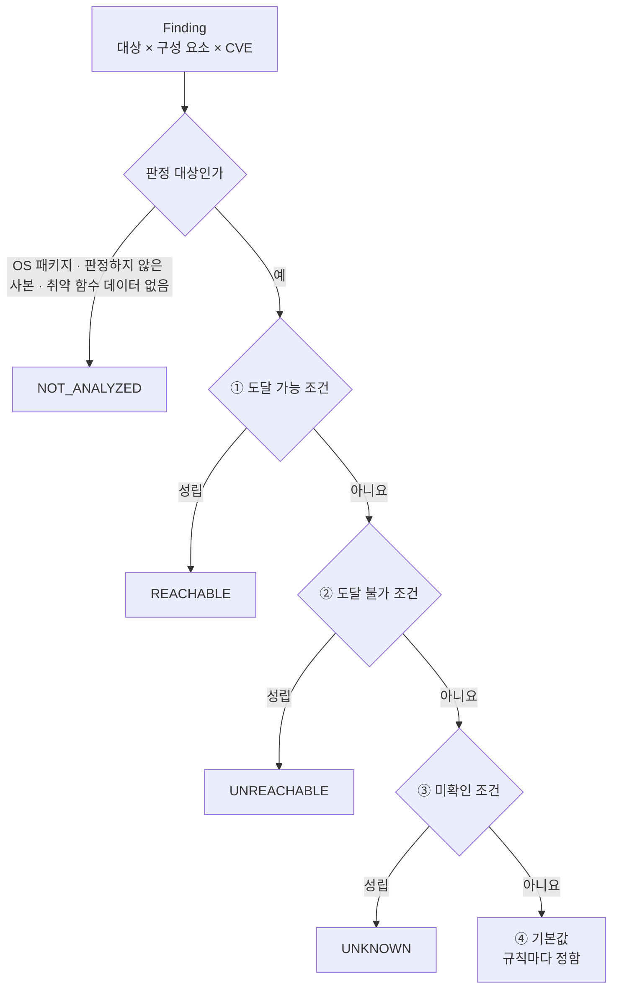

# 규칙 명세서

**한 줄 요약**: Reach가 Finding마다 `REACHABLE`·`UNREACHABLE`·`UNKNOWN`·`NOT_ANALYZED` 중 하나를 정하는 규칙이다. 기준은 Java·Spring Boot bootJar다. api의 Java CVE 14개를 이 규칙으로 판정했고, 14개 모두 `UNREACHABLE`이다.

**상태 표기**: [완료] PoC로 구현·검증됨 / [부분] 일부만 구현되었거나 수동 / [계획] 아직 없음(설계). 지금 규칙은 CLI가 읽는 데이터 파일(`data/rules.json`, `data/vuln-functions.json`)과 사실 수집 코드(`Facts.java`)로 돌아간다. API와 대시보드는 [계획]이다.

## 1. 목적과 적용 범위

**목적**

- Reach가 Finding 하나에 판정(상태, 방식, 근거)을 붙이는 조건을 한곳에 고정한다.
- 규칙 작성자는 이 문서의 절차(12절)로 규칙을 더한다. 검토자는 판정 근거를 이 문서와 대조한다.

**적용 범위**

| 구분 | 범위 | 상태 |
|---|---|---|
| L2 판정 대상 | Java·Spring Boot bootJar. PoC 대상은 api(`service-backend`, Spring Boot 4.1.1, Java 21, Gradle) | [완료] v0 |
| 입력 | bootJar의 앱 클래스(`BOOT-INF/classes`)와 라이브러리 jar(`BOOT-INF/lib`), Trivy 결과, `vuln-functions.json`, `rules.json` | [완료] |
| 도구 | `reach.jar`(Java 21 + ASM): 호출 그래프, 취약 함수 도달, 사실 수집<br>`verdict.py`(Python, 외부 라이브러리 없음): reach 결과·Trivy 결과·규칙을 합쳐 CVE별 판정과 보고서 생성 | [완료] v0 |
| 출력 | `verdicts.json`, `verdicts.md`(보고서), `reach-result.json` | [완료] |
| L1 배포 여부 | 실행 중 파드의 imageID와 스캔 digest 조인 (10절) | [부분] api 수동 확인 완료, 자동화 [계획] |
| OS 패키지(apk) | Java 호출 그래프로 판정하지 않고 `NOT_ANALYZED`로 표시 (9절) | [완료] 표시만 |
| 다른 생태계 | web(정적 프론트, npm), chat(Node). 분석기 플러그인으로 더한다(NFR-07) | [계획] |
| L3 실제 호출 | 능동 관측: 스테이징·로컬·CI에서 Java는 커버리지 에이전트로 취약 메서드 실행, 네이티브는 라이브러리 로드(maps)·uprobe를 확인한다. 실행이 관측되면 `REACHABLE` 근거로 쓰고, 실행되지 않았다는 것만으로 `UNREACHABLE`을 만들지 않는다(FR-14). 운영 상시 관측(Tetragon 등)은 비목표다 | [계획] |

- 관련 요구사항: FR-05(호출 그래프 판정), FR-06(규칙 판정), FR-07(판정·근거 출력), FR-08(사람 검토), FR-09(취약 함수 데이터), FR-04(L1).
- 규칙 조회는 API-09, 취약 함수 조회는 API-10, 규칙 화면은 SCR-06이다. 모두 [계획]이고, 지금은 데이터 파일을 직접 읽는다.
- 범위 밖: 우리 코드 자체의 취약점(SAST), 스캐너가 찾지 못한 구성 요소(13-1).

## 2. 판정 어휘

값은 다섯 산출물이 같이 쓴다. API 필드(API-04, API-05)와 화면 표시(SCR-02, SCR-03)가 이 값이다. 대시보드 공통 규약에 따라 대문자로 쓴다(ADR-D008). 지금 CLI(`verdict.py`)와 데이터 파일(`rules.json`)은 PoC 때의 소문자 값(`unreachable` 등)을 쓰고, 서버가 저장할 때 대문자로 바꾼다(ARD AD-18). 뜻은 같다.

### 2-1. 상태 `status`

| 값 | 뜻 | 출력 조건 | 근거로 남기는 것 |
|---|---|---|---|
| `REACHABLE` | 도달 가능. 취약 코드가 우리 앱에서 실행될 수 있다 | 규칙의 도달 가능 조건이 성립한다. 호출 그래프 방식이면 진입점에서 취약 메서드까지 강한 경로가 있다 | 조건을 만족한 앱 코드 줄, 호출 경로(후보) |
| `UNREACHABLE` | 도달 불가. 확인한 범위에서 닿지 않는다 | 규칙의 도달 불가 조건이 성립한다. 호출 그래프 방식이면 취약 메서드가 jar에 있고, 진입점에서 닿지 않는다 | 이유와 "확인했지만 없던 것" |
| `UNKNOWN` | 미확인. 판단할 근거가 모자라다 | 규칙의 미확인 조건이 성립한다. 또는 약한 경로로만 닿는다(GR-09), 취약 메서드가 jar에 없다(GR-08), 그 밖에 확신이 없다(GR-01) | 미확인으로 둔 이유 |
| `NOT_ANALYZED` | 분석 대상 아님. 이 Finding에는 판정 규칙을 적용하지 않았다 | OS 패키지(GR-13), 판정하지 않은 패키지 사본(GR-12), 취약 함수 데이터 없음(GR-14), 지원하지 않는 생태계(npm 등, [계획]) | 대상이 아닌 이유. API에서는 `notAnalyzedReason`(`OS_PACKAGE` / `UNANALYZED_COPY` / `NO_VULN_FUNCTION_DATA` / `UNSUPPORTED_ECOSYSTEM`)이다(API 명세서 3-4) |

### 2-2. 방식 `method`

| 값 | 뜻 | 쓰는 경우 | 지금 api에서 |
|---|---|---|---|
| `CALLGRAPH` | 호출 그래프로 취약 메서드 도달을 본다 | 앱 코드가 라이브러리를 직접 부를 때 (5-1) | 5개: CVE-2025-14813, CVE-2026-8763, 13506, 0636, 89425 |
| `RULE` | 앱 코드 사실로 설정·타입 조건을 본다 | 컨테이너나 프레임워크가 스스로 실행할 때 (5-1, 6절) | 9개: Tomcat 3개, Jackson 6개 |
| `MANUAL` | 사람이 판정한다 | 도구가 판정하지 않은 것을 사람이 정할 때 | 없음. 10/9 수동 판정에서 CVE-2025-14813·CVE-2026-8763을 `MANUAL`로 적었고, 지금은 도구가 판정한다. Jackson 2 사본 7행은 사람이 제안을 확정하면 `MANUAL`이 된다(9-1) |

### 2-3. 사람 검토 `reviewState`

| 값 | 뜻 | 출력 조건 | 예 |
|---|---|---|---|
| `UNREVIEWED` | 검토 전 | 사람 판정이 없다 | Jackson 2 사본 7행. 제안(확정 대기)이 있어도 확정 전이다(9-1) |
| `PROVISIONAL` | 잠정 | 사람이 판정했지만 확인할 항목이 남았다 | 10/9 CRITICAL 5개(노트북 확인 전), CVE-2026-13506(지금) |
| `CONFIRMED` | 확정 | 근거에 필요한 확인 항목을 모두 확인했다 | 처음 10개(10/10, `verify-laptop.sh` 결과로 정리), 0636·19032·83557 |

자세한 기준은 11절. 지금은 `docs/answer-key.md`에 적는다([부분], FR-08). API-06은 [계획]이다.

### 2-4. 판정 기록 형식

원자료의 예시(종합 정리 6-2). CLI 출력이라 소문자 값과 원래 필드 이름 그대로다:

```json
{
  "cve": "CVE-2026-68525",
  "purl": "pkg:maven/org.apache.tomcat.embed/tomcat-embed-core@11.0.24",
  "status": "unreachable",
  "method": "rule",
  "evidence": "FORM 인증(LoginConfig) 설정 없음"
}
```

| 항목 | 내용 | 출처 |
|---|---|---|
| `cve`, `purl`, `status`, `method`, `evidence` | 위 예시의 필드 | 종합 정리 6-2 |
| 패키지 도달, 취약 메서드 도달 | 보고서 열. 호출 그래프 결과를 판정과 따로 보여준다 | 작업 기록 11-2절 |
| 앱 코드 사실(파일·줄), 호출 경로(후보) | 사실을 먼저, 경로를 나중에 보여준다(GR-05) | 작업 기록 14-3절 |
| `info` | 판정에 쓰지 않고 "참고"로만 보여주는 사실. API에서는 Rule의 `infoFacts`, Evidence의 `informational`로 보인다(API 명세서 3-5·3-7) | 작업 기록 12절 |
| `dto_type_tokens` | tokens 출발점 목록(6-1). 사람이 판정 근거를 확인하는 데 쓴다 | 작업 기록 12절 |
| `reviewState` | 사람 검토 상태. 지금(PoC)은 판정 파일이 아니라 정답지에 따로 적는다. 운영에서는 검토 기록(API-06)에 남기고, 정답지와 구분한다(11절) | FR-08 |

필드 이름과 전체 구조는 원본(`verdict.py`, `verdicts.json`) 확인 필요.

## 3. 일반 원칙 (GR)

모든 CVE 규칙이 따르는 원칙이다. 원자료에 근거가 있는 것만 적었다. 출처의 "기록"은 PoC 작업 기록, "종합"은 종합 정리 및 향후 계획이다.

### 3-1. 판정 일반

| ID | 원칙 | 이유 | 출처 | 상태 |
|---|---|---|---|---|
| GR-01 | 확신이 없으면 `UNKNOWN`으로 둔다. 거짓 `UNREACHABLE`을 내지 않는다 | PoC 성공 기준: 틀리더라도 거짓 `UNREACHABLE`이 아니라 `UNKNOWN`이어야 한다(NFR-01) | 종합 3-2·6-2, 기록 4절 | [완료] |
| GR-02 | 결과를 지우지 않는다. 모든 Finding을 네 상태 중 하나로 표시한다 | 도달 불가는 삭제가 아니라 보류다(업계 공통 원칙) | 종합 3-2, 스프린트 10/8 1-3 | [완료] |
| GR-03 | 판정 단위는 메서드다. 패키지·클래스 단위 도달은 참고로만 보여준다 | bcprov는 패키지로는 닿지만(Argon2) 취약 메서드에는 닿지 않는다. 13506은 클래스 단위로는 배제되지 않고 메서드 단위로만 배제된다 | 종합 4-4, 기록 5·14-4절 | [완료] |
| GR-04 | 모든 판정에 방식(`method`)과 근거를 남긴다. `REACHABLE`은 호출 경로나 코드 줄, `UNREACHABLE`은 이유와 "확인했지만 없던 것"을 낸다 | 설명 가능성(NFR-02) | 종합 3-2·6-2 | [완료] |
| GR-05 | 근거는 앱 코드 사실(파일·줄)을 먼저, 호출 경로를 나중에 보여준다. 경로에는 "가장 짧은 후보 경로이며 실제 경로와 다를 수 있다"를 붙인다 | RTA 과대근사로 판정이 맞아도 경로가 엉뚱할 수 있다(89425 실험 B) | 기록 14-3·16절 | [완료] |
| GR-06 | 규칙으로 판정했는데 호출 그래프 결과가 판정과 달라 보이면 이유(과대근사, 프레임워크가 실행하는 코드)를 붙인다 | jackson-databind는 그래프상 취약 메서드 도달이 "예"인데 판정은 `UNREACHABLE`이고, Tomcat은 그래프상 패키지 도달이 "아니요"다. 보고서만 보면 헷갈린다 | 기록 11-2·14-3절 | [완료] |

### 3-2. 입력과 수집

| ID | 원칙 | 이유 | 출처 | 상태 |
|---|---|---|---|---|
| GR-07 | 사실은 앱 코드(`BOOT-INF/classes`)에서만 수집한다 | 프레임워크 내부 코드는 앱과 무관하게 같은 일을 한다. 판정을 가르는 것은 "앱이 무엇을 설정·호출하는가"다 | 기록 4절 | [완료] |
| GR-08 | 취약 메서드가 jar에 없으면 `UNKNOWN`이다 | 버전에 따라 메서드 이름이 바뀐다(예: BC 1.84). 못 찾았다고 도달 불가로 쓰면 위험하다 | 기록 4절 | [완료] |
| GR-09 | 약한 경로(Object 메서드 호출, JDK 콜백)로만 닿으면 `UNKNOWN`이다 | 첫 시험에서 "Jackson 날짜 포맷 → Object.equals → BC 권한 클래스" 같은 의미 없는 경로가 근거로 나왔다 (5-3) | 기록 4절 | [완료] |
| GR-10 | 리플렉션, 동적 프록시, JNI는 모델링하지 않는다. JDK 내부 코드도 분석하지 않고, JDK가 다시 부를 수 있는 메서드는 약한 경로로 가정한다. 2단계 진입점과 규칙으로 보완하고, 놓치는 모양은 회귀 테스트로 고정한다(13절) | 알려진 한계다. 주입 실험 C에서 실제로 놓쳤다 | 기록 4·13절, 종합 7절 | [완료] 한계 고정 |
| GR-11 | AI는 취약 함수 후보 생성, 구성요소 식별 후보(FR-02), 판정 설명에만 쓴다. CVE 대조와 최종 판정에는 쓰지 않는다. 후보는 사람이 확인한 것만 쓴다. 취약 함수 후보를 만들 때 AI에는 공개 공지와 수정 커밋만 보내고, 우리 앱 소스 코드는 보내지 않는다(FR-09, ARD SR-11). AI 후보로만 식별한 구성요소는 "구성요소 추정"으로 표시하고, 그 Finding은 `UNREACHABLE`로 확정하지 않는다(FR-02) | 정답이 DB와 코드에 있어 규칙이 더 정확하다. AI 결과는 재현할 수 없다(NFR-04) | 종합 3-3 | [완료] 판정 도구(`reach.jar`, `verdict.py`)는 AI를 쓰지 않는다 |

### 3-3. 판정 대상과 행 구성

| ID | 원칙 | 이유 | 출처 | 상태 |
|---|---|---|---|---|
| GR-12 | 같은 CVE라도 패키지 사본이 다르면 행을 나눈다. 판정 행에는 판정한 패키지의 설치·수정 버전을 쓴다. 판정하지 않은 사본은 `NOT_ANALYZED` 행으로 드러낸다 | CVE당 한 줄이던 보고서에서는 판정하지 않은 사본(Jackson 2.21.5)이 보이지 않았고, 다른 패키지의 버전이 표시될 수 있었다 | 기록 14-2절 | [완료] |
| GR-13 | OS 패키지는 Java 호출 그래프로 판정하지 않는다(`NOT_ANALYZED`) | Java 호출 그래프의 대상이 아니다 | 기록 11-2절 | [완료] |
| GR-14 | 취약 함수 데이터가 없는 CVE는 `NOT_ANALYZED`로 둔다. `UNREACHABLE`로 쓰지 않는다 | 취약 함수가 호출 그래프 판정의 목표 지점이다. 공지 중 취약 함수를 적은 것은 2%뿐이라(Endor Labs 2024, 회사 자체 조사 기준) 데이터를 직접 만들어야 한다 | 기록 11-2절, 종합 3-3. 종합 7절 위험 표는 "못 찾으면 unknown"으로 적었지만, 도구 출력(기록 11-2)은 `NOT_ANALYZED`다 | [완료] |
| GR-15 | 판정 대상(bootJar, 이미지 digest)을 보고서에 적는다. 이미지를 직접 만들면 이미지 안 jar의 sha256을 분석한 bootJar와 비교한다 | 로컬 이미지에 오래된 jar가 들어가 라이브러리가 102개(이미지) 대 185개(레포 bootJar)로 달랐다(10/10 `verify-laptop.sh` 확인). 실제 앱 분석의 라이브러리 jar 184개(5-4)와 1개 차이가 나는 원인은 확인 필요 | 종합 7절, 기록 11-1·14-1절 | [부분] 수동 비교. 보고서 표기 형식은 원본(`verdict.py`) 확인 필요 |

### 3-4. 배포 여부 (L1, 자세한 것은 10절)

| ID | 원칙 | 이유 | 출처 | 상태 |
|---|---|---|---|---|
| GR-16 | 실행 중 파드의 `status.containerStatuses[].imageID`(digest)와 스캔 digest를 조인한다. 태그는 신뢰하지 않는다 | ECR 태그가 MUTABLE이고 `pullPolicy: IfNotPresent`라 gitops 태그로는 실행 중 이미지를 확정할 수 없다. `docker images`의 IMAGE ID도 digest가 아니다 | 스프린트 10/7 2절, 자산 인벤토리 1절 | [부분] |
| GR-17 | 이미지의 revision 라벨(`org.opencontainers.image.revision`)로 커밋을 찾는다. 분석 커밋과 다르면 조상 관계와 소스 트리 해시를 비교한다 | CI가 이 라벨을 붙인다. 커밋이 달라도 소스 트리가 같으면 같은 코드다. 예: 라벨 `bb4639b`와 분석 커밋 `6583020`은 커밋이 다르지만 소스 트리가 같다(10-3) | 기록 15-4·15-6절 | [부분] |
| GR-18 | 배포 digest를 다시 스캔해, 판정에 쓴 스캔과 행(CVE·패키지·설치 버전·심각도·수정 버전)이 같을 때 판정을 배포물에 적용한다. 다르면 그 결과를 배포물 판정으로 쓰지 않는다 | 운영에서 실제로 도는 이미지에 맞아야 최종 결과로 쓸 수 있다. 로컬에서 만든 이미지는 오래된 jar가 들어가 bcprov 등이 빠져 있었다 | 기록 14-1·15-6절, 종합 4-5 | [부분] |

### 3-5. 사람 검토와 검증

| ID | 원칙 | 이유 | 출처 | 상태 |
|---|---|---|---|---|
| GR-19 | 사람이 확정한 판정이 도구 판정보다 우선한다. 정답지는 도구와 독립적으로 만든 판정(PoC 정답지, 검증 세트)이고, 도구를 채점하는 기준이다(M-03). 운영 Finding의 사람 검토(`reviewState`)는 정답지가 아니다. 둘이 다르면 원인을 조사해 틀린 쪽을 고친다(11-3) | 확정은 사람이 한다 | 기록 7·11-2·15-2절 | [부분] 문서(`answer-key.md`)로 관리 |
| GR-20 | 대조군 기대값은 도구를 돌리기 전에 적는다. 판정만이 아니라 근거가 가리키는 줄도 확인한다 | 판정만 맞고 이유가 틀릴 수 있다 | 기록 5·13절 | [완료] |
| GR-21 | 알려진 놓침은 회귀 테스트의 기대값으로 고정한다. 누가 한계를 해결하면 테스트가 실패해 문서를 고치게 한다 | 문서의 한계와 도구 동작을 맞춰 둔다 | 기록 13절, 종합 7절 | [완료] |

### 3-6. 취약 함수 데이터

| ID | 원칙 | 이유 | 출처 | 상태 |
|---|---|---|---|---|
| GR-22 | 취약 함수는 diff에서 실제로 바뀐 메서드로 정한다. 처음 10개는 취약·수정 버전 소스 diff(Tomcat은 수정 커밋과 태그 diff를 대조), 13506과 MEDIUM 3개는 수정 커밋 diff다. 설치 버전 jar에서 `javap`로 시그니처를 확인한다. 일반 경로와 함께 쓰는 메서드는 빼고, 뺀 이유를 남긴다(FR-09) | `ASN1InputStream.buildObject`는 일반 파싱과 공유해서 넣으면 오탐이 난다(13506) | 기록 3·14-4·15-1절 | [완료] |
| GR-23 | `vuln-functions.json`은 조사 파일에서 `make_spec.py`로만 만든다. 생성 파일을 직접 고치지 않는다 | 13506을 직접 넣었다가 조사 파일로 옮기고 다시 생성했다 | 기록 15-1절 | [완료] |

## 4. 평가 순서

CVE 규칙은 "도달 가능 조건 → 도달 불가 조건 → 미확인 조건 → 기본값" 순서로 평가한다(기록 4절). 그 전에 판정 대상인지부터 가른다.

| 순서 | 단계 | 성립하면 | 예 |
|---|---|---|---|
| 0 | 대상 확인: OS 패키지, 판정하지 않은 패키지 사본, 취약 함수 데이터 없음 | `NOT_ANALYZED` | libpng·zlib, Jackson 2.21.5 사본 (9절) |
| 1 | 도달 가능 조건 | `REACHABLE` | 요청 본문 타입에 실수형 필드(89407), 강한 경로로 취약 메서드 도달(14813) |
| 2 | 도달 불가 조건 | `UNREACHABLE` | FORM 인증기 사용 없음(68525), 취약 메서드 미도달(13506) |
| 3 | 미확인 조건 | `UNKNOWN` | `F-dto.floating.tokens`(89407), `CertStore.getInstance`만 있음(0636), 약한 경로로만 도달, 취약 메서드가 jar에 없음 |
| 4 | 기본값 | 규칙마다 정한 값 | 원본(`rules.json`) 확인 필요 |

- 먼저 성립한 단계의 결과를 쓰고 뒤 단계는 보지 않는다(추정: "순서로 평가한다"의 뜻. 원본(`verdict.py`) 확인 필요). 그래서 도달 가능 조건이 다른 조건보다 앞선다.
- `RULE` 방식에서는 규칙의 사실 조건이 판정을 정하고, 호출 그래프 결과는 보고서에 참고로 보인다(기록 11-2절). 규칙이 그래프 결과를 조건에 함께 쓰는지는 원본(`rules.json`) 확인 필요.



**개념 의사코드** (실제 이름·구조는 다를 수 있다. 원본(`verdict.py`) 확인 필요)

```python
def judge(finding):
    if finding.is_os_package:                                   # GR-13
        return Verdict("not_analyzed", reason="OS 패키지")
    if finding.package not in judged_packages(finding.cve):     # GR-12
        return Verdict("not_analyzed", reason="판정하지 않은 패키지 사본")
    if finding.cve not in vuln_functions:                       # GR-14
        return Verdict("not_analyzed", reason="취약 함수 데이터 없음")

    rule  = rules[finding.cve]
    facts = collect_facts(bootjar.app_classes)                  # GR-07: 앱 코드에서만
    cg    = callgraph(bootjar, vuln_functions[finding.cve])
    # cg: strong(강한 경로 도달) / weak_only(약한 경로로만) / none(미도달) / missing(jar에 없음)

    for status, cond in [("reachable",   rule.reachable_if),
                         ("unreachable", rule.unreachable_if),
                         ("unknown",     rule.unknown_if)]:
        if cond(facts, cg):                                     # 먼저 성립한 것을 쓴다
            return Verdict(status, rule.method,
                           evidence=evidence(facts, cg),         # GR-04, GR-05
                           info=rule.info(facts))                # 판정에 쓰지 않는 참고 사실
    return Verdict(rule.default, rule.method, evidence=evidence(facts, cg))
```

**호출 그래프 방식의 기본 조건**

| 호출 그래프 결과 | 판정 | 원칙 |
|---|---|---|
| 진입점에서 강한 경로로 취약 메서드에 닿음 | `REACHABLE` | 경로는 후보로 표시 (GR-05) |
| 약한 경로로만 닿음 | `UNKNOWN` | GR-09 |
| 취약 메서드가 jar에 없음 | `UNKNOWN` | GR-08 |
| 취약 메서드가 jar에 있고 닿지 않음 | `UNREACHABLE` | 확인한 범위를 근거로 남김 (GR-04) |
| 2단계 진입점(모든 앱 메서드)에서만 닿음 | 원본(`reach.jar`, `verdict.py`) 확인 필요 | - |

## 5. 호출 그래프 규칙

### 5-1. 방식 선택 기준

라이브러리를 우리 코드가 부르면 호출 그래프, 프레임워크가 스스로 실행하면 설정 규칙이다(종합 4-5).

| 호출 주체 | 방식 | 이유 | CVE |
|---|---|---|---|
| 앱 코드가 라이브러리를 직접 부름 | `CALLGRAPH` | 코드가 취약 클래스를 직접 부르는 구조라 경로가 그래프에 나온다 | CVE-2025-14813, CVE-2026-8763, 13506, 0636 (bcprov), 89425 (jackson-core) |
| 컨테이너(Tomcat)가 스스로 실행 | `RULE` (설정) | Spring Boot 내장 Tomcat은 기본 인증기(`NonLoginAuthenticator`) 때문에 `AuthenticatorBase.invoke`·`RealmBase.findSecurityConstraints`를 요청마다 실행한다. 제약 목록이 비어 있어 취약 구간에는 들어가지 않으므로, 함수 도달만 보면 오탐이 난다. Tomcat은 리플렉션으로 떠서 그래프에 잡히지도 않는다 | 65182, 65905, 68525 |
| 프레임워크(Spring MVC의 Jackson 변환)가 타입에 따라 실행 | `RULE` (역직렬화 타입) | `readValue`를 한 번이라도 부르면 그래프상 거의 모든 역직렬화기에 닿는다(가상 호출 과대근사). 실제 경로는 어떤 타입을 역직렬화하느냐에 달렸다 | 89407, 68497, 91776, 91777, 19032, 83557 |

### 5-2. 그래프 만들기

| 항목 | 규칙 | 이유 |
|---|---|---|
| 입력 | bootJar 바이트코드(앱 클래스와 `BOOT-INF/lib`). ASM으로 읽는다 | v0는 작업 공간에서 SootUp을 받을 수 없어 ASM으로 직접 구현했다 |
| 알고리즘 | RTA(Rapid Type Analysis). 실제로 `new`한 클래스만 가상 호출 대상으로 본다 | CHA보다 정밀하고, 포인터 분석보다 가벼워 노트북에서 돈다 |
| 진입점 1단계 | Spring 진입점: 컨트롤러, `@Bean`, 리스너, 스케줄러(`@Scheduled`), 프레임워크 콜백 | "어느 API에서 시작하는지"를 보여준다 |
| 진입점 2단계 | 모든 앱 메서드 | 리플렉션으로 불리는 앱 메서드를 놓치지 않는다 |
| 약한 간선 | Object 메서드 호출(예: `Object.equals`), JDK 콜백. 탐색의 두 번째 단계로 미룬다 | 근거로 약하다 (5-3) |
| JDK 내부 | 분석하지 않는다. JDK가 다시 부를 수 있는 메서드는 약한 경로로 가정한다 | GR-10 |
| 교체 후보 | SootUp(같은 RTA 계열) | [계획] 정밀도를 높일 때 |

진입점 전체 목록, 진입점 단계와 약한 간선 단계를 조합하는 방식은 원본(`reach.jar`) 확인 필요.

### 5-3. 약한 경로를 분리한 이유

첫 시험에서 bcprov 도달 근거가 의미 없는 경로로 나왔다. 이 간선을 두 번째 단계로 미루자 근거가 실제 사용 경로로 바뀌었다. 약한 경로로만 닿으면 `UNKNOWN`이다(GR-09).

```text
분리 전: Jackson 날짜 포맷 → Object.equals → BC 권한 클래스
분리 후: AuthController.signup → EmailAuthService.signup → … → Argon2BytesGenerator
```

### 5-4. 경로 출력

- 가장 짧은 후보 경로 하나를 보여주고 "가장 짧은 후보 경로이며 실제 경로와 다를 수 있다"를 붙인다(GR-05).
- 앱 코드 사실(정확한 줄)을 경로보다 먼저 보여준다.
- 대표 경로 (app-positive, 실제 BouncyCastle 바이트코드):

```text
CVE-2025-14813: RiskyController.encrypt → LegacyCrypto.gostEncrypt → StreamBlockCipher.processBytes
                → G3413CTRBlockCipher.calculateByte → G3413CTRBlockCipher.generateCRT
CVE-2026-8763 : CertReview.review → PKIXCertPathReviewer.isValidCertPath → doChecks → checkNameConstraints
                → PKIXNameConstraintValidator.checkPermitted → … → emailIsConstrained
```

**과대근사 사례**

| 사례 | 무엇이 나왔나 | 처리 |
|---|---|---|
| 89425 실험 B | 경로가 `AuditLogController.list → … → readTree → UTF8DataInputJsonParser`로 나왔다. probe가 DataInput 파서를 한 번 만들자 RTA가 앱 전체의 `nextToken()` 호출이 그 파서로 갈 수 있다고 봤다 | 판정은 맞았다. 사실을 먼저 보여주고 경로를 후보로 표시한다 |
| jackson-databind 3개(실제 앱) | 취약 메서드 도달이 "예"인데 판정은 `UNREACHABLE` | 규칙이 판정을 정했다는 이유를 붙인다 (GR-06) |
| Tomcat(실제 앱) | 패키지 도달이 "아니요". Spring Boot가 Tomcat을 리플렉션으로 띄워 그래프에 안 잡힐 뿐 실제로는 쓰인다 | 규칙으로 판정하고 이유를 붙인다 (GR-06) |

**성능**: 실제 api 약 40초(앱 클래스 376개, 라이브러리 jar 184개, 도달 메서드 67,091개, 로딩 12초 포함, bootJar 빌드 제외). PR마다 돌릴 수 있다(NFR-03).

## 6. 역직렬화 타입 추적 규칙

Jackson CVE 대부분은 데이터 타입이 결정한다. 앱이 어떤 타입을 역직렬화하는지 찾고, 그 타입의 필드를 따라가 취약 기능을 쓰는 필드가 있는지 본다(기록 3·4·12절).

### 6-1. 범위 세 가지

| 범위 | 출발점 | 쓰는 곳 |
|---|---|---|
| 루트 | `@RequestBody`·`@RequestPart`·`@Payload`, 리스너 파라미터, `HttpEntity`, `readValue` 계열에 쓰인 class, `TypeReference`, Feign·HTTP Interface 응답 타입 | 도달 가능 조건(발동 조건 사실) |
| tokens | 루트 + 앱 코드 어디든 있는 class 리터럴 + `TypeReference` 제네릭 + Jackson 어노테이션의 클래스 값(`@JsonDeserialize(as=…)`, `@JsonSubTypes`) + `@Cacheable`·`@CachePut` 반환 타입 | 89407 미확인 조건(`F-dto.floating.tokens`) |
| any | 앱 클래스 전체 | 89407 참고(`F-dto.floating.any`, `info`) |

- tokens는 "Jackson에 타입을 알려줄 수 있는 자리에 나온 타입"이다. 루트 수집이 놓치는 경우(예: `Class<T>`를 받는 공용 helper에 `Foo.class`를 넘김)를 잡는다.
- 실제 앱의 tokens 출발점은 97개였다(Kakao 응답 DTO, `Report` 엔티티, enum, logger용 class 리터럴 등). 넓게 잡았는데도 실수형 필드는 없었다. "아무것도 안 봐서 없음"이 아니다.
- 출발점 목록은 결과 파일의 `dto_type_tokens`에 남긴다.

### 6-2. 필드 타입 따라가기

- 루트 타입에서 필드 타입을 따라간다. 컬렉션 원소 타입과 중첩 record도 따라간다(실험 B: `List<Line>` 안의 `BigDecimal`, 중첩 record의 `Duration`).
- 근거는 따라간 길을 그대로 쓴다. 예(실험 B, 89407): `order(@body) → OrderRequest.lines → OrderLine.unitPrice`.
- 어노테이션을 세는 자리(91777 수정 후): 타입 자체에 붙은 어노테이션은 91776 검사에서만 센다. 91777은 (1) 컬렉션·맵 필드의 원소 타입, (2) 루트 자체가 컬렉션·맵인 경우(`@RequestBody Map<String, Account>`, `TypeReference<List<Node>>`)의 원소 타입만 센다.
- 제네릭, 상속, 맵 키 처리의 세부는 원본(`Facts.java`) 확인 필요.

### 6-3. 응답 전용 타입을 세지 않는 이유

- Jackson은 누군가 타입을 알려줘야만 그 타입으로 역직렬화한다. `new`로 만들어 반환만 하는 응답 record는 역직렬화될 방법이 없다.
- 실제 사례: `SellerBriefResponse`, `SellerProfileResponse`의 `Double averageRating`. JDBC 행으로 만들어 반환만 한다. 처음 안전망은 "앱 클래스 어디든 실수형 필드가 있으면 미확인"이라 이것에 걸렸고, 정답지와 9/10 일치에 그쳤다. 안전망을 tokens로 좁힌 뒤 10/10이 됐다.
- 대조군 `app-tokens`(helper를 거쳐서만 역직렬화되는 `BigDecimal`)는 `UNKNOWN`이 나온다. 좁힌 뒤에도 helper 경유는 놓치지 않는다.
- 한계: 일부러 넓게 잡아서, 실수형 필드가 있는 JPA 엔티티를 `em.find(Foo.class)`로 읽기만 해도 `UNKNOWN`이 된다.
- `GenericJackson(2)JsonRedisSerializer`는 `@class`로 아무 타입이나 지정할 수 있다. 이것이나 default typing이 있으면 `UNKNOWN`으로 남긴다(`F-jackson.polymorphicSerializer`).

## 7. 사실 목록 (F)

- 사실은 `reach.jar`가 앱 클래스 바이트코드에서 뽑는다(`Facts.java`, GR-07).
- 원자료 기준 사실은 **40개**다(처음 38개, 89407 규칙 개선 후 40개). 아래는 원자료에 나온 것만 적었다. 나머지와, CVE 4개를 더한 뒤(기록 14-4·15-1절)의 목록은 원본(`rules.json`) 확인 필요.
- 이름이 원자료에 없는 사실은 "(이름 미정)"으로 두고 뜻만 적는다. 이름을 새로 짓지 않는다.

### 7-1. 이름이 확인된 사실

| ID | 뜻 | 수집 방법 | 쓰는 규칙 |
|---|---|---|---|
| `F-dto.floating.tokens` | tokens 범위(6-1)의 타입에 실수형 필드가 있다 | tokens 출발점에서 필드 타입을 따라간다. 출발점 목록은 `dto_type_tokens`에 남는다 | RULE-CVE-2026-89407 미확인 조건 |
| `F-dto.floating.any` | 앱 클래스 전체에 실수형 필드가 있다 | 앱 클래스 전체 | RULE-CVE-2026-89407 `info`(참고). 12절 개선 전에는 미확인 조건이었다 |
| `F-jackson.polymorphicSerializer` | `@class`로 타입을 지정할 수 있는 직렬화기(`GenericJackson(2)JsonRedisSerializer`)를 쓴다 | 앱 코드에서 사용 여부 | RULE-CVE-2026-89407 미확인 조건. default typing이 이 사실에 들어가는지, 다른 규칙에서도 쓰는지는 원본(`rules.json`) 확인 필요 |
| `F-jsonIdentityInfo.any` | 앱 코드에 `@JsonIdentityInfo`가 있다(mix-in 클래스에 붙은 것 포함) | 앱 코드의 어노테이션. 범위가 앱 전체인지는 이름으로 본 추정이다. 원본(`Facts.java`) 확인 필요 | RULE-CVE-2026-91777 미확인 조건 |

"실수형"에 드는 타입 목록은 원본(`Facts.java`) 확인 필요. 원자료에 나온 것은 `double`, `Double`, `BigDecimal`이다. 공지는 89407의 대상 타입으로 `BigDecimal`, `BigInteger`, `Double`, `Float`를 적는다.

### 7-2. 이름이 없는 사실

"수집 방법"에는 원자료에서 실제로 잡힌 모양을 적었다. 실험 A는 규칙 모양 그대로 넣은 것, B는 우회한 모양이다(13-3).

| ID | 뜻 | 수집 방법(원자료에 나온 모양) | 쓰는 규칙 |
|---|---|---|---|
| (이름 미정) | 컨테이너 보안 제약을 설정한다 | `SecurityConstraint`, `LoginConfig`, `@ServletSecurity`, `addConstraint` 등. 이 목록은 정답지(사람 판정)의 근거다. 사실이 잡는 모양은 원본(`rules.json`) 확인 필요 | RULE-CVE-2026-65182 |
| (이름 미정) | Tomcat DIGEST 인증기를 쓴다 | `new DigestAuthenticator`(실험 A) | RULE-CVE-2026-65905 |
| (이름 미정) | Tomcat FORM 인증기와 메서드별 제약을 쓴다 | `new FormAuthenticator` + `addMethod`(실험 A) | RULE-CVE-2026-68525 |
| (이름 미정) | GOST CTR 모드를 쓴다 | `new G3413CTRBlockCipher`(실험 A), JCE 이름 `"GOST3412-2015/CTR"`(실험 B). 사실로 잡는지 그래프 모델로 잡는지는 원본(`rules.json`, `reach.jar`) 확인 필요 | RULE-CVE-2025-14813 |
| (이름 미정) | BC provider로 인증서 경로를 검증한다 | `CertPathValidator` + `new BouncyCastleProvider()`(실험 A), `addProvider(BC)` + `CertPathBuilder "BC"`(실험 B) | RULE-CVE-2026-8763 |
| (이름 미정) | BC LDAP 클래스를 만든다 | BC LDAP 클래스 생성. 대상 클래스 목록은 원본(`rules.json`) 확인 필요 | RULE-CVE-2026-0636 도달 가능 조건 |
| (이름 미정) | JCE 이름으로 인증서 저장소를 고른다 | `CertStore.getInstance` | RULE-CVE-2026-0636 미확인 조건 |
| (이름 미정) | 루트에서 따라간 타입에 실수형 필드가 있다 | `@RequestBody`의 `double`(실험 A), `List<Line>` 안의 `BigDecimal`(실험 B) | RULE-CVE-2026-89407 도달 가능 조건 |
| (이름 미정) | 루트에서 따라간 타입에 `javax.xml.datatype`의 `Duration`·`XMLGregorianCalendar` 필드가 있다 | `@RequestBody`의 `XMLGregorianCalendar`(실험 A), 중첩 record의 `Duration`(실험 B) | RULE-CVE-2026-68497 |
| (이름 미정) | 역직렬화 타입(타입 자체 또는 필드)에 `@JsonTypeInfo`와 대체 동작(`defaultImpl`)이 있다 | `@JsonTypeInfo(defaultImpl)`(실험 A), 필드에 붙인 `@JsonTypeInfo`(실험 B) | RULE-CVE-2026-91776 |
| (이름 미정) | 컬렉션·맵의 원소 타입에 `@JsonIdentityInfo`가 있다 | 컬렉션·맵 필드의 원소(`List<Node>`, 실험 A), 루트 자체가 컬렉션·맵(`Map<String, Account>`, 실험 B) | RULE-CVE-2026-91777 도달 가능 조건 |
| (이름 미정) | 역직렬화 타입에 `java.nio.file.Path` 필드가 있다 | 89407과 같은 모양(타입 추적) | RULE-CVE-2026-19032 |
| (이름 미정) | `@JsonTypeInfo`를 쓰고, `Comparable` 필드가 있다 | 앱 코드의 어노테이션과 필드 타입 | RULE-CVE-2026-83557 |
| (이름 미정) | default typing을 쓴다 | 원본(`Facts.java`) 확인 필요 | RULE-CVE-2026-89407 미확인 조건 |

실험 B의 Tomcat 우회 모양(Authenticator 하위 클래스, `@ServletSecurity`, `HttpMethodConstraintElement`)도 기대대로 잡혔다. 어느 사실이 어느 CVE에서 잡았는지는 원본(`rules.json`) 확인 필요.

### 7-3. 도구 밖에서 확인하는 사실

런타임 설정(`java.security`, 환경 변수)은 도구가 보지 못한다. 확인 스크립트(`verify-laptop.sh`)와 수동 조회로 따로 본다(기록 4·11-1절).

| 사실 | 확인 방법 | 쓰는 곳 |
|---|---|---|
| 런타임 provider 순서 | `verify-laptop.sh`. api 이미지는 SUN이 1순위이고 BouncyCastle은 목록에 없다 | RULE-CVE-2026-8763 |
| 실행 옵션 `-Djava.security.*` | `verify-laptop.sh`. api는 없다 | RULE-CVE-2026-8763 |
| `bctls`·`bcpkix` 포함 여부 | 이미지·bootJar의 jar 목록. api는 둘 다 없다. `okhttp` 4.12.0이 bcprov를 참조하지만 `bctls`가 없어 BC TLS를 쓰지 않는다 | RULE-CVE-2026-8763 |
| 이미지 안 jar와 분석한 bootJar의 일치 | sha256 비교 | GR-15 |
| 실행 중 파드의 `imageID`, 이미지의 revision 라벨 | `kubectl get pods` 조회와 이미지 라벨. 읽기 명령만 썼지만 관리자 kubeconfig로 실행했다. 읽기 전용 계정은 \[계획\](10-1) | 10절 |

### 7-4. 사실이 아닌 출력 항목

- `info`: 판정에 쓰지 않고 보고서에 "참고"로만 보여줄 사실. 89407은 `F-dto.floating.any`를 계속 보여준다.
- `dto_type_tokens`: tokens 출발점 목록. 판정 근거를 사람이 확인할 수 있게 남긴다.
- 취약 함수 데이터 규모: 10/10 오전 기준 CVE 10개, 취약 메서드 36개. CVE 4개를 더한 뒤의 수는 원본(`vuln-functions.json`) 확인 필요.

## 8. CVE별 규칙 (RULE)

- 배포 이미지(`a6ffffef…`) 스캔 23행 중 Java CVE 14개의 규칙이다. 판정 대상은 `service-backend` 커밋 `6583020`의 bootJar다. 이 커밋은 배포 이미지의 revision `bb4639b`와 소스 트리가 같다(10절).
- 조건 칸은 원자료에 나온 것만 적었다. 원자료가 규칙으로 설명한 조건은 그대로 옮겼다. 정답지(사람 판정)의 근거나 추론으로 채운 조건에는 "정확한 조건식은 원본(`rules.json`) 확인 필요"를 붙였다. 원자료에 없는 조건은 "원본(`rules.json`) 확인 필요"로만 두었다.
- 기본값(4절)은 모든 규칙에서 원본(`rules.json`) 확인 필요다. 표에는 89407에만 적었다.
- "공통"은 호출 그래프 기본 조건(약한 경로로만 닿음, 취약 메서드가 jar에 없음 → `UNKNOWN`, 4절)이다.
- 수정 버전은 배포 digest 재스캔(Trivy, 10/10)의 값이다. 우리 앱의 업그레이드 대상은 Tomcat 11.0.25, bcprov 1.85, Jackson 3.1.7 이상이다(기록 3절). 적용 여부는 팀이 정한다.
- "verify N절"은 노트북 확인 결과 `verify-report.txt`의 절 번호다.

### 8-0. 요약

| RULE | 패키지·설치 버전 | 심각도 | 방식 | 도구 판정 | 사람 판정 |
|---|---|---|---|---|---|
| RULE-CVE-2026-65182 | tomcat-embed-core 11.0.24 | CRITICAL | `RULE` | `UNREACHABLE` | `UNREACHABLE` 확정 |
| RULE-CVE-2026-65905 | tomcat-embed-core 11.0.24 | CRITICAL | `RULE` | `UNREACHABLE` | `UNREACHABLE` 확정 |
| RULE-CVE-2026-68525 | tomcat-embed-core 11.0.24 | CRITICAL | `RULE` | `UNREACHABLE` | `UNREACHABLE` 확정 |
| RULE-CVE-2025-14813 | bcprov-jdk18on 1.81 | CRITICAL | `CALLGRAPH` | `UNREACHABLE` | `UNREACHABLE` 확정 |
| RULE-CVE-2026-8763 | bcprov-jdk18on 1.81 | CRITICAL | `CALLGRAPH` | `UNREACHABLE` | `UNREACHABLE` 확정 |
| RULE-CVE-2026-13506 | bcprov-jdk18on 1.81 | HIGH | `CALLGRAPH` | `UNREACHABLE` | `UNREACHABLE` **잠정** |
| RULE-CVE-2026-0636 | bcprov-jdk18on 1.81 | MEDIUM | `CALLGRAPH` | `UNREACHABLE` | `UNREACHABLE` 확정 |
| RULE-CVE-2026-89407 | jackson-core 3.1.5 | HIGH | `RULE` | `UNREACHABLE` | `UNREACHABLE` 확정 |
| RULE-CVE-2026-89425 | jackson-core 3.1.5 | HIGH | `CALLGRAPH` | `UNREACHABLE` | `UNREACHABLE` 확정 |
| RULE-CVE-2026-68497 | jackson-databind 3.1.5 | HIGH | `RULE` | `UNREACHABLE` | `UNREACHABLE` 확정 |
| RULE-CVE-2026-91776 | jackson-databind 3.1.5 | HIGH | `RULE` | `UNREACHABLE` | `UNREACHABLE` 확정 |
| RULE-CVE-2026-91777 | jackson-databind 3.1.5 | HIGH | `RULE` | `UNREACHABLE` | `UNREACHABLE` 확정 |
| RULE-CVE-2026-19032 | jackson-databind 3.1.5 | MEDIUM | `RULE` | `UNREACHABLE` | `UNREACHABLE` 확정 |
| RULE-CVE-2026-83557 | jackson-databind 3.1.5 | MEDIUM | `RULE` | `UNREACHABLE` | `UNREACHABLE` 확정 |

고유 CVE 기준 CRITICAL 5 · HIGH 6 · MEDIUM 3. 처음 10개는 정답지와 10/10 일치, 추가 4개 중 13506만 사람 판정이 잠정이다. jackson-core·databind는 `tools.jackson.core` 좌표(Jackson 3)다.

### 8-1. Tomcat (`org.apache.tomcat.embed:tomcat-embed-core` 11.0.24)

- 세 CVE 모두 컨테이너가 실행한다. Spring Boot 내장 Tomcat은 기본 인증기 때문에 `RealmBase.findSecurityConstraints`를 요청마다 실행하지만, 제약 목록이 비어 있어 취약 구간에 들어가지 않는다. 그래서 "앱이 제약·인증기를 설정했나"를 보는 `RULE`로 판정한다(5-1).
- Trivy 수정 버전은 11.0.25, 10.1.58, 9.0.121이다. 10.1.58은 릴리스되지 않아 10.1.x의 수정 버전은 10.1.59다(기록 3절). 우리 앱은 11.0.25다.

#### RULE-CVE-2026-65182

| 항목 | 내용 |
|---|---|
| 패키지·버전 | tomcat-embed-core 11.0.24 → 11.0.25 · CRITICAL |
| 취약 기능 | security-constraint 경로 매칭 우회 |
| 취약 함수 | `RealmBase.findSecurityConstraints` |
| 발동 조건 | 앱이 컨테이너 보안 제약을 추가하고, 한 컬렉션 안에서 긴 패턴이 짧은 패턴보다 먼저 온다. 호출 주체는 컨테이너 |
| reachable 조건 | 없음. 설계상 최대 판정이 `UNKNOWN`이다(실험 A) |
| unreachable 조건 | 앱 코드에 컨테이너 보안 제약 설정(`SecurityConstraint`, `LoginConfig`, `@ServletSecurity`, `addConstraint` 등)이 없다. 정확한 조건식은 원본(`rules.json`) 확인 필요. 괄호 안 목록은 정답지(사람 판정)의 근거다 |
| unknown 조건 | 컨테이너 보안 제약을 설정한다(실험 A에서 `UNKNOWN`). 정확한 조건식은 원본(`rules.json`) 확인 필요 |
| 방식 | `RULE` |
| 현재 판정(api) | `UNREACHABLE` |
| 사람 판정 | `UNREACHABLE` 확정. 컨테이너 보안 설정이 없고, Spring Boot는 제약을 만들지 않는다(verify 6절) |
| 대조군 | 실험 A(직접 주입) → `UNKNOWN`(설계상 최대) |

#### RULE-CVE-2026-65905

| 항목 | 내용 |
|---|---|
| 패키지·버전 | tomcat-embed-core 11.0.24 → 11.0.25 · CRITICAL |
| 취약 기능 | DIGEST 인증 재전송 |
| 취약 함수 | `DigestAuthenticator$NonceInfo.nonceCountValid` |
| 발동 조건 | Tomcat DIGEST 인증기를 설치한다. 호출 주체는 컨테이너 |
| reachable 조건 | 앱 코드가 DIGEST 인증기를 만든다(`new DigestAuthenticator`, 실험 A) |
| unreachable 조건 | `DigestAuthenticator` 사용이 없다(컨테이너 DIGEST 인증 미설정). Spring Boot는 `web.xml`을 읽지 않는다. 정확한 조건식은 원본(`rules.json`) 확인 필요. "Spring Boot는 …" 문장은 정답지(사람 판정)의 근거다 |
| unknown 조건 | 원본(`rules.json`) 확인 필요 |
| 방식 | `RULE` |
| 현재 판정(api) | `UNREACHABLE` |
| 사람 판정 | `UNREACHABLE` 확정. `DigestAuthenticator` 사용 없음(verify 6절) |
| 대조군 | app-positive(Tomcat DIGEST 인증), 실험 A → `REACHABLE` |

#### RULE-CVE-2026-68525

| 항목 | 내용 |
|---|---|
| 패키지·버전 | tomcat-embed-core 11.0.24 → 11.0.25 · CRITICAL |
| 취약 기능 | FORM 인증 제약 우회 |
| 취약 함수 | `FormAuthenticator.restoreRequest` |
| 발동 조건 | Tomcat FORM 인증기와 메서드별 제약. 호출 주체는 컨테이너 |
| reachable 조건 | FORM 인증기와 메서드별 제약을 함께 설정한다(`new FormAuthenticator` + `addMethod`, 실험 A) |
| unreachable 조건 | `FormAuthenticator` 사용이 없다(FORM 인증 `LoginConfig` 미설정). Spring Security의 `formLogin`은 별개 구현이다. 정확한 조건식은 원본(`rules.json`) 확인 필요. `formLogin` 문장은 정답지(사람 판정)의 근거다 |
| unknown 조건 | 원본(`rules.json`) 확인 필요 |
| 방식 | `RULE` |
| 현재 판정(api) | `UNREACHABLE` |
| 사람 판정 | `UNREACHABLE` 확정. `FormAuthenticator` 사용 없음(verify 6절) |
| 대조군 | app-positive(Tomcat FORM 인증), 실험 A → `REACHABLE` |

실험 B에서 Tomcat 3개는 Authenticator 하위 클래스, `@ServletSecurity`, `HttpMethodConstraintElement`로 우회해 넣었고 모두 기대대로 나왔다. CVE별 대응은 원본(`rules.json`) 확인 필요.

### 8-2. BouncyCastle (`org.bouncycastle:bcprov-jdk18on` 1.81)

- 앱 코드가 BC를 직접 부르는 구조라 `CALLGRAPH`로 판정한다(5-1).
- api에서 bcprov는 `PasswordEncoderConfig → Argon2PasswordEncoder`(spring-security-crypto) 경로로 패키지 수준에서는 닿는다. 취약 메서드에는 닿지 않는다(GR-03).

#### RULE-CVE-2025-14813

| 항목 | 내용 |
|---|---|
| 패키지·버전 | bcprov-jdk18on 1.81 → 1.80.2, 1.81.1, 1.84 · CRITICAL(Trivy). CNA의 CVSS 벡터로는 7.5(HIGH) |
| 취약 기능 | GOST R 34.13-2015 CTR 모드 |
| 취약 함수 | `G3413CTRBlockCipher.generateCRT` |
| 발동 조건 | GOST3412-2015 CTR 모드를 쓴다. 호출 주체는 앱 코드 |
| reachable 조건 | 진입점에서 `generateCRT`까지 강한 경로가 있다(5-4 대표 경로). JCE 이름 `"GOST3412-2015/CTR"`로 고르는 경우도 잡는다(실험 B) |
| unreachable 조건 | 취약 메서드가 jar에 있고 닿지 않는다 |
| unknown 조건 | 공통 |
| 방식 | `CALLGRAPH` |
| 현재 판정(api) | `UNREACHABLE` |
| 사람 판정 | `UNREACHABLE` 확정. bcprov는 Argon2 경로로만 쓰이고, 앱 코드에 BC 참조와 GOST 문자열이 없다 |
| 대조군 | app-positive(GOST CTR), 실험 A(`new G3413CTRBlockCipher`), 실험 B(JCE 이름) → `REACHABLE`. 실험 C(`Class.forName`으로 생성) → 놓침, `app-blindspots`에 고정(13-2) |

#### RULE-CVE-2026-8763

| 항목 | 내용 |
|---|---|
| 패키지·버전 | bcprov-jdk18on 1.81 → 1.85 · CRITICAL |
| 취약 기능 | X.509 Name Constraints 검증 우회 |
| 취약 함수 | `PKIXNameConstraintValidator.emailIsConstrained` 등. 전체 목록은 원본(`vuln-functions.json`) 확인 필요 |
| 발동 조건 | BouncyCastle로 인증서 경로를 검증한다. 호출 주체는 앱 코드 + 런타임 설정(provider 순서에 따라 JDK의 TLS 검증이 BC로 갈 수 있다) |
| reachable 조건 | 진입점에서 취약 메서드까지 강한 경로가 있다(5-4 대표 경로). `CertPathValidator`와 `new BouncyCastleProvider()`(실험 A), `addProvider(BC)`와 `CertPathBuilder "BC"`(실험 B) |
| unreachable 조건 | 취약 메서드에 닿지 않는다. 런타임 설정은 도구 밖에서 따로 확인한다(7-3) |
| unknown 조건 | 공통 |
| 방식 | `CALLGRAPH` |
| 현재 판정(api) | `UNREACHABLE` |
| 사람 판정 | `UNREACHABLE` 확정. 앱 코드에 BC provider·`CertPathValidator` 참조 없음. `bctls` 없음(OkHttp도 BC TLS를 쓰지 않음). 이미지 provider 1순위 SUN, BC 없음, `-Djava.security.*` 없음(verify 2·3절) |
| 대조군 | app-positive(BC 인증서 검토기), 실험 A·B → `REACHABLE` |

#### RULE-CVE-2026-13506

| 항목 | 내용 |
|---|---|
| 패키지·버전 | bcprov-jdk18on 1.81 → 1.85 · HIGH |
| 취약 기능 | ASN.1을 지연 파싱할 때 중첩 깊이 제한이 초기화돼, 깊게 중첩된 입력으로 StackOverflowError(DoS) |
| 취약 함수 | `LazyEncodedSequence.force`, `LazyEncodedSequence.getObjects`, `LazyConstructionEnumeration.<init>`. 수정 커밋 `bcgit/bc-java@77454da9`의 diff에서 정하고 1.81 jar에서 `javap`로 확인했다. `ASN1InputStream.buildObject`는 일반 파싱과 공유해서 뺐다 |
| 발동 조건 | BC가 ASN.1을 지연 파싱한다 |
| reachable 조건 | 진입점에서 취약 메서드까지 강한 경로가 있다. 예: LDAP에서 받은 인증서를 BC가 지연 ASN.1로 파싱(실험 E, 0636과 연쇄) |
| unreachable 조건 | 취약 메서드에 닿지 않는다. Argon2의 클래스 단위 폐포(jdeps)에는 `LazyEncodedSequence`가 들어 있어 클래스 단위로는 배제할 수 없고, 메서드 단위로만 배제된다 |
| unknown 조건 | 공통 |
| 방식 | `CALLGRAPH` |
| 현재 판정(api) | `UNREACHABLE`. 패키지는 Argon2로 닿고, 취약 메서드는 닿지 않는다 |
| 사람 판정 | `UNREACHABLE` **잠정**. 확정에 남은 항목은 원본(`answer-key.md`) 확인 필요 |
| 대조군 | 샘플 앱과 실험 D(지연 파싱 코드) → `REACHABLE`, 근거가 넣은 코드를 가리킨다. 실험 E → `REACHABLE`. 다른 BC CVE 2개(14813, 8763)는 그대로 `UNREACHABLE` |

#### RULE-CVE-2026-0636

| 항목 | 내용 |
|---|---|
| 패키지·버전 | bcprov-jdk18on 1.81 → 1.84 · MEDIUM |
| 취약 기능 | LDAP 인젝션 |
| 취약 함수 | `LDAPStoreHelper`·`X509LDAPCertStoreSpi`의 `parseDN`, `search` |
| 발동 조건 | BC의 LDAP 클래스로 인증서 저장소를 쓴다(규칙 기준) |
| reachable 조건 | 취약 메서드까지 강한 경로가 있고, 앱 코드가 BC LDAP 클래스를 만든다(실험 E) |
| unreachable 조건 | 취약 메서드에 닿지 않는다. BC LDAP 클래스 생성 조건과 조합하는 방식은 원본(`rules.json`) 확인 필요 |
| unknown 조건 | `CertStore.getInstance`만 있다(JCE 이름으로 리플렉션 선택). 공통 |
| 방식 | `CALLGRAPH` |
| 현재 판정(api) | `UNREACHABLE` |
| 사람 판정 | `UNREACHABLE` 확정 |
| 대조군 | 샘플 앱과 실험 E → `REACHABLE`. JCE 이름만으로 LDAP 저장소를 고르는 경우 → `UNKNOWN`(`UNREACHABLE`이 아님) |

### 8-3. Jackson core (`tools.jackson.core:jackson-core` 3.1.5)

#### RULE-CVE-2026-89407

| 항목 | 내용 |
|---|---|
| 패키지·버전 | jackson-core 3.1.5 → 3.1.7, 3.2.2 · HIGH |
| 취약 기능 | 숫자 문자열 검사 정규식의 백트래킹. 비용이 입력 길이의 제곱으로 늘어 DoS가 된다 |
| 취약 함수 | `NumberInput.looksLikeValidNumber` |
| 발동 조건 | 공격자 JSON의 문자열을 숫자 타입으로 바꾸는 기본 변환(databind의 `StdDeserializer`, `NumberDeserializers`). 공지가 적은 대상은 `BigDecimal`, `BigInteger`, `Double`, `Float`. 호출 주체는 프레임워크(Spring MVC) |
| reachable 조건 | 루트에서 따라간 타입에 실수형 필드가 있다. 예: `@RequestBody`의 `double`(실험 A), `order(@body) → OrderRequest.lines → OrderLine.unitPrice`(실험 B, `List<Line>` 안의 `BigDecimal`) |
| unreachable 조건 | 루트와 tokens의 타입에 실수형 필드가 없고, 다형 직렬화기와 default typing이 없다. 정확한 조건식은 원본(`rules.json`) 확인 필요 |
| unknown 조건 | `F-dto.floating.tokens`, `F-jackson.polymorphicSerializer` 또는 default typing |
| 기본값 | 원본(`rules.json`) 확인 필요. 실제 앱은 평가 순서(4절)의 2번 도달 불가 조건에서 판정이 정해진다 |
| 참고(`info`) | `F-dto.floating.any`. 판정에 쓰지 않는다 |
| 방식 | `RULE` |
| 현재 판정(api) | `UNREACHABLE`. 규칙 개선 전에는 `UNKNOWN`이었다(응답 전용 record의 `Double averageRating`, 6-3) |
| 사람 판정 | `UNREACHABLE` 확정. 실수형 필드는 응답 record 2개뿐이고 JDBC 행으로 만들어 반환만 한다. `@RequestBody` 타입 31개에는 실수형 필드가 없다. 외부 입력을 `readTree`하는 `CursorCodec`은 `numberValue()`만 써서 문자열→숫자 변환을 타지 않는다(verify 7절 + 소스 확인) |
| 대조군 | app-positive(`double` 필드), 실험 A·B → `REACHABLE`. `app-tokens`(helper 경유 `BigDecimal`) → `UNKNOWN`. 실험 C(`readValue(json, Class.forName(name))`) → 놓침, `app-blindspots`에 고정 |
| 확인 필요 | 공지는 `BigInteger`도 대상으로 적는다. 규칙의 "실수형"에 `BigInteger`가 들어가는지 원본(`Facts.java`) 확인 필요<br>Jackson 3 `StringNode`의 숫자 접근자(`asInt`·`asLong`·`asDouble`·`asDecimal`·`asBigInteger` 등과 `*Opt`)도 `looksLikeValidNumber`에 닿는다(10/11 확인, 기록 15-7절). 앱의 Jackson 3 숫자 접근자 호출은 `CursorCodec`의 `numberValue` 하나라 판정은 같다. 발동 조건에 넣을지 검토한다 |

#### RULE-CVE-2026-89425

| 항목 | 내용 |
|---|---|
| 패키지·버전 | jackson-core 3.1.5 → 3.1.7, 3.2.3 · HIGH |
| 취약 기능 | 잘못된 토큰의 오류 메시지를 만들 때 `StringBuilder`가 제한 없이 커진다(메모리 DoS) |
| 취약 함수 | `UTF8DataInputJsonParser._reportInvalidToken` |
| 발동 조건 | `DataInput`으로 만든 파서(`JsonFactory.createParser(DataInput)`, `DataInput`을 받는 `readValue`·`readTree`)에 잘못된 토큰이 들어온다. 호출 주체는 앱 코드 |
| reachable 조건 | 진입점에서 취약 메서드까지 강한 경로가 있다(`readValue(DataInput)` 실험 A, `ObjectReader.readValue(DataInput)` 실험 B) |
| unreachable 조건 | 취약 메서드가 jar에 있고 닿지 않는다 |
| unknown 조건 | 공통 |
| 방식 | `CALLGRAPH` |
| 현재 판정(api) | `UNREACHABLE` |
| 사람 판정 | `UNREACHABLE` 확정. Spring MVC는 `InputStream`·`Reader`로 읽고, `DataInput` 사용이 없다(verify 7절) |
| 대조군 | app-positive(`DataInput`), 실험 A·B → `REACHABLE`. 실험 B의 보고서 경로는 과대근사였다(5-4) |

### 8-4. Jackson databind (`tools.jackson.core:jackson-databind` 3.1.5)

- `readValue`를 한 번이라도 부르면 호출 그래프상 거의 모든 역직렬화기에 닿는다. 그래서 역직렬화 타입(6절)으로 판정한다. 보고서의 "취약 메서드 도달: 예"는 과대근사다(GR-06).
- 아래 5개 중 68497·91776·91777은 처음 10개, 19032·83557은 10/10 밤에 더한 MEDIUM이다.

#### RULE-CVE-2026-68497

| 항목 | 내용 |
|---|---|
| 패키지·버전 | jackson-databind 3.1.5 → 3.1.6, 3.2.2 · HIGH |
| 취약 기능 | 숫자 성분이 아주 긴 XML 기간·날짜 문자열을 파싱하느라 CPU를 오래 쓴다(DoS) |
| 취약 함수 | `CoreXMLDeserializers$Std._deserialize` |
| 발동 조건 | JSON 문자열을 `javax.xml.datatype.Duration`·`XMLGregorianCalendar` 필드로 바인딩한다. 기본 등록이라 별도 설정 없이 닿는다. 호출 주체는 프레임워크 |
| reachable 조건 | 루트에서 따라간 타입에 그 필드가 있다(`@RequestBody`의 `XMLGregorianCalendar` 실험 A, 중첩 record의 `Duration` 실험 B) |
| unreachable 조건 | 역직렬화 타입에 그 필드가 없다. 정확한 조건식은 원본(`rules.json`) 확인 필요 |
| unknown 조건 | 원본(`rules.json`) 확인 필요 |
| 방식 | `RULE` |
| 현재 판정(api) | `UNREACHABLE` |
| 사람 판정 | `UNREACHABLE` 확정. `javax.xml.datatype` 사용 없음(verify 7절) |
| 대조군 | app-positive(`Duration` 필드), 실험 A·B → `REACHABLE` |

#### RULE-CVE-2026-91776

| 항목 | 내용 |
|---|---|
| 패키지·버전 | jackson-databind 3.1.5 → 3.1.7, 3.2.3 · HIGH |
| 취약 기능 | 모르는 타입 ID마다 역직렬화기 캐시 항목이 늘어 메모리가 계속 쌓인다(DoS) |
| 취약 함수 | `TypeDeserializerBase._findDeserializer` |
| 발동 조건 | 이름 기반 다형성 + 대체 동작(`@JsonTypeInfo(use = NAME, defaultImpl = …)` 등). 공격자가 타입 ID를 정할 수 있고, ObjectMapper가 오래 산다. 호출 주체는 프레임워크 |
| reachable 조건 | 역직렬화 타입 자체나 필드에 `@JsonTypeInfo`와 `defaultImpl`이 있다(실험 A), 필드에 붙인 `@JsonTypeInfo`(실험 B). 타입 자체에 붙은 어노테이션은 이 규칙에서만 센다(6-2) |
| unreachable 조건 | 역직렬화 타입에 해당 `@JsonTypeInfo`가 없다. 정확한 조건식은 원본(`rules.json`) 확인 필요 |
| unknown 조건 | 원본(`rules.json`) 확인 필요 |
| 방식 | `RULE` |
| 현재 판정(api) | `UNREACHABLE` |
| 사람 판정 | `UNREACHABLE` 확정. `@JsonTypeInfo`, default typing, 문제 처리기 사용 없음(verify 7절) |
| 대조군 | app-positive(`@JsonTypeInfo(defaultImpl)`), 실험 A·B → `REACHABLE` |

#### RULE-CVE-2026-91777

| 항목 | 내용 |
|---|---|
| 패키지·버전 | jackson-databind 3.1.5 → 3.1.7, 3.2.3 · HIGH |
| 취약 기능 | `@JsonIdentityInfo` 전방 참조를 완성할 때 비교 횟수가 제곱으로 늘어 CPU DoS |
| 취약 함수 | 컬렉션·맵 역직렬화기의 참조 누적기(`CollectionDeserializer.CollectionReferringAccumulator.resolveForwardReference`와 `MapDeserializer`의 같은 구현) |
| 발동 조건 | `@JsonIdentityInfo`가 붙은 원소를 담는 컬렉션·맵에 공격자 JSON이 들어온다. 호출 주체는 프레임워크 |
| reachable 조건 | (1) 컬렉션·맵 필드의 원소 타입에 `@JsonIdentityInfo`(`List<Node>`, 실험 A), (2) 루트 자체가 컬렉션·맵인 경우의 원소 타입(`@RequestBody Map<String, Account>` 실험 B, `TypeReference<List<Node>>`) |
| unreachable 조건 | `@JsonIdentityInfo` 사용이 없다. 정확한 조건식은 원본(`rules.json`) 확인 필요 |
| unknown 조건 | `F-jsonIdentityInfo.any`. 예: mix-in에 붙은 `@JsonIdentityInfo` |
| 방식 | `RULE` |
| 현재 판정(api) | `UNREACHABLE` |
| 사람 판정 | `UNREACHABLE` 확정. `@JsonIdentityInfo` 사용 없음(verify 7절) |
| 대조군 | app-positive(`@JsonIdentityInfo`), 실험 A·B → `REACHABLE`. 실험 C(mix-in) → `UNKNOWN`, `app-blindspots` 오탐 회귀 테스트 |
| 수정 이력 | 처음에는 `readValue(json, Node.class)`가 있는 메서드의 class 리터럴(mix-in 포함)이 모두 루트가 됐고, 루트 타입 자체의 `@JsonIdentityInfo`도 셌다. 실험 C에서 `REACHABLE`(오탐)이 나왔다. Node 하나만 읽으면 참조 누적기를 타지 않으므로, 지금은 위 (1)(2)만 센다. 고치기 전 jar로는 회귀 테스트가 실패한다 |

#### RULE-CVE-2026-19032

| 항목 | 내용 |
|---|---|
| 패키지·버전 | jackson-databind 3.1.5 → 3.1.6, 3.2.2 · MEDIUM |
| 취약 기능 | `Path` 역직렬화가 URI 스킴을 제한하지 않는다. JDK 기본 provider만 있으면 영향이 없고, 부작용이 있는 서드파티 `FileSystemProvider`가 classpath에 있어야 피해가 커진다(공지) |
| 취약 함수 | `JDKFromStringDeserializer$NioPathHelper.deserialize` |
| 발동 조건 | 공격자 JSON 문자열을 `java.nio.file.Path`로 바인딩한다 |
| reachable 조건 | 역직렬화 타입에 `Path` 필드가 있다(89407과 같은 모양) |
| unreachable 조건 | 역직렬화 타입에 `Path` 필드가 없다. 정확한 조건식은 원본(`rules.json`) 확인 필요 |
| unknown 조건 | 원본(`rules.json`) 확인 필요 |
| 방식 | `RULE` |
| 현재 판정(api) | `UNREACHABLE` |
| 사람 판정 | `UNREACHABLE` 확정 |
| 대조군 | 샘플 앱과 실험 E → `REACHABLE` |

#### RULE-CVE-2026-83557

| 항목 | 내용 |
|---|---|
| 패키지·버전 | jackson-databind 3.1.5 → 3.1.6, 3.2.2 · MEDIUM |
| 취약 기능 | 기본 다형 타입 검증기가 `Comparable` 기반 타입을 막지 않는다. 공격자가 `Comparable`을 구현한 아무 클래스나 만들게 할 수 있다(예: 임의 경로의 `java.io.File`) |
| 취약 함수 | `DefaultBaseTypeLimitingValidator.isUnsafeBaseType`·`isSafeSubType` |
| 발동 조건 | `@JsonTypeInfo`가 붙은 속성·클래스의 기반 타입이 `Comparable`이고, 사용자 지정 `PolymorphicTypeValidator`가 없다. `activateDefaultTyping`은 해당 없다(공지) |
| reachable 조건 | `@JsonTypeInfo`가 있고 `Comparable` 필드다 |
| unreachable 조건 | `@JsonTypeInfo`가 없다 |
| unknown 조건 | 원본(`rules.json`) 확인 필요 |
| 방식 | `RULE` |
| 현재 판정(api) | `UNREACHABLE` |
| 사람 판정 | `UNREACHABLE` 확정 |
| 대조군 | 샘플 앱과 실험 E → `REACHABLE` |

## 9. 다른 Finding 처리

배포 이미지 23행 중 8절의 14행을 뺀 9행이다. 지우지 않고 `NOT_ANALYZED` 행으로 보여준다(GR-02).

| 묶음 | 행 | `status` | 사람 검토 | 이유 | 다음 |
|---|---|---|---|---|---|
| Jackson 2.21.5 사본(`com.fasterxml.jackson.core`: jackson-core 2행, jackson-databind 5행) | 7 | `NOT_ANALYZED`(`UNANALYZED_COPY`) | 검토 전(`UNREVIEWED`). 제안(확정 대기): 7행 모두 도달 불가 | 규칙은 앱 클래스만 본다(GR-07). 라이브러리가 쓰는 사본의 내부 경로는 지금 규칙으로 판정할 수 없다(GR-12) | 사람이 제안을 확정한다(9-1) |
| OS 패키지 libpng, zlib | 2 | `NOT_ANALYZED`(`OS_PACKAGE`) | - | Java 호출 그래프로 판정하지 않는다(GR-13) | 네이티브 라이브러리의 실제 호출 확인은 L3 \[계획\](FR-14) |
| 취약 함수 데이터 없음 | 0 | `NOT_ANALYZED`(`NO_VULN_FUNCTION_DATA`) | - | 판정할 목표 지점이 없다(GR-14) | 12절 절차로 데이터를 만든다 |

### 9-1. Jackson 2 사본 7행 (제안, 확정 대기)

- 행: CVE-2026-89407·89425(jackson-core 2.21.5), 68497·91776·91777·19032·83557(jackson-databind 2.21.5). 같은 CVE의 3.1.5 사본은 8절에서 판정했다.
- 수정 버전(Trivy): 89407·89425·91776·91777은 2.21.7, 68497·19032·83557은 2.21.6. Jackson 2 버전은 Spring Boot 4.1.1의 `jackson-2-bom.version`이 정한다.
- 규칙으로 판정하지 않는 이유: 앱 코드는 Jackson 3를 쓴다. 규칙은 앱 클래스만 보므로 라이브러리 안의 Jackson 2 경로는 판정할 수 없다.
- 지금 상태: **제안(확정 대기)**(10/11). 도구 판정은 `NOT_ANALYZED`(`notAnalyzedReason` = `UNANALYZED_COPY`)이고, `reviewState`는 `UNREVIEWED`(검토 전)다. 제안은 도구 밖에서 따로 조사한 결과라 도구 판정을 바꾸지 않는다. 보여 줄 때는 이 상태와 함께 "제안(확정 대기)"과 아래 제안 내용을 보인다.
- 확정되면 사람 판정이므로 `method`는 `MANUAL`, `reviewState`는 `CONFIRMED`로 적는다. `status`는 7행 모두 `UNREACHABLE`이다.
- 조사 방법: 배포 이미지(`a6ffffef…`)의 app.jar를 네 갈래(운영 활성 연동, 89407 숫자 변환, 타입 조건 5개, 89425와 누락된 입구)로 나눠 바이트코드(javap)와 실행 실험으로 조사했다. 갈래마다 독립 반박 검증을 했고, 판정이 뒤집힌 곳은 없다. 상세는 기록 15-7절과 `sca-eval/jackson2/verdicts.md`다.

**제안 판정** (10/11)

| CVE | 패키지 | 제안 | 핵심 근거 |
|---|---|---|---|
| CVE-2026-89407 (HIGH) | jackson-core 2.21.5 | 도달 불가 (운영 기본, anthropic을 켠 경우 모두) | 정규식을 부르는 곳은 databind 6곳뿐이고, 모두 문자열→숫자 강제 변환이 허용(TryConvert)될 때만 실행된다. 운영 기본에서는 외부 입력을 Jackson 2로 읽는 경로가 없다. anthropic을 켜도 SDK 매퍼가 String→Float·Integer 변환을 Fail로 막고, 앱이 받는 `BetaMessage`에는 실수형 필드가 없다. 실측(40,000자 입력): 기본 매퍼 9.4초, SDK 매퍼 0~11ms(정규식 전에 예외) |
| CVE-2026-89425 (HIGH) | jackson-core 2.21.5 | 도달 불가 (설정 무관) | `UTF8DataInputJsonParser`를 만드는 DataInput 진입점 10개를 Jackson 2 밖에서 부르는 곳이 0개다. 검색 범위는 jar 184개와 앱(합쳐서 클래스 70,350개)이고, 리플렉션·MethodHandle·코틀린 확장 함수까지 확인했다. 양성 대조로 검색 자체를 검증했다 |
| CVE-2026-68497 (HIGH) | jackson-databind 2.21.5 | 도달 불가(발동 조건 없음) | `Duration`·`XMLGregorianCalendar` 바인딩 대상도, 이 타입을 type id로 고르게 하는 활성 다형성 설정도 없다 |
| CVE-2026-91776 (HIGH) | jackson-databind 2.21.5 | 도달 불가(발동 조건 없음) | 활성 Jackson 2 매퍼 어디에도 다형성(+대체 동작)이 없다. `@JsonTypeInfo`는 spring-security의 Jackson 2 mixin 19개에만 있고 아무도 등록하지 않는다 |
| CVE-2026-91777 (HIGH) | jackson-databind 2.21.5 | 도달 불가(발동 조건 없음) | 이미지 전체에 `@JsonIdentityInfo`가 0건이다 |
| CVE-2026-19032 (MEDIUM) | jackson-databind 2.21.5 | 도달 불가(발동 조건 없음) | `Path` 바인딩 대상이 없다. SDK의 `Path` 30건은 업로드 요청 빌더와 로컬 설정 파일 위치뿐이다 |
| CVE-2026-83557 (MEDIUM) | jackson-databind 2.21.5 | 도달 불가(발동 조건 없음) | `DefaultBaseTypeLimitingValidator` 사용과 `Comparable` 기반 `@JsonTypeInfo`가 없다 |

조사 기록(`verdicts.md`, 기록 15-7절)은 68497·91776·91777·19032·83557을 "해당 없음"으로 적었다. 발동 조건 자체가 없다는 뜻이다. 확정되면 `status`는 `UNREACHABLE`이고, 근거에 "발동 조건 없음"을 쓴다.

**10/10 밤 제안에서 정정한 것**

| 10/10 밤 제안 | 10/11 정정 |
|---|---|
| "Jackson 2는 anthropic-java SDK만 쓴다" | 틀렸다(객체 생성 수준). 배포 이미지에는 Jackson 2를 참조하는 jar가 SDK 말고도 20개가 넘고, 운영 기동 때 Jackson 2 ObjectMapper가 2개 생긴다. 액추에이터 `Jackson2EndpointAutoConfiguration`의 매퍼는 붙을 Jackson 2 변환기가 없고 웹 노출 엔드포인트가 health뿐이라 아무것도 읽지 않는다. Hibernate 7.4.5의 기본 JSON FormatMapper는 Jackson 2를 Jackson 3보다 먼저 고르지만, JSON으로 매핑된 엔티티 속성이 없어(유일한 jsonb 열은 JdbcTemplate로만 다룬다) 읽는 입력이 없다. Spring Data 웹 지원이 만드는 Jackson 2 모듈 빈(GeoModule, PageModule)은 어느 매퍼에도 등록되지 않는다 |
| 89407: "응답 모델에 `Double` 필드가 있지만 입력이 Anthropic API 응답이라 위험 낮음" | 틀렸다. 앱이 받는 `BetaMessage`에는 실수형·BigDecimal·Number 필드가 없다(숫자는 서버가 계산한 Long). SDK 매퍼가 문자열→숫자 변환도 막는다. 제안은 "위험 낮음"이 아니라 "도달 불가"다 |

**외부 입력이 Jackson에 닿는 지점** (전수)

| 입구 | 쓰는 Jackson |
|---|---|
| MVC `@RequestBody`, 액추에이터 요청 본문 | 3 |
| 카카오 RestClient 응답 | 3 |
| Gemini 응답(원시 본문을 앱의 JsonMapper로 `readTree`) | 3 |
| CursorCodec(커서 토큰) | 3 |
| Anthropic SDK 응답(LLM 공급자가 anthropic이고 자유 입력이 켜졌을 때만) | **2**. Jackson 2.21.5에 외부 입력이 닿는 유일한 입구 |

- spring-web 7.0.9는 Jackson 3와 2가 함께 있으면 JSON 변환기로 Jackson 3 하나만 만든다. 바이트코드 분기와, 배포 jar 클래스패스로 돌린 실행 결과가 일치한다.
- 운영 기본에서는 마지막 입구가 꺼져 있다. LLM 공급자 기본값이 gemini라 `AnthropicLlmClient` 빈이 없고, 자유 입력도 꺼져 있다(배포값 사본 기준. 실제 파드 환경 변수는 아래 "확인하지 못한 것").

**남은 위험** (지금은 도달 불가. 바뀌면 다시 판정한다)

| 바뀌는 경우 | 생기는 경로 | 대응 |
|---|---|---|
| Hibernate에 JSON 엔티티 속성을 추가한다 | 기본 JSON FormatMapper가 Jackson 2(기본 변환 설정)라서, DB에 저장된 JSON(사용자 데이터를 포함할 수 있다)을 Jackson 2로 읽게 되고 89407 경로가 생긴다 | `spring.jpa.properties.hibernate.type.json_format_mapper=jackson3` 고정을 검토한다. 반박 검증에서 실행으로 확인했다(Jackson 3 매퍼가 쓰이고, Jackson 2 매퍼가 2개에서 1개로 준다). 적용 여부는 팀이 정한다 |
| SDK의 구조화 출력이나 타입 지정 도구 입력을 쓰기 시작한다 | SDK의 두 번째 매퍼(`StructuredOutputsKt.MAPPER`)에는 변환 설정이 없어, 모델 출력(사용자 프롬프트로 영향을 줄 수 있다)의 문자열이 정규식에 닿는다. 실측: 10,000자 0.6초, 20,000자 2.4초 | Jackson 2.21.7 이상으로 올리기 전에는 이 기능을 쓰지 않기를 권한다 |
| 이례적인 설정 전환: `SPRING_MAIN_SOURCES`로 Jackson 2 ObjectMapper 빈을 만들고 `spring.http.converters.preferred-json-mapper=jackson2`를 준다 | MVC 요청 본문이 Jackson 2로 바뀐다(반박 검증에서 재현) | 요청 DTO에 해당 타입이 없어 7개 제안은 같다 |

`jackson-2-bom.version`을 2.21.7(업그레이드 실험과 같은 값)로 올리면 7행이 모두 사라진다. 적용 여부는 팀이 정한다.

**확인하지 못한 것**

- 실제 파드 환경 변수. 파드 환경 변수는 gitops의 ConfigMap과, Secrets Manager 비밀의 모든 키를 넣는 ExternalSecret에서 온다. 그래서 배포값 사본만으로는 키가 없다는 것을 증명할 수 없다. 다만 7개 제안은 anthropic을 켜도 같다.
- 확인 방법: 값은 보지 않고 키 이름만 본다. control plane 노드에 SSM으로 접속해 디플로이먼트 `reused-api`의 `env`·`envFrom`에서 키 이름과 ConfigMap·Secret 이름을 뽑고, 그 ConfigMap·Secret의 키 이름만 출력한다. 명령은 `sca-eval/jackson2/verdicts.md` 5절에 있다.
- 확인할 키: `LLM_PROVIDER`·`APP_CHATBOT_LLM_PROVIDER`, `ANTHROPIC_API_KEY`·`APP_CHATBOT_LLM_API_KEY`, `CHATBOT_FREE_INPUT_ENABLED`, `SPRING_MAIN_SOURCES`, `SPRING_HTTP_CONVERTERS_PREFERRED_JSON_MAPPER`, `SPRING_JPA_PROPERTIES_HIBERNATE_TYPE_JSON_FORMAT_MAPPER`, `MANAGEMENT_ENDPOINTS_WEB_EXPOSURE_INCLUDE`, `SPRING_JMX_ENABLED`, `JAVA_TOOL_OPTIONS`, `JDK_JAVA_OPTIONS`, `SPRING_APPLICATION_JSON`, `SPRING_CONFIG_IMPORT`.

참고: AWS SDK가 셰이딩한 jackson-core(`third-party-jackson-core-2.55.4`)는 내부 버전이 2.21.7(수정판)이라 해당 없다. Trivy가 따로 보고하지 않은 것도 맞다.

### 9-2. OS 패키지 2행

| CVE | 패키지 | 설치 버전 | 수정 버전 | 심각도 |
|---|---|---|---|---|
| CVE-2026-46675 | libpng | 1.6.58-r1 | 1.6.59-r0 | MEDIUM |
| CVE-2026-85091 | zlib | 1.3.2-r0 | 1.3.2-r1 | MEDIUM |

업그레이드 실험(실험용 clone)에서 Dockerfile에 `apk upgrade`를 넣으면 이 2행도 사라졌다. 적용 여부는 팀이 정한다.

### 9-3. 취약 함수 데이터 없음

- 지금 배포 이미지에는 0행이다. 10/10 오후에는 4개(0636, 13506, jackson-databind MEDIUM 2개)가 이 상태였고, 기록 14-4·15-1절에서 데이터를 만들어 판정했다.
- 새 CVE가 들어오면 데이터를 만들 때까지 `NOT_ANALYZED`다. `UNREACHABLE`로 쓰지 않는다(GR-14).

## 10. L1 규칙 (배포 여부)

L1은 "이 이미지가 실제로 돌고 있나"를 본다(FR-04). L2 판정을 배포물에 적용하는 조건도 여기서 정한다. api는 10/10에 수동으로 확인했다([부분]). 자동화는 [계획]이다(API-07, SCR-04).

### 10-1. 규칙

- 3-4의 GR-16~18을 적용한다: 파드 `imageID`로 digest 조인(GR-16), revision 라벨로 커밋 확인(GR-17), 배포 digest 재스캔 비교(GR-18). api 적용 결과는 10-3이다.
- 클러스터는 읽기 전용으로 조회한다(최소 권한, NFR-05). 지금은 읽기 명령(`kubectl get pods`)만 썼지만 관리자 kubeconfig로 실행했다. 읽기 전용 계정은 [계획]이다.

### 10-2. 배포 상태 `deployment`

| 값 | 출력 조건 |
|---|---|
| `RUNNING` | 실행 중 파드의 `imageID` 중에 스캔 digest가 있다 |
| `NOT_RUNNING` | 파드를 조회했는데 그 digest를 쓰는 파드가 없다 |
| `UNKNOWN` | 파드를 조회하지 못했다. 지금 클러스터 API 서버는 내부 로드밸런서 뒤에 있어 SSM을 거쳐야 하므로, 자동화하려면 클러스터 안에서 실행하거나 조회 권한이 필요하다 |

dashboard-backend가 계산하는 방법(구현, API 명세 3-3):

- 조회 범위: 서버가 허용한 (클러스터, 네임스페이스)만 본다. 지금은 `reused-prod`의 `reused` 하나다. 허용 목록 밖에 남은 조회는 `RUNNING`에도 `NOT_RUNNING`에도 쓰지 않는다.
- "조회하지 못했다"의 판단: 수집 결과를 서버로 보내는 방식(ARD 7-3 선택지 A)에서는 수집이 실패해도 서버에 아무것도 오지 않는다. 그래서 마지막 조회가 48시간을 넘으면 조회하지 못한 것으로 본다. 하루 1번 수집이 한 번 빠져도 버티게 정한 값이다.
- `NOT_RUNNING`은 허용한 네임스페이스가 모두 48시간 안에, 그리고 스캔 대상이 생긴 뒤에 조회됐을 때만 낸다. 대상보다 오래된 조회로 "없다"고 하지 않는다.
- 다시 계산하는 때: 수집 결과를 올릴 때, 6시간마다, 분석 결과 업로드(API-13) 끝(그 대상만). 업로드한 결과 묶음의 `deployment`는 image 대상에서 쓰지 않는다.
- 같은 digest를 돌리는 파드가 준비되지 않았어도(ready 0, 재시작 반복) `RUNNING`이다. 컨테이너가 뜰 때마다 코드가 실행되기 때문이다(팀 확인 전).

자동 조회(수집기)는 [계획]이다. 지금은 control plane에 SSM으로 접속해 `kubectl`로 조회한 결과를 관리자가 올린다(API 명세 API-07 아래 "L1 수집 결과 올리기").

### 10-3. api 적용 결과 (10/10)

| 확인 항목 | 결과 |
|---|---|
| 실행 중 파드 | reused-api 파드 2개 모두 `sha256:a6ffffef…` |
| ECR 최신 푸시 | 9/29의 같은 digest. 그 뒤 reused-api 푸시 없음 |
| 커밋 | revision 라벨 `bb4639b`는 분석 커밋 `6583020`의 조상이고, 사이 커밋은 merge 2개뿐이다. 소스 트리 해시가 같다(`e5b4a3af…`) |
| 재스캔(Trivy 0.75.0, 10/10 DB) | CRITICAL 5 · HIGH 11 · MEDIUM 7. 10/7 결과와 23행 모두 일치 |
| 23행 구성 | Java CVE 14개(8절) + Jackson 2.21.5 사본 7행 + OS 패키지 2행(9절) |
| 결론 | PoC 판정(Java CVE 14개 모두 `UNREACHABLE`)이 배포물에 그대로 적용된다 |

### 10-4. 스캔 대상을 만들 때

- 이미지를 직접 만들면 bootJar 경로를 지정한다. `build/libs/`에 plain jar도 있으면 기본값 `JAR_FILE=build/libs/*.jar`로는 COPY 원본이 2개가 된다. CI는 plain jar를 만들지 않아 문제가 없다(기록 14-1·15-4절).
- 이미지 안 jar의 sha256을 분석한 bootJar와 비교한다(GR-15). `sca-test/api:6583020`은 이 방법으로 같음을 확인했다.

## 11. 사람 검토 규칙

사람 판정은 정답지(`docs/answer-key.md`)에 적는다. 정답지는 도구와 따로 만든 판정이고, 도구 판정을 채점하는 기준이다(GR-19). PoC에서는 정답지가 사람 검토 기록을 겸했다. 운영 Finding의 사람 검토(`reviewState`)는 정답지와 다르다. 도구 정확도(M-03)는 정답지와 검증 세트(ARD C-14)로만 재고, 도구나 규칙을 고칠 때마다 다시 잰다. 운영 검토는 도구 근거를 보고 판단해 도구 쪽으로 치우치기 쉽기 때문이다. 지금은 문서로 관리한다([부분], FR-08). 검토 기록 API(API-06)와 검토 패널(SCR-03)은 [계획]이다.

### 11-1. 정답지 만드는 법

1. CVE의 취약 기능과 발동 조건을 조사한다(8절의 발동 조건).
2. 우리 코드가 그 기능을 쓰는지 확인한다. 소스 grep, `jdeps`, `verify-laptop.sh`(provider 순서, `bctls`, 정답지용 소스 grep)를 쓴다.
3. 검색 결과가 0건이면 반드시 걸려야 하는 패턴으로 검색 자체를 먼저 검증한다. `grep`이 바이너리 파일을 조용히 건너뛰어 처음에 모두 0건이 나온 적이 있다(기록 15-2절).
4. CVE마다 사람 판정, 근거, 확인한 곳을 적는다. 기준 대상(예: 레포 bootJar)도 적는다.
5. 확정·잠정을 정한다(11-2).
6. 도구 판정과 나란히 놓고 비교한다(도구 판정, 방식, 사람 판정).

### 11-2. 확정과 잠정

| `reviewState` | 기준 | 예 |
|---|---|---|
| `CONFIRMED` 확정 | 근거에 필요한 확인 항목을 모두 확인했다 | CRITICAL 5개: 10/9 수동 판정 뒤 10/10 노트북 확인과 도구 판정으로 확정(예: 8763은 `bctls` 없음, provider 순서까지 확인) |
| `PROVISIONAL` 잠정 | 판정은 했지만 확인할 항목이 남았다 | 10/9의 CRITICAL 5개(노트북 확인 전), CVE-2026-13506(지금) |
| `UNREVIEWED` 검토 전 | 사람 판정이 없다 | Jackson 2 사본 7행. 제안(확정 대기)이 있어도 사람이 확정하기 전에는 검토 전이다(9-1) |

### 11-3. 도구와 다를 때

| 경우 | 처리 | 사례 |
|---|---|---|
| 도구 `UNKNOWN`, 사람 `UNREACHABLE` | 원인을 찾는다. 규칙이 지나치게 넓으면 좁히고, 좁힌 범위가 놓치는 것이 없는지 대조군으로 확인한다 | 89407: 앱 전체 안전망이 응답 전용 record에 걸렸다 → tokens로 좁히고 `app-tokens`로 확인 → 10/10 일치 |
| 도구 `REACHABLE`, 기대값은 `UNKNOWN`·`UNREACHABLE`(오탐) | 원인을 고치고 회귀 테스트로 고정한다. 고치기 전 jar로 테스트가 실패하는지 확인한다 | 91777: 루트 타입 자체의 `@JsonIdentityInfo`를 셌다 → 원소 타입만 세도록 수정, `app-blindspots` |
| 도구가 놓침(닿는데 `REACHABLE`로 잡지 못함) | 가장 위험하다(GR-01). 고칠 수 없으면 한계로 문서화하고 회귀 테스트 기대값으로 고정한다(GR-21) | 실험 C: 리플렉션으로 만든 GOST CTR(14813), 런타임 타입 이름(89407) |
| 판정은 같고 근거가 틀림 | 근거 표시를 고친다(사실 먼저, 경로는 후보) | 89425 실험 B의 경로 (5-4) |

- 사람이 확정한 판정을 기준으로 삼는다(GR-19). 목록·요약에서 도구 판정과 사람 판정 중 무엇을 대표로 보일지는 아직 정하지 않았다(화면 명세서 5절 미결 2. 지금 화면 설계는 도구 판정에 "≠ 불일치" 태그를 단다). 지금은 보고서와 정답지를 나란히 둔다(종합 4-6 표).
- 판정만 맞고 이유가 틀릴 수 있다. 검토자는 근거가 가리키는 줄이 실제 원인인지도 본다(GR-20).

### 11-4. 다음 스캔으로 이어받기와 재검토

- 같은 Finding(같은 서비스의 같은 purl·CVE)이 다음 스캔에 다시 나오면 검토 상태와 메모를 이어받는다(FR-08).
- 도구 판정(`status`)이나 판정 근거(사실, 호출 경로, 적용 규칙)가 바뀌면 이어받은 검토 상태를 `UNREVIEWED`로 되돌린다. 이유는 `resetReason`(`VERDICT_CHANGED` / `EVIDENCE_CHANGED`)으로 남기고, 이전 검토 기록은 이력으로 남긴다.
- 규칙·사실·취약 함수 데이터를 고치면(12절) 판정이 같아도 근거가 바뀔 수 있다. 그러면 그 Finding은 다시 검토한다.
- 사람 판정이 도구 판정과 다른 Finding은 검증 세트(ARD C-14)에 추가할 후보로 표시한다.
- 이월과 되돌리기는 검토 기록 API(API-06)와 함께 [계획]이다.

## 12. 규칙 추가·변경 절차

새 CVE를 더하거나 규칙을 고칠 때의 순서다. 경로는 노트북의 `reach-poc/` 기준이다.

| 단계 | 할 일 | 산출물 | 주의 |
|---|---|---|---|
| 1. 공지·수정 커밋 조사 | 공지가 참조하는 수정 커밋을 찾는다. 취약·수정 버전 소스를 diff한다. Tomcat은 보안 페이지 원본에서 수정 커밋을 찾고, 커밋 시점 파일과 태그 diff가 일치하는지 확인했다 | 조사 메모 | AI는 후보만 만든다. AI에는 공개 공지와 수정 커밋만 보내고, 앱 소스 코드는 보내지 않는다(GR-11, ARD SR-11) |
| 2. 취약 함수 선정 | 1단계 diff에서 실제로 바뀐 메서드를 고른다. 설치 버전 jar에서 `javap`로 시그니처를 확인한다. 일반 경로와 함께 쓰는 메서드는 빼고, 뺀 이유를 남긴다. 가능하면 결함을 재현한다 | 취약 함수 목록 | GR-22. 재현 예: Tomcat 2건은 로직을 옮겨, BC 2건·Jackson 4건은 같은 결함이 있는 이전 버전 jar(bcprov 1.78.1, Jackson 2.16.1)로, 89407은 정규식만 떼어 |
| 3. 조사 파일 | 조사 원본을 `data/research/`에 둔다 | 조사 파일 | 형식은 원본(`data/research/`) 확인 필요 |
| 4. 데이터 생성 | `scripts/make_spec.py`로 `data/vuln-functions.json`을 만든다. 다시 만든 뒤 기존 항목이 바뀌지 않았는지 본다 | `vuln-functions.json` | 생성 파일을 직접 고치지 않는다(GR-23) |
| 5. 방식 결정 | 앱 코드가 부르면 `CALLGRAPH`, 컨테이너·프레임워크가 스스로 실행하면 `RULE` (5-1) | - | - |
| 6. 규칙 작성 | `data/rules.json`에 조건을 평가 순서(4절)대로 쓴다. 새 사실이 필요하면 `Facts.java`에 더한다 | `rules.json` | 사실은 앱 코드에서만(GR-07). 확신이 없으면 `UNKNOWN`(GR-01) |
| 7. 대조군 확인 | 샘플 앱(`test/`)과 앱 사본(로컬 clone)에 취약 조건을 넣어 `REACHABLE`(또는 설계상 최대)이 나오는지 본다. 규칙 모양 그대로와 우회한 모양을 함께 넣는다. 근거가 넣은 줄을 가리키는지 본다 | 대조군 결과 | 기대값을 먼저 적는다(GR-20). 원래 레포는 건드리지 않는다 |
| 8. 회귀 테스트 | `test/expected.json`에 기대값을 넣고 `test/run-tests.sh`를 돌린다. 알려진 놓침도 기대값으로 넣는다 | 테스트 통과(지금 44/44) | GR-21 |
| 9. 실제 앱 판정 | `scripts/run-reach.sh`로 실제 bootJar를 판정하고 정답지와 비교한다. 기존 판정이 바뀌지 않았는지 본다 | `verdicts.md`, `verdicts.json` | 예: 13506을 더한 뒤 다른 BC CVE 2개는 그대로 `UNREACHABLE`이었다 |
| 10. 검토와 반영 | 바뀐 `rules.json`·`vuln-functions.json`(조사 파일, `Facts.java` 포함)을 PR로 올린다. CODEOWNERS 검토를 받고 검증 세트(ARD C-14: 샘플 앱, 대조군, 회귀 테스트)가 모두 통과해야 반영한다 | 반영된 규칙·데이터 | ARD SR-10. 반영 뒤 판정 근거(적용 규칙, 사실)가 바뀐 Finding은 이어받은 검토가 `UNREVIEWED`로 돌아간다(11-4). 정답지 일치율(M-03)을 다시 잰다 |
| 11. 문서 갱신 | README(한계), `docs/WORKLOG.md`, `docs/answer-key.md`, 이 문서의 RULE·F 항목 | - | - |

## 13. 알려진 한계와 사각지대

### 13-1. 한계

| 한계 | 영향 | 대응 | 상태 |
|---|---|---|---|
| 리플렉션, 의존성 주입, 동적 프록시, JNI | Spring이 런타임에 연결하는 호출과 리플렉션 호출이 빠져 거짓 `UNREACHABLE`이 나올 수 있다. 주입 실험 C에서 `Class.forName`으로 만든 객체와 문자열로 정한 역직렬화 타입을 실제로 놓쳤다 | 확신이 없으면 `UNKNOWN`(GR-01). 2단계 진입점과 규칙으로 보완하고, 놓치는 모양은 `app-blindspots`로 고정 | [완료] 고정. 리플렉션 보완은 \[계획\](선택) |
| 프레임워크가 부르는 라이브러리 | Spring MVC가 Jackson을 부르는 것처럼, 우리 코드 기준 경로에 나오지 않는다 | 프레임워크 규칙(`@RequestBody` 등, 6절) | [완료] |
| JDK 내부 코드 | 분석하지 않는다 | JDK 콜백은 약한 경로로 가정(GR-09, GR-10) | [완료] |
| 런타임 설정(`java.security`, 환경 변수) | 도구가 보지 못한다 | 확인 스크립트로 따로 본다(7-3) | [부분] |
| RTA 과대근사 | 판정이 맞아도 경로가 실제와 다를 수 있다. jackson-databind는 거의 모든 역직렬화기에 닿는다 | 사실 먼저, 경로는 후보로 표시. 타입 규칙으로 판정 | [완료] |
| tokens를 넓게 잡음 | 실수형 필드가 있는 JPA 엔티티를 `em.find(Foo.class)`로 읽기만 해도 `UNKNOWN`이 된다 | 거짓 `UNREACHABLE`보다 낫다(GR-01). 한계로 둔다 | [완료] |
| 라이브러리 안의 다른 사본 | 규칙은 앱 클래스만 보아 Jackson 2.21.5 사본을 판정하지 못한다 | 별도 행으로 드러내고 사람이 판정한다(9-1) | [부분] |
| 규칙은 CVE마다 사람이 쓴다 | CVE가 늘면 작업이 는다 | 데이터 파일로 더한다(NFR-07). AI는 후보만 만든다. 변경은 PR 검토와 검증 세트 통과 뒤 반영한다(12절, ARD SR-10) | [부분] |
| 스캐너가 못 찾는 구성 요소 | relocation된 shading 코드(AWS SDK `third-party-jackson-core`), JRE에 정적으로 포함된 네이티브 라이브러리는 판정 대상에 오르지 않는다 | 잡히지 않는 범위를 결과에 명시한다. relocation된 shading 코드는 AI 후보로 보완하고 "구성요소 추정"으로 표시한다. 추정 구성요소의 Finding은 `UNREACHABLE`로 확정하지 않는다(FR-02) | [계획] |
| 호출 그래프 정밀도 | ASM으로 직접 구현한 RTA다 | SootUp 교체 검토 | \[계획\](선택) |

### 13-2. 회귀 테스트로 고정한 사각지대 (`app-blindspots`)

| 넣은 것 | CVE | 기대값 | 뜻 |
|---|---|---|---|
| `Class.forName`으로 GOST CTR 생성 | CVE-2025-14813 | 놓침(알려진 한계) | 리플렉션 |
| `readValue(json, Class.forName(name))` | CVE-2026-89407 | 놓침(알려진 한계) | 문자열로 정한 역직렬화 타입 |
| mix-in에 붙인 `@JsonIdentityInfo` | CVE-2026-91777 | `UNKNOWN` | 오탐 회귀 테스트. 고치기 전 jar로는 `REACHABLE`이 나와 실패한다 |

누가 리플렉션 한계를 해결하면 14813·89407 테스트가 실패한다. 그때 README와 이 문서의 한계를 함께 고친다.

### 13-3. 대조군과 테스트

**주입 실험** (실제 앱 사본: Spring Boot 4.1.1, Jackson 3.1.5, 실제 Tomcat·bcprov. 원래 레포는 건드리지 않았다)

| 실험 | 넣은 것 | 결과 |
|---|---|---|
| A. 직접 주입 | 규칙이 찾는 모양 그대로 10개 | 10/10 기대대로. 65182는 설계상 최대가 `UNKNOWN`, 나머지 9개 `REACHABLE` |
| B. 우회 주입 | 같은 취약점을 다른 모양으로 10개 | 10/10 기대대로. A·B 20개 모두 넣은 코드의 정확한 줄을 근거로 가리켰다 |
| C. 알려진 사각지대 | 리플렉션, 런타임 타입 이름, mix-in | 14813·89407은 예상대로 놓침. 91777은 오탐 → 수정 (13-2) |
| D | 지연 ASN.1 파싱 코드 | 13506 `REACHABLE` |
| E | MEDIUM 3개의 발동 조건 | 0636·19032·83557 `REACHABLE`. 13506도 `REACHABLE`(LDAP 인증서를 지연 파싱하는 연쇄) |

**샘플 앱 회귀 테스트**: 앱 5개, **44/44 일치**. 기대값은 소스를 보고 먼저 정한다(`test/expected.json`).

| 샘플 앱 | 내용 | 판정 수(기록 5절 기준) |
|---|---|---|
| app-like | 우리 서비스 구조를 흉내 냄. Argon2 비밀번호 인코더, `@RequestBody` 가입·로그인, 응답 전용 DTO의 `BigDecimal`, Jackson으로 채팅 메시지 읽기 | 10 |
| app-positive | CVE마다 발동 조건을 일부러 넣음 | 10 |
| app-tokens | 89407 대조군. helper를 거쳐서만 역직렬화되는 `BigDecimal` → `UNKNOWN` | 1 |
| app-indirect | 실험 B를 옮김(중첩, 하위 클래스, JCE 이름, ObjectReader) | 10 |
| app-blindspots | 실험 C (13-2) | 3 |

기록 5절 기준 합계는 34개다. 그 뒤 13506(36/36)과 MEDIUM 3개를 더해 44/44가 됐다. 지금의 앱별 판정 수는 원본(`test/expected.json`) 확인 필요.

| 항목 | 내용 |
|---|---|
| 작성자 | 김진섭 |
| 작성일 | 2026-10-11 |
| 수정일 | 2026-10-18 |
