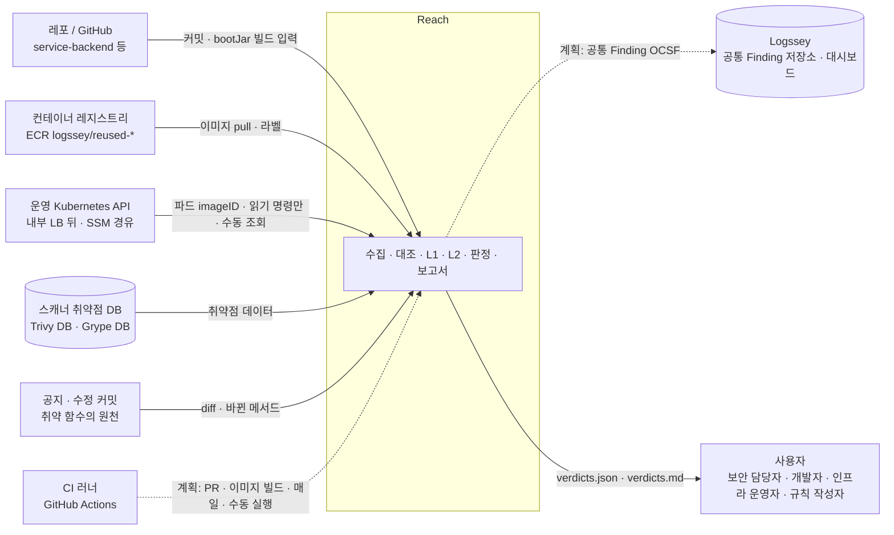
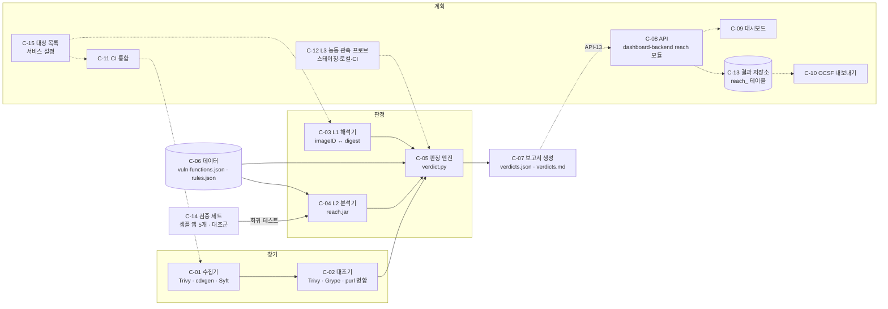
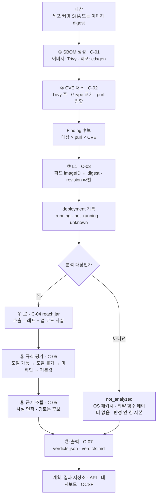
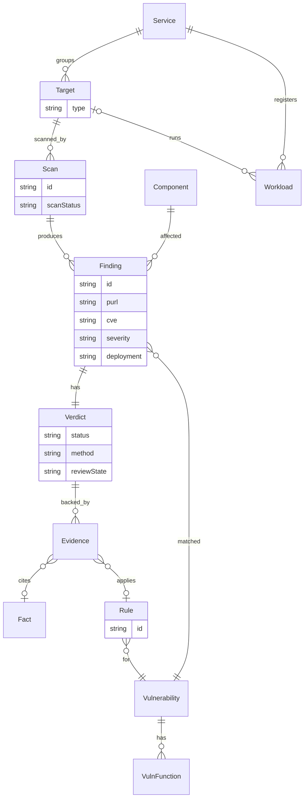
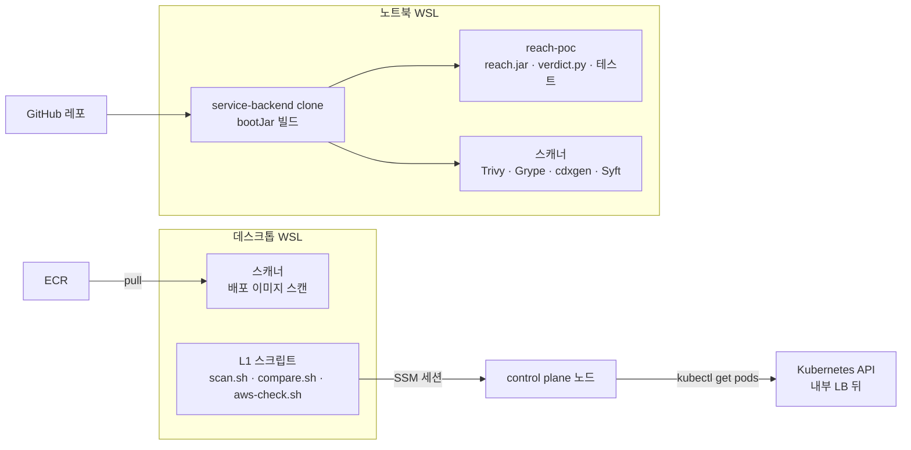
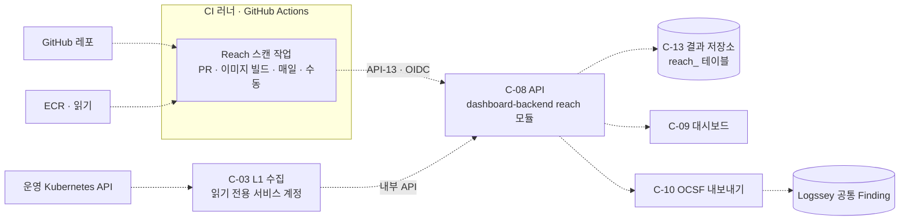

# ARD

**한 줄 요약**: Reach(Logssey 도달 가능성 분석 모듈)가 지켜야 할 품질 속성과, 그것을 만족시키는 구조(구성 요소, 데이터 흐름, 배치, 결정)를 정한다. 지금 구현은 CLI와 스크립트이고, API(dashboard-backend `reach` 모듈)·대시보드·CI 연동은 [계획]이다.

## 1. 개요와 범위

### 1-1. 목적

- 이 문서는 Reach의 구조를 정한다. 어떤 구성 요소가 어떤 순서로 무엇을 주고받는지, 그 구조가 어떤 품질 속성을 지키는지 적는다.
- 기능은 PRD, 판정 조건은 규칙명세서, 외부 인터페이스는 API 명세서, 화면은 화면 명세서가 정한다. 이 문서는 그 문서들의 ID를 참조만 한다.
- Reach가 하는 일: 스캐너가 찾은 CVE 중 실제로 우리 서비스 코드에 닿는 것을 가려내고, 판정 근거를 남긴다.
- 배경: 취약한 의존성의 95%가 간접 의존성이다(Endor Labs 2022, 회사 자체 조사 기준). Maven에서 취약 코드까지 호출 경로가 있는 패키지는 1% 미만이다(Mir et al., TU Delft 2023). 호출 경로가 있는 취약점은 9.5% 미만이다(Endor Labs 2024, 회사 자체 조사 기준).

### 1-2. 판정 단계

| 단계 | 질문 | 방법 | 상태 |
|---|---|---|---|
| L1 배포 여부 | 이 이미지가 실제로 실행 중인가 | 실행 중 파드 `imageID` ↔ 스캔 digest 조인. revision 라벨로 커밋 확인 | [부분] api 수동 확인 완료, 자동화 [계획] (FR-04) |
| L2 호출 경로 | 우리 코드에서 취약 코드까지 닿나 | ① 호출 그래프: 우리 코드가 라이브러리를 부르는 경우<br>② 설정·타입 규칙: 프레임워크가 스스로 실행하는 경우 | [완료] v0 (FR-05, FR-06) |
| L3 실제 호출 | 런타임에 실제로 호출되나 | CI 러너에서 스캔한 이미지를 띄우고 요청 시나리오를 보내, Java는 커버리지 에이전트로 취약 구간(줄) 실행을 본다(C-12). L2 판정 옆에 놓는 근거이고 판정을 바꾸지 않는다. 네이티브(maps·uprobe)는 [계획]. 운영 상시 관측(Tetragon 등)은 비목표(AD-16) |

### 1-3. 범위

| 구분 | 내용 |
|---|---|
| 범위 안 | Reach 모듈: SBOM 생성, CVE 대조, L1·L2 판정, 근거와 보고서. [계획] API(dashboard-backend `reach` 모듈), 화면, CI 연동, OCSF 내보내기, L3 능동 관측(스테이징·로컬·CI), 대상 목록(C-15) |
| 범위 밖 | Logssey의 다른 모듈(시크릿, IaC, 런타임 등). 우리 코드 자체의 취약점(SAST)은 직접 만들지 않는다. 확장 단계에서 기존 도구(Semgrep CE 등) 결과를 공통 Finding으로 받는 것만 검토한다. L3 상시 관측(운영 트래픽 감시)은 비목표다(PRD 3-2) |
| PoC 대상 | Re:Used **api** (`service-backend`, Spring Boot 4.1.1, Java 21, Gradle) |
| 확장 대상 | [계획] **web**(정적 프론트, npm), **chat**(Node) |
| 지금 구현 | CLI와 스크립트: `reach.jar`, `verdict.py`, `run-reach.sh`, L1 스크립트. 결과는 파일(`verdicts.json`, `verdicts.md`)이다 |

### 1-4. Logssey와의 접점

Logssey는 서비스, 인프라, 데이터, 네트워크, 개발 도구를 하나의 자산 관계로 연결하고 실제 위험을 판단하는 맥락 기반 보안 플랫폼이다. Reach는 그중 "이 의존성 CVE가 우리 코드에 실제로 닿는가"라는 신호를 공급한다.

| 접점 | 방향 | 내용 | 상태 |
|---|---|---|---|
| 공통 Finding | Reach → Logssey | Finding 단위로 판정과 근거를 내보낸다. 형식은 OCSF가 후보다 | [계획] 스키마 합의 필요 (FR-10, API-11, C-10) |
| 자산 연결 키 | Reach ↔ Logssey | 이미지 digest, 레포·커밋(OCI revision 라벨), 워크로드, purl | [부분] Reach 안에서는 쓰고 있다. 공유 저장소는 없다 |
| 통합 대시보드 | Logssey → 사용자 | 제안서 v0 5절의 제안: 통합 대시보드와 공통 Finding 모델의 주인을 인프라 담당 1명으로 두고, Reach는 공급자로 둔다. 팀 합의 전이다 | [계획] 합의 필요 |
| Reach 화면 | Reach → 사용자 | Logssey 대시보드 공통 레이아웃(ADR-D007)의 "취약점 관리" 메뉴 안 화면 SCR-01~06 | [계획] (FR-12, C-09) |
| 대시보드 백엔드 | Reach → Logssey | API는 dashboard-backend의 `reach` 모듈(`/api/v1/reach`), 결과는 대시보드 PostgreSQL의 `reach_` 테이블. 시크릿·IaC·런타임과 같은 구조다(AD-18) | [계획] |

### 1-5. 이 문서의 ID

| ID | 뜻 | 예 |
|---|---|---|
| QA-xx | 품질 속성 | QA-01 정확성 |
| C-xx | 구성 요소 | C-04 L2 분석기 |
| AD-xx | 아키텍처 결정 | AD-07 확신이 없으면 unknown |
| CON-xx | 제약 | CON-01 클러스터 API는 SSM 경유 |
| A-xx, SR-xx, R-xx, TD-xx, Q-xx | 이 문서 안에서만 쓰는 가정, 보안 요구, 위험, 기술 부채, 미결 사항 | SR-01 클러스터 읽기 전용 |
| AS-x, TA-x, TB-x, TM-xx | 위협 모델(11-1)의 자산, 행위자, 신뢰 경계, 위협. 이 문서 안에서만 쓴다. 자산(AS)은 가정(A-xx)과 다르다. TM은 통제인 SR로 이어진다 | TM-01 PR 빌드 스크립트로 자격 증명 탈취 → SR-05, SR-09 |

## 2. 아키텍처 동인: 품질 속성

### 2-1. 품질 속성 요약

| ID | 품질 속성 | 핵심 기준 | 관련 NFR | 지금 |
|---|---|---|---|---|
| QA-01 | **정확성** | 거짓 unreachable 금지. 확신이 없으면 unknown | NFR-01 | [완료] v0 검증(주입 20/20, 정답지 10/10). 리플렉션은 알려진 한계 |
| QA-02 | 설명 가능성 | 모든 판정에 방식과 근거. 앱 코드 사실은 파일·줄까지 | NFR-02 | [완료] 보고서 기준. 화면은 [계획] |
| QA-03 | 성능 | 앱 1개 L2 분석 1분 이내. PR마다 실행 가능 | NFR-03 | [완료] 약 40초 |
| QA-04 | 재현성 | 같은 입력이면 같은 판정. AI는 최종 판정에 쓰지 않는다 | NFR-04 | [부분] 회귀 테스트 44/44. 입력 버전 기록은 수동 |
| QA-05 | 보안·최소 권한·도구 무결성 | 클러스터 읽기 전용, 비밀값 비노출, 도구 버전 고정·검증, 분석 대상 코드를 실행하지 않음 | NFR-05 | [부분] L2는 정적 분석. 권한 분리와 도구 검증은 [계획] |
| QA-06 | 이식성 | 노트북과 CI 러너에서 실행. 대용량 DB에 의존하지 않는다 | NFR-06 | [부분] 노트북·데스크톱 WSL [완료], CI 러너 [계획] |
| QA-07 | 확장성 | CVE 규칙과 취약 함수는 데이터 파일로, 생태계는 분석기 플러그인으로 추가 | NFR-07 | [부분] CVE 추가 [완료], 생태계 플러그인 [계획] |

### 2-2. 품질 시나리오

각 시나리오는 자극 → 반응 → 측정 순서로 적는다. "지금" 칸은 10/10 밤까지의 결과다.

#### QA-01 정확성: 거짓 unreachable 금지

| 시나리오 | 자극 | 반응 | 측정 | 지금 |
|---|---|---|---|---|
| 취약 조건 주입 | 대조군 앱이나 실제 앱 사본에 CVE 발동 조건을 넣고 스캔한다 | 넣은 조건을 reachable 또는 unknown으로 판정한다 | 넣은 조건 중 unreachable 판정 0건 | [완료] 규칙 모양 그대로 10개 + 우회한 모양 10개 → 20/20 탐지. 리플렉션으로 넣은 것은 놓쳤다(알려진 한계, R-01). 오탐 1건(91777)은 고치고 회귀 테스트로 고정했다 |
| 근거 부족 | 약한 경로로만 닿거나, 버전 차이로 취약 메서드가 jar에 없거나, 규칙의 미확인 조건에 걸린다 | unknown으로 둔다 | 이 경우의 unreachable 0건 | [완료] v0 동작. 89407은 규칙 개선 전에 unknown이었다(거짓 unreachable이 아니었다) |
| 사람 판정과 대조 | 정답지가 있는 CVE를 판정한다 | 도구 판정이 정답지와 같다. 다르면 unknown 쪽이어야 한다 | 불일치 중 거짓 unreachable 0건 | [완료] 처음 10개 10/10 일치. 추가 4개 중 13506은 사람 판정 잠정, 나머지는 확정 |

관련: NFR-01 · C-04, C-05, C-14 · AD-07, AD-12

#### QA-02 설명 가능성

| 시나리오 | 자극 | 반응 | 측정 | 지금 |
|---|---|---|---|---|
| 판정 이유 확인 | 사용자가 Finding 하나의 판정 이유를 연다 | 방식(`method`)과 근거(사실, 적용 규칙, 후보 경로, 메모)를 보여준다. unreachable이면 이유와 "확인했지만 없던 것"을 보여준다 | 근거 없는 판정 0건. 앱 코드 사실은 파일·줄까지 | [완료] `verdicts.md`. 화면(SCR-03)은 [계획] |
| 근거 위치 정확성 | 조건을 넣은 위치를 아는 상태에서 판정한다(주입 실험) | 근거가 그 코드 줄을 가리킨다 | 가리킨 줄 = 넣은 줄 | [완료] 주입 실험 A·B의 판정 20개 모두 넣은 코드의 정확한 줄을 가리켰다 |
| 과대근사 경로 | RTA가 실제와 다른 경로를 낸다 | 사실을 먼저 보이고, 경로에는 "가장 짧은 후보 경로이며 실제와 다를 수 있음"을 표시한다 | 표시 없는 경로 0건 | [완료] 근거 표시 개선(AD-13) |

관련: NFR-02 · C-05, C-07 · AD-13

#### QA-03 성능

| 시나리오 | 자극 | 반응 | 측정 | 지금 |
|---|---|---|---|---|
| PR 검사 | PR이 열린다 | SBOM 생성, 대조, L2를 실행해 결과를 남긴다 | 앱 1개 L2 분석 1분 이내 | [완료] 실제 앱 약 40초(앱 클래스 376개, 라이브러리 jar 184개, bootJar 빌드 제외). CI 연동은 [계획] |
| 큰 classpath | 라이브러리와 클래스가 많은 앱을 분석한다 | 제한된 힙 안에서 끝난다 | 시간, 힙 | [완료] 라이브러리 315개·클래스 약 8만 개 9초(힙 1GB). 앱 클래스 2,134개 스트레스 시험 18초 |
| 매일 재대조 | 취약점 DB가 갱신된다 | 저장된 SBOM을 재빌드 없이 다시 대조한다 | 재빌드 0회 | [완료] FR-11(11/17). 대시보드가 하루 1번 실행 중인 이미지마다 띄운다(API 명세 6-1). SBOM은 C-13에 보관 |

관련: NFR-03 · C-04, C-11 · AD-01

#### QA-04 재현성

| 시나리오 | 자극 | 반응 | 측정 | 지금 |
|---|---|---|---|---|
| 같은 입력 재실행 | 같은 bootJar, SBOM, 스캐너 DB, `rules.json`, `vuln-functions.json`으로 다시 돌린다 | 같은 판정을 낸다 | 판정 차이 0건 | [완료] 샘플 앱 회귀 테스트 44/44. 기대값은 실행 전에 먼저 고정했다 |
| 같은 digest 재스캔 | 같은 이미지 digest를 다른 날 다시 스캔한다 | 차이가 나면 DB 변경 때문인지 구분할 수 있다 | 스캔마다 도구·DB 버전 기록 | [부분] 10/10 재스캔 23행이 10/7 스캔과 모두 같았다. 도구·DB 버전(Trivy 0.75.0, DB 날짜)은 손으로 기록했다 |
| AI 사용 | 취약 함수 후보를 AI로 뽑는다 | 사람이 확인한 뒤 조사 파일에 넣는다. 판정은 정적 분석이 한다 | 최종 판정에 쓴 AI 출력 0건 | [완료] 원칙 적용(AD-06) |

관련: NFR-04 · C-05, C-06, C-14 · AD-06

#### QA-05 보안·최소 권한·도구 무결성

| 시나리오 | 자극 | 반응 | 측정 | 지금 |
|---|---|---|---|---|
| L1 조회 | L1이 실행 중 파드를 조회한다 | 읽기 전용 권한으로만 조회한다 | Reach가 쓰는 계정의 쓰기 권한 0개 | [부분] 지금은 control plane 노드에 SSM으로 접속해 관리자 kubeconfig로 `kubectl get pods`만 실행한다. 동작은 읽기지만 권한은 관리자다. 전용 읽기 전용 계정은 [계획] |
| 도구 배포 체계 침해 | 스캐너 바이너리나 DB의 배포 경로가 변조된다(2026년 3월 Trivy 배포 체계 침해 사례) | 버전을 고정하고, 체크섬·서명 확인에 실패하면 실행을 멈춘다 | 검증하지 않은 도구로 만든 결과 0건 | [계획] SR-04 |
| 분석 대상 코드 | 악의적이거나 취약한 코드가 분석 대상이다 | L2는 바이트코드를 읽기만 하고 실행하지 않는다 | L2에서 대상 코드 실행 0회 | [완료] L2. 단 bootJar 빌드와 cdxgen은 Gradle 빌드를 실행한다. 격리 실행은 \[계획\](SR-05) |
| 결과 유출 | 권한 없는 사람이 Finding 목록을 열려고 한다 | 대시보드 로그인 세션으로 막는다. CI 토큰은 조회 API를 못 쓴다 | 무권한 조회 0건 | [계획] 대시보드 세션 `ADMIN`, CI는 OIDC로 업로드만(SR-06) |

관련: NFR-05 · C-03, C-08, C-11 · CON-01 · 11절

#### QA-06 이식성

| 시나리오 | 자극 | 반응 | 측정 | 지금 |
|---|---|---|---|---|
| 새 PC | 새 PC나 새 폴더에서 실행한다 | JDK 21, Python 3, 스캐너 CLI만으로 실행된다 | 추가 서버와 대용량 DB 0개 | [완료] 새 폴더에 풀어 테스트 44/44. 경로는 환경 변수(`SDEV`, `REPO`, `IMG`, `EVAL`, `JAR`)로 바꾼다. `verdict.py`는 외부 라이브러리가 없다 |
| 깨끗한 CI 러너 | 캐시가 없는 러너에서 실행한다 | 끝까지 실행된다 | 성공 여부, 소요 시간 | [계획] 첫 실행은 Trivy DB와 Gradle 의존성을 내려받는 시간이 더 든다 |
| 무거운 도구 | 대용량 DB가 필요한 도구를 검토한다 | 기본 경로에 넣지 않는다 | 기본 경로의 대용량 DB 0개 | [완료] dep-scan 보류(AD-10) |

관련: NFR-06 · C-04, C-05, C-11 · AD-10 · CON-04

#### QA-07 확장성

| 시나리오 | 자극 | 반응 | 측정 | 지금 |
|---|---|---|---|---|
| CVE 추가 | 새 CVE를 판정 대상에 넣는다 | 조사 파일 → `make_spec.py` → `vuln-functions.json`. 규칙은 `rules.json`에 더한다 | 기존 사실로 표현되면 분석기 코드 변경 0 | [완료] 10/10 저녁 13506, 밤 0636·19032·83557을 추가했다. 새 사실이 필요하면 사실 수집 코드(`Facts.java`)를 고친다(89407의 `tokens` 사례) |
| 생태계 추가 | npm(web, chat)을 넣는다 | 분석기 플러그인만 더하고 판정 엔진과 출력 형식은 그대로 쓴다 | 판정 엔진·출력 형식 변경 범위 | [계획] |
| 대상 앱 추가 | web·chat 이미지를 넣는다 | 같은 수집·대조·L1 경로를 쓴다 | 앱별 추가 작업 | [계획] |

관련: NFR-07 · C-04, C-05, C-06

### 2-3. 상충 관계

| 상충 | 선택 | 관련 |
|---|---|---|
| 정확성 vs 판정률 | 확신이 없으면 unknown. unknown이 늘어나는 것을 받아들인다 | QA-01, AD-07 |
| 정밀도 vs 성능·이식성 | RTA를 쓴다. CHA보다 정밀하고 포인터 분석보다 가벼워 노트북에서 돈다 | QA-03, AD-01 |
| 설명 가능성 vs 과대근사 | 앱 코드 사실을 먼저 보이고, 경로는 후보로 표시한다 | QA-02, AD-13 |
| 재현성 vs AI 활용 | AI는 후보 생성과 설명에만 쓴다 | QA-04, AD-06 |
| 레포 SBOM 완전성 vs 실행 안전 | cdxgen은 Gradle 빌드를 실행한다. 대신 비밀값 없는 격리 러너에서 돌린다([계획]) | QA-05, AD-04, SR-05 |
| 사실 수집 범위 vs unknown 수 | 역직렬화 타입 범위(`tokens`)를 넓게 잡아 놓칠 위험을 줄인다. 실수형 필드가 있는 JPA 엔티티를 `em.find`로 읽기만 해도 unknown이 되는 것을 받아들인다 | QA-01, 규칙명세서 F-dto.floating.tokens |

## 3. 시스템 맥락

Reach와 외부 요소의 관계다. 실선은 PoC에서 쓴 연결(수동 포함), 점선은 [계획]인 연결이다.



### 3-1. 외부 요소

| 외부 요소 | Reach가 쓰는 것 | 권한 | 지금 | MVP |
|---|---|---|---|---|
| 레포 / GitHub | 소스 커밋. bootJar 빌드와 cdxgen의 입력. 커밋 관계와 소스 트리 해시(L1) | 읽기 | [완료] 로컬 clone. 10/7 비교는 같은 커밋을 `git archive`로 꺼낸 사본을 썼고, 10/9 노트북 스캔은 작업 clone을 썼다(이미지도 로컬 태그 `sca-test/api:local`). git은 읽기 명령만 쓴다 | [계획] CI 체크아웃 |
| CI 러너 (GitHub Actions) | 스캔 실행 환경 | 레포 읽기, 필요하면 ECR 읽기 | 기존 CI는 새 러너에서 `./gradlew build -x test` 후 `docker build`를 하고, 이미지에 `org.opencontainers.image.revision` 라벨을 붙인다. Reach는 아직 CI에 없다 | [계획] PR·이미지 빌드·매일·수동 실행(FR-11, C-11) |
| 컨테이너 레지스트리 (ECR) | 배포 이미지, 이미지 라벨, 최신 푸시 시각 | 읽기(pull, 조회) | [부분] 데스크톱에서 수동 pull·조회 | [계획] 스캔 작업이 읽기 권한으로 조회 |
| 운영 Kubernetes API | 실행 중 파드의 `imageID` | 읽기 전용. SSM 경유(CON-01) | [부분] 수동 조회. 읽기 명령만 썼지만 관리자 kubeconfig로 실행했다(SR-01) | [계획] 읽기 전용 서비스 계정. 수집 위치는 미결(7-3) |
| 스캐너 취약점 DB | CVE, 영향 버전, 수정 버전, 심각도 | 다운로드 | [완료] Trivy 취약점 DB·Java DB, Grype DB | [계획] 버전 기록과 무결성 확인(SR-04) |
| 공지·수정 커밋 | 취약 함수를 뽑을 diff(취약·수정 버전 소스, 수정 커밋) | 읽기 | [완료] 수동 조사 + `javap`로 시그니처 확인 | 같은 방식. AI 후보 + 사람 확인 |
| Logssey 공통 Finding 저장소·대시보드 | 판정 결과 공유 | 쓰기(내보내기) | 없음 | [계획] OCSF 내보내기(C-10). 합의 필요 |

### 3-2. 사용자

| 사용자 | 하는 일 | 주요 화면 |
|---|---|---|
| 보안 담당자 | 스캔 실행, 판정 확인, 사람 검토 | SCR-01, SCR-02, SCR-03, SCR-05 |
| 개발자 | Finding 확인, 수정 우선순위 판단, PR 검사 결과 확인 | SCR-02, SCR-03, SCR-05(CI 검사 탭) |
| 인프라 운영자 | 실행 중 워크로드와 배포 이미지 확인 | SCR-04 |
| 규칙 작성자(보안 담당자) | CVE 규칙과 취약 함수 데이터 관리 | SCR-06 |

## 4. 구성 요소

### 4-1. 구성도

점선 연결과 "계획" 묶음은 [계획]이다.



### 4-2. 구성 요소 목록

| ID | 구성 요소 | 책임 | 현재 구현 | 상태 | 관련 FR |
|---|---|---|---|---|---|
| C-01 | 수집기 (SBOM) | 대상별 SBOM 생성 | Trivy(이미지), cdxgen(레포), Syft(보완) CLI | [완료] | FR-02 |
| C-02 | 대조기 (CVE) | SBOM과 취약점 DB 대조, 도구 결과 병합 | Trivy(주). Grype(교차)는 10/9 로컬 이미지에서 개수 비교만 했다. purl 기준 병합은 확인 필요 | [부분] | FR-03 |
| C-03 | L1 해석기 | 대상이 배포물과 같은지, 실행 중인지 확인 | L1 스크립트 + SSM 경유 수동 `kubectl` | [부분] | FR-04, FR-15 |
| C-04 | L2 분석기 | 호출 그래프와 앱 코드 사실 | `reach.jar` (Java 21 + ASM) | [완료] v0 | FR-05, FR-06 |
| C-05 | 판정 엔진 | 규칙 평가와 근거 조립 | `verdict.py` (Python, 외부 라이브러리 없음) | [완료] v0 | FR-05, FR-06, FR-07 |
| C-06 | 데이터 | 취약 함수·규칙 데이터와 생성 경로 | `vuln-functions.json`, `rules.json`, 조사 원본, `make_spec.py` | [완료] v0 | FR-06, FR-09 |
| C-07 | 보고서 생성 | 판정 결과를 기계용·사람용으로 출력 | `verdict.py`의 출력 단계 | [완료] | FR-07 |
| C-08 | API (dashboard-backend `reach` 모듈) | `/api/v1/reach` 제공, 러너 결과 받기(API-13) | 없음. `run-reach.sh` 등 CLI가 대신한다 | [계획] | FR-01, FR-07, FR-08, FR-12 |
| C-09 | 대시보드 | 화면 SCR-01~06 | 없음 | [계획] | FR-12 |
| C-10 | OCSF 내보내기 | 공통 Finding으로 변환 | 없음 | [계획] 합의 필요 | FR-10 |
| C-11 | CI 통합 | PR·이미지 빌드·매일·수동 실행 | 없음 | [계획] | FR-11 |
| C-12 | L3 능동 관측 프로브 | CI 러너에서 스캔한 이미지를 커버리지 에이전트와 띄우고 서비스 레포의 시나리오를 보내, 취약 구간이 어느 요청에서 어디까지 실행됐는지 남긴다. 네이티브 라이브러리 로드·호출(maps·uprobe)은 [계획] | 없음 | [구현] Java | FR-14 |
| C-13 | 결과 저장소 (`reach_` 테이블) | 스캔·Finding·판정·검토 기록, SBOM 보관 | 없음. 파일과 문서(`answer-key.md`, `l1/result.md`) | [계획] | FR-01, FR-02, FR-08, FR-11 |
| C-14 | 검증 세트 | 샘플 앱, 대조군, 회귀 테스트 | `test/` 샘플 앱 5개, `expected.json`, `run-tests.sh` | [완료] | FR-05, FR-06, FR-08 |
| C-15 | 대상 목록(서비스 설정) | 서비스마다 레포 · ECR 리포지토리 · 클러스터 워크로드(네임스페이스, 디플로이먼트)를 묶는다. 매일 스캔(C-11)과 L1(C-03)의 기준 목록이고, 목록에 없는 워크로드를 "미등록"으로 가려낸다 | 작업 PC의 `targets.env`(api·web 이미지 태그만). MVP는 레포에 커밋한 설정 파일, 등록 API·화면은 확장 | [부분] | FR-15 |

FR-13(업그레이드 제안)은 지금 수동 실험(`upgrade-proposal.md`, `upgrade.patch`)이라 구성 요소로 두지 않는다. 적용 여부는 팀이 결정한다(CON-09).

### 4-3. 구성 요소 상세

#### C-01 수집기 (SBOM)

| 항목 | 내용 |
|---|---|
| 책임 | 대상 하나의 SBOM(CycloneDX JSON)을 만든다 |
| 입력 | 이미지(digest 기준) 또는 레포 커밋(`git archive`로 꺼낸 깨끗한 사본). MVP 기준이다. PoC 입력은 스캔마다 달랐다(3-1) |
| 출력 | CycloneDX JSON SBOM |
| 현재 구현 | 이미지: `trivy image --format cyclonedx`<br>레포: `cdxgen -t java` (Gradle을 실행해 간접 의존성까지 잡는다)<br>보완: Syft (JRE처럼 패키지 매니저 밖에 설치된 런타임)<br>도구는 FR-02 수용 기준을 만족하면 바꿀 수 있다 |
| 좌표 확인·AI 후보 [계획] | ① 이미지 SBOM과 레포 SBOM의 좌표가 다르면 레포 SBOM(빌드 도구가 해석한 좌표)을 우선하고 차이를 기록한다.<br>② 버전 범위는 잠금 파일이나 의존성 해석기로 확정한다. 못 하면 "버전 미확정"으로 두고 범위 전체로 대조한다.<br>③ 결정적 방법(`pom.properties`, MANIFEST, SHA-1 조회, 레포 SBOM 교차 확인)으로 식별하지 못한 구성요소만 AI로 후보를 만든다. 사람이 확인하기 전에는 "구성요소 추정"으로 표시하고, 그 Finding은 `UNREACHABLE`로 확정하지 않는다. AI에 보내는 데이터는 SR-11을 따른다.<br>④ SBOM에 도구와 버전을, AI 후보에는 모델·프롬프트 버전과 입력(jar SHA-1)을 남긴다. SBOM은 재대조를 위해 C-13에 보관한다(FR-02) |
| 근거 (10/7 비교) | 이미지 Maven: Trivy 182/184, shading 8/8. 레포 Maven: cdxgen 266/266, Trivy fs·Syft는 0(lock 파일 없음). Syft는 Maven groupId를 39개(21%) 잘못 추정해 Maven 목록으로 쓰지 않는다 |
| 상태 | [완료] 스크립트로 수동 실행. SBOM 보관은 [완료](C-13, 11/17). 앱별 SBOM 병합은 \[계획\] |
| 관련 | FR-02, AD-03, AD-04, AD-06, AD-09, CON-03, SR-11 |
| 한계 | 프론트 번들 안의 JS 라이브러리, relocation된 shading 코드(AWS SDK `third-party-jackson-core`), JRE에 정적으로 포함된 네이티브 라이브러리는 어떤 도구 조합으로도 못 본다. 앞의 두 가지는 AI 후보 대상이다(FR-02). 이미지 SBOM에서 hibernate-core의 groupId가 틀린 사례가 있다(Q-16) |

#### C-02 대조기 (CVE)

| 항목 | 내용 |
|---|---|
| 책임 | SBOM을 취약점 DB와 대조해 구성 요소 × 취약점 목록을 만든다. 도구 결과를 purl로 합친다 |
| 입력 | CycloneDX SBOM, 스캐너 취약점 DB |
| 출력 | Trivy JSON(Finding 후보), Grype JSON(교차 확인). purl 기준 병합 목록은 설계이며 구현 여부는 확인 필요(Q-08) |
| 현재 구현 | `trivy sbom -f json`(주), `grype sbom:<SBOM 파일> -o json`(교차 확인) |
| 근거 | 같은 SBOM 입력(10/9, 로컬 이미지): CRITICAL 3/3, HIGH 5/5 일치. MEDIUM은 Trivy 4, Grype 2. 배포 이미지(10/7 기준선, 10/10 재스캔)는 Trivy만 돌렸다 |
| 상태 | [부분] Trivy 대조는 [완료]. Grype 교차 확인은 10/9 로컬 이미지에서 개수 비교만 했다. purl 기준 자동 병합은 확인 필요 |
| 관련 | FR-03, AD-03, AD-05, AD-08 |
| 메모 | 심각도는 스캐너 값을 그대로 쓴다. CVE-2025-14813은 Trivy가 CRITICAL로 보고했지만 CNA의 CVSS 벡터로는 7.5(HIGH)다. 이런 차이는 메모로 남긴다. 두 도구 결과가 다를 때의 병합 규칙은 문서로 정해야 한다(Q-08) |

#### C-03 L1 해석기

| 항목 | 내용 |
|---|---|
| 책임 | 대상이 실제 배포물과 같은지, 그 이미지가 실행 중인지 확인해 `deployment`를 정한다 |
| 입력 | 실행 중 파드의 `status.containerStatuses[].imageID`, ECR 최신 푸시, 이미지 라벨 `org.opencontainers.image.revision`, git 커밋 관계와 소스 트리 해시 |
| 출력 | 워크로드(네임스페이스, 파드, digest), 대상 ↔ 워크로드 연결, `deployment`(`RUNNING` / `NOT_RUNNING` / `UNKNOWN`) |
| 현재 구현 | `sca-eval/l1/`의 `scan.sh`(배포 digest 재스캔), `compare.sh`(이전 스캔과 비교), `aws-check.sh`(ECR 최신 푸시 조회, 읽기 전용) + SSM 경유 수동 `kubectl get pods` |
| 결과 (10/10) | 운영 reused-api 파드 2개가 모두 digest `a6ffffef…`다. 이미지 revision 라벨 `bb4639b`는 분석 커밋 `6583020`과 소스 트리가 같다. 재스캔 23행이 10/7 스캔과 모두 같다. 따라서 PoC 판정이 실제 배포물에 그대로 적용된다 |
| 상태 | [부분] api 수동 확인 완료. 자동화는 [계획] |
| 관련 | FR-04, FR-15, API-07, SCR-04, AD-09, CON-01, CON-02, C-15 |
| 메모 | 태그가 아니라 digest로 조인한다. 결과는 조회 시점의 스냅숏이다(A-05). 대상 목록(C-15)에 등록된 서비스를 기준으로 조회하고, 목록에 없는 워크로드는 "미등록"으로 표시한다(FR-15) |

#### C-04 L2 분석기 (reach.jar)

| 항목 | 내용 |
|---|---|
| 책임 | bootJar 바이트코드로 호출 그래프를 만들고, 취약 함수 도달 여부와 앱 코드 사실을 뽑는다 |
| 입력 | bootJar(`BOOT-INF/classes`, `BOOT-INF/lib/*.jar`), `vuln-functions.json`, `rules.json`의 수집할 사실 목록 |
| 출력 | reach 결과 JSON(산출물 목록의 `reach-result.json`으로 추정): 패키지 도달 여부, 취약 메서드 도달 여부, 후보 경로, 사실과 위치, 역직렬화 타입 출발점 목록(`dto_type_tokens`) |
| 현재 구현 | Java 21 + ASM 9.8. `tool/build.sh`로 빌드한다 |
| 수치 | 실제 앱 약 40초(로딩 12초 포함): 앱 클래스 376개, 라이브러리 jar 184개(클래스 약 6.7만 개), 도달 메서드 67,091개 |
| 상태 | [완료] v0 |
| 관련 | FR-05, FR-06, AD-01, AD-11, AD-12, AD-14 |
| 한계 | 리플렉션, 동적 프록시, JNI는 모델링하지 않는다. JDK 내부는 분석하지 않는다(JDK가 다시 불러줄 수 있는 메서드는 약한 경로로 가정). 런타임 설정(`java.security`, 환경 변수)은 못 보고 확인 스크립트(`verify-laptop.sh`)로 따로 본다. 가상 호출은 과대근사된다 |

내부 단계

| 단계 | 하는 일 | 이유 |
|---|---|---|
| 바이트코드 로딩 | 앱 클래스와 라이브러리 jar의 클래스를 ASM으로 읽는다. 로드하거나 실행하지 않는다 | 라이브러리 안 경로까지 봐야 한다. bcprov는 앱 코드에 참조가 없고 Spring Security의 Argon2가 부른다 |
| RTA 호출 그래프 | 실제로 `new`한 클래스만 가상 호출 대상으로 본다 | CHA보다 정밀하고 포인터 분석보다 가볍다 |
| 진입점 2단계 | 1단계 Spring 진입점(컨트롤러, @Bean, 리스너, 스케줄러 등), 2단계 모든 앱 메서드 | 1단계로 "어느 API에서 시작하는지"를 보이고, 2단계로 리플렉션 호출을 놓치지 않는다 |
| 약한 경로 분리 | Object 메서드 호출과 JDK 콜백 간선을 뒤 단계로 미룬다. 이것으로만 닿으면 unknown | 첫 시험에서 "Jackson 날짜 포맷 → Object.equals → BC 권한 클래스" 같은 의미 없는 근거가 나왔다 |
| 취약 함수 도달 | `vuln-functions.json`의 메서드까지 경로를 찾는다. jar에 그 메서드가 없으면 unknown | 버전에 따라 메서드 이름이 바뀐다(예: BC 1.84). 못 찾았다고 unreachable로 두면 위험하다 |
| 사실 수집 | 앱 코드에서만 사실을 모은다. 역직렬화 타입은 @RequestBody·@RequestPart·@Payload, 리스너 파라미터, HttpEntity, readValue 계열, TypeReference, Feign·HTTP Interface 응답 타입에서 시작해 필드 타입을 따라간다 | 판정을 가르는 것은 "앱이 무엇을 설정·호출하는가"다. 사실 이름과 정의는 규칙명세서(`F-<사실 이름>`) |

#### C-05 판정 엔진 (`verdict.py`)

| 항목 | 내용 |
|---|---|
| 책임 | 대조 결과, reach 결과, 규칙을 합쳐 Finding마다 `status`와 `method`를 정하고 근거를 조립한다 |
| 입력 | C-02 출력(지금은 Trivy 대조 결과), C-04 출력(reach 결과), `rules.json` |
| 출력 | Finding별 판정과 근거(C-07로 넘긴다) |
| 규칙 평가 | 도달 가능 조건 → 도달 불가 조건 → 미확인 조건 → 기본값 순서로 평가한다. 규칙의 참고 사실(`rules.json`의 `info`)은 판정에 쓰지 않고 "참고"로만 보인다. API에서는 Rule의 `infoFacts`, Evidence의 `informational`로 나온다. 규칙 형식과 CVE별 내용은 규칙명세서(`RULE-<CVE ID>`)가 정한다 |
| 사본 처리 | 같은 CVE의 다른 패키지 사본은 별도 행으로 낸다. 판정하지 않은 사본은 `NOT_ANALYZED`다. 판정 행은 판정한 패키지의 설치·수정 버전을 쓴다 |
| 근거 조립 | 앱 코드 사실(파일·줄)을 먼저, 호출 경로는 "가장 짧은 후보 경로이며 실제와 다를 수 있음"으로 표시한다. 규칙으로 판정했는데 호출 그래프 결과가 달라 보이면 이유(과대근사, 프레임워크가 실행하는 코드)를 붙인다 |
| 현재 구현 | Python, 외부 라이브러리 없음 |
| 상태 | [완료] v0 |
| 관련 | FR-05, FR-06, FR-07, AD-06, AD-07, AD-08, AD-11, AD-13 |

#### C-06 데이터

| 파일 | 내용 | 만드는 법 | 관련 |
|---|---|---|---|
| `data/vuln-functions.json` | CVE별 취약 함수(클래스, 메서드, 시그니처). 처음 CVE 10개·취약 메서드 36개, 지금 CVE 14개 | `scripts/make_spec.py`가 조사 파일에서 만든다. 직접 고치지 않는다(AD-15) | FR-09, API-10, SCR-06 |
| `data/research/` | CVE별 조사 원본(취약 함수 데이터의 원본) | 사람이 쓴다. AI는 후보만 낸다 | FR-09 |
| `data/rules.json` | 수집할 사실과 CVE별 판정 규칙. 10/10 오후 기준 사실 40개, CVE 규칙 10개 | 사람이 쓴다. 저녁·밤에 CVE 4개를 더한 뒤의 개수는 확인 필요(Q-13) | FR-06, API-09, SCR-06 |
| `docs/answer-key.md` | 정답지(사람 판정)와 도구 비교 | 사람이 쓴다 | FR-08, API-06 |

상태: [완료] v0. 데이터 파일은 `reach-poc/data/`에 있다.

#### C-07 보고서 생성

| 항목 | 내용 |
|---|---|
| 책임 | 판정 결과를 기계용(JSON)과 사람용(Markdown)으로 낸다 |
| 출력 | `verdicts.json`, `verdicts.md`(머리말에 스캔 요약) |
| 내용 | Finding마다 CVE, 패키지(purl), 설치·수정 버전, `status`, `method`, 근거. 같은 CVE의 다른 사본과 `NOT_ANALYZED` 행(OS 패키지 등)을 숨기지 않는다 |
| 현재 구현 | `verdict.py`의 출력 단계. `run-reach.sh`가 `sca-eval/reach/`에 쓴다 |
| 상태 | [완료] |
| 관련 | FR-07, API-03, API-04, API-05 |
| 메모 | L1 결과와 사람 검토는 지금 별도 문서(`l1/result.md`, `answer-key.md`)에 있다. 위험 대응으로 "판정 대상 jar를 보고서에 명시"하기로 했고, 구현 여부는 확인 필요(Q-13) |

#### C-08 API (dashboard-backend `reach` 모듈) [계획]

| 항목 | 내용 |
|---|---|
| 책임 | 스캔 요청, 결과 조회, 사람 검토 기록, 규칙·데이터 조회를 `/api/v1/reach`로 제공하고, 러너가 올린 분석 결과를 받아 저장한다 |
| 위치 | 별도 서버가 아니라 dashboard-backend(Java 21, Spring Boot)의 `reach` 모듈이다(AD-18) |
| 엔드포인트 | API-01~13 (API 명세서) |
| 인증·권한 | 대시보드는 공통 로그인 세션 + CSRF(ADR-D003), MVP 권한은 `ADMIN` 하나. CI는 GitHub OIDC 토큰(`aud = logssey-reach`)으로 API-12·13만 부른다. 역할 분리는 다음 단계(API 명세서 2-2) |
| 지금의 대응 | API-01 → `run-reach.sh`, API-03 → `verdicts.md` 머리말, API-04·05 → `verdicts.json`, API-06 → `answer-key.md`, API-07 → L1 스크립트 + 수동 `kubectl`, API-09 → `data/rules.json`, API-10 → `data/vuln-functions.json` |
| 실행 방식 | 스캔은 비동기다(`scanStatus`: `QUEUED` → `RUNNING` → `SUCCEEDED` / `FAILED`). 분석은 GitHub Actions 러너(C-11)가 하고 결과를 API-13으로 올린다. 대시보드에서 요청한 스캔(API-01)은 서버가 `workflow_dispatch`로 러너를 띄운다(AD-18) |
| 의존 | C-13 결과 저장소 |
| 관련 | FR-01, FR-07, FR-08, FR-12 |

#### C-09 대시보드 [계획]

| 항목 | 내용 |
|---|---|
| 화면 | SCR-01 요약 대시보드, SCR-02 Finding 목록, SCR-03 Finding 상세, SCR-04 워크로드·배포 확인, SCR-05 스캔 실행·이력, SCR-06 규칙·취약 함수 데이터 |
| 레이아웃 | 대시보드 공통 레이아웃(ADR-D007)의 "취약점 관리" 메뉴 안. 하위 메뉴는 요약 / Finding / 워크로드 / 스캔 / 규칙, 상단에 대상 선택. 데스크톱 1440×900 기준 |
| 데이터 | C-08 API만 쓴다. 파일이나 저장소를 직접 읽지 않는다 |
| 관련 | FR-12, 화면 명세서. 통합 대시보드와의 관계는 1-4 |

#### C-10 OCSF 내보내기 [계획]

| 항목 | 내용 |
|---|---|
| 책임 | Finding과 판정·근거를 공통 Finding(OCSF)으로 바꿔 Logssey에 넘긴다 |
| 엔드포인트 | API-11 `GET /api/v1/reach/exports/ocsf?scanId=` |
| 전제 | 팀 전체의 공통 Finding/Asset 스키마 합의(제안서 v0 5절). OCSF 클래스와 확장 필드는 합의 후 정한다 |
| 관련 | FR-10, CON-08, Q-02 |

#### C-11 CI 통합 [계획]

| 항목 | 내용 |
|---|---|
| 실행 시점 | PR마다 빠른 대조, 이미지 빌드(ECR push 전) 때 이미지 스캔과 L3 능동 관측, 하루 1번 저장된 SBOM 재대조·L1·재판정, 필요할 때 수동 실행. 시점별로 하는 일은 5-3 |
| 트리거(제안) | `pull_request`(+`push`), `schedule`, `workflow_dispatch`, 배포 파이프라인의 이미지 빌드 단계. 재사용 워크플로(`workflow_call`)로 한 번 정의하고 `service-backend`·`service-frontend`에서 같이 쓴다 |
| 도입 순서(제안) | 리포트 전용(빌드를 깨지 않음) → 전환 기준을 만족하면 게이트. PR에서 새로 생긴 Finding만 본다. 조건은 API 명세서 6-2(`REACHABLE` CRITICAL·HIGH는 실패, `REACHABLE` MEDIUM 이하·`UNKNOWN`·CRITICAL·HIGH인 `NOT_ANALYZED`는 경고)다. 전환 기준·예외·되돌리기는 Q-07 |
| 원칙(제안) | ECR push 전에 로컬 이미지를 스캔한다. 이미지 검사에서 그 이미지를 커버리지 에이전트와 띄워 시나리오를 보내고 L3 근거를 남긴다(C-12). L3가 실패해도 검사는 계속된다. PR에서는 L3를 돌리지 않는다. 재대조는 저장된 SBOM으로 재빌드 없이 한다. PR 작업에는 자격 증명을 주지 않는다(SR-09) |
| 엔드포인트 | API-12 `POST /api/v1/reach/ci/checks`(실행), `GET /api/v1/reach/ci/checks/{checkId}`(결과). 목록 조회는 없다 |
| 메모 | 기존 CI는 새 러너에서 bootJar 하나만 만든다(plain jar를 끔). 이미지에 붙는 revision 라벨을 L1 연결에 그대로 쓸 수 있다 |
| 관련 | FR-11, FR-14, AD-17, Q-07, C-12, C-15, SR-09 |

#### C-12 L3 능동 관측 프로브 [구현: Java]

| 항목 | 내용 |
|---|---|
| 책임 | 스캔한 이미지를 실제로 띄워 요청 시나리오를 보내고, 취약 코드 쪽으로 어디까지 실행됐는지(취약 구간 / 취약 함수 / 없음), 어느 요청에서였는지, L2가 찾은 호출 경로를 어디까지 탔는지를 근거로 남긴다. L2 판정 옆에 놓는 근거이고 판정·사람 검토·게이트를 바꾸지 않는다. L2 결과와 독립으로 취약 함수 데이터가 있는 모든 CVE를 본다. 운영 트래픽을 계속 감시하는 상시 관측은 하지 않는다(AD-16) |
| 입력 | 이미지(digest), 그 이미지의 앱 jar(리포트용 클래스 파일), 서비스 레포의 시나리오(`.reach/l3-scenario.json`: 띄울 서비스, 앱 환경 변수, 보낼 요청. 스크립트가 아닌 데이터), 취약 구간 데이터(`vuln-functions.json`의 `l3`: 줄 번호가 맞는 라이브러리 버전과 구간), L2 결과(호출 경로), SBOM(라이브러리 버전) |
| 방법 | ① 기록(`deploy/reach/ci/l3-run.sh`): 시나리오의 서비스(DB·캐시)와 앱을 실행마다 만든 Docker 네트워크에 띄운다. 앱에는 JaCoCo 에이전트(`output=tcpserver`)를 붙이고, 기록 범위는 `java.util.*` + 앱·라이브러리의 최상위 패키지 전부다. 앱이 준비되면 기록을 읽고 비우고(구간 `startup`), 시나리오 단계를 보낼 때마다 다시 읽고 비운다(`001`, `002`, …). ② 대조(`reach-scan.sh`, L2 다음): 구간마다 리포트를 만들고 `verdict/l3.py`가 취약 구간·취약 함수·L2 경로 단계의 실행 여부를 낸다. 리포트는 취약 구간 데이터와 L2 경로가 가리키는 클래스만 만든다 |
| 출력 | 결과 묶음의 `l3`(API-13): CVE마다 도달 수준, 실행한 구간, 실행된 취약 함수와 줄, 경로 단계, 그리고 그 실행의 근거 항목(이미지 digest, 시나리오 버전, 설정 키 이름과 켜짐 여부, 보낸 요청 목록, 확인 방법, 관측 시각). 서버는 Finding의 `l3`로 저장한다(API 명세 3-12). 실행되지 않은 결과는 `UNREACHABLE` 근거로 쓰지 않는다 |
| 실행 위치 | CI 러너: 이미지 검사(`IMAGE_BUILD`)에서 서비스 레포에 시나리오가 있을 때. PR마다, 재대조에서는, 운영에서는 실행하지 않는다. L3가 실패해도 검사는 계속된다 |
| 믿지 않는 입력 | 이미지와 시나리오는 PR이 만든 것이다. 시나리오의 어떤 값도 러너의 셸에서 실행하지 않고, 컨테이너에는 러너의 비밀값을 넣지 않는다. 컨테이너가 디스크에 쓴 것은 읽지 않는다(실행 기록은 에이전트 포트로 읽는다). 로그에는 요청·응답 본문을 남기지 않는다 |
| 한계 | 시나리오가 지나간 코드만 본다. 러너의 설정이 운영과 다르면 결과가 다를 수 있다. 부른 메서드가 예외를 던진 줄과 에이전트 전에 로드된 JDK 클래스는 기록되지 않는다. 취약 구간의 줄 번호는 라이브러리 버전에 묶여 있어, 버전이 다르면 함수 단위로만 본다. 네이티브(maps·uprobe)와 보관한 실행 기록의 재대조는 [계획] |
| 관련 | FR-11, FR-14, AD-16, SR-08, C-11 |


#### C-13 결과 저장소 (`reach_` 테이블) [계획]

| 항목 | 내용 |
|---|---|
| 저장 대상 | 스캔(대상, 상태, 도구·DB 버전), SBOM(재대조용), Finding·판정·근거, 사람 검토 기록과 이력, 스캔끼리 Finding을 잇는 키(서비스·purl·CVE), 워크로드 스냅숏 |
| 지금 | 작업 PC의 파일(`sca-eval/sbom/`, `vuln/`, `reach/`)과 문서(`answer-key.md`, `l1/result.md`) |
| 왜 필요한가 | 하루 1번 재대조에는 저장된 SBOM이 필요하다. 사람 검토는 다음 스캔에도 이어져야 한다. `UNREACHABLE`은 보류라 같은 Finding이 매일 다시 나오기 때문이다. 같은 키의 Finding이 다시 나오면 검토를 이어받고, 도구 판정이나 근거(사실·호출 경로·적용 규칙)가 바뀌었으면 `UNREVIEWED`로 되돌린다(FR-08). 그래서 이전 스캔의 판정 근거도 비교할 수 있게 남긴다. SBOM을 이미지 digest와 연결해 두면 "어느 이미지에 무엇이 들어갔나"를 바로 답할 수 있다 |
| 위치 | 대시보드 PostgreSQL의 `reach_` 접두 테이블. Flyway 후속 마이그레이션으로 추가하고 공통 V1은 고치지 않는다. 운영 DB 서버 위치는 대시보드 ADR-D005를 따른다(AD-18) |
| 접근 | 읽고 쓰는 것은 C-08뿐이다. 러너는 API-13으로, L1 수집(C-03)은 내부 API(API 명세서 1-5)로 C-08에 넘긴다(7-2, SR-06) |
| 관련 | FR-01, FR-08, FR-11, Q-04, Q-05, Q-06 |

#### C-14 검증 세트

| 항목 | 내용 |
|---|---|
| 구성 | 샘플 앱 5개: `app-like`(우리 구조를 흉내 냄), `app-positive`(발동 조건을 일부러 넣음), `app-tokens`(89407 대조군), `app-indirect`(우회한 모양), `app-blindspots`(알려진 놓침과 오탐 회귀). 기대값 `test/expected.json`, 실행 `test/run-tests.sh` |
| 원칙 | 기대값을 실행 전에 먼저 정한다. 알려진 놓침도 기대값으로 고정한다. 누가 한계를 해결하면 테스트가 실패해 문서를 고치라고 알린다. 도구 정확도(M-03, M-04)는 이 검증 세트와 독립적으로 만든 정답지로만 잰다. 운영에서 사람 판정이 도구와 다른 Finding은 추가 후보로 받는다(FR-08) |
| 결과 | 44/44 일치. 고치기 전 코드로 빌드한 jar에서는 `app-blindspots`의 91777 테스트가 실패했다. 회귀 테스트가 실제로 오탐을 잡는다 |
| 일회성 실험 | 실제 앱 사본에 취약 코드를 넣은 주입 실험 A~E. 원래 레포는 건드리지 않았다 |
| 상태 | [완료] |
| 관련 | NFR-01, NFR-04, QA-01, QA-04, FR-08 |

## 5. 데이터 흐름

### 5-1. 스캔 1회의 순서

지금은 `run-reach.sh`와 L1 스크립트가 이 순서를 수동으로 실행한다. [계획] 단계에서는 C-08(API 요청)이나 C-11(CI 트리거)이 시작한다.



- L1 결과는 `deployment`로 따로 기록하고 `status`를 바꾸지 않는다(6-4). 우선순위는 두 값을 함께 보고 정한다(제안서 v0: 어느 단계까지 통과했는지로 우선순위). PoC는 L2를 먼저 하고 L1을 나중에(10/10 밤) 확인했다.
- 분석 대상 분류는 논리상 L2 앞에 있지만, 지금 구현에서는 판정 엔진(C-05)이 결과를 합칠 때 한다.

### 5-2. 단계별 입출력

| 순서 | 단계 | 구성 요소 | 입력 | 출력 | 상태 |
|---|---|---|---|---|---|
| 1 | 대상 지정 | C-08 / 지금은 `run-reach.sh` | 레포 커밋 SHA 또는 이미지 digest | 스캔 1건 | [부분] |
| 2 | SBOM 생성 | C-01 | 대상 | CycloneDX SBOM | [완료] |
| 3 | CVE 대조 | C-02 | SBOM, 스캐너 DB | 구성 요소 × 취약점 목록(Finding 후보) | [부분] Trivy 대조만 \[완료\](C-02) |
| 4 | L1 | C-03 | 이미지 digest, 파드 `imageID`, revision 라벨 | `deployment`, 대상 ↔ 배포물 일치 여부 | [부분] |
| 5 | 분석 대상 분류 | C-05 | Finding 후보, `vuln-functions.json`, `rules.json` | 분석 대상 / `NOT_ANALYZED` | [완료] |
| 6 | L2 호출 그래프 + 사실 | C-04 | bootJar, 취약 함수, 수집할 사실 목록 | reach 결과 | [완료] v0 |
| 7 | 규칙 평가 | C-05 | reach 결과, 규칙 | `status`, `method` | [완료] v0 |
| 8 | 근거 조립 | C-05 | 사실 위치, 후보 경로, 적용 규칙 | 근거 | [완료] |
| 9 | 출력 | C-07 | 판정과 근거 | `verdicts.json`, `verdicts.md` | [완료] |
| 10 | 저장·공유 | C-13, C-08, C-10 | 출력 | 저장소, API 응답, OCSF | [계획] |
| 11 | 사람 검토 | C-08 / 지금은 문서 | 판정과 근거 | `reviewState`, 메모 | [부분] |

### 5-3. 실행 시점별 흐름 [계획]

PRD 1-2(실행 시점)와 FR-11의 시점별 표를 구조 관점에서 적은 것이다. SBOM은 이미지 digest당 한 번 만들고, 대조는 반복한다.

| 트리거 | 하는 일 | 메모 |
|---|---|---|
| PR | 레포 SBOM(cdxgen) 생성과 빠른 대조. 새 Finding만 L2로 판정한다. L2는 약 40초라 PR마다 돌릴 수 있다. L1(배포 전)과 L3는 없다 | bootJar 빌드 시간은 별도다. cdxgen(Gradle 빌드) 시간은 측정 필요(Q-15). 자격 증명 없이 돈다(SR-09) |
| 이미지 빌드(ECR push 전) | 이미지 SBOM(Trivy)을 만들어 digest와 함께 보관(C-13)하고, 대조와 L2를 한다. 서비스 레포에 시나리오가 있으면 그 이미지를 커버리지 에이전트와 띄워 시나리오를 보내고 L3 근거를 남긴다(C-12) | L3는 로컬 측정으로 앱 기동 11~13초, 기록 24초, 대조 약 5초(Re:Used api, Q-15) |
| 하루 1번 | 저장된 SBOM을 최신 DB로 재대조한다. 등록된 서비스(C-15)의 실행 중 digest를 조회하고(L1), 새 Finding을 L2로 재판정한다. 새 CVE만 알린다. L3는 앱을 다시 띄우지 않는다(그 이미지의 마지막 결과가 남는다. 보관한 실행 기록으로 새 CVE를 다시 대조하는 것은 [계획]) | 재빌드하지 않는다. SBOM은 결과 저장소에 보관한 것을 쓰고, L2용 jar는 같은 digest 이미지를 ECR에서 받아 꺼낸다(Q-06). GitHub `schedule`이 아니라 대시보드가 띄운다(실행 중 digest를 대시보드만 안다) |
| 수동 | 대시보드 요청(API-01)이나 `workflow_dispatch`로 SBOM·대조·L1·L2를 다시 실행한다. L3는 앱을 띄우지 않는다 | `workflow_dispatch` 또는 API-01 |

## 6. 데이터 모델

### 6-1. 개체 관계



### 6-2. 개체와 주요 필드

경로 변수는 `scanId`·`findingId`·`ruleId`, 쿼리 필터는 `status`·`severity`·`target`·`deployment`·`reviewState`·`package`를 쓴다(API 명세서 4절). 응답 필드는 camelCase다(`id`, `scanId`, `ruleId`). 6-5의 PoC 계획 단계 예시에 나온 `cve`·`purl`·`evidence`(문자열)는 API에서 `vulnerability.id`·`component.purl`·`verdict.summary`(한 줄 근거)와 `verdict.evidence[]`(근거 목록)로 바뀐다(API 명세서 3-3·3-4). 표의 그 밖의 필드는 한국어로만 적는다. 이름과 JSON 구조는 API 명세서가 정하고, 다르면 API 명세서를 따른다.

| 개체 | 뜻 | 식별 | 주요 필드 | 지금 있는 곳 |
|---|---|---|---|---|
| 대상 (Target) | 레포 커밋 또는 컨테이너 이미지 | 종류 + 커밋 SHA 또는 digest | 종류(`REPO` / `IMAGE`), 레포와 커밋 SHA 또는 이미지와 digest, 앱 이름(api, web, chat) | 스크립트 환경 변수(`REPO`, `IMG`, `JAR`) |
| 스캔 (Scan) | 대상 하나에 대해 SBOM 생성 → CVE 대조 → 판정까지 한 번 실행한 것 | `id`(경로 변수 `scanId`) | `target`, `scanStatus`, 시작·끝 시각, 도구·DB 버전, 규칙·취약 함수 데이터 버전, 상태별·심각도별 개수 | `verdicts.md` 머리말 |
| 구성 요소 (Component) | SBOM의 패키지 하나 | `purl` | `purl`, 패키지 이름(`package` 필터의 대상), 버전, 생태계(maven, apk, npm), 위치(예: `BOOT-INF/lib` 안의 jar 경로) | SBOM |
| 취약점 (Vulnerability) | CVE 하나와 심각도, 수정 버전 | CVE ID | `id`(CVE ID), `severity`, 수정 버전, 설명 | Trivy·Grype JSON |
| Finding | 대상 × 구성 요소 × 취약점 한 건 | `id`(경로 변수 `findingId`). (대상, purl, CVE)로 정한다. 스캔끼리는 (서비스, purl, CVE)로 같은 Finding을 잇는다(FR-08) | 대상(`targetId`), 구성 요소(`component.purl`, 설치 버전), 취약점(`vulnerability.id`, `vulnerability.severity`, 수정 버전), `deployment` | `verdicts.json`의 행 |
| 판정 (Verdict) | Finding에 대한 Reach의 결론 | 스캔마다 Finding당 1개 | `status`, `method`, 한 줄 근거(`summary`), 근거 목록(`evidence[]`), 적용 규칙(`ruleId`), `reviewState`, 사람 검토 메모·검토자·시각, 이어받은 검토의 출처(`carriedFrom`), 되돌린 이유(`resetReason`)(API 명세서 3-10) | `verdicts.json`. 사람 검토는 `answer-key.md` |
| 근거 (Evidence) | 판정을 뒷받침하는 것 | 판정에 딸린다 | 사실(이름, 파일, 줄), 판정에 쓰지 않은 참고 사실 표시(`informational`), 후보 경로(약한 경로 여부 포함), 적용 규칙, "확인했지만 없던 것", 메모 | `verdicts.json`, `verdicts.md` |
| 사실 (Fact) | 앱 코드에서 수집한 관찰값 | `F-<사실 이름>` (예: F-dto.floating.tokens) | 이름, 값, 위치(파일·줄) | reach 결과 |
| 규칙 (Rule) | CVE별 판정 조건 | `id` = `RULE-<CVE ID>`(경로 변수 `ruleId`) | 조건 4종(도달 가능 / 도달 불가 / 미확인 / 기본값), 참고 사실(`rules.json`의 `info`. API에서는 `infoFacts`) | `rules.json` |
| 취약 함수 (Vulnerable function) | 수정으로 바뀐 메서드. 수정 커밋 diff나 취약·수정 버전 소스 diff에서 뽑는다 | CVE + 메서드 | CVE, 패키지, 클래스, 메서드, 시그니처, 수정 커밋, 출처(취약·수정 버전 소스 diff / 수정 커밋 diff) | `vuln-functions.json` |
| 워크로드 (Workload) | 운영에서 실행 중인 파드와 그 imageID. 대상 목록에 없는 워크로드는 "미등록"이다(FR-15) | 네임스페이스 + 파드 이름 | 네임스페이스, 파드, 이미지 digest(`imageID`), revision 라벨, 조회 시각 | `l1/result.md` |
| 서비스 (Service) | 레포 · ECR 리포지토리 · 클러스터 워크로드를 묶은 등록 단위(예: api). 매일 스캔과 L1이 무엇을 볼지 정한다 | 서비스 이름 | 레포, ECR 리포지토리, 네임스페이스, 디플로이먼트 | 작업 PC의 `targets.env`. MVP는 레포에 커밋한 설정 파일(C-15, FR-15) |
| 진입점, 약한 경로 | 호출 그래프 탐색의 시작점, 근거로 약한 간선 | 따로 저장하지 않는다 | 근거의 후보 경로 안에 표시한다 | reach 결과 |

### 6-3. 열거값

API 필드, 화면 표시, 규칙 출력이 모두 같은 값을 쓴다. 값과 뜻은 PRD 1절의 "용어와 공통 열거값"과 같다.

| 필드 | 값 | 정하는 곳 |
|---|---|---|
| `status` | `REACHABLE`(도달 가능) / `UNREACHABLE`(도달 불가) / `UNKNOWN`(미확인) / `NOT_ANALYZED`(분석 대상 아님: 취약 함수 데이터 없음, OS 패키지, 판정하지 않은 패키지 사본 등) | C-05 |
| `method` | `CALLGRAPH`(호출 그래프) / `RULE`(설정·타입 규칙) / `MANUAL`(사람) | C-05, 사람 |
| `reviewState` | `UNREVIEWED`(검토 전) / `PROVISIONAL`(잠정) / `CONFIRMED`(확정). 이어받은 검토를 되돌린 이유 `resetReason`: `VERDICT_CHANGED` / `EVIDENCE_CHANGED` | 사람(API-06). 되돌리기는 스캔 작업 |
| `deployment` | `RUNNING`(실행 중) / `NOT_RUNNING`(실행 안 함) / `UNKNOWN`(확인 못 함) | C-03 |
| `severity` | `CRITICAL` / `HIGH` / `MEDIUM` / `LOW` / `UNKNOWN` (스캐너 값 그대로) | C-02 |
| `scanStatus` | `QUEUED` / `RUNNING` / `SUCCEEDED` / `FAILED` | C-08 [계획] |
| 대상 종류 | `REPO` / `IMAGE` | 스캔 요청 |

### 6-4. 모델 규칙

- Finding 하나는 (대상, purl, CVE)다. 같은 CVE라도 purl이 다르면 다른 Finding이다(AD-08).
- `UNREACHABLE`에는 `method`와 근거가 반드시 있다. 근거 없는 `UNREACHABLE`은 만들지 않는다.
- `NOT_ANALYZED`는 "판정하지 않았다"는 표시다. 개수를 셀 때 `UNREACHABLE`과 섞지 않는다.
- `deployment`는 `status`를 바꾸지 않는다. 둘은 따로 기록한다.
- `reviewState`를 `PROVISIONAL`·`CONFIRMED`로 바꾸는 것은 사람만 한다. 같은 서비스의 같은 purl·CVE가 다음 스캔에 다시 나오면 검토 상태와 메모를 이어받는다(`carriedFrom`). 도구 판정이나 근거(사실, 호출 경로, 적용 규칙)가 바뀌면 `UNREVIEWED`로 되돌리고(`resetReason`), 이전 검토는 이력으로 남긴다(FR-08). 저장 방식은 Q-05.
- `severity`는 스캐너 값을 그대로 둔다. 다른 출처와 다르면 메모로 남긴다.

### 6-5. 지금 결과로 본 모델

배포 이미지(운영 reused-api, digest `a6ffffef…`) 스캔 23행 = CRITICAL 5 · HIGH 11 · MEDIUM 7이다. 행마다 Finding 하나다.

| 묶음 | 행 수 | `status` | `method` |
|---|---|---|---|
| tomcat-embed-core 11.0.24: CVE-2026-65182, 65905, 68525 (CRITICAL) | 3 | `UNREACHABLE` | `RULE` |
| bcprov-jdk18on 1.81: CVE-2025-14813, CVE-2026-8763 (CRITICAL), 13506 (HIGH), 0636 (MEDIUM) | 4 | `UNREACHABLE` | `CALLGRAPH` |
| jackson-core 3.1.5: CVE-2026-89407 (HIGH), 89425 (HIGH) | 2 | `UNREACHABLE` | 89407 `RULE`, 89425 `CALLGRAPH` |
| jackson-databind 3.1.5: CVE-2026-68497, 91776, 91777 (HIGH), 19032, 83557 (MEDIUM) | 5 | `UNREACHABLE` | `RULE` |
| Jackson 2.21.5 사본: 같은 CVE 7개 | 7 | `NOT_ANALYZED` | - (제안(확정 대기), 표 아래) |
| OS 패키지: libpng, zlib | 2 | `NOT_ANALYZED` | - |

Jackson 2 사본 7행의 도구 판정은 `NOT_ANALYZED`(`notAnalyzedReason` = `UNANALYZED_COPY`, 판정하지 않은 패키지 사본)이고, 검토 상태는 `UNREVIEWED`(검토 전)다. 그 위에 "제안(확정 대기)"과 제안 내용을 함께 보인다. 89407·89425는 도달 불가, 나머지 5개(68497·91776·91777·19032·83557)는 도달 불가(발동 조건 없음)다. 사람이 확정하면 그때 사람 판정(`method` = `MANUAL`)과 `CONFIRMED`가 된다. 제안 내용과 남은 위험은 규칙명세서 9-1, 근거는 PoC 작업 기록 15-7절에 있다(Q-01).

판정 결과 형식의 예(PoC 계획 단계의 예시). 필드 구성은 API 명세서(API-05)가 정한다(이름 대응은 6-2).

```json
{
  "cve": "CVE-2026-68525",
  "purl": "pkg:maven/org.apache.tomcat.embed/tomcat-embed-core@11.0.24",
  "status": "unreachable",
  "method": "rule",
  "evidence": "FORM 인증(LoginConfig) 설정 없음"
}
```

## 7. 배치 관점

### 7-1. 지금: 작업 PC와 스크립트

| 장소 | 하는 일 | 외부 접근 | 상태 |
|---|---|---|---|
| 노트북 WSL | `reach-poc`(도구, 데이터, 테스트, 스크립트). `service-backend` clone으로 bootJar 빌드와 판정. 로컬 이미지 빌드와 스캔. 업그레이드 실험(실험용 clone) | GitHub(레포) | [완료] |
| 데스크톱 WSL | 배포 이미지 pull과 스캔(10/7), SBOM 도구 비교, L1 확인(10/10) | ECR 읽기, SSM 세션 | [완료] 스캔, [부분] L1 수동 |
| 클라우드 작업 공간 (10/10 오전) | CVE 조사, 판정 도구 v0 작성, 샘플 앱 검증 | Maven Central·GitHub 웹 차단. 실제 레포·이미지·AWS는 볼 수 없었다 | 일회성 |



### 7-2. MVP [계획]

| 요소 | 위치 | 권한 | 메모 |
|---|---|---|---|
| Reach 스캔 작업 (C-01, C-02, C-04, C-05, C-07) | CI 러너 (GitHub Actions) | 레포 읽기, 필요하면 ECR 읽기, 결과 업로드용 OIDC 토큰(`id-token: write`). 그 밖의 비밀값 없음 | PR·이미지 빌드·매일·수동 실행(C-11). 이미지 빌드 때 L3 프로브(C-12)도 이 러너에서 돈다 |
| 결과 저장소 (C-13) | 대시보드 PostgreSQL의 `reach_` 테이블. 운영 DB 서버는 ADR-D005 | C-08만 읽고 쓴다 | SBOM 보관 포함 |
| API (C-08) | dashboard-backend의 `reach` 모듈 | 대시보드 세션 `ADMIN`, CI는 GitHub OIDC(API-12·13만) | OCSF 내보내기(C-10) 포함 |
| 대시보드 (C-09) | Logssey 대시보드 공통 레이아웃 안 "취약점 관리" | API만 쓴다 | SCR-01~06 |
| L1 수집 (C-03) | 7-3 선택지 중 하나 | 읽기 전용 서비스 계정(파드 조회만) | CON-01 |

- 운영 클러스터 API는 내부 로드밸런서 뒤에 있고 VPN·bastion이 없어 외부에서는 SSM을 거쳐야 한다(CON-01).
- CI 러너가 클러스터 밖에 있으면 클러스터 API에 직접 닿지 않는다. 그래서 L1 수집은 CI 작업과 분리해 7-3에서 정한다.



### 7-3. L1 수집 위치 선택지 (A로 결정, Q-03)

장단점은 설계 검토 메모다. 조회 경로 두 가지(SSM 후 `kubectl`, Grafana 메트릭)는 10/7 스프린트 기록에 있고, 실제 조회는 SSM 경로로 했다.

| 선택지 | 방법 | 장점 | 단점 |
|---|---|---|---|
| A(권장). 클러스터 안 수집기(CronJob) | 클러스터 안에서 읽기 전용 서비스 계정으로 주기적으로(처음 하루 1번, 11/17부터 6시간마다: 요약·목록이 실행 중 이미지 기준이라 새 배포를 빨리 알도록) 파드 목록을 읽어 결과 저장소로 보낸다 | SSM이 필요 없다. 권한이 가장 작고, 밖에서 클러스터로 들어오는 경로가 필요 없다 | 클러스터에 배포물이 하나 늘고, 결과를 밖으로 보내는 경로가 필요하다. 클러스터에 배포할 권한이 필요하다 |
| B(차선). SSM 경유 조회 | 지금처럼 control plane 노드에 SSM으로 접속해 조회한다. 관리자 kubeconfig 대신 읽기 전용 자격 증명을 쓴다 | 클러스터 변경이 없다 | SSM 세션 권한이 필요하고 자동화가 번거롭다. CI에서 `ssm:SendCommand`를 쓰면 대상 서버에서 아무 명령이나 실행할 수 있다(아래 제한 전제) |
| C. 모니터링 메트릭 | Grafana(Prometheus)의 `kube_pod_container_info`에서 imageID를 읽는다 | 이미 수집 중인 데이터다 | Grafana Editor 권한이 필요하다. 메트릭 지연과 보존 기간은 확인 필요 |

권장(PRD 12절과 같다): A를 권장하고 B를 차선으로 둔다. B를 쓴다면 ① 정해진 조회 스크립트만 도는 사용자 정의 SSM 문서만 쓴다(`AWS-RunShellScript` 금지). ② IAM으로 그 문서와 대상 인스턴스만 허용한다. ③ control plane 노드의 kubeconfig를 관리자에서 읽기 전용 ServiceAccount 토큰으로 바꾼다(SR-01). CI에서 클러스터 API를 직접 호출하는 방식은 API가 내부 로드밸런서 뒤에 있어 제외한다(CON-01).

결정(11/16): A. 수집기는 클러스터 밖에 공개된 대시보드의 `PUT /api/v1/reach/l1/workloads`(수동 업로드와 같은 경로)로 서비스 계정 토큰(`aud = logssey-reach-l1`)을 보내고, 대시보드는 클러스터 발급자의 공개 키로 서명을 확인한 뒤 `sub`가 수집기 서비스 계정일 때만 받는다(API 명세 2-2). 밖에서 클러스터로 들어오는 경로는 없다. 수집기 이미지는 dashboard-backend `deploy/reach/l1-collector`, 클러스터 매니페스트는 gitops `reach/l1/`이다.

## 8. 인터페이스와 형식

| 형식 | 생산 → 소비 | 상태 | 메모 |
|---|---|---|---|
| CycloneDX JSON (SBOM) | C-01 → C-02, C-13 | [완료] | Trivy는 `--format cyclonedx`를 쓰면 취약점 스캔을 끈다. 그래서 SBOM 생성과 대조를 두 단계로 나눈다. 이 구조가 매일 재대조의 바탕이다 |
| Trivy JSON | C-02 → C-05 | [완료] | Trivy 0.75.0. 취약점 DB와 Java DB 날짜를 함께 기록한다 |
| Grype JSON | C-02 | [부분] | 교차 확인용. 10/9 로컬 이미지에서 개수 비교만 했다 |
| purl | 모든 단계의 구성 요소 키 | [완료] | 예: `pkg:maven/org.apache.tomcat.embed/tomcat-embed-core@11.0.24` |
| bootJar | Gradle 빌드 → C-04 | [완료] | `BOOT-INF/classes`, `BOOT-INF/lib`. 판정 대상 jar가 배포물과 같은지 확인한다(AD-09) |
| `vuln-functions.json`, `rules.json` | C-06 → C-04, C-05 | [완료] v0 | 규칙 형식은 규칙명세서가 정한다 |
| reach 결과 JSON | C-04 → C-05 | [완료] | `dto_type_tokens` 포함 |
| `verdicts.json` | C-07 → 사람·도구, C-13 | [완료] | API-04·05 응답의 원형 |
| `verdicts.md` | C-07 → 사람 | [완료] | 머리말이 스캔 요약이다(API-03에 대응) |
| OCI 이미지 라벨 | CI → C-03 | [완료] `org.opencontainers.image.revision`<br>[계획] `org.opencontainers.image.source`, `image.base.*`(제안) | revision 라벨로 digest에서 커밋을 바로 찾는다. base 라벨은 base image 역추적용 |
| Kubernetes 파드 상태 | Kubernetes API → C-03 | [부분] | `status.containerStatuses[].imageID` |
| REST JSON `/api/v1/reach` | C-08 ↔ C-09, CI, 외부 | [계획] | API 명세서. 대시보드 공통 규약(camelCase, 대문자 enum, `{code, message}` 오류)을 따른다 |
| OCSF | C-10 → Logssey | [계획] | 합의 필요(Q-02) |
| SARIF | C-11 → GitHub Security 탭 | [계획] | Code scanning(SARIF 업로드) 사용 가능 여부는 확인 필요(Q-12) |

## 9. 아키텍처 결정

### 9-1. 결정 목록

| ID | 결정 | 상태 |
|---|---|---|
| AD-01 | 호출 그래프는 ASM으로 직접 구현한 RTA. SootUp은 교체 후보 | [완료] v0 |
| AD-02 | Eclipse Steady는 생략 | [완료] 결정 |
| AD-03 | CVE 대조는 Trivy 주, Grype 교차 확인 | [부분] Grype 교차는 개수 비교만 |
| AD-04 | 레포 SBOM은 cdxgen | [완료] |
| AD-05 | purl을 공통 키로 | [완료] |
| AD-06 | AI는 판정에 쓰지 않는다 | [완료] 원칙 |
| AD-07 | 확신이 없으면 unknown | [완료] v0 |
| AD-08 | 같은 CVE의 다른 패키지 사본은 별도 Finding | [완료] |
| AD-09 | 이미지와 레포를 둘 다 스캔하고, 대상이 배포물과 같은지 digest로 확인 | [부분] 수동 |
| AD-10 | dep-scan 보류 | [완료] 결정 |
| AD-11 | 판정 방식은 호출 그래프와 설정·타입 규칙 두 가지 | [완료] v0 |
| AD-12 | 진입점 2단계와 약한 경로 분리 | [완료] v0 |
| AD-13 | 근거는 앱 코드 사실 먼저, 경로는 후보로 | [완료] |
| AD-14 | 사실은 앱 코드에서만 수집 | [완료] v0 |
| AD-15 | 취약 함수는 수정 전후 diff에서 뽑고, 조사 파일에서 생성 | [완료] v0 |
| AD-16 | L3는 능동 관측을 MVP로, 상시 관측은 하지 않음 | [구현: Java] |
| AD-17 | CI는 리포트 전용으로 시작해 게이트로 넘어간다 | [계획] |
| AD-18 | API는 dashboard-backend의 `reach` 모듈, 결과는 `reach_` 테이블, 분석은 GitHub Actions 러너 | [계획] 결정(팀 확인 필요) |

### 9-2. 결정 상세

#### AD-01 호출 그래프는 ASM으로 직접 구현한 RTA, SootUp은 교체 후보

| 항목 | 내용 |
|---|---|
| 맥락 | Java 함수 수준 판정은 오픈 소스 완성품이 사실상 없다(CON-07). 10/10 오전 작업 공간에서는 Maven Central이 막혀 SootUp을 받을 수 없었다. 로컬에는 ASM(SootUp도 내부에서 쓰는 바이트코드 라이브러리)이 있었다. 우리 코드만 보면 경로를 놓친다. bcprov는 앱 코드 참조 없이 Spring Security의 Argon2 경로로 쓰인다 |
| 결정 | bootJar 전체(앱 + 라이브러리)의 바이트코드를 ASM으로 읽어 RTA 호출 그래프를 직접 만든다. 정밀도가 더 필요하면 SootUp(v2.0.0, Java 21 바이트코드 지원)으로 바꾼다 |
| 이유 | 테스트하지 못한 코드를 넘기지 않는다. RTA는 CHA보다 정밀하고(실제로 `new`한 클래스만 가상 호출 대상) 포인터 분석보다 가벼워 노트북에서 돈다. 알고리즘은 SootUp과 같은 계열이다 |
| 결과 | 실제 앱 약 40초. 가상 호출 과대근사가 남는다(readValue를 한 번만 불러도 거의 모든 역직렬화기에 닿음, DataInput 파서 사례). 규칙(AD-11)과 근거 표시(AD-13)로 보완한다. 리플렉션·동적 프록시·JNI는 모델링하지 않는다 |
| 관련 | FR-05, QA-01, QA-03, QA-06, C-04, TD-01 |

#### AD-02 Eclipse Steady 생략

| 항목 | 내용 |
|---|---|
| 맥락 | Steady는 Java 함수 수준 판정 완성품이다. 마지막 릴리스는 3.2(2021-06)이고 공식 요구사항은 JDK 8이다. Eclipse 프로젝트 종료 검토가 10/14로 잡혀 있다. 작업 공간에서는 Docker Hub와 Maven Central이 막혀 백엔드를 띄울 수 없었다 |
| 결정 | 시도하지 않는다. 비교 기준이 꼭 필요하면 노트북에서 반나절 제한으로 시도한다 |
| 이유 | 유지보수가 끊겼다. 자체 도구가 실제 앱에서 정답지와 10/10 일치했다 |
| 결과 | 외부 비교 기준이 없다. 정답지와 대조군(C-14)으로 검증한다 |
| 관련 | FR-05, CON-07 |

#### AD-03 CVE 대조는 Trivy 주, Grype 교차 확인

| 항목 | 내용 |
|---|---|
| 맥락 | 스캐너마다 DB와 매칭 방식이 다르다. 플랫폼 내장 스캔은 지금 사실상 동작하지 않는다(Dependabot은 Dependency graph가 꺼져 있고, ECR은 레지스트리 스캔 규칙이 비어 있다) |
| 결정 | 이미지 SBOM 생성과 CVE 대조는 Trivy를 주 도구로, Grype를 교차 확인용으로 쓴다. OSV-Scanner는 세 번째 교차 확인 후보(선택)다. OWASP Dependency-Check는 쓰지 않는다 |
| 이유 | 같은 SBOM에서 CRITICAL·HIGH가 일치했다. Trivy는 이미지 Maven 182/184, shading 8/8로 가장 정확했고 가장 빨랐다. Dependency-Check는 오탐이 많고 느리다(SAP 연구: Dependency-Check만 잡은 코드 취약점의 88.8%가 오탐) |
| 결과 | MEDIUM은 도구마다 다를 수 있다(로컬 이미지 기준 4 대 2). 두 결과는 purl로 합치도록 설계했다(AD-05). 자동 병합의 구현 여부와 다를 때의 병합 규칙은 확인 필요(Q-08). 배포 이미지는 Trivy만 돌렸다 |
| 관련 | FR-02, FR-03, C-01, C-02 |

#### AD-04 레포 SBOM은 cdxgen

| 항목 | 내용 |
|---|---|
| 맥락 | `service-backend`에는 `gradle.lockfile`이 없고, 버전은 Spring Boot·AWS SDK BOM이 정한다(CON-03). Trivy fs와 Syft는 파일만 읽는다 |
| 결정 | 레포 SBOM은 cdxgen으로 만든다. cdxgen은 Gradle을 실행해 간접 의존성까지 잡는다 |
| 이유 | cdxgen은 266/266을 찾았다. Trivy fs는 Gradle 의존성을 하나도 못 봤다(잡은 것은 `chat-server`의 npm 패키지뿐이다) |
| 결과 | 스캐너가 빌드 스크립트를 실행한다. 신뢰 경계, 네트워크 접근, 시간 문제가 따른다(SR-05). 깨끗한 CI 러너에서는 의존성을 내려받는 시간이 더 든다. `gradle.lockfile` 도입을 함께 제안한다. 도입하면 Trivy와 Syft도 레포에서 Maven을 볼 수 있다 |
| 관련 | FR-02, C-01, CON-03 |

#### AD-05 purl을 공통 키로

| 항목 | 내용 |
|---|---|
| 맥락 | 도구마다 항목 ID와 추가 정보 형식이 다르다 |
| 결정 | 구성 요소의 키는 purl이다. 이미지 digest와 레포·커밋(OCI 라벨)으로 L1·L2를 잇는다 |
| 이유 | 도구를 바꿔도 뒤 단계가 그대로다 |
| 결과 | purl이 틀리면 매칭이 안 된다. 그래서 Maven groupId를 21% 잘못 추정한 Syft는 Maven 목록의 원천으로 쓰지 않는다. relocation된 shading 코드는 purl을 알 수 없어 못 본다 |
| 관련 | FR-03, C-02 |

#### AD-06 AI는 판정에 쓰지 않는다

| 항목 | 내용 |
|---|---|
| 맥락 | 공지 중 취약 함수를 적은 것은 2%, 수정 커밋을 참조하는 것은 51%다(Endor Labs 2024, 회사 자체 조사 기준). 취약 함수 추출이 병목이다 |
| 결정 | AI는 수정 커밋에서 취약 함수 후보를 뽑고, 결정적 방법으로 식별하지 못한 구성요소의 후보를 만들고(FR-02), 판정 결과를 설명하는 데만 쓴다. AI에 보내는 데이터는 SR-11이 정한다. CVE 대조와 최종 판정에는 쓰지 않는다. 후보는 사람이 확인한다 |
| 이유 | 정답이 DB와 코드에 있어 규칙이 더 정확하다. AI 결과는 재현할 수 없다 |
| 결과 | 같은 입력이면 같은 판정이 나온다(QA-04). 취약 함수 데이터를 만드는 데 사람 시간이 든다 |
| 관련 | NFR-04, FR-02, FR-09, C-01, C-06, SR-11 |

#### AD-07 확신이 없으면 unknown

| 항목 | 내용 |
|---|---|
| 맥락 | 거짓 unreachable은 위험한 CVE를 숨긴다. 정적 분석은 리플렉션과 의존성 주입을 놓칠 수 있다 |
| 결정 | 결과를 지우지 않고 reachable / unreachable / unknown으로 표시한다. 약한 경로로만 닿거나, 취약 메서드를 jar에서 찾지 못하거나, 규칙의 미확인 조건에 걸리면 unknown이다 |
| 이유 | NFR-01. 업계 공통 원칙도 같다(Sonatype): 도달 가능은 우선, 도달 불가는 삭제가 아니라 보류, 판단 불가는 따로 조사 |
| 결과 | unknown이 늘 수 있다. 89407은 규칙 개선 전 unknown이었다(거짓 unreachable이 아니었다). 리플렉션으로 넣은 코드는 여전히 놓친다(R-01) |
| 관련 | NFR-01, QA-01, C-04, C-05 |

#### AD-08 같은 CVE의 다른 패키지 사본은 별도 Finding

| 항목 | 내용 |
|---|---|
| 맥락 | 배포 이미지에서 Jackson CVE가 `tools.jackson` 3.1.5와 `com.fasterxml.jackson` 2.21.5 양쪽에서 나왔다. 처음 보고서는 CVE당 한 줄이어서, 2.21.5 사본이 판정되지 않았다는 사실이 드러나지 않았다. 판정 행에 다른 패키지의 버전이 표시될 수도 있었다 |
| 결정 | Finding = 대상 × 구성 요소(purl) × 취약점이다. 판정하지 않은 사본은 `NOT_ANALYZED` 행으로 따로 보인다. 판정 행은 판정한 패키지의 버전을 쓴다 |
| 이유 | 빈틈을 숨기지 않는다. 같은 CVE라도 패키지 사본마다 쓰이는 경로가 다르다 |
| 결과 | 23행 = Java CVE 14개 + Jackson 2.21.5 사본 7행 + OS 패키지 2행. 사본 7행은 제안(확정 대기)이다(Q-01) |
| 관련 | FR-07, C-05, C-07 |

#### AD-09 이미지와 레포를 둘 다 스캔하고, 대상이 배포물과 같은지 digest로 확인

| 항목 | 내용 |
|---|---|
| 맥락 | 10/9 로컬 이미지 스캔에서 bcprov CRITICAL 2개가 빠졌다. Trivy 누락이 아니었다. 이미지 안 jar(라이브러리 102개)가 레포 bootJar(185개)와 달랐다(9/21 무렵의 오래된 jar가 들어감). 102개 대 185개는 10/10 `verify-laptop.sh`로 확인했다(PoC 작업 기록 11-1). 실제 앱 분석의 라이브러리 jar 184개와 1개 차이가 나는 원인은 확인 필요다. ECR 태그는 MUTABLE이고 `pullPolicy: IfNotPresent`라 태그로는 실행 이미지를 확정할 수 없다(CON-02) |
| 결정 | 이미지(운영 구성)와 레포(빌드·테스트·CI 공급망)를 둘 다 스캔한다. 최종 결과는 실행 중인 digest 기준으로 확인한다. revision 라벨로 커밋을 찾고, 분석 커밋과 소스 트리가 같은지 본다 |
| 이유 | 두 스캔이 보는 것이 다르다. 레포 스캔만 보는 것: test·빌드 의존성, `chat-server` npm, GitHub Actions. 이미지 스캔만 보는 것: OS 패키지, JRE, shading, 실제로 해석된 버전. 스캔 대상이 배포물과 다르면 판정이 맞아도 쓸 수 없다 |
| 결과 | 운영 reused-api 파드 2개가 모두 `a6ffffef…`였다. 소스 트리가 같고 재스캔 23행이 일치해, PoC 판정이 실제 배포물에 그대로 적용된다. 자동화는 [계획] |
| 관련 | FR-02, FR-04, C-01, C-03, A-01 |

#### AD-10 dep-scan 보류

| 항목 | 내용 |
|---|---|
| 맥락 | OWASP dep-scan은 패키지 수준 도달 가능성을 준다 |
| 결정 | 보류한다 |
| 이유 | 전체 취약점 DB가 약 42GB라 노트북에서 실행에 실패했다(C 드라이브가 차서 WSL이 읽기 전용이 됐다). 또 패키지 수준 판정은 bcprov 같은 경우를 위험으로 남긴다. bcprov는 패키지 수준으로는 닿지만 함수 수준으로는 닿지 않는다 |
| 결과 | 대용량 DB에 의존하지 않는다(NFR-06). 무거운 도구는 데스크톱이나 CI에서만 쓰고, 실행 전에 디스크 여유를 확인한다 |
| 관련 | NFR-06, QA-06, CON-04 |

#### AD-11 판정 방식은 호출 그래프와 설정·타입 규칙 두 가지

| 항목 | 내용 |
|---|---|
| 맥락 | Spring Boot 내장 Tomcat은 기본 인증기를 넣어 `AuthenticatorBase.invoke`와 `RealmBase.findSecurityConstraints`가 요청마다 실행된다. 함수 도달만 보면 오탐이 난다. Jackson은 readValue를 한 번만 불러도 호출 그래프상 거의 모든 역직렬화기에 닿는다 |
| 결정 | 우리 코드가 라이브러리를 부르면 호출 그래프(`CALLGRAPH`), 프레임워크가 스스로 실행하면 설정·타입 규칙(`RULE`)으로 판정한다. 사람이 판정하면 `MANUAL`이다 |
| 이유 | 취약 구간에 실제로 들어가는지는 "앱이 무엇을 설정했나", "어떤 타입을 역직렬화하나"가 정한다 |
| 결과 | Java CVE 14개 중 `RULE` 9개(tomcat 3, jackson-core 1, jackson-databind 5), `CALLGRAPH` 5개(bcprov 4, jackson-core 1). 규칙은 CVE마다 사람이 써야 한다(CON-06) |
| 관련 | FR-05, FR-06, C-04, C-05, 규칙명세서 |

#### AD-12 진입점 2단계와 약한 경로 분리

| 항목 | 내용 |
|---|---|
| 맥락 | 첫 시험에서 bcprov 도달 근거가 "Jackson 날짜 포맷 → Object.equals → BC 권한 클래스"처럼 의미 없는 경로로 나왔다. Spring 진입점만 보면 리플렉션 호출을 놓친다 |
| 결정 | 진입점은 1단계 Spring 진입점, 2단계 모든 앱 메서드다. Object 메서드 호출과 JDK 콜백은 약한 경로로 분리해 뒤로 미룬다. 약한 경로로만 닿으면 unknown이다 |
| 이유 | 근거가 "AuthController.signup → EmailAuthService.signup → … → Argon2BytesGenerator"처럼 읽을 수 있는 경로로 바뀌었다 |
| 결과 | 근거의 질이 올라간다. JDK 내부는 분석하지 않고 약한 경로로 가정한다 |
| 관련 | FR-05, QA-01, QA-02, C-04 |

#### AD-13 근거는 앱 코드 사실 먼저, 경로는 후보로

| 항목 | 내용 |
|---|---|
| 맥락 | 주입 실험 B의 89425는 판정은 맞았지만, 보고서의 경로가 `AuditLogController.list → … → readTree → UTF8DataInputJsonParser`로 나왔다. probe가 DataInput 파서를 한 번 만들자 RTA가 앱 전체의 `nextToken()` 호출이 그 파서로 갈 수 있다고 봤다. 사람이 잘못된 근거를 믿을 수 있다 |
| 결정 | 앱 코드에서 찾은 사실(정확한 줄)을 먼저 보인다. 호출 경로에는 "가장 짧은 후보 경로이며 실제 경로와 다를 수 있음"을 표시한다. 규칙 판정과 호출 그래프 결과가 달라 보이면 이유를 붙인다 |
| 이유 | NFR-02. 판정만 맞고 이유가 틀리는 경우를 막는다 |
| 결과 | 주입 실험 A·B의 판정 20개 모두 넣은 코드의 정확한 줄을 근거로 가리켰다 |
| 관련 | FR-07, QA-02, C-05, C-07 |

#### AD-14 사실은 앱 코드에서만 수집

| 항목 | 내용 |
|---|---|
| 맥락 | 프레임워크 내부 코드는 앱과 무관하게 같은 일을 한다 |
| 결정 | 사실은 앱 클래스에서만 모은다 |
| 이유 | 판정을 가르는 것은 "앱이 무엇을 설정·호출하는가"다 |
| 결과 | 사실 수집이 작고 빠르다. 대신 같은 CVE의 다른 사본(Jackson 2.21.5)은 지금 규칙으로 자동 판정하지 못해 `NOT_ANALYZED`로 남았다(TD-04) |
| 관련 | FR-06, C-04 |

#### AD-15 취약 함수는 수정 전후 diff에서 뽑고, 조사 파일에서 생성

| 항목 | 내용 |
|---|---|
| 맥락 | 공지의 2%만 취약 함수를 적는다(CON-05). 최근 CVE는 Project KB에 없을 수 있다 |
| 결정 | 취약·수정 버전 소스 diff나 수정 커밋 diff에서 실제로 바뀐 메서드를 취약 함수로 정하고 `javap`로 시그니처를 확인한다. 처음 10개는 버전 소스 diff(Tomcat은 수정 커밋과 태그 diff를 대조), 13506과 MEDIUM 3개는 수정 커밋 diff로 정했다. 일반 경로와 공유하는 메서드는 오탐 때문에 뺀다(13506의 `ASN1InputStream.buildObject`). 조사 파일이 원본이고, `vuln-functions.json`은 `make_spec.py`로만 만든다 |
| 이유 | 데이터 생성 경로를 하나로 둔다. 13506을 `vuln-functions.json`에 직접 넣었다가 조사 파일로 옮기고 다시 생성한 적이 있다(기존 10개는 변화 없음) |
| 결과 | CVE 하나를 더할 때마다 조사 시간이 든다. 데이터가 없으면 `NOT_ANALYZED`다 |
| 관련 | FR-09, C-06, QA-07 |

#### AD-16 L3는 능동 관측을 MVP로, 상시 관측은 하지 않음 [구현: Java]

| 항목 | 내용 |
|---|---|
| 맥락 | JVM은 시작할 때 classpath의 JAR를 거의 모두 연다. 클래스는 실제로 쓸 때 로드되지만, 취약 클래스가 일반 경로에서도 로드된다. 운영 트래픽을 계속 감시하면 운영 부하와 인프라 비용이 크다 |
| 결정 | L3는 능동 관측을 MVP로 하고, 상시 관측은 하지 않는다(PRD 3-2 비목표). CI 러너에서 스캔한 이미지를 커버리지 에이전트(JaCoCo)와 띄우고 서비스 레포의 시나리오를 보내 실행을 본다. **메서드가 아니라 취약 구간(줄) 단위**로 본다. 네이티브 라이브러리(maps·uprobe)는 [계획]이다. 파일 로드(`openat`, `mmap`)와 클래스 로드는 기준으로 쓰지 않는다. **L3는 L2 판정 옆에 놓는 근거이고 판정 상태를 바꾸지 않는다**(층마다 확인된 것을 나란히 보인다). 실행되지 않은 결과는 `UNREACHABLE` 근거로 쓰지 않는다 |
| 이유 | Java 서비스에서 "취약한 JAR가 열렸다"는 거의 항상 참이라 변별력이 없다. 대안과 비교했다. ① 상시 관측(운영 트래픽 감시): 운영 부하·인프라 비용이 크고, 관찰 기간에 안 쓰인 코드를 "안 쓰임"으로 오판할 수 있다. ② 클래스 로드만 보는 방식: 일반 경로에서 로드되는 클래스를 변별하지 못한다. 그래서 메서드 단위 커버리지를 쓴다. ③ Tetragon(커널 수준 관측): JVM 안의 Java 메서드 실행은 보지 못한다. 그래서 Java는 커버리지 에이전트, 네이티브는 maps·uprobe로 보고, Tetragon은 상시 관측과 함께 확장 단계로 보류한다 ④ 메서드 단위 커버리지: 구현하며 바꿨다. Tomcat `RealmBase.findSecurityConstraints`처럼 요청마다 실행되는 메서드는 취약한 줄을 타지 않아도 "실행됨"이 되어, 취약 버전과 수정 버전 사이에 바뀐 줄(취약 구간)의 실행으로 본다. ⑤ 기존 테스트에 에이전트를 붙이는 방식: 쓰지 않는다. 테스트는 이미지가 아니라 소스를 돌리고 MockMvc 등으로 컨테이너(Tomcat)를 거치지 않을 수 있으며, Re:Used CI는 테스트를 돌리지 않는다. 그래서 배포할 이미지 그대로를 띄워 시나리오를 보낸다 |
| 결과 | L3는 L2가 놓친 것(예: 타입 변수로 받는 요청 본문)을 실제 실행으로 드러내고, L2가 찾은 후보 경로가 실제로 어디까지 실행되는지 보인다. 실행되지 않았다는 것만으로는 판정하지 않는다. 러너의 설정이 운영과 다르면 결과가 달라질 수 있어, 빌드(이미지 digest), 설정 키와 켜짐 여부(값은 기록하지 않음), 보낸 요청 목록, 확인 방법, 관측 시각, 시나리오 버전을 근거에 함께 남긴다. 판정 근거(Evidence)와 따로 저장해 사람 검토를 되돌리지 않는다(API 명세 3-12) |
| 관련 | FR-14, C-12 |

#### AD-17 CI는 리포트 전용으로 시작해 게이트로 넘어간다 [계획]

| 항목 | 내용 |
|---|---|
| 맥락 | 처음부터 CRITICAL에 빌드를 깨면 오탐으로 모든 PR이 막힌다 |
| 결정 | 처음에는 리포트 전용(빌드를 깨지 않음)으로 결과만 쌓는다. 전환 기준을 만족하면 게이트를 건다(Q-07). 게이트는 PR에서 새로 생긴 Finding만 본다. 조건은 API 명세서 6-2(`REACHABLE` CRITICAL·HIGH는 실패, `REACHABLE` MEDIUM 이하·`UNKNOWN`·CRITICAL·HIGH인 `NOT_ANALYZED`는 경고)다. ECR push 전에 로컬 이미지를 스캔하고, 재대조는 저장된 SBOM으로 한다 |
| 이유 | 도입 비용을 낮추고, 취약한 이미지가 레지스트리에 올라가기 전에 막는다 |
| 결과 | 게이트 조건은 API 명세서 6-2, 대상·전환 기준·예외·되돌리기는 Q-07에 제안으로 구체화했다. 팀이 확정하기 전까지 CI는 리포트 전용이다 |
| 관련 | FR-11, C-11 |

#### AD-18 API는 dashboard-backend의 `reach` 모듈, 분석은 GitHub Actions 러너 [계획]

| 항목 | 내용 |
|---|---|
| 맥락 | 처음 설계는 별도 API 서버와 결과 저장소를 두고 위치를 미결(Q-04)로 남겼다. 그 사이 시크릿(ADR-S008), IaC(ADR-11), 런타임이 모두 dashboard-backend에 모듈로 들어가기로 했고, 대시보드 공통 규약(ADR-D003 세션 인증, ADR-D008 API 규약)이 정해졌다 |
| 결정 | ① API는 dashboard-backend(Java 21, Spring Boot)의 `reach` 모듈, 경로는 `/api/v1/reach`다. 형식·이름·오류는 대시보드 공통 규약을 따른다.<br>② 결과는 대시보드 PostgreSQL의 `reach_` 접두 테이블에 둔다. Flyway 후속 마이그레이션으로 추가하고, 사용자는 `dashboard_users`, 자산은 공통 `assets`와 연결한다. 운영 DB 서버 위치는 ADR-D005를 따른다.<br>③ 분석(SBOM 생성, 대조, L2 판정, 보고서)은 GitHub Actions 러너에서 지금 도구(`reach.jar`, `verdict.py`)로 돌리고, 결과만 API-13으로 올린다. 대시보드에서 요청한 스캔은 서버가 `workflow_dispatch`로 러너를 띄운다.<br>④ 사람은 대시보드 세션(`ADMIN`), CI는 GitHub OIDC 토큰으로 인증한다(IaC와 같은 방식) |
| 이유 | 대시보드가 이미 로그인 세션·사용자·자산을 가지고 있다. 다른 솔루션과 배포 단위·규약을 맞추면 운영할 것이 줄고, 통합 현황 집계를 한 API 안에서 합성할 수 있다. 분석을 러너에 두면 서버가 PR 코드(Gradle 빌드 스크립트)를 실행하지 않고(SR-05, SR-09), 이미지를 ECR push 전에 스캔할 수 있다. 판정 도구는 바꾸지 않는다 |
| 버린 대안 | 별도 Reach API 서버와 저장소: 인증·사용자·배포를 따로 가져야 하고, 다른 솔루션과 규약이 갈린다. 서버 안 분석 워커(IaC 방식): Reach 분석은 레포 빌드가 필요해 서버에서 PR 코드를 실행하게 된다 |
| 결과 | Q-04, Q-14를 닫는다. CLI 출력(`verdicts.json`)의 소문자 값은 서버가 저장할 때 대문자로 바꾼다. `verdict.py`는 러너에서 그대로 쓰므로 Python 워커를 서버에 두지 않는다(ADR-S008과 충돌하지 않음). L1 수집 결과를 받는 내부 API는 Q-03이 정해지면 더한다 |
| 관련 | C-08, C-11, C-13, API 명세서 2절, SR-06, SR-09 |

## 10. 제약과 가정

### 10-1. 제약

| ID | 제약 | 아키텍처에 주는 영향 | 관련 |
|---|---|---|---|
| CON-01 | 운영 클러스터 API 서버는 내부 로드밸런서 뒤에 있다. VPN·bastion이 없어 외부에서는 SSM을 거쳐야 한다 | L1 자동화는 클러스터 안에서 실행하거나, SSM 경유 조회 권한이 필요하다(7-3) | C-03, FR-04 |
| CON-02 | ECR 태그가 MUTABLE이고 `pullPolicy: IfNotPresent`다 | 태그로는 실행 이미지를 확정할 수 없다. digest로 조인한다 | AD-09 |
| CON-03 | `service-backend`에 `gradle.lockfile`이 없다. 버전은 Spring Boot·AWS SDK BOM이 정한다 | 레포 SBOM은 빌드를 실행하는 도구가 필요하다 | AD-04 |
| CON-04 | 실행 환경은 노트북·데스크톱 WSL과 CI 러너다. 노트북 자원이 작다 | 대용량 DB나 서버형 도구를 기본 경로에 넣지 않는다 | NFR-06, AD-10 |
| CON-05 | 취약 함수를 적은 공지는 2%, 수정 커밋을 참조하는 공지는 51%다(Endor Labs 2024, 회사 자체 조사 기준) | 취약 함수는 수정 커밋이나 버전 소스 diff에서 직접 뽑아야 한다. 데이터가 없으면 판정하지 않는다 | AD-15 |
| CON-06 | CVE 규칙은 CVE마다 사람이 써야 한다 | CVE를 더하는 속도가 사람 시간에 묶인다 | FR-06, R-08 |
| CON-07 | Java 함수 수준 판정은 오픈 소스 완성품이 사실상 없다. Steady는 유지보수가 끊겼고, govulncheck와 OSV-Scanner 호출 분석은 Go·Rust만 지원한다 | 호출 그래프, 취약 함수 데이터, 프레임워크 규칙을 직접 조립한다 | AD-01, AD-02 |
| CON-08 | 공통 Finding 스키마(OCSF)와 통합 대시보드의 주인은 팀 합의 사항이다 | C-10의 형식을 Reach 혼자 정할 수 없다 | FR-10, Q-02 |
| CON-09 | 레포 변경(업그레이드 적용, 설정 변경)은 팀이 결정한다 | Reach는 제안과 근거까지만 낸다. 업그레이드 실험(이미지 취약점 0, 백엔드 테스트 945개 통과)은 실험용 clone에서만 했다 | FR-13, Q-09 |
| CON-10 | web 이미지에는 minify된 번들만 있다 | web 확장 때는 레포 스캔이 유일한 근거다. 그것도 상한일 뿐이다(트리 셰이킹) | QA-07, Q-10 |

### 10-2. 가정

| ID | 가정 | 근거 | 깨지면 |
|---|---|---|---|
| A-01 | 같은 소스 트리로 CI가 빌드한 bootJar는 분석한 bootJar와 라이브러리 구성이 같다 | 배포 커밋 `bb4639b`와 분석 커밋 `6583020`의 소스 트리가 같고, 재스캔 23행이 일치했다 | 판정 대상과 배포물이 달라진다. 배포 이미지 안 jar의 해시를 직접 비교한다([계획]) |
| A-02 | 스캐너 DB의 영향 버전과 수정 버전이 맞다 | Trivy와 Grype의 CRITICAL·HIGH가 일치했다(10/9 로컬 이미지) | 대조 단계에서 놓치거나 더한다. Reach는 대조 결과를 고치지 않는다 |
| A-03 | 수정 전후 diff(수정 커밋 또는 취약·수정 버전 소스)에서 바뀐 메서드가 취약 동작을 대표한다 | 일부 CVE는 같은 결함이 있는 이전 버전 jar로 결함을 재현해 확인했다 | `CALLGRAPH` 판정이 틀린다. 대조군으로 확인한다 |
| A-04 | 런타임 설정(`java.security`, 환경 변수)은 이미지와 배포값 문서에서 확인한 값과 같다 | 이미지의 보안 provider 순서를 확인했다(SUN 1순위, BouncyCastle 없음, `-Djava.security.*` 옵션 없음) | 설정에 기대는 규칙이 틀린다. 미확인 조건을 보강한다 |
| A-05 | L1 조회 시점의 워크로드가 결과를 쓰는 시점에도 같다 | 10/10 확인 때 9/29 이후 reused-api 푸시가 없었다 | `deployment`가 낡는다. 매일 다시 조회한다([계획]) |

## 11. 보안 요구

### 11-1. 위협 모델

범위는 Reach 자체(도구, 데이터, 자격 증명)다. 분석 대상 앱의 공격자 가정(무엇을 도달 가능으로 보나)은 PRD 1절의 판정 정의가 정한다. 자산·행위자·신뢰 경계를 정하고 STRIDE로 위협을 뽑아 보안 요구(SR)에 잇는 가벼운 방식이다. 미결 설계(Q-03 L1 수집 위치, Q-04 저장소·API 위치, Q-07 게이트 예외, Q-14 인증)는 이 표를 기준으로 판단한다.

**자산**

| ID | 자산 | 왜 중요한가 |
|---|---|---|
| AS-1 | 결과 데이터(Finding·판정·근거, SBOM) | 어디가 약한지 모은 지도다. 유출되면 공격 우선순위표가 된다 |
| AS-2 | 판정 입력(`rules.json`, `vuln-functions.json`, 사람 검토, 게이트 예외) | 바뀌면 `REACHABLE`이 `UNREACHABLE`이 되어 게이트를 통과한다 |
| AS-3 | 자격 증명(ECR 읽기, 클러스터 읽기 서비스 계정, 대시보드 세션, CI OIDC 토큰, AI API 키) | 탈취되면 운영 자산에 접근하는 발판이 된다 |
| AS-4 | 분석 대상(레포, bootJar, 이미지) | 빌드 스크립트가 실행되고, 내용 일부가 AI로 보내질 수 있다 |
| AS-5 | 도구와 DB(Trivy·Grype·cdxgen·`reach.jar`, 취약점 DB) | 오염되면 결과가 바뀌거나 러너가 장악된다 |

**행위자**: TA-1 외부 PR 작성자(포크 PR 포함, PR의 빌드 스크립트·코드·문자열을 조작할 수 있다) / TA-2 내부 사용자의 실수·남용(규칙·검토·예외를 바꿀 수 있다) / TA-3 오염된 공급망(스캐너 배포물, 취약점 DB) / TA-4 결과나 자격 증명을 노리는 외부 공격자

**신뢰 경계**: TB-1 PR 코드 ↔ CI 러너(PR의 Gradle 스크립트가 러너에서 실행된다) / TB-2 CI 러너 ↔ ECR·레포 / TB-3 운영 클러스터 ↔ L1 수집(C-03) / TB-4 Reach ↔ 도구 배포처·취약점 DB / TB-5 Reach ↔ 외부 LLM(FR-02 구성요소 후보, FR-09 취약 함수 후보) / TB-6 Reach API(dashboard-backend) ↔ 사용자·CI 러너·Logssey(OCSF)

**위협과 통제**

| ID | STRIDE | 위협 | 경계·자산 | 통제 |
|---|---|---|---|---|
| TM-01 | 권한 상승, 정보 노출 | 악의적인 PR의 빌드 스크립트가 CI에서 실행돼 자격 증명을 빼낸다 | TB-1, AS-3 | SR-05, SR-09 |
| TM-02 | 변조 | 규칙·취약 함수 데이터를 바꿔 판정을 `UNREACHABLE`로 만든다 | AS-2, TA-2 | SR-07, SR-10 |
| TM-03 | 권한 상승 | 게이트 예외나 사람 검토를 남용해 `REACHABLE`을 통과시킨다 | AS-2, TA-2 | SR-07, SR-10 |
| TM-04 | 변조 | 오염된 스캐너·DB가 결과를 바꾸거나 러너를 장악한다 | TB-4, AS-5 | SR-04 |
| TM-05 | 정보 노출 | 결과 데이터·SBOM이 권한 없는 사람에게 노출된다 | TB-6, AS-1 | SR-03, SR-06 |
| TM-06 | 권한 상승 | 클러스터·ECR 자격 증명을 탈취해 쓰기 권한까지 얻는다 | TB-2, TB-3, AS-3 | SR-01, SR-02 |
| TM-07 | 정보 노출, 변조 | AI 호출로 내부 코드 정보가 나가거나, 분석 대상 안의 문자열이 AI를 속여 잘못된 후보를 만든다(프롬프트 주입) | TB-5, AS-4 | SR-11 |
| TM-08 | 부인 | 누가 규칙·검토·예외를 바꿨는지 부인한다 | AS-2 | SR-07 |
| TM-09 | 서비스 거부 | 클러스터 조회·스캔 실패가 `NOT_RUNNING`이나 통과로 오인된다 | TB-3 | FR-04(조회 실패는 `UNKNOWN`), API 명세서 6-3(스캔 실패는 경고) |
| TM-10 | 서비스 거부 | L3 프로브(에이전트, uprobe)가 운영에 붙어 성능·안정성에 영향을 준다 | C-12 | SR-08 |

### 11-2. 보안 요구 목록

Reach는 Trivy 같은 오픈 소스 스캐너에 기대고, 운영 클러스터를 조회하고, 어디가 약한지를 모은 결과를 만든다. 그래서 도구 공급망과 결과 데이터가 함께 보호 대상이다. 신뢰하던 오픈 소스 도구와 레지스트리가 공급망 공격의 통로가 되는 사고가 이어지고 있다(2026년 3월 Trivy 배포 체계 침해, 2026년 8월 Coder 모듈 레지스트리 변조. 근거: [프로젝트 정당화](https://app.notion.com/p/3ecf532bd437801692a9cabb6379564e) 1-1).

| ID | 요구 | 지금 | MVP | 관련 |
|---|---|---|---|---|
| SR-01 | **최소 권한: 클러스터.** Reach는 클러스터에서 파드 조회(get, list)만 한다. 대상 네임스페이스로 한정한다 | [부분] 수동 조회. control plane 노드에서 관리자 kubeconfig로 `kubectl get pods`만 실행한다. 동작은 읽기지만 권한은 관리자다 | [계획] 전용 읽기 전용 서비스 계정 | NFR-05, CON-01, C-03 |
| SR-02 | **최소 권한: 레지스트리·레포.** ECR은 이미지 pull과 메타데이터 조회만, 레포는 읽기만 한다 | [부분] 동작은 읽기만 했다: ECR은 pull과 조회, git은 읽기 명령만 썼다(레포 스캔 입력은 10/7 비교에서 `git archive` 사본, 10/9에는 작업 clone). 자격 증명 자체를 읽기 전용으로 줄이는 것은 MVP에서 한다 | [계획] CI의 Reach 작업에는 ECR 읽기만 준다. 기존 CI 역할(ECR 푸시만)에 권한을 더하지 않는다 | NFR-05, C-01, C-11 |
| SR-03 | **비밀값 비노출.** Reach는 비밀값 파일과 비밀 저장소를 입력으로 쓰지 않는다. 보고서, 로그, 공유 문서에 비밀값, 계정 ID, 내부 IP, 인스턴스 ID를 넣지 않는다. 공유 문서에는 digest 앞 8자리까지만 쓴다 | [부분] 작업 규칙으로 지킨다(비밀값 파일을 열지 않는다) | [계획] 출력에 민감 정보가 없는지 검사한다 | NFR-05 |
| SR-04 | **도구 공급망 무결성.** 스캐너, 분석 도구, DB의 버전을 고정하고 설치 전에 체크섬·서명을 확인한다. 스캔 기록에 도구·DB 버전을 남긴다 | [부분] 버전은 손으로 기록했다(Trivy 0.75.0, Syft 1.54.1, cdxgen 12.8.5, ASM 9.8). 설치 경로와 무결성 검증 기록은 원자료에 없다(확인 필요). `verdict.py`는 외부 라이브러리가 없고, `reach.jar`는 ASM만 쓴다 | [계획] 버전 고정 + 체크섬·서명 확인. 실패하면 실행을 멈춘다 | NFR-05, R-06, TD-05 |
| SR-05 | **분석 대상 코드를 실행하지 않는다.** L2는 바이트코드를 읽기만 하는 정적 분석이다 | [완료] L2. 예외: bootJar 빌드와 cdxgen은 대상 레포의 Gradle 빌드 스크립트를 실행한다. 주입 실험은 실험용 clone에서만 했다 | [계획] 빌드와 cdxgen은 비밀값 없는 격리 러너에서 실행한다 | NFR-05, AD-04 |
| SR-06 | **결과 데이터 접근 제어.** Finding 목록은 어디가 약한지를 모은 정보다. 대시보드에 로그인한 사용자만 본다. 자산 대장을 팀 내부에서만 공유하는 것과 같은 원칙이다 | [부분] 결과는 작업 PC의 파일로만 있다 | [계획] 대시보드 세션(MVP는 `ADMIN` 하나, ADR-D003). CI OIDC 토큰은 검사 등록·결과 업로드(API-12·13)만 하고 조회·사람 검토는 못 한다. 저장소는 C-08만 읽고 쓴다(7-2). 조회 전용·검토자 역할 분리는 다음 단계 | API 명세서 2-2, C-08, C-13, AD-18 |
| SR-07 | **검토·규칙 변경 기록.** 사람 검토(`reviewState`)와 규칙·데이터 변경은 누가 언제 바꿨는지 남긴다 | [부분] 문서(`answer-key.md`)로 관리한다 | [계획] 저장소에 변경 기록 | FR-08, API-06 |
| SR-08 | **L3 프로브의 범위.** 커버리지 에이전트는 스테이징·로컬과 CI 러너(이미지 빌드 단계의 테스트 실행)에만 붙이고, 운영 노드나 JVM에는 붙이지 않는다. CI 러너에서는 기본 브랜치 작업에서만 돈다(SR-09). 근거에 설정 값은 기록하지 않는다. uprobe(bpftrace·perf)는 root 권한이 필요하므로 스테이징·로컬에서만 쓰고 운영 노드에는 쓰지 않는다 | 없음 | [계획] | FR-14, C-12 |
| SR-09 | **PR 작업 격리.** PR(특히 포크 PR) 작업에는 자격 증명을 주지 않는다. `pull_request_target`으로 PR 코드를 실행하지 않는다. ECR 읽기는 기본 브랜치 작업(이미지 빌드, 매일, 수동)에서만 한다 | 없음(CI 연동 전) | [계획] PR 워크플로 권한은 `contents: read`와 결과 업로드용 `id-token: write`뿐이고, 비밀값은 기본 브랜치 작업에만 연결한다. 포크 PR은 OIDC 토큰을 받지 않아 결과를 올리지 않는다. PR 결과는 그 PR의 CI 검사 결과로만 두고 요약 집계와 사람 검토 이어받기에 넣지 않는다(AD-18) | FR-11, SR-05, TM-01 |
| SR-10 | **판정 입력 변경 통제.** 규칙(`rules.json`)과 취약 함수 데이터는 PR 리뷰와 검증 세트(C-14) 통과 후에만 반영한다. 게이트 예외는 사유와 만료일이 필수이고, PR 작성자 본인이 승인할 수 없다 | [부분] 회귀 테스트(C-14)는 있다. 리뷰 필수·승인 분리는 없다 | [계획] 규칙·데이터 파일에 CODEOWNERS 리뷰 필수, CI에서 검증 세트 실행, 예외 자기 승인 금지 | FR-06, FR-08, FR-09, FR-11, Q-07, TM-02, TM-03 |
| SR-11 | **AI 호출 데이터 범위.** AI에는 패키지·클래스 이름, jar 안 파일 경로, 버전 문자열, 공개 공지와 수정 커밋만 보낸다. 우리 앱 소스 코드, 비밀값, 내부 식별자(계정 ID, 내부 IP)는 보내지 않는다. AI 응답은 후보로만 쓰고 사람이 확인한다. 분석 대상에서 온 문자열은 지시가 아닌 데이터로 다룬다 | [부분] 취약 함수 후보에 사람 확인 원칙만 있다(FR-09) | [계획] 보내는 필드 허용 목록, 호출 기록(모델·프롬프트 버전, 입력 SHA-1) | FR-02, FR-09, NFR-04, TM-07 |

## 12. 위험, 기술 부채, 미결 사항

### 12-1. 위험

| ID | 위험 | 영향 | 대응 | 상태 |
|---|---|---|---|---|
| R-01 | 리플렉션·의존성 주입·동적 프록시 | 거짓 unreachable이 나올 수 있다. 주입 실험에서 `Class.forName`으로 만든 취약 객체와 문자열로 정한 역직렬화 타입을 실제로 놓쳤다 | 2단계 진입점과 규칙으로 보완한다. 놓치는 경우를 회귀 테스트(`app-blindspots`)로 고정해 한계를 문서와 맞춘다 | 남음(알려진 한계) |
| R-02 | 프레임워크가 부르는 라이브러리 | Spring MVC가 부르는 Jackson처럼 우리 코드 기준 경로에 나오지 않는다 | 프레임워크 규칙(@RequestBody 등) | 대응함(AD-11) |
| R-03 | 호출 경로 과대근사 | 판정이 맞아도 보고서의 경로가 실제와 다를 수 있다 | 사실을 먼저 보이고 경로는 후보로 표시한다 | 대응함(AD-13) |
| R-04 | 취약 함수 데이터 없음·오류 | 최근 CVE는 Project KB에 없을 수 있다. 데이터가 틀리면 `CALLGRAPH` 판정이 틀린다 | 수정 커밋이나 버전 소스 diff에서 직접 뽑고 대조군으로 확인한다(AD-15). 없으면 `NOT_ANALYZED` | 남음 |
| R-05 | 판정 대상과 배포물 불일치 | 실제로 로컬 이미지 jar(102개)와 레포 bootJar(185개, 10/10 `verify-laptop.sh` 확인. 184개와의 차이는 AD-09)가 달랐다 | 실행 중 digest 기준 L1. 판정 대상 jar를 보고서에 명시한다 | api는 대응함. 자동화 [계획] |
| R-06 | 스캐너 배포 체계 침해 | 변조된 도구나 DB가 결과를 바꾸거나 실행 환경을 공격한다(2026년 3월 Trivy 사례) | SR-04 | [계획] |
| R-07 | 부재 확인의 오류 | 검색 도구가 바이너리 파일을 조용히 건너뛰어 "0건"이 나온 적이 있다. 그대로 쓰면 거짓 unreachable의 근거가 된다 | 반드시 걸려야 하는 패턴(양성 대조군)으로 검색 자체를 먼저 검증한다 | 작업 규칙으로 적용 |
| R-08 | 규칙 작성 병목 | CVE마다 사람이 규칙을 써야 해서 대상이 늘면 느려진다 | 사실을 재사용하고, 취약 함수 후보는 AI로 뽑아 사람이 확인한다 | 남음 |
| R-09 | 노트북 자원 부족 | 무거운 도구가 실패한다(dep-scan DB로 디스크가 차 WSL이 읽기 전용이 됨) | 무거운 도구는 데스크톱이나 CI에서, 실행 전 디스크 여유 확인 | 대응함(AD-10) |
| R-10 | 런타임 설정 미관찰 | 설정에 기대는 규칙이 틀릴 수 있다 | 확인 스크립트(`verify-laptop.sh`)로 따로 본다. 불확실하면 미확인 조건 | 남음(A-04) |
| R-11 | 심각도 출처 차이 | 같은 CVE의 심각도가 출처마다 다르다(CVE-2025-14813: Trivy CRITICAL, CNA CVSS 7.5) | 스캐너 값을 그대로 쓰고 차이는 메모로 남긴다 | 대응함 |

### 12-2. 기술 부채

| ID | 부채 | 생긴 이유 | 갚는 방법 | 관련 |
|---|---|---|---|---|
| TD-01 | 호출 그래프를 ASM으로 직접 구현했다 | 작업 공간에서 SootUp을 받을 수 없었다 | 정밀도가 더 필요하면 SootUp으로 교체한다(선택) | AD-01, Q-11 |
| TD-02 | 결과가 파일과 문서로만 남는다(스캔 이력, 사람 검토, L1) | PoC | 결과 저장소와 API(AD-18) | C-08, C-13, FR-01, FR-08 |
| TD-03 | L1이 수동이고 관리자 kubeconfig를 쓴다 | 자동화용 조회 권한이 없다 | 읽기 전용 서비스 계정과 수집 위치 결정(7-3) | FR-04, SR-01, Q-03 |
| TD-04 | 같은 CVE의 다른 사본(Jackson 2.21.5)을 자동 판정하지 못한다 | 규칙이 앱 코드 사실과 판정한 패키지(Jackson 3) 기준이다(AD-14) | 다른 사본을 판정하는 방법을 정한다. Jackson 2 사본 확정 결과(Q-01)를 보고 설계한다 | AD-08, AD-14 |
| TD-05 | 도구·DB 버전 고정과 무결성 검증 절차가 정해져 있지 않다(검증 기록이 원자료에 없다) | PoC 범위 밖이었다 | SR-04 | NFR-05 |
| TD-06 | 앱별 SBOM 병합이 없다(보관은 11/17 C-13) | PoC는 SBOM 파일을 따로 만들었다 | C-01 병합, C-13 보관 | FR-11 |

### 12-3. 미결 사항

| ID | 질문 | 정할 사람·방법 | 관련 |
|---|---|---|---|
| Q-01 | Jackson 2.21.5 사본 7행의 판정 | 10/11 제안(확정 대기): 89407·89425는 도달 불가, 나머지 5개는 도달 불가(발동 조건 없음). 사람이 확정한다. 제안 내용과 남은 위험은 규칙명세서 9-1, 근거는 PoC 작업 기록 15-7절 | AD-08, TD-04, 6-5 |
| Q-02 | 공통 Finding 스키마(OCSF)의 클래스와 필드, 통합 대시보드의 주인 | 팀 합의 | C-10, CON-08 |
| Q-03 | L1 자동화 방식(클러스터 안 수집기 / SSM 경유 / 모니터링 메트릭)과 클러스터 조회 권한. 11/16 A로 결정(7-3). 조회 권한은 `reused`의 pods `list`만 가진 수집기 서비스 계정 | 닫힘 | 7-3, SR-01 |
| Q-04 | ~~API 서버, 결과 저장소, 작업 실행기의 위치~~ 닫음(10/18): AD-18. 운영 DB 서버 위치만 대시보드 ADR-D005에 남는다 | - | C-08, C-13, AD-18 |
| Q-05 | Finding의 스캔 간 이력 관리(같은 Finding 갱신 / 스캔마다 새로)의 저장 방식. 사람 검토를 잇는 키(서비스·purl·CVE)와 되돌리는 조건(도구 판정·근거 변경)은 FR-08과 API 명세서 3-10으로 정했다 | API 명세서와 함께 정한다 | 6-2, 6-4 |
| Q-06 | ~~매일 재판정에 쓸 bootJar 또는 reach 결과의 보관 방식(결과 저장소에 함께 보관 / 실행 중 digest의 이미지를 ECR에서 받아 꺼냄)~~ 닫음(11/17): SBOM은 결과 저장소(`reach_sboms`, 스캔마다 gzip), jar는 실행 중 digest의 이미지를 ECR에서 받아 꺼낸다 | - | 5-3, C-13 |
| Q-07 | PR 게이트 조건과 전환. 처음에는 리포트 전용이다(AD-17). 제안(PRD FR-11 "게이트 전환"):<br>① 대상: PR에서 새로 생긴 Finding만. 기존 Finding으로 PR을 막지 않는다<br>② 조건: API 명세서 6-2(`REACHABLE` CRITICAL·HIGH는 실패, `REACHABLE` MEDIUM 이하·`UNKNOWN`·`NOT_ANALYZED` CRITICAL·HIGH는 경고, 나머지 통과)<br>③ 전환 기준: 리포트 전용 4주 이상, 그 기간 사람 검토로 확인된 `REACHABLE` 오탐 0건, 경고 Finding 모두 검토됨<br>④ 예외: 보안 담당자(MVP는 `ADMIN`)가 사유와 만료일을 남기면 통과. PR 작성자 본인은 승인할 수 없다(SR-10). 기록은 Finding 검토 이력에 남고 만료되면 다시 게이트 대상<br>⑤ 되돌리기: 전환 뒤 오탐으로 막히면 그 조건만 경고로 내리고 검증 세트(C-14)에 추가 | 팀. 전환 기준을 만족하면 확정한다. 예외 기록을 받는 API(API-06 또는 API-12)는 설계 필요 | C-11, AD-17 |
| Q-08 | purl 기준 자동 병합의 구현 여부, Trivy와 Grype 결과가 다를 때의 병합 규칙 | 확인 필요 | C-02, AD-03 |
| Q-09 | 업그레이드 적용 여부 | 팀 결정. 적용한다면 `marketplaceE2E`와 실제 기동 확인이 먼저다 | FR-13, CON-09 |
| Q-10 | npm(web, chat) 분석기 설계 | 확장 단계 | QA-07, CON-10 |
| Q-11 | OSV-Scanner 세 번째 교차 확인, SootUp 교체 | 선택. 정밀도와 범위를 더 높일 때 | AD-01, AD-03 |
| Q-12 | GitHub Code scanning(SARIF 업로드) 사용 가능 여부, Dependency graph 켜기 | 조직 설정이라 팀 합의 | C-11, 8절 |
| Q-13 | `rules.json`의 현재 사실·규칙 개수(10/10 밤 이후), 보고서의 "판정 대상 jar 명시" 구현 여부 | 확인 필요 | C-06, C-07 |
| Q-14 | ~~토큰 발급과 Logssey 공통 인증 연동~~ 닫음(10/18): 사람은 대시보드 세션(ADR-D003), CI는 GitHub OIDC(AD-18). 역할 분리는 대시보드 공통 역할 체계와 함께 정한다 | - | C-08, SR-06, AD-18 |
| Q-15 | PR 대조의 cdxgen(Gradle 빌드) 시간. (L3는 답함: 테스트가 아니라 이미지를 띄워 시나리오를 보내는 방식으로 이미지 검사에 넣었다. 로컬 측정 앱 기동 9초 → 에이전트와 11~13초, 기록 24초, 대조 약 5초) | 측정 후 팀 결정(PRD 12절) | 5-3, C-11, C-12 |
| Q-16 | 이미지 SBOM의 hibernate-core groupId가 `org.hibernate`(실제 `org.hibernate.orm`)다. 올바른 좌표로 다시 대조해 놓친 CVE가 있는지 | 보안 담당자 확인(PRD 12절) | C-01, C-02 |

| 항목 | 내용 |
|---|---|
| 작성자 | 김진섭 |
| 작성일 | 2026-10-11 |
| 수정일 | 2026-10-18 |
