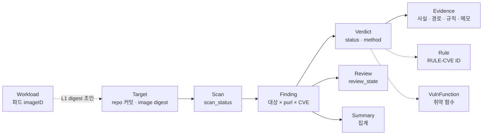
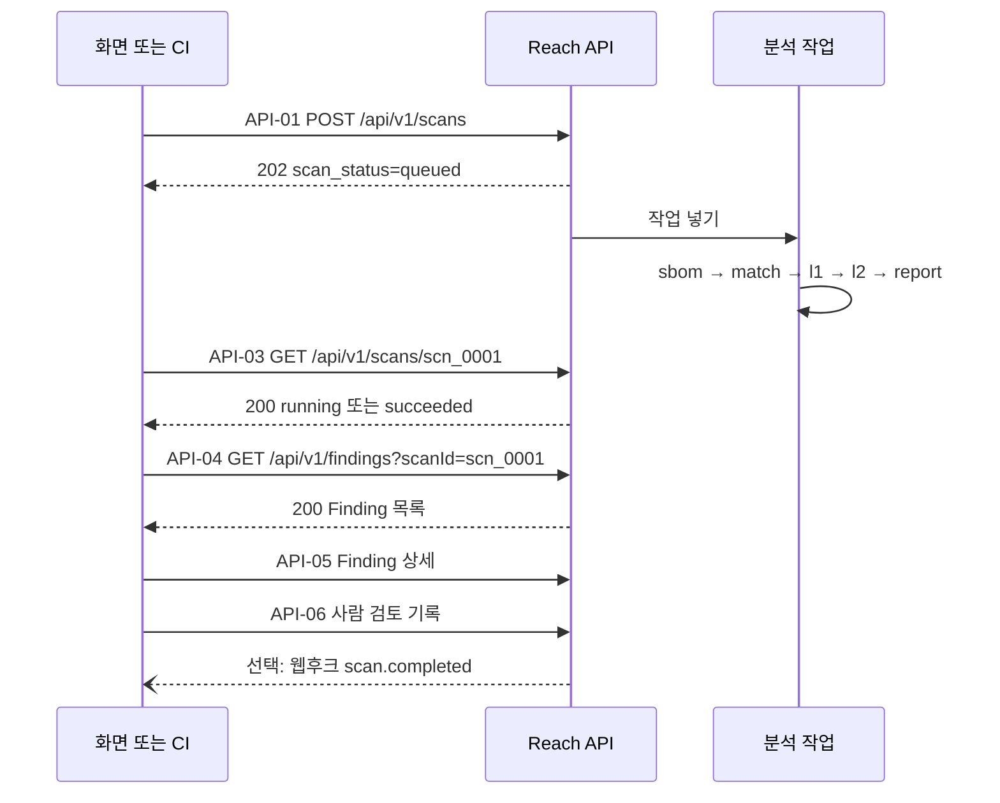
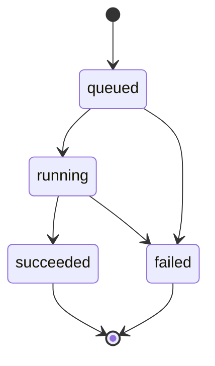
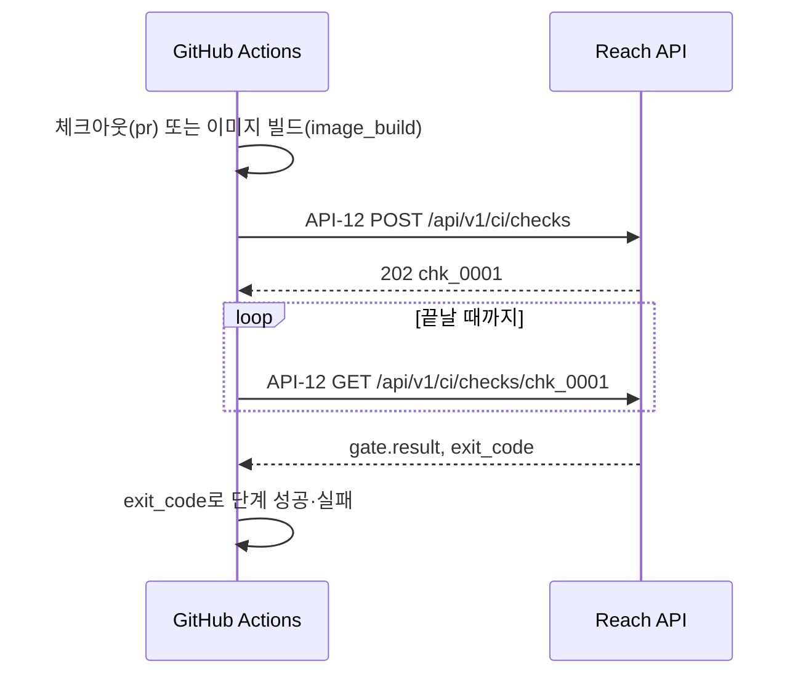

# API 명세서

**한 줄 요약**: Reach(Logssey 도달 가능성 분석 모듈)의 MVP용 HTTP API 설계 초안이다. 지금은 API 서버가 없고, 같은 일을 CLI와 파일이 한다(8절 대응표).

**상태 표기**: [완료] PoC로 구현·검증됨 / [부분] 일부만 구현되었거나 수동 / [계획] 아직 없음(설계). 이 문서의 API는 모두 [계획]이다.

## 1. 개요

### 1-1. 목적

- 화면(SCR-01~06), CI, Logssey 공통 플랫폼이 Reach의 결과를 같은 방식으로 읽고 쓰게 한다.
- 지금 CLI가 만드는 결과 파일(`verdicts.json`, `verdicts.md`)을 응답 모양의 기준으로 삼는다. 판정 로직은 바꾸지 않는다.
- 판정 근거를 API에서도 그대로 보여 준다. 모든 판정에 방식과 근거가 있고, 앱 코드 사실은 파일·줄까지 준다(NFR-02).

### 1-2. 범위

| 구분 | 내용 |
|---|---|
| 포함 | 스캔 요청과 이력, Finding·판정·근거 조회, 사람 검토 기록, 워크로드(L1) 조회, 대시보드 요약, 규칙·취약 함수 조회, 공통 Finding(OCSF) 내보내기, CI 검사, 이벤트(선택), L3 능동 관측 근거(Evidence `kind=runtime`, FR-14) |
| 제외 | Logssey의 다른 모듈(시크릿, IaC, 런타임). 사용자와 토큰 발급(Logssey 공통 인증). L3 상시 관측(운영 트래픽 감시, 확장). 업그레이드 적용(팀 결정) |
| 이번 초안에 없는 것 | 규칙·취약 함수를 쓰는 API. 지금처럼 데이터 파일로 추가한다(NFR-07). `admin`의 "규칙 관리" 권한은 쓰기 API를 더할 때 쓴다. 사실(F-) 목록 조회와 CI 검사 목록 조회도 없다. 대상(서비스) 등록 API도 없다. MVP는 레포에 커밋한 설정 파일로 등록하고, 등록 API와 화면은 확장 단계다(PRD FR-15). 사실의 뜻과 수집 범위는 규칙명세서 7절을 본다. PR 검사가 만든 스캔은 API-02(`trigger=pr`)로 본다 |

### 1-3. 상태

| 항목 | 상태 |
|---|---|
| 이 문서 | 설계 초안 v0.1 (2026-10-11) |
| API 서버, 인증, 웹후크 | [계획] |
| 판정 엔진 | [완료] v0. CLI(`reach.jar`, `verdict.py`, `run-reach.sh`)로 동작한다. 배포 이미지의 Java CVE 14개를 판정했고 모두 unreachable이다. 처음 10개는 정답지와 10/10 일치, 샘플 앱 회귀 테스트는 44/44 일치 |
| 엔드포인트별 지금 구현 | 4절 표의 "지금 같은 일" 열과 8절 대응표 |

### 1-4. 버전 정책

- 주 버전을 경로에 둔다: `/api/v1`.
- 호환을 깨는 변경은 `/api/v2`로 낸다: 필드 삭제·이름 변경·타입 변경, 열거값 추가·변경, 기본 정렬 변경, 권한 강화.
- 열거값 추가도 호환을 깨는 변경으로 본다. 공통 열거값(3-11, PRD 1절 "용어와 공통 열거값")을 다섯 산출물과 화면이 함께 쓰기 때문이다.
- 호환되는 변경은 v1 안에서 한다: 선택 필드 추가, 엔드포인트 추가, 오류 코드 추가.
- 클라이언트는 모르는 필드를 무시하고, 모르는 오류 코드는 HTTP 상태로 처리한다.
- 새 주 버전을 낸 뒤 이전 버전은 최소 3개월 유지한다. 응답 헤더 `Deprecation`, `Sunset`으로 알린다(초안 값).
- 예외: API-11(OCSF 내보내기)은 팀 스키마 합의 전까지 실험 단계다. 합의 전에는 이 규칙을 적용하지 않는다.

### 1-5. 아직 정하지 않은 것

| 항목 | 내용 | 정할 곳 |
|---|---|---|
| OCSF 클래스·필드 매핑 | 팀 스키마 합의 필요(5절) | 팀 합의(인프라 담당) |
| 토큰 발급 | Logssey 공통 인증과 맞춘다 | ARD Q-14 |
| CI 토큰 범위 | `admin` 서비스 계정을 그대로 쓸지, 스캔 실행만 허용하는 범위를 따로 둘지 | 팀 합의 |
| PR 코드를 빌드하는 곳 | 레포 대상 스캔은 cdxgen이 Gradle 빌드를 실행한다. 서버가 PR 코드를 빌드하면 빌드 스크립트를 실행하게 되어 신뢰 경계 문제가 생긴다. 러너에서 판정하고 결과만 올리는 방식과 비교한다 | ARD |
| 취약 함수 클래스 이름 표기 | 데이터 파일이 패키지를 포함한 이름을 쓰는지 확인 필요. 이 문서 예시는 원자료에 적힌 짧은 이름이다 | 규칙명세서 |
| `make_spec.py` 실행 인자 | 원자료에 없다. 확인 필요 | 8절 |
| Jackson 2 사본 7행 | 제안(확정 대기). 89407·89425는 도달 불가, 나머지 5개는 도달 불가(발동 조건 없음)로 제안했다. 사람이 확정하기 전까지 도구 판정은 `not_analyzed`, 검토 상태는 `unreviewed`이고, 제안은 `review.proposal`로 준다(3-10). 상세는 규칙명세서 9-1 | 사람 검토(FR-08) |
| 게이트 예외 기록 | 게이트에 걸린 PR을 통과시키는 예외(사유, 만료일, 승인한 `reviewer`)를 어디에 어떤 형식으로 남길지 정하지 않았다. 검토 기록(3-10)을 넓힐지 별도 API를 둘지 정한다. 규칙은 6-2와 PRD FR-11을 따른다 | ARD Q-07 |

## 2. 공통 규약

### 2-1. 기본 경로와 연결

- 기본 경로는 `/api/v1`이다. HTTPS만 받는다.
- 호스트 이름과 배포 위치는 ARD에서 정한다.
- 모든 응답에 `X-Request-Id` 헤더를 붙인다. 문의할 때 이 값을 쓴다.

### 2-2. 인증과 권한

- 모든 요청에 `Authorization: Bearer <토큰>` 헤더가 필요하다. 없거나 만료되면 401 `E-UNAUTHENTICATED`다.
- 토큰은 사람 사용자 토큰과 서비스 계정 토큰(CI)으로 나눈다. 발급은 Logssey 공통 인증을 따른다(1-5).

| 역할 | 할 수 있는 것 | 주 사용자 | API |
|---|---|---|---|
| `viewer` | 조회 | 보안 담당자, 개발자, 인프라 운영자 | API-02\~05, API-07\~11, API-12 결과 조회 |
| `reviewer` | 사람 검토 기록 | 보안 담당자 | API-06 |
| `admin` | 스캔 실행, 규칙 관리(쓰기 API는 [계획]) | 보안 담당자, CI 서비스 계정 | API-01, API-12 실행 |

- `viewer`, `reviewer`, `admin`은 서로를 포함하지 않는다. `admin`도 사람 검토를 쓸 수 없다. CI 서비스 계정이 사람 검토를 쓰지 못하게 하려는 것이다.
- 한 사람이나 서비스 계정이 여러 역할을 함께 가질 수 있다. 조회가 필요하면 `viewer`를 함께 준다. 예: 검토하는 보안 담당자는 `viewer`와 `reviewer`, CI 서비스 계정은 `admin`과 `viewer`다.
- 사람 검토 저장(API-06)은 `reviewer` 역할이 있어야 한다.
- 역할이 모자라면 403 `E-FORBIDDEN`이다.
- 쓰기 요청(API-01, API-06, API-12)은 누가·언제 했는지 남긴다(`requested_by`, `reviewer`, `reviewed_at`).

### 2-3. 요청·응답 형식

| 항목 | 규약 |
|---|---|
| 본문 | JSON, UTF-8. `Content-Type: application/json; charset=utf-8` |
| 필드 이름 | snake_case. 열거값은 공통 열거값(PRD 1절 "용어와 공통 열거값")을 그대로 쓴다(3-11) |
| 시각 | ISO 8601, UTC, 초 단위, 끝에 `Z`. 예: `2026-09-29T07:46:33Z` |
| 기간 | 초 단위 숫자. 필드 이름은 `_seconds`로 끝난다 |
| ID | 불투명 문자열. 앞머리로 종류를 나눈다: `scn_` 스캔, `tgt_` 대상, `fnd_` Finding, `wl_` 워크로드, `vf_` 취약 함수, `chk_` CI 검사, `evt_` 이벤트, `usr_` 사용자. 규칙은 `RULE-<CVE ID>`, 사실은 `F-<사실 이름>`이다(규칙명세서) |
| 값이 없는 선택 필드 | 응답에서 뺀다. 클라이언트는 없는 필드를 null로 본다. 오류의 `details`만은 항상 객체로 준다 |
| 단건 응답 | 리소스 객체를 그대로 준다 |
| 목록 응답 | `data` 배열과 `page` 객체(2-4) |
| 선택 하위 객체 | `include=a,b`로 붙인다. 허용 값은 엔드포인트마다 다르다(4절) |
| digest·커밋 표기 | 응답은 전체 값을 준다(digest는 `sha256:`과 64자, 커밋은 40자). 이 문서는 digest를 앞 8자리, 커밋을 7자리로 줄여 쓴다 |

### 2-4. 페이지네이션

목록 API는 모두 커서 방식 하나만 쓴다.

| 파라미터 | 설명 |
|---|---|
| `limit` | 한 번에 받을 개수. 기본 50, 최대 200 |
| `cursor` | 직전 응답의 `page.next_cursor` 값을 그대로 넣는다. 불투명 문자열이다 |
| `include=total` | 전체 개수 `page.total`을 함께 준다. 기본으로는 주지 않는다 |

```json
{
  "data": [],
  "page": {
    "limit": 50,
    "next_cursor": "eyJrIjoiZm5kXzAwNTAifQ"
  }
}
```

- `next_cursor`가 `null`이면 마지막 페이지다.
- 커서는 처음 요청의 필터·정렬과 묶인다. 커서를 넣으면서 필터나 정렬을 바꾸면 400 `E-INVALID_REQUEST`다.
- 커서는 24시간 동안 쓸 수 있다(초안 값).

**커서 방식으로 정한 이유**

- 하루 1번 재대조(FR-11)로 Finding이 생기고 사라진다. offset 방식은 페이지를 넘기는 사이에 행이 밀리거나 빠진다.
- 목록 화면(SCR-02)은 페이지 번호 대신 표 아래 [더 보기]로 다음 행을 붙인다. 다음 페이지만 있으면 된다. 개수는 요약(API-08)과 스캔 상태(API-03)가 준다.

### 2-5. 정렬과 필터

**정렬**

- `sort=필드1,-필드2` 형식이다. `-`를 붙이면 내림차순이다.
- 값이 같으면 다음 필드로, 마지막에는 `id`로 정렬한다.
- `severity`와 `status`는 아래 표의 순위로 정렬한다. `-`를 붙이면 순위가 높은 것이 먼저 온다.
- `cve`는 연도와 번호를 숫자로 비교한다. 예: CVE-2026-8763이 CVE-2026-13506보다 앞이다(문자열로 비교하면 뒤로 간다).
- 허용하지 않은 정렬 필드는 400 `E-INVALID_REQUEST`다. 엔드포인트별 허용 필드와 기본 정렬은 4절에 적는다.

| 필드 | 순위(높은 것부터) |
|---|---|
| `severity` | `CRITICAL > HIGH > MEDIUM > LOW > UNKNOWN` |
| `status` | `reachable > unknown > unreachable > not_analyzed` |

- Finding 기본 정렬(API-04)은 상태(`reachable` → `unknown` → `unreachable` → `not_analyzed`), 심각도(CRITICAL → UNKNOWN), CVE(연도·번호를 숫자로 비교) 순서다. 목록 화면(SCR-02)도 같은 순서를 쓴다.

**필터**

- 쿼리 파라미터 이름은 필드 이름과 같다.
- 한 파라미터에 쉼표로 여러 값을 주면 그중 하나에 맞으면 된다(OR).
- 서로 다른 파라미터는 모두 맞아야 한다(AND).
- 시각 범위는 `from`(포함), `to`(제외)로 준다.
- purl처럼 `:`, `/`, `@`가 들어간 값은 URL 인코딩한다.
- 모르는 파라미터나 열거값 밖의 값은 400 `E-INVALID_REQUEST`다. `details.param`에 파라미터 이름을 준다.
- 예외: 스캔 ID 쿼리는 경로 변수와 맞춰 `scanId`로 쓴다(API-11의 `?scanId=` 표기). 비교 방식을 이름에 담은 쿼리도 있다: `first_seen_after`(이 시각 뒤), `cve_contains`(부분 일치). 둘 다 API-04에서 쓴다.

예: `GET /api/v1/findings?status=reachable,unknown&severity=CRITICAL,HIGH&sort=-status,-severity,cve`

### 2-6. 오류 응답

모든 오류는 같은 모양이다.

```json
{
  "error": {
    "code": "E-INVALID_REQUEST",
    "message": "status 값이 올바르지 않다",
    "details": {
      "param": "status",
      "allowed": ["reachable", "unreachable", "unknown", "not_analyzed"]
    }
  }
}
```

- `code`: 아래 표의 값이다. 클라이언트는 이 값으로 분기한다.
- `message`: 사람이 읽는 한국어 문장이다. 문구는 바뀔 수 있다.
- `details`: 코드별 추가 정보다. 없으면 빈 객체 `{}`를 준다.

| 코드 | HTTP | 뜻 | `details` | 주로 나오는 API |
|---|---|---|---|---|
| `E-INVALID_REQUEST` | 400 | JSON이 아님, 필수 값·헤더 누락, 열거값 밖의 값, 허용하지 않은 파라미터, 잘못된 커서 | `param` 또는 `field`, `allowed` | 전체 |
| `E-UNAUTHENTICATED` | 401 | 토큰이 없거나 만료됨, 검증 실패 | - | 전체 |
| `E-FORBIDDEN` | 403 | 역할이 모자람 | `required_role` | API-01, API-06, API-12. 조회 API도 `viewer`가 없으면 나온다 |
| `E-NOT_FOUND` | 404 | 리소스가 없음 | `resource`, `id` | 단건 조회, `scanId`·`target`을 지정한 조회 |
| `E-CONFLICT` | 409 | 검토 `version`이 현재 값과 다름(다른 사람이 먼저 고침) | `current_version` | API-06 |
| `E-IDEMPOTENCY_CONFLICT` | 409 | 같은 `Idempotency-Key`로 다른 본문을 보냄 | `key` | API-01, API-12 |
| `E-SCAN_NOT_READY` | 409 | 스캔이 아직 `succeeded`가 아님 | `scan_status` | API-04, API-08, API-11(`scanId`를 지정한 경우) |
| `E-TARGET_UNRESOLVED` | 422 | 대상을 찾지 못함(없는 커밋·digest, 지원하지 않는 대상) | `field` | API-01, API-12 |
| `E-RATE_LIMITED` | 429 | 속도 제한을 넘음 | `retry_after_seconds` | 전체 |
| `E-INTERNAL` | 500 | 서버 오류 | - | 전체 |
| `E-UNAVAILABLE` | 503 | 의존 서비스를 잠시 쓸 수 없음(취약점 DB 갱신, 클러스터 조회 불가 등) | `dependency` | API-01, API-07, API-12 |
| `E-BUILD_FAILED` | - | 레포 대상의 빌드 실패. HTTP 응답이 아니라 스캔 실패 사유(`failure.code`)로만 쓴다 | `stage` | API-03 |
| `E-ANALYSIS_FAILED` | - | L2 분석 실패. 스캔 실패 사유로만 쓴다 | `stage` | API-03 |

### 2-7. 멱등성

- 스캔을 만드는 요청(API-01, API-12 실행)은 `Idempotency-Key` 헤더가 필수다. 없으면 400 `E-INVALID_REQUEST`다.
- 값은 클라이언트가 만든 고유 문자열이다(1~64자, UUID 권장). CI는 다시 실행해도 같은 값이 나오게 만든다. 예: `service-backend-pr-123-bb4639b`.
- 서버는 키를 토큰 주체별로 24시간 보관한다(초안 값).

| 경우 | 응답 |
|---|---|
| 처음 받은 키 | 정상 처리. 202와 새 스캔 |
| 같은 키, 같은 본문 | 처음 응답을 그대로 다시 준다(같은 `id`, 같은 상태 코드). `Idempotent-Replayed: true` 헤더를 붙인다 |
| 같은 키, 다른 본문 | 409 `E-IDEMPOTENCY_CONFLICT` |
| 같은 키가 동시에 두 번 | 하나만 처리하고, 다른 하나는 같은 응답을 받는다 |

- API-06(PATCH)은 `version`으로 충돌을 막는다. 같은 본문을 다시 보내면 `version`이 이미 올라가 409 `E-CONFLICT`가 난다. 클라이언트는 현재 값을 다시 읽는다.

### 2-8. 속도 제한

| 구분 | 토큰당 한도(초안 값) |
|---|---|
| 조회(GET) | 분당 300회 |
| 스캔 요청(API-01, API-12 실행) | 분당 10회 |
| 검토 기록(API-06) | 분당 60회 |

- 응답 헤더 `RateLimit-Limit`, `RateLimit-Remaining`, `RateLimit-Reset`(초)으로 남은 한도를 알린다.
- 한도를 넘으면 429 `E-RATE_LIMITED`와 `Retry-After` 헤더를 준다.
- 같은 대상의 스캔은 한 번에 1개만 돈다. 나머지는 `queued`로 기다린다. 분석 환경을 가볍게 유지하려는 것이다(NFR-03, NFR-06).
- 한도 값은 운영하며 조정한다.

## 3. 리소스 스키마

필드 표의 "필수"는 응답에 항상 들어 있는지를 뜻한다. 요청 본문의 필수 여부는 4절 각 엔드포인트에 적는다. 열거값은 3-11에 모았다.



### 3-1. Scan

대상 하나에 대해 SBOM 생성 → CVE 대조 → 판정까지 한 번 실행한 것이다.

| 이름 | 타입 | 필수 | 설명 |
|---|---|---|---|
| `id` | string | 예 | 스캔 ID(`scn_…`) |
| `target` | Target | 예 | 스캔 대상(3-2) |
| `scan_status` | enum | 예 | `queued` / `running` / `succeeded` / `failed` |
| `trigger` | enum | 예 | `manual`(사람·API-01 직접) / `pr`(API-12, PR 검사) / `image_build`(API-12, 이미지 빌드 단계, ECR push 전) / `schedule`(하루 1번 재대조) |
| `rescan_of` | string | 아니요 | 저장된 SBOM을 다시 쓴 경우 원래 스캔 ID |
| `stages` | object 배열 | 예 | 단계별 진행. `name`(`sbom` / `match` / `l1` / `l2` / `report`), `status`(`scan_status` 값), `started_at`, `finished_at`, `duration_seconds`, `message` |
| `tools` | object | 예 | 쓴 도구와 DB 버전(NFR-04, NFR-05). `trivy`, `trivy_db_updated_at`, `grype`, `cdxgen`, `reach`, `rules_version`, `vuln_functions_version` |
| `analysis` | object | 아니요 | L2 분석 규모. `app_classes`, `library_jars`, `reached_methods`, `jar_sha256`(판정한 jar. 판정 대상을 결과에 남긴다) |
| `counts` | object | 아니요 | `succeeded`일 때만. `total`, `by_severity`, `by_status`, `by_review_state` |
| `failure` | object | 아니요 | `failed`일 때만. `code`(E-코드), `stage`, `message` |
| `requested_by` | string | 예 | 요청한 사용자·서비스 계정 ID |
| `created_at` | date-time | 예 | 요청을 받은 시각 |
| `started_at`, `finished_at` | date-time | 아니요 | 시작·끝 시각 |

| 단계 | 하는 일 | 관련 FR |
|---|---|---|
| `sbom` | 이미지는 Trivy, 레포는 cdxgen으로 SBOM을 만든다(지금 도구이며 바꿀 수 있다). cdxgen은 Gradle 빌드를 실행해 간접 의존성까지 잡는다. 이미지와 레포 SBOM의 좌표가 다르면 레포를 우선하고 차이를 기록한다. 버전을 확정하지 못하면 "버전 미확정"으로 두고 범위 전체로 대조한다. 결정적 방법으로 식별하지 못한 구성요소만 AI 후보를 만들고 "구성요소 추정"으로 표시한다. 이 Finding은 `unreachable`로 확정하지 않는다 | FR-02 |
| `match` | Trivy로 대조하고 Grype로 교차 확인한다. purl을 키로 합친다(두 도구 결과가 다를 때의 병합 규칙은 ARD Q-08) | FR-03 |
| `l1` | 실행 중 파드의 imageID와 스캔 digest를 조인한다. revision 라벨로 커밋을 확인한다 | FR-04 |
| `l2` | bootJar 바이트코드로 호출 그래프(RTA, 진입점 2단계, 약한 경로 분리)를 만들고, CVE별 규칙으로 판정한다 | FR-05, FR-06 |
| `report` | 판정과 근거를 결과로 저장하고 보고서(기계용 JSON, 사람용 Markdown)를 만든다. API-04·API-05는 이 결과를 읽는다. 지금은 `verdict.py`가 `verdicts.json`, `verdicts.md`를 쓴다 | FR-07 |

### 3-2. Target

레포 커밋 또는 컨테이너 이미지 digest다.

| 이름 | 타입 | 필수 | 설명 |
|---|---|---|---|
| `id` | string | 예 | 대상 ID(`tgt_…`) |
| `type` | enum | 예 | `repo`(레포 커밋) / `image`(컨테이너 이미지 digest) |
| `app` | enum | 예 | `api` / `web` / `chat` |
| `repo` | object | `type=repo`일 때 | `name`(예: `service-backend`), `path`(레포 안 하위 경로. chat은 `chat-server`), `commit`(커밋 SHA) |
| `image` | object | `type=image`일 때 | `repository`(예: `logssey/reused-api`), `digest`, `revision`(OCI 라벨 `org.opencontainers.image.revision`), `created_at` |
| `source_tree` | string | 아니요 | git 트리 해시. 배포 커밋과 분석 커밋이 같은 소스인지 비교할 때 쓴다 |
| `display_name` | string | 예 | 화면 표시용 이름 |

- 이미지는 digest로만 가리킨다. ECR 태그는 MUTABLE이라 태그로는 실행 중인 이미지를 확정하지 못한다.
- `image.repository`에는 레지스트리 호스트를 넣지 않는다.

| `app` | 레포 | 이미지 저장소 | 주력 스캔 | L2 판정 |
|---|---|---|---|---|
| `api` | `service-backend` | `logssey/reused-api` | 이미지(Trivy) | [완료] v0 (Java) |
| `web` | `service-frontend` | `logssey/reused-web` | 레포(cdxgen). 이미지에는 minify된 번들만 있다 | [계획] (npm) |
| `chat` | `service-backend`의 `chat-server` | `logssey/reused-chat` | 레포 + 이미지 | [계획] (Node) |

### 3-3. Finding

대상 × 구성 요소 × 취약점 한 건이다. 같은 CVE라도 패키지 사본이 다르면 Finding이 다르다.

| 이름 | 타입 | 필수 | 설명 |
|---|---|---|---|
| `id` | string | 예 | Finding ID(`fnd_…`). 대상 × purl × CVE마다 하나다 |
| `scan_id` | string | 예 | 이 Finding을 마지막으로 갱신한 스캔 |
| `target_id` | string | 예 | 대상 ID |
| `component` | object | 예 | `purl`(키), `name`, `version`, `ecosystem`(`maven` / `npm` / `apk` 등), `path`(이미지 안 위치) |
| `vulnerability` | object | 예 | `id`(CVE), `severity`, `severity_note`(출처마다 심각도가 다를 때 남긴 메모, FR-03), `title`(스캐너 값), `description`(스캐너 설명 원문), `affected_feature`(취약 기능 설명), `fixed_versions`(스캐너 값), `cwe`, `references` |
| `deployment` | enum | 예 | `running` / `not_running` / `unknown` |
| `verdict` | Verdict | 예 | Reach 판정(3-4) |
| `review` | Review | 예 | 사람 검토(3-10) |
| `same_cve_findings` | string 배열 | 아니요 | 같은 CVE의 다른 패키지 사본 Finding ID |
| `sources` | enum 배열 | 예 | 이 Finding을 보고한 스캐너: `trivy`, `grype` |
| `upgrade` | object | 아니요 | `suggested_version`(같은 패키지의 CVE를 모두 없애는 최소 버전), `change`(버전을 정하는 위치와 바꿀 내용. 예: Spring Boot 관리 버전 덮어쓰기), `note`. 제안일 뿐이며 적용 여부는 팀이 정한다(FR-13) |
| `first_seen_at`, `last_seen_at` | date-time | 예 | 처음·마지막으로 보인 시각 |

- 예: CVE-2026-89407은 `tools.jackson.core:jackson-core` 3.1.5와 `com.fasterxml.jackson.core:jackson-core` 2.21.5에서 각각 한 건이다(FR-07).
- `deployment`: image 대상은 digest가 실행 중 파드의 imageID에 있으면 `running`, 조회했는데 없으면 `not_running`, 조회하지 못하면 `unknown`이다. repo 대상은 실행 중 이미지의 revision 라벨이 이 커밋이거나 소스 트리 해시가 같으면 `running`이다(FR-04).
- 결과는 지우지 않는다. 다음 스캔에서 보이지 않으면 `last_seen_at`이 그대로 남는다.

### 3-4. Verdict

Finding에 대한 Reach의 결론이다.

| 이름 | 타입 | 필수 | 설명 |
|---|---|---|---|
| `status` | enum | 예 | `reachable` / `unreachable` / `unknown` / `not_analyzed` |
| `method` | enum | `not_analyzed`가 아니면 | `callgraph` / `rule` / `manual` |
| `summary` | string | 예 | 한 줄 근거. 예: "FORM 인증(LoginConfig) 설정 없음" |
| `not_analyzed_reason` | enum | `not_analyzed`일 때 | `no_vuln_function_data`(취약 함수 데이터 없음) / `os_package`(OS 패키지) / `unanalyzed_copy`(판정하지 않은 패키지 사본) / `unsupported_ecosystem`(L2를 아직 지원하지 않는 생태계) |
| `rule_id` | string | 아니요 | 적용한 규칙 `RULE-<CVE ID>` |
| `rule` | Rule | 아니요 | `include=rule`일 때(API-05). `rule_id`의 규칙 객체(3-7) |
| `vuln_function_ids` | string 배열 | 아니요 | 판정에 쓴 취약 함수 |
| `vuln_functions` | VulnFunction 배열 | 아니요 | `include=vuln_functions`일 때(API-05). `vuln_function_ids`의 취약 함수 객체(3-8) |
| `callgraph` | object | 아니요 | `package_reached`, `vuln_function_present`(jar에 취약 메서드가 있나), `vuln_function_reached`, `entry_stage`(1 또는 2), `weak_only`(약한 경로로만 닿음) |
| `evidence` | Evidence 배열 | 예 | 근거 목록(3-5). 사실이 먼저, 경로가 나중이다 |
| `analyzed_at` | date-time | 예 | 판정 시각 |
| `engine` | object | 예 | `reach`, `rules_version`, `vuln_functions_version` |
| `history` | object 배열 | 아니요 | `include=verdict_history`일 때. 이전 판정을 새것부터 준다. 항목은 `status`, `method`, `not_analyzed_reason`, `summary`, `scan_id`, `engine`, `analyzed_at`이다. 재판정(규칙·취약 함수 데이터 변경, 재스캔)과 사람 판정이 `verdict`가 된 경우(API-06 예외)를 남긴다 |

API가 지키는 판정 원칙이다. 자세한 원칙은 규칙명세서(GR-)가 정한다.

- 확신이 없으면 `unknown`이다. 거짓 `unreachable`을 내지 않는다(NFR-01).
- 약한 경로로만 닿으면 `unknown`이다.
- 취약 메서드가 jar에 없으면(`vuln_function_present: false`) `unknown`이다. 버전에 따라 메서드 이름이 바뀔 수 있다.
- 규칙은 도달 가능 조건 → 도달 불가 조건 → 미확인 조건 → 기본값 순서로 평가한다.
- 규칙으로 판정했는데 호출 그래프 결과가 달라 보이면 이유를 `note` 근거로 붙인다(가상 호출 과대근사, 프레임워크가 실행하는 코드).
- AI는 최종 판정에 쓰지 않는다. 같은 입력이면 같은 판정이 나온다(NFR-04).

| `not_analyzed_reason` | PoC에서 해당하는 행(배포 이미지 23행 기준) |
|---|---|
| `unanalyzed_copy` | `com.fasterxml.jackson` 2.21.5 사본 7행. 제안(확정 대기): 89407·89425는 도달 불가, 나머지 5개는 발동 조건이 없어 도달 불가다(규칙명세서 9-1). 제안은 `review.proposal`에 있다 |
| `os_package` | libpng, zlib 2행 |
| `no_vuln_function_data` | 지금은 없음. 취약 함수 데이터를 더하기 전의 CVE가 여기에 든다 |
| `unsupported_ecosystem` | 지금은 없음. web·chat(npm)을 스캔하면 여기에 든다 |

### 3-5. Evidence

판정을 뒷받침하는 것이다: 앱 코드의 사실(파일·줄), 호출 경로, 적용한 규칙, 메모.

| 이름 | 타입 | 필수 | 설명 |
|---|---|---|---|
| `order` | integer | 예 | 표시 순서. `fact`가 `path`보다 앞선다 |
| `kind` | enum | 예 | `fact`(앱 코드 사실) / `path`(호출 경로) / `rule`(적용한 규칙) / `note`(설명) / `runtime`(L3 능동 관측, FR-14) |
| `summary` | string | 예 | 사람이 읽는 한 줄 |
| `fact_id` | string | `kind=fact`일 때 | `F-<사실 이름>`(규칙명세서) |
| `value` | any | 아니요 | 사실 값(참·거짓, 개수 등) |
| `informational` | boolean | 아니요 | true면 판정에 쓰지 않은 참고 사실이다(규칙의 `info_facts`) |
| `locations` | object 배열 | 아니요 | 앱 코드 위치. `file`, `line`, `symbol`. 앱 코드 사실은 파일·줄까지 준다(NFR-02) |
| `rule_id` | string | `kind=rule`일 때 | 적용한 규칙 |
| `matched_condition` | enum | 아니요 | `kind=rule`일 때 맞은 조건: `reachable` / `unreachable` / `unknown` / `default` |
| `checked_absent` | string 배열 | 아니요 | 확인했지만 없던 것 |
| `checked_count` | integer | 아니요 | 확인한 대상 수. 예: tokens 출발점 97개. `checked_absent`와 함께 "무엇을 몇 개 확인했는데 없었는지"를 보인다 |
| `path` | string 배열 | `kind=path`일 때 | 진입점 → … → 목표 |
| `path_target` | enum | `kind=path`일 때 | `vuln_function`(취약 함수까지) / `package`(패키지까지) |
| `candidate` | boolean | `kind=path`일 때 | 항상 true. 가장 짧은 후보 경로이며 실제 경로와 다를 수 있다 |
| `entry_stage` | integer | 아니요 | 경로가 시작한 진입점 단계. 1(Spring 진입점) / 2(모든 앱 메서드) |
| `weak` | boolean | 아니요 | 경로에 약한 간선(Object 메서드 호출, JDK 콜백)이 있나 |
| `build` | object | `kind=runtime`일 때 | 관측한 빌드. `jar_sha256` 또는 `image_digest` 중 하나 |
| `config_keys` | object 배열 | `kind=runtime`일 때 | 환경 변수·프로필의 키. `name`(키 이름), `enabled`(켜짐 여부). 값은 담지 않는다 |
| `invocations` | string 배열 | `kind=runtime`일 때 | 호출한 API·테스트 목록 |
| `observation_method` | enum | `kind=runtime`일 때 | 확인 방법: `coverage`(Java 커버리지 에이전트, 메서드 실행) / `maps`(네이티브 라이브러리 로드, `/proc/<pid>/maps`) / `uprobe`(네이티브 공개 함수 호출) |
| `observed_at` | date-time | `kind=runtime`일 때 | 관측 시각 |
| `executed` | boolean | `kind=runtime`일 때 | 실행(로드·호출)이 관측됐나. true만 판정 근거(`reachable`)로 쓴다. false는 `unreachable` 근거로 쓰지 않는다 |

예: CVE-2026-89407(jackson-core 3.1.5)의 사실 근거. 원자료에 줄 번호가 없어 `symbol`만 적었다.

```json
[
  {
    "order": 1,
    "kind": "fact",
    "fact_id": "F-dto.floating.tokens",
    "value": false,
    "checked_count": 97,
    "summary": "Jackson에 타입을 알려줄 수 있는 자리(tokens) 97개에서 필드를 따라갔다. 실수형 필드 없음"
  },
  {
    "order": 2,
    "kind": "fact",
    "fact_id": "F-dto.floating.any",
    "informational": true,
    "value": true,
    "summary": "앱 전체로 보면 실수형 필드가 있다. 응답 전용 record의 Double averageRating이며 판정에는 쓰지 않는다",
    "locations": [
      { "symbol": "SellerBriefResponse.averageRating" },
      { "symbol": "SellerProfileResponse.averageRating" }
    ]
  }
]
```

### 3-6. Workload

운영 클러스터에서 실행 중인 파드·디플로이먼트와 그 imageID(digest)다.

| 이름 | 타입 | 필수 | 설명 |
|---|---|---|---|
| `id` | string | 예 | 워크로드 ID(`wl_…`) |
| `namespace` | string | 예 | 예: `reused` |
| `kind` | string | 예 | 예: `Deployment` |
| `name` | string | 예 | 예: `reused-api` |
| `app` | enum | 아니요 | `api` / `web` / `chat` |
| `image` | object | 예 | `repository`, `digest`(파드 imageID에서 얻은 값), `revision`(확인한 경우) |
| `replicas` | object | 예 | `ready`(준비된 파드 수), `desired`(디플로이먼트가 원하는 파드 수. 디플로이먼트를 조회했을 때만 준다) |
| `pods` | object 배열 | 아니요 | `include=pods`일 때. `name`, `image_id`, `ready` |
| `deployment` | enum | 예 | `running` / `not_running` / `unknown` |
| `scan_match` | object | 예 | 스캔 결과와의 연결. `status`(`match` / `mismatch` / `no_scan`), `scan_id`, `matched_by`(`digest` / `source_tree`), `deployed_revision`, `analyzed_commit`, `source_tree_equal`. `no_scan`이면 `status`만 준다 |
| `registered` | boolean | 예 | 대상(서비스) 등록 목록(PRD FR-15)에 있는 워크로드면 true, 없으면 false다. false면 화면은 "미등록"으로 보인다(SCR-04) [계획] |
| `service` | string | 아니요 | 이 워크로드를 묶은 등록 서비스 이름(예: `api`). `registered`가 true일 때만 준다 [계획] |
| `observed_at` | date-time | 예 | 클러스터를 조회한 시각 |
| `source` | enum | 예 | `manual`(사람이 kubectl로 조회) / `cluster_reader`(읽기 전용 자동 조회, [계획]) |

- 실행 중인 이미지는 파드의 `imageID`로 정한다. gitops 태그만으로는 확정하지 못한다(태그 MUTABLE, `pullPolicy: IfNotPresent`).
- `scan_match.status`: `match`는 이 digest를 스캔했거나(`matched_by: digest`), 배포 커밋과 소스 트리가 같은 커밋을 스캔한 경우(`matched_by: source_tree`)다. `mismatch`는 같은 `app`의 스캔은 있지만 digest도 소스 트리도 다른 경우다. 이때 `scan_id`는 그 앱의 최신 `succeeded` 스캔이고, 그 판정을 배포물에 그대로 쓸 수 없다. `no_scan`은 같은 `app`의 스캔이 없는 경우다.
- 자동 조회에는 클러스터 읽기 전용 권한이 필요하다(NFR-05). 지금은 클러스터 API 서버가 SSM을 거쳐야 닿아서 사람이 조회한다.
- 클러스터에서 본 워크로드는 등록 여부와 관계없이 모두 준다. 대상(서비스) 등록 목록(PRD FR-15)에 없으면 `registered: false`다. 등록하지 않은 서비스가 감시에서 조용히 빠지지 않게 하려는 것이다. 등록은 레포에 커밋한 설정 파일로 하고, 등록 API는 확장 단계라 이 초안에 없다(1-2).

### 3-7. Rule

CVE별 판정 조건이다. 사실과 호출 그래프 결과를 입력으로 상태를 정한다. 조건식의 형식과 내용은 규칙명세서가 정한다.

| 이름 | 타입 | 필수 | 설명 |
|---|---|---|---|
| `id` | string | 예 | `RULE-<CVE ID>` |
| `cve` | string | 예 | CVE ID |
| `packages` | string 배열 | 예 | 적용 패키지(purl, 버전 제외) |
| `summary` | string | 예 | 판정 조건 요약 |
| `facts` | string 배열 | 예 | 판정에 쓰는 사실 `F-…` |
| `info_facts` | string 배열 | 아니요 | 판정에 쓰지 않고 참고로만 보여 주는 사실. `rules.json`의 `info`를 그대로 옮긴다. 근거에서는 Evidence의 `informational`이 true다 |
| `evaluation_order` | string 배열 | 예 | 항상 `reachable`, `unreachable`, `unknown`, `default` 순서 |
| `vuln_function_ids` | string 배열 | 아니요 | 함께 쓰는 취약 함수 |
| `regression_apps` | string 배열 | 아니요 | 이 규칙을 검사하는 샘플 앱 |
| `definition` | object | 아니요 | `include=definition`일 때. 조건식 원문을 그대로 준다 |
| `version` | string | 예 | 규칙 데이터 버전 |
| `updated_at` | date-time | 예 | 마지막 변경 시각 |

- 규칙은 데이터 파일(`data/rules.json`)에 있다. CVE를 더할 때 분석기 코드를 고치지 않는다(NFR-07).

### 3-8. VulnFunction

수정으로 바뀐 메서드다. 수정 커밋 diff나 취약·수정 버전의 소스 diff로 찾는다. 호출 그래프 판정의 목표 지점이다.

| 이름 | 타입 | 필수 | 설명 |
|---|---|---|---|
| `id` | string | 예 | 취약 함수 ID(`vf_…`) |
| `cve` | string | 예 | CVE ID |
| `package` | string | 예 | purl(버전 제외) |
| `class` | string | 예 | 클래스 이름(표기 형식은 1-5에서 확인 필요) |
| `method` | string | 예 | 메서드 이름. 생성자는 `<init>` |
| `descriptor` | string | 아니요 | JVM 메서드 시그니처 |
| `fixed_version` | string | 아니요 | 수정 버전 |
| `fix_commits` | string 배열 | `provenance=fix_commit_diff`일 때 | 근거로 쓴 수정 커밋. `version_diff`여도 수정 커밋과 대조했으면 준다(예: Tomcat) |
| `provenance` | enum | 예 | 정한 방법. `version_diff`(취약 버전과 수정 버전의 소스 diff에서 바뀐 메서드) / `fix_commit_diff`(수정 커밋 diff에서 바뀐 메서드) |
| `verified_with` | string | 아니요 | 확인 방법. 예: 대상 버전 jar를 `javap`로 확인 |
| `candidate_source` | enum | 아니요 | 후보를 낸 곳: `manual` / `prospector` / `ai`. AI는 후보만 내고 사람이 확인한다(NFR-04) |
| `excluded` | boolean | 아니요 | true면 일부러 뺀 메서드다. `include=excluded`일 때만 목록에 나온다 |
| `exclusion_reason` | string | `excluded`가 true일 때 | 뺀 이유 |

- 취약 함수 데이터는 조사 파일에서 생성 스크립트(`make_spec.py`)로 만든다(FR-09).
- PoC의 CVE 14개: 처음 10개는 `version_diff`다(Tomcat 3개는 수정 커밋을 찾아 태그 diff와 대조했다). CVE-2026-13506과 MEDIUM 3개(0636, 19032, 83557)는 `fix_commit_diff`다. 모두 `javap`로 시그니처를 확인했다.

### 3-9. Summary

대시보드 요약이다(SCR-01).

| 이름 | 타입 | 필수 | 설명 |
|---|---|---|---|
| `scope` | object | 예 | `target_id`(없으면 전체 대상), `scan_id`(기준 스캔) |
| `totals` | object | 예 | `findings` |
| `by_status` | object | 예 | 네 값을 모두 키로 준다(0 포함) |
| `by_not_analyzed_reason` | object | 예 | `not_analyzed`의 사유별 개수. 네 사유를 모두 키로 준다(0 포함) |
| `by_severity` | object | 예 | 다섯 값을 모두 키로 준다 |
| `by_method` | object | 예 | 판정한 것만 센다(`not_analyzed` 제외) |
| `by_review_state` | object | 예 | 세 값을 모두 키로 준다 |
| `by_deployment` | object | 예 | 세 값을 모두 키로 준다 |
| `severity_by_status` | object | 아니요 | `include=matrix`일 때. 심각도 × 상태. 0인 칸은 뺀다 |
| `noise_reduction` | object | 예 | 노이즈 감소율(PRD M-01). `unreachable`, `judged`, `ratio`. 정의는 API-08 |
| `coverage` | object | 예 | 판정 범위(PRD M-02). `judged`, `total`, `ratio`. 정의는 API-08 |
| `generated_at` | date-time | 예 | 집계 시각 |

### 3-10. Review

사람 검토 기록이다(FR-08).

| 이름 | 타입 | 필수 | 설명 |
|---|---|---|---|
| `review_state` | enum | 예 | `unreviewed` / `provisional` / `confirmed` |
| `status` | enum | 아니요 | 사람이 본 판정. `reachable` / `unreachable` / `unknown` |
| `note` | string | 아니요 | 근거 메모. 2,000자 이하 |
| `reviewer` | object | 기록이 있으면 | 마지막으로 기록한 사람. `id`, `name`. 서버가 토큰에서 채운다 |
| `reviewed_at` | date-time | 기록이 있으면 | 마지막으로 기록한 시각. 서버 시각이다 |
| `version` | integer | 예 | 처음은 1이고 고칠 때마다 1씩 오른다 |
| `disagrees_with_tool` | boolean | 예 | `status`가 도구 판정과 다르면 true. 도구가 판정하지 않아 사람 판정이 `verdict`가 된 경우(API-06 예외)는 false다. true인 Finding은 검증 세트(ARD C-14)에 추가할 후보다(FR-08) |
| `proposal` | object | 아니요 | 사람 확정을 기다리는 판정 제안. `status`(제안한 판정: `reachable` / `unreachable` / `unknown`), `summary`(한 줄 근거. 발동 조건 자체가 없어 도달 불가로 본 제안은 "발동 조건 없음"으로 시작한다), `reference`(근거 문서). `review_state`와 `verdict`를 바꾸지 않는다. `provisional`·`confirmed`로 저장하면 현재 값에서 빠지고 이력에 남는다 |
| `carried_from` | object | 아니요 | 이 검토를 이어받은 이전 Finding. `finding_id`, `scan_id`, `reviewed_at`. 같은 서비스의 같은 purl·CVE가 다음 스캔에 다시 나오면 서버가 채운다(FR-08 수용 기준 7). 이어받지 않았으면 없다 |
| `reset_reason` | enum | 아니요 | 이어받을 검토를 `unreviewed`로 되돌린 이유. `verdict_changed`(도구 판정이 바뀜) / `evidence_changed`(사실·호출 경로·적용 규칙이 바뀜). 되돌리기 전 기록은 `history`에 남는다(FR-08 수용 기준 8). 사람이 다시 기록하면 빈다 |
| `history` | object 배열 | 아니요 | `include=review_history`일 때. 이전 기록을 새것부터 준다. 항목은 `review_state`, `status`, `note`, `proposal`, `reviewer`, `reviewed_at`, `version`이다 |

### 3-11. 열거값

PRD 1절 "용어와 공통 열거값"과 같다. API 필드, 화면 표시, 규칙 출력이 모두 이 값을 쓴다.

| 필드 | 값 |
|---|---|
| 판정 상태 `status` | `reachable`(도달 가능) / `unreachable`(도달 불가) / `unknown`(미확인) / `not_analyzed`(분석 대상 아님: 취약 함수 데이터 없음, OS 패키지, 판정하지 않은 패키지 사본 등) |
| 판정 방식 `method` | `callgraph`(호출 그래프) / `rule`(설정·타입 규칙) / `manual`(사람) |
| 사람 검토 `review_state` | `unreviewed`(검토 전) / `provisional`(잠정) / `confirmed`(확정) |
| 배포 상태 `deployment` | `running`(실행 중) / `not_running`(실행 안 함) / `unknown`(확인 못 함) |
| 심각도 `severity` | `CRITICAL` / `HIGH` / `MEDIUM` / `LOW` / `UNKNOWN` (스캐너 값 그대로) |
| 스캔 상태 `scan_status` | `queued` / `running` / `succeeded` / `failed` |

이 문서에서만 쓰는 값이다.

| 필드 | 값 |
|---|---|
| Target `type` | `repo` / `image` |
| Target `app` | `api` / `web` / `chat` |
| Scan `trigger` | `manual` / `pr` / `image_build` / `schedule` |
| Scan `stages[].name` | `sbom` / `match` / `l1` / `l2` / `report` |
| Verdict `not_analyzed_reason` | `no_vuln_function_data` / `os_package` / `unanalyzed_copy` / `unsupported_ecosystem` |
| Evidence `kind` | `fact` / `path` / `rule` / `note` / `runtime` |
| Evidence `path_target` | `vuln_function` / `package` |
| Workload `source` | `manual` / `cluster_reader` |
| Workload `scan_match.status` | `match` / `mismatch` / `no_scan` |
| VulnFunction `provenance` | `version_diff` / `fix_commit_diff` |
| VulnFunction `candidate_source` | `manual` / `prospector` / `ai` |
| CI 검사 `mode` | `pr` / `image_build` / `schedule` / `manual` |
| CI 검사 `policy` | `report_only` / `gate` |
| CI 검사 `gate.result` | `pass` / `warn` / `fail` |

## 4. 엔드포인트

예시의 CVE, 패키지와 설치·수정 버전, 판정, 근거, 개수는 PoC 실제 값이다. ID(`scn_0001` 등), 시각, PR 번호, 규칙·데이터 버전 문자열, 토큰은 형식을 보이기 위한 값이다. 실제 값을 옮긴 시각은 예시 아래에 따로 적었다. digest는 앞 8자리, 커밋은 7자리로 줄여 쓴다.

| ID | 메서드·경로 | 권한 | 용도 | 관련 FR | 관련 SCR | 지금 같은 일 |
|---|---|---|---|---|---|---|
| API-01 | `POST /api/v1/scans` | `admin` | 스캔 요청 | FR-01 | SCR-05 | `run-reach.sh` [부분] |
| API-02 | `GET /api/v1/scans` | `viewer` | 스캔 이력 목록 | FR-01 | SCR-05 | 없음 |
| API-03 | `GET /api/v1/scans/{scanId}` | `viewer` | 스캔 상태·요약 | FR-01, FR-07 | SCR-01, SCR-05 | `verdicts.md` 머리말 |
| API-04 | `GET /api/v1/findings` | `viewer` | Finding 목록 | FR-07, FR-12 | SCR-02 | `verdicts.json` |
| API-05 | `GET /api/v1/findings/{findingId}` | `viewer` | Finding 상세 | FR-05, FR-06, FR-07 | SCR-03 | `verdicts.json` 한 항목 |
| API-06 | `PATCH /api/v1/findings/{findingId}/review` | `reviewer` | 사람 검토 기록 | FR-08 | SCR-03 | `answer-key.md` [부분] |
| API-07 | `GET /api/v1/workloads` | `viewer` | 실행 중 워크로드와 digest, 스캔 연결, 등록 여부 | FR-04, FR-15 | SCR-04 | l1 스크립트 + 수동 kubectl [부분] |
| API-08 | `GET /api/v1/summary` | `viewer` | 대시보드 요약 | FR-12 | SCR-01 | 없음 |
| API-09 | `GET /api/v1/rules`, `GET /api/v1/rules/{ruleId}` | `viewer` | 규칙 조회 | FR-06 | SCR-06 | `data/rules.json` |
| API-10 | `GET /api/v1/vuln-functions` | `viewer` | 취약 함수 데이터 조회 | FR-09 | SCR-06 | `data/vuln-functions.json` |
| API-11 | `GET /api/v1/exports/ocsf?scanId=` | `viewer` | 공통 Finding(OCSF) 내보내기 | FR-10 | - | 없음 |
| API-12 | `POST /api/v1/ci/checks`, `GET /api/v1/ci/checks/{checkId}` | `admin`(실행), `viewer`(결과) | CI(PR) 검사 실행과 결과 | FR-11 | SCR-05 | 없음 |

**기본 흐름**



**스캔 상태**



### API-01 스캔 요청

| 항목 | 내용 |
|---|---|
| 메서드·경로 | `POST /api/v1/scans` |
| 권한 | `admin` |
| 설명 | 대상 하나에 대해 스캔을 만든다. 바로 202를 주고 작업은 뒤에서 돈다. 단계는 `sbom` → `match` → `l1` → `l2` → `report`다. 같은 대상의 스캔이 이미 돌고 있으면 `queued`로 기다린다 |
| 관련 | FR-01(스캔 안에서 FR-02~06 단계를 돈다) · SCR-05 |
| 지금 같은 일 | `bash scripts/run-reach.sh` [부분] |

| 이름 | 위치 | 타입 | 필수 | 설명 |
|---|---|---|---|---|
| `Idempotency-Key` | 헤더 | string | 예 | 2-7 |
| `target.type` | 본문 | enum | `rescan_of`가 없으면 | `repo` / `image` |
| `target.app` | 본문 | enum | 아니요 | `api` / `web` / `chat`. 없으면 레포·이미지 저장소 이름으로 정한다(3-2 표) |
| `target.repo.name`, `target.repo.commit` | 본문 | string | `type=repo`일 때 | 레포 이름과 커밋 SHA(40자) |
| `target.repo.path` | 본문 | string | 아니요 | 레포 안 하위 경로. chat은 `chat-server` |
| `target.image.repository`, `target.image.digest` | 본문 | string | `type=image`일 때 | 이미지 저장소와 digest. 태그는 받지 않는다 |
| `rescan_of` | 본문 | string | 아니요 | 이전 스캔 ID. 그 스캔의 저장된 SBOM으로 대조부터 다시 한다. `target`과 함께 쓰지 않는다 |
| `options.cross_check` | 본문 | string 배열 | 아니요 | 교차 확인 스캐너. 기본 `["grype"]`(FR-03) |
| `options.l1`, `options.l2` | 본문 | boolean | 아니요 | 배포 여부 확인과 판정. 기본 둘 다 true. `l2`가 false면 대조까지만 한다. 이때 스캔의 `stages`에 `l2`가 없다 |

요청 예시(배포 이미지)

```http
POST /api/v1/scans
Authorization: Bearer <토큰>
Content-Type: application/json; charset=utf-8
Idempotency-Key: 5f0c2a9e-3c1b-4f7e-9a51-0d6b2e8c7a10
```

```json
{
  "target": {
    "type": "image",
    "app": "api",
    "image": {
      "repository": "logssey/reused-api",
      "digest": "sha256:a6ffffef…"
    }
  },
  "options": {
    "cross_check": ["grype"],
    "l1": true,
    "l2": true
  }
}
```

응답 예시(202 Accepted, 헤더 `Location: /api/v1/scans/scn_0001`)

```json
{
  "id": "scn_0001",
  "scan_status": "queued",
  "trigger": "manual",
  "target": {
    "id": "tgt_0001",
    "type": "image",
    "app": "api",
    "image": {
      "repository": "logssey/reused-api",
      "digest": "sha256:a6ffffef…"
    },
    "display_name": "reused-api @ a6ffffef"
  },
  "requested_by": "usr_0001",
  "created_at": "2026-10-11T01:00:00Z"
}
```

다른 요청 모양

```json
{
  "target": {
    "type": "repo",
    "app": "api",
    "repo": { "name": "service-backend", "commit": "6583020" }
  }
}
```

```json
{
  "rescan_of": "scn_0001"
}
```

- 레포 대상은 cdxgen이 Gradle 빌드를 실행한다. 간접 의존성까지 잡지만 빌드 스크립트를 실행하므로 시간이 더 들고 신뢰 경계를 따져야 한다(1-5).
- `rescan_of`는 재빌드 없이 저장된 SBOM을 최신 DB로 다시 대조한다. 하루 1번 재대조(FR-11)에 쓴다.
- 어떤 서비스를 스캔할지는 PRD FR-15의 대상(서비스) 등록 목록(레포에 커밋한 설정 파일)이 정한다. 하루 1번 재대조(`trigger=schedule`)는 이 목록의 서비스를 대상으로 한다. 등록하지 않은 대상을 API-01로 요청했을 때 받을지는 정하지 않았다.

**오류**: `E-INVALID_REQUEST`, `E-UNAUTHENTICATED`, `E-FORBIDDEN`, `E-IDEMPOTENCY_CONFLICT`, `E-TARGET_UNRESOLVED`, `E-RATE_LIMITED`, `E-UNAVAILABLE`

### API-02 스캔 이력 목록

| 항목 | 내용 |
|---|---|
| 메서드·경로 | `GET /api/v1/scans` |
| 권한 | `viewer` |
| 설명 | 스캔 이력을 최근 것부터 준다 |
| 관련 | FR-01 · SCR-05 |
| 지금 같은 일 | 없음 |

| 쿼리 | 타입 | 필수 | 설명 |
|---|---|---|---|
| `target` | string | 아니요 | Target ID |
| `scan_status` | enum 목록 | 아니요 | `queued`, `running`, `succeeded`, `failed` |
| `trigger` | enum 목록 | 아니요 | `manual`, `pr`, `image_build`, `schedule` |
| `from`, `to` | date-time | 아니요 | `created_at` 범위 |
| `sort` | string | 아니요 | 기본 `-created_at`. 허용: `created_at`, `finished_at` |
| `limit`, `cursor`, `include` | - | 아니요 | 2-4. `include`는 `total`만 받는다 |

목록 항목은 Scan(3-1)과 같은 모양이다. 대상은 `display_name`과 digest·커밋까지 준다.

요청 예시: `GET /api/v1/scans?target=tgt_0001&scan_status=succeeded&limit=20`

응답 예시(200, 일부 필드 줄임)

```json
{
  "data": [
    {
      "id": "scn_0001",
      "scan_status": "succeeded",
      "trigger": "manual",
      "target": {
        "id": "tgt_0001",
        "type": "image",
        "app": "api",
        "image": { "repository": "logssey/reused-api", "digest": "sha256:a6ffffef…" },
        "display_name": "reused-api @ a6ffffef"
      },
      "counts": {
        "total": 23,
        "by_severity": { "CRITICAL": 5, "HIGH": 11, "MEDIUM": 7, "LOW": 0, "UNKNOWN": 0 },
        "by_status": { "reachable": 0, "unreachable": 14, "unknown": 0, "not_analyzed": 9 }
      },
      "created_at": "2026-10-11T01:00:00Z",
      "started_at": "2026-10-11T01:00:05Z",
      "finished_at": "2026-10-11T01:01:20Z"
    }
  ],
  "page": { "limit": 20, "next_cursor": null }
}
```

**오류**: `E-INVALID_REQUEST`, `E-UNAUTHENTICATED`, `E-RATE_LIMITED`

### API-03 스캔 상태·요약

| 항목 | 내용 |
|---|---|
| 메서드·경로 | `GET /api/v1/scans/{scanId}` |
| 권한 | `viewer` |
| 설명 | 스캔 하나의 상태, 단계별 진행, 쓴 도구 버전, 분석 규모, 개수를 준다. 실행 중이면 `counts`가 없고 `stages`만 진행 상태를 보인다. 실패하면 `failure`를 준다 |
| 관련 | FR-01, FR-07 · SCR-01, SCR-05 |
| 지금 같은 일 | `sca-eval/reach/verdicts.md` 머리말 |

| 파라미터 | 위치 | 타입 | 필수 | 설명 |
|---|---|---|---|---|
| `scanId` | 경로 | string | 예 | 스캔 ID |

요청 예시: `GET /api/v1/scans/scn_0001`

응답 예시(200, `succeeded`). 개수는 배포 이미지 23행의 실제 값이다.

```json
{
  "id": "scn_0001",
  "scan_status": "succeeded",
  "trigger": "manual",
  "target": {
    "id": "tgt_0001",
    "type": "image",
    "app": "api",
    "image": {
      "repository": "logssey/reused-api",
      "digest": "sha256:a6ffffef…",
      "revision": "bb4639b",
      "created_at": "2026-09-29T07:46:33Z"
    },
    "source_tree": "e5b4a3af…",
    "display_name": "reused-api @ a6ffffef"
  },
  "stages": [
    { "name": "sbom", "status": "succeeded" },
    { "name": "match", "status": "succeeded" },
    { "name": "l1", "status": "succeeded" },
    { "name": "l2", "status": "succeeded", "duration_seconds": 40 },
    { "name": "report", "status": "succeeded" }
  ],
  "tools": {
    "trivy": "0.75.0",
    "trivy_db_updated_at": "2026-10-10T14:44:00Z",
    "reach": "v0"
  },
  "analysis": {
    "app_classes": 376,
    "library_jars": 184,
    "reached_methods": 67091
  },
  "counts": {
    "total": 23,
    "by_severity": { "CRITICAL": 5, "HIGH": 11, "MEDIUM": 7, "LOW": 0, "UNKNOWN": 0 },
    "by_status": { "reachable": 0, "unreachable": 14, "unknown": 0, "not_analyzed": 9 },
    "by_review_state": { "unreviewed": 9, "provisional": 1, "confirmed": 13 }
  },
  "requested_by": "usr_0001",
  "created_at": "2026-10-11T01:00:00Z",
  "started_at": "2026-10-11T01:00:05Z",
  "finished_at": "2026-10-11T01:01:20Z"
}
```

- 예시는 PoC 기록을 한 스캔으로 합친 것이다. 실제로는 배포 digest 재스캔(`trivy image` 한 번), 수동 L1 확인, 노트북의 L2 판정(커밋 `6583020`의 bootJar)을 따로 실행했다.
- `l2`의 40초는 PoC 실측(약 40초, 로딩 12초 포함, bootJar 빌드 제외)을 옮긴 값이다(NFR-03 기준 1분 이내).
- `tools`는 10/10 배포 digest 재스캔의 Trivy 0.75.0과 DB 시각이다. DB 시각은 원자료에 "10/10 23:44 DB"로만 남아 있어, 재스캔 시각(23:44 KST)을 UTC로 옮겼다. DB 자체의 갱신 시각은 확인 필요다. 10/7 기준선 스캔(Trivy 0.75.0, DB 2026-10-07 07:38 UTC)과 23행이 모두 같았다. 같은 입력과 같은 버전이면 같은 판정이 나와야 한다(NFR-04).
- 개수 구성: Java CVE 14개(모두 `unreachable`) + Jackson 2.21.5 사본 7행 + OS 패키지 2행(libpng, zlib). 사본 7행과 OS 패키지 2행이 `not_analyzed` 9다.
- 검토 상태: 처음 10개와 추가 4개 중 3개(CVE-2026-0636, 19032, 83557)가 `confirmed`, CVE-2026-13506이 `provisional`, `not_analyzed` 9행이 `unreviewed`다. Jackson 2 사본 7행은 제안(확정 대기)이다.

**오류**: `E-NOT_FOUND`, `E-UNAUTHENTICATED`, `E-RATE_LIMITED`

### API-04 Finding 목록

| 항목 | 내용 |
|---|---|
| 메서드·경로 | `GET /api/v1/findings` |
| 권한 | `viewer` |
| 설명 | Finding을 필터·정렬해 준다. 같은 CVE라도 패키지 사본이 다르면 다른 행이다. 목록 항목은 요약 모양이고, 근거 전체는 API-05로 본다 |
| 관련 | FR-07, FR-12 · SCR-02 |
| 지금 같은 일 | `sca-eval/reach/verdicts.json` |

| 쿼리 | 타입 | 필수 | 설명 |
|---|---|---|---|
| `scanId` | string | 아니요 | 이 스캔의 Finding. 없으면 대상마다 최신 `succeeded` 스캔을 쓴다 |
| `target` | string | 아니요 | Target ID |
| `status` | enum 목록 | 아니요 | 판정 상태 |
| `severity` | enum 목록 | 아니요 | 심각도 |
| `deployment` | enum 목록 | 아니요 | 배포 상태 |
| `review_state` | enum 목록 | 아니요 | 사람 검토 상태 |
| `method` | enum 목록 | 아니요 | 판정 방식 |
| `package` | string | 아니요 | purl 앞부분 일치. 버전을 빼면 모든 버전이다. URL 인코딩한다 |
| `cve` | string 목록 | 아니요 | CVE ID 완전 일치 |
| `cve_contains` | string | 아니요 | CVE ID 부분 일치(대소문자 무시). 예: `89407` |
| `disagrees_with_tool` | boolean | 아니요 | true면 사람 판정이 도구 판정과 다른 Finding만 준다(FR-08) |
| `first_seen_after` | date-time | 아니요 | `first_seen_at`이 이 시각보다 뒤인 Finding만 준다. 직전 성공 스캔의 `finished_at`을 넣으면 그 뒤에 새로 생긴 Finding이다(US-10) |
| `sort` | string | 아니요 | 기본 `-status,-severity,cve`(2-5의 Finding 기본 정렬). 허용: `status`, `severity`, `cve`, `package`, `first_seen_at`, `last_seen_at` |
| `limit`, `cursor`, `include` | - | 아니요 | 2-4. `include`는 `total`만 받는다 |

목록 항목은 Finding(3-3)의 요약 모양이다. 들어가는 필드: `id`, `scan_id`, `target_id`, `component`(`purl`, `name`, `version`), `vulnerability`(`id`, `severity`, `fixed_versions`), `deployment`, `verdict`(`status`, `method`, `summary`, `not_analyzed_reason`), `review`(`review_state`, `disagrees_with_tool`, `proposal`), `first_seen_at`.

요청 예시: `GET /api/v1/findings?target=tgt_0001&cve=CVE-2025-14813,CVE-2026-68525,CVE-2026-89407&sort=-severity,cve`

응답 예시(200). CVE-2026-89407은 Jackson 3 사본과 Jackson 2 사본이 따로 나온다. Jackson 2 사본은 도구 판정이 `not_analyzed`이고, 사람 확정을 기다리는 제안이 `review.proposal`에 있다. 수정 버전은 10/10 재스캔의 스캐너 값이다.

```json
{
  "data": [
    {
      "id": "fnd_0001",
      "scan_id": "scn_0001",
      "target_id": "tgt_0001",
      "component": {
        "purl": "pkg:maven/org.bouncycastle/bcprov-jdk18on@1.81",
        "name": "bcprov-jdk18on",
        "version": "1.81"
      },
      "vulnerability": {
        "id": "CVE-2025-14813",
        "severity": "CRITICAL",
        "fixed_versions": ["1.80.2", "1.81.1", "1.84"]
      },
      "deployment": "running",
      "verdict": {
        "status": "unreachable",
        "method": "callgraph",
        "summary": "취약 메서드 G3413CTRBlockCipher.generateCRT에 닿는 경로 없음"
      },
      "review": { "review_state": "confirmed", "disagrees_with_tool": false },
      "first_seen_at": "2026-10-11T01:01:20Z"
    },
    {
      "id": "fnd_0002",
      "scan_id": "scn_0001",
      "target_id": "tgt_0001",
      "component": {
        "purl": "pkg:maven/org.apache.tomcat.embed/tomcat-embed-core@11.0.24",
        "name": "tomcat-embed-core",
        "version": "11.0.24"
      },
      "vulnerability": {
        "id": "CVE-2026-68525",
        "severity": "CRITICAL",
        "fixed_versions": ["11.0.25", "10.1.58", "9.0.121"]
      },
      "deployment": "running",
      "verdict": {
        "status": "unreachable",
        "method": "rule",
        "summary": "FORM 인증(LoginConfig) 설정 없음"
      },
      "review": { "review_state": "confirmed", "disagrees_with_tool": false },
      "first_seen_at": "2026-10-11T01:01:20Z"
    },
    {
      "id": "fnd_0003",
      "scan_id": "scn_0001",
      "target_id": "tgt_0001",
      "component": {
        "purl": "pkg:maven/tools.jackson.core/jackson-core@3.1.5",
        "name": "jackson-core",
        "version": "3.1.5"
      },
      "vulnerability": {
        "id": "CVE-2026-89407",
        "severity": "HIGH",
        "fixed_versions": ["3.1.7", "3.2.2"]
      },
      "deployment": "running",
      "verdict": {
        "status": "unreachable",
        "method": "rule",
        "summary": "Jackson에 타입을 알려줄 수 있는 자리(tokens 97개)의 타입에 실수형 필드 없음"
      },
      "review": { "review_state": "confirmed", "disagrees_with_tool": false },
      "first_seen_at": "2026-10-11T01:01:20Z"
    },
    {
      "id": "fnd_0004",
      "scan_id": "scn_0001",
      "target_id": "tgt_0001",
      "component": {
        "purl": "pkg:maven/com.fasterxml.jackson.core/jackson-core@2.21.5",
        "name": "jackson-core",
        "version": "2.21.5"
      },
      "vulnerability": {
        "id": "CVE-2026-89407",
        "severity": "HIGH",
        "fixed_versions": ["2.18.11", "2.21.7", "2.22.3"]
      },
      "deployment": "running",
      "verdict": {
        "status": "not_analyzed",
        "not_analyzed_reason": "unanalyzed_copy",
        "summary": "판정하지 않은 패키지 사본"
      },
      "review": {
        "review_state": "unreviewed",
        "disagrees_with_tool": false,
        "proposal": {
          "status": "unreachable",
          "summary": "운영 기본에서 외부 입력을 Jackson 2로 읽는 경로가 없다. anthropic을 켜도 SDK 매퍼가 문자열→숫자 변환을 막는다",
          "reference": "규칙명세서 9-1, PoC 작업 기록 15-7절"
        }
      },
      "first_seen_at": "2026-10-11T01:01:20Z"
    }
  ],
  "page": { "limit": 50, "next_cursor": null }
}
```

**오류**: `E-INVALID_REQUEST`, `E-NOT_FOUND`(없는 `scanId`·`target`), `E-SCAN_NOT_READY`(`scanId`가 아직 끝나지 않음), `E-UNAUTHENTICATED`, `E-RATE_LIMITED`

### API-05 Finding 상세

| 항목 | 내용 |
|---|---|
| 메서드·경로 | `GET /api/v1/findings/{findingId}` |
| 권한 | `viewer` |
| 설명 | Finding 하나의 판정, 근거, 취약 함수, 수정 버전, 사람 검토를 준다. 근거는 앱 코드 사실을 먼저, 호출 경로는 후보로 표시해 나중에 준다 |
| 관련 | FR-05, FR-06, FR-07(수정 버전은 FR-13) · SCR-03 |
| 지금 같은 일 | `verdicts.json` 한 항목, `verdicts.md`의 근거 표시 |

| 파라미터 | 위치 | 타입 | 필수 | 설명 |
|---|---|---|---|---|
| `findingId` | 경로 | string | 예 | Finding ID |
| `include` | 쿼리 | string 목록 | 아니요 | `rule`(적용 규칙 객체, `verdict.rule`), `vuln_functions`(취약 함수 객체, `verdict.vuln_functions`), `review_history`(검토 이력, `review.history`), `verdict_history`(판정 이력, `verdict.history`) |

요청 예시: `GET /api/v1/findings/fnd_0002`

응답 예시(200): 규칙 판정. CVE-2026-68525, tomcat-embed-core 11.0.24

```json
{
  "id": "fnd_0002",
  "scan_id": "scn_0001",
  "target_id": "tgt_0001",
  "component": {
    "purl": "pkg:maven/org.apache.tomcat.embed/tomcat-embed-core@11.0.24",
    "name": "tomcat-embed-core",
    "version": "11.0.24",
    "ecosystem": "maven"
  },
  "vulnerability": {
    "id": "CVE-2026-68525",
    "severity": "CRITICAL",
    "affected_feature": "FORM 인증 제약 우회",
    "fixed_versions": ["11.0.25", "10.1.58", "9.0.121"]
  },
  "deployment": "running",
  "sources": ["trivy"],
  "verdict": {
    "status": "unreachable",
    "method": "rule",
    "summary": "FORM 인증(LoginConfig) 설정 없음",
    "rule_id": "RULE-CVE-2026-68525",
    "vuln_function_ids": ["vf_0003"],
    "callgraph": {
      "package_reached": false,
      "vuln_function_reached": false
    },
    "evidence": [
      {
        "order": 1,
        "kind": "rule",
        "rule_id": "RULE-CVE-2026-68525",
        "summary": "FORM 인증(LoginConfig) 설정 없음",
        "checked_absent": ["FormAuthenticator", "LoginConfig"]
      },
      {
        "order": 2,
        "kind": "note",
        "summary": "호출 그래프상 패키지 도달은 '아니요'다. Spring Boot가 Tomcat을 리플렉션으로 띄워 그래프에 잡히지 않을 뿐 실제로는 쓰인다. 판정은 규칙이 정했다"
      }
    ],
    "analyzed_at": "2026-10-11T01:01:15Z",
    "engine": { "reach": "v0" }
  },
  "review": {
    "review_state": "confirmed",
    "status": "unreachable",
    "note": "FormAuthenticator 사용 없음. Spring Security formLogin은 별개 구현",
    "reviewer": { "id": "usr_0002", "name": "보안 담당자" },
    "reviewed_at": "2026-10-11T02:10:00Z",
    "version": 2,
    "disagrees_with_tool": false
  },
  "upgrade": {
    "suggested_version": "11.0.25",
    "change": "build.gradle: ext['tomcat.version'] = '11.0.25' (Spring Boot 관리 버전 덮어쓰기)",
    "note": "업그레이드 실험(실험용 clone, Jackson·Tomcat·bcprov·apk를 함께 올림)에서 이미지 취약점 0, 백엔드 테스트 945개 통과. 적용 여부는 팀이 정한다"
  },
  "first_seen_at": "2026-10-11T01:01:20Z",
  "last_seen_at": "2026-10-11T01:01:20Z"
}
```

응답 예시(200, 일부): 호출 그래프 판정. CVE-2025-14813, bcprov-jdk18on 1.81. 패키지까지는 후보 경로가 있지만 취약 메서드에는 닿지 않는다.

```json
{
  "id": "fnd_0001",
  "vulnerability": {
    "id": "CVE-2025-14813",
    "severity": "CRITICAL",
    "severity_note": "Trivy는 CRITICAL로 보고했다. CNA의 CVSS 벡터로는 7.5(HIGH)다",
    "affected_feature": "GOST R 34.13-2015 CTR 모드(G3413CTRBlockCipher)"
  },
  "verdict": {
    "status": "unreachable",
    "method": "callgraph",
    "summary": "취약 메서드 G3413CTRBlockCipher.generateCRT에 닿는 경로 없음",
    "vuln_function_ids": ["vf_0001"],
    "callgraph": {
      "package_reached": true,
      "vuln_function_present": true,
      "vuln_function_reached": false,
      "weak_only": false
    },
    "evidence": [
      {
        "order": 1,
        "kind": "path",
        "path_target": "package",
        "candidate": true,
        "summary": "패키지 도달 후보 경로. 가장 짧은 후보이며 실제 경로와 다를 수 있다",
        "path": ["PasswordEncoderConfig", "Argon2PasswordEncoder", "…", "Argon2BytesGenerator"]
      },
      {
        "order": 2,
        "kind": "note",
        "summary": "패키지 수준으로는 닿지만(Spring Security의 Argon2), 함수 수준으로는 취약 기능(GOST CTR)에 닿지 않는다"
      }
    ]
  }
}
```

- 첫 예시(CVE-2026-68525)의 `fixed_versions`와 `sources`는 10/10 배포 digest 재스캔 값이다. 배포 이미지는 Trivy만 돌렸다. Grype 교차 확인은 10/9 로컬 이미지에서 개수를 비교한 것뿐이다.
- `fixed_versions`는 스캐너 값 그대로다. PoC 조사에서 10.1.58은 릴리스되지 않아 10.1.x의 수정 버전은 10.1.59였다.
- `upgrade.change`는 PoC 업그레이드 실험의 패치(실험용 clone)에 있는 줄이다. 실제 레포에는 적용하지 않았다.
- 둘째 예시의 경로는 10/9 사람 조사 경로(우리 코드 `PasswordEncoderConfig` → spring-security-crypto의 `Argon2PasswordEncoder` → bcprov의 Argon2 구현)를 형식 예시로 옮긴 것이다. 실제 앱에 대한 도구의 경로 출력은 원자료에 없다. 실제 응답은 메서드 단위 경로를 준다.
- Trivy는 CVE-2025-14813을 CRITICAL로 보고했다. CNA의 CVSS 벡터로는 7.5(HIGH)다. `severity`는 스캐너 값을 그대로 쓰고, 차이는 `severity_note`에 남긴다(FR-03).

**오류**: `E-INVALID_REQUEST`(`include` 값), `E-NOT_FOUND`, `E-UNAUTHENTICATED`, `E-RATE_LIMITED`

### API-06 사람 검토 기록

| 항목 | 내용 |
|---|---|
| 메서드·경로 | `PATCH /api/v1/findings/{findingId}/review` |
| 권한 | `reviewer` |
| 설명 | 사람의 검토 상태(확정/잠정), 사람이 본 판정, 메모를 기록한다. 확정 전 판정 제안도 남긴다. 검토자와 시각은 서버가 채운다 |
| 관련 | FR-08 · SCR-03 |
| 지금 같은 일 | `docs/answer-key.md`(PoC 정답지와 도구 비교). 정답지는 도구와 독립적으로 만든 채점 기준이라(PRD M-03) 운영 검토 기록과 다르다. 운영 Finding의 검토 기록과 이어받기는 없다 [부분] |

| 이름 | 위치 | 타입 | 필수 | 설명 |
|---|---|---|---|---|
| `findingId` | 경로 | string | 예 | Finding ID |
| `review_state` | 본문 | enum | 예 | `unreviewed` / `provisional` / `confirmed` |
| `status` | 본문 | enum | `provisional`·`confirmed`일 때 | 사람이 본 판정: `reachable` / `unreachable` / `unknown` |
| `note` | 본문 | string | `provisional`·`confirmed`일 때 | 근거 메모. 2,000자 이하. 사람 판정(확정·잠정)에는 근거를 남겨야 한다(NFR-02). 도구 판정과 다르면 다르게 본 이유를 쓴다 |
| `proposal` | 본문 | object | 아니요 | 확정 전 판정 제안: `status`, `summary`, `reference`(3-10). `review_state`가 `unreviewed`일 때만 받는다 |
| `version` | 본문 | integer | 예 | 지금 `review.version`. 다르면 409 `E-CONFLICT` |

처리 규칙

- 도구가 판정한 Finding(`not_analyzed`가 아닌 것)의 `verdict`는 바꾸지 않는다(NFR-04). 사람 판정이 다르면 `disagrees_with_tool`이 true가 되고, 화면은 다시 볼 대상으로 올린다.
- 예외: 도구가 판정하지 않은 Finding(`not_analyzed`)에 사람이 `status`를 넣으면, `verdict`를 그 값과 `method: manual`로 기록한다(FR-08). 도구의 원래 판정은 판정 이력(`include=verdict_history`)에 남고, `disagrees_with_tool`은 false다. `unreviewed`로 되돌리면 `verdict`도 도구의 원래 판정으로 돌아간다.
- `proposal`은 `review_state`와 `verdict`를 바꾸지 않는다. `unreviewed`가 아닌데 `proposal`을 보내면 400 `E-INVALID_REQUEST`다. `provisional`·`confirmed`로 저장하면 제안은 현재 값에서 빠지고 이력에만 남는다.
- `reviewer`(토큰 주체)와 `reviewed_at`(서버 시각)은 서버가 채운다. 본문으로 받지 않는다.
- 모든 변경은 이력으로 남는다(`include=review_history`). `unreviewed`로 되돌리기도 받으며, 되돌려도 이력은 남는다.
- 이어받기(FR-08 수용 기준 7): 새 스캔에서 같은 서비스의 같은 purl·CVE를 가진 이전 Finding에 검토가 있으면, 서버가 검토 상태·사람 판정·메모를 이어받고 `carried_from`을 채운다. 이어받기는 이 API가 아니라 스캔 처리(API-01) 중에 일어난다.
- 되돌리기(FR-08 수용 기준 8): 이어받을 때 도구 판정이나 판정 근거(사실, 호출 경로, 적용 규칙)가 이전과 다르면 `review_state`를 `unreviewed`로 두고 `reset_reason`을 채운다. 이전 검토는 `history`에 남는다.

요청 예시

```http
PATCH /api/v1/findings/fnd_0002/review
Authorization: Bearer <토큰>
Content-Type: application/json; charset=utf-8
```

```json
{
  "review_state": "confirmed",
  "status": "unreachable",
  "note": "FormAuthenticator 사용 없음. Spring Security formLogin은 별개 구현",
  "version": 1
}
```

응답 예시(200): 바뀐 Review

```json
{
  "review_state": "confirmed",
  "status": "unreachable",
  "note": "FormAuthenticator 사용 없음. Spring Security formLogin은 별개 구현",
  "reviewer": { "id": "usr_0002", "name": "보안 담당자" },
  "reviewed_at": "2026-10-11T02:10:00Z",
  "version": 2,
  "disagrees_with_tool": false
}
```

요청 예시(제안 기록): `PATCH /api/v1/findings/fnd_0004/review`. Jackson 2 사본(CVE-2026-89407, jackson-core 2.21.5)에 확정 전 제안을 남긴다. 검토 상태는 `unreviewed` 그대로다.

```json
{
  "review_state": "unreviewed",
  "proposal": {
    "status": "unreachable",
    "summary": "운영 기본에서 외부 입력을 Jackson 2로 읽는 경로가 없다. anthropic을 켜도 SDK 매퍼가 문자열→숫자 변환을 막는다",
    "reference": "규칙명세서 9-1, PoC 작업 기록 15-7절"
  },
  "version": 1
}
```

- 89425 사본도 같은 모양으로 남긴다. 나머지 5개 사본(68497·91776·91777·19032·83557)은 `status`가 `unreachable`이고 `summary`가 "발동 조건 없음"으로 시작한다. 예(CVE-2026-68497): "발동 조건 없음. Duration·XMLGregorianCalendar 바인딩 대상도, 이 타입을 type id로 고르게 하는 활성 다형성 설정도 없다".
- 사람이 확정하면(`confirmed`, `status`, `note`) 예외 규칙에 따라 `verdict`가 사람이 넣은 `status`와 `method: manual`이 된다. 제안은 이력에만 남는다.

**오류**: `E-INVALID_REQUEST`, `E-UNAUTHENTICATED`, `E-FORBIDDEN`, `E-NOT_FOUND`, `E-CONFLICT`, `E-RATE_LIMITED`

### API-07 워크로드

| 항목 | 내용 |
|---|---|
| 메서드·경로 | `GET /api/v1/workloads` |
| 권한 | `viewer` |
| 설명 | 실행 중인 워크로드와 그 이미지 digest, 같은 digest를 스캔한 결과와의 연결을 준다(L1). 클러스터를 조회하지 못하면 마지막 조회 결과를 주고 `observed_at`으로 시점을 보인다. 조회 기록이 전혀 없으면 503 `E-UNAVAILABLE`이다 |
| 관련 | FR-04, FR-15 · SCR-04 |
| 지금 같은 일 | `sca-eval/l1/` 스크립트 + 수동 `kubectl get pods -n reused` [부분] |

| 쿼리 | 타입 | 필수 | 설명 |
|---|---|---|---|
| `namespace` | string 목록 | 아니요 | 예: `reused` |
| `app` | enum 목록 | 아니요 | `api`, `web`, `chat` |
| `digest` | string | 아니요 | 이미지 digest 일치 |
| `deployment` | enum 목록 | 아니요 | 배포 상태 |
| `registered` | boolean | 아니요 | true면 등록된 워크로드만, false면 미등록 워크로드만 준다(PRD FR-15) [계획] |
| `sort` | string | 아니요 | 기본 `namespace,name`. 허용: `namespace`, `name`, `observed_at` |
| `limit`, `cursor`, `include` | - | 아니요 | 2-4. `include`는 `total`, `pods`를 받는다 |

요청 예시: `GET /api/v1/workloads?namespace=reused`

응답 예시(200). reused-api는 PoC L1 결과다. web·chat은 같은 조회에서 본 digest이고, 아직 Reach 스캔이 없어 `scan_match.status`가 `no_scan`이다.

```json
{
  "data": [
    {
      "id": "wl_0001",
      "namespace": "reused",
      "kind": "Deployment",
      "name": "reused-api",
      "app": "api",
      "image": {
        "repository": "logssey/reused-api",
        "digest": "sha256:a6ffffef…",
        "revision": "bb4639b"
      },
      "replicas": { "ready": 2 },
      "deployment": "running",
      "scan_match": {
        "status": "match",
        "scan_id": "scn_0001",
        "matched_by": "digest",
        "deployed_revision": "bb4639b",
        "analyzed_commit": "6583020",
        "source_tree_equal": true
      },
      "observed_at": "2026-10-11T01:00:30Z",
      "source": "manual"
    },
    {
      "id": "wl_0002",
      "namespace": "reused",
      "kind": "Deployment",
      "name": "reused-chat",
      "app": "chat",
      "image": { "repository": "logssey/reused-chat", "digest": "sha256:4b57e13c…" },
      "replicas": { "ready": 2 },
      "deployment": "running",
      "scan_match": { "status": "no_scan" },
      "observed_at": "2026-10-11T01:00:30Z",
      "source": "manual"
    },
    {
      "id": "wl_0003",
      "namespace": "reused",
      "kind": "Deployment",
      "name": "reused-web",
      "app": "web",
      "image": { "repository": "logssey/reused-web", "digest": "sha256:a89a79ed…" },
      "replicas": { "ready": 2 },
      "deployment": "running",
      "scan_match": { "status": "no_scan" },
      "observed_at": "2026-10-11T01:00:30Z",
      "source": "manual"
    }
  ],
  "page": { "limit": 50, "next_cursor": null }
}
```

- reused-api의 연결 근거: 운영 파드 2개가 모두 `a6ffffef…`다. 이미지 revision 라벨 `bb4639b`는 분석 커밋 `6583020`과 소스 트리 해시가 같다. 배포 digest 재스캔 23행이 10/7 스캔과 모두 같다.
- PoC L1은 파드 목록(`kubectl get pods`)만 조회했다. 그래서 예시에 `replicas.desired`가 없고, `ready`는 조회한 파드 수(앱마다 2개)다.
- `source: manual`은 지금 방식(사람이 SSM으로 접속해 kubectl로 조회)이다. 읽기 명령만 썼지만 관리자 kubeconfig로 실행했다. 읽기 전용 계정과 자동 조회(`cluster_reader`)는 [계획]이다.
- `registered`·`service`는 [계획]이라 예시에 넣지 않았다. 서비스 등록 설정 파일(PRD FR-15)이 아직 없다.

**오류**: `E-INVALID_REQUEST`, `E-UNAUTHENTICATED`, `E-UNAVAILABLE`, `E-RATE_LIMITED`

### API-08 대시보드 요약

| 항목 | 내용 |
|---|---|
| 메서드·경로 | `GET /api/v1/summary` |
| 권한 | `viewer` |
| 설명 | 상태별·심각도별·방식별·검토 상태별·배포 상태별 개수, 분석 대상 아님의 사유별 개수, 노이즈 감소율과 판정 범위를 준다 |
| 관련 | FR-12 · SCR-01 |
| 지금 같은 일 | 없음 |

| 쿼리 | 타입 | 필수 | 설명 |
|---|---|---|---|
| `target` | string | 아니요 | Target ID. 없으면 모든 대상을 합친다 |
| `scanId` | string | 아니요 | 기준 스캔. 없으면 대상마다 최신 `succeeded` 스캔 |
| `deployment` | enum 목록 | 아니요 | 예: `running`만 집계 |
| `include` | string 목록 | 아니요 | `matrix`(심각도 × 상태) |

노이즈 감소율과 판정 범위

- 노이즈 감소율 `noise_reduction`(PRD M-01): `ratio` = `unreachable` ÷ `judged`. `judged`는 판정한 Finding 수(`reachable` + `unreachable` + `unknown`)다.
- 판정 범위 `coverage`(PRD M-02): `ratio` = `judged` ÷ `total`(전체 Finding 수).
- `not_analyzed`는 노이즈 감소율의 분모에서 빼고 판정 범위로 따로 본다. 판정하지 않은 것을 줄었다고 세지 않는다.
- `ratio`는 소수 셋째 자리까지 반올림한다. 분모가 0이면 `ratio`를 주지 않는다. 분자와 분모를 함께 주므로 화면은 분수(예: 14/14, 14/23)로 보인다.

요청 예시: `GET /api/v1/summary?target=tgt_0001&include=matrix`

응답 예시(200). 배포 이미지 23행의 실제 값이다.

```json
{
  "scope": { "target_id": "tgt_0001", "scan_id": "scn_0001" },
  "totals": { "findings": 23 },
  "by_status": { "reachable": 0, "unreachable": 14, "unknown": 0, "not_analyzed": 9 },
  "by_not_analyzed_reason": { "no_vuln_function_data": 0, "os_package": 2, "unanalyzed_copy": 7, "unsupported_ecosystem": 0 },
  "by_severity": { "CRITICAL": 5, "HIGH": 11, "MEDIUM": 7, "LOW": 0, "UNKNOWN": 0 },
  "by_method": { "callgraph": 5, "rule": 9, "manual": 0 },
  "by_review_state": { "unreviewed": 9, "provisional": 1, "confirmed": 13 },
  "by_deployment": { "running": 23, "not_running": 0, "unknown": 0 },
  "severity_by_status": {
    "CRITICAL": { "unreachable": 5 },
    "HIGH": { "unreachable": 6, "not_analyzed": 5 },
    "MEDIUM": { "unreachable": 3, "not_analyzed": 4 }
  },
  "noise_reduction": { "unreachable": 14, "judged": 14, "ratio": 1.0 },
  "coverage": { "judged": 14, "total": 23, "ratio": 0.609 },
  "generated_at": "2026-10-11T02:15:00Z"
}
```

- 노이즈 감소율은 14/14, 판정 범위는 14/23이다. 남은 9행은 Jackson 2 사본 7행(제안(확정 대기))과 OS 패키지 2행이다.
- `by_not_analyzed_reason`: Jackson 2 사본 7행이 `unanalyzed_copy`, libpng·zlib 2행이 `os_package`다.
- `by_method`: `rule` 9개(tomcat 3, jackson-core 89407, jackson-databind 5), `callgraph` 5개(bcprov 4, jackson-core 89425).
- `severity_by_status`의 HIGH `not_analyzed` 5와 MEDIUM `not_analyzed` 2는 Jackson 2 사본이다. MEDIUM `not_analyzed`의 나머지 2는 OS 패키지(libpng, zlib)다.

**오류**: `E-INVALID_REQUEST`, `E-NOT_FOUND`, `E-SCAN_NOT_READY`, `E-UNAUTHENTICATED`, `E-RATE_LIMITED`

### API-09 규칙 조회

| 항목 | 내용 |
|---|---|
| 메서드·경로 | `GET /api/v1/rules`, `GET /api/v1/rules/{ruleId}` |
| 권한 | `viewer` |
| 설명 | CVE별 판정 규칙의 목록과 하나를 준다. 조건식 원문은 `include=definition`일 때만 준다 |
| 관련 | FR-06 · SCR-06 |
| 지금 같은 일 | `data/rules.json` [완료] v0 |

| 파라미터 | 위치 | 타입 | 필수 | 설명 |
|---|---|---|---|---|
| `ruleId` | 경로 | string | 단건 조회에서 예 | `RULE-<CVE ID>` |
| `cve` | 쿼리 | string 목록 | 아니요 | CVE ID |
| `package` | 쿼리 | string | 아니요 | purl 앞부분 일치 |
| `fact` | 쿼리 | string | 아니요 | 이 사실 `F-…`을 쓰는 규칙 |
| `sort` | 쿼리 | string | 아니요 | 기본 `id`. 허용: `id`, `cve`, `updated_at` |
| `limit`, `cursor`, `include` | 쿼리 | - | 아니요 | 2-4. `include`는 `total`, `definition`을 받는다 |

요청 예시: `GET /api/v1/rules?package=pkg%3Amaven%2Ftools.jackson.core`

응답 예시(200). 사실 이름과 샘플 앱은 PoC 기록에 나온 것만 적었다. 전체 조건은 규칙명세서의 RULE-CVE-2026-89407, RULE-CVE-2026-91777이 정한다.

```json
{
  "data": [
    {
      "id": "RULE-CVE-2026-89407",
      "cve": "CVE-2026-89407",
      "packages": ["pkg:maven/tools.jackson.core/jackson-core"],
      "summary": "Jackson에 타입을 알려줄 수 있는 자리(tokens)에 나온 타입의 실수형 필드를 본다. 반환만 하는 응답 전용 타입은 세지 않는다",
      "facts": ["F-dto.floating.tokens", "F-jackson.polymorphicSerializer"],
      "info_facts": ["F-dto.floating.any"],
      "evaluation_order": ["reachable", "unreachable", "unknown", "default"],
      "regression_apps": ["app-like", "app-positive", "app-tokens", "app-indirect", "app-blindspots"],
      "version": "v0",
      "updated_at": "2026-10-10T09:00:00Z"
    },
    {
      "id": "RULE-CVE-2026-91777",
      "cve": "CVE-2026-91777",
      "packages": ["pkg:maven/tools.jackson.core/jackson-databind"],
      "summary": "컬렉션·맵 필드의 원소 타입과, 루트 자체가 컬렉션·맵일 때의 원소 타입에 붙은 @JsonIdentityInfo만 센다. 타입 자체의 어노테이션은 91776 규칙에서 센다",
      "facts": ["F-jsonIdentityInfo.any"],
      "evaluation_order": ["reachable", "unreachable", "unknown", "default"],
      "regression_apps": ["app-like", "app-positive", "app-indirect", "app-blindspots"],
      "version": "v0",
      "updated_at": "2026-10-10T09:00:00Z"
    }
  ],
  "page": { "limit": 50, "next_cursor": null }
}
```

- 89407 규칙은 처음에 앱 전체의 실수형 필드(`F-dto.floating.any`)로 미확인을 냈다. 응답 전용 record 때문에 정답지와 9/10이었고, tokens로 좁힌 뒤 10/10이 됐다. 앱 전체 사실은 지금 참고(`info_facts`)로만 보인다.
- 91777 규칙은 주입 실험에서 오탐 1건을 찾아 고쳤다. `app-blindspots`가 이 오탐을 회귀 테스트로 고정한다.

**오류**: `E-INVALID_REQUEST`, `E-NOT_FOUND`, `E-UNAUTHENTICATED`, `E-RATE_LIMITED`

### API-10 취약 함수 데이터

| 항목 | 내용 |
|---|---|
| 메서드·경로 | `GET /api/v1/vuln-functions` |
| 권한 | `viewer` |
| 설명 | CVE별 취약 함수와 그 출처(정한 방법 `provenance`, 수정 커밋, 확인 방법)를 준다. 일부러 뺀 메서드는 `include=excluded`일 때 이유와 함께 준다 |
| 관련 | FR-09 · SCR-06 |
| 지금 같은 일 | `data/vuln-functions.json`(`make_spec.py`가 조사 파일에서 생성) [완료] v0 |

| 쿼리 | 타입 | 필수 | 설명 |
|---|---|---|---|
| `cve` | string 목록 | 아니요 | CVE ID |
| `package` | string | 아니요 | purl 앞부분 일치 |
| `sort` | string | 아니요 | 기본 `cve,class,method`. 허용: `cve`, `class`, `method` |
| `limit`, `cursor`, `include` | - | 아니요 | 2-4. `include`는 `total`, `excluded`를 받는다 |

요청 예시: `GET /api/v1/vuln-functions?cve=CVE-2026-13506&include=excluded`

응답 예시(200). CVE-2026-13506(bcprov, HIGH)의 실제 조사 결과다.

```json
{
  "data": [
    {
      "id": "vf_0011",
      "cve": "CVE-2026-13506",
      "package": "pkg:maven/org.bouncycastle/bcprov-jdk18on",
      "class": "LazyEncodedSequence",
      "method": "force",
      "fixed_version": "1.85",
      "fix_commits": ["bcgit/bc-java@77454da9"],
      "provenance": "fix_commit_diff",
      "verified_with": "1.81 jar를 javap로 확인"
    },
    {
      "id": "vf_0012",
      "cve": "CVE-2026-13506",
      "package": "pkg:maven/org.bouncycastle/bcprov-jdk18on",
      "class": "LazyEncodedSequence",
      "method": "getObjects",
      "fixed_version": "1.85",
      "fix_commits": ["bcgit/bc-java@77454da9"],
      "provenance": "fix_commit_diff",
      "verified_with": "1.81 jar를 javap로 확인"
    },
    {
      "id": "vf_0013",
      "cve": "CVE-2026-13506",
      "package": "pkg:maven/org.bouncycastle/bcprov-jdk18on",
      "class": "LazyConstructionEnumeration",
      "method": "<init>",
      "fixed_version": "1.85",
      "fix_commits": ["bcgit/bc-java@77454da9"],
      "provenance": "fix_commit_diff",
      "verified_with": "1.81 jar를 javap로 확인"
    },
    {
      "id": "vf_0014",
      "cve": "CVE-2026-13506",
      "package": "pkg:maven/org.bouncycastle/bcprov-jdk18on",
      "class": "ASN1InputStream",
      "method": "buildObject",
      "fix_commits": ["bcgit/bc-java@77454da9"],
      "provenance": "fix_commit_diff",
      "excluded": true,
      "exclusion_reason": "일반 파싱과 공유하는 메서드라 넣으면 오탐이 난다"
    }
  ],
  "page": { "limit": 50, "next_cursor": null }
}
```

- 이 CVE는 Argon2 클래스 단위 폐포에 취약 클래스가 들어 있어, 메서드 단위 호출 그래프로만 배제된다. 실제 앱은 `unreachable`, 사람 판정은 잠정이다.

**오류**: `E-INVALID_REQUEST`, `E-UNAUTHENTICATED`, `E-RATE_LIMITED`

### API-11 공통 Finding(OCSF) 내보내기

| 항목 | 내용 |
|---|---|
| 메서드·경로 | `GET /api/v1/exports/ocsf?scanId=` |
| 권한 | `viewer` |
| 설명 | 스캔 하나의 Finding을 Logssey 공통 Finding 형식(OCSF)으로 준다. 상태와 상관없이 모두 내보낸다. 결과는 지우지 않는다. 매핑은 팀 스키마 합의 전 제안이다(5절) |
| 관련 | FR-10 · 화면 없음 |
| 지금 같은 일 | 없음 [계획] |

| 쿼리 | 타입 | 필수 | 설명 |
|---|---|---|---|
| `scanId` | string | 예 | 내보낼 스캔. `succeeded`여야 한다 |
| `status` | enum 목록 | 아니요 | 판정 상태로 거른다. 기본은 전체 |
| `limit`, `cursor` | - | 아니요 | 2-4. 목록 응답과 같은 `data`·`page` 모양이다 |

요청 예시: `GET /api/v1/exports/ocsf?scanId=scn_0001`

응답 예시(200, 줄임). `data`의 각 항목은 5절의 OCSF 모양이고, 한 항목 전체는 5-3에 있다. 이 스캔은 23건이라 한 페이지에 다 들어간다.

```json
{
  "data": [
    {
      "class_name": "Vulnerability Finding",
      "finding_info": {
        "uid": "fnd_0002",
        "title": "CVE-2026-68525 tomcat-embed-core 11.0.24"
      },
      "unmapped": {
        "reach": { "status": "unreachable", "method": "rule" }
      }
    }
  ],
  "page": { "limit": 50, "next_cursor": null }
}
```

**오류**: `E-INVALID_REQUEST`(`scanId` 없음), `E-NOT_FOUND`, `E-SCAN_NOT_READY`, `E-UNAUTHENTICATED`, `E-RATE_LIMITED`

### API-12 CI 검사

| 항목 | 내용 |
|---|---|
| 메서드·경로 | `POST /api/v1/ci/checks`(실행), `GET /api/v1/ci/checks/{checkId}`(결과) |
| 권한 | 실행 `admin`(CI 서비스 계정), 결과 `viewer` |
| 설명 | CI가 PR·이미지 빌드·정기·수동 실행 때 검사를 요청한다. 서버는 스캔을 만들고, 끝나면 기준 스캔과 비교해 게이트 결과(`pass` / `warn` / `fail`)를 낸다. 정책은 6절. 경로는 실행(POST)과 결과(GET) 둘이고, 검사 목록 조회는 없다. PR 검사가 만든 스캔은 API-02(`trigger=pr`)로 본다 |
| 관련 | FR-11 · SCR-05 |
| 지금 같은 일 | 없음 [계획] |

| 이름 | 위치 | 타입 | 필수 | 설명 |
|---|---|---|---|---|
| `Idempotency-Key` | 헤더 | string | 예(실행) | 2-7. 예: `service-backend-pr-123-bb4639b` |
| `mode` | 본문 | enum | 예 | `pr`(PR, 레포 SBOM) / `image_build`(이미지 빌드, ECR push 전) / `schedule`(하루 1번) / `manual`(수동 실행) |
| `repository` | 본문 | string | 예 | 예: `service-backend` |
| `head_commit` | 본문 | string | `mode=pr`일 때 | 검사할 커밋 SHA |
| `pull_request` | 본문 | object | 아니요 | `number`, `base_ref`(예: `main`), `head_ref`(예: `develop`) |
| `target` | 본문 | object | `rescan_of`가 없으면 | API-01의 `target`과 같다. `mode=pr`이면 레포 대상(`type=repo`, 커밋은 `head_commit`), `mode=image_build`이면 빌드한 이미지의 digest다(6-1) |
| `rescan_of` | 본문 | string | 아니요 | `mode=schedule`에서 저장된 SBOM으로 재대조·재판정할 스캔 |
| `policy` | 본문 | enum | 아니요 | `report_only`(기본) / `gate` |
| `baseline_scan_id` | 본문 | string | 아니요 | 비교 기준 스캔. 없으면 `base_ref`의 최신 `succeeded` 스캔을 쓴다 |
| `checkId` | 경로 | string | 예(결과) | CI 검사 ID |

요청 예시(실행)

```http
POST /api/v1/ci/checks
Authorization: Bearer <CI 서비스 계정 토큰>
Content-Type: application/json; charset=utf-8
Idempotency-Key: service-backend-pr-123-bb4639b
```

```json
{
  "mode": "pr",
  "repository": "service-backend",
  "head_commit": "bb4639b",
  "pull_request": { "number": 123, "base_ref": "main", "head_ref": "develop" },
  "target": {
    "type": "repo",
    "app": "api",
    "repo": { "name": "service-backend", "commit": "bb4639b" }
  },
  "policy": "gate"
}
```

응답 예시(202 Accepted, 헤더 `Location: /api/v1/ci/checks/chk_0001`)

```json
{
  "id": "chk_0001",
  "mode": "pr",
  "scan_id": "scn_0002",
  "scan_status": "queued",
  "policy": "gate",
  "created_at": "2026-10-11T03:00:00Z"
}
```

응답 예시(결과 조회 200): 기준 스캔이 없는 첫 실행. 모든 Finding을 새 것으로 본다. 개수는 배포 이미지 23행의 실제 값을 형식 예시로 옮긴 것이다. 레포 대상인 실제 PR 검사에서는 이미지에만 있는 행(OS 패키지 libpng·zlib 2행 등)이 나오지 않아 개수가 다르다. 결과 조회는 실행 요청의 `mode`, `repository`, `head_commit`, `pull_request`, `policy`, `baseline_scan_id`를 함께 준다(기준 스캔이 없으면 `baseline_scan_id`를 뺀다).

```json
{
  "id": "chk_0001",
  "mode": "pr",
  "repository": "service-backend",
  "head_commit": "bb4639b",
  "pull_request": { "number": 123, "base_ref": "main", "head_ref": "develop" },
  "scan_id": "scn_0002",
  "scan_status": "succeeded",
  "policy": "gate",
  "gate": {
    "result": "warn",
    "exit_code": 0,
    "reasons": [
      {
        "condition": "not_analyzed_critical_high",
        "count": 5,
        "summary": "not_analyzed인 HIGH 5건: Jackson 2.21.5 사본, 제안(확정 대기)"
      }
    ],
    "new_findings": {
      "total": 23,
      "by_status": { "reachable": 0, "unreachable": 14, "unknown": 0, "not_analyzed": 9 }
    }
  },
  "findings_url": "/api/v1/findings?scanId=scn_0002",
  "finished_at": "2026-10-11T03:01:20Z"
}
```

**오류**: 실행은 `E-INVALID_REQUEST`, `E-UNAUTHENTICATED`, `E-FORBIDDEN`, `E-IDEMPOTENCY_CONFLICT`, `E-TARGET_UNRESOLVED`, `E-RATE_LIMITED`, `E-UNAVAILABLE`. 결과 조회는 `E-NOT_FOUND`, `E-UNAUTHENTICATED`, `E-RATE_LIMITED`

## 5. 공통 Finding(OCSF) 내보내기 (API-11)

**팀 스키마 합의 필요.** 아래 매핑은 Reach 쪽 제안이다. OCSF 버전, 클래스 번호, 필드 이름은 인프라 담당과 합의할 때 OCSF 문서로 확정한다. 합의 전까지 API-11은 실험 단계다(1-4).

### 5-1. 전제

- 제안서 5절은 공통 Finding 모델과 통합 대시보드의 주인을 한 명(플랫폼은 인프라 담당, Reach는 공급자)으로 두자고 제안했다. 팀 합의 전이다.
- 대상 클래스는 OCSF의 Vulnerability Finding 클래스다(번호는 합의 때 확정).
- Reach가 Logssey에 내보내는 접점은 공통 Finding과 자산 연결(이미지 digest, 워크로드)이다.
- Reach 판정 상태를 OCSF의 기존 상태 값(해결, 억제 등)에 끼워 넣지 않는다. 도달 불가는 삭제가 아니라 보류다.
- 같은 CVE라도 패키지 사본이 다르면 따로 낸다.

### 5-2. 제안 매핑

| Reach 필드 | OCSF 쪽 위치(제안) | 상태 |
|---|---|---|
| 클래스 | Vulnerability Finding 클래스(번호는 합의 때 확정) | 합의 필요 |
| 스키마 버전 | `metadata`의 버전 필드 | 합의 필요(버전은 합의 때 확정) |
| 제품: Reach, Logssey | `metadata.product`(`name`, `vendor_name`) | 제안 |
| Finding `id` | `finding_info.uid` | 제안 |
| CVE·패키지·버전 표시 이름 | `finding_info.title` | 제안 |
| `first_seen_at`, `last_seen_at` | `finding_info`의 처음·마지막 발견 시각 | 제안(속성 이름은 OCSF 문서로 확인) |
| 스캔 `finished_at` | `time` | 제안 |
| `vulnerability.id`(CVE) | `vulnerabilities[].cve.uid` | 제안 |
| `vulnerability.severity` | `severity`, `severity_id` | 합의 필요(값 표기와 번호 대응) |
| `component.purl`, `name`, `version` | `vulnerabilities[].affected_packages[]` | 제안(purl 속성은 OCSF 문서로 확인) |
| `component.path` | 패키지 경로 속성 | 합의 필요 |
| `vulnerability.fixed_versions`, `upgrade` | 수정 버전·조치 속성 | 합의 필요 |
| Target(이미지 digest, 레포 커밋) | `resources[]` | 합의 필요(Logssey 자산 ID 형식) |
| `deployment`, Workload | 자산 연결 | 합의 필요(Logssey 자산 모델) |
| `verdict.status`(도달 가능성) | 맞는 표준 속성을 확인하지 못했다. 확장 위치에 둔다 | 합의 필요 |
| `verdict.method`, `verdict.summary`, `evidence` | 확장 위치 | 합의 필요 |
| `review.review_state` | 확장 위치 | 합의 필요 |
| 재스캔에서 사라진 Finding | 활동 구분(생성·갱신·종료) | 합의 필요 |
| 확장 위치 자체 | `unmapped` 또는 확장 프로필 중 하나 | 합의 필요 |

### 5-3. 형식 예시(합의 전)

CVE-2026-68525(tomcat-embed-core 11.0.24) 한 건이다.

```json
{
  "class_name": "Vulnerability Finding",
  "metadata": {
    "product": { "name": "Reach", "vendor_name": "Logssey" }
  },
  "time": "2026-10-11T01:01:20Z",
  "finding_info": {
    "uid": "fnd_0002",
    "title": "CVE-2026-68525 tomcat-embed-core 11.0.24"
  },
  "vulnerabilities": [
    {
      "cve": { "uid": "CVE-2026-68525" },
      "affected_packages": [
        {
          "name": "tomcat-embed-core",
          "version": "11.0.24",
          "purl": "pkg:maven/org.apache.tomcat.embed/tomcat-embed-core@11.0.24"
        }
      ]
    }
  ],
  "resources": [
    { "uid": "logssey/reused-api@sha256:a6ffffef…" }
  ],
  "unmapped": {
    "reach": {
      "severity": "CRITICAL",
      "status": "unreachable",
      "method": "rule",
      "summary": "FORM 인증(LoginConfig) 설정 없음",
      "review_state": "confirmed",
      "deployment": "running",
      "finding_url": "/api/v1/findings/fnd_0002"
    }
  }
}
```

- 숫자 필드(클래스 번호, 스키마 버전, `severity_id`)는 일부러 넣지 않았다. 합의 때 채운다.
- 심각도는 OCSF 값 대응이 정해질 때까지 Reach 값 그대로 확장 위치에 둔다.
- `unmapped.reach`는 확장 위치 후보 중 하나를 예로 든 것이다.

## 6. CI 연동 (API-12)

### 6-1. 실행 시점

| 원하는 것 | GitHub Actions 트리거 | `mode` | 하는 일 |
|---|---|---|---|
| PR 검사 | `pull_request` | `pr` | 레포 SBOM(cdxgen)으로 대조하고 새 Finding을 판정(L2)한다. 게이트를 적용한다. L1·L3는 없다 |
| 이미지 빌드(ECR push 전) | 배포 파이프라인의 이미지 빌드 단계 | `image_build` | 이미지 SBOM(Trivy)을 digest와 함께 보관하고 대조·판정(L2)한다. 백엔드 테스트에 커버리지 에이전트를 붙여 L3 근거를 남긴다(PRD FR-14) |
| 하루 1번 | `schedule` | `schedule` | 등록된 서비스(PRD FR-15)의 저장된 SBOM을 최신 DB로 재대조하고, 실행 중 digest를 조회하고(L1), 새 Finding을 판정(L2)한다. 새로 생긴 것만 알린다 |
| 원할 때 | `workflow_dispatch` | `manual` | 수동 실행. 대조·L1·L2를 모두 하고, 필요하면 특정 API를 직접 호출해 L3 근거를 남긴다(PRD FR-14) |

- PR 검사(`pr`)는 레포 대상(`type=repo`, `head_commit`)이다. cdxgen으로 레포 SBOM을 만들고 새 Finding만 L2로 판정한다. 배포 전이라 L1은 없다(PRD FR-11).
- 이미지 스캔(`image_build`)은 ECR push 전에 한다(PRD FR-11). 서버가 이미지를 읽으려면 레지스트리에 있어야 하므로, push 전에 스캔하려면 러너에서 SBOM을 만들고 결과만 올리는 방식이 필요하다(1-5). 이 방식을 정하기 전에는 지금 CI처럼 `pr-<PR head SHA>` 태그로 먼저 올린 이미지의 digest를 쓴다. 운영 태그를 붙이기 전에 검사하는 셈이다.
- L2 분석은 앱 1개에 1분 이내가 기준이다(NFR-03, PoC 약 40초). PR마다 돌릴 수 있다.
- L3 능동 관측은 앱을 띄우고 테스트를 돌려야 해서 PR마다 돌리지 않는다(PRD FR-14). 결과는 Evidence `kind=runtime`으로 남는다. 러너의 관측 결과를 서버에 올리는 방법은 정하지 않았다.



### 6-2. 게이트 정책(제안)

처음부터 빌드를 깨면 오탐으로 모든 PR이 막힌다. 그래서 두 단계로 들인다(제안서 3절). 처음에는 리포트 전용이다. 대상·전환 기준·예외·되돌리기는 PRD FR-11 "게이트 전환"이 정하고, 조건은 이 절의 표를 따른다. 게이트 조건은 ARD Q-07에서 정한다. 아래 조건 표는 그 결정 전의 제안이다.

| 단계 | `policy` | 동작 |
|---|---|---|
| 1. 리포트 전용 | `report_only` | 결과만 남긴다. 항상 `pass`, `exit_code` 0 |
| 2. 게이트 | `gate` | 아래 조건을 적용한다. PRD FR-11의 전환 기준(제안: 리포트 전용으로 4주 이상 운영, 그 기간 `reachable` 오탐 0건, 경고에 걸린 Finding 모두 검토)을 만족하면 팀이 전환한다 |

| 조건(`reasons[].condition`) | 대상 | 결과 | 이유 |
|---|---|---|---|
| `reachable_critical_high` | 새 Finding 중 `reachable`이고 CRITICAL·HIGH | `fail` | 먼저 고칠 것이 분명하다 |
| `reachable_other` | 새 Finding 중 `reachable`이고 MEDIUM 이하 | `warn` | 차단할지는 합의 필요 |
| `unknown_any` | 새 Finding 중 `unknown` | `warn` | 확신이 없는 것은 통과로 보지 않고 사람 검토로 넘긴다(NFR-01) |
| `not_analyzed_critical_high` | 새 Finding 중 `not_analyzed`이고 CRITICAL·HIGH | `warn` | 판정하지 않은 것을 안전하다고 보지 않는다 |
| 해당 없음 | `unreachable`, 그 밖의 `not_analyzed` | `pass` | 근거는 결과에 남긴다 |

- 여러 조건이 맞으면 가장 나쁜 결과를 따른다: `fail > warn > pass`.
- `exit_code`는 `fail`이면 1, 아니면 0이다.
- "새 Finding"은 기준 스캔에 없던 purl × CVE다. 기준 스캔이 없으면 모두 새 것으로 본다. 이미 있던 Finding 때문에 PR을 막지 않는다(PRD FR-11).
- API-12 예시의 첫 실행 결과는 `warn`이다. `reachable`과 `unknown`은 0이고, `not_analyzed`인 HIGH 5건(Jackson 2 사본, 제안(확정 대기))이 경고 조건에 걸린다.
- 예외: `fail`인 PR이라도 `reviewer` 권한자가 사유와 만료일을 남기면 통과시킬 수 있다. PR 작성자 본인은 승인할 수 없다(ARD SR-10). 예외는 그 Finding의 검토 기록에 남고, 만료되면 다시 게이트 대상이 된다(PRD FR-11). 예외를 기록하는 API와 형식은 아직 정하지 않았다(1-5, ARD Q-07).
- 되돌리기: 전환 뒤 오탐으로 머지가 막히면 그 조건만 `warn`으로 내리고, 사례를 검증 세트(ARD C-14)에 추가한다(PRD FR-11).

### 6-3. 결과 전달

- CI는 `scan_status`가 `succeeded`나 `failed`가 될 때까지 결과를 조회한다. 웹후크 `ci.check.completed`(7절)를 받아도 된다.
- 스캔이 `failed`면 `gate`가 없다. 1단계에서는 경고로 다루고 배포를 막지 않는다(제안).
- PR에 결과를 남기는 방법(체크, 코멘트, SARIF 업로드)은 정하지 않았다. Security 탭의 Code scanning(SARIF 업로드)을 쓸 수 있는지는 확인 필요다.

## 7. 이벤트·웹훅 [계획] (선택)

- 조회를 반복하는 대신 결과를 받아야 할 때 쓴다. 없어도 1~6절은 동작한다.
- 웹후크 등록 방법(받을 URL, 공유 비밀값 관리)은 이 초안에서 정하지 않았다.

| 이벤트 | 언제 | `data` |
|---|---|---|
| `scan.completed` | `scan_status`가 `succeeded`가 됨 | `scan_id`, `target`, `counts` |
| `scan.failed` | `scan_status`가 `failed`가 됨 | `scan_id`, `failure` |
| `finding.created` | 새 Finding이 생김(예: 하루 1번 재대조에서 새 CVE) | `finding_id`, `vulnerability`, `verdict.status` |
| `finding.status_changed` | 재판정이나 사람 판정(API-06 예외)으로 `verdict.status`가 바뀜(예: `unreachable`에서 `reachable`로) | `finding_id`, `before`, `after` |
| `review.updated` | API-06으로 검토 기록이 바뀜 | `finding_id`, `review` |
| `ci.check.completed` | API-12 검사가 끝남 | `check_id`, `gate` |

```json
{
  "id": "evt_0001",
  "type": "scan.completed",
  "occurred_at": "2026-10-11T01:01:20Z",
  "data": {
    "scan_id": "scn_0001",
    "target": { "id": "tgt_0001", "type": "image", "app": "api" },
    "counts": {
      "total": 23,
      "by_status": { "reachable": 0, "unreachable": 14, "unknown": 0, "not_analyzed": 9 }
    }
  }
}
```

- `POST`로 JSON을 보낸다. 헤더는 `Reach-Event`(이벤트 종류), `Reach-Delivery`(전달 ID), `Reach-Signature`(`sha256=`과 본문의 HMAC-SHA256)다.
- 최소 한 번 전달한다. 받는 쪽은 `id`로 중복을 거른다.
- 2xx를 받지 못하면 지수 백오프로 24시간까지 다시 보낸다(초안 값).
- 순서는 보장하지 않는다. 받는 쪽은 `occurred_at`으로 정렬한다.

**서명 확인 순서**

1. 본문을 파싱하기 전에 바이트 그대로 읽는다.
2. 공유 비밀값으로 HMAC-SHA256을 계산한다.
3. `Reach-Signature` 값과 상수 시간으로 비교한다.
4. `occurred_at`이 5분보다 오래됐으면 버린다(재전송 방지, 초안 값).

## 8. CLI 대응표

지금 Reach는 CLI와 스크립트다. 아래 표는 각 도구가 어느 API와 같은 일을 하는지 적는다. 명령과 환경 변수는 원자료에 나온 것만 적었다. 경로는 노트북 `~/projects/sdev/reach-poc/` 기준이고, l1 스크립트만 데스크톱 `sca-eval/l1/`에 있다. API별로 보려면 4절 표의 "지금 같은 일" 열을 본다.

| 도구·스크립트 | 지금 하는 일 | 명령·환경 변수 | 결과 | 대응 API |
|---|---|---|---|---|
| `scripts/run-reach.sh` | 판정 도구 v0(`reach.jar` + `verdict.py`)를 실제 bootJar에 돌린다. Trivy·Grype 결과를 입력으로 받는다 | `bash scripts/run-reach.sh`. 이미 빌드한 jar는 `JAR=<bootJar 경로> bash scripts/run-reach.sh`. 경로는 환경 변수 `SDEV`, `REPO`, `IMG`, `EVAL`, `JAR`로 바꾼다 | `sca-eval/reach/verdicts.md`(보고서), `verdicts.json`, `reach-result.json` | API-01(실행), API-03(`verdicts.md` 머리말), API-04·API-05(`verdicts.json`) |
| `tool/reach.jar` | bootJar를 읽어 호출 그래프(RTA)를 만들고, 취약 함수 도달 여부와 사실을 뽑는다. Java 21 + ASM | `run-reach.sh`가 실행한다. 고친 뒤 다시 빌드: `ASM_JAR=<asm-9.x.jar> bash tool/build.sh` | reach 결과(호출 그래프 판정, 사실) | API-01의 `l2` 단계, API-05의 `verdict.callgraph`와 사실 근거 |
| `tool/verdict.py` | reach 결과, Trivy 결과, 규칙을 합쳐 CVE별로 판정하고 보고서를 만든다. 같은 CVE의 다른 사본은 별도 행, 사실 먼저, 경로는 후보로 표시한다. Python, 외부 라이브러리 없음 | `run-reach.sh`가 실행한다 | `verdicts.md`, `verdicts.json` | API-01의 `l2`(규칙 평가)와 `report` 단계, API-03·API-04·API-05 응답 모양의 원형, API-08 집계 |
| `scripts/verify-laptop.sh` | 노트북 확인 항목(이미지 jar와 bootJar의 라이브러리 비교, bctls·bcpkix 포함 여부, 런타임 provider 순서, Syft·Trivy fs 집계)과 정답지용 소스 grep | `bash scripts/verify-laptop.sh` | `sca-eval/verify-report.txt` | API-06(사람 검토 근거). 도구가 보지 못하는 런타임 설정을 확인해 API-05 근거를 보강한다 |
| `scripts/make_spec.py` | 조사 파일(`data/research/`)에서 `data/vuln-functions.json`을 만든다 | 실행 인자는 원자료에 없다(확인 필요) | `data/vuln-functions.json` | API-10 |
| `test/run-tests.sh`(참고) | 샘플 앱 5개 회귀 테스트. 기대값 `test/expected.json`과 비교한다(44/44 일치) | `GRADLE_LIB=<gradle-8.14.x/lib> COMMONS_LOGGING_JAR=<commons-logging-1.3.x.jar> bash test/run-tests.sh` | 일치 여부 | API-09(`regression_apps`) |
| `sca-eval/l1/` 스크립트(참고) | 배포 digest 재스캔과 10/7 결과 비교, ECR 최신 푸시 확인(읽기 전용). 파드 imageID는 사람이 control plane 노드에 SSM으로 접속해 `kubectl get pods -n reused`로 본다. 읽기 명령만 쓰지만 관리자 kubeconfig로 실행한다(읽기 전용 계정은 [계획]) | `bash scan.sh && bash compare.sh`, `bash aws-check.sh` | `sca-eval/l1/result.md` | API-07 |
| 데이터·문서(참고) | `data/rules.json`: 수집할 사실과 CVE별 규칙. `docs/answer-key.md`: 정답지와 도구 비교 | - | - | API-09, API-06 |

API-01의 `sbom`·`match` 단계는 지금 아래 스캐너 명령으로 따로 돌린다(노트북 기준, 종합 정리 8절).

```bash
# SBOM 생성
trivy image --format cyclonedx -o sca-eval/sbom/api.trivy.cdx.json $IMG
cdxgen -t java -o sca-eval/sbom/backend.cdxgen.cdx.json $REPO

# CVE 대조
trivy sbom -f json -o sca-eval/vuln/api.trivy.json sca-eval/sbom/api.trivy.cdx.json
grype sbom:sca-eval/sbom/api.trivy.cdx.json -o json > sca-eval/vuln/api.grype.json
```

대응이 없는 API: API-02(스캔 이력), API-08(요약), API-11(OCSF), API-12(CI)는 지금 같은 일을 하는 도구가 없다.

| 항목 | 내용 |
|---|---|
| 작성자 | 김진섭 |
| 작성일 | 2026-10-11 |
| 수정일 | 2026-10-13 |
