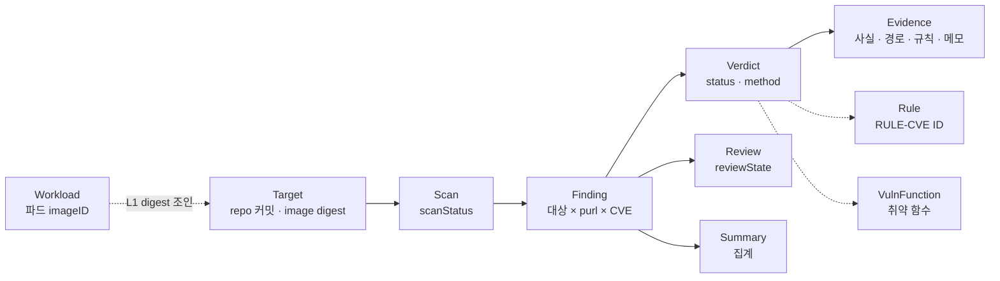
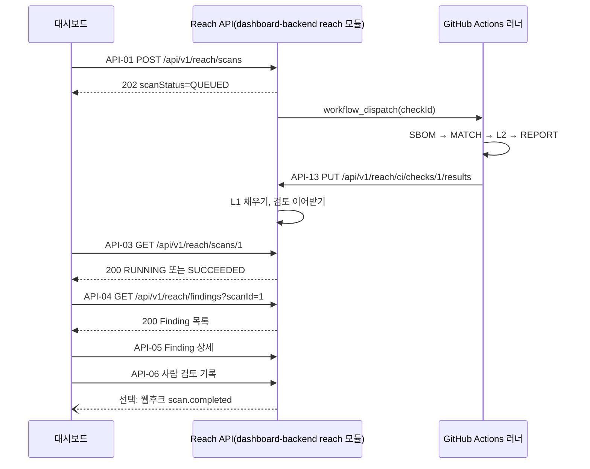
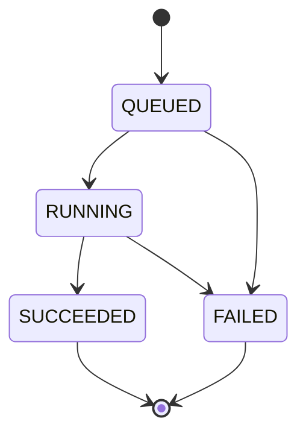
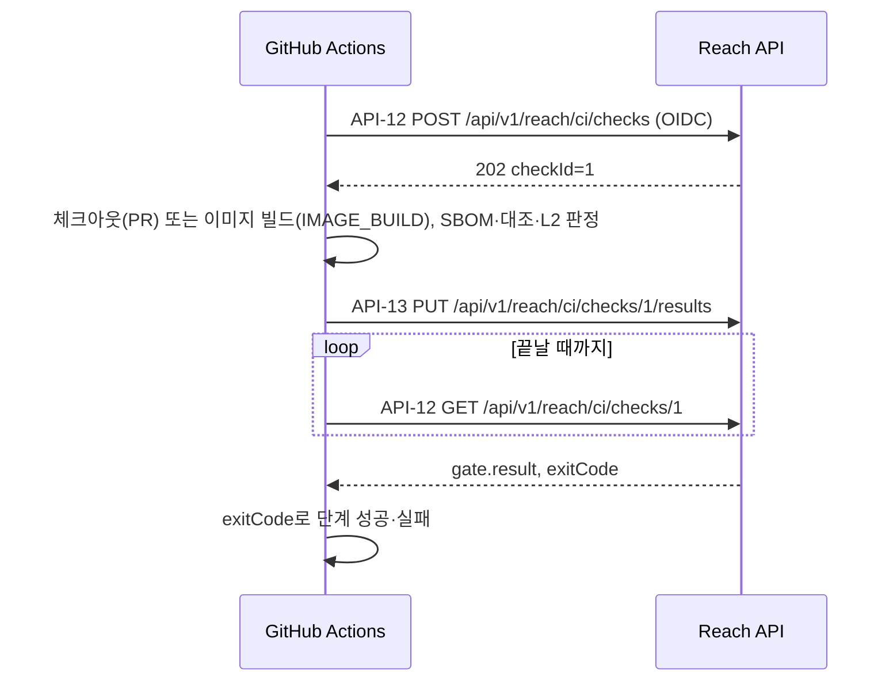

# API 명세서

**한 줄 요약**: Reach(Logssey 도달 가능성 분석 모듈)의 MVP용 HTTP API 설계 초안이다. API는 별도 서버가 아니라 dashboard-backend의 `reach` 모듈로 들어가고(ARD AD-18), 형식·이름·오류는 [대시보드 API 공통 규약](https://github.com/Logssey/dashboard-design-docs/blob/main/05-api/api-spec.md)을 따른다(ADR-D008). 지금은 API가 없고, 같은 일을 CLI와 파일이 한다(8절 대응표).

**상태 표기**: [완료] PoC로 구현·검증됨 / [부분] 일부만 구현되었거나 수동 / [계획] 아직 없음(설계). 이 문서의 API는 모두 [계획]이다.

## 1. 개요

### 1-1. 목적

- 화면(SCR-01~06), CI, Logssey 공통 플랫폼이 Reach의 결과를 같은 방식으로 읽고 쓰게 한다.
- 지금 CLI가 만드는 결과 파일(`verdicts.json`, `verdicts.md`)을 응답 모양의 기준으로 삼는다. 판정 로직은 바꾸지 않는다.
- 판정 근거를 API에서도 그대로 보여 준다. 모든 판정에 방식과 근거가 있고, 앱 코드 사실은 파일·줄까지 준다(NFR-02).

### 1-2. 범위

| 구분 | 내용 |
|---|---|
| 포함 | 스캔 요청과 이력, Finding·판정·근거 조회, 사람 검토 기록, 워크로드(L1) 조회, 대시보드 요약, 규칙·취약 함수 조회, 공통 Finding(OCSF) 내보내기, CI 검사, 이벤트(선택), L3 능동 관측 근거(Evidence `kind=RUNTIME`, FR-14) |
| 제외 | Logssey의 다른 모듈(시크릿, IaC, 런타임). 로그인과 사용자 관리(대시보드 공통, ADR-D003). L3 상시 관측(운영 트래픽 감시, 확장). 업그레이드 적용(팀 결정) |
| 이번 초안에 없는 것 | 규칙·취약 함수를 쓰는 API. 지금처럼 데이터 파일로 추가한다(NFR-07). 사실(F-) 목록 조회도 없다. 대상(서비스) 등록 API도 없다. MVP는 레포에 커밋한 설정 파일로 등록하고, 등록 API와 화면은 확장 단계다(PRD FR-15). 사실의 뜻과 수집 범위는 규칙명세서 7절을 본다. PR 검사가 만든 스캔은 API-02(`trigger=PR`)로 본다 |

### 1-3. 상태

| 항목 | 상태 |
|---|---|
| 이 문서 | 설계 초안 v0.2 (2026-10-18, 대시보드 공통 규약에 맞춤) |
| API(dashboard-backend `reach` 모듈), 인증, 웹후크 | [계획] |
| 판정 엔진 | [완료] v0. CLI(`reach.jar`, `verdict.py`, `run-reach.sh`)로 동작한다. 배포 이미지의 Java CVE 14개를 판정했고 모두 `UNREACHABLE`이다. 처음 10개는 정답지와 10/10 일치, 샘플 앱 회귀 테스트는 44/44 일치 |
| 엔드포인트별 지금 구현 | 4절 표의 "지금 같은 일" 열과 8절 대응표 |

### 1-4. 버전 정책

- 주 버전을 경로에 둔다: `/api/v1/reach`. 앞부분 `/api/v1`은 대시보드 공통이다.
- 호환을 깨는 변경은 `/api/v2/reach`로 낸다: 필드 삭제·이름 변경·타입 변경, 열거값 추가·변경, 기본 정렬 변경, 권한 강화.
- 열거값 추가도 호환을 깨는 변경으로 본다. 공통 열거값(3-11, PRD 1절 "용어와 공통 열거값")을 다섯 산출물과 화면이 함께 쓰기 때문이다.
- 호환되는 변경은 v1 안에서 한다: 선택 필드 추가, 엔드포인트 추가, 오류 코드 추가.
- 클라이언트는 모르는 필드를 무시하고, 모르는 오류 코드는 HTTP 상태로 처리한다.
- 새 주 버전을 낸 뒤 이전 버전은 최소 3개월 유지한다. 응답 헤더 `Deprecation`, `Sunset`으로 알린다(초안 값).
- 예외: API-11(OCSF 내보내기)은 팀 스키마 합의 전까지 실험 단계다. 합의 전에는 이 규칙을 적용하지 않는다.

### 1-5. 아직 정하지 않은 것

| 항목 | 내용 | 정할 곳 |
|---|---|---|
| OCSF 클래스·필드 매핑 | 팀 스키마 합의 필요(5절) | 팀 합의(인프라 담당) |
| 역할 분리 | MVP는 대시보드 공통의 `ADMIN` 하나로 조회·스캔 요청·사람 검토를 모두 한다(2-2). 조회 전용, 검토자, 게이트 예외 승인자를 나눌지는 대시보드 공통 역할 체계와 함께 정한다 | 팀 합의, 대시보드 ADR |
| `make_spec.py` 실행 인자 | 원자료에 없다. 확인 필요 | 8절 |
| Jackson 2 사본 7행 | 제안(확정 대기). 89407·89425는 도달 불가, 나머지 5개는 도달 불가(발동 조건 없음)로 제안했다. 사람이 확정하기 전까지 도구 판정은 `NOT_ANALYZED`, 검토 상태는 `UNREVIEWED`이고, 제안은 `review.proposal`로 준다(3-10). 상세는 규칙명세서 9-1 | 사람 검토(FR-08) |
| 게이트 예외 기록 | 게이트에 걸린 PR을 통과시키는 예외(사유, 만료일, 승인한 사람)를 어디에 어떤 형식으로 남길지 정하지 않았다. 검토 기록(3-10)을 넓힐지 별도 API를 둘지 정한다. 규칙은 6-2와 PRD FR-11을 따른다 | ARD Q-07 |

## 2. 공통 규약

### 2-1. 기본 경로와 연결

- 기본 경로는 `/api/v1/reach`다. dashboard-backend의 `reach` 모듈이 받는다(ARD AD-18). 시크릿(`/api/v1/secrets`), IaC(`/api/v1/iac`), 런타임(`/api/v1/runtime`)과 같은 구조다.
- 대시보드 공통 규약(ADR-D008)과 그 기준인 Re:Used API 공통 규약을 따른다. 이 절은 Reach에서 자주 쓰는 항목과 Reach가 더한 것만 적는다.
- 분석(SBOM 생성, CVE 대조, L2 판정)은 API 안에서 하지 않는다. GitHub Actions 러너에서 돌리고 결과만 올린다(API-12, API-13, ARD AD-18).

### 2-2. 인증과 권한

호출 주체마다 인증이 다르다. IaC(`/api/v1/iac`)와 같은 방식이다.

| 호출 주체 | 인증 | 권한 |
|---|---|---|
| 대시보드 | 통합 대시보드 로그인 세션(서버 세션, HttpOnly 쿠키, ADR-D003). 쓰기 요청(POST·PATCH·PUT·DELETE)은 `X-XSRF-TOKEN` 헤더가 필요하다 | MVP는 대시보드 공통 `ADMIN` 하나. 조회, 스캔 요청(API-01), 사람 검토(API-06) 모두 `ADMIN`이다. 역할 분리는 다음 단계다(1-5) |
| CI (GitHub Actions) | GitHub OIDC 토큰(`Authorization: Bearer`). `aud = logssey-reach`. `repository`·`event_name`·`sub` 클레임을 허용 목록과 대조한다 | CI 검사 실행·결과 조회(API-12)와 결과 업로드(API-13)만. 조회 API와 사람 검토(API-06)는 쓸 수 없다 |
| L1 수집기 (클러스터 CronJob, ARD 7-3 선택지 A) | 쿠버네티스 서비스 계정 토큰(`Authorization: Bearer`). `aud = logssey-reach-l1`. `sub`가 수집기 서비스 계정이어야 한다 | L1 수집 결과 올리기(`PUT /api/v1/reach/l1/workloads`)만 |

- 사람 검토는 세션으로만 쓴다. CI 토큰으로는 API-06을 부를 수 없으므로, 역할을 나누지 않아도 CI가 사람 검토를 쓰는 일은 없다.
- 세션이 없거나 만료되면 401 `UNAUTHENTICATED`다. CSRF 토큰이 없거나 다르면 403 `FORBIDDEN`이다(공통).
- OIDC 토큰 검증에 실패하면 401 `UNAUTHENTICATED`, 허용 목록 밖의 레포·이벤트면 403 `FORBIDDEN`이다.
- 쓰기 요청(API-01, API-06, API-12, API-13)은 누가·언제 했는지 남긴다(`requestedBy`, `reviewer`, `reviewedAt`). CI 요청은 OIDC 토큰의 `repository`와 `sub`를 남긴다.
- CI 경로(API-12, API-13)와 L1 수집 결과 올리기는 대시보드 `ADMIN` 세션도 받는다. `Authorization: Bearer` 헤더가 있는 `/api/v1/reach/**` 요청은 토큰 요청으로 본다(세션 쿠키가 같이 와도 세션은 보지 않는다). 세션·CSRF는 쓰지 않는다.
- 토큰은 발급자(`iss`)로 구분한다. GitHub 발급자면 CI 토큰, 설치 설정 `logssey.reach.l1.collector.issuer`의 발급자면 L1 수집기 토큰이다. 두 발급자 밖의 토큰은 401이다. CI 토큰으로 L1 업로드, 수집기 토큰으로 CI 경로나 다른 Reach API를 부르면 403이다.

**CI 토큰 검증 (실패하면 401 `UNAUTHENTICATED`)**

- 서명: 발급자의 공개 키(`https://token.actions.githubusercontent.com/.well-known/jwks`, RS256)
- `iss = https://token.actions.githubusercontent.com`, 만료(`exp`), `aud`에 `logssey-reach` 포함
- 클레임 `repository`(`소유자/이름`), `sub`, `event_name`, `ref`가 있어야 한다(없으면 401). `job_workflow_ref`는 아래 권한 검사에서 본다(없으면 403). `repository`는 200자, `sub`는 300자까지

**CI가 할 수 있는 일 (어긋나면 403 `FORBIDDEN`)**

| 조건 | 설명 |
|---|---|
| Reach 워크플로 | 토큰 `job_workflow_ref`가 `<토큰 repository>/.github/workflows/reach.yml@<ref>`다(레포 이름은 대소문자 무시). 같은 레포의 다른 워크플로가 받은 토큰이나 이 클레임이 없는 토큰은 403이다 |
| 감시 대상 레포 | 토큰 `repository`의 소유자가 설치 설정 `logssey.reach.ci.repository-owner`(예: `Logssey`)이고, 이름이 감시 대상 앱의 레포(FR-15, `logssey.reach.apps[*].repo`)다. 소유자 설정이 비어 있으면 모든 CI 토큰이 403이다 |
| 본문·대상의 레포 | 본문 `repository`와 `target.repo.name`이 토큰 레포와 같다(소유자 없이 이름만 와도 된다, 대소문자 무시). 이미지 대상은 그 레포 앱의 이미지(`logssey.reach.apps[*].image`)여야 하고, `target.app`을 주면 그 레포의 앱이어야 한다 |
| 이벤트 | `mode = PR`은 `event_name = pull_request`이고 `pullRequest.number`가 있어야 하며, 토큰 `ref`가 `refs/pull/<번호>/merge`다. 그 밖의 mode(`IMAGE_BUILD`, `SCHEDULE`, `MANUAL`)는 토큰 `ref`가 `refs/heads/<기본 브랜치>`이고 `event_name`이 `pull_request`로 시작하지 않는다(`pull_request_target`은 `ref`가 기본 브랜치라도 PR이 계기라 뺀다). 기본 브랜치는 설치 설정 `logssey.reach.ci.default-branch`(기본 `main`) |
| 재검사 | CI 토큰은 `rescanOf`를 쓰지 못한다(403). 사람(API-01·12)과 대시보드의 하루 1번 재대조(6-1)만 쓴다 |
| 결과 조회·업로드 | 그 검사를 만든 레포의 토큰이 만들 때와 같은 이벤트 조건을 지킬 때만. PR 검사는 그 PR 번호의 `pull_request` 토큰만, 그 밖의 CI 검사(이미지 빌드)는 기본 브랜치 실행의 토큰만이다. 그래서 같은 레포의 PR 토큰이 기본 브랜치 이미지 검사의 결과를 보거나 올리지 못한다. 다른 레포나 대시보드 사용자가 만든 검사는 403, 없는 검사는 404. 예외: 대시보드에서 요청한 스캔(API-01, `mode = MANUAL`)과 대시보드의 하루 1번 재대조(`mode = SCHEDULE`, 요청 주체 `SYSTEM`)는 서버가 띄운 실행의 토큰이 올린다. `event_name = workflow_dispatch`, `ref = refs/heads/<기본 브랜치>`이고 토큰 레포가 그 검사의 레포(레포 대상은 그 레포, 이미지 대상은 그 이미지 앱의 레포)여야 한다 |
| 경로 | CI 토큰으로 `/api/v1/reach/ci/**` 밖의 Reach API를 부르면 403 |

- 순서는 본문 형식(400) → 권한(403) → 멱등 충돌(409)이다.
- CI가 만든 스캔은 `requestedBy = {kind: CI, repository: 토큰 repository, subject: 토큰 sub}`이고, 멱등 키 범위(2-7)는 `CI:<토큰 repository>`다. 토큰의 `ref`는 위 검사에만 쓰고 저장하지 않는다(PR 번호·브랜치는 검사 본문 값으로 남는다).

**L1 수집기 토큰 검증**

- 서명: 클러스터 발급자의 공개 키(`<issuer>/openid/v1/jwks`, RS256). 발급자는 설치 설정 `logssey.reach.l1.collector.issuer`(Re:Used 설치는 `https://k8s-oidc.re-used.store`)이고, 비어 있으면 수집기 토큰은 모두 401이다
- `iss`, 만료(`exp`·`nbf`), `aud`에 `logssey-reach-l1` 포함, `sub`가 있어야 한다(255자까지). 어긋나면 401 `UNAUTHENTICATED`
- `sub`가 수집기 서비스 계정(기본 `system:serviceaccount:reach:reach-l1-collector`, 설정 `logssey.reach.l1.collector.subject`)이 아니면 403 `FORBIDDEN`. 같은 `aud`의 토큰은 클러스터의 어떤 파드든 요청해 받을 수 있어서 `sub`까지 본다
- 수집기가 올린 조회는 `source = CLUSTER_READER`, 기록자는 토큰의 `sub`다(수동 업로드는 `MANUAL`, `USER:<사용자 ID>`)

### 2-3. 요청·응답 형식

| 항목 | 규약 | 출처 |
|---|---|---|
| 본문 | JSON, UTF-8. `Content-Type: application/json; charset=utf-8` | 공통 |
| 필드 이름 | camelCase | 공통(ADR-D008) |
| 열거값 | 대문자(`REACHABLE`, `UNREVIEWED`). 값과 뜻은 공통 열거값(PRD 1절 "용어와 공통 열거값", 3-11)을 따른다 | 공통(ADR-D008) |
| 식별자 문자열 | 열거값이 아니라 식별자라 정해진 표기를 그대로 쓴다: 규칙 `RULE-<CVE ID>`, 사실 `F-<사실 이름>`, purl과 그 생태계(`maven`, `npm`, `apk`), `include` 값, 이벤트 종류(`scan.completed`) | 공통(ADR-D008의 "계약 식별 문자열") |
| 시각 | ISO 8601, UTC, 초 단위, 끝에 `Z`. 예: `2026-09-29T07:46:33Z` | 공통 |
| 기간 | 초 단위 숫자. 필드 이름은 `Seconds`로 끝난다(`durationSeconds`) | Reach |
| ID | 숫자(DB의 `BIGINT`). 스캔, 대상, Finding, 워크로드, 취약 함수, CI 검사, 이벤트가 각자 번호를 쓴다. 사용자 ID는 대시보드 공통 `dashboard_users`의 번호다 | 시크릿·IaC·런타임과 같음 |
| 값이 없는 선택 필드 | 응답에서 빼거나 `null`로 준다. 클라이언트는 둘을 같게(`null`로) 본다. 지금 구현(dashboard-backend `reach`)은 `null`로 준다. 이 문서의 응답 예시는 짧게 쓰려고 뺐다 | Reach |
| 단건 응답 | 리소스 객체를 그대로 준다 | 공통 |
| 목록 응답 | `items` 배열, `nextCursor`, `hasNext`(2-4) | Re:Used 공통(`CursorPageResponse`) |
| 선택 하위 객체 | `include=a,b`로 붙인다. 허용 값은 엔드포인트마다 다르다(4절) | Reach |
| 계산 | 집계·비율은 서버가 계산한다. 화면은 받은 값을 표시한다 | 공통 |
| digest·커밋 표기 | 응답은 전체 값을 준다(digest는 `sha256:`과 64자, 커밋은 40자). 이 문서는 digest를 앞 8자리, 커밋을 7자리로 줄여 쓴다 | Reach |

### 2-4. 페이지네이션

목록 API는 모두 커서 방식이다(Re:Used 공통 `CursorPageRequest`·`CursorPageResponse`).

| 파라미터 | 설명 |
|---|---|
| `size` | 한 번에 받을 개수. 기본 20, 최대 100. 1보다 작거나 100보다 크면 400 `INVALID_INPUT` |
| `cursor` | 직전 응답의 `nextCursor` 값을 그대로 넣는다. 불투명 문자열이다 |
| `include=total` | 필터를 건 전체 개수 `totalCount`를 함께 준다. 기본으로는 주지 않는다(Reach 추가) |

```json
{
  "items": [],
  "nextCursor": "eyJrIjoiNTAifQ==",
  "hasNext": true
}
```

- `hasNext`가 false면 마지막 페이지이고 `nextCursor`는 null이다.
- 커서는 처음 요청의 필터·정렬과 묶인다. 커서를 넣으면서 필터나 정렬을 바꾸면 400 `INVALID_INPUT`이다.
- 커서는 24시간 동안 쓸 수 있다(초안 값). [계획] 지금 구현(API-02, API-04)은 기간을 두지 않는다.

**커서 방식으로 정한 이유**

- 하루 1번 재대조(FR-11)로 Finding이 생기고 사라진다. offset 방식은 페이지를 넘기는 사이에 행이 밀리거나 빠진다.
- 목록 화면(SCR-02)은 페이지 번호 대신 표 아래 [더 보기]로 다음 행을 붙인다. 다음 페이지만 있으면 된다. 개수는 요약(API-08)과 스캔 상태(API-03)가 준다.

### 2-5. 정렬과 필터

**정렬**

- `sort=필드1,-필드2` 형식이다. `-`를 붙이면 내림차순이다.
- 값이 같으면 다음 필드로, 마지막에는 `id`로 정렬한다.
- `severity`와 `status`는 아래 표의 순위로 정렬한다. `-`를 붙이면 순위가 높은 것이 먼저 온다.
- `cve`는 연도와 번호를 숫자로 비교한다. 예: CVE-2026-8763이 CVE-2026-13506보다 앞이다(문자열로 비교하면 뒤로 간다).
- 허용하지 않은 정렬 필드는 400 `INVALID_INPUT`다. 엔드포인트별 허용 필드와 기본 정렬은 4절에 적는다.

| 필드 | 순위(높은 것부터) |
|---|---|
| `severity` | `CRITICAL > HIGH > MEDIUM > LOW > UNKNOWN` |
| `status` | `REACHABLE > UNKNOWN > UNREACHABLE > NOT_ANALYZED` |
| `deployment` | `RUNNING > UNKNOWN > NOT_RUNNING`. 확인 못 함(`UNKNOWN`)은 실제로 돌고 있을 수 있어 실행 안 함보다 높다 |

- Finding 기본 정렬(API-04)은 배포(`RUNNING` → `UNKNOWN` → `NOT_RUNNING`), 상태(`REACHABLE` → `UNKNOWN` → `UNREACHABLE` → `NOT_ANALYZED`), 심각도(CRITICAL → UNKNOWN), CVE(연도·번호를 숫자로 비교) 순서다. 운영에서 실행 중인 이미지의 Finding이 먼저 오고, 같은 배포 상태 안에서는 판정 순이다(PRD FR-04, 시나리오 D). 레포 대상의 Finding은 지금 `UNKNOWN`이다(3-3). 스캔 하나(`scanId`·`target`)를 보면 대상이 하나라 배포가 모두 같아 상태부터 보는 것과 같다. CVE가 아닌 ID(GHSA 등)와 연도·번호가 9자리를 넘는 ID는 맨 뒤에 온다. 목록 화면(SCR-02)도 같은 순서를 쓴다.
- 배포를 맨 앞에 넣은 것은 기본 정렬 변경이다(1-4). 지금 API-04를 부르는 곳은 함께 배포하는 대시보드 화면뿐이라 v1 안에서 바꿨다. 바꾸기 전에 받은 커서는 400 `INVALID_INPUT`이고, 화면은 처음부터 다시 받는다.

**필터**

- 쿼리 파라미터 이름은 필드 이름과 같다.
- 한 파라미터에 쉼표로 여러 값을 주면 그중 하나에 맞으면 된다(OR).
- 서로 다른 파라미터는 모두 맞아야 한다(AND).
- 시각 범위는 `from`(포함), `to`(제외)로 준다.
- purl처럼 `:`, `/`, `@`가 들어간 값은 URL 인코딩한다.
- 모르는 파라미터나 열거값 밖의 값은 400 `INVALID_INPUT`다. `details.param`에 파라미터 이름을 준다. [계획] 지금 구현은 모르는 파라미터를 무시하고 열거값 밖의 값만 400으로 준다(`details`는 2-6처럼 아직 없다).
- 예외: 스캔 ID 쿼리는 경로 변수와 맞춰 `scanId`로 쓴다(API-11의 `?scanId=` 표기). 비교 방식을 이름에 담은 쿼리도 있다: `firstSeenAfter`(이 시각 뒤), `cveContains`(부분 일치). 둘 다 API-04에서 쓴다.

예: `GET /api/v1/reach/findings?status=REACHABLE,UNKNOWN&severity=CRITICAL,HIGH&sort=-deployment,-status,-severity,cve`

### 2-6. 오류 응답

대시보드 공통 오류 형식이다. `code`, `message`는 필수이고, `details`, `requestId`, `retryable`은 선택 확장 필드다(ADR-D008). 스택 트레이스, 쿼리, 내부 식별자는 넣지 않는다.

```json
{
  "code": "INVALID_INPUT",
  "message": "status 값이 올바르지 않다",
  "details": {
    "param": "status",
    "allowed": ["REACHABLE", "UNREACHABLE", "UNKNOWN", "NOT_ANALYZED"]
  }
}
```

- `code`: 아래 표의 값이다. 클라이언트는 이 값으로 분기한다.
- `message`: 사람이 읽는 한국어 문장이다. 문구는 바뀔 수 있다.
- `details`: 코드별 추가 정보다. 없으면 뺀다. [계획] 지금 대시보드 공통 오류 응답은 `code`·`message`만 주고 `details`는 주지 않는다. 409 `CONFLICT`를 받으면 클라이언트는 상세(API-05)를 다시 읽어 현재 `version`을 얻는다.

| 코드 | HTTP | 뜻 | `details` | 주로 나오는 API | 구분 |
|---|---|---|---|---|---|
| `INVALID_INPUT` | 400 | JSON이 아님, 필수 값·헤더 누락, 열거값 밖의 값, 허용하지 않은 파라미터, 잘못된 커서 | `param` 또는 `field`, `allowed` | 전체 | 공통 |
| `UNAUTHENTICATED` | 401 | 세션이 없거나 만료됨, OIDC 토큰 검증 실패 | - | 전체 | 공통 |
| `FORBIDDEN` | 403 | CSRF 토큰 누락·불일치, 허용 목록 밖의 레포·이벤트, CI 토큰으로 대시보드 API 호출 | `reason` | 전체 | 공통 |
| `NOT_FOUND` | 404 | 리소스가 없음 | `resource`, `id` | 단건 조회, `scanId`·`target`을 지정한 조회 | 공통 |
| `CONFLICT` | 409 | 검토 `version`이 현재 값과 다름(다른 사람이 먼저 고침), 이미 결과를 올린 CI 검사에 다시 업로드 | `currentVersion` | API-06, API-13 | 공통 |
| `IDEMPOTENCY_CONFLICT` | 409 | 같은 `Idempotency-Key`로 다른 본문을 보냄. [계획] 대시보드 공통 오류 코드에 아직 없어 지금 구현은 `CONFLICT`로 준다 | `key` | API-01, API-12 | Reach 추가 |
| `SCAN_NOT_READY` | 409 | 스캔이 아직 `SUCCEEDED`가 아님. [계획] 대시보드 공통 오류 코드에 아직 없어 지금 구현(API-04, API-08, API-11)은 `CONFLICT`로 준다 | `scanStatus` | API-04, API-08, API-11(`scanId`를 지정한 경우) | Reach 추가 |
| `TARGET_UNRESOLVED` | 422 | 대상을 찾지 못함(없는 커밋·digest, 지원하지 않는 대상). [계획] 대시보드 공통 오류 코드에 아직 없어 지금 구현은 공통 `UNPROCESSABLE`(422)로 준다 | `field` | API-01, API-12 | Reach 추가 |
| `RUNNER_NOT_INSTALLED` | 422 | 스캔을 요청한 대상의 레포에 Reach 실행기가 없음(GitHub App 미설치, 기본 브랜치에 `reach.yml` 없음)(API-01). [계획] 공통 오류 코드에 없어 지금 구현은 `UNPROCESSABLE`(422)이고 `message`가 `RUNNER_NOT_INSTALLED:`로 시작한다 |
| `PAYLOAD_TOO_LARGE` | 413 | 업로드한 결과 묶음이 한도를 넘음 | `limitBytes` | API-13 | Reach 추가(IaC와 같은 이름) |
| `RATE_LIMITED` | 429 | 속도 제한을 넘음 | `retryAfterSeconds` | 전체 | 공통 |
| `INTERNAL_ERROR` | 500 | 서버 오류 | - | 전체 | 공통 |
| `UNAVAILABLE` | 503 | 의존 서비스를 잠시 쓸 수 없음(GitHub 워크플로 실행 요청 실패 등) | `dependency` | API-01, API-12 | Reach 추가(IaC와 같은 이름) |
| `BUILD_FAILED` | - | 레포 대상의 빌드 실패. HTTP 응답이 아니라 스캔 실패 사유(`failure.code`)로만 쓴다 | `stage` | API-03 | Reach 추가 |
| `IMAGE_PULL_FAILED` | - | 이미지 대상을 받지 못함(대시보드에서 요청한 스캔, API-01). 스캔 실패 사유로만 쓴다 | `stage` | API-03 | Reach 추가 |
| `ANALYSIS_FAILED` | - | L2 분석 실패. 스캔 실패 사유로만 쓴다 | `stage` | API-03 | Reach 추가 |
| `RUNNER_CANCELLED` | - | 러너 작업이 취소되거나 시간 제한에 걸려, 그때 돌던 단계의 실패 묶음을 올렸다. 스캔 실패 사유로만 쓴다 | `stage` | API-03 | Reach 추가 |
| `RUNNER_NO_RESULT` | - | 러너가 결과도 실패 묶음도 올리지 않은 채 2시간이 지났다(2-7). 스캔 실패 사유로만 쓴다 | - | API-03 | Reach 추가 |

### 2-7. 멱등성

- 스캔을 만드는 요청(API-01, API-12 실행)은 `Idempotency-Key` 헤더가 필수다. 없으면 400 `INVALID_INPUT`다.
- 값은 클라이언트가 만든 고유 문자열이다(1~64자, UUID 권장). CI는 다시 실행해도 같은 값이 나오게 만든다. 예: `service-backend-pr-123-bb4639b`.
- 서버는 키를 호출 주체(대시보드 사용자, CI 레포)별로 24시간 보관한다(초안 값). [계획] 지금 구현은 기간 없이 보관한다.

| 경우 | 응답 |
|---|---|
| 처음 받은 키 | 정상 처리. 202와 새 스캔 |
| 같은 키, 같은 본문 | 처음 응답을 그대로 다시 준다(같은 `id`, 같은 상태 코드). `Idempotent-Replayed: true` 헤더를 붙인다 |
| 같은 키, 다른 본문 | 409 `IDEMPOTENCY_CONFLICT` |
| 같은 키, 그 키의 스캔이 `FAILED` | 본문과 상관없이 **새 검사·스캔을 만든다**(202, 새 `id`). 실패한 검사는 그대로 남고 키만 놓아 준다 |
| 같은 키가 동시에 두 번 | 하나만 처리하고, 다른 하나는 같은 응답을 받는다 |

- 다시 줄 때는 같은 검사·스캔을 지금 상태(`scanStatus`)로 준다.
- 실패한 스캔을 다시 주지 않는 이유: CI는 같은 빌드를 다시 돌리면(Re-run) 같은 키를 보내는데, 끝난 검사에는 결과를 올릴 수 없어(API-13 409) 일시 오류 한 번으로 그 커밋의 PR 검사가 새 커밋 없이는 풀리지 않았다. 게이트(`GATE`)를 켠 뒤에는 그 PR을 머지할 수 없게 된다. 성공한 스캔은 그대로 다시 준다(다시 돌려도 다시 스캔하지 않는다)
- 결과가 오지 않는 스캔(러너가 취소·시간 초과로 실패 묶음도 못 올림, 띄운 워크플로가 시작하지 않음)은 대시보드가 만든 지 2시간 뒤(초안 값, 워크플로 시간 제한 30분보다 넉넉히) `FAILED`(`RUNNER_NO_RESULT`)로 끝낸다. 30분마다 본다. 그 뒤 같은 키는 위 표대로 새 검사가 된다
- API-01과 API-12는 키를 같이 쓴다. 한 호출 주체가 API-12에 쓴 키를 API-01에 다시 쓰면 본문이 달라 409다.

- API-06(PATCH)은 `version`으로 충돌을 막는다. 같은 본문을 다시 보내면 `version`이 이미 올라가 409 `CONFLICT`가 난다. 클라이언트는 현재 값을 다시 읽는다.

### 2-8. 속도 제한

| 구분 | 호출 주체당 한도(초안 값) |
|---|---|
| 조회(GET) | 분당 300회 |
| 스캔 요청(API-01, API-12 실행, API-13 업로드) | 분당 10회 |
| 검토 기록(API-06) | 분당 60회 |

- 응답 헤더 `RateLimit-Limit`, `RateLimit-Remaining`, `RateLimit-Reset`(초)으로 남은 한도를 알린다.
- 한도를 넘으면 429 `RATE_LIMITED`(대시보드 공통 코드)와 `Retry-After` 헤더를 준다.
- 같은 대상의 스캔은 한 번에 1개만 돈다. 나머지는 `QUEUED`로 기다린다. 분석 환경을 가볍게 유지하려는 것이다(NFR-03, NFR-06).
- 한도 값은 운영하며 조정한다.

## 3. 리소스 스키마

필드 표의 "필수"는 응답에 항상 들어 있는지를 뜻한다. 요청 본문의 필수 여부는 4절 각 엔드포인트에 적는다. 열거값은 3-11에 모았다.



### 3-1. Scan

대상 하나에 대해 SBOM 생성 → CVE 대조 → 판정까지 한 번 실행한 것이다.

| 이름 | 타입 | 필수 | 설명 |
|---|---|---|---|
| `id` | integer | 예 | 스캔 ID |
| `target` | Target | 예 | 스캔 대상(3-2) |
| `scanStatus` | enum | 예 | `QUEUED` / `RUNNING` / `SUCCEEDED` / `FAILED` |
| `trigger` | enum | 예 | `MANUAL`(사람·API-01 직접) / `PR`(API-12, PR 검사) / `IMAGE_BUILD`(API-12, 이미지 빌드 단계, ECR push 전) / `SCHEDULE`(하루 1번 재대조) |
| `rescanOf` | integer | 아니요 | 저장된 SBOM을 다시 쓴 경우 원래 스캔 ID |
| `stages` | object 배열 | 예 | 단계별 진행. `name`(`SBOM` / `MATCH` / `L1` / `L2` / `REPORT`), `status`(`scanStatus` 값), `startedAt`, `finishedAt`, `durationSeconds`, `message` |
| `tools` | object | 예 | 쓴 도구와 DB 버전(NFR-04, NFR-05). `trivy`, `trivyDbUpdatedAt`, `grype`, `cdxgen`, `reach`, `rulesVersion`, `vulnFunctionsVersion`, `reachRef`, `sbomSource`. `reachRef`는 분석기·판정 데이터(`vuln-functions.json`, `rules.json`)·CI 스크립트를 받은 Logssey/dashboard-backend 커밋(40자)이다. CI에서는 대시보드가 알려 준 자기 커밋(아래 "러너가 받을 Reach 코드", API-12 보조)이고, 서비스 레포 변수 `REACH_REF`가 있으면 그 값이다. 로컬 실행에서 그 파일들을 고친 채 돌렸으면 끝에 `-dirty`가 붙는다. `rulesVersion`·`vulnFunctionsVersion`은 파일 형식 버전이라 데이터가 바뀌어도 그대로이고, 판정 데이터의 내용은 `reachRef`로 가린다. `sbomSource`는 재대조가 보관 SBOM을 썼을 때 `stored:scan-<id>`. 러너가 보내지 않은 값은 없다 |
| `analysis` | object | 아니요 | L2 분석 규모. `appClasses`, `libraryJars`, `reachedMethods`, `jarSha256`(판정한 jar. 판정 대상을 결과에 남긴다) |
| `counts` | object | 아니요 | `SUCCEEDED`일 때만. `total`, `bySeverity`, `byStatus`, `byReviewState`. 그 스캔이 낸 도구 판정을 센다. Finding의 마지막 스캔이 아니라 판정의 스캔으로 세서, 같은 Finding이 다음 스캔에 다시 나와도 이 스캔의 개수는 그대로다. 사람 판정(`MANUAL`)은 세지 않는다. 스캔 결과는 스캔이 낸 값으로 두고, 사람 판정은 요약(API-08)에만 반영된다. 값은 0까지 채운다. `byReviewState`는 지금의 검토 상태다(검토는 Finding마다 한 행뿐) |
| `failure` | object | 아니요 | `FAILED`일 때만. `code`(E-코드), `stage`, `message` |
| `l3` | object | 아니요 | 이 스캔이 L3 능동 관측을 했을 때만(3-12 "스캔의 L3"). `runStatus`, `error`, `scenario`, `observedAt`, `counts`. `runStatus`가 `FAILED`여도 스캔은 실패가 아니다 |
| `requestedBy` | object | 예 | 요청한 주체. `kind`(`USER` 대시보드 / `CI` / `SYSTEM` 하루 1번 재대조 등)를 함께 준다. `USER`면 `userId`(`dashboard_users` 번호), `CI`면 `repository`와 `subject`(OIDC `sub`), `SYSTEM`은 `kind`만 있다 |
| `createdAt` | date-time | 예 | 요청을 받은 시각 |
| `startedAt`, `finishedAt` | date-time | 아니요 | 시작·끝 시각 |

| 단계 | 하는 일 | 관련 FR |
|---|---|---|
| `SBOM` | 이미지는 Trivy, 레포는 cdxgen으로 SBOM을 만든다(지금 도구이며 바꿀 수 있다). cdxgen은 Gradle 빌드를 실행해 간접 의존성까지 잡는다. 이미지와 레포 SBOM의 좌표가 다르면 레포를 우선하고 차이를 기록한다. 버전을 확정하지 못하면 "버전 미확정"으로 두고 범위 전체로 대조한다. 결정적 방법으로 식별하지 못한 구성요소만 AI 후보를 만들고 "구성요소 추정"으로 표시한다. 이 Finding은 `UNREACHABLE`로 확정하지 않는다 | FR-02 |
| `MATCH` | Trivy로 대조하고 Grype로 교차 확인한다. purl을 키로 합친다(두 도구 결과가 다를 때의 병합 규칙은 ARD Q-08) | FR-03 |
| `L1` | 실행 중 파드의 imageID와 스캔 digest를 조인한다. revision 라벨로 커밋을 확인한다 | FR-04 |
| `L2` | bootJar 바이트코드로 호출 그래프(RTA, 진입점 2단계, 약한 경로 분리)를 만들고, CVE별 규칙으로 판정한다 | FR-05, FR-06 |
| `REPORT` | 판정과 근거를 결과로 저장하고 보고서(기계용 JSON, 사람용 Markdown)를 만든다. API-04·API-05는 이 결과를 읽는다. 지금은 `verdict.py`가 `verdicts.json`, `verdicts.md`를 쓴다 | FR-07 |

- L3 능동 관측(FR-14)은 단계(`stages`)가 아니다. 러너가 앱을 띄워 본 스캔은 결과를 `l3`로 준다(3-12). L3가 실패해도 스캔과 다른 단계는 그대로다.

### 3-2. Target

레포 커밋 또는 컨테이너 이미지 digest다.

| 이름 | 타입 | 필수 | 설명 |
|---|---|---|---|
| `id` | integer | 예 | 대상 ID |
| `type` | enum | 예 | `REPO`(레포 커밋) / `IMAGE`(컨테이너 이미지 digest) |
| `app` | string | 예 | 앱 코드. 설치 설정 `logssey.reach.apps`에 등록한 값이다(아래). Re:Used 설치는 `API` / `WEB` / `CHAT` |
| `repo` | object | `type=REPO`일 때 | `name`(예: `service-backend`), `path`(레포 안 하위 경로. chat은 `chat-server`), `commit`(커밋 SHA) |
| `image` | object | `type=IMAGE`일 때 | `repository`(예: `logssey/reused-api`), `digest`, `revision`(OCI 라벨 `org.opencontainers.image.revision`), `createdAt` |
| `sourceTree` | string | 아니요 | git 트리 해시. 배포 커밋과 분석 커밋이 같은 소스인지 비교할 때 쓴다 |
| `displayName` | string | 예 | 화면 표시용 이름 |

- 이미지는 digest로만 가리킨다. ECR 태그는 MUTABLE이라 태그로는 실행 중인 이미지를 확정하지 못한다.
- `image.repository`에는 레지스트리 호스트를 넣지 않는다.
- 요청(API-01, API-12)의 커밋은 40자, digest는 `sha256:`과 64자다. 대문자로 와도 소문자로 저장한다. 형식이 틀리거나 `image.repository`에 태그(`:`)·digest(`@`)를 붙이면 400 `INVALID_INPUT`이다.
- 감시 대상 앱은 코드에 두지 않고 설치마다 설정으로 등록한다(PRD FR-15). 앱 하나는 앱 코드(`code`), 레포(`repo`), 레포 안 하위 경로(`path`, 없으면 레포 전체), 이미지 저장소(`image`), 생태계(`ecosystem`, `maven` 또는 `npm`, 없으면 `maven`)다. `repo`와 `image` 중 하나는 있어야 한다. L2(호출 그래프)는 `maven`만 한다. `npm` 앱도 스캔은 하되 SBOM·CVE 대조·L1까지이고 Finding은 `NOT_ANALYZED`다(PRD 확장 단계). `ecosystem`은 화면 표시용이고, 스캔에서 L2를 할지는 러너가 앱 jar 유무로 정한다. 앱 코드는 대문자로 시작하고 대문자·숫자·`_`로 최대 10자다. 형식이 틀리거나 코드·레포(+경로)·이미지 저장소가 겹치거나 `ecosystem`이 두 값이 아니면 서버가 뜨지 않는다. 설정이 없으면 서버는 뜨지만 어떤 대상도 정하지 못한다. 등록한 앱 목록은 API-14로 본다.
- `app`을 주면 설정에 있는 코드여야 한다. 없는 코드면 400 `INVALID_INPUT`이다.
- `app`을 주지 않으면 설정으로 정한다. 레포는 소유자를 떼고 이름만 비교한다(`Logssey/service-backend`도 `service-backend`). 레포 이름과 하위 경로가 같은 등록을 먼저 찾고, 없으면 같은 레포를 경로 없이 등록한 앱을 쓴다. 이미지 저장소는 정확히 같은 이름만 찾는다. 찾지 못하면 422 `TARGET_UNRESOLVED`다. 이미 있는 대상(같은 digest, 또는 같은 레포·하위 경로·커밋)을 다른 `app`으로 요청해도 422다.

Re:Used 설치의 설정은 아래와 같다(로컬은 `dashboard-backend`의 `reach/local-targets.properties`).

| `app` | 레포 | 이미지 저장소 | 주력 스캔 | L2 판정 |
|---|---|---|---|---|
| `API` | `service-backend` | `logssey/reused-api` | 이미지(Trivy) | [완료] v0 (Java) |
| `WEB` | `service-frontend` | `logssey/reused-web` | 레포(cdxgen). 이미지에는 minify된 번들만 있다 | [계획] (npm) |
| `CHAT` | `service-backend`의 `chat-server` | `logssey/reused-chat` | 레포 + 이미지 | [계획] (Node) |

### 3-3. Finding

대상 × 구성 요소 × 취약점 한 건이다. 같은 CVE라도 패키지 사본이 다르면 Finding이 다르다.

| 이름 | 타입 | 필수 | 설명 |
|---|---|---|---|
| `id` | integer | 예 | Finding ID. 대상 × purl × CVE마다 하나다 |
| `scanId` | integer | 예 | 이 Finding을 마지막으로 갱신한 스캔 |
| `targetId` | integer | 예 | 대상 ID |
| `component` | object | 예 | `purl`(키), `name`, `version`, `ecosystem`(purl 타입 그대로: `maven` / `npm` / `apk` 등), `path`(이미지 안 위치) |
| `vulnerability` | object | 예 | `id`(CVE), `severity`, `severityNote`(출처마다 심각도가 다를 때 남긴 메모, FR-03), `title`(스캐너 값), `description`(스캐너 설명 원문), `affectedFeature`(취약 기능 설명), `fixedVersions`(스캐너 값), `cwe`, `references` |
| `deployment` | enum | 예 | `RUNNING` / `NOT_RUNNING` / `UNKNOWN` |
| `l3` | L3 | 아니요 | L3 능동 관측이 닿은 곳(3-12). 판정 옆에 놓는 근거다. 실제 실행을 확인했으면 서버가 판정(`verdict`)을 올린다(3-12 "판정 올리기"). 이 대상(이미지)을 띄워 본 결과가 없으면 null이다 |
| `verdict` | Verdict | 예 | Reach 판정(3-4) |
| `review` | Review | 예 | 사람 검토(3-10) |
| `sameCveFindings` | integer 배열 | 아니요 | 같은 CVE의 다른 패키지 사본 Finding ID |
| `sources` | enum 배열 | 예 | 이 Finding을 보고한 스캐너: `TRIVY`, `GRYPE` |
| `upgrade` | object | 아니요 | `suggestedVersion`(같은 패키지의 CVE를 모두 없애는 최소 버전), `change`(버전을 정하는 위치와 바꿀 내용. 예: Spring Boot 관리 버전 덮어쓰기), `note`. 제안일 뿐이며 적용 여부는 팀이 정한다(FR-13) |
| `firstSeenAt`, `lastSeenAt` | date-time | 예 | 처음·마지막으로 보인 시각 |

- 예: CVE-2026-89407은 `tools.jackson.core:jackson-core` 3.1.5와 `com.fasterxml.jackson.core:jackson-core` 2.21.5에서 각각 한 건이다(FR-07).
- `deployment`: image 대상은 digest가 실행 중 파드의 imageID에 있으면 `RUNNING`, 조회했는데 없으면 `NOT_RUNNING`, 조회하지 못하면 `UNKNOWN`이다. repo 대상은 실행 중 이미지의 revision 라벨이 이 커밋이거나 소스 트리 해시가 같으면 `RUNNING`이다(FR-04).
  - image 대상의 계산(규칙명세서 10-2): 허용한 (클러스터, 네임스페이스)의 조회 중 48시간 안의 것만 믿는다. 그 조회에 digest가 있으면 `RUNNING`이다. 허용한 네임스페이스가 모두 48시간 안에, 그리고 대상이 생긴 뒤에 조회됐는데 digest가 없으면 `NOT_RUNNING`이다. 그 밖(조회 없음, 일부만 신선, 대상이 마지막 조회보다 새것)은 `UNKNOWN`이다. 수집기가 보내는 방식이라 서버는 조회 실패를 직접 알 수 없어, 마지막 조회 시각으로 판단한다(FR-04, ARD TM-09).
  - 다시 계산하는 때: L1 수집 결과를 올릴 때, 6시간마다(UTC 00:05·06:05·12:05·18:05), 분석 결과 업로드(API-13) 끝(그 대상만). 그래서 수집이 끊기면 늦어도 마지막 조회 48시간 + 6시간 뒤에 `UNKNOWN`이 된다.
  - repo 대상은 지금 다시 계산하지 않는다 [계획].
- 결과는 지우지 않는다. 다음 스캔에서 보이지 않으면 `lastSeenAt`이 그대로 남는다.

### 3-4. Verdict

Finding에 대한 Reach의 결론이다.

| 이름 | 타입 | 필수 | 설명 |
|---|---|---|---|
| `status` | enum | 예 | `REACHABLE` / `UNREACHABLE` / `UNKNOWN` / `NOT_ANALYZED` |
| `method` | enum | `NOT_ANALYZED`가 아니면 | `CALLGRAPH` / `RULE` / `MANUAL` |
| `summary` | string | 예 | 한 줄 근거. 예: "FORM 인증(LoginConfig) 설정 없음" |
| `notAnalyzedReason` | enum | `NOT_ANALYZED`일 때 | `NO_VULN_FUNCTION_DATA`(취약 함수 데이터 없음) / `OS_PACKAGE`(OS 패키지) / `UNANALYZED_COPY`(판정하지 않은 패키지 사본) / `UNSUPPORTED_ECOSYSTEM`(L2를 아직 지원하지 않는 생태계) |
| `ruleId` | string | 아니요 | 적용한 규칙 `RULE-<CVE ID>` |
| `rule` | Rule | 아니요 | `include=RULE`일 때(API-05). `ruleId`의 규칙 객체(3-7) |
| `vulnFunctionIds` | integer 배열 | 아니요 | 판정에 쓴 취약 함수 |
| `vulnFunctions` | VulnFunction 배열 | 아니요 | `include=vulnFunctions`일 때(API-05). `vulnFunctionIds`의 취약 함수 객체(3-8) |
| `callgraph` | object | 아니요 | `packageReached`, `vulnFunctionPresent`(jar에 취약 메서드가 있나), `vulnFunctionReached`, `entryStage`(1 또는 2), `weakOnly`(약한 경로로만 닿음) |
| `evidence` | Evidence 배열 | 예 | 근거 목록(3-5). 사실이 먼저, 경로가 나중이다 |
| `analyzedAt` | date-time | 예 | 판정 시각 |
| `engine` | object | 예 | `reach`, `rulesVersion`, `vulnFunctionsVersion` |
| `history` | object 배열 | 아니요 | `include=verdictHistory`일 때. 이전 판정을 새것부터 준다. 항목은 `status`, `method`, `notAnalyzedReason`, `summary`, `scanId`, `engine`, `analyzedAt`이다. 재판정(규칙·취약 함수 데이터 변경, 재스캔)과 사람 판정이 `verdict`가 된 경우(API-06 예외)를 남긴다 |

API가 지키는 판정 원칙이다. 자세한 원칙은 규칙명세서(GR-)가 정한다.

- 확신이 없으면 `UNKNOWN`이다. 거짓 `UNREACHABLE`을 내지 않는다(NFR-01).
- 약한 경로로만 닿으면 `UNKNOWN`이다.
- 취약 메서드가 jar에 없으면(`vulnFunctionPresent: false`) `UNKNOWN`이다. 버전에 따라 메서드 이름이 바뀔 수 있다.
- 규칙은 도달 가능 조건 → 도달 불가 조건 → 미확인 조건 → 기본값 순서로 평가한다.
- 규칙으로 판정했는데 호출 그래프 결과가 달라 보이면 이유를 `note` 근거로 붙인다(가상 호출 과대근사, 프레임워크가 실행하는 코드).
- AI는 최종 판정에 쓰지 않는다. 같은 입력이면 같은 판정이 나온다(NFR-04).

| `notAnalyzedReason` | PoC에서 해당하는 행(배포 이미지 23행 기준) |
|---|---|
| `UNANALYZED_COPY` | `com.fasterxml.jackson` 2.21.5 사본 7행. 제안(확정 대기): 89407·89425는 도달 불가, 나머지 5개는 발동 조건이 없어 도달 불가다(규칙명세서 9-1). 제안은 `review.proposal`에 있다 |
| `OS_PACKAGE` | libpng, zlib 2행 |
| `NO_VULN_FUNCTION_DATA` | 지금은 없음. 취약 함수 데이터를 더하기 전의 CVE가 여기에 든다 |
| `UNSUPPORTED_ECOSYSTEM` | maven이 아닌 언어 패키지(npm 등). chat 이미지(Node.js 런타임의 npm 패키지)를 스캔하면 여기에 든다 |

### 3-5. Evidence

판정을 뒷받침하는 것이다: 앱 코드의 사실(파일·줄), 호출 경로, 적용한 규칙, 메모.

| 이름 | 타입 | 필수 | 설명 |
|---|---|---|---|
| `order` | integer | 예 | 표시 순서. `FACT`가 `PATH`보다 앞선다 |
| `kind` | enum | 예 | `FACT`(앱 코드 사실) / `PATH`(호출 경로) / `RULE`(적용한 규칙) / `NOTE`(설명) / `RUNTIME`(L3 능동 관측, FR-14) |
| `summary` | string | 예 | 사람이 읽는 한 줄 |
| `factId` | string | `kind=FACT`일 때 | `F-<사실 이름>`(규칙명세서) |
| `value` | any | 아니요 | 사실 값(참·거짓, 개수 등) |
| `informational` | boolean | 아니요 | true면 판정에 쓰지 않은 참고 사실이다(규칙의 `infoFacts`) |
| `locations` | object 배열 | 아니요 | 앱 코드 위치. `file`, `line`, `symbol`. 앱 코드 사실은 파일·줄까지 준다(NFR-02) |
| `ruleId` | string | `kind=RULE`일 때 | 적용한 규칙 |
| `matchedCondition` | enum | 아니요 | `kind=RULE`일 때 맞은 조건: `REACHABLE` / `UNREACHABLE` / `UNKNOWN` / `DEFAULT` |
| `checkedAbsent` | string 배열 | 아니요 | 확인했지만 없던 것 |
| `checkedCount` | integer | 아니요 | 확인한 대상 수. 예: tokens 출발점 97개. `checkedAbsent`와 함께 "무엇을 몇 개 확인했는데 없었는지"를 보인다 |
| `path` | string 배열 | `kind=PATH`일 때 | 진입점 → … → 목표 |
| `pathTarget` | enum | `kind=PATH`일 때 | `VULN_FUNCTION`(취약 함수까지) / `PACKAGE`(패키지까지) |
| `candidate` | boolean | `kind=PATH`일 때 | 항상 true. 가장 짧은 후보 경로이며 실제 경로와 다를 수 있다 |
| `entryStage` | integer | 아니요 | 경로가 시작한 진입점 단계. 1(Spring 진입점) / 2(모든 앱 메서드) |
| `weak` | boolean | 아니요 | 경로에 약한 간선(Object 메서드 호출, JDK 콜백)이 있나 |
| `executed` | boolean | `kind=RUNTIME`일 때 | 취약 구간 실행이 관측됐나. true면 `REACHABLE`로 올린 근거, false면 구간을 확인 못 한 함수 실행으로 `UNREACHABLE`을 `UNKNOWN`으로 올린 근거다. 실행되지 않았다는 것은 근거로 쓰지 않는다 |
| `reached`, `regionsChecked`, `startupOnly` | enum, boolean, boolean | `kind=RUNTIME`일 때 | 올릴 때 본 L3 결과(3-12와 같은 뜻) |
| `l2Status` | enum | `kind=RUNTIME`일 때 | 올리기 전 L2 판정: `UNREACHABLE` / `UNKNOWN` |

- [구현] `kind=RUNTIME`은 서버가 L3로 판정을 올릴 때만 근거 끝에 한 줄 더한다(3-12 "판정 올리기"). 러너는 보내지 않는다. 관측 근거 항목(빌드, 설정 키, 보낸 요청, 확인 방법, 관측 시각, 시나리오)은 근거에 넣지 않고 Finding의 `l3.run`으로 준다. 근거 해시가 근거 전체로 만들어져서, 다시 대조할 때마다 바뀌는 값(스캔 번호, `rematch`)이나 같은 이미지를 다시 띄우면 바뀌는 값(관측 시각)을 넣으면 같은 결과인데도 사람 검토가 `EVIDENCE_CHANGED`로 되돌아가기 때문이다.

예: CVE-2026-89407(jackson-core 3.1.5)의 사실 근거. 원자료에 줄 번호가 없어 `symbol`만 적었다.

```json
[
  {
    "order": 1,
    "kind": "FACT",
    "factId": "F-dto.floating.tokens",
    "value": false,
    "checkedCount": 97,
    "summary": "Jackson에 타입을 알려줄 수 있는 자리(tokens) 97개에서 필드를 따라갔다. 실수형 필드 없음"
  },
  {
    "order": 2,
    "kind": "FACT",
    "factId": "F-dto.floating.any",
    "informational": true,
    "value": true,
    "summary": "앱 전체로 보면 실수형 필드가 있다. 응답 전용 record의 Double averageRating이며 판정에는 쓰지 않는다",
    "locations": [
      { "symbol": "SellerBriefResponse.averageRating" },
      { "symbol": "SellerProfileResponse.averageRating" }
    ]
  }
]
```

### 3-6. Workload

운영 클러스터에서 실행 중인 파드·디플로이먼트와 그 imageID(digest)다.

| 이름 | 타입 | 필수 | 설명 |
|---|---|---|---|
| `id` | integer | 예 | 항목 ID. 업로드할 때마다 새로 매겨진다(API-07) |
| `cluster` | string | 예 | 예: `reused-prod` |
| `namespace` | string | 예 | 예: `reused` |
| `kind` | string | 예 | 예: `Deployment` |
| `name` | string | 예 | 예: `reused-api` |
| `container` | string | 예 | 컨테이너 이름. 예: `api` |
| `app` | string | 아니요 | 앱 코드(3-2). 같은 digest의 이미지 대상, 설치 설정의 이미지, 같은 이미지 저장소의 이미지 대상이 모두 없으면 `null`(API-07) |
| `image` | object | 예 | `repository`, `digest`(파드 imageID에서 얻은 값), `revision`(이미지 태그. 태그가 없으면 주지 않는다) |
| `replicas` | object | 예 | `ready`(준비된 파드 수), `desired`(디플로이먼트가 원하는 파드 수. 디플로이먼트를 조회했을 때만 준다 [계획]) |
| `pods` | object 배열 | 아니요 | `include=pods`일 때. `name`, `imageId`, `ready` [계획] |
| `deployment` | enum | 예 | `RUNNING` / `NOT_RUNNING` / `UNKNOWN` |
| `scanMatch` | object | 예 | 스캔 결과와의 연결. `status`(`MATCH` / `MISMATCH` / `NO_SCAN`), `scanId`, `matchedBy`(`DIGEST`. `SOURCE_TREE`는 [계획]). `NO_SCAN`이면 `status`만 준다. `deployedRevision`, `analyzedCommit`, `sourceTreeEqual`은 [계획] |
| `registered` | boolean | 아니요 | 대상(서비스) 등록 목록(PRD FR-15)에 있는 워크로드면 true, 없으면 false다. false면 화면은 "미등록"으로 보인다(SCR-04) [계획] |
| `service` | string | 아니요 | 이 워크로드를 묶은 등록 서비스 이름(예: `API`). `registered`가 true일 때만 준다 [계획] |
| `observedAt` | date-time | 예 | 클러스터를 조회한 시각 |
| `source` | enum | 예 | `MANUAL`(사람이 올린 조회) / `CLUSTER_READER`(클러스터 수집기가 올린 조회, 2-2) |

- 실행 중인 이미지는 파드의 `imageID`로 정한다. gitops 태그만으로는 확정하지 못한다(태그 MUTABLE, `pullPolicy: IfNotPresent`).
- 수집 규칙: phase가 `Running`인 파드만 본다. digest는 `status.containerStatuses[].imageID`의 `@sha256:` 뒤 값이고, 아직 이미지를 받지 않아 digest가 없는 컨테이너는 뺀다. 이미지 이름(`image.repository`의 원본)은 파드 spec(`spec.containers[].image`)에서 컨테이너 이름으로 찾는다. `status.containerStatuses[].image`는 노드가 그 이미지에 붙여 둔 이름 중 사전순 첫 번째라 spec과 다를 수 있다. 워크로드 안에서 (컨테이너 이름, digest)마다 한 항목이고, `replicas.ready`는 그 digest를 돌리는 Ready 파드 수다. 롤아웃 중이면 같은 워크로드에 digest별 항목이 둘 생긴다.
- `scanMatch.status`: `MATCH`는 이 digest를 스캔했거나(`matchedBy: DIGEST`), 배포 커밋과 소스 트리가 같은 커밋을 스캔한 경우(`matchedBy: SOURCE_TREE`)다. `MISMATCH`는 같은 `app`의 스캔은 있지만 digest도 소스 트리도 다른 경우다. 이때 `scanId`는 그 앱의 최신 `SUCCEEDED` 스캔이고, 그 판정을 배포물에 그대로 쓸 수 없다. `NO_SCAN`은 같은 `app`의 스캔이 없는 경우다. 지금 구현은 digest만 비교한다(API-07).
- 자동 조회에는 클러스터 읽기 전용 권한이 필요하다(NFR-05). 지금은 클러스터 API 서버가 SSM을 거쳐야 닿아서 사람이 조회한다.
- 클러스터에서 본 워크로드는 등록 여부와 관계없이 모두 준다. 대상(서비스) 등록 목록(PRD FR-15)에 없으면 `registered: false`다. 등록하지 않은 서비스가 감시에서 조용히 빠지지 않게 하려는 것이다. 등록은 레포에 커밋한 설정 파일로 하고, 등록 API는 확장 단계라 이 초안에 없다(1-2).

### 3-7. Rule

CVE별 판정 조건이다. 사실과 호출 그래프 결과를 입력으로 상태를 정한다. 조건식의 형식과 내용은 규칙명세서가 정한다.

| 이름 | 타입 | 필수 | 설명 |
|---|---|---|---|
| `id` | string | 예 | `RULE-<CVE ID>` |
| `cve` | string | 예 | CVE ID |
| `method` | enum | 예 | 판정 방식. `RULE`(설정·타입 사실로 판정) / `CALLGRAPH`(호출 그래프로 판정) |
| `packages` | string 배열 | 예 | 적용 패키지(purl, 버전 제외). 같은 CVE의 취약 함수 데이터(3-8)에서 가져온다 |
| `summary` | string | 아니요 [계획] | 판정 조건 요약. 지금 데이터에 없어 주지 않는다. 상태별 이유는 `reasons`에 있다 |
| `facts` | string 배열 | 예 | 판정 조건에 나오는 사실 `F-<사실 이름>`(조건 순서, 중복 없음, 부정 `!`은 뗀다). Finding 근거의 `factId`(3-5)와 같은 표기다. 호출 그래프 결과(`sink`, `sink_weak`, `sinks_missing`)는 사실이 아니라 넣지 않고 `definition`에만 있다 |
| `infoFacts` | string 배열 | 아니요 | 판정에 쓰지 않고 참고로만 보여 주는 사실. `rules.json`의 `info`를 그대로 옮긴다. 근거에서는 Evidence의 `informational`이 true다 |
| `evaluationOrder` | string 배열 | 예 | 항상 `REACHABLE`, `UNREACHABLE`, `UNKNOWN`, `DEFAULT` 순서 |
| `defaultStatus` | enum | 예 | 어느 조건에도 맞지 않을 때(`DEFAULT`)의 상태. `rules.json`의 `otherwise`. 지금 규칙은 모두 `UNREACHABLE` |
| `reasons` | object | 예 | 상태(`REACHABLE` / `UNREACHABLE` / `UNKNOWN`)별 판정 이유(한국어). `rules.json`의 `why_ko`. 데이터에 없는 상태는 키가 없다 |
| `vulnFunctionIds` | integer 배열 | 예 | 같은 CVE의 취약 함수 `id`(3-8). 같은 데이터 버전 안에서만 같다 |
| `regressionApps` | string 배열 | 아니요 [계획] | 이 규칙을 검사하는 샘플 앱. 지금 데이터에 없어 주지 않는다 |
| `definition` | object | 아니요 | `include=definition`일 때. `verdict`(조건식 원문)와 `facts`(그 조건과 `infoFacts`에 나오는 사실의 정의 원문). 원문이라 사실 이름에 `F-`가 없다 |
| `version` | string | 예 | 규칙 데이터 버전(스키마 `reach-rules/v0`의 `v0`) |
| `updatedAt` | date-time | 아니요 [계획] | 마지막 변경 시각. 지금 데이터에 없어 주지 않는다 |

- 규칙은 데이터 파일(`data/rules.json`)에 있다. CVE를 더할 때 분석기 코드를 고치지 않는다(NFR-07).

### 3-8. VulnFunction

수정으로 바뀐 메서드다. 수정 커밋 diff나 취약·수정 버전의 소스 diff로 찾는다. 호출 그래프 판정의 목표 지점이다.

| 이름 | 타입 | 필수 | 설명 |
|---|---|---|---|
| `id` | integer | 예 | 취약 함수 ID. 데이터 파일 순서로 매긴다. 같은 데이터 버전(API-10 `version`·`generated`) 안에서만 같은 함수를 가리킨다 |
| `cve` | string | 예 | CVE ID |
| `package` | string | 예 | purl(버전 제외). 데이터의 Maven 좌표 `group:artifact`를 `pkg:maven/group/artifact`로 바꾼다 |
| `class` | string | 예 | 패키지를 포함한 클래스 이름(예: `org.bouncycastle.asn1.LazyEncodedSequence`). 데이터 파일 표기 그대로다 |
| `method` | string | 예 | 메서드 이름. 생성자는 `<init>` |
| `descriptor` | string | 아니요 | JVM 메서드 시그니처 |
| `fixedVersions` | string 배열 | 예 | 수정 버전 전부(릴리스 줄마다 하나, 버전 순). 예: Tomcat `9.0.121`, `10.1.59`, `11.0.25`. 하나만 고르지 않는다(설치 버전은 대상마다 달라서다) |
| `fixCommits` | string 배열 | 예 | 출처 중 GitHub 수정 커밋을 `owner/repo@앞 8자리`로 줄인 것. 없으면 빈 배열 |
| `confidence` | string | 아니요 | 데이터에 적힌 확신도(`high` / `medium`) |
| `note` | string | 아니요 | 데이터에 적힌 메모 |
| `provenance` | enum | 아니요 [계획] | 정한 방법. `VERSION_DIFF`(취약 버전과 수정 버전의 소스 diff에서 바뀐 메서드) / `FIX_COMMIT_DIFF`(수정 커밋 diff에서 바뀐 메서드) |
| `verifiedWith` | string | 아니요 [계획] | 확인 방법. 예: 대상 버전 jar를 `javap`로 확인 |
| `candidateSource` | enum | 아니요 [계획] | 후보를 낸 곳: `MANUAL` / `PROSPECTOR` / `AI`. AI는 후보만 내고 사람이 확인한다(NFR-04) |
| `excluded` | boolean | 아니요 [계획] | true면 일부러 뺀 메서드다. `include=excluded`일 때만 목록에 나온다 |
| `exclusionReason` | string | `excluded`가 true일 때 [계획] | 뺀 이유 |

- [계획] `provenance`, `verifiedWith`, `candidateSource`, `excluded`, `exclusionReason`은 지금 데이터 파일(`data/vuln-functions.json`, reach-spec/v0)에 없어 주지 않는다. 생성 스크립트가 이 칸을 쓰게 되면 준다. 그때까지 정한 방법은 아래 메모를 본다.

- 취약 함수 데이터는 조사 파일에서 생성 스크립트(`make_spec.py`)로 만든다(FR-09).
- PoC의 CVE 14개: 처음 10개는 `VERSION_DIFF`다(Tomcat 3개는 수정 커밋을 찾아 태그 diff와 대조했다). CVE-2026-13506과 MEDIUM 3개(0636, 19032, 83557)는 `FIX_COMMIT_DIFF`다. 모두 `javap`로 시그니처를 확인했다.

### 3-9. Summary

대시보드 요약이다(SCR-01).

| 이름 | 타입 | 필수 | 설명 |
|---|---|---|---|
| `scope` | object | 예 | `targetId`(없으면 전체 대상), `scanId`(기준 스캔). API-08에 `target`·`scanId`를 주지 않으면 둘 다 없다(지금 구현은 `null`. 대상이 여럿이라 기준 스캔이 하나가 아니다). `target`만 주면 그 대상의 기준 스캔이고, 그 대상에 성공한 스캔이 없으면 `scanId`가 없다. `scanId`만 주면 `targetId`는 그 스캔의 대상이다 |
| `totals` | object | 예 | `findings` |
| `byStatus` | object | 예 | 네 값을 모두 키로 준다(0 포함) |
| `byNotAnalyzedReason` | object | 예 | `NOT_ANALYZED`의 사유별 개수. 네 사유를 모두 키로 준다(0 포함) |
| `bySeverity` | object | 예 | 다섯 값을 모두 키로 준다 |
| `byMethod` | object | 예 | 판정한 것만 센다(`NOT_ANALYZED` 제외) |
| `byReviewState` | object | 예 | 세 값을 모두 키로 준다 |
| `byDeployment` | object | 예 | 세 값을 모두 키로 준다 |
| `severityByStatus` | object | 아니요 | `include=matrix`일 때. 심각도 × 상태. 0인 칸은 뺀다 |
| `noiseReduction` | object | 예 | 노이즈 감소율(PRD M-01). `unreachable`, `judged`, `ratio`. 정의는 API-08 |
| `coverage` | object | 예 | 판정 범위(PRD M-02). `judged`, `total`, `ratio`. 정의는 API-08 |
| `generatedAt` | date-time | 예 | 집계 시각 |

### 3-10. Review

사람 검토 기록이다(FR-08).

| 이름 | 타입 | 필수 | 설명 |
|---|---|---|---|
| `reviewState` | enum | 예 | `UNREVIEWED` / `PROVISIONAL` / `CONFIRMED` |
| `status` | enum | 아니요 | 사람이 본 판정. `REACHABLE` / `UNREACHABLE` / `UNKNOWN` |
| `note` | string | 아니요 | 근거 메모. 2,000자 이하(글자 수로 센다. 이모지도 한 글자) |
| `reviewer` | object | 기록이 있으면 | 마지막으로 기록한 사람. `id`(`dashboard_users` 번호), `name`. 서버가 세션에서 채운다 |
| `reviewedAt` | date-time | 기록이 있으면 | 마지막으로 기록한 시각. 서버 시각이다 |
| `version` | integer | 예 | 처음은 1이고 고칠 때마다 1씩 오른다 |
| `disagreesWithTool` | boolean | 예 | `status`가 도구 판정과 다르면 true. 도구가 판정하지 않아 사람 판정이 `verdict`가 된 경우(API-06 예외)는 false다. true인 Finding은 검증 세트(ARD C-14)에 추가할 후보다(FR-08) |
| `proposal` | object | 아니요 | 사람 확정을 기다리는 판정 제안. `status`(제안한 판정: `REACHABLE` / `UNREACHABLE` / `UNKNOWN`), `summary`(한 줄 근거. 발동 조건 자체가 없어 도달 불가로 본 제안은 "발동 조건 없음"으로 시작한다), `reference`(근거 문서). `reviewState`와 `verdict`를 바꾸지 않는다. `PROVISIONAL`·`CONFIRMED`로 저장하면 현재 값에서 빠지고 이력에 남는다 |
| `carriedFrom` | object | 아니요 | 이 검토를 이어받은 이전 Finding. `findingId`, `scanId`, `reviewedAt`. 같은 서비스의 같은 purl·CVE가 다음 스캔에 다시 나오면 서버가 채운다(FR-08 수용 기준 7). 이어받지 않았으면 없다. `reviewedAt`은 이전 Finding의 검토 시각이다. 사람이 다시 기록하면(API-06) 빈다. 같은 purl·CVE의 이전 Finding이 여럿이면 가장 최근에 나온(`lastSeenAt`) 하나만 보고, 그 Finding이 검토 전이면 이어받지 않는다(더 오래된 검토를 찾지 않는다). 판정·메모와 함께 검토자·검토 시각도 옮기고, 이어받은 뒤 되돌려도(`resetReason`) 남는다. PR 검사(`mode=PR`)의 Finding은 이어받지 않고, PR 스캔에서만 나온 Finding은 이어받을 원본이 되지 않는다(ARD SR-09). 이때 `scanId`는 원본 Finding이 나온 PR이 아닌 마지막 스캔이다 |
| `resetReason` | enum | 아니요 | 이어받을 검토를 `UNREVIEWED`로 되돌린 이유. `VERDICT_CHANGED`(도구 판정이 바뀜) / `EVIDENCE_CHANGED`(사실·호출 경로·적용 규칙이 바뀜). 되돌리기 전 기록은 `history`에 남는다(FR-08 수용 기준 8). 사람이 다시 기록하면 빈다. 비교 대상은 검토할 때 본 도구 판정이다. 근거는 근거 목록과 `callgraph`로 비교하고, 판정 시각·엔진 버전만 바뀐 것은 되돌리지 않는다 |
| `history` | object 배열 | 아니요 | `include=reviewHistory`일 때. 기록을 새것부터 준다. 지금 기록도 들어 있어 첫 항목의 `version`이 `review.version`과 같다. Finding을 만들 때의 검토 전 기록(version 1)은 없고, 기록이 없으면 빈 배열이다. 항목은 `reviewState`, `status`, `note`, `proposal`, `reviewer`, `reviewedAt`, `version`, `changeKind`(`HUMAN` 사람 기록 / `CARRIED` 이어받음 / `RESET` 서버가 되돌림. `RESET`은 `reviewer`가 없다)다 |

### 3-11. 열거값

PRD 1절 "용어와 공통 열거값"과 같다. API 필드와 화면이 이 값을 쓴다. 대시보드 공통 규약에 따라 대문자로 쓴다(ADR-D008). 지금 CLI 출력(`verdicts.json`)은 PoC 때의 소문자 값을 쓰고, 서버가 API-13으로 받아 저장할 때 대문자로 바꾼다.

| 필드 | 값 |
|---|---|
| 판정 상태 `status` | `REACHABLE`(도달 가능) / `UNREACHABLE`(도달 불가) / `UNKNOWN`(미확인) / `NOT_ANALYZED`(분석 대상 아님: 취약 함수 데이터 없음, OS 패키지, 판정하지 않은 패키지 사본 등) |
| 판정 방식 `method` | `CALLGRAPH`(호출 그래프) / `RULE`(설정·타입 규칙) / `MANUAL`(사람) |
| 사람 검토 `reviewState` | `UNREVIEWED`(검토 전) / `PROVISIONAL`(잠정) / `CONFIRMED`(확정) |
| 배포 상태 `deployment` | `RUNNING`(실행 중) / `NOT_RUNNING`(실행 안 함) / `UNKNOWN`(확인 못 함) |
| 심각도 `severity` | `CRITICAL` / `HIGH` / `MEDIUM` / `LOW` / `UNKNOWN` (스캐너 값 그대로) |
| 스캔 상태 `scanStatus` | `QUEUED` / `RUNNING` / `SUCCEEDED` / `FAILED` |

이 문서에서만 쓰는 값이다.

| 필드 | 값 |
|---|---|
| Target `type` | `REPO` / `IMAGE` |
| Target `app` | 열거값이 아니다. 설치 설정의 앱 코드(3-2, API-14) |
| Scan `trigger` | `MANUAL` / `PR` / `IMAGE_BUILD` / `SCHEDULE` |
| Scan `stages[].name` | `SBOM` / `MATCH` / `L1` / `L2` / `REPORT` |
| Finding `sources` | `TRIVY` / `GRYPE` |
| Verdict `notAnalyzedReason` | `NO_VULN_FUNCTION_DATA` / `OS_PACKAGE` / `UNANALYZED_COPY` / `UNSUPPORTED_ECOSYSTEM` |
| Review `resetReason` | `VERDICT_CHANGED` / `EVIDENCE_CHANGED` |
| Evidence `kind` | `FACT` / `PATH` / `RULE` / `NOTE` / `RUNTIME` |
| Evidence `pathTarget` | `VULN_FUNCTION` / `PACKAGE` |
| Evidence `matchedCondition` | `REACHABLE` / `UNREACHABLE` / `UNKNOWN` / `DEFAULT` |
| Evidence `observationMethod` | `COVERAGE` / `MAPS` / `UPROBE` |
| L3 `reached` | `REGION` / `FUNCTION` / `NONE` / `NOT_RECORDED` (3-12) |
| L3 `runStatus` | `SUCCEEDED` / `FAILED` |
| L3 구간의 `unchecked` | `OTHER_VERSION` / `OUT_OF_SCOPE` / `NO_CLASS_FILE` / `NO_METHOD` / `NO_LINE_NUMBERS` |
| Workload `source` | `MANUAL` / `CLUSTER_READER` |
| Workload `scanMatch.status` | `MATCH` / `MISMATCH` / `NO_SCAN` |
| Workload `scanMatch.matchedBy` | `DIGEST` / `SOURCE_TREE` |
| VulnFunction `provenance` | `VERSION_DIFF` / `FIX_COMMIT_DIFF` |
| VulnFunction `candidateSource` | `MANUAL` / `PROSPECTOR` / `AI` |
| CI 검사 `mode` | `PR` / `IMAGE_BUILD` / `SCHEDULE` / `MANUAL` |
| CI 검사 `policy` | `REPORT_ONLY` / `GATE` |
| CI 검사 `gate.result` | `PASS` / `WARN` / `FAIL` |
| CI 검사 `gate.reasons[].condition` | `REACHABLE_CRITICAL_HIGH` / `REACHABLE_OTHER` / `UNKNOWN_ANY` / `NOT_ANALYZED_CRITICAL_HIGH` (6-2) |

### 3-12. L3 (능동 관측 결과)

러너가 스캔한 이미지를 실제로 띄워 요청 시나리오를 보냈을 때, 취약 코드 쪽으로 **어디까지 실행됐는지**다(PRD FR-14). L2 판정(`verdict`) 옆에 놓는 근거이고 판정·사람 검토·게이트·요약 숫자를 바꾸지 않는다(US-12 "L2 판정과 나란히 본다"). L2가 무엇이라고 했든 취약 함수 데이터가 있는 모든 CVE를 본다. 판정 근거(3-5)와 따로 저장한다.

**Finding의 L3** (API-04는 앞의 세 필드만, API-05는 전부)

| 이름 | 타입 | 필수 | 설명 |
|---|---|---|---|
| `reached` | enum | 예 | 도달 수준. `REGION`: 취약 구간(취약한 줄)이 실행됨 / `FUNCTION`: 취약 함수는 실행됐지만 구간은 아님 / `NONE`: 모두 확인할 수 있었고 실행된 것이 없음 / `NOT_RECORDED`: 실행된 것이 없고 확인하지 못한 것이 있음(기록 범위 밖, 클래스 파일 없음) |
| `regionsChecked` | boolean | 예 | 구간을 확인했나. `FUNCTION`일 때 true면 "구간을 봤고 실행되지 않음", false면 "구간을 확인하지 못함"(라이브러리 버전이 구간 데이터와 다름, 구간 데이터 없음, 줄 번호 없는 클래스) |
| `startupOnly` | boolean | 예 | 앱이 뜨는 동안에만 실행됐나. 요청으로 실행된 것과 구분한다 |
| `during` | string 배열 | 상세만 | 그 수준에 닿은 구간 id. `startup`(앱이 준비될 때까지, 준비 확인 요청 포함) 또는 시나리오 단계(`001`, `002`, …). `run.invocations[].segment`와 잇는다 |
| `functions` | object 배열 | 상세만 | 실행된 취약 함수. `function`(`클래스#메서드(desc)`), `during` |
| `regions` | object 배열 | 상세만 | 취약 구간마다 `class`, `method`, `lines`(줄 범위 배열, 없으면 `wholeMethod`), `executedLines`, `executed`, `during`. 확인하지 못했으면 `unchecked`(이유) |
| `paths` | object 배열 | 상세만 | L2가 호출 그래프로 경로를 찾은 취약 함수마다 `target`, `reachedStep`, `of`, `steps`(`method`, `executed`). `reachedStep`은 진입점부터 **끊기지 않고** 실행된 단계 수다. 중간 메서드가 다른 길로 실행된 것은 세지 않는다. 진입점이 실행되지 않았으면 0이고 `steps`가 없다. `executed`가 null인 단계는 확인할 수 없는 것(JDK 콜백 등)이다 |
| `note` | string | 아니요 | 취약 구간 데이터의 메모(예: 수정이 데이터만 바꿔 실행으로 구분할 수 없음) |
| `run` | object | 상세만 | 그 관측의 근거 항목(FR-14 수용 기준 3). `scanId`, `scenario`(시나리오 버전), `observationMethod`(`COVERAGE`), `observedAt`, `build`(`imageDigest`), `configKeys`(`name`, `enabled`. 값은 없다), `invocations`(`segment`, `name`, `request`, `count`, `ok`, `failed`, `skipped`), `rematch`(true면 앱을 다시 띄운 것이 아니라 보관한 실행 기록을 `scanId` 스캔에서 다시 대조한 결과다. `observedAt`은 처음 관측한 때) |

- `NONE`은 시나리오가 그 코드를 지나가지 않았다는 뜻일 뿐 `UNREACHABLE`의 근거가 아니다(FR-14 수용 기준 2).
- 값은 그 대상(이미지 digest)의 **마지막 성공한 L3 결과**다. 같은 이미지를 다시 띄워 보거나, 재대조가 보관한 실행 기록을 다시 대조하면(`run.rematch`) 새 결과가 대신한다. `l3`가 없는 스캔(`PR`, 보관한 기록이 없는 재대조, 대시보드 요청 스캔)과 L3가 실패한 스캔은 이 값을 바꾸지 않는다.
- **실행 기록 보관**: 앱을 띄운 관측의 실행 기록(구간별 실행 데이터와 `run`)을 이미지마다 보관한다(API-13 `l3Record`). 하루 1번 재대조는 앱을 다시 띄우지 않고 이 기록을 그날의 취약 함수 데이터·취약점 목록과 다시 대조한다. 그래서 이미지는 그대로인데 새 CVE가 나오거나 취약 함수 데이터가 늘어도 그 Finding에 `l3`가 붙는다. 앱마다 최근 이미지 5개와 실행 중인 이미지(L1)의 기록만 남긴다.
- CVE와 패키지 좌표(group:artifact)로 Finding에 잇는다. 취약 함수 데이터가 없는 CVE, 다른 좌표의 사본(`UNANALYZED_COPY`), OS 패키지는 `l3`가 null이다.
- **판정 올리기**: 서버가 결과(API-13)를 받을 때, PR 검사가 아니면 Finding마다 L3 결과(이번 묶음의 `l3`, 없으면 그 이미지에 남은 마지막 결과)로 도구 판정을 올린다. 그래서 앱을 띄우지 않는 재대조도 같은 판정이 된다.

  | L2 판정 | L3 | 저장하는 판정 |
  |---|---|---|
  | `UNREACHABLE`, `UNKNOWN` | `REGION`(앱이 뜨는 동안만인 `startupOnly`도) | `REACHABLE` |
  | `UNREACHABLE` | `FUNCTION`이고 `regionsChecked=false` | `UNKNOWN` |
  | 그 밖 | `NONE`, `NOT_RECORDED`, 구간을 봤고 실행 안 된 `FUNCTION`, 결과 없음 | L2 그대로 |

  - `method`는 L2의 것(`CALLGRAPH`/`RULE`) 그대로, `summary`는 L3 문장 뒤에 L2 판정과 L2 요약을 붙인다(500자). 근거 끝에 `kind=RUNTIME` 한 줄(3-5)을 더하고 근거 해시를 다시 만든다.
  - 판정이 바뀌므로 사람 검토는 한 번 `VERDICT_CHANGED`로 되돌아간다. 같은 이미지를 다시 띄워 실행되지 않으면(`NONE`) L2 판정으로 돌아가고 역시 되돌아간다.
  - PR 검사(`PR`)는 앱을 띄우지 않아 L2 판정 그대로다. 게이트는 PR 스캔 판정과 기준 스캔 판정을 비교하므로, 운영 이미지에서 L3로 올라간 Finding은 PR에서 "새로 닿게 된 것"이 되지 않는다.
  - 이 규칙 전에 저장된 판정(도달 불가 + `REGION`)은 그 이미지의 다음 스캔(매일 재대조 포함)에서 올라간다. 그 전까지 화면은 "≠ 판정"으로 표시한다(SCR-02, SCR-03).

**스캔의 L3** (API-02·API-03 `l3`)

| 이름 | 타입 | 필수 | 설명 |
|---|---|---|---|
| `runStatus` | enum | 예 | `SUCCEEDED` / `FAILED` |
| `error` | string | `FAILED`일 때 | 러너가 남긴 사유(500자) |
| `scenario`, `observedAt` | string, date-time | `SUCCEEDED`일 때 | 시나리오 버전과 관측 시각 |
| `counts` | object | 예 | 도달 수준별 CVE 수(`REGION`, `FUNCTION`, `NONE`, `NOT_RECORDED`). `FAILED`면 빈 객체 |


## 4. 엔드포인트

예시의 CVE, 패키지와 설치·수정 버전, 판정, 근거, 개수는 PoC 실제 값이다. ID(숫자), 시각, PR 번호, 규칙·데이터 버전 문자열, 세션·토큰 값은 형식을 보이기 위한 값이다. 실제 값을 옮긴 시각은 예시 아래에 따로 적었다. digest는 앞 8자리, 커밋은 7자리로 줄여 쓴다.

| ID | 메서드·경로 | 권한 | 용도 | 관련 FR | 관련 SCR | 지금 같은 일 |
|---|---|---|---|---|---|---|
| API-01 | `POST /api/v1/reach/scans` | `ADMIN` | 스캔 요청 | FR-01 | SCR-05 | `run-reach.sh` [부분] |
| API-02 | `GET /api/v1/reach/scans` | `ADMIN` | 스캔 이력 목록 | FR-01 | SCR-05 | 없음 |
| API-03 | `GET /api/v1/reach/scans/{scanId}` | `ADMIN` | 스캔 상태·요약 | FR-01, FR-07 | SCR-01, SCR-05 | `verdicts.md` 머리말 |
| API-04 | `GET /api/v1/reach/findings` | `ADMIN` | Finding 목록 | FR-07, FR-12 | SCR-02 | `verdicts.json` |
| API-05 | `GET /api/v1/reach/findings/{findingId}` | `ADMIN` | Finding 상세 | FR-05, FR-06, FR-07 | SCR-03 | `verdicts.json` 한 항목 |
| API-06 | `PATCH /api/v1/reach/findings/{findingId}/review` | `ADMIN` | 사람 검토 기록 | FR-08 | SCR-03 | `answer-key.md` [부분] |
| API-07 | `GET /api/v1/reach/workloads` | `ADMIN` | 마지막 조회의 워크로드와 digest, 스캔 연결. 등록 여부는 [계획] | FR-04, FR-15 | SCR-04 | 수동 kubectl 결과 업로드 |
| (API-07 아래) | `PUT /api/v1/reach/l1/workloads` | `ADMIN` · L1 수집기 | L1 수집 결과 올리기(수동, 클러스터 수집기) | FR-04 | - | 사람이 kubectl로 조회한 결과 |
| API-08 | `GET /api/v1/reach/summary` | `ADMIN` | 대시보드 요약 | FR-12 | SCR-01 | 없음 |
| API-09 | `GET /api/v1/reach/rules`, `GET /api/v1/reach/rules/{ruleId}` | `ADMIN` | 규칙 조회 | FR-06 | SCR-06 | `data/rules.json` |
| API-10 | `GET /api/v1/reach/vuln-functions` | `ADMIN` | 취약 함수 데이터 조회 | FR-09 | SCR-06 | `data/vuln-functions.json` |
| API-11 | `GET /api/v1/reach/exports/ocsf?scanId=` | `ADMIN` | 공통 Finding(OCSF) 내보내기 | FR-10 | - | 없음 |
| API-12 | `POST /api/v1/reach/ci/checks`, `GET /api/v1/reach/ci/checks/{checkId}` | CI(OIDC) | CI(PR) 검사 실행과 결과 | FR-11 | SCR-05 | 없음 |
| API-13 | `PUT /api/v1/reach/ci/checks/{checkId}/results` | CI(OIDC) | 러너의 분석 결과 업로드 | FR-01, FR-11 | - | `run-reach.sh`가 만드는 파일 |
| API-14 | `GET /api/v1/reach/apps` | `ADMIN` | 감시 대상 앱 목록(설치 설정) | FR-15 | SCR-02, SCR-04, SCR-05 | 없음 |

**기본 흐름**



**스캔 상태**



### API-01 스캔 요청

| 항목 | 내용 |
|---|---|
| 메서드·경로 | `POST /api/v1/reach/scans` |
| 권한 | `ADMIN`(대시보드 세션) |
| 설명 | 대상 하나에 대해 스캔을 만든다. 바로 202를 주고 작업은 뒤에서 돈다. 서버는 `mode=MANUAL`인 CI 검사를 함께 만들고 GitHub Actions의 Reach 워크플로를 `workflow_dispatch`로 실행한다. 러너가 `SBOM` → `MATCH` → `L2` → `REPORT`를 돌려 결과를 API-13으로 올리고, `L1`은 서버가 워크로드 조회 기록과 digest를 맞춰 채운다(ARD AD-18). 같은 대상의 스캔이 이미 돌고 있으면 `QUEUED`로 기다린다 |
| 관련 | FR-01(스캔 안에서 FR-02~06 단계를 돈다) · SCR-05 |
| 지금 같은 일 | `bash scripts/run-reach.sh` [부분] |

| 이름 | 위치 | 타입 | 필수 | 설명 |
|---|---|---|---|---|
| `Idempotency-Key` | 헤더 | string | 예 | 2-7 |
| `target.type` | 본문 | enum | `rescanOf`가 없으면 | `REPO` / `IMAGE` |
| `target.app` | 본문 | enum | 아니요 | `API` / `WEB` / `CHAT`. 없으면 레포·이미지 저장소 이름으로 정한다(3-2 표) |
| `target.repo.name`, `target.repo.commit` | 본문 | string | `type=REPO`일 때 | 레포 이름과 커밋 SHA(40자) |
| `target.repo.path` | 본문 | string | 아니요 | 레포 안 하위 경로. chat은 `chat-server` |
| `target.image.repository`, `target.image.digest` | 본문 | string | `type=IMAGE`일 때 | 이미지 저장소와 digest. 태그는 받지 않는다 |
| `rescanOf` | 본문 | integer | 아니요 | 이전 스캔 ID. 그 스캔의 저장된 SBOM으로 대조부터 다시 한다. `target`과 함께 쓰지 않는다(둘 다 있거나 없으면 400). 그 스캔이 `SUCCEEDED`가 아니면 422 |
| `options.crossCheck` | 본문 | string 배열 | 아니요 | 교차 확인 스캐너. 기본 `["GRYPE"]`(FR-03). 지금 받는 값은 `GRYPE`뿐이다 |
| `options.l1`, `options.l2` | 본문 | boolean | 아니요 | 배포 여부 확인과 판정. 기본 둘 다 true. `options.l2`가 false면 대조까지만 한다. 이때 스캔의 `stages`에 `L2`가 없다 |

요청 예시(배포 이미지)

```http
POST /api/v1/reach/scans
Cookie: SESSION=<세션>; XSRF-TOKEN=<토큰>
X-XSRF-TOKEN: <토큰>
Content-Type: application/json; charset=utf-8
Idempotency-Key: 5f0c2a9e-3c1b-4f7e-9a51-0d6b2e8c7a10
```

```json
{
  "target": {
    "type": "IMAGE",
    "app": "API",
    "image": {
      "repository": "logssey/reused-api",
      "digest": "sha256:a6ffffef…"
    }
  },
  "options": {
    "crossCheck": ["GRYPE"],
    "l1": true,
    "l2": true
  }
}
```

응답 예시(202 Accepted, 헤더 `Location: /api/v1/reach/scans/1`). 응답은 Scan(3-1)이고 API-03과 같은 필드를 준다. 아래는 줄인 것이다

```json
{
  "id": 1,
  "scanStatus": "QUEUED",
  "trigger": "MANUAL",
  "target": {
    "id": 1,
    "type": "IMAGE",
    "app": "API",
    "image": {
      "repository": "logssey/reused-api",
      "digest": "sha256:a6ffffef…"
    },
    "displayName": "reused-api @ a6ffffef"
  },
  "requestedBy": { "kind": "USER", "userId": 1 },
  "createdAt": "2026-10-11T01:00:00Z"
}
```

다른 요청 모양

```json
{
  "target": {
    "type": "REPO",
    "app": "API",
    "repo": { "name": "service-backend", "commit": "6583020" }
  }
}
```

```json
{
  "rescanOf": 1
}
```

- 레포 대상은 cdxgen이 Gradle 빌드를 실행한다. 간접 의존성까지 잡지만 빌드 스크립트를 실행하므로, 빌드는 러너에서만 하고 서버는 PR 코드를 실행하지 않는다(ARD AD-18, SR-09).
- `rescanOf`는 재빌드 없이 저장된 SBOM을 최신 DB로 다시 대조한다. 하루 1번 재대조(FR-11)에 쓴다.
- 어떤 서비스를 스캔할지는 PRD FR-15의 대상(서비스) 등록 목록(레포에 커밋한 설정 파일)이 정한다. 하루 1번 재대조(`trigger=SCHEDULE`)는 이 목록의 서비스를 대상으로 한다. 등록하지 않은 대상을 API-01로 요청했을 때 받을지는 정하지 않았다. [계획] 지금 구현은 `app`을 정할 수 있으면(3-2) 받는다.
- 서버는 요청과 함께 `mode=MANUAL`인 CI 검사를 만들고 `options`를 거기에 남긴다(러너가 읽는다). 검사의 `repository`는 레포 대상이면 그 레포, 이미지 대상이면 설정(`logssey.reach.apps`)에서 그 이미지 앱의 레포다.
- 그다음 그 레포의 Reach 워크플로(`reach.yml`)를 기본 브랜치(`logssey.reach.ci.default-branch`)로 `workflow_dispatch`한다. 대시보드 설치의 GitHub App(설정 `logssey.reach.dispatch.app-id`·`private-key`, 권한 `Actions: write`)으로 부른다. inputs는 늘 아래 여섯 개를 모두 보내고 쓰지 않는 값은 빈 문자열이다.

| input | 값 |
|---|---|
| `check_id` | 만든 검사 ID. 러너는 이 검사로 결과를 올린다(API-13) |
| `target_type` | `REPO` / `IMAGE` |
| `commit` | 레포 대상의 커밋(40자, 소문자) |
| `path` | 레포 대상이면 `target.repo.path`, 이미지 대상이면 그 앱의 `path`. 없으면 빈 문자열 |
| `image_repository`, `image_digest` | 이미지 대상의 저장소와 digest |
| `rescan_of` | 재대조(`rescanOf`)일 때만 보낸다. 원래 스캔 ID. 러너는 그 스캔의 보관한 SBOM을 받아(API-13 "재대조 입력 SBOM") 대조부터 다시 한다 |

- 워크플로를 띄우지 못하면(앱이 그 레포에 설치되지 않음, 워크플로나 `workflow_dispatch` 트리거가 없음, GitHub 오류·응답 없음) 503 `UNAVAILABLE`(`details.dependency = "github"`)이고 대상·스캔·검사를 남기지 않는다. 같은 `Idempotency-Key`로 다시 보내면 처음처럼 만들고 띄운다.
- 같은 키로 다시 보낸 요청(`Idempotent-Replayed: true`)은 다시 띄우지 않는다.
- 레포가 없는 이미지 앱(설정에 `image`만 있음)은 띄울 워크플로가 없어 422 `TARGET_UNRESOLVED`다.
- 대상 레포에 Reach 실행기가 없으면(GitHub App이 설치되지 않았거나 기본 브랜치에 `reach.yml`이 없어 GitHub이 404) 422 `RUNNER_NOT_INSTALLED`이고 스캔·검사·대상을 남기지 않는다. 다시 해도 같아서 503이 아니다. [계획] 공통 오류 코드에 없어 지금 구현은 `UNPROCESSABLE`(422)에 `message`가 `RUNNER_NOT_INSTALLED:`로 시작한다.
- 러너는 앱 jar가 없는 대상도 스캔한다. 레포 경로에 Gradle 빌드가 없으면 잠금 파일로, 이미지에 `/app/app.jar`가 없으면 이미지만으로 SBOM을 만들고 L2를 건너뛴다. 그 Finding은 `NOT_ANALYZED`(npm 등 `UNSUPPORTED_ECOSYSTEM`, OS 패키지 `OS_PACKAGE`, jar를 못 찾은 Java 패키지는 데이터가 없으면 `NO_VULN_FUNCTION_DATA`·있으면 `UNANALYZED_COPY`)다.
- `rescanOf`는 원래 스캔의 대상(레포 대상은 그 레포·커밋·경로, 이미지 대상은 그 이미지 앱의 레포)으로 띄우고 `rescan_of`를 더한다. L2용 jar는 레포 대상이면 그 커밋을 빌드해, 이미지 대상이면 같은 digest 이미지에서 꺼낸다. 원래 스캔에 보관한 SBOM이 없으면(SBOM 보관 전 스캔) 러너가 SBOM을 새로 만든다.
- 띄우지 않는 경우: 설치에 앱 설정이 없으면 띄우지 않고 스캔은 `QUEUED`로 남는다.
- 러너가 스캔 전 단계(빌드, 이미지 받기, 도구 설치)에서 실패하면 실패 묶음을 올려 스캔이 `FAILED`가 된다. `failure.code`는 레포 대상 `BUILD_FAILED`, 이미지 대상 `IMAGE_PULL_FAILED`이고 `stage`는 `SBOM`이다(2-6).

**오류**: `INVALID_INPUT`, `UNAUTHENTICATED`, `FORBIDDEN`, `IDEMPOTENCY_CONFLICT`, `TARGET_UNRESOLVED`, `RUNNER_NOT_INSTALLED`, `RATE_LIMITED`, `UNAVAILABLE`

### API-02 스캔 이력 목록

| 항목 | 내용 |
|---|---|
| 메서드·경로 | `GET /api/v1/reach/scans` |
| 권한 | `ADMIN`(대시보드 세션) |
| 설명 | 스캔 이력을 최근 것부터 준다 |
| 관련 | FR-01 · SCR-05 |
| 지금 같은 일 | 없음 |

| 쿼리 | 타입 | 필수 | 설명 |
|---|---|---|---|
| `target` | integer | 아니요 | Target ID. 없는 대상이면 404 `NOT_FOUND`(2-6), 스캔이 없는 대상이면 빈 목록 |
| `scanStatus` | enum 목록 | 아니요 | `QUEUED`, `RUNNING`, `SUCCEEDED`, `FAILED` |
| `trigger` | enum 목록 | 아니요 | `MANUAL`, `PR`, `IMAGE_BUILD`, `SCHEDULE` |
| `from`, `to` | date-time | 아니요 | `createdAt` 범위(2-5: `from` 포함, `to` 제외). `from`이 `to`보다 늦으면 400 `INVALID_INPUT` |
| `sort` | string | 아니요 | 기본 `-createdAt`. 허용: `createdAt`, `-createdAt`, `finishedAt`, `-finishedAt`. 같은 시각이면 스캔 ID 순(같은 방향). 안 끝난 스캔(`QUEUED`·`RUNNING`)은 `finishedAt`이 없어 `-finishedAt`에서 맨 위, `finishedAt`에서 맨 아래 |
| `size`, `cursor`, `include` | - | 아니요 | 2-4. `include`는 `total`만 받는다 |

목록 항목은 Scan(3-1)과 같은 모양이다(API-03 응답과 같은 필드, `counts`는 `SUCCEEDED` 항목에만). 대상은 `displayName`과 digest·커밋까지 준다.

요청 예시: `GET /api/v1/reach/scans?target=1&scanStatus=SUCCEEDED&size=20`

응답 예시(200, 일부 필드 줄임)

```json
{
  "items": [
    {
      "id": 1,
      "scanStatus": "SUCCEEDED",
      "trigger": "MANUAL",
      "target": {
        "id": 1,
        "type": "IMAGE",
        "app": "API",
        "image": { "repository": "logssey/reused-api", "digest": "sha256:a6ffffef…" },
        "displayName": "reused-api @ a6ffffef"
      },
      "counts": {
        "total": 23,
        "bySeverity": { "CRITICAL": 5, "HIGH": 11, "MEDIUM": 7, "LOW": 0, "UNKNOWN": 0 },
        "byStatus": { "REACHABLE": 0, "UNREACHABLE": 14, "UNKNOWN": 0, "NOT_ANALYZED": 9 }
      },
      "createdAt": "2026-10-11T01:00:00Z",
      "startedAt": "2026-10-11T01:00:05Z",
      "finishedAt": "2026-10-11T01:01:20Z"
    }
  ],
  "nextCursor": null,
  "hasNext": false
}
```

**오류**: `INVALID_INPUT`, `UNAUTHENTICATED`, `NOT_FOUND`(없는 `target`), `RATE_LIMITED`

### API-03 스캔 상태·요약

| 항목 | 내용 |
|---|---|
| 메서드·경로 | `GET /api/v1/reach/scans/{scanId}` |
| 권한 | `ADMIN`(대시보드 세션) |
| 설명 | 스캔 하나의 상태, 단계별 진행, 쓴 도구 버전, 분석 규모, 개수를 준다. 실행 중이면 `counts`가 없고 `stages`만 진행 상태를 보인다. 실패하면 `failure`를 준다 |
| 관련 | FR-01, FR-07 · SCR-01, SCR-05 |
| 지금 같은 일 | `sca-eval/reach/verdicts.md` 머리말 |

| 파라미터 | 위치 | 타입 | 필수 | 설명 |
|---|---|---|---|---|
| `scanId` | 경로 | integer | 예 | 스캔 ID |

요청 예시: `GET /api/v1/reach/scans/1`

응답 예시(200, `SUCCEEDED`). 개수는 배포 이미지 23행의 실제 값이다.

```json
{
  "id": 1,
  "scanStatus": "SUCCEEDED",
  "trigger": "MANUAL",
  "target": {
    "id": 1,
    "type": "IMAGE",
    "app": "API",
    "image": {
      "repository": "logssey/reused-api",
      "digest": "sha256:a6ffffef…",
      "revision": "bb4639b",
      "createdAt": "2026-09-29T07:46:33Z"
    },
    "sourceTree": "e5b4a3af…",
    "displayName": "reused-api @ a6ffffef"
  },
  "stages": [
    { "name": "SBOM", "status": "SUCCEEDED" },
    { "name": "MATCH", "status": "SUCCEEDED" },
    { "name": "L1", "status": "SUCCEEDED" },
    { "name": "L2", "status": "SUCCEEDED", "durationSeconds": 40 },
    { "name": "REPORT", "status": "SUCCEEDED" }
  ],
  "tools": {
    "trivy": "0.75.0",
    "trivyDbUpdatedAt": "2026-10-10T14:44:00Z",
    "reach": "v0",
    "reachRef": "4c912326c7c1f7fd9aa5e96dd993e9caca91a6bf"
  },
  "analysis": {
    "appClasses": 376,
    "libraryJars": 184,
    "reachedMethods": 67091
  },
  "counts": {
    "total": 23,
    "bySeverity": { "CRITICAL": 5, "HIGH": 11, "MEDIUM": 7, "LOW": 0, "UNKNOWN": 0 },
    "byStatus": { "REACHABLE": 0, "UNREACHABLE": 14, "UNKNOWN": 0, "NOT_ANALYZED": 9 },
    "byReviewState": { "UNREVIEWED": 9, "PROVISIONAL": 1, "CONFIRMED": 13 }
  },
  "requestedBy": { "kind": "USER", "userId": 1 },
  "createdAt": "2026-10-11T01:00:00Z",
  "startedAt": "2026-10-11T01:00:05Z",
  "finishedAt": "2026-10-11T01:01:20Z"
}
```

- 예시는 PoC 기록을 한 스캔으로 합친 것이다. 실제로는 배포 digest 재스캔(`trivy image` 한 번), 수동 L1 확인, 노트북의 L2 판정(커밋 `6583020`의 bootJar)을 따로 실행했다.
- `L2`의 40초는 PoC 실측(약 40초, 로딩 12초 포함, bootJar 빌드 제외)을 옮긴 값이다(NFR-03 기준 1분 이내).
- `tools`는 10/10 배포 digest 재스캔의 Trivy 0.75.0과 DB 시각이다. DB 시각은 원자료에 "10/10 23:44 DB"로만 남아 있어, 재스캔 시각(23:44 KST)을 UTC로 옮겼다. DB 자체의 갱신 시각은 확인 필요다. 10/7 기준선 스캔(Trivy 0.75.0, DB 2026-10-07 07:38 UTC)과 23행이 모두 같았다. 같은 입력과 같은 버전이면 같은 판정이 나와야 한다(NFR-04).
- 개수 구성: Java CVE 14개(모두 `UNREACHABLE`) + Jackson 2.21.5 사본 7행 + OS 패키지 2행(libpng, zlib). 사본 7행과 OS 패키지 2행이 `NOT_ANALYZED` 9다.
- 검토 상태: 처음 10개와 추가 4개 중 3개(CVE-2026-0636, 19032, 83557)가 `CONFIRMED`, CVE-2026-13506이 `PROVISIONAL`, `NOT_ANALYZED` 9행이 `UNREVIEWED`다. Jackson 2 사본 7행은 제안(확정 대기)이다.

**오류**: `NOT_FOUND`, `UNAUTHENTICATED`, `RATE_LIMITED`

### API-04 Finding 목록

| 항목 | 내용 |
|---|---|
| 메서드·경로 | `GET /api/v1/reach/findings` |
| 권한 | `ADMIN`(대시보드 세션) |
| 설명 | Finding을 필터·정렬해 준다. 같은 CVE라도 패키지 사본이 다르면 다른 행이다. 목록 항목은 요약 모양이고, 근거 전체는 API-05로 본다 |
| 관련 | FR-07, FR-12 · SCR-02 |
| 지금 같은 일 | `sca-eval/reach/verdicts.json` |

| 쿼리 | 타입 | 필수 | 설명 |
|---|---|---|---|
| `scanId` | integer | 아니요 | 이 스캔의 Finding. 없으면 기본 범위(`basis`)다. 이미지를 다시 빌드하면 digest마다 대상이 생기는데, 대상마다로 두면 옛 이미지의 Finding이 계속 쌓이기 때문에 앱·대상 종류마다 고른다. 옛 대상은 `target`으로 본다. 이 기준 범위에 PR 검사의 스캔은 넣지 않는다(ARD SR-09). PR 결과는 `scanId`로 지정해서 본다. 없는 스캔이면 404, `SUCCEEDED`가 아니면 409 `SCAN_NOT_READY`(2-6). `scanId`로 고르면 목록 항목의 `verdict`는 **그 스캔의 도구 판정**이다(사람 판정 `MANUAL`은 넣지 않는다). PR 검사 결과(API-12 `findingsUrl`)와 지난 스캔이 오늘 판정이 아니라 그때 판정을 보이고, 게이트·API-03 `counts`와 같은 판정으로 센다. `review`는 지금 검토다. `scanId`가 없거나 `target`이면 `verdict`는 지금 판정(사람 판정 포함)이다. 상세(API-05)는 늘 지금 판정이라, 지난 스캔 목록에서 연 상세는 목록과 다를 수 있다 |
| `target` | integer | 아니요 | Target ID. 기준 범위를 이 대상의 PR이 아닌 최신 `SUCCEEDED` 스캔으로 바꾼다(그 `app`의 최신 대상이 아니어도 된다). 없는 대상이면 404, 성공한 스캔이 없는 대상이면 빈 목록이다. `scanId`와 함께 주면 그 스캔이 이 대상의 것이어야 한다(아니면 400 `INVALID_INPUT`). 커서는 `scanId`·`target`과도 묶인다(2-4) |
| `basis` | enum | 아니요 | `scanId`·`target`이 없을 때의 기본 범위 기준. `RUNNING`(기본): 앱마다 운영에서 실행 중인 이미지(L1 신선한 조회, API-07과 같은 48시간)의 PR이 아닌 최신 `SUCCEEDED` 스캔을 쓴다. 같은 앱이 두 digest로 돌면 둘 다다. 실행 중 이미지의 스캔이 없는 앱의 이미지와 레포 대상은 `LATEST`와 같다. L1이 꺼졌거나 신선한 조회가 없으면 전체가 `LATEST`와 같다. `LATEST`: `app`·대상 종류(`REPO`/`IMAGE`)마다 PR이 아닌 최신 `SUCCEEDED` 스캔 하나. 다른 값이면 400 `INVALID_INPUT`. `scanId`·`target`이 있으면 쓰지 않는다. 커서는 `basis`와도 묶인다(2-4). PRD 목표 3(실제 배포물 기준) |
| `status` | enum 목록 | 아니요 | 판정 상태 |
| `severity` | enum 목록 | 아니요 | 심각도 |
| `deployment` | enum 목록 | 아니요 | 배포 상태 |
| `reviewState` | enum 목록 | 아니요 | 사람 검토 상태 |
| `method` | enum 목록 | 아니요 | 판정 방식 |
| `package` | string | 아니요 | purl 앞부분 일치. 버전을 빼면 모든 버전이다. URL 인코딩한다 |
| `cve` | string 목록 | 아니요 | CVE ID 완전 일치 |
| `cveContains` | string | 아니요 | CVE ID 부분 일치(대소문자 무시). 예: `89407` |
| `disagreesWithTool` | boolean | 아니요 | true면 사람 판정이 도구 판정과 다른 Finding만 준다(FR-08) |
| `l3` | enum 목록 | 아니요 | L3 도달 수준(3-12 `reached`). 주면 `l3`가 없는 Finding은 빠진다. 예: `status=UNREACHABLE&l3=REGION`은 L2가 놓친 것 |
| `firstSeenAfter` | date-time | 아니요 | `firstSeenAt`이 이 시각보다 뒤인 Finding만 준다. 직전 성공 스캔의 `finishedAt`을 넣으면 그 뒤에 새로 생긴 Finding이다(US-10) |
| `sort` | string | 아니요 | 기본 `-deployment,-status,-severity,cve`(2-5의 Finding 기본 정렬, 실행 중 이미지 먼저). 허용: `deployment`, `status`, `severity`, `cve`, `package`, `firstSeenAt`, `lastSeenAt`. [계획] 지금 구현은 `sort`를 받지 않고 늘 기본 정렬로 준다 |
| `size`, `cursor`, `include` | - | 아니요 | 2-4. `include`는 `total`만 받는다 |

목록 항목은 Finding(3-3)의 요약 모양이다. 들어가는 필드: `id`, `scanId`, `targetId`, `component`(`purl`, `name`, `version`), `vulnerability`(`id`, `severity`, `fixedVersions`), `deployment`, `verdict`(`status`, `method`, `summary`, `notAnalyzedReason`), `review`(`reviewState`, `disagreesWithTool`, `proposal`), `firstSeenAt`. `l3`는 `reached`·`regionsChecked`·`startupOnly`만 준다(없으면 null).

요청 예시: `GET /api/v1/reach/findings?target=1&cve=CVE-2025-14813,CVE-2026-68525,CVE-2026-89407&sort=-severity,cve`

응답 예시(200). CVE-2026-89407은 Jackson 3 사본과 Jackson 2 사본이 따로 나온다. Jackson 2 사본은 도구 판정이 `NOT_ANALYZED`이고, 사람 확정을 기다리는 제안이 `review.proposal`에 있다. 수정 버전은 10/10 재스캔의 스캐너 값이다.

```json
{
  "items": [
    {
      "id": 1,
      "scanId": 1,
      "targetId": 1,
      "component": {
        "purl": "pkg:maven/org.bouncycastle/bcprov-jdk18on@1.81",
        "name": "bcprov-jdk18on",
        "version": "1.81"
      },
      "vulnerability": {
        "id": "CVE-2025-14813",
        "severity": "CRITICAL",
        "fixedVersions": ["1.80.2", "1.81.1", "1.84"]
      },
      "deployment": "RUNNING",
      "verdict": {
        "status": "UNREACHABLE",
        "method": "CALLGRAPH",
        "summary": "취약 메서드 G3413CTRBlockCipher.generateCRT에 닿는 경로 없음"
      },
      "review": { "reviewState": "CONFIRMED", "disagreesWithTool": false },
      "firstSeenAt": "2026-10-11T01:01:20Z"
    },
    {
      "id": 2,
      "scanId": 1,
      "targetId": 1,
      "component": {
        "purl": "pkg:maven/org.apache.tomcat.embed/tomcat-embed-core@11.0.24",
        "name": "tomcat-embed-core",
        "version": "11.0.24"
      },
      "vulnerability": {
        "id": "CVE-2026-68525",
        "severity": "CRITICAL",
        "fixedVersions": ["11.0.25", "10.1.58", "9.0.121"]
      },
      "deployment": "RUNNING",
      "verdict": {
        "status": "UNREACHABLE",
        "method": "RULE",
        "summary": "FORM 인증(LoginConfig) 설정 없음"
      },
      "review": { "reviewState": "CONFIRMED", "disagreesWithTool": false },
      "firstSeenAt": "2026-10-11T01:01:20Z"
    },
    {
      "id": 3,
      "scanId": 1,
      "targetId": 1,
      "component": {
        "purl": "pkg:maven/tools.jackson.core/jackson-core@3.1.5",
        "name": "jackson-core",
        "version": "3.1.5"
      },
      "vulnerability": {
        "id": "CVE-2026-89407",
        "severity": "HIGH",
        "fixedVersions": ["3.1.7", "3.2.2"]
      },
      "deployment": "RUNNING",
      "verdict": {
        "status": "UNREACHABLE",
        "method": "RULE",
        "summary": "Jackson에 타입을 알려줄 수 있는 자리(tokens 97개)의 타입에 실수형 필드 없음"
      },
      "review": { "reviewState": "CONFIRMED", "disagreesWithTool": false },
      "firstSeenAt": "2026-10-11T01:01:20Z"
    },
    {
      "id": 4,
      "scanId": 1,
      "targetId": 1,
      "component": {
        "purl": "pkg:maven/com.fasterxml.jackson.core/jackson-core@2.21.5",
        "name": "jackson-core",
        "version": "2.21.5"
      },
      "vulnerability": {
        "id": "CVE-2026-89407",
        "severity": "HIGH",
        "fixedVersions": ["2.18.11", "2.21.7", "2.22.3"]
      },
      "deployment": "RUNNING",
      "verdict": {
        "status": "NOT_ANALYZED",
        "notAnalyzedReason": "UNANALYZED_COPY",
        "summary": "판정하지 않은 패키지 사본"
      },
      "review": {
        "reviewState": "UNREVIEWED",
        "disagreesWithTool": false,
        "proposal": {
          "status": "UNREACHABLE",
          "summary": "운영 기본에서 외부 입력을 Jackson 2로 읽는 경로가 없다. anthropic을 켜도 SDK 매퍼가 문자열→숫자 변환을 막는다",
          "reference": "규칙명세서 9-1, PoC 작업 기록 15-7절"
        }
      },
      "firstSeenAt": "2026-10-11T01:01:20Z"
    }
  ],
  "nextCursor": null,
  "hasNext": false
}
```

**오류**: `INVALID_INPUT`, `NOT_FOUND`(없는 `scanId`·`target`), `SCAN_NOT_READY`(`scanId`가 아직 끝나지 않음), `UNAUTHENTICATED`, `RATE_LIMITED`

### API-05 Finding 상세

| 항목 | 내용 |
|---|---|
| 메서드·경로 | `GET /api/v1/reach/findings/{findingId}` |
| 권한 | `ADMIN`(대시보드 세션) |
| 설명 | Finding 하나의 판정, 근거, 취약 함수, 수정 버전, 사람 검토를 준다. 근거는 앱 코드 사실을 먼저, 호출 경로는 후보로 표시해 나중에 준다 |
| 관련 | FR-05, FR-06, FR-07(수정 버전은 FR-13) · SCR-03 |
| 지금 같은 일 | `verdicts.json` 한 항목, `verdicts.md`의 근거 표시 |

| 파라미터 | 위치 | 타입 | 필수 | 설명 |
|---|---|---|---|---|
| `findingId` | 경로 | integer | 예 | Finding ID |
| `include` | 쿼리 | string 목록 | 아니요 | `RULE`(적용 규칙 객체, `verdict.rule`), `vulnFunctions`(취약 함수 객체, `verdict.vulnFunctions`), `reviewHistory`(검토 이력, `review.history`), `verdictHistory`(판정 이력, `verdict.history`). 네 값 밖이면 400 `INVALID_INPUT`(대소문자를 구분한다). [계획] 지금 구현은 `reviewHistory`만 채우고 나머지 셋은 받기만 한다 |

- `l3`(3-12)는 `include` 없이 늘 준다. 이 대상을 띄워 본 결과가 없으면 null이다.

요청 예시: `GET /api/v1/reach/findings/2`

응답 예시(200): 규칙 판정. CVE-2026-68525, tomcat-embed-core 11.0.24

```json
{
  "id": 2,
  "scanId": 1,
  "targetId": 1,
  "component": {
    "purl": "pkg:maven/org.apache.tomcat.embed/tomcat-embed-core@11.0.24",
    "name": "tomcat-embed-core",
    "version": "11.0.24",
    "ecosystem": "maven"
  },
  "vulnerability": {
    "id": "CVE-2026-68525",
    "severity": "CRITICAL",
    "affectedFeature": "FORM 인증 제약 우회",
    "fixedVersions": ["11.0.25", "10.1.58", "9.0.121"]
  },
  "deployment": "RUNNING",
  "sources": ["TRIVY"],
  "verdict": {
    "status": "UNREACHABLE",
    "method": "RULE",
    "summary": "FORM 인증(LoginConfig) 설정 없음",
    "ruleId": "RULE-CVE-2026-68525",
    "vulnFunctionIds": [3],
    "callgraph": {
      "packageReached": false,
      "vulnFunctionReached": false
    },
    "evidence": [
      {
        "order": 1,
        "kind": "RULE",
        "ruleId": "RULE-CVE-2026-68525",
        "summary": "FORM 인증(LoginConfig) 설정 없음",
        "checkedAbsent": ["FormAuthenticator", "LoginConfig"]
      },
      {
        "order": 2,
        "kind": "NOTE",
        "summary": "호출 그래프상 패키지 도달은 '아니요'다. Spring Boot가 Tomcat을 리플렉션으로 띄워 그래프에 잡히지 않을 뿐 실제로는 쓰인다. 판정은 규칙이 정했다"
      }
    ],
    "analyzedAt": "2026-10-11T01:01:15Z",
    "engine": { "reach": "v0" }
  },
  "review": {
    "reviewState": "CONFIRMED",
    "status": "UNREACHABLE",
    "note": "FormAuthenticator 사용 없음. Spring Security formLogin은 별개 구현",
    "reviewer": { "id": 2, "name": "보안 담당자" },
    "reviewedAt": "2026-10-11T02:10:00Z",
    "version": 2,
    "disagreesWithTool": false
  },
  "upgrade": {
    "suggestedVersion": "11.0.25",
    "change": "build.gradle: ext['tomcat.version'] = '11.0.25' (Spring Boot 관리 버전 덮어쓰기)",
    "note": "업그레이드 실험(실험용 clone, Jackson·Tomcat·bcprov·apk를 함께 올림)에서 이미지 취약점 0, 백엔드 테스트 945개 통과. 적용 여부는 팀이 정한다"
  },
  "firstSeenAt": "2026-10-11T01:01:20Z",
  "lastSeenAt": "2026-10-11T01:01:20Z"
}
```

응답 예시(200, 일부): 호출 그래프 판정. CVE-2025-14813, bcprov-jdk18on 1.81. 패키지까지는 후보 경로가 있지만 취약 메서드에는 닿지 않는다.

```json
{
  "id": 1,
  "vulnerability": {
    "id": "CVE-2025-14813",
    "severity": "CRITICAL",
    "severityNote": "Trivy는 CRITICAL로 보고했다. CNA의 CVSS 벡터로는 7.5(HIGH)다",
    "affectedFeature": "GOST R 34.13-2015 CTR 모드(G3413CTRBlockCipher)"
  },
  "verdict": {
    "status": "UNREACHABLE",
    "method": "CALLGRAPH",
    "summary": "취약 메서드 G3413CTRBlockCipher.generateCRT에 닿는 경로 없음",
    "vulnFunctionIds": [1],
    "callgraph": {
      "packageReached": true,
      "vulnFunctionPresent": true,
      "vulnFunctionReached": false,
      "weakOnly": false
    },
    "evidence": [
      {
        "order": 1,
        "kind": "PATH",
        "pathTarget": "PACKAGE",
        "candidate": true,
        "summary": "패키지 도달 후보 경로. 가장 짧은 후보이며 실제 경로와 다를 수 있다",
        "path": ["PasswordEncoderConfig", "Argon2PasswordEncoder", "…", "Argon2BytesGenerator"]
      },
      {
        "order": 2,
        "kind": "NOTE",
        "summary": "패키지 수준으로는 닿지만(Spring Security의 Argon2), 함수 수준으로는 취약 기능(GOST CTR)에 닿지 않는다"
      }
    ]
  }
}
```

- 첫 예시(CVE-2026-68525)의 `fixedVersions`와 `sources`는 10/10 배포 digest 재스캔 값이다. 배포 이미지는 Trivy만 돌렸다. Grype 교차 확인은 10/9 로컬 이미지에서 개수를 비교한 것뿐이다.
- `fixedVersions`는 스캐너 값 그대로다. PoC 조사에서 10.1.58은 릴리스되지 않아 10.1.x의 수정 버전은 10.1.59였다.
- `upgrade.change`는 PoC 업그레이드 실험의 패치(실험용 clone)에 있는 줄이다. 실제 레포에는 적용하지 않았다.
- 둘째 예시의 경로는 10/9 사람 조사 경로(우리 코드 `PasswordEncoderConfig` → spring-security-crypto의 `Argon2PasswordEncoder` → bcprov의 Argon2 구현)를 형식 예시로 옮긴 것이다. 실제 앱에 대한 도구의 경로 출력은 원자료에 없다. 실제 응답은 메서드 단위 경로를 준다.
- Trivy는 CVE-2025-14813을 CRITICAL로 보고했다. CNA의 CVSS 벡터로는 7.5(HIGH)다. `severity`는 스캐너 값을 그대로 쓰고, 차이는 `severityNote`에 남긴다(FR-03).

**오류**: `INVALID_INPUT`(`include` 값), `NOT_FOUND`, `UNAUTHENTICATED`, `RATE_LIMITED`

### API-06 사람 검토 기록

| 항목 | 내용 |
|---|---|
| 메서드·경로 | `PATCH /api/v1/reach/findings/{findingId}/review` |
| 권한 | `ADMIN`(대시보드 세션). CI 토큰으로는 부를 수 없다 |
| 설명 | 사람의 검토 상태(확정/잠정), 사람이 본 판정, 메모를 기록한다. 확정 전 판정 제안도 남긴다. 검토자와 시각은 서버가 채운다 |
| 관련 | FR-08 · SCR-03 |
| 지금 같은 일 | `docs/answer-key.md`(PoC 정답지와 도구 비교). 정답지는 도구와 독립적으로 만든 채점 기준이라(PRD M-03) 운영 검토 기록과 다르다. 운영 Finding의 검토 기록과 이어받기는 없다 [부분] |

| 이름 | 위치 | 타입 | 필수 | 설명 |
|---|---|---|---|---|
| `findingId` | 경로 | integer | 예 | Finding ID |
| `reviewState` | 본문 | enum | 예 | `UNREVIEWED` / `PROVISIONAL` / `CONFIRMED` |
| `status` | 본문 | enum | `PROVISIONAL`·`CONFIRMED`일 때 | 사람이 본 판정: `REACHABLE` / `UNREACHABLE` / `UNKNOWN` |
| `note` | 본문 | string | `PROVISIONAL`·`CONFIRMED`일 때 | 근거 메모. 2,000자 이하(글자 수로 센다. 이모지도 한 글자). 사람 판정(확정·잠정)에는 근거를 남겨야 한다(NFR-02). 도구 판정과 다르면 다르게 본 이유를 쓴다 |
| `proposal` | 본문 | object | 아니요 | 확정 전 판정 제안: `status`, `summary`, `reference`(3-10). `reviewState`가 `UNREVIEWED`일 때만 받는다 |
| `version` | 본문 | integer | 예 | 지금 `review.version`. 다르면 409 `CONFLICT` |

처리 규칙

- 도구가 판정한 Finding(`NOT_ANALYZED`가 아닌 것)의 `verdict`는 바꾸지 않는다(NFR-04). 사람 판정이 다르면 `disagreesWithTool`이 true가 되고, 화면은 다시 볼 대상으로 올린다.
- 예외: 도구가 판정하지 않은 Finding(`NOT_ANALYZED`)에 사람이 `status`를 넣으면, `verdict`를 그 값과 `method: MANUAL`로 기록한다(FR-08). 이때 `verdict.summary`는 `note` 앞 500자다. 도구의 원래 판정은 판정 이력(`include=verdictHistory`)에 남고, `disagreesWithTool`은 false다. `UNREVIEWED`로 되돌리면 `verdict`도 도구의 원래 판정으로 돌아간다.
- `proposal`은 `reviewState`와 `verdict`를 바꾸지 않는다. `UNREVIEWED`가 아닌데 `proposal`을 보내면 400 `INVALID_INPUT`다. `proposal`을 보낼 때는 `status`와 `summary`가 필수다. `PROVISIONAL`·`CONFIRMED`로 저장하면 제안은 현재 값에서 빠지고 이력에만 남는다.
- `UNREVIEWED`로 되돌릴 때는 `status`·`note`를 보내지 않는다. 보내면 400 `INVALID_INPUT`다.
- `reviewer`(세션 사용자)와 `reviewedAt`(서버 시각)은 서버가 채운다. 본문으로 받지 않는다.
- 모든 변경은 이력으로 남는다(`include=reviewHistory`). `UNREVIEWED`로 되돌리기도 받으며, 되돌려도 이력은 남는다.
- 이어받기(FR-08 수용 기준 7): 새 스캔에서 같은 서비스의 같은 purl·CVE를 가진 이전 Finding에 검토가 있으면, 서버가 검토 상태·사람 판정·메모를 이어받고 `carriedFrom`을 채운다. 이어받기는 이 API가 아니라 스캔 처리(API-01) 중에 일어난다.
- 되돌리기(FR-08 수용 기준 8): 이어받을 때 도구 판정이나 판정 근거(사실, 호출 경로, 적용 규칙)가 이전과 다르면 `reviewState`를 `UNREVIEWED`로 두고 `resetReason`을 채운다. 이전 검토는 `history`에 남는다.

요청 예시

```http
PATCH /api/v1/reach/findings/2/review
Cookie: SESSION=<세션>; XSRF-TOKEN=<토큰>
X-XSRF-TOKEN: <토큰>
Content-Type: application/json; charset=utf-8
```

```json
{
  "reviewState": "CONFIRMED",
  "status": "UNREACHABLE",
  "note": "FormAuthenticator 사용 없음. Spring Security formLogin은 별개 구현",
  "version": 1
}
```

응답 예시(200): 바뀐 Review

```json
{
  "reviewState": "CONFIRMED",
  "status": "UNREACHABLE",
  "note": "FormAuthenticator 사용 없음. Spring Security formLogin은 별개 구현",
  "reviewer": { "id": 2, "name": "보안 담당자" },
  "reviewedAt": "2026-10-11T02:10:00Z",
  "version": 2,
  "disagreesWithTool": false
}
```

요청 예시(제안 기록): `PATCH /api/v1/reach/findings/4/review`. Jackson 2 사본(CVE-2026-89407, jackson-core 2.21.5)에 확정 전 제안을 남긴다. 검토 상태는 `UNREVIEWED` 그대로다.

```json
{
  "reviewState": "UNREVIEWED",
  "proposal": {
    "status": "UNREACHABLE",
    "summary": "운영 기본에서 외부 입력을 Jackson 2로 읽는 경로가 없다. anthropic을 켜도 SDK 매퍼가 문자열→숫자 변환을 막는다",
    "reference": "규칙명세서 9-1, PoC 작업 기록 15-7절"
  },
  "version": 1
}
```

- 89425 사본도 같은 모양으로 남긴다. 나머지 5개 사본(68497·91776·91777·19032·83557)은 `status`가 `UNREACHABLE`이고 `summary`가 "발동 조건 없음"으로 시작한다. 예(CVE-2026-68497): "발동 조건 없음. Duration·XMLGregorianCalendar 바인딩 대상도, 이 타입을 type id로 고르게 하는 활성 다형성 설정도 없다".
- 사람이 확정하면(`CONFIRMED`, `status`, `note`) 예외 규칙에 따라 `verdict`가 사람이 넣은 `status`와 `method: MANUAL`이 된다. 제안은 이력에만 남는다.

**오류**: `INVALID_INPUT`, `UNAUTHENTICATED`, `FORBIDDEN`, `NOT_FOUND`, `CONFLICT`, `RATE_LIMITED`

### API-07 워크로드

| 항목 | 내용 |
|---|---|
| 메서드·경로 | `GET /api/v1/reach/workloads` |
| 권한 | `ADMIN`(대시보드 세션) |
| 설명 | 마지막으로 조회한 워크로드와 그 이미지 digest, 같은 digest를 스캔한 결과와의 연결을 준다(L1). 클러스터를 직접 조회하지 않고, 저장된 조회 결과(수동 업로드 또는 클러스터 수집기)를 준다. 조회 시점은 `observations`와 각 항목의 `observedAt`으로 보인다 |
| 관련 | FR-04 · SCR-04 |
| 지금 같은 일 | 수동 `kubectl get pods -n reused -o json` 결과를 "L1 수집 결과 올리기"로 올린 것 |

| 쿼리 | 타입 | 필수 | 설명 |
|---|---|---|---|
| `namespace` | string 목록 | 아니요 | 예: `reused`. 허용 목록 밖 값은 400이 아니라 빈 결과다 |
| `app` | string 목록 | 아니요 | 앱 코드(3-2). 설정에 없는 코드면 400. `app`을 정하지 못한 항목(아래)은 이 필터를 걸면 빠진다 |
| `digest` | string | 아니요 | 이미지 digest 일치. `^sha256:[0-9a-f]{64}$`가 아니면 400 |
| `deployment` | enum 목록 | 아니요 | `RUNNING`, `NOT_RUNNING`, `UNKNOWN`. 항목은 `NOT_RUNNING`이 되지 않으므로 `NOT_RUNNING`만 걸면 빈 결과다 |
| `size`, `cursor`, `include` | - | 아니요 | 2-4. `include`는 `total`만 받는다 |

- 순서는 `namespace`, `name`, `kind`, 컨테이너 이름, `image.digest` 오름차순으로 고정이고 `sort`는 받지 않는다. 화면의 묶음 순서(불일치 → 스캔 없음 → 일치)는 화면이 정한다.
- 허용한 (클러스터, 네임스페이스)의 조회만 준다(3-3과 같은 목록). 허용 목록은 설치 설정 `logssey.reach.l1`(클러스터 하나 `cluster`, 네임스페이스 목록 `namespaces`)이다. Re:Used 설치는 `reused-prod` · `reused`. 설정이 없으면 L1이 꺼진다: 목록은 빈 결과(200), 업로드는 400, `deployment`는 다시 계산하지 않는다.

요청 예시: `GET /api/v1/reach/workloads?namespace=reused`

응답 예시(200). reused-api는 스캔한 digest가 그대로 돌고 있다. reused-chat은 아직 Reach 스캔이 없다. reused-web은 줄였다.

```json
{
  "observations": [
    { "cluster": "reused-prod", "namespace": "reused", "observedAt": "2026-11-07T03:17:05Z", "source": "MANUAL", "fresh": true }
  ],
  "items": [
    {
      "id": 41,
      "cluster": "reused-prod",
      "namespace": "reused",
      "kind": "Deployment",
      "name": "reused-api",
      "container": "api",
      "app": "API",
      "image": {
        "repository": "logssey/reused-api",
        "digest": "sha256:a6ffffef7fc1f9e876f02884ff708d90cb223d8ece7ddab7b8690441d10529d5",
        "revision": "bb4639b7e45c21d5ced03a5f541b1982093e0865"
      },
      "replicas": { "ready": 2 },
      "deployment": "RUNNING",
      "scanMatch": { "status": "MATCH", "scanId": 1, "matchedBy": "DIGEST" },
      "observedAt": "2026-11-07T03:17:05Z",
      "source": "MANUAL"
    },
    {
      "id": 42,
      "cluster": "reused-prod",
      "namespace": "reused",
      "kind": "Deployment",
      "name": "reused-chat",
      "container": "chat",
      "app": null,
      "image": {
        "repository": "logssey/reused-chat",
        "digest": "sha256:4b57e13cfad629d039e76b4d865d0c6ca1a4d00d352ddd90f2216364d1be99ee"
      },
      "replicas": { "ready": 2 },
      "deployment": "RUNNING",
      "scanMatch": { "status": "NO_SCAN" },
      "observedAt": "2026-11-07T03:17:05Z",
      "source": "MANUAL"
    }
  ],
  "nextCursor": null,
  "hasNext": false
}
```

**`observations`** (페이지와 관계없이 매번 준다. `namespace` 필터만 적용한다)

- 허용한 네임스페이스 중 조회 기록이 있는 것마다 하나다. 조회 기록이 전혀 없으면 빈 배열이고 `items`도 빈 배열이다(503이 아니라 200).
- 조회는 했는데 파드가 없는 네임스페이스는 `observations`에만 있고 `items`에는 없다. 화면은 이것으로 "조회 기록 없음"과 "실행 중인 워크로드 없음"을 구분한다.
- `fresh`는 `observedAt`이 48시간 안이면 true다(3-3 신선도와 같은 기준).

**항목** (3-6 Workload)

- 한 항목은 워크로드 안의 (컨테이너, digest) 하나다. 롤아웃 중이면 같은 워크로드에 digest별 항목이 둘이다. `replicas.ready`는 그 digest를 돌리는 Ready 파드 수다.
- `id`는 업로드할 때마다 새로 매겨진다. 업로드를 넘어 같은 항목을 가리키려면 (`cluster`, `namespace`, `kind`, `name`, `container`, `image.digest`)를 쓴다.
- `image.repository`: 파드 spec의 이미지에서 레지스트리 주소(첫 `/` 앞이 `.`·`:`를 포함하거나 `localhost`인 경우)와 `:태그`·`@digest`를 뺀 값. 예: `794386801311.dkr.ecr.ap-northeast-1.amazonaws.com/logssey/reused-api:bb4639b…` → `logssey/reused-api`.
- `image.revision`: 이미지의 태그. 태그가 없으면 주지 않는다. Re:Used 차트는 태그로 전체 커밋 SHA를 쓴다. 태그는 바뀔 수 있어 참고 값이고, 실행 이미지는 `image.digest`로 정한다.
- `app`: 다음 순서로 처음 찾은 것이다. ① 이 digest의 이미지 대상의 `app` ② 설치 설정(`logssey.reach.apps[*].image`, PRD FR-15)에서 이미지 저장소가 `image.repository`와 같은 앱 ③ `image.repository`가 같은 이미지 대상(API-01로 등록된 대상)의 `app`. ①·③에서 대상이 여럿이면 가장 최근에 등록된 것을 따른다. 셋 다 없으면 `null`이다. ②가 있어 한 번도 스캔하지 않은 이미지도 앱이 보인다(`scanMatch.status`는 `NO_SCAN`). `app` 필터와 `totalCount`도 같은 기준이다.
- `deployment`: 그 항목의 조회가 신선하면(`fresh`) `RUNNING`, 아니면 `UNKNOWN`이다. 실행 중인 파드에서 본 항목이라 `NOT_RUNNING`은 없다. 준비 수가 0인 항목도 `RUNNING`이다(3-6, 팀 결정 대기).
- `scanMatch`:
  - `MATCH`: 이 digest의 이미지 대상에 PR이 아닌 `SUCCEEDED` 스캔이 있다. `scanId`는 그중 최신, `matchedBy`는 `DIGEST`.
  - `MISMATCH`: `MATCH`가 아니고, 같은 `app`의 이미지 대상에 PR이 아닌 `SUCCEEDED` 스캔이 있다. `scanId`는 그 앱의 기본 범위 스캔(최신)이다. 그 판정을 이 배포물에 그대로 쓸 수 없다는 뜻이다. `matchedBy`는 주지 않는다.
  - `NO_SCAN`: 둘 다 아니다(`app`이 `null`이면 항상 이것). `status`만 준다.
  - 소스 트리 비교(`matchedBy: SOURCE_TREE`)는 [계획]이다. 배포 이미지의 소스 트리를 알려면 그 이미지를 스캔해야 한다.
- 응답 시각은 UTC다.

**지금 주지 않는 것**: `replicas.desired`(디플로이먼트를 조회하지 않음), `pods`·`include=pods`(파드 단위로 저장하지 않음), `registered`·`service`(FR-15 등록 목록이 없음), `scanMatch`의 `deployedRevision`·`analyzedCommit`·`sourceTreeEqual`(배포 쪽 revision은 `image.revision`, 분석 쪽은 API-03 `target`으로 본다). 모두 [계획]이다.

**오류**: `INVALID_INPUT`(enum·`digest` 형식·`size`·`cursor`·`include` 값), `UNAUTHENTICATED`, `FORBIDDEN`(`ADMIN` 아님), `RATE_LIMITED`

#### L1 수집 결과 올리기 (수동 업로드·수집기)

| 항목 | 내용 |
|---|---|
| 메서드·경로 | `PUT /api/v1/reach/l1/workloads` |
| 권한 | `ADMIN`(대시보드 세션) 또는 L1 수집기 토큰(2-2). 세션 요청은 쓰기라 `X-XSRF-TOKEN` 헤더가 필요하다(없으면 세션 확인보다 먼저 403). 토큰 요청은 CSRF를 쓰지 않는다 |
| 설명 | 한 (클러스터, 네임스페이스)의 조회 결과를 통째로 바꾸고 Finding `deployment`를 다시 계산한다(3-3). 그 네임스페이스의 예전 워크로드는 지우고 본문 것만 남긴다. 다른 네임스페이스는 그대로다 |
| 관련 | FR-04 · 3-6 수집 규칙 |
| 지금 같은 일 | 사람이 SSM으로 접속해 `kubectl get pods -o json`으로 조회한 결과. 클러스터 수집기(ARD 7-3 선택지 A, dashboard-backend `deploy/reach/l1-collector`)는 같은 본문을 같은 경로로 보낸다 |

```json
{
  "cluster": "reused-prod",
  "namespace": "reused",
  "observedAt": "2026-11-07T03:17:05Z",
  "workloads": [
    { "kind": "Deployment", "name": "reused-api",
      "containers": [ { "name": "api",
        "image": "794386801311.dkr.ecr.ap-northeast-1.amazonaws.com/logssey/reused-api:bb4639b7e45c21d5ced03a5f541b1982093e0865",
        "imageDigest": "sha256:a6ffffef7fc1f9e876f02884ff708d90cb223d8ece7ddab7b8690441d10529d5",
        "readyReplicas": 2 } ] }
  ]
}
```

| 필드 | 규칙 (어기면 400 `INVALID_INPUT`) |
|---|---|
| `cluster` · `namespace` | 설치 설정 `logssey.reach.l1`이 허용한 값만(Re:Used 설치는 `reused-prod` · `reused`). L1 설정이 없으면 모두 400 |
| `observedAt` | 필수. 오프셋을 포함한 ISO-8601. 지금 + 5분보다 미래면 400(시계 차이는 5분까지 받는다). 저장된 조회보다 오래되면 409 `CONFLICT`이고 아무것도 바꾸지 않는다. 같은 시각은 받는다(재시도) |
| `workloads` | 필수. 빈 배열도 받는다(조회했는데 파드가 없음). `containers`가 빈 워크로드는 저장하지 않는다 |
| `kind` · `name` · `containers[].name` · `containers[].image` | 비지 않은 문자열. 최대 30 · 253 · 253 · 512자(유니코드 문자 수) |
| `containers[].imageDigest` | `^sha256:[0-9a-f]{64}$`. 대문자는 400 |
| `containers[].readyReplicas` | 필수, 0 이상. 그 digest를 돌리는 Ready 파드 수(3-6) |
| 중복 | 같은 (`kind`, `name`, 컨테이너 이름, digest)가 두 번이면 400. `image`는 비교하지 않는다 |
| 개수 | 컨테이너 합계 1,000개까지(넘으면 413이 아니라 400) |

응답(200):

```json
{ "cluster": "reused-prod", "namespace": "reused", "observedAt": "2026-11-07T03:17:05Z", "workloads": 1, "findingsUpdated": 23 }
```

- `workloads`는 받은 워크로드 수, `findingsUpdated`는 이번 계산으로 `deployment`가 바뀐 Finding 수다. 같은 내용을 다시 올리면 0이다.
- 응답 시각은 UTC로 준다(`+09:00`으로 보내도 UTC로 바꿔 저장한다).
- 업로드와 다시 계산(3-3)은 한 번에 하나씩 처리한다. 동시에 올리면 차례로 처리된다.

**오류**: `INVALID_INPUT`(400), `UNAUTHENTICATED`(401, 세션 없음 또는 토큰 검증 실패), `FORBIDDEN`(403, `ADMIN` 아님, CSRF 토큰 없음, 수집기 서비스 계정이 아닌 토큰, CI 토큰), `CONFLICT`(409, 저장된 조회보다 오래된 `observedAt`)

### API-08 대시보드 요약

| 항목 | 내용 |
|---|---|
| 메서드·경로 | `GET /api/v1/reach/summary` |
| 권한 | `ADMIN`(대시보드 세션) |
| 설명 | 상태별·심각도별·방식별·검토 상태별·배포 상태별 개수, 분석 대상 아님의 사유별 개수, 노이즈 감소율과 판정 범위를 준다 |
| 관련 | FR-12 · SCR-01 |
| 지금 같은 일 | 없음 |

| 쿼리 | 타입 | 필수 | 설명 |
|---|---|---|---|
| `target` | integer | 아니요 | Target ID. 없으면 모든 대상을 합친다. 없는 대상이면 404, 성공한 스캔이 없는 대상이면 모두 0이다 |
| `scanId` | integer | 아니요 | 기준 스캔. 없으면 기본 범위(`basis`, API-04와 같음. PR 검사의 스캔은 넣지 않는다, ARD SR-09). 규칙은 API-04 `scanId`·`target`과 같다(404, 409 `SCAN_NOT_READY`, 다른 대상이면 400). `scope`는 3-9 |
| `deployment` | enum 목록 | 아니요 | 예: `RUNNING`만 집계 |
| `include` | string 목록 | 아니요 | `matrix`(심각도 × 상태) |
| `basis` | enum | 아니요 | 기본 범위 기준 `RUNNING`(기본) / `LATEST`. 규칙은 API-04 `basis`와 같다 |

노이즈 감소율과 판정 범위

- 노이즈 감소율 `noiseReduction`(PRD M-01): `ratio` = `UNREACHABLE` ÷ `judged`. `judged`는 판정한 Finding 수(`REACHABLE` + `UNREACHABLE` + `UNKNOWN`)다.
- 판정 범위 `coverage`(PRD M-02): `ratio` = `judged` ÷ `total`(전체 Finding 수).
- `NOT_ANALYZED`는 노이즈 감소율의 분모에서 빼고 판정 범위로 따로 본다. 판정하지 않은 것을 줄었다고 세지 않는다.
- `ratio`는 소수 셋째 자리까지 반올림한다. 분모가 0이면 `ratio`를 주지 않는다. 분자와 분모를 함께 주므로 화면은 분수(예: 14/14, 14/23)로 보인다.

기본 범위의 기준 `basis` (응답, `target`·`scanId`가 없을 때만. 있으면 `null`)

| 필드 | 타입 | 설명 |
|---|---|---|
| `requested` | enum | 요청한 기준(`RUNNING`/`LATEST`) |
| `applied` | enum | 실제로 쓴 기준. `RUNNING`을 요청해도 L1이 꺼졌거나 신선한 조회가 없으면 `LATEST` |
| `scans` | object 목록 | 집계에 쓴 스캔: `app`, `targetType`, `targetId`, `scanId`, `imageDigest`(레포 대상은 `null`), `running`(실행 중 이미지의 스캔이면 `true`) |
| `unscannedRunning` | object 목록 | 실행 중인데 PR이 아닌 `SUCCEEDED` 스캔이 없는 워크로드: `app`(설치 설정의 이미지로 찾음, 없으면 `null`), `namespace`, `name`, `container`, `imageRepository`, `imageDigest`. 그 앱은 `LATEST`로 대신 집계됐다. `applied`가 `LATEST`면 빈 목록 |

요청 예시: `GET /api/v1/reach/summary?target=1&include=matrix`

응답 예시(200). 배포 이미지 23행의 실제 값이다.

```json
{
  "scope": { "targetId": 1, "scanId": 1 },
  "basis": null,
  "totals": { "findings": 23 },
  "byStatus": { "REACHABLE": 0, "UNREACHABLE": 14, "UNKNOWN": 0, "NOT_ANALYZED": 9 },
  "byNotAnalyzedReason": { "NO_VULN_FUNCTION_DATA": 0, "OS_PACKAGE": 2, "UNANALYZED_COPY": 7, "UNSUPPORTED_ECOSYSTEM": 0 },
  "bySeverity": { "CRITICAL": 5, "HIGH": 11, "MEDIUM": 7, "LOW": 0, "UNKNOWN": 0 },
  "byMethod": { "CALLGRAPH": 5, "RULE": 9, "MANUAL": 0 },
  "byReviewState": { "UNREVIEWED": 9, "PROVISIONAL": 1, "CONFIRMED": 13 },
  "byDeployment": { "RUNNING": 23, "NOT_RUNNING": 0, "UNKNOWN": 0 },
  "severityByStatus": {
    "CRITICAL": { "UNREACHABLE": 5 },
    "HIGH": { "UNREACHABLE": 6, "NOT_ANALYZED": 5 },
    "MEDIUM": { "UNREACHABLE": 3, "NOT_ANALYZED": 4 }
  },
  "noiseReduction": { "unreachable": 14, "judged": 14, "ratio": 1.0 },
  "coverage": { "judged": 14, "total": 23, "ratio": 0.609 },
  "generatedAt": "2026-10-11T02:15:00Z"
}
```

- 노이즈 감소율은 14/14, 판정 범위는 14/23이다. 남은 9행은 Jackson 2 사본 7행(제안(확정 대기))과 OS 패키지 2행이다.
- `byNotAnalyzedReason`: Jackson 2 사본 7행이 `UNANALYZED_COPY`, libpng·zlib 2행이 `OS_PACKAGE`다.
- `byMethod`: `RULE` 9개(tomcat 3, jackson-core 89407, jackson-databind 5), `CALLGRAPH` 5개(bcprov 4, jackson-core 89425).
- `severityByStatus`의 HIGH `NOT_ANALYZED` 5와 MEDIUM `NOT_ANALYZED` 2는 Jackson 2 사본이다. MEDIUM `NOT_ANALYZED`의 나머지 2는 OS 패키지(libpng, zlib)다.

**오류**: `INVALID_INPUT`, `NOT_FOUND`, `SCAN_NOT_READY`, `UNAUTHENTICATED`, `RATE_LIMITED`

### API-09 규칙 조회

| 항목 | 내용 |
|---|---|
| 메서드·경로 | `GET /api/v1/reach/rules`, `GET /api/v1/reach/rules/{ruleId}` |
| 권한 | `ADMIN`(대시보드 세션) |
| 설명 | CVE별 판정 규칙의 목록과 하나를 준다. 조건식 원문은 `include=definition`일 때만 준다 |
| 관련 | FR-06 · SCR-06 |
| 지금 같은 일 | `data/rules.json` [완료] v0 |

| 파라미터 | 위치 | 타입 | 필수 | 설명 |
|---|---|---|---|---|
| `ruleId` | 경로 | string | 단건 조회에서 예 | `RULE-<CVE ID>` |
| `cve` | 쿼리 | string 목록 | 아니요 | CVE ID |
| `package` | 쿼리 | string | 아니요 | purl 앞부분 일치 |
| `fact` | 쿼리 | string | 아니요 | 이 사실 `F-<사실 이름>`을 판정 조건(`facts`)에 쓰는 규칙. `infoFacts`만 있는 규칙은 나오지 않는다. 접두사 없는 이름은 다른 값이라 아무것도 맞지 않는다 |
| `sort` | 쿼리 | string | 아니요 | 기본 `id`. 허용: `id`, `cve`(둘 다 CVE 연도·번호 숫자 순). `updatedAt`은 데이터에 변경 시각이 없어 400 |
| `size`, `cursor`, `include` | 쿼리 | - | 아니요 | 2-4. `include`는 `total`, `definition`을 받는다 |

요청 예시: `GET /api/v1/reach/rules?cve=CVE-2026-89407,CVE-2026-91777`

응답 예시(200). 지금 데이터(reach-rules/v0)의 실제 값이다. 89407의 `reasons`는 길어서 줄였다(…). 조건식 원문은 `include=definition`일 때 `definition`에 있다.

```json
{
  "items": [
    {
      "id": "RULE-CVE-2026-89407",
      "cve": "CVE-2026-89407",
      "method": "RULE",
      "packages": [
        "pkg:maven/tools.jackson.core/jackson-core"
      ],
      "facts": [
        "F-dto.floating",
        "F-dto.floating.tokens",
        "F-jackson.jsonNodeNumeric",
        "F-jackson.defaultTyping",
        "F-jackson.polymorphicSerializer"
      ],
      "infoFacts": [
        "F-dto.floating.any"
      ],
      "evaluationOrder": [
        "REACHABLE",
        "UNREACHABLE",
        "UNKNOWN",
        "DEFAULT"
      ],
      "defaultStatus": "UNREACHABLE",
      "reasons": {
        "REACHABLE": "외부 입력을 역직렬화하는 타입에 float/double/BigDecimal/Number 필드가 있다. …",
        "UNREACHABLE": "역직렬화될 수 있는 타입(…)에 실수형 필드가 없고, JsonNode 숫자 변환·다형성 타입 지정도 없다. …",
        "UNKNOWN": "실수형 필드를 가진 타입이 class 리터럴·TypeReference 등으로 지정되거나 … 외부 입력으로 역직렬화되는지 정적으로 확정하지 못했다. …"
      },
      "vulnFunctionIds": [
        26,
        27,
        28,
        29,
        30,
        31,
        32
      ],
      "version": "v0"
    },
    {
      "id": "RULE-CVE-2026-91777",
      "cve": "CVE-2026-91777",
      "method": "RULE",
      "packages": [
        "pkg:maven/tools.jackson.core/jackson-databind"
      ],
      "facts": [
        "F-dto.identityCollection",
        "F-jsonIdentityInfo.any"
      ],
      "infoFacts": [],
      "evaluationOrder": [
        "REACHABLE",
        "UNREACHABLE",
        "UNKNOWN",
        "DEFAULT"
      ],
      "defaultStatus": "UNREACHABLE",
      "reasons": {
        "REACHABLE": "외부 입력 타입의 컬렉션·맵 원소에 @JsonIdentityInfo가 있다. 전방 참조가 많으면 제곱 시간이 걸린다.",
        "UNREACHABLE": "@JsonIdentityInfo를 쓰지 않는다. 취약한 경로는 object id가 켜진 컬렉션·맵에서만 실행된다.",
        "UNKNOWN": "@JsonIdentityInfo를 쓰지만 외부 입력 컬렉션과 연결되는지 확정하지 못했다."
      },
      "vulnFunctionIds": [
        40,
        41,
        42,
        43
      ],
      "version": "v0"
    }
  ],
  "nextCursor": null,
  "hasNext": false,
  "version": "v0"
}
```

- 89407 규칙은 처음에 앱 전체의 실수형 필드(`F-dto.floating.any`)로 미확인을 냈다. 응답 전용 record 때문에 정답지와 9/10이었고, tokens로 좁힌 뒤 10/10이 됐다. 앱 전체 사실은 지금 참고(`infoFacts`)로만 보인다.
- 91777 규칙은 주입 실험에서 오탐 1건을 찾아 고쳤다. `app-blindspots`가 이 오탐을 회귀 테스트로 고정한다(`regressionApps`는 [계획]).
- 단건 `GET /api/v1/reach/rules/RULE-CVE-2026-89407`은 같은 항목 하나를 준다. 없는 `ruleId`면 404. `include`는 `definition`만 받는다.
- 커서는 필터와 규칙 데이터 버전에 묶인다. 커서를 넣은 채 필터를 바꾸면 400이다.

**오류**: `INVALID_INPUT`(`cve` 형식, `sort`·`include`·`size`·`cursor` 값), `NOT_FOUND`(없는 `ruleId`), `UNAUTHENTICATED`, `FORBIDDEN`, `RATE_LIMITED`

### API-10 취약 함수 데이터

| 항목 | 내용 |
|---|---|
| 메서드·경로 | `GET /api/v1/reach/vuln-functions` |
| 권한 | `ADMIN`(대시보드 세션) |
| 설명 | CVE별 취약 함수와 그 출처(정한 방법 `provenance`, 수정 커밋, 확인 방법)를 준다. 일부러 뺀 메서드는 `include=excluded`일 때 이유와 함께 준다 |
| 관련 | FR-09 · SCR-06 |
| 지금 같은 일 | `data/vuln-functions.json`(`make_spec.py`가 조사 파일에서 생성) [완료] v0 |

| 쿼리 | 타입 | 필수 | 설명 |
|---|---|---|---|
| `cve` | string 목록 | 아니요 | CVE ID |
| `package` | string | 아니요 | purl 앞부분 일치 |
| `sort` | string | 아니요 | 하나만 고른다. 허용: `cve`(기본), `class`, `method`. 고른 칸이 먼저이고 나머지는 `cve` → `class` → `method` 순. `cve`는 연도·번호 숫자 순 |
| `size`, `cursor`, `include` | - | 아니요 | 2-4. `include`는 `total`, `excluded`를 받는다. `excluded`는 지금 데이터에 뺀 메서드 기록이 없어 결과가 같다 |

요청 예시: `GET /api/v1/reach/vuln-functions?cve=CVE-2026-13506`

응답 예시(200). CVE-2026-13506(bcprov, HIGH)의 실제 데이터다. `version`·`generated`는 이 응답을 만든 데이터 파일의 버전과 생성 날짜다. 스캔이 쓴 데이터 버전(API-03 `tools.vulnFunctionsVersion`)과 다를 수 있다.

```json
{
  "items": [
    {
      "id": 21,
      "cve": "CVE-2026-13506",
      "package": "pkg:maven/org.bouncycastle/bcprov-jdk18on",
      "class": "org.bouncycastle.asn1.LazyConstructionEnumeration",
      "method": "<init>",
      "descriptor": "([B)V",
      "fixedVersions": ["1.85"],
      "fixCommits": ["bcgit/bc-java@77454da9"],
      "confidence": "high"
    },
    {
      "id": 19,
      "cve": "CVE-2026-13506",
      "package": "pkg:maven/org.bouncycastle/bcprov-jdk18on",
      "class": "org.bouncycastle.asn1.LazyEncodedSequence",
      "method": "force",
      "descriptor": "()V",
      "fixedVersions": ["1.85"],
      "fixCommits": ["bcgit/bc-java@77454da9"],
      "confidence": "high"
    },
    {
      "id": 20,
      "cve": "CVE-2026-13506",
      "package": "pkg:maven/org.bouncycastle/bcprov-jdk18on",
      "class": "org.bouncycastle.asn1.LazyEncodedSequence",
      "method": "getObjects",
      "descriptor": "()Ljava/util/Enumeration;",
      "fixedVersions": ["1.85"],
      "fixCommits": ["bcgit/bc-java@77454da9"],
      "confidence": "high"
    }
  ],
  "nextCursor": null,
  "hasNext": false,
  "version": "v0",
  "generated": "2026-10-10"
}
```

- 조사 때 일반 파싱과 공유해 뺀 `ASN1InputStream.buildObject`(오탐 방지)는 데이터 파일에 뺀 기록(`excluded`)이 없어 지금은 나오지 않는다 [계획].
- 커서는 필터와 데이터 버전에 묶인다. 커서를 넣은 채 필터를 바꾸거나 데이터 파일이 바뀐 뒤의 커서는 400이다.
- 이 CVE는 Argon2 클래스 단위 폐포에 취약 클래스가 들어 있어, 메서드 단위 호출 그래프로만 배제된다. 실제 앱은 `UNREACHABLE`, 사람 판정은 잠정이다.

**오류**: `INVALID_INPUT`(`cve` 형식, `sort`·`include`·`size`·`cursor` 값), `UNAUTHENTICATED`, `FORBIDDEN`, `RATE_LIMITED`

### API-11 공통 Finding(OCSF) 내보내기

| 항목 | 내용 |
|---|---|
| 메서드·경로 | `GET /api/v1/reach/exports/ocsf?scanId=` |
| 권한 | `ADMIN`(대시보드 세션) |
| 설명 | 스캔 하나의 Finding을 Logssey 공통 Finding 형식(OCSF)으로 준다. 상태와 상관없이 모두 내보낸다. 결과는 지우지 않는다. 매핑은 팀 스키마 합의 전 제안이다(5절) |
| 관련 | FR-10 · 화면 없음 |
| 지금 같은 일 | 없음 [계획] |

| 쿼리 | 타입 | 필수 | 설명 |
|---|---|---|---|
| `scanId` | integer | 예 | 내보낼 스캔. `SUCCEEDED`여야 한다(아니면 409). 없으면 400, 없는 스캔이면 404 |
| `status` | enum 목록 | 아니요 | 판정 상태로 거른다. 기본은 전체 |
| `size`, `cursor` | - | 아니요 | 2-4. 목록 응답과 같은 `items`·`nextCursor`·`hasNext` 모양이다 |

요청 예시: `GET /api/v1/reach/exports/ocsf?scanId=1`

응답 예시(200, 줄임). `items`의 각 항목은 5절의 OCSF 모양이고, 한 항목 전체는 5-3에 있다. 이 스캔은 23건이라 한 페이지에 다 들어간다.

```json
{
  "items": [
    {
      "class_name": "Vulnerability Finding",
      "finding_info": {
        "uid": "2",
        "title": "CVE-2026-68525 tomcat-embed-core 11.0.24"
      },
      "unmapped": {
        "reach": { "status": "UNREACHABLE", "method": "RULE" }
      }
    }
  ],
  "nextCursor": null,
  "hasNext": false
}
```

- 항목은 그 스캔이 낸 도구 판정으로 만든다. API-03 `counts`와 같은 기준이라, 같은 Finding이 다음 스캔에서 바뀌어도 지난 스캔은 그때의 판정으로 나온다. 사람 판정(`MANUAL`)은 넣지 않는다. `unmapped.reach.reviewState`만 지금 검토 상태다.
- 정렬은 Finding ID 순이다. 커서는 `scanId`·`status`와 묶인다(2-4).
- `finding_info.title`은 `<CVE> <패키지 이름> <버전>`이다. `resources[].uid`는 이미지면 `<저장소>@<digest>`, 레포면 `<레포 이름>[/<하위 경로>]@<커밋>`이다(Logssey 자산 ID 형식 합의 전).

**오류**: `INVALID_INPUT`(`scanId` 없음), `NOT_FOUND`, `SCAN_NOT_READY`, `UNAUTHENTICATED`, `RATE_LIMITED`

### API-12 CI 검사

| 항목 | 내용 |
|---|---|
| 메서드·경로 | `POST /api/v1/reach/ci/checks`(실행), `GET /api/v1/reach/ci/checks/{checkId}`(결과), `GET /api/v1/reach/ci/checks`(목록) |
| 권한 | CI(GitHub OIDC, 2-2) 또는 대시보드 세션 `ADMIN`. 결과 조회는 검사를 만든 레포의 토큰만(대시보드에서 요청한 스캔은 서버가 띄운 실행, 2-2). 목록은 대시보드 세션만(CI 토큰은 403: 한 레포의 토큰으로 모든 레포의 검사를 보지 않는다) |
| 설명 | CI가 PR·이미지 빌드·정기·수동 실행 때 검사를 등록한다. 서버는 검사와 스캔을 만들고 202를 준다. 러너가 분석한 결과를 API-13으로 올리면, 서버가 `L1`을 채우고 기준 스캔과 비교해 게이트 결과(`PASS` / `WARN` / `FAIL`)를 낸다. 정책은 6절. 목록은 최신 검사부터 결과 조회와 같은 모양으로 준다(화면 SCR-05-10). PR 검사가 만든 스캔은 API-02(`trigger=PR`)로도 본다 |
| 관련 | FR-11 · SCR-05 |
| 지금 같은 일 | 없음 [계획] |

| 이름 | 위치 | 타입 | 필수 | 설명 |
|---|---|---|---|---|
| `Idempotency-Key` | 헤더 | string | 예(실행) | 2-7. 예: `service-backend-pr-123-bb4639b` |
| `mode` | 본문 | enum | 예 | `PR`(PR, 레포 SBOM) / `IMAGE_BUILD`(이미지 빌드, ECR push 전) / `SCHEDULE`(하루 1번) / `MANUAL`(수동 실행) |
| `repository` | 본문 | string | 예 | 예: `service-backend` |
| `headCommit` | 본문 | string | `mode=PR`일 때 | 검사할 커밋 SHA(40자) |
| `pullRequest` | 본문 | object | 아니요 | `number`, `baseRef`(예: `main`), `headRef`(예: `develop`) |
| `target` | 본문 | object | `rescanOf`가 없으면 | API-01의 `target`과 같다. `mode=PR`이면 레포 대상(`type=REPO`, 커밋은 `headCommit`), `mode=IMAGE_BUILD`이면 빌드한 이미지의 digest다(6-1). 맞지 않으면 400 |
| `rescanOf` | 본문 | integer | 아니요 | `mode=SCHEDULE`에서 저장된 SBOM으로 재대조·재판정할 스캔. `target`과 함께 쓰지 않는다(둘 다 있거나 없으면 400). 지금 구현은 `SCHEDULE`·`MANUAL`에서만 받고, 그 스캔이 `SUCCEEDED`가 아니면 422 |
| `policy` | 본문 | enum | 아니요 | `REPORT_ONLY`(기본) / `GATE` |
| `baselineScanId` | 본문 | integer | 아니요 | 비교 기준 스캔. `SUCCEEDED`여야 한다(아니면 400). `mode=PR`에서 없으면 그 앱이 운영에서 실행 중인 이미지의 스캔(기본 범위 `basis=RUNNING`이 쓰는 이미지 스캔, 둘 이상이면 가장 최근 것)을 쓴다. 운영 이미지는 머지된 코드라 "운영에 없던 것"이 그 PR로 새로 생긴 Finding이다. 이미지 빌드(`IMAGE_BUILD`) 검사의 스캔은 머지 전 PR 이미지일 수 있어 쓰지 않는다. 실행 중인 이미지를 모르면(L1이 꺼졌거나 신선한 조회가 없음, 그 앱의 실행 중 이미지에 성공한 스캔이 없음) 기준 없이 모든 Finding을 새 것으로 본다. 다른 `mode`는 주지 않으면 기준 없이 본다. 정한 기준은 결과 조회의 `baselineScanId`로 보인다 |
| `checkId` | 경로 | integer | 예 | CI 검사 ID |
| `repository` | 쿼리 | string | 아니요(목록) | 레포 이름. 대소문자를 가리지 않고, 소유자를 붙여도(`Logssey/service-backend`) 이름으로 맞춘다. 200자까지 |
| `mode` | 쿼리 | enum[] | 아니요(목록) | 쉼표로 여러 개(`PR,IMAGE_BUILD`). 허용 밖이면 400 |
| `scanStatus` | 쿼리 | enum[] | 아니요(목록) | 검사가 만든 스캔의 상태. 쉼표로 여러 개 |
| `size`, `cursor`, `include` | 쿼리 | | 아니요(목록) | 2-4와 같다. 기본 20, 최대 100. 정렬은 최신(검사 ID 큰) 순 하나. 커서와 다른 필터를 같이 보내면 400. `include=total`이면 `totalCount` |

요청 예시(실행)

```http
POST /api/v1/reach/ci/checks
Authorization: Bearer <GitHub OIDC 토큰>
Content-Type: application/json; charset=utf-8
Idempotency-Key: service-backend-pr-123-bb4639b
```

```json
{
  "mode": "PR",
  "repository": "service-backend",
  "headCommit": "bb4639b",
  "pullRequest": { "number": 123, "baseRef": "main", "headRef": "develop" },
  "target": {
    "type": "REPO",
    "app": "API",
    "repo": { "name": "service-backend", "commit": "bb4639b" }
  },
  "policy": "GATE"
}
```

응답 예시(202 Accepted, 헤더 `Location: /api/v1/reach/ci/checks/1`)

```json
{
  "id": 1,
  "mode": "PR",
  "scanId": 2,
  "scanStatus": "QUEUED",
  "policy": "GATE",
  "createdAt": "2026-10-11T03:00:00Z"
}
```

응답 예시(결과 조회 200): 기준 스캔이 없는 첫 실행. 모든 Finding을 새 것으로 본다. 개수는 배포 이미지 23행의 실제 값을 형식 예시로 옮긴 것이다. 레포 대상인 실제 PR 검사에서는 이미지에만 있는 행(OS 패키지 libpng·zlib 2행 등)이 나오지 않아 개수가 다르다. 결과 조회는 실행 요청의 `mode`, `repository`, `headCommit`, `pullRequest`, `policy`, `baselineScanId`를 함께 준다(기준 스캔이 없으면 `baselineScanId`를 뺀다).

```json
{
  "id": 1,
  "mode": "PR",
  "repository": "service-backend",
  "headCommit": "bb4639b",
  "pullRequest": { "number": 123, "baseRef": "main", "headRef": "develop" },
  "scanId": 2,
  "scanStatus": "SUCCEEDED",
  "policy": "GATE",
  "gate": {
    "result": "WARN",
    "exitCode": 0,
    "reasons": [
      {
        "condition": "NOT_ANALYZED_CRITICAL_HIGH",
        "count": 5,
        "summary": "not_analyzed인 HIGH 5건: Jackson 2.21.5 사본, 제안(확정 대기)"
      }
    ],
    "newFindings": {
      "total": 23,
      "byStatus": { "REACHABLE": 0, "UNREACHABLE": 14, "UNKNOWN": 0, "NOT_ANALYZED": 9 }
    }
  },
  "findingsUrl": "/api/v1/reach/findings?scanId=2",
  "createdAt": "2026-10-11T03:00:00Z",
  "finishedAt": "2026-10-11T03:01:20Z"
}
```

- 결과 조회와 목록 항목에는 검사를 등록한 시각 `createdAt`도 있다.
- 목록 응답은 `{ "items": [결과 조회와 같은 모양…], "nextCursor": …, "hasNext": …, "totalCount": … }`(2-4)이다. 끝난 검사는 항목마다 `gate`가 있다.
- `gate`와 `findingsUrl`은 스캔이 `SUCCEEDED`일 때만 있다. `findingsUrl`(API-04 `?scanId=`)로 열면 그 검사의 스캔 Finding이 나온다. PR 검사의 결과는 기준 범위에 없어서(ARD SR-09) 이렇게 본다.

**오류**: 실행은 `INVALID_INPUT`, `UNAUTHENTICATED`, `FORBIDDEN`, `IDEMPOTENCY_CONFLICT`, `TARGET_UNRESOLVED`, `RATE_LIMITED`, `UNAVAILABLE`. 결과 조회는 `NOT_FOUND`, `UNAUTHENTICATED`, `FORBIDDEN`(다른 레포·사람이 만든 검사), `RATE_LIMITED`. 목록은 `INVALID_INPUT`, `UNAUTHENTICATED`, `FORBIDDEN`(CI 토큰)

### API-13 분석 결과 업로드

| 항목 | 내용 |
|---|---|
| 메서드·경로 | `PUT /api/v1/reach/ci/checks/{checkId}/results` |
| 권한 | CI(GitHub OIDC, 2-2). 검사를 등록한 레포의 토큰만 받는다(다른 레포·사람이 만든 검사는 본문을 보기 전에 403). 대시보드에서 요청한 스캔(API-01)은 서버가 띄운 실행의 토큰이 올린다(2-2). 대시보드 세션 `ADMIN`도 된다 |
| 설명 | 러너가 돌린 `SBOM`·`MATCH`·`L2`·`REPORT` 단계의 결과를 올린다. 서버는 받은 결과를 `reach_` 테이블에 저장하고, `L1`을 채우고, 사람 검토를 이어받은 뒤(FR-08) 스캔을 `SUCCEEDED`로 바꾼다. 분석은 서버에서 다시 하지 않는다(ARD AD-18) |
| 관련 | FR-01, FR-07, FR-11 · 화면 없음 |
| 지금 같은 일 | `reach-analyzer/verdict/bundle.py`가 스캐너 결과와 `verdicts.json`, `reach-result.json`으로 결과 묶음을 만든다. `dashboard-backend`의 `deploy/reach/ci/reach-scan.sh`가 OIDC 토큰으로 API-12·13을 부른다. 서비스 레포에 붙여 실제로 돌리는 일은 [계획] |

| 이름 | 위치 | 타입 | 필수 | 설명 |
|---|---|---|---|---|
| `checkId` | 경로 | integer | 예 | API-12가 준 CI 검사 ID |
| `Content-Type` | 헤더 | string | 예 | `application/json`(압축을 푼 본문의 형식). [계획] 지금 구현은 없으면 본문을 폼으로 읽으려다 500을 준다 |
| `Content-Encoding` | 헤더 | string | 예 | `gzip`. 압축한 본문은 20MB 이하(초안 값, IaC와 같음). 없거나 `gzip`이 아니면 400, 넘으면 413 `PAYLOAD_TOO_LARGE`. 지금 구현은 푼 본문도 100MB(초안 값)로 막는다 |
| `sbom` | 본문 | object | 예 | CycloneDX JSON. 서버가 스캔마다 보관해(gzip, ARD C-13) 재대조(`rescanOf`)의 입력으로 쓴다. 재대조 결과의 SBOM도 보관해 다음 재대조의 입력이 된다. 실패 묶음은 보관하지 않는다. 보관 기간은 아직 없다 |
| `matches` | 본문 | object | 예 | 스캐너 원본 결과. `trivy`, `grype`(교차 확인을 했으면). [계획] 지금 구현은 보관하지 않는다 |
| `verdicts` | 본문 | object 배열 | `options.l2`가 true면 | `verdict.py`가 만든 판정. CLI 출력의 소문자 값은 서버가 저장할 때 대문자로 바꾼다(PRD 1절). 한 항목이 Finding 하나다(아래 "결과 묶음 형식"). [계획] 지금 구현은 늘 필요하다(대조만 한 묶음은 아직 받지 않는다) |
| `reachResult` | 본문 | object | `options.l2`가 true면 | `reach.jar` 결과(사실, 후보 경로, 호출 그래프 요약). [계획] 지금 구현은 보관하지 않는다 |
| `tools`, `analysis` | 본문 | object | 예 | 3-1의 같은 이름 필드 |
| `stages` | 본문 | object 배열 | 예 | 러너에서 돈 단계의 `name`, `status`, `durationSeconds`, `message`. 실패했으면 본문에 `failure`(`code`, `stage`, `message`, 3-1)도 준다. 이때는 `tools`·`stages`만 있으면 되고 스캔은 `FAILED`로 끝난다 |
| `l3` | 본문 | object | 아니요 | L3 능동 관측 결과(아래 "L3 결과"). 러너가 앱을 띄워 봤거나, 재대조에서 보관한 실행 기록을 다시 대조했을 때 넣는다 |
| `l3Record` | 본문 | object | 아니요 | 그 관측의 실행 기록. `format`(`TAR_XZ`), `content`(base64). 방금 앱을 띄운 성공한 관측일 때만 넣는다(아래 "L3 결과") |

- 응답은 202와 `{ "id": 1, "scanId": 2, "scanStatus": "RUNNING" }`이다. 저장과 게이트 계산이 끝나면 API-12 결과 조회에 반영된다. [계획] 지금 구현은 요청 안에서 저장까지 끝내 `SUCCEEDED`(실패 묶음이면 `FAILED`)를 준다.
- 같은 검사에 두 번 올리면 409 `CONFLICT`다. 다시 돌리려면 API-12로 새 검사를 등록한다.
- 결과 묶음은 `reach-analyzer/verdict/bundle.py`가 만든다(아래 "결과 묶음 만들기").

**결과 묶음 형식(지금 구현)**

`verdicts`의 한 항목이 Finding 하나이고, 필드 이름은 3-3·3-4·3-5(API-05 상세)와 같다.

| 필드 | 필수 | 설명 |
|---|---|---|
| `component` | 예 | `purl`, `name`, `version`, `ecosystem`(없으면 purl 타입), `path` |
| `vulnerability` | 예 | `id`, `severity`, `severityNote`, `title`, `description`, `affectedFeature`, `fixedVersions`, `cwe`, `references` |
| `sources` | 예 | `TRIVY`, `GRYPE` 중 하나 이상 |
| `deployment` | 아니요 | 새 Finding을 만들 때만 쓰고, 없으면 `UNKNOWN`이다. 이미 있는 Finding의 값은 바꾸지 않는다. image 대상은 업로드 끝에서 L1 조회로 다시 계산하므로(3-3) 이 값이 남지 않는다 |
| `upgrade` | 아니요 | 3-3 `upgrade` |
| `verdict` | 예 | `status`, `method`, `summary`, `notAnalyzedReason`, `ruleId`, `vulnFunctionIds`, `callgraph`, `evidence`, `analyzedAt`(없으면 받은 시각), `engine`(필수) |
| `proposal` | 아니요 | 검토 전 제안(3-10 `proposal`). 새 Finding과 되돌린 검토에만 넣고, 이미 있던 검토 전 Finding의 제안은 바꾸지 않는다 |

- 소문자 열거값은 대문자로 바꾼다: 심각도, `sources`, `deployment`, 판정 `status`·`method`·`notAnalyzedReason`, 근거 `kind`·`matchedCondition`·`pathTarget`·`observationMethod`, 단계 `name`·`status`.
- 근거의 `order`는 배열 순서로 다시 매긴다.
- 400 `INVALID_INPUT`: 같은 purl × 취약점 ID가 두 번 나옴, 근거 없는 `UNREACHABLE`(ARD 6-4), 방식이 `MANUAL`(사람 판정), `NOT_ANALYZED`인데 방식이 있거나 사유가 없음(그 반대도), `FACT`에 `factId`가 없음, `RULE`에 `ruleId`가 없음, 배열(`fixedVersions`·`cwe`·`references`·`vulnFunctionIds`)에 `null`이나 빈 문자열이 있음. 검사는 저장 전에 모두 해서 400이면 아무것도 저장하지 않는다.
- PR 검사의 결과가 이미 스캔한 레포 커밋(같은 대상)의 Finding을 만나면, 그 스캔의 도구 판정만 남긴다. Finding의 스캐너 값·`scanId`·`lastSeenAt`, 지금 판정(`verdict`), 사람 검토는 기준 스캔의 것을 그대로 둔다(ARD SR-09). PR 결과 개수와 게이트는 그 스캔의 판정으로 센다.
- 사람 판정이 남아 있고 새 도구 판정이 다시 `NOT_ANALYZED`면 사람 판정(`MANUAL`)이 계속 `verdict`다(API-06 예외). 이어받은 Finding도 같다.
- 되돌릴지 비교하는 기준은 **사람이 검토할 때 화면에 있던 도구 판정**이다(API-06이 저장할 때 정한다). 지금 판정이 도구 판정이면 그것, 사람 판정(`MANUAL`)이면 PR이 아닌 스캔의 가장 늦게 저장한 도구 판정이다. PR 검사가 같은 Finding에 남긴 판정은 기준이 되지 않는다. 판정 시각(`analyzedAt`)은 러너가 보낸 값이라 순서에 쓰지 않는다.
- 업로드는 Finding마다 검토를 잠그고 읽는다. 사람이 같은 Finding을 저장하는 중이면 끝날 때까지 기다렸다가 그 판정을 보고 되돌릴지 정한다. 업로드가 먼저 잡았으면 사람의 저장은 `version`이 달라 409 `CONFLICT`이고 다시 읽는다(API-06).
- 저장 중 서버 오류가 나면 저장한 것을 되돌리고 스캔만 `FAILED`(`failure.code`는 `INTERNAL_ERROR`, `stage`는 `REPORT`)로 남긴다. 이 검사에 다시 올리면 409다.

**L3 결과 (`l3`)**

러너가 `image` 작업에서 앱을 띄워 봤으면(서비스 레포에 시나리오가 있을 때) 묶음에 `l3`를 넣는다. 모양은 러너 `verdict/l3.py` 출력에 그 실행의 근거 항목 `run`을 더한 것이다.

| 필드 | 필수 | 설명 |
|---|---|---|
| `cves` | 예 | CVE마다 `cve`, `coordinates`(group:artifact), `reached`, `regionsChecked`, `startupOnly`, `during`, `functions`, `regions`, `paths`, `note`, `installedVersions`, `regionVersion`(3-12) |
| `run` | 예 | `scenario`(64자), `observedAt`, `observationMethod`(없으면 `COVERAGE`), `build`, `configKeys`, `invocations`, `requests`, `scope`(에이전트 기록 범위) |
| `counts`, `segments`, `tool`, `scope` | 아니요 | 도달 수준별 개수, 구간 id 목록, 도구 버전 |
| `error` | - | L3 실행이나 대조가 실패했을 때는 `{ "error": "…" }`만 넣는다 |

- **`l3`는 스캔을 실패시키지 않는다.** `error`가 있거나 모양이 틀리면(`reached`가 허용 밖, `run` 없음, 같은 CVE·좌표가 두 번) 400이 아니라 그 스캔의 L3를 `FAILED`로 남기고(3-12 "스캔의 L3") 나머지는 그대로 저장한다.
- 판정·근거·사람 검토·게이트에는 쓰지 않는다. 근거 해시에도 들어가지 않아 검토를 되돌리지 않는다.
- CVE와 `coordinates`가 같은 Finding에 붙인다(같은 좌표의 여러 버전은 같은 결과). 이번 묶음에 없는 CVE의 예전 결과는 지운다. `l3`가 없거나 `FAILED`면 그 대상의 예전 결과를 그대로 둔다.
- `PR` 검사의 `l3`는 받지 않는다(ARD SR-09).
- 서버가 아는 필드만 저장한다. Finding 하나의 근거가 256KB를 넘으면 `paths`를 빼고 저장한다.
- `l3Record`는 `l3`가 성공한 새 관측일 때만 보관한다(16MB 이하의 tar.xz. 안에는 `run.json`과 `segments/<구간 id>.exec`). `run.rematch`가 true인 결과(보관한 기록을 다시 대조한 것), `PR` 검사, 모양이 틀린 기록은 보관하지 않고 `l3` 결과는 그대로 저장한다. 보관한 뒤 그 앱의 기록을 정리한다: 이미지마다 가장 새 기록 하나, 그중 최근 5개와 실행 중인 이미지(L1 조회에 있는 digest)의 것만 남긴다.


**결과 묶음 만들기 (`bundle.py`)**

러너가 스캐너와 L2 판정을 돌린 뒤 결과 묶음을 만든다. 입력은 CycloneDX SBOM, Trivy JSON, Grype JSON(교차 확인을 했으면), 분석 결과(`reach-result.json`), 판정(`verdicts.json`), 취약 함수 데이터(`vuln-functions.json`)와 규칙(`rules.json`)이다.

- 스캐너가 찾은 매칭(purl × 취약점 ID) 하나가 `verdicts` 한 항목이다. Trivy와 Grype가 같은 purl × 취약점 ID를 찾으면 한 항목이고 `sources`에 둘 다 남는다. Grype가 GitHub 권고 ID(`GHSA-…`)로 준 것은 연결된 CVE가 있으면 CVE로 맞춘다. 심각도가 다르면 Trivy 값을 쓰고 `severityNote`에 둘 다 적는다(예: `Trivy HIGH, Grype MEDIUM`). 같은 패키지가 이미지 안 두 경로에 있어도 한 항목이다(`path`는 처음 것).
- 스캐너가 같은 취약점을 다른 ID로 따로 보고하면(예: Trivy의 `NSWG-ECO-17`과 `CVE-2015-9235`) 항목도 둘이다. 별칭은 합치지 않는다.
- 판정한 CVE·패키지(`verdicts.json`에 판정이 있는 것)는 그 판정을 옮긴다. 근거 순서는 사실(`FACT`) → 메모(`NOTE`) → 적용 규칙(`RULE`, `matchedCondition`) → 호출 경로(`PATH`)다. 규칙으로 판정했어도 호출 그래프가 취약 함수에 닿으면 후보 경로(`pathTarget` = `VULN_FUNCTION`, 최대 3개)와 판정에 쓰지 않은 이유(`NOTE`)를 남긴다. 확인했지만 없던 사실은 `value: false`로, 확인한 대상 수를 아는 사실(`F-dto.floating`, `F-dto.floating.tokens`)은 `checkedCount`를 함께 준다.
- `vulnFunctionIds`는 API-10의 id(`vuln-functions.json` 함수 순서), `engine`의 `rulesVersion`·`vulnFunctionsVersion`은 API-09·10의 `version`과 같다.
- 판정하지 않은 매칭은 `NOT_ANALYZED`와 사유다: OS 패키지(purl 타입 `apk`, `deb`, `rpm` 등) → `OS_PACKAGE`, maven이 아닌 생태계(`npm` 등) → `UNSUPPORTED_ECOSYSTEM`, 취약 함수 데이터에 있는 CVE지만 다른 패키지 좌표 → `UNANALYZED_COPY`, 취약 함수 데이터에 없는 CVE → `NO_VULN_FUNCTION_DATA`.
- Java 코드가 없는 대상(npm만, OS 패키지만)은 L2를 돌리지 않는다. 이때 `reachResult`는 빈 객체이고 모든 항목이 `NOT_ANALYZED`다. maven 패키지가 있는데 L2 결과가 없거나, 데이터에 있는 CVE·패키지인데 판정이 없으면 묶음을 만들지 않고 실패한다(러너가 단계를 빠뜨린 것이다).
- 단계(`stages`)는 러너가 잰 값을 넘긴다. 넘기지 않으면 `SBOM`·`MATCH`·`L2`·`REPORT`(L2를 안 돌렸으면 `L2` 빼고)를 `SUCCEEDED`로 둔다. 분석 전에 실패했으면 `tools`·`stages`·`failure`만 있는 실패 묶음을 만든다.

**오류**: `INVALID_INPUT`, `UNAUTHENTICATED`, `FORBIDDEN`(다른 레포의 검사), `NOT_FOUND`, `CONFLICT`, `PAYLOAD_TOO_LARGE`, `RATE_LIMITED`

**재대조 입력 SBOM**

| 항목 | 내용 |
|---|---|
| 메서드·경로 | `GET /api/v1/reach/ci/checks/{checkId}/sbom` |
| 권한 | 결과 업로드와 같다(그 검사에 올릴 수 있는 CI 토큰, 대시보드 세션 `ADMIN`) |
| 설명 | 검사가 재대조(`rescanOf`)면 원래 스캔에 보관한 SBOM을 준다. 러너가 SBOM을 새로 만들지 않고 이것을 최신 취약점 DB로 다시 대조한다 |

- 200, `Content-Type: application/gzip`. 본문은 gzip한 CycloneDX JSON이다(`Content-Encoding`이 아니라 파일 그대로라 받는 쪽이 푼다).
- 404 `NOT_FOUND`: 검사가 없음, 재대조가 아닌 검사, 원래 스캔에 보관한 SBOM이 없음(SBOM 보관 전 스캔). 러너는 404면 SBOM을 새로 만든다.

**재대조 입력 L3 실행 기록**

| 항목 | 내용 |
|---|---|
| 메서드·경로 | `GET /api/v1/reach/ci/checks/{checkId}/l3-record` |
| 권한 | 결과 업로드와 같다(그 검사에 올릴 수 있는 CI 토큰, 대시보드 세션 `ADMIN`) |
| 설명 | 검사가 재대조(`rescanOf`)면 그 대상(이미지)에 보관한 가장 새 L3 실행 기록을 준다. 러너가 앱을 띄우지 않고 이것을 다시 대조해 `l3`(`run.rematch` = true)로 올린다 |

- 200, `Content-Type: application/x-xz`. 본문은 tar.xz 그대로다.
- 404 `NOT_FOUND`: 검사가 없음, 재대조가 아닌 검사, 그 이미지에 보관한 기록이 없음(앱을 띄워 본 적 없는 이미지, 정리된 기록, 레포 대상). 러너는 404면 `l3` 없이 올린다(그 대상의 예전 `l3`는 그대로 남는다).
- 원래 스캔이 아니라 같은 대상의 다른 스캔에 보관돼 있어도 준다(재대조의 재대조도 같은 기록을 쓴다).

**러너가 받을 Reach 코드**

| 항목 | 내용 |
|---|---|
| 메서드·경로 | `GET /api/v1/reach/ci/code` |
| 권한 | 감시 대상 레포(`logssey.reach.apps`)의 Reach 워크플로가 받은 CI 토큰(이벤트 무관), 대시보드 세션 `ADMIN` |
| 설명 | 대시보드가 지금 돌리는 Logssey/dashboard-backend 커밋을 준다. 러너는 그 커밋의 분석기·판정 데이터·CI 스크립트를 받아, 결과를 올릴 API와 같은 버전으로 스캔한다. 그래서 판정 데이터를 고쳐 대시보드에 배포하면 서비스 레포를 고치지 않아도 다음 스캔부터 반영된다 |

- 200 `{"commit": "<40자>"}`. 커밋은 이미지를 만들 때 넣은 값(`LOGSSEY_BUILD_COMMIT`)이고 설정 `logssey.reach.ci.code-commit`으로 바꿀 수 있다.
- 404 `NOT_FOUND`: 대시보드가 자기 커밋을 모름(로컬 실행, 커밋을 넣기 전 이미지). 러너는 서비스 레포 변수 `REACH_REF`가 없으면 멈춘다.
- 러너는 받은 커밋(또는 `REACH_REF`)이 `develop`에 들어 있는지 GitHub에서 확인한 뒤에만 받는다. 서비스 레포에 설치할 GitHub App은 대시보드가 워크플로를 띄우는 앱(`Actions: write`) 하나뿐이다.

**오류**: `UNAUTHENTICATED`, `FORBIDDEN`(감시 대상이 아닌 레포, Reach 워크플로가 아닌 토큰), `NOT_FOUND`

### API-14 감시 대상 앱

| 항목 | 내용 |
|---|---|
| 메서드·경로 | `GET /api/v1/reach/apps` |
| 권한 | `ADMIN`(대시보드 세션) |
| 설명 | 이 설치가 감시하는 앱(설정 `logssey.reach.apps`, 3-2)을 설정 순서대로 준다. 화면의 앱 선택지가 이 목록을 쓴다. 등록·수정 API는 없다(PRD FR-15 MVP는 설정 파일) |
| 관련 | FR-15 · SCR-02, SCR-04, SCR-05 |
| 지금 같은 일 | 없음 |

쿼리는 없다. 페이지를 나누지 않는다(설정에 적은 앱 수만큼).

응답 예시(200). Re:Used 설치의 값이다.

```json
{
  "items": [
    { "code": "API", "repo": "service-backend", "path": null, "image": "logssey/reused-api", "ecosystem": "maven" },
    { "code": "WEB", "repo": "service-frontend", "path": null, "image": "logssey/reused-web", "ecosystem": "npm" },
    { "code": "CHAT", "repo": "service-backend", "path": "chat-server", "image": "logssey/reused-chat", "ecosystem": "npm" }
  ]
}
```

| 필드 | 타입 | 필수 | 설명 |
|---|---|---|---|
| `code` | string | 예 | 앱 코드. 다른 API의 `app` 값 |
| `repo` | string | 예(값은 `null` 가능) | 설정에 적은 레포 이름 그대로 |
| `path` | string | 예(값은 `null` 가능) | 레포 안 하위 경로. `null`이면 레포 전체 |
| `image` | string | 예(값은 `null` 가능) | 이미지 저장소 |
| `ecosystem` | string | 예 | `maven` 또는 `npm`(설정에 없으면 `maven`). `npm` 앱은 L2(호출 경로) 판정이 없다 |

- 설정이 없으면 `items`가 빈 배열이다(200).

**오류**: `UNAUTHENTICATED`, `FORBIDDEN`

## 5. 공통 Finding(OCSF) 내보내기 (API-11)

**팀 스키마 합의 필요.** 아래 매핑은 Reach 쪽 제안이다. OCSF 버전, 클래스 번호, 필드 이름은 인프라 담당과 합의할 때 OCSF 문서로 확정한다. 합의 전까지 API-11은 실험 단계다(1-4).

### 5-1. 전제

- 제안서 5절은 공통 Finding 모델과 통합 대시보드의 주인을 한 명(플랫폼은 인프라 담당, Reach는 공급자)으로 두자고 제안했다. 팀 합의 전이다.
- 대상 클래스는 OCSF의 Vulnerability Finding 클래스다(번호는 합의 때 확정).
- Reach가 Logssey에 내보내는 접점은 공통 Finding과 자산 연결(이미지 digest, 워크로드)이다.
- Reach 판정 상태를 OCSF의 기존 상태 값(해결, 억제 등)에 끼워 넣지 않는다. 도달 불가는 삭제가 아니라 보류다.
- 같은 CVE라도 패키지 사본이 다르면 따로 낸다.

### 5-2. 제안 매핑

| Reach 필드 | OCSF 쪽 위치(제안) | 상태 |
|---|---|---|
| 클래스 | Vulnerability Finding 클래스(번호는 합의 때 확정) | 합의 필요 |
| 스키마 버전 | `metadata`의 버전 필드 | 합의 필요(버전은 합의 때 확정) |
| 제품: Reach, Logssey | `metadata.product`(`name`, `vendor_name`) | 제안 |
| Finding `id` | `finding_info.uid` | 제안 |
| CVE·패키지·버전 표시 이름 | `finding_info.title` | 제안 |
| `firstSeenAt`, `lastSeenAt` | `finding_info`의 처음·마지막 발견 시각 | 제안(속성 이름은 OCSF 문서로 확인) |
| 스캔 `finishedAt` | `time` | 제안 |
| `vulnerability.id`(CVE) | `vulnerabilities[].cve.uid` | 제안 |
| `vulnerability.severity` | `severity`, `severity_id` | 합의 필요(값 표기와 번호 대응) |
| `component.purl`, `name`, `version` | `vulnerabilities[].affected_packages[]` | 제안(purl 속성은 OCSF 문서로 확인) |
| `component.path` | 패키지 경로 속성 | 합의 필요 |
| `vulnerability.fixedVersions`, `upgrade` | 수정 버전·조치 속성 | 합의 필요 |
| Target(이미지 digest, 레포 커밋) | `resources[]` | 합의 필요(Logssey 자산 ID 형식) |
| `deployment`, Workload | 자산 연결 | 합의 필요(Logssey 자산 모델) |
| `verdict.status`(도달 가능성) | 맞는 표준 속성을 확인하지 못했다. 확장 위치에 둔다 | 합의 필요 |
| `verdict.method`, `verdict.summary`, `evidence` | 확장 위치 | 합의 필요 |
| `review.reviewState` | 확장 위치 | 합의 필요 |
| 재스캔에서 사라진 Finding | 활동 구분(생성·갱신·종료) | 합의 필요 |
| 확장 위치 자체 | `unmapped` 또는 확장 프로필 중 하나 | 합의 필요 |

### 5-3. 형식 예시(합의 전)

CVE-2026-68525(tomcat-embed-core 11.0.24) 한 건이다.

```json
{
  "class_name": "Vulnerability Finding",
  "metadata": {
    "product": { "name": "Reach", "vendor_name": "Logssey" }
  },
  "time": "2026-10-11T01:01:20Z",
  "finding_info": {
    "uid": "2",
    "title": "CVE-2026-68525 tomcat-embed-core 11.0.24"
  },
  "vulnerabilities": [
    {
      "cve": { "uid": "CVE-2026-68525" },
      "affected_packages": [
        {
          "name": "tomcat-embed-core",
          "version": "11.0.24",
          "purl": "pkg:maven/org.apache.tomcat.embed/tomcat-embed-core@11.0.24"
        }
      ]
    }
  ],
  "resources": [
    { "uid": "logssey/reused-api@sha256:a6ffffef…" }
  ],
  "unmapped": {
    "reach": {
      "severity": "CRITICAL",
      "status": "UNREACHABLE",
      "method": "RULE",
      "summary": "FORM 인증(LoginConfig) 설정 없음",
      "reviewState": "CONFIRMED",
      "deployment": "RUNNING",
      "findingUrl": "/api/v1/reach/findings/2"
    }
  }
}
```

- 숫자 필드(클래스 번호, 스키마 버전, `severity_id`)는 일부러 넣지 않았다. 합의 때 채운다.
- 심각도는 OCSF 값 대응이 정해질 때까지 Reach 값 그대로 확장 위치에 둔다.
- `unmapped.reach`는 확장 위치 후보 중 하나를 예로 든 것이다.

## 6. CI 연동 (API-12)

### 6-1. 실행 시점

| 원하는 것 | GitHub Actions 트리거 | `mode` | 하는 일 |
|---|---|---|---|
| PR 검사 | `pull_request` | `PR` | 레포 SBOM(cdxgen)으로 대조하고 새 Finding을 판정(L2)한다. 게이트를 적용한다. L1·L3는 없다 |
| 이미지 빌드(ECR push 전) | 배포 파이프라인의 이미지 빌드 단계 | `IMAGE_BUILD` | 이미지 SBOM(Trivy)을 digest와 함께 보관하고 대조·판정(L2)한다. 서비스 레포에 시나리오가 있으면 그 이미지를 띄워 시나리오를 보내고 L3 근거(`l3`)를 남긴다(PRD FR-14) |
| 하루 1번 | 대시보드가 `workflow_dispatch` | `SCHEDULE` | 운영에서 실행 중인 이미지(L1)마다 그 이미지의 저장된 SBOM을 최신 DB로 재대조하고, 새 Finding을 판정(L2)한다. 새로 생긴 것은 Finding의 처음 본 시각으로 구분한다 |
| 원할 때 | `workflow_dispatch` | `MANUAL` | 대시보드에서 스캔을 요청하면(API-01) 서버가 띄운다. 레포 대상은 그 커밋을 빌드한 bootJar, 이미지 대상은 그 digest 이미지로 대조·판정(L2)하고 그 검사에 올린다. L1은 서버가 채운다. L3(PRD FR-14)는 아직 없다 |

- PR 검사(`PR`)는 레포 대상(`type=REPO`, `headCommit`)이다. cdxgen으로 레포 SBOM을 만들고 새 Finding만 L2로 판정한다. 배포 전이라 L1은 없다(PRD FR-11).
- 이미지 스캔(`IMAGE_BUILD`)은 ECR push 전에 한다(PRD FR-11). 러너가 방금 빌드한 이미지로 SBOM을 만들고 결과만 올리므로(API-13), 서버가 레지스트리에서 이미지를 읽을 필요가 없다.
- 하루 1번 재대조(`SCHEDULE`)는 GitHub `schedule`이 아니라 대시보드가 띄운다. 어떤 digest가 운영에서 도는지는 대시보드(L1)만 알기 때문이다. 기본 한국 04:30(L1 수집 03:17 뒤), 설치 설정 `logssey.reach.rescan.cron`(`-`이면 끔). 대상은 요약 기본 범위(API-08 `basis=RUNNING`)가 실행 중인 이미지로 쓰는 스캔이고, L1이 꺼졌거나 신선한 조회가 없으면 띄우지 않는다. 검사마다 `rescanOf` = 그 스캔, 요청 주체 `SYSTEM`, 멱등 키는 스캔·날짜라 하루에 한 번이다. 러너는 수동 실행과 같은 작업을 `rescan_of`와 함께 돌린다(API-01). 재빌드는 없고, L2용 jar는 같은 digest 이미지에서 꺼낸다
- L2 분석은 앱 1개에 1분 이내가 기준이다(NFR-03, PoC 약 40초). PR마다 돌릴 수 있다.
- L3 능동 관측은 앱을 띄워 시나리오를 보내야 해서 PR마다 돌리지 않는다(PRD FR-14). 이미지 검사(`IMAGE_BUILD`)에서 서비스 레포에 시나리오(`.reach/l3-scenario.json`)가 있을 때만 돈다. 러너의 관측 결과는 API-13 결과 묶음의 `l3`로 올리고, Finding의 `l3`(3-12)로 남는다. 재대조와 대시보드 요청 스캔은 앱을 띄우지 않는다. 재대조는 그 이미지에 보관한 실행 기록이 있으면 받아서 다시 대조한다(API-13 "재대조 입력 L3 실행 기록").



### 6-2. 게이트 정책(제안)

처음부터 빌드를 깨면 오탐으로 모든 PR이 막힌다. 그래서 두 단계로 들인다(제안서 3절). 처음에는 리포트 전용이다. 대상·전환 기준·예외·되돌리기는 PRD FR-11 "게이트 전환"이 정하고, 조건은 이 절의 표를 따른다. 게이트 조건은 ARD Q-07에서 정한다. 아래 조건 표는 그 결정 전의 제안이다.

| 단계 | `policy` | 동작 |
|---|---|---|
| 1. 리포트 전용 | `REPORT_ONLY` | 결과만 남긴다. 항상 `PASS`, `exitCode` 0. 걸린 조건(`reasons`)은 그대로 준다. 전환 기준의 "경고에 걸린 Finding"을 보려는 것이다 |
| 2. 게이트 | `GATE` | 아래 조건을 적용한다. PRD FR-11의 전환 기준(제안: 리포트 전용으로 4주 이상 운영, 그 기간 `REACHABLE` 오탐 0건, 경고에 걸린 Finding 모두 검토)을 만족하면 팀이 전환한다 |

| 조건(`reasons[].condition`) | 대상 | 결과 | 이유 |
|---|---|---|---|
| `REACHABLE_CRITICAL_HIGH` | 새 Finding 중 `REACHABLE`이고 CRITICAL·HIGH | `FAIL` | 먼저 고칠 것이 분명하다 |
| `REACHABLE_OTHER` | 새 Finding 중 `REACHABLE`이고 MEDIUM 이하 | `WARN` | 차단할지는 합의 필요 |
| `UNKNOWN_ANY` | 새 Finding 중 `UNKNOWN` | `WARN` | 확신이 없는 것은 통과로 보지 않고 사람 검토로 넘긴다(NFR-01) |
| `NOT_ANALYZED_CRITICAL_HIGH` | 새 Finding 중 `NOT_ANALYZED`이고 CRITICAL·HIGH | `WARN` | 판정하지 않은 것을 안전하다고 보지 않는다 |
| 해당 없음 | `UNREACHABLE`, 그 밖의 `NOT_ANALYZED` | `PASS` | 근거는 결과에 남긴다 |

- 여러 조건이 맞으면 가장 나쁜 결과를 따른다: `FAIL > WARN > PASS`.
- `exitCode`는 `FAIL`이면 1, 아니면 0이다.
- "새 Finding"은 기준 스캔에 없던 purl × CVE다. 기준 스캔이 다른 대상(예: 운영 이미지)이어도 purl과 CVE로 비교한다. purl은 한정자(`?…`)와 하위 경로(`#…`)를 떼고 비교한다. 레포 SBOM(cdxgen)은 같은 패키지를 `pkg:maven/g/a@v?type=jar`로, 이미지 스캔(Trivy)은 `pkg:maven/g/a@v`로 적기 때문이다. 사람 판정(`MANUAL`)은 세지 않는다. 기준 스캔이 없으면 모두 새 것으로 본다. 이미 있던 Finding 때문에 PR을 막지 않는다(PRD FR-11). PR 검사의 기준은 API-12 `baselineScanId`를 따른다.
- API-12 예시의 첫 실행 결과는 `WARN`이다. `REACHABLE`과 `UNKNOWN`은 0이고, `NOT_ANALYZED`인 HIGH 5건(Jackson 2 사본, 제안(확정 대기))이 경고 조건에 걸린다.
- 예외: `FAIL`인 PR이라도 보안 담당자(MVP는 `ADMIN`)가 사유와 만료일을 남기면 통과시킬 수 있다. PR 작성자 본인은 승인할 수 없다(ARD SR-10). 예외는 그 Finding의 검토 기록에 남고, 만료되면 다시 게이트 대상이 된다(PRD FR-11). 예외를 기록하는 API와 형식은 아직 정하지 않았다(1-5, ARD Q-07).
- 되돌리기: 전환 뒤 오탐으로 머지가 막히면 그 조건만 `WARN`으로 내리고, 사례를 검증 세트(ARD C-14)에 추가한다(PRD FR-11).

### 6-3. 결과 전달

- CI는 `scanStatus`가 `SUCCEEDED`나 `FAILED`가 될 때까지 결과를 조회한다. 웹후크 `ci.check.completed`(7절)를 받아도 된다.
- 스캔이 `FAILED`면 `gate`가 없다. 1단계에서는 경고로 다루고 배포를 막지 않는다(제안).
- PR에 결과를 남기는 방법(체크, 코멘트, SARIF 업로드)은 정하지 않았다. Security 탭의 Code scanning(SARIF 업로드)을 쓸 수 있는지는 확인 필요다.

## 7. 이벤트·웹훅 [계획] (선택)

- 조회를 반복하는 대신 결과를 받아야 할 때 쓴다. 없어도 1~6절은 동작한다.
- 웹후크 등록 방법(받을 URL, 공유 비밀값 관리)은 이 초안에서 정하지 않았다.

| 이벤트 | 언제 | `data` |
|---|---|---|
| `scan.completed` | `scanStatus`가 `SUCCEEDED`가 됨 | `scanId`, `target`, `counts` |
| `scan.failed` | `scanStatus`가 `FAILED`가 됨 | `scanId`, `failure` |
| `finding.created` | 새 Finding이 생김(예: 하루 1번 재대조에서 새 CVE) | `findingId`, `vulnerability`, `verdict.status` |
| `finding.status_changed` | 재판정이나 사람 판정(API-06 예외)으로 `verdict.status`가 바뀜(예: `UNREACHABLE`에서 `REACHABLE`로) | `findingId`, `before`, `after` |
| `review.updated` | API-06으로 검토 기록이 바뀜 | `findingId`, `review` |
| `ci.check.completed` | API-12 검사가 끝남 | `checkId`, `gate` |

```json
{
  "id": 1,
  "type": "scan.completed",
  "occurredAt": "2026-10-11T01:01:20Z",
  "data": {
    "scanId": 1,
    "target": { "id": 1, "type": "IMAGE", "app": "API" },
    "counts": {
      "total": 23,
      "byStatus": { "REACHABLE": 0, "UNREACHABLE": 14, "UNKNOWN": 0, "NOT_ANALYZED": 9 }
    }
  }
}
```

- `POST`로 JSON을 보낸다. 헤더는 `Reach-Event`(이벤트 종류), `Reach-Delivery`(전달 ID), `Reach-Signature`(`sha256=`과 본문의 HMAC-SHA256)다.
- 최소 한 번 전달한다. 받는 쪽은 `id`로 중복을 거른다.
- 2xx를 받지 못하면 지수 백오프로 24시간까지 다시 보낸다(초안 값).
- 순서는 보장하지 않는다. 받는 쪽은 `occurredAt`으로 정렬한다.

**서명 확인 순서**

1. 본문을 파싱하기 전에 바이트 그대로 읽는다.
2. 공유 비밀값으로 HMAC-SHA256을 계산한다.
3. `Reach-Signature` 값과 상수 시간으로 비교한다.
4. `occurredAt`이 5분보다 오래됐으면 버린다(재전송 방지, 초안 값).

## 8. CLI 대응표

판정 도구는 `dashboard-backend` 저장소의 하위 프로젝트 `reach-analyzer/`에 있다(서버와 따로 도는 명령줄 도구). 판정 데이터는 서버와 같은 `src/main/resources/reach/`의 파일을 쓴다. 아래 표는 각 도구가 어느 API와 같은 일을 하는지 적는다. 경로는 `dashboard-backend` 기준이다. `scripts/verify-laptop.sh`와 l1 스크립트는 옮기지 않아 PoC 위치(노트북 `~/projects/sdev/reach-poc/`, 데스크톱 `sca-eval/l1/`)에만 있다. API별로 보려면 4절 표의 "지금 같은 일" 열을 본다.

| 도구·스크립트 | 지금 하는 일 | 명령·환경 변수 | 결과 | 대응 API |
|---|---|---|---|---|
| `reach-analyzer/scripts/run-reach.sh` | 서비스 레포의 bootJar를 빌드하고 분석기와 `verdict.py`를 돌린다 | `REPO=<서비스 레포> OUT=<결과 폴더> bash reach-analyzer/scripts/run-reach.sh`. 선택: `JAR`(이미 빌드한 bootJar), `TRIVY_DIR`(Trivy JSON 폴더) | `verdicts.md`(보고서), `verdicts.json`, `reach-result.json` | API-01(실행), API-03(`verdicts.md` 머리말), API-04·API-05(`verdicts.json`) |
| 분석기 `reach-analyzer.jar` | bootJar를 읽어 호출 그래프(RTA)를 만들고, 취약 함수 도달 여부와 사실을 뽑는다. Java 21 + ASM | 빌드: `./gradlew :reach-analyzer:jar`. 실행: `java -jar reach-analyzer/build/libs/reach-analyzer.jar --app <bootJar> --spec … --rules … --out reach-result.json` | reach 결과(호출 그래프 판정, 사실) | API-01의 `L2` 단계, API-05의 `verdict.callgraph`와 사실 근거 |
| `reach-analyzer/verdict/verdict.py` | reach 결과, Trivy 결과, 규칙을 합쳐 CVE별로 판정하고 보고서를 만든다. 같은 CVE의 다른 사본은 별도 행, 사실 먼저, 경로는 후보로 표시한다. Python, 외부 라이브러리 없음 | `run-reach.sh`가 실행한다 | `verdicts.md`, `verdicts.json` | API-01의 `L2`(규칙 평가)와 `report` 단계, API-03·API-04·API-05 응답 모양의 원형, API-08 집계 |
| `reach-analyzer/verdict/bundle.py` | SBOM, 스캐너 결과, 분석 결과, 판정을 API-13 결과 묶음으로 바꾼다(API-13 "결과 묶음 만들기"). Python, 외부 라이브러리 없음 | `python3 reach-analyzer/verdict/bundle.py --sbom … --trivy … [--grype …] [--reach … --verdicts …] --spec … --rules … --out bundle.json.gz` | `bundle.json.gz` | API-13 본문 |
| `scripts/verify-laptop.sh` | 노트북 확인 항목(이미지 jar와 bootJar의 라이브러리 비교, bctls·bcpkix 포함 여부, 런타임 provider 순서, Syft·Trivy fs 집계)과 정답지용 소스 grep | `bash scripts/verify-laptop.sh` | `sca-eval/verify-report.txt` | API-06(사람 검토 근거). 도구가 보지 못하는 런타임 설정을 확인해 API-05 근거를 보강한다 |
| `reach-analyzer/scripts/make_spec.py` | 조사 파일(`reach-analyzer/research/*.json`)에서 취약 함수 데이터를 만든다 | `python3 reach-analyzer/scripts/make_spec.py`(인자 없음) | `src/main/resources/reach/vuln-functions.json` | API-10 |
| 샘플 앱 회귀 테스트(참고) | 샘플 앱의 판정을 기대값 `reach-analyzer/fixtures/expected.json`과 비교한다 | `./gradlew :reach-analyzer:fixtureTest`(bash·`python3` 필요, 라이브러리 jar는 Gradle이 받는다). `bundle.py` 단위 테스트는 `./gradlew :reach-analyzer:verdictTest` | 일치 여부 | API-09(`regressionApps`) |
| `sca-eval/l1/` 스크립트(참고) | 배포 digest 재스캔과 10/7 결과 비교, ECR 최신 푸시 확인(읽기 전용). 파드 imageID는 사람이 control plane 노드에 SSM으로 접속해 `kubectl get pods -n reused`로 본다. 읽기 명령만 쓰지만 관리자 kubeconfig로 실행한다(읽기 전용 계정은 [계획]) | `bash scan.sh && bash compare.sh`, `bash aws-check.sh` | `sca-eval/l1/result.md` | API-07 |
| 데이터·문서(참고) | `src/main/resources/reach/rules.json`: 수집할 사실과 CVE별 규칙. `reach-analyzer/docs/answer-key.md`: 정답지와 도구 비교 | - | - | API-09, API-06 |

API-01의 `SBOM`·`MATCH` 단계는 지금 아래 스캐너 명령으로 따로 돌린다(노트북 기준, 종합 정리 8절).

```bash
# SBOM 생성
trivy image --format cyclonedx -o sca-eval/sbom/api.trivy.cdx.json $IMG
cdxgen -t java -o sca-eval/sbom/backend.cdxgen.cdx.json $REPO

# CVE 대조
trivy sbom -f json -o sca-eval/vuln/api.trivy.json sca-eval/sbom/api.trivy.cdx.json
grype sbom:sca-eval/sbom/api.trivy.cdx.json -o json > sca-eval/vuln/api.grype.json
```

대응이 없는 API: API-02(스캔 이력), API-08(요약), API-11(OCSF), API-12(CI)는 지금 같은 일을 하는 도구가 없다.

| 항목 | 내용 |
|---|---|
| 작성자 | 김진섭 |
| 작성일 | 2026-10-11 |
| 수정일 | 2026-10-18 |
