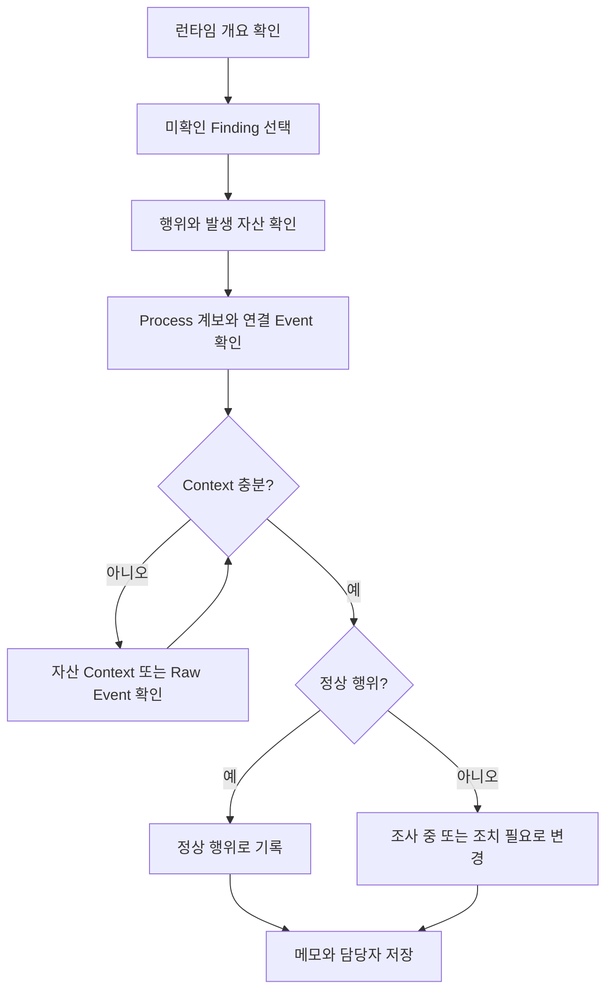
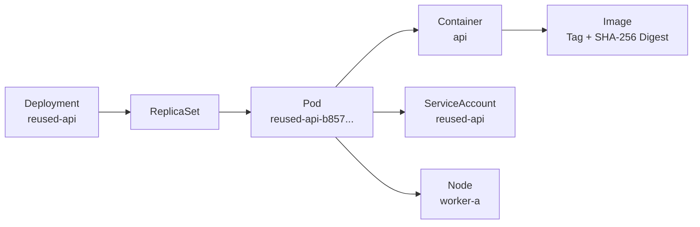

# 대시보드 화면 설계

기준: [PRD](../01-requirements/PRD.md), [API 명세](../03-architecture/api-contract.md). Dashboard 코드와 2026-10-10 Re:Used 검증 결과를 반영했다.

## 1. 문서 목적

이 문서는 사용자가 런타임 Event를 처음 발견한 뒤 발생 위치와 근거를 확인하고 조사 상태를 기록하기까지 필요한 화면을 정의한다. 디자인 시안보다 먼저 화면에 어떤 정보와 상태가 반드시 있어야 하는지 정하는 문서다.

현재 Dashboard에는 사이드바의 `인프라 보안 > 런타임 보안`과 `/runtime` Route가 이미 있고 본문은 Coming Soon 상태다. 구현 시 기존 `AppLayout`, `PageHeader`, `Badge`, `EmptyState`, Token·Typography·Spacing을 그대로 사용하고 Runtime 전용 화면만 추가한다.

## 2. 화면 설계 원칙

1. **행위와 위치를 먼저 보여준다.** 사용자는 규칙 이름만 보고 판단하기 어렵다. `무슨 Process가 어느 Workload에서 무엇을 했는지`를 한 문장으로 보여준다.
2. **센서 등급과 최종 심각도를 구분한다.** `sourcePriority`는 `센서 등급`, `finalSeverity`는 `최종 심각도`로 표시한다.
3. **Context가 없으면 없다고 보여준다.** 최종 심각도를 계산하지 못한 상태는 `Context 확인 중`으로 표시하며 임의의 색상 등급을 만들지 않는다.
4. **Event와 Finding을 구분한다.** 목록은 조사 단위인 Finding을 보여주고, 상세에서 연결된 원본 Event를 확인한다.
5. **삭제된 자산도 조사할 수 있어야 한다.** 현재 상태와 발생 당시 Snapshot을 함께 제공한다.
6. **데이터 없음과 수집 장애를 구분한다.** 탐지 결과 0건, Sensor 미설치, Sensor 중단, 처리 지연을 다른 상태로 표시한다.
7. **운영 모드를 항상 표시한다.** 초기 2~3개월의 `탐지 전용` 상태를 화면 상단에 표시해 사용자가 차단 기능으로 오해하지 않게 한다.

## 3. 정보 구조

```text
인프라
└─ 런타임 보안
   ├─ 개요                         UI-201
   ├─ 탐지 결과                    UI-210
   │  └─ Finding 상세              UI-220
   │     ├─ Event 상세·원문        UI-221
   │     └─ 자산 Context           UI-230
   ├─ 센서 상태                    UI-240
   └─ 탐지 규칙                    UI-250
```

## 4. 공통 표시 규칙

### 상태 Label

| 내부 값 | 화면 표시 | 용도 |
|---|---|---|
| `UNREVIEWED` | 미확인 | 아직 확인하지 않은 Finding |
| `REVIEWED` | 확인함 | 담당자가 검토함 |
| `OPEN` | 미조치 | 조치가 시작되지 않음 |
| `IN_PROGRESS` | 조치 중 | 담당자가 후속 조치 중 |
| `RESOLVED` | 해결됨 | 조치와 확인 완료 |
| `RISK_ACCEPTED` | 위험 수용 | 근거를 남기고 수용 |
| `EXPECTED` | 정상 행위 | Runtime 판정이 정상 작업임 |
| `ACTION_REQUIRED` | 조치 필요 | Runtime 판정상 수정·격리 필요 |
| `PENDING_CONTEXT` | Context 확인 중 | 최종 심각도 평가 전 |
| `INSUFFICIENT_CONTEXT` | Context 부족 | 필요한 자산·권한 정보 부족 |
| `EVALUATION_FAILED` | 평가 실패 | 평가 처리 오류 |

### 등급 표시

- `센서 등급: Warning`처럼 Label과 값을 함께 표시한다.
- `finalSeverity=null`이면 `최종 심각도: Context 확인 중`으로 표시한다.
- 빨간색·주황색은 등급만으로 화면 전체를 채우지 않고 Badge와 핵심 Marker에 제한한다.
- 색상 외에도 Text와 Icon으로 상태를 구분한다.

### Finding 제목

```text
{행위} · {workloadName}
```

예시:

```text
컨테이너 셸 실행 · reused-api
```

보조 설명:

```text
/bin/sh가 reused/reused-api의 api 컨테이너에서 실행됨
```

## 5. 사용자 흐름



---

## UI-201. 런타임 개요

### 목적

현재 런타임 수집 상태와 최근 발생한 Finding을 한 화면에서 파악한다.

### 진입 경로

`인프라 > 런타임 보안 > 개요`

### 기본 구성

```text
┌─────────────────────────────────────────────────────────────────────────┐
│ 런타임 보안                        Cluster [logssey-prod ▾]  최근 24시간 │
│ Container 안에서 실제로 발생한 Process·File·Network 행위를 확인합니다. │
│ 운영 모드: 탐지 전용 · 자동 차단하지 않음                               │
├─────────────────────────────────────────────────────────────────────────┤
│ 미확인 Finding     영향 Workload      최근 Event      자산 연결 실패    │
│       0                 0                  0                0            │
├─────────────────────────────────────────────────────────────────────────┤
│ Event 추이                                              Sensor 상태     │
│  아직 수집된 데이터가 없습니다.                ○ Sensor 미설치 6개 Slot │
├───────────────────────────────────────┬─────────────────────────────────┤
│ 최근 확인이 필요한 항목              │ 규칙별 Finding                  │
│ Sensor를 설치하면 최근 Finding 표시   │ RUN-001  0                      │
│                                        │ RUN-005  0                      │
└───────────────────────────────────────┴─────────────────────────────────┘
```

### 구성 요소

| 영역 | 표시 내용 | 동작 |
|---|---|---|
| Header | Cluster, 기간, 마지막 갱신 시각 | Cluster·기간 변경 |
| 운영 모드 | 탐지 전용 여부와 적용 시작일 | 운영 정책 설명 표시 |
| Summary | 미확인 Finding, 영향 Workload, 최근 Event, 자산 연결 실패 | 선택 시 Filter된 목록 이동 |
| Event 추이 | 시간별 RuntimeEvent 수 | Hover 시 시각·건수 표시 |
| Sensor 상태 | Healthy·Degraded·Offline 수 | UI-240 이동 |
| 최근 Finding | 제목, 위치, 마지막 발생, 반복 수, 조사 상태 | UI-220 이동 |
| 규칙별 Finding | 규칙명과 Finding 수 | UI-210에 Rule Filter 적용 |

### 상태 처리

| 상태 | 표시 |
|---|---|
| Event 0건, Sensor 정상 | `선택한 기간에 탐지된 행위가 없습니다.` |
| Sensor 미설치 | `이 Cluster에는 런타임 센서가 연결되지 않았습니다.` |
| Sensor 중단 | 상단 Banner와 마지막 정상 수집 시각 |
| 집계 지연 | 이전 데이터 유지, `집계 지연 중` 표시 |
| API 오류 | 새로고침 동작과 Request ID 표시 |

### API

- API-RT-001 런타임 개요 조회
- API-RT-002 Finding 목록 조회
- API-RT-009 Sensor 상태 조회

---

## UI-210. Finding 목록

### 목적

조사할 Finding을 조건별로 찾고 현재 상태를 한눈에 비교한다.

### 기본 구성

아래 값은 데이터가 들어왔을 때의 Demo 예시다.

```text
┌─────────────────────────────────────────────────────────────────────────┐
│ 탐지 결과                                                               │
│ [Cluster ▾] [Namespace ▾] [규칙 ▾] [상태 ▾] [센서 ▾] [기간 ▾] [검색]   │
├─────────────────────────────────────────────────────────────────────────┤
│ 미확인 7  ·  확인함 2  ·  조치 필요 1                    정렬: 최신순  │
├─────────────────────────────────────────────────────────────────────────┤
│ □ 컨테이너 셸 실행 · reused-api                         [미확인]        │
│   /bin/sh ← java · reused/api · UID 100                                 │
│   센서 등급 Warning · Context 확인 중 · Falco + Tetragon · 3회          │
│   마지막 발생 3분 전                                                     │
├─────────────────────────────────────────────────────────────────────────┤
│ □ 예상하지 않은 외부 연결 · reused-web                  [확인함]        │
│   nginx → 새 외부 목적지 · reused/web · UID 101                         │
│   센서 등급 Notice · Context 확인 중 · Falco · 1회                      │
│   마지막 발생 2시간 전                                                   │
└─────────────────────────────────────────────────────────────────────────┘
```

### 표시 필드

- 규칙 제목과 Rule ID
- Workload, Namespace, Container
- Process와 Parent Process
- 실행 사용자
- 센서 등급
- 최종 심각도 또는 평가 상태
- Sensor 종류
- 최초·마지막 발생 시각과 반복 횟수
- 조사 상태와 담당자
- 삭제 자산 여부

### Filter

- Cluster
- Namespace
- Workload 검색
- 규칙
- 조사 상태
- Sensor 등급
- 평가 상태
- Sensor
- 발생 기간

Filter는 URL Query에 반영해 같은 조건을 다시 열 수 있게 한다.

### 동작

- 행 선택: UI-220 이동
- 상태 Summary 선택: 해당 상태 Filter 적용
- 선택 항목 일괄 담당자 지정: MVP 후순위
- CSV 내보내기: MVP 후순위

### Empty State

- Filter 없음, 0건: Sensor 상태를 확인한 뒤 `탐지된 행위가 없습니다.` 표시
- Filter 적용, 0건: `조건에 맞는 결과가 없습니다.`와 Filter 초기화 제공

### API

- API-RT-002 Finding 목록 조회

---

## UI-220. Finding 상세

### 목적

한 Finding의 행위, 발생 위치, Process 계보, 반복 Event, 자산 Context를 확인하고 조사 결과를 기록한다.

### 기본 구성

```text
┌─────────────────────────────────────────────────────────────────────────┐
│ ← 탐지 결과                                                             │
│ 컨테이너 셸 실행 · reused-api                           [미확인 ▾]       │
│ /bin/sh가 reused/reused-api의 api 컨테이너에서 실행됨                   │
│ 센서 등급 Warning   최종 심각도 Context 확인 중   Falco + Tetragon      │
├───────────────────────────────────────────┬─────────────────────────────┤
│ 무슨 일이 있었나                          │ 조사 정보                   │
│ java → /bin/sh → id                          │ 담당자 [관리자 ▾]           │
│ UID 100 · 3회 · 01:00:00 ~ 01:03:00          │ 검토   [미확인 ▾]           │
│                                            │ 메모   [                 ] │
│ 발생 위치                                  │                     [저장] │
│ logssey-prod / reused                       │ 조치   [미조치 ▾]           │
│ Deployment reused-api                       │ 판정   [미정 ▾]             │
│ Pod reused-api-b857... / Container api       │ Context 확인 중             │
├───────────────────────────────────────────┴─────────────────────────────┤
│ 연결 Event 3                                                            │
│ 01:03:00 Tetragon process_exec  /bin/sh                         [보기]  │
│ 01:03:00 Falco    RUN-001      /bin/sh                         [보기]  │
│ 01:00:00 Falco    RUN-001      /bin/sh                         [보기]  │
├─────────────────────────────────────────────────────────────────────────┤
│ 자산 Context                                                             │
│ Image · ServiceAccount · Node · 외부 노출 · 관련 보안 결과               │
└─────────────────────────────────────────────────────────────────────────┘
```

### 정보 우선순위

1. 행위를 설명하는 한 문장
2. Process 계보
3. Cluster부터 Container까지의 발생 위치
4. 센서 등급과 평가 상태
5. 반복 횟수와 연결 Sensor
6. 발생 당시 자산 Context
7. Raw Event

### 조사 정보 변경

- 검토 상태, 조치 상태, 판정, 담당자, 메모를 변경할 수 있다.
- 변경하지 않은 필드는 전송하지 않는다.
- 동시에 수정된 경우 최신 내용을 보여주고 다시 저장하도록 안내한다.
- 모든 변경은 `변경자 · 시각 · 변경 전후 값`으로 History에 표시한다.

### 삭제된 자산

현재 삭제된 Pod라면 이름 옆에 `삭제됨` Badge를 표시한다. 현재 조회 실패로 빈칸을 만들지 않고 Event 발생 당시 Snapshot과 `deletedAt`을 보여준다.

### API

- API-RT-003 Finding 상세 조회
- API-RT-004 Finding 조사 정보 변경
- API-RT-005 Finding의 Event 목록 조회
- API-RT-008 자산의 런타임 Context 조회

---

## UI-221. Event 상세·원문

### 목적

정규화된 RuntimeEvent가 어떤 Sensor 원본에서 생성됐는지 확인한다.

### 표시 구성

| Tab | 내용 |
|---|---|
| 정규화 Event | 공통 RuntimeEvent 필드와 Mapping 상태 |
| Sensor 원문 | 마스킹된 Falco·Tetragon JSON |
| 처리 이력 | 수신, 정규화, 자산 연결, Finding 연결 시각 |

### 화면 규칙

- 기본 Tab은 정규화 Event다.
- MVP에서는 로그인한 `ADMIN`에게만 원문 Tab을 보여준다.
- 마스킹한 필드는 `마스킹됨`으로 표시하며 원래 값을 복구하지 않는다.
- JSON Copy 기능은 마스킹된 Payload만 복사한다.
- `normalizationStatus=PARTIAL`이면 누락 필드와 사용한 보조 Key를 표시한다.

### API

- API-RT-006 RuntimeEvent 상세 조회
- API-RT-007 Raw Event 조회

---

## UI-230. 자산 Context

### 목적

Event가 발생한 자산의 Kubernetes 관계와 당시 상태를 확인한다.

### 관계 표현



### 표시 내용

- Cluster, Namespace, Workload, Pod, Container
- Kubernetes UID와 Container ID
- Image, Tag, Digest
- Node와 ServiceAccount
- 생성·삭제 시각
- 발생 당시 Label과 주요 Security Context
- 현재 상태와 Event 발생 당시 Snapshot의 차이
- 관련 IaC·IAM·SCA·Secret 결과가 연결되면 해당 결과 Link

관계가 아직 연결되지 않은 항목은 `정보 없음`이 아니라 `연결 대기`, `수집 대상 아님`, `자산 삭제됨`으로 이유를 구분한다.

### API

- API-RT-008 자산의 런타임 Context 조회

---

## UI-240. Sensor 상태

### 목적

Event가 없는 이유가 실제 미발생인지 Sensor 문제인지 확인한다.

### 기본 구성

| Node | Sensor | Version | Driver | 상태 | 마지막 Heartbeat | 마지막 Event | Rule Set |
|---|---|---|---|---|---|---|---|
| worker-a | Falco | - | - | 미설치 | - | - | - |
| worker-c | Falco | - | - | 미설치 | - | - | - |
| worker-d | Falco | - | - | 미설치 | - | - | - |
| worker-a·c·d | Tetragon | - | - | 미설치 | - | - | - |

### 상태 판단

| 상태 | 조건 |
|---|---|
| 정상 | 마지막 Heartbeat가 60초 이내이고 처리 오류가 없음 |
| 성능 저하 | Heartbeat는 있으나 Queue·Drop·오류가 증가하거나 마지막 Event 처리가 60초 이상 지연 |
| 중단 | 마지막 Heartbeat를 120초 이상 받지 못함 |
| 알 수 없음 | Sensor가 등록되지 않았거나 Node 상태를 확인하지 못함 |
| 미설치 | 기대 Node는 확인됐지만 해당 Sensor DaemonSet이 없음 |

### API

- API-RT-009 Sensor 상태 조회

---

## UI-250. 탐지 규칙

### 목적

현재 어떤 행위를 어떤 Sensor로 탐지하는지 확인한다.

### 목록 필드

| 필드 | 예시 |
|---|---|
| ID | RUN-001 |
| 규칙 | 컨테이너 셸 실행 |
| 상태 | Testing |
| Sensor | Falco, Tetragon |
| Event Type | Process Exec |
| 센서 등급 | Warning |
| Version | 0.1.0 |
| 마지막 배포 | 2026.10.08 10:00 |

### 상세 정보

- 탐지 목적
- 조건 요약
- 필요한 Event Field
- 적용 범위
- 예외 목록과 만료 시각
- 최근 Test 결과
- Rule Version 변경 이력
- 최근 7일 Event 수, Finding 수, 정상 행위 판정 수
- Event 급증으로 일시 중지된 상태와 원인

MVP에서는 조회만 제공한다. Rule 원문 편집과 Cluster 배포는 Git 기반 운영 흐름을 정한 뒤 추가한다.

### API

- API-RT-010 규칙 목록 조회
- API-RT-011 규칙 운영 지표 조회

## 6. 화면별 권한

현재 Dashboard는 `ADMIN` 역할만 지원한다.

| 화면 | MVP `ADMIN` |
|---|---:|
| UI-201 개요 | 조회 |
| UI-210 Finding 목록 | 조회 |
| UI-220 Finding 상세 | 조회·변경 |
| UI-221 정규화 Event·Raw Event | 조회 |
| UI-230 자산 Context | 조회 |
| UI-240 Sensor 상태 | 조회 |
| UI-250 규칙 | 조회 |

`VIEWER`와 `ANALYST`를 추가할 때 Raw Event와 변경 권한을 다시 분리한다. Role을 추가하기 전에는 화면에서 존재하지 않는 권한 선택지를 보여주지 않는다.

## 7. Loading·Empty·Error 상태

| 상황 | 처리 |
|---|---|
| 첫 Loading | 화면 구조를 유지하는 Skeleton 표시 |
| Filter 변경 | 기존 목록을 유지하고 목록 영역에 Loading 표시 |
| 데이터 0건 | Sensor 상태에 따라 정상 0건과 수집 문제를 구분 |
| 일부 API 실패 | 성공한 영역은 유지하고 실패한 Card에만 오류 표시 |
| 권한 없음 | 숨겨야 하는 정보는 감추고 필요한 권한 안내 |
| 연결 실패 Event | `자산 연결 실패` Badge와 재시도 상태 표시 |
| 삭제 자산 | Snapshot 유지, `삭제됨` Badge 표시 |
| Sensor Offline | 전역 Banner와 마지막 정상 시각 표시 |

## 8. 접근성과 반응형 기준

- Text와 배경의 명도 대비를 WCAG AA 수준으로 맞춘다.
- 상태를 색상 하나로만 전달하지 않는다.
- 모든 Filter와 상태 변경은 Keyboard로 조작할 수 있어야 한다.
- 표의 행 선택 영역과 Button 동작을 구분한다.
- Timestamp는 절대 시각과 상대 시각을 함께 확인할 수 있게 한다.
- Desktop 1280px 이상을 1차 대상으로 한다.
- 좁은 화면에서는 Summary Card를 2열로 바꾸고 상세 우측 조사 Panel을 본문 아래로 이동한다.
- 긴 Pod·Container ID는 중간 생략하고 전체 값과 Copy 기능을 제공한다.

## 9. 화면 수용 기준

### UI-201

- [ ] Sensor 정상 상태의 0건과 Sensor 중단 상태를 구분한다.
- [ ] Summary를 선택하면 같은 Filter가 적용된 목록으로 이동한다.
- [ ] 데이터 생성 시각을 확인할 수 있다.

### UI-210

- [ ] Rule, 상태, Sensor, Namespace, 기간 Filter가 동작한다.
- [ ] 센서 등급과 최종 심각도 평가 상태가 별도로 보인다.
- [ ] 반복 횟수와 연결 Sensor를 한 행에서 확인할 수 있다.

### UI-220

- [ ] 행위, Process 계보, 발생 위치가 첫 화면에 보인다.
- [ ] Finding 상태·담당자·메모를 저장할 수 있다.
- [ ] Falco와 Tetragon 원본 Event를 각각 확인할 수 있다.
- [ ] 삭제된 Pod도 발생 당시 정보가 보인다.

### UI-221·UI-230

- [ ] Raw Event 권한을 구분한다.
- [ ] 마스킹 필드가 원문과 Copy 결과에 노출되지 않는다.
- [ ] 현재 자산과 발생 당시 Snapshot을 구분한다.

### UI-240·UI-250

- [ ] Node별 Sensor 상태와 마지막 Heartbeat가 보인다.
- [ ] 규칙 Version과 배포된 Rule Set을 비교할 수 있다.
- [ ] 규칙별 Event·Finding·정상 행위 판정 수를 확인할 수 있다.
- [ ] Event 급증으로 중지된 규칙은 원인과 중지 시각을 표시한다.

## 10. 개발 순서

1. UI-210 Finding 목록의 정적 화면과 Filter 구조
2. UI-220 상세의 행위·자산·Process 영역
3. Finding 목록·상세 API 연결
4. 조사 상태·담당자·메모 변경
5. UI-221 Event 상세와 Raw Event 권한
6. UI-240 Sensor 상태
7. UI-201 개요 집계
8. UI-230 자산 Context와 다른 보안 영역 Link
9. UI-250 규칙 조회

## 11. 구현 기준

1. 전체 Navigation과 Header는 현재 Logssey 통합 대시보드의 Sidebar·Header Component를 재사용한다.
2. Route는 이미 등록된 `/runtime`을 사용하고 `ComingSoonPage` 대신 Runtime Page Router를 연결한다.
3. MVP에서는 런타임 상세 안에 자산 Context Panel을 제공하고 공통 Asset 상세가 완성되면 Link를 추가한다.
4. 담당자 선택은 현재 Dashboard 사용자 목록을 사용하며 MVP에서는 `ADMIN`만 변경할 수 있다.
5. `finalSeverity=null`은 `Context 확인 중`으로 표시한다.
6. Finding 변경 이력은 365일 보존한다.
7. UI-201·UI-240은 30초 Polling, UI-210은 Filter 변경·수동 새로고침·30초 Polling을 사용한다. SSE는 MVP에서 제외한다.
8. 운영 기본값은 `logssey-prod`, `reused`, `reused-api`·`reused-chat`·`reused-web`이며 테스트 화면은 `attack-lab` Label로 구분한다.
9. 현재 Sensor가 없으므로 첫 배포 전 화면의 기본 상태는 `0건`이 아니라 `Sensor 미설치`다.
10. Wireframe의 Event 수와 시각은 Demo 값이다. 실제 환경 사실로 표시하지 않는다.

## 12. 현재 코드에서 변경할 위치

| 영역 | 현재 | 구현 내용 |
|---|---|---|
| Route | `routes.ts`에 `/runtime` 등록됨 | `App.tsx`에서 Runtime Page 연결 |
| Navigation | 인프라 보안 하위 탭에 런타임 존재 | 현재 구조 유지 |
| 인증 | Session·CSRF, ADMIN | 그대로 사용 |
| API Client | 공통 `apiRequest` | Runtime API Module 추가 |
| Type | Severity 필수형 중심 | Runtime의 Nullable `finalSeverity`와 평가 상태 Type 추가 |
| 공통 UI | Badge, EmptyState, PageHeader, Token | 재사용하고 Runtime 상태 Tone만 추가 |
| 현재 본문 | Coming Soon | UI-201·UI-210부터 교체 |

검증 근거는 `Logssey/dashboard-frontend`, `Logssey/dashboard-backend`, `Logssey/gitops`와 2026.10.10 Live Cluster 읽기 전용 조회 결과다.

| 항목 | 내용 |
|---|---|
| 작성자 | 김진호 |
| 작성일 | 2026-10-10 |
| 수정일 | 2026-10-14 |
