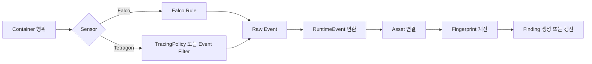

# 규칙 명세

기준: [PRD](../01-requirements/PRD.md), [ADR](../03-architecture/adr.md). Re:Used에서 먼저 검증할 런타임 탐지 규칙과 입력, 출력, 예외, 테스트 방법을 정의한다.

## 1. 문서 목적

이 문서는 Re:Used를 대상으로 먼저 검증할 런타임 탐지 규칙과 각 규칙의 입력, 출력, 예외 처리, 테스트 방법을 정리한다. 여기서 정하는 등급은 센서 규칙이 제공하는 기본 우선순위다. Logssey가 다른 보안 Context까지 결합해 판단하는 최종 심각도와는 구분한다.

## 2. 적용 범위

- 1차 대상: `reused` Namespace의 `reused-api`, `reused-chat`, `reused-web`
- 검증 환경: `attack-lab` Namespace 또는 별도 Test Cluster
- 센서: Falco 우선, Tetragon 비교 검증
- 배포 Node: Re:Used Pod가 실행되는 Worker 3대
- 결과: Raw Event, RuntimeEvent, Finding
- 제외: 자동 차단, 운영 환경 공격 재현, Final Severity 계산

### 확인된 정상 실행 기준

| Workload | Main Process | 실행 사용자 | 정상 연결 | 현재 보안 설정 |
|---|---|---:|---|---|
| `reused-api` | Java 21 | UID 100 | PostgreSQL, Redis, S3, SES SMTP, Kakao, LLM | 비root, 권한 상승 금지, Capability 제거, SA Token 미마운트 |
| `reused-chat` | Node.js 24 | UID 1000 | `reused-api`, Redis | 비root, 권한 상승 금지, Capability 제거, SA Token 미마운트 |
| `reused-web` | Nginx unprivileged | UID 101 | 사용자 요청 응답 외 애플리케이션 Egress 없음 | 비root, 권한 상승 금지, Capability 제거, SA Token 미마운트 |

세 Workload 모두 Root Filesystem은 현재 쓰기 가능하고, `reused` Namespace에는 Egress NetworkPolicy가 없다. 이 표는 규칙 예외가 아니라 첫 Baseline이다.

## 3. 규칙 처리 흐름



## 4. 공통 규칙 형식

구현 시 규칙 자체와 제품 Metadata를 함께 관리한다. 아래 구조는 제품 내부 규칙 Registry이며 Falco Rule YAML이나 Tetragon TracingPolicy 원문을 그대로 대체하지 않는다.

```yaml
id: RUN-001
title: 컨테이너 셸 실행
status: testing
version: 0.1.0
sensors:
  - falco
  - tetragon
eventType: process_exec
sourcePriority: warning
description: 컨테이너 안에서 대화형 또는 비대화형 셸이 실행된 사실을 탐지한다.
requiredFields:
  - occurredAt
  - asset.clusterId
  - asset.namespace
  - asset.podUid
  - asset.containerId
  - process.executable
conditionSummary: 컨테이너에서 bash, sh, dash, zsh 중 하나가 실행됨
assetScope:
  namespaces:
    - attack-lab
exceptions: []
tags:
  - process
  - shell
  - kubernetes
```

### 상태

| 상태 | 의미 |
|---|---|
| `draft` | 조건과 필요한 필드를 정리하는 단계 |
| `testing` | Test Cluster에서 Event와 오탐을 확인하는 단계 |
| `observe` | 운영에서 Finding만 생성하며 예외와 이벤트량을 측정하는 단계 |
| `enabled` | 대상 환경에서 Finding 생성에 사용하는 상태 |
| `disabled` | Event 수집 또는 Finding 생성을 중단한 상태 |

### Sensor Priority

`sourcePriority`는 규칙이 주는 1차 분류다. 화면에서는 반드시 **센서 등급**으로 표시한다.

| 값 | 용도 |
|---|---|
| `critical` | 즉시 확인이 필요한 규칙의 기본값 |
| `warning` | 비정상일 가능성이 높지만 정상 작업일 수도 있음 |
| `notice` | 조사 Context로 사용할 관찰 정보 |
| `informational` | Finding보다는 활동 이력에 가까운 정보 |

MVP에서는 `sourcePriority`를 `finalSeverity`로 복사하지 않는다. `finalSeverity`는 `null`, `evaluationStatus`는 `PENDING_CONTEXT`로 시작한다.

## 5. 우선 규칙 목록

| ID | 규칙 | Event Type | 1차 센서 | 초기 Sensor Priority | MVP |
|---|---|---|---|---|---|
| RUN-001 | 컨테이너 셸 실행 | `process_exec` | Falco | `warning` | 필수 |
| RUN-002 | 서비스 Process의 셸 실행 | `process_exec` | Tetragon + Falco | `warning` | 필수 |
| RUN-003 | ServiceAccount 토큰 접근 | `file_access` | Falco | `warning` | 필수 |
| RUN-004 | 실행 중인 Container의 패키지 관리자 실행 | `process_exec` | Falco | `notice` | 필수 |
| RUN-005 | Pod의 IMDS 접근 | `network_connect` | Tetragon + Falco | `warning` | 필수 |
| RUN-006 | 다른 Process의 메모리 접근 | `file_access` | Falco | `warning` | 검증 |
| RUN-007 | Container 중요 경로 변경 | `file_write` | Falco | `warning` | 필수 |
| RUN-008 | 예상하지 않은 외부 연결 | `network_connect` | Falco + Tetragon | `notice` | 필수 |

---

## RUN-001. 컨테이너 셸 실행

### 탐지 목적

Re:Used Container 안에서 `bash`, `sh`, `ash`, `dash`, `zsh`가 실행된 사실을 확인한다. API·Chat·Web Image는 Alpine 기반이므로 `ash`를 포함한다. 개발자의 정상적인 `kubectl exec`와 애플리케이션 침해 후 실행된 셸은 같은 Process 이름을 가질 수 있으므로 이 규칙만으로 공격 여부를 확정하지 않는다.

### 구현 조건

```text
container = true
AND process.name IN (bash, sh, ash, dash, zsh)
```

Falco의 실제 필드명과 Macro 조합은 설치 Version의 기본 Rule과 첫 Sample Event를 확인한 뒤 고정한다.

### 필요한 근거

- Process 실행 파일과 Arguments
- Parent Process
- UID와 Username
- Cluster, Namespace, Pod UID, Container ID
- Image와 Image Digest
- Node
- Event 발생 시각
- 가능할 경우 Kubernetes Audit Log의 `pods/exec` 요청

### 예외 후보

- 배포·점검 시간에 승인된 운영자 `kubectl exec`
- Image Build 또는 별도 Debug Container
- Kubernetes System Namespace

예외는 사람 이름이나 Pod 이름만으로 만들지 않는다. `actor + action + target + time range` 조합을 우선 사용한다.

### 안전한 검증

```bash
kubectl -n attack-lab exec deploy/reused-api-lab -- /bin/sh -c 'id'
```

**통과 조건:** 실행 후 10초 안에 RUN-001 RuntimeEvent가 저장되고 Pod·Container·Deployment가 연결된다.

---

## RUN-002. 서비스 Process의 셸 실행

### 탐지 목적

API나 Chat의 정상 서비스 Process가 셸을 자식 Process로 생성하는 행위를 찾는다. 외부 입력을 통한 Command Injection과 애플리케이션의 정상 Script 실행을 구분하기 위한 Process 계보를 확보하는 것이 핵심이다.

### 구현 조건

```text
child.process.name IN (bash, sh, ash, dash, zsh)
AND parent.process.name IN (java, node, nginx)
```

Re:Used의 확인된 Main Process는 API의 `java`, Chat의 `node`, Web의 `nginx`다. Package Manager나 Health Check가 간접적으로 셸을 실행하는지 관찰 기간에 확인하고 예외 여부를 결정한다.

### 필요한 근거

- Parent·Child Process 실행 파일
- Process ID와 Parent Process ID
- 전체 Process 계보
- Arguments와 Working Directory
- 실행 사용자
- Image Digest
- 연결된 Pod와 Workload

### Sensor 역할

- Falco: 규칙 기반 1차 Alert
- Tetragon: `process_exec` Event와 Process 계보 보강

### 안전한 검증

테스트 전용 애플리케이션 Endpoint 또는 테스트 Container에서 부모 Process가 `/bin/sh -c 'id'`를 실행하도록 한다. 운영 Re:Used Endpoint에 임의 입력을 보내지 않는다.

**통과 조건:** Falco와 Tetragon Event가 각각 보존되고 같은 Process 실행으로 확인되면 하나의 Finding에 연결된다.

---

## RUN-003. ServiceAccount 토큰 접근

### 탐지 목적

애플리케이션에서 예상하지 않은 Process가 Kubernetes ServiceAccount 토큰 경로를 읽는 행위를 찾는다.

현재 Re:Used API·Chat·Web ServiceAccount는 `automountServiceAccountToken=false`이므로 운영 Pod에는 이 경로가 없어야 한다. 따라서 경로 접근 Event가 발생하면 배포 설정 변경, Sidecar 추가, 다른 Volume Mount 여부를 함께 확인한다.

### 구현 조건

```text
container = true
AND file.path STARTS_WITH "/var/run/secrets/kubernetes.io/serviceaccount/"
AND operation IN (open, read, copy)
```

Sensor가 실제로 제공하는 File Operation 수준은 PoC에서 확인한다. `open`만 식별 가능한 경우 결과에 그 한계를 표시한다.

### 필요한 근거

- 접근 Process와 Parent Process
- File Path와 Operation
- Pod의 ServiceAccount
- ServiceAccount에 연결된 RoleBinding·ClusterRoleBinding
- Namespace와 Workload

### 예외 후보

- Kubernetes Client를 정상적으로 사용하는 승인된 Process
- Sidecar 또는 Agent의 주기적 토큰 읽기

### 안전한 검증

`attack-lab`에만 토큰 자동 마운트를 허용한 테스트 ServiceAccount와 Pod를 만들고 파일의 Metadata 또는 첫 Byte 읽기 시도만 수행한다. 토큰 값을 화면이나 Log에 출력하지 않는다. 운영 Re:Used Pod의 설정은 바꾸지 않는다.

**통과 조건:** Secret 값은 저장되지 않고 Path, Process, ServiceAccount 관계만 확인할 수 있다.

---

## RUN-004. 실행 중인 Container의 패키지 관리자 실행

### 탐지 목적

이미 배포된 Container 안에서 Package Manager가 실행되는 행위를 찾는다. Immutable Image 운영 원칙과 다른 변경이거나 침해 이후 도구 설치의 흔적일 수 있다.

### 구현 조건

```text
container = true
AND process.name IN (apt, apt-get, yum, dnf, apk, rpm, dpkg)
```

### 필요한 근거

- Package Manager와 Arguments
- Parent Process
- 실행 사용자
- Image와 Image Digest
- Namespace, Pod, Container

### 예외 후보

- Image Build용 Container
- 승인된 Debug Pod
- 초기화 단계에서 설치가 명시된 테스트 Workload

### 안전한 검증

패키지를 실제 설치하지 않고 버전 조회 또는 도움말 명령으로 Process 실행만 발생시킨다.

**통과 조건:** 실행 Process와 대상 Container를 확인할 수 있고, 패키지 설치 성공 여부를 공격 여부로 오인하지 않는다.

---

## RUN-005. Pod의 IMDS 접근

### 탐지 목적

Pod Process가 Cloud Instance Metadata 주소로 연결하는 행위를 찾는다. Re:Used는 자체 관리 Kubernetes 환경이므로 실제 Metadata Service 구성과 접근 가능 여부를 먼저 확인해야 한다.

실제 EC2 Metadata Option은 `HttpTokens=optional`, Hop Limit 2다. 모든 EC2가 같은 IAM Role을 사용하고 이 Role에는 `AmazonEC2FullAccess`, `AmazonS3FullAccess`, 리전 내 Secrets Manager 조회 권한이 있다. 이 조건 때문에 RUN-005는 MVP 필수 규칙으로 처리한다.

### 구현 조건

```text
source = pod network namespace
AND destination.ip = 169.254.169.254
AND destination.port IN (80, 443)
```

### 필요한 근거

- 연결을 시작한 Process
- Source Pod·Container·Node
- Destination IP·Port
- Network Namespace 또는 Socket 정보
- Node의 Cloud Provider 정보
- Event 발생 당시 Node의 IMDS Token 요구 여부와 Hop Limit
- Node Role 식별자와 권한 요약. Policy·Secret 값 전체는 복제하지 않음

### 검증 조건

- 실제 IMDS에 요청하지 않는다.
- 격리된 실습 환경에서 동일 IP를 모사하거나 Packet/Event Sample로 Mapping만 검증한다.
- Falco와 Tetragon 중 Process와 Network를 안정적으로 함께 제공하는 Sensor를 PoC 후 선택한다.

**통과 조건:** Process·Pod·Node와 목적지 `169.254.169.254`를 하나의 Event에서 연결하고 Node의 IMDS Context를 표시한다. Sensor가 이를 안정적으로 제공하지 못하면 해당 Sensor의 규칙은 `draft`로 유지한다.

---

## RUN-006. 다른 Process의 메모리 접근

### 탐지 목적

Container Process가 `/proc/<pid>/mem`을 열어 다른 Process의 메모리를 읽거나 변경하려는 행위를 찾는다. 자격증명 탈취, Debugger 사용, Process Injection 가능성을 조사하기 위한 신호다.

### 구현 조건

```text
container = true
AND file.path MATCHES "/proc/[0-9]+/mem"
AND target.pid != actor.pid
AND operation IN (open, read, write)
```

### 필요한 근거

- 접근 Process와 대상 PID
- File Operation과 Open Flag
- 실행 UID와 Linux Capability
- 대상 Process의 실행 파일
- Pod·Container·Image Digest

### 예외 후보

- 승인된 APM·Profiler·Debugger
- 장애 분석 시간에 실행한 관리 도구

**통과 조건:** 자기 Process 접근과 다른 Process 접근을 구분하고, 승인된 Profiler는 기간이 있는 예외로 처리한다.

---

## RUN-007. Container 중요 경로 변경

### 탐지 목적

실행 중인 Container에서 실행 파일·설정·인증에 사용되는 중요 경로가 변경되는 행위를 찾는다.

현재 Re:Used 세 Workload는 `readOnlyRootFilesystem=false`다. 쓰기 시도가 기술적으로 가능하므로 RUN-007은 MVP 필수 규칙으로 검증한다.

### 구현 조건

```text
container = true
AND operation IN (create, write, rename, unlink)
AND file.path STARTS_WITH_ONE_OF (
  /bin, /sbin, /usr/bin, /usr/sbin, /etc, /root/.ssh
)
```

### 필요한 근거

- 변경 Process와 Parent Process
- 대상 Path와 Operation
- Container의 Read Only Root Filesystem 여부
- 실행 UID와 Capability
- Image Digest

### 예외 후보

- 승인된 Init Container
- Package Manager 실행과 연결된 변경
- 설정 갱신이 설계된 Sidecar

**통과 조건:** Test Container의 임시 중요 경로에서 생성·변경·삭제 Event를 각각 확인하고, Read Only Root Filesystem에서는 실패한 시도도 근거로 남긴다.

---

## RUN-008. 예상하지 않은 외부 연결

### 탐지 목적

Re:Used Workload가 Baseline에 없거나 허용 목록 밖에 있는 외부 주소로 연결하는 행위를 찾는다. 정상 외부 API가 많은 서비스이므로 IP 하나만으로 악성 여부를 판단하지 않는다.

### 구현 조건

```text
source = container
AND destination NOT_IN approvedDestination
AND destination NOT_IN clusterNetwork
AND destination NOT_IN dnsResolver
```

### 필요한 근거

- 연결을 시작한 Process와 Parent Process
- Destination IP·Port·Protocol
- 가능할 경우 DNS Name과 TLS Server Name
- Workload·Namespace·Image Digest
- 첫 관찰 시각과 최근 관찰 시각

### 운영 방식

- 최초에는 `observe` 상태로 Baseline만 만든다.
- 코드와 GitOps에서 확인한 초기 허용 범위는 아래 표로 시작하고 실제 7일 관찰 결과와 비교한다.
- IP가 자주 바뀌는 SaaS는 CIDR 전체 허용보다 DNS Name·Service Identity를 우선 사용한다.
- 외부 연결 Event만으로 최종 심각도를 만들지 않고 외부 노출, Process, Secret 접근과 결합한다.

| Workload | 초기 허용 범주 | 판별 기준 |
|---|---|---|
| `reused-api` | RDS PostgreSQL, Redis, S3, SES SMTP, Kakao OAuth/API, 설정된 LLM Provider | Service Endpoint·DNS Name·Port와 Process `java` |
| `reused-chat` | Cluster 내부 `reused-api`, Redis | Kubernetes Service Identity·Redis Endpoint와 Process `node` |
| `reused-web` | 애플리케이션 Egress 없음 | Process `nginx`의 새 Outbound 연결은 우선 확인 |

DNS, Kubernetes API, CNI·Node 운영 통신은 애플리케이션 Baseline과 분리한다. 현재 Namespace에 NetworkPolicy가 없다는 사실은 Context로 표시하고, 탐지 예외로 사용하지 않는다.

**통과 조건:** 승인된 DB·Redis·SMTP·Kakao·LLM 연결과 새로운 Test Endpoint 연결을 구분해 표시한다.

## 6. RuntimeEvent Mapping

| 규칙 필드 | RuntimeEvent 필드 | 필수 여부 |
|---|---|---|
| 규칙 ID | `ruleKey` | 필수 |
| Event 종류 | `eventType` | 필수 |
| Sensor | `source` | 필수 |
| Sensor 원본 ID | `sourceEventId` | 필수 또는 Payload Hash |
| Sensor 등급 | `sourcePriority` | 필수 |
| 발생 시각 | `occurredAt` | 필수 |
| Cluster | `asset.clusterId` | 필수 |
| Pod UID | `asset.podUid` | 가능할 때 필수 |
| Container ID | `asset.containerId` | 가능할 때 필수 |
| 실행 파일 | `process.executable` | Process 규칙에서 필수 |
| Parent Process | `process.parentExecutable` | RUN-002에서 필수 |
| 파일 경로 | `file.path` | RUN-003에서 필수 |
| 목적지 IP·Port | `network.destination` | RUN-005에서 필수 |
| 대상 PID | `targetProcess.processId` | RUN-006에서 필수 |
| 파일 Operation | `file.operation` | RUN-006·RUN-007에서 필수 |
| DNS·TLS 목적지 | `network.domain`, `network.serverName` | RUN-008에서 가능한 경우 |

필수 필드가 누락돼도 Raw Event는 버리지 않는다. RuntimeEvent는 `normalizationStatus=PARTIAL`과 누락 필드 목록을 기록한다.

## 7. Finding 묶음 기준

### Fingerprint

```text
ruleKey
+ clusterId
+ podUid
+ containerId
+ executable
+ parentExecutable
+ userId
+ timeBucket(기본 5분)
```

- `timeBucket`은 기본 5분으로 사용하며 규칙별로 덮어쓸 수 있다.
- Falco와 Tetragon의 `source`는 Fingerprint에서 제외해 같은 행위를 하나의 Finding으로 묶을 수 있게 한다.
- `podUid`가 없으면 Namespace, Pod Name, Node, 발생 시각을 보조 Key로 쓰되 `resolutionConfidence`를 낮춘다.
- 원본 Event는 Sensor별로 모두 보존한다.

## 8. 예외 정책

```yaml
id: EX-RUN-001-001
ruleId: RUN-001
status: enabled
reason: 승인된 장애 점검
actor:
  kubernetesUser: engineer@example.com
action:
  type: pods/exec
target:
  clusterId: reused-test
  namespace: attack-lab
  workload: reused-api-lab
validFrom: 2026-10-08T01:00:00Z
validUntil: 2026-10-08T02:00:00Z
approvedBy: security-owner
```

- 예외에는 사유, 승인자, 적용 범위, 만료 시각이 필요하다.
- 만료 시각이 없는 임시 예외는 허용하지 않는다.
- 예외가 적용된 Event도 원본은 보존하고 `suppressed=true`를 기록한다.
- 정규식 하나로 모든 Namespace나 Image를 제외하지 않는다.

## 9. 규칙 테스트 기준

| 구분 | 확인할 내용 |
|---|---|
| Positive | 의도한 행위가 Event와 Finding을 만드는가 |
| Negative | 평상시 애플리케이션 동작이 불필요한 Finding을 만들지 않는가 |
| Mapping | 필수 필드가 RuntimeEvent에 들어오는가 |
| Asset | Pod UID와 Container ID로 Workload까지 연결되는가 |
| Duplicate | 같은 Source Event 재전송이 중복 저장되지 않는가 |
| Grouping | Falco·Tetragon Event가 조건에 따라 하나로 묶이는가 |
| Exception | 범위와 시간 안에서만 예외가 적용되는가 |
| Masking | 토큰, 환경변수, 민감 Argument가 노출되지 않는가 |

### 운영 적용 절차

```text
draft → testing → observe → enabled 또는 disabled
```

1. `testing`: `attack-lab`에서 악성 행위 Test와 정상 행위 Test를 각각 3회 이상 실행한다.
2. `observe`: 운영에서 7일 이상 차단 없이 Event 수와 정상 행위 판정 결과를 수집한다.
3. `enabled`: 담당자, 예외, Runbook이 준비되고 이벤트량이 조사 가능한 수준일 때 전환한다.
4. `disabled`: 이벤트 급증으로 Sensor나 저장소에 영향을 주거나 행위 구분에 필요한 필드를 확보하지 못하면 중지한다.

### 이벤트량 Guardrail

- 단일 규칙이 1분에 1,000개를 초과하면 `RULE_EVENT_FLOOD`를 발생시키고 해당 규칙의 Finding 생성을 일시 중지한다.
- Raw Event는 Collector Local Queue와 중앙 수집 한도 안에서 보존한다.
- 중지된 규칙은 조건·Export Filter·Rate Limit을 수정한 뒤 `testing`부터 다시 검증한다.
- Guardrail 값은 PoC와 관찰 운영 결과로 조정하며 변경 이력을 남긴다.

## 10. 버전 관리

- 규칙 변경은 `major.minor.patch` 형식으로 관리한다.
- 조건 의미가 바뀌면 `major`, 탐지 범위가 추가되면 `minor`, 오탈자와 Metadata 수정은 `patch`를 올린다.
- RuntimeEvent에 `ruleVersion`을 저장한다.
- 규칙 Version 변경 전후의 탐지량과 대표 Sample을 비교한다.
- Falco Rule과 Tetragon Policy 원문은 Git에서 관리하고 배포 Version을 Sensor 상태에 기록한다.

## 11. 환경별 검증 항목

1. 설치한 Falco Version에서 사용할 실제 Field와 Macro
2. Tetragon Process 계보와 File·Network Event의 수집 범위
3. 규칙별 `timeBucket` 조정 필요성과 Fingerprint 보조 Key
4. Re:Used API·Chat의 정상 Parent Process 목록
5. Kubernetes Audit Log와 `kubectl exec` Event의 연결 방식
6. RUN-003의 실제 File Operation 구분 수준
7. RUN-005·RUN-008 Network Event의 지원 Sensor와 재현 방법
8. Cilium Event를 보조 Network Source로 사용할 필요가 있는지
9. Worker 3대에서 Falco 단독과 Tetragon 추가 후 CPU·Memory·Drop 차이

## 12. 환경 검증 근거

- Re:Used Dockerfile과 GitOps Helm Values에서 Main Process, UID, Port, 외부 연동 범주를 확인했다.
- Live Cluster에서 각 Workload 2개 Pod, Image Digest, Security Context, ServiceAccount Token 미마운트를 확인했다.
- `reused` Namespace에는 NetworkPolicy와 CiliumNetworkPolicy가 없고 Falco·Tetragon DaemonSet도 없다.
- EC2 Metadata Option과 Node IAM Role은 2026.10.10 AWS CLI 읽기 전용 조회 결과를 사용했다.

## 참고 자료

- [Falco Rules](https://falco.org/docs/concepts/rules/)
- [Falco Exceptions](https://falco.org/docs/concepts/rules/exceptions/)
- [Falco Supported Fields](https://falco.org/docs/rules/supported-fields/)
- [Tetragon TracingPolicy](https://tetragon.io/docs/concepts/tracing-policy/)
- [Tetragon Events](https://tetragon.io/docs/concepts/events/)

| 항목 | 내용 |
|---|---|
| 작성자 | 김진호 |
| 작성일 | 2026-10-10 |
| 수정일 | 2026-10-14 |
