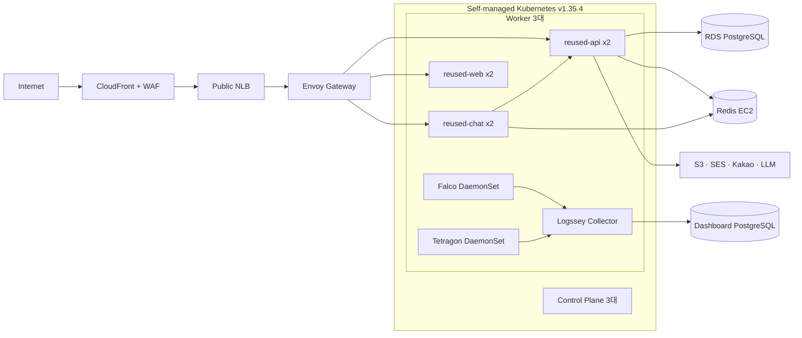

# ADR

기준: [PRD](../01-requirements/PRD.md). 2026-10-10 AWS·Re:Used 검증 결과를 반영한 런타임 탐지 아키텍처 결정 기록이다.

## 1. 상태 정의

| 상태 | 의미 |
|---|---|
| 제안 | 팀 합의 전이며 변경 가능 |
| 승인 | 구현 기준으로 사용 |
| 보류 | 현재 범위에서 결정하지 않음 |
| 대체 | 새 ADR로 결정이 변경됨 |

## 2. ADR 목록

| ID | 제목 | 상태 |
|---|---|---|
| ADR-RT-001 | 첫 검증 대상을 Re:Used로 제한 | 승인 |
| ADR-RT-002 | Falco를 먼저 연결하고 Tetragon을 추가 | 승인 |
| ADR-RT-003 | Raw Event와 RuntimeEvent를 분리 | 승인 |
| ADR-RT-004 | Kubernetes Asset은 LIST·WATCH로 수집 | 승인 |
| ADR-RT-005 | Kubernetes UID를 Asset 식별자로 사용 | 승인 |
| ADR-RT-006 | Final Severity 평가는 후속 단계로 분리 | 승인 |
| ADR-RT-007 | MVP에서 자동 차단을 제외 | 승인 |
| ADR-RT-008 | Tetragon 수집기를 공통 Runtime Source로 운영 | 승인 |
| ADR-RT-009 | 초기 Event와 Finding은 PostgreSQL에 저장 | 승인 |
| ADR-RT-010 | 원본 Event는 보존하고 화면에서 Finding으로 묶음 | 승인 |
| ADR-RT-011 | Cluster 내부 Logssey Collector를 통해 Event 전달 | 승인 |
| ADR-RT-012 | 운영 초기 2~3개월은 탐지만 수행 | 승인 |
| ADR-RT-013 | 첫 Sensor 배포 범위를 Worker 3대로 제한 | 승인 |
| ADR-RT-014 | Tag와 별도로 실행 중 Image Digest를 저장 | 승인 |
| ADR-RT-015 | 기존 Dashboard 인증·ID를 재사용하고 Runtime Schema를 분리 | 승인 |
| ADR-RT-016 | 현재 AWS 위험 조건을 Runtime Context로 연결 | 승인 |

### 확인된 환경과 목표 배치



Falco·Tetragon·Collector는 목표 구성으로 아직 설치되지 않았다. Diagram의 Sensor 영역은 이번 개발에서 추가할 부분이며 나머지 구성은 GitOps·AWS·Live Cluster에서 확인했다.

---

## ADR-RT-001. 첫 검증 대상을 Re:Used로 제한

- 상태: 승인
- 결정일: 2026.10.07
- 관련 요구사항: G-01~G-06

### 배경

프로젝트 기간 안에 임의의 Kubernetes 환경을 모두 지원하기 어렵다. 팀이 구조와 배포 흐름을 알고 있는 Re:Used를 기준으로 끝까지 동작하는 시나리오가 필요하다.

### 결정

> 런타임 탐지의 첫 검증 대상은 Re:Used로 제한하고, 구현 내부의 Asset·Event 모델은 다른 Kubernetes 환경에도 사용할 수 있게 구성한다.

### 결과

- 문서와 테스트 시나리오는 Re:Used API·Chat을 기준으로 작성한다.
- 운영 Baseline에는 Re:Used Web도 포함한다.
- 실제 검증은 `attack-lab` 또는 별도 Test Cluster에서 수행한다.
- 코드에 `reused-api` 같은 이름을 조건으로 고정하지 않는다.
- Cluster ID, Kubernetes UID, Container ID를 식별자로 사용한다.

### 재검토 조건

- Re:Used 외 두 번째 Kubernetes 환경을 연결할 때
- Re:Used 환경에 Sensor를 설치할 수 없을 때

---

## ADR-RT-002. Falco를 먼저 연결하고 Tetragon을 추가

- 상태: 승인
- 관련 요구사항: FR-RT-001, FR-RT-002, FR-RT-004

### 배경

Falco와 Tetragon을 동시에 설치하면 Driver, 권한, Event Mapping, 중복 처리 문제를 한 번에 확인해야 한다. 먼저 하나의 Sensor로 Event 발생부터 화면까지 연결할 필요가 있다.

### 선택지

| 선택지 | 장점 | 단점 |
|---|---|---|
| Falco만 사용 | PoC가 빠르고 Rule이 명확함 | Process 계보와 세부 관찰에 제한 |
| Tetragon만 사용 | 상세 Process와 TracingPolicy 활용 | 초기 학습·정책 설계 부담 |
| Falco와 Tetragon 동시 시작 | 두 Sensor 비교가 빠름 | 문제 원인 분리가 어려움 |
| Falco 후 Tetragon | 전체 흐름을 먼저 완성하고 확장 가능 | Tetragon 검증 시점이 늦어짐 |

### 결정

> Falco로 첫 end-to-end 흐름을 완성한 뒤 동일한 RuntimeEvent 계약에 Tetragon Adapter를 추가한다.

### 결과

- Phase 1은 Falco 셸 실행 Event를 기준으로 한다.
- Phase 2에서 Tetragon `process_exec`를 같은 시나리오로 비교한다.
- Sensor별 원본 Event는 유지한다.
- 두 Sensor의 역할 분담은 PoC 결과로 확정한다.

### 검증

- [ ] Falco Sample을 RuntimeEvent로 변환
- [ ] Tetragon Sample을 RuntimeEvent로 변환
- [ ] 같은 Process 실행을 하나의 Finding에 연결

---

## ADR-RT-003. Raw Event와 RuntimeEvent를 분리

- 상태: 승인
- 관련 요구사항: FR-RT-003, FR-RT-004, NFR-RT-003

### 배경

Falco와 Tetragon의 Event 구조가 다르고 Sensor Version에 따라 필드가 달라질 수 있다. 변환에 실패하거나 Mapping이 변경됐을 때 원본을 다시 처리할 수 있어야 한다.

### 결정

> Sensor 원본은 `RawEvent`로 보존하고, 제품 내부 조회와 상관 분석에는 `RuntimeEvent`를 사용한다.

### 데이터 흐름

```text
Sensor Payload
→ RawEvent 저장
→ Adapter
→ RuntimeEvent
→ Asset Resolution
→ Finding Grouping
```

### 결과

- 원본과 변환 결과를 비교할 수 있다.
- Adapter 오류를 수정한 뒤 재처리할 수 있다.
- Collector가 민감 정보를 마스킹한 뒤 Sensor 고유 구조를 유지해 저장하며 저장 후에는 Payload를 변경하지 않는다.
- Raw Event 조회 권한은 일반 Finding 조회보다 제한한다.

---

## ADR-RT-004. Kubernetes Asset은 LIST·WATCH로 수집

- 상태: 승인
- 관련 요구사항: FR-RT-005, FR-RT-006, FR-RT-007

### 배경

Pod와 Container는 수시로 생성·삭제된다. Event가 발생할 때마다 Kubernetes API를 조회하면 API Server 부하가 늘고, 이미 삭제된 Pod를 찾지 못할 수 있다.

### 선택지

| 선택지 | 장점 | 단점 |
|---|---|---|
| Event 발생 시 API 조회 | 구현이 단순함 | 삭제 Asset과 API 장애에 취약 |
| 일정 주기 Polling | 누락 복구가 쉬움 | 변경 반영이 늦고 호출량 증가 |
| LIST·WATCH + 재동기화 | 변경 반영이 빠르고 캐시 활용 가능 | Watch 재연결 구현 필요 |

### 결정

> 시작 시 전체 LIST를 수행하고 `resourceVersion`부터 WATCH한다. 연결 종료와 `410 Gone` 발생 시 전체 LIST로 복구하고 주기적으로 재동기화한다.

### 결과

- Asset Inventory가 Event 처리와 분리된다.
- Watch 상태와 마지막 동기화 시각을 관측 지표로 저장한다.
- 삭제 Asset은 즉시 물리 삭제하지 않는다.

---

## ADR-RT-005. Kubernetes UID를 Asset 식별자로 사용

- 상태: 승인
- 관련 요구사항: FR-RT-006

### 배경

Pod 이름은 재배포 과정에서 다시 사용되거나 비슷한 이름으로 생성될 수 있다. 이름만 사용하면 과거 Event가 새 Pod와 잘못 연결될 수 있다.

### 결정

> Kubernetes 객체는 `clusterId + metadata.uid`, Container는 `clusterId + containerId`를 우선 식별자로 사용한다.

### 보조 Key

- Cluster + Namespace + Kind + Name
- Event 발생 시각과 Asset 유효 기간
- Image Digest
- Node Name

### 결과

- UID가 없는 Event는 보조 Key로 후보를 찾고 `confidence`를 기록한다.
- 정확히 연결하지 못한 Event는 `UNRESOLVED`로 유지한다.

---

## ADR-RT-006. Final Severity 평가는 후속 단계로 분리

- 상태: 승인
- 결정일: 2026.10.07
- 관련 요구사항: FR-RT-012

### 배경

같은 `bash` 실행이라도 개발 환경의 승인된 점검과 외부에 노출된 운영 Pod의 비정상 실행은 의미가 다르다. Event 하나만으로 최종 위험도를 확정하면 잘못된 우선순위를 만들 수 있다.

### 결정

> Sensor가 제공한 값은 `sourcePriority`로 저장하고, `finalSeverity`는 설정·권한·외부 노출·데이터 경로가 연결된 뒤 별도 Risk Evaluator가 계산한다.

### 상태

```text
PENDING_CONTEXT
EVALUATED
INSUFFICIENT_CONTEXT
EVALUATION_FAILED
```

### 결과

- MVP에서 `finalSeverity=null`을 정상 상태로 허용한다.
- 화면에는 Sensor Priority와 평가 상태를 구분해 표시한다.
- 평가 정책 Version과 평가 시각을 저장한다.
- 정책 변경 시 기존 Finding을 재평가할 수 있게 한다.

---

## ADR-RT-007. MVP에서 자동 차단을 제외

- 상태: 승인
- 관련 요구사항: MVP 제외 범위

### 배경

`kubectl exec`와 Package Manager 실행은 공격 행위일 수 있지만 장애 대응이나 점검 작업일 수도 있다. 정상 행위 Baseline 없이 Process나 Pod를 차단하면 서비스 장애를 만들 수 있다.

### 결정

> MVP는 탐지, 근거 조회, 조사 상태 기록까지 구현한다. Tetragon Enforcement와 자동 Pod 격리는 후속 검증으로 남긴다.

### 재검토 조건

- 정상 행위와 예외 정책을 충분히 수집했을 때
- 승인·복구 절차와 책임자가 정해졌을 때
- `attack-lab`에서 차단과 복구를 반복 검증했을 때

---

## ADR-RT-008. Tetragon 수집기를 공통 Runtime Source로 운영

- 상태: 승인
- 관련 파트: 런타임, SCA

### 배경

SCA 파트는 CVE Reachability를 위해 Tetragon의 Process·Loader·파일 Event를 필요로 한다. 파트별로 Tetragon을 중복 설치하거나 별도 Collector를 만들면 Event 계약과 운영 책임이 나뉜다.

### 결정

> 런타임 파트가 Tetragon 설치·수집·기본 정규화를 맡고, SCA 파트는 합의한 RuntimeEvent 또는 별도 Loader Event Stream을 소비한다.

### 결과

- Cluster에는 하나의 Tetragon 배포를 사용한다.
- SCA 전용 필드와 보존 범위는 별도 계약으로 정의한다.
- 파일 Load 관찰 가능 여부는 설치 환경 검증 결과를 `supportedCapabilities`로 기록하고 지원되는 Cluster에서만 활성화한다.

---

## ADR-RT-009. 초기 Event와 Finding은 PostgreSQL에 저장

- 상태: 승인
- 관련 요구사항: FR-RT-003, FR-RT-008

### 배경

팀의 대시보드 Stack은 Spring Boot와 PostgreSQL로 결정됐다. MVP에서 Event 양을 아직 측정하지 못했으며 별도 Streaming·검색 Cluster를 운영할 여력이 제한된다.

### 선택지

| 선택지 | 장점 | 단점 |
|---|---|---|
| PostgreSQL | 기존 Stack 재사용, Transaction 처리 | 대량 Raw Event 장기 보존에 한계 |
| OpenSearch | 검색과 대량 Log에 적합 | 운영 부담 증가 |
| Object Storage + DB | 원본 비용 절감 | 조회와 재처리 구조 복잡 |

### 결정

> MVP는 PostgreSQL에 Raw Event, RuntimeEvent, Finding을 저장한다. Event 양을 측정한 뒤 Raw Event Archive를 분리한다.

### 제한

- Raw Event는 30일, RuntimeEvent는 90일, Finding과 감사 이력은 365일을 MVP 기본값으로 사용한다.
- RuntimeEvent는 발생 월 기준 Partition을 사용하고 보존 기간이 지난 Partition을 삭제한다.
- 보존 기간은 환경변수로 조정하며 Event 양을 측정해 축소하거나 Object Storage Archive를 추가할 수 있다.
- 실제 데이터 연결 시 서비스 DB와 Schema·계정을 분리한다.

---

## ADR-RT-010. 원본 Event는 보존하고 화면에서 Finding으로 묶음

- 상태: 승인
- 관련 요구사항: FR-RT-008

### 배경

한 번의 행위가 여러 syscall과 Sensor Alert를 만들 수 있다. 모든 Event를 조사 목록에 표시하면 같은 문제를 반복 조사하게 된다.

### 결정

> RuntimeEvent는 각각 보존하고, 사용자 화면은 Rule·Asset·Process·시간 범위를 기준으로 생성한 Finding을 기본 단위로 사용한다.

### Fingerprint

```text
ruleKey
+ clusterId
+ podUid
+ containerId
+ executable
+ parentExecutable
+ userId
+ timeBucket(기본 5분)
```

### 결과

- Finding은 `firstSeenAt`, `lastSeenAt`, `occurrenceCount`를 가진다.
- Falco와 Tetragon Event를 같은 Finding에 연결할 수 있다.
- `timeBucket`은 기본 5분이며 규칙별 설정으로 덮어쓸 수 있다.
- MVP에서는 Fingerprint가 다른 Finding을 수동으로 합치지 않는다.

---

## ADR-RT-011. Cluster 내부 Logssey Collector를 통해 Event 전달

- 상태: 승인
- 결정일: 2026.10.10
- 관련 요구사항: FR-RT-001, FR-RT-002, FR-RT-003

### 배경

Falco는 HTTP·HTTPS JSON Output을 지원하고 Tetragon은 JSON Log와 gRPC Event를 제공한다. Sensor가 중앙 API의 인증·재시도·Cluster 식별을 각각 구현하게 하면 설정이 분산된다.

### 결정

> Cluster마다 Logssey Collector를 하나 배포한다. Falco는 JSON HTTP Output을 Collector로 전송하고, Collector는 Tetragon JSON Export도 수집해 공통 Envelope을 붙인 뒤 중앙 Runtime API로 전달한다.

### 결과

- Collector가 `clusterId`, `sensorId`, 수신 시각과 Idempotency Key를 부여한다.
- Collector는 민감 필드를 마스킹하고, 중앙 API는 Sensor 고유 구조를 유지한 Payload를 Raw Event로 먼저 저장한다.
- MVP에서는 Falcosidekick을 필수 구성으로 두지 않는다.
- 다중 목적지 전달이나 별도 Alert Integration이 필요해지면 Falcosidekick을 Collector 앞에 추가한다.
- Collector 전송 실패는 제한된 Local Queue에 보관하고 지수 Backoff로 재시도한다.

---

## ADR-RT-012. 운영 초기 2~3개월은 탐지만 수행

- 상태: 승인
- 결정일: 2026.10.09
- 관련 요구사항: MVP 제외 범위

### 배경

런타임 규칙은 같은 행위를 정상 작업과 공격으로 모두 탐지할 수 있다. 운영 Baseline과 예외를 확보하기 전에 차단하면 서비스 장애가 발생할 수 있다.

### 결정

> 운영 Cluster 연결 후 2~3개월은 Detection Only로 운영한다. 담당자가 Finding을 확인하고 결과를 기록한 뒤 규칙별 오탐과 Event 양을 기준으로 튜닝한다.

### 결과

- 차단 Action은 모든 규칙에서 비활성화한다.
- 규칙별 Event 수, Finding 수, 정상 행위 판정 비율을 측정한다.
- 자동 차단은 승인·복구 절차와 별도 ADR이 있는 규칙에만 후속 적용할 수 있다.

---

## ADR-RT-013. 첫 Sensor 배포 범위를 Worker 3대로 제한

- 상태: 승인
- 결정일: 2026.10.10
- 관련 요구사항: NFR-RT-005, NFR-RT-009

### 배경

실제 Cluster는 Control Plane 3대와 Worker 3대가 Kubernetes Node로 동작하고, 외부 etcd 3대와 Redis 1대가 별도 EC2로 운영된다. Re:Used Pod는 Worker에만 배치된다. 초기부터 Control Plane과 시스템 Host까지 Sensor를 적용하면 운영 영향과 이벤트 범위가 동시에 커진다.

### 결정

> MVP의 Falco·Tetragon은 Worker 3대에만 배포한다. `nodeSelector` 또는 Node Label로 적용 범위를 고정하고, Control Plane·etcd·Redis Host는 첫 PoC 대상에서 제외한다.

### 결과

- Re:Used Container 행위 탐지를 먼저 완성한다.
- Sensor 상태 화면의 기대 개수는 Sensor 종류별 Worker 수를 기준으로 계산한다.
- Control Plane과 Host Runtime 탐지는 별도 성능 측정과 승인 후 확장한다.
- DaemonSet이 의도하지 않은 Node에 Scheduling되면 배포 검증을 실패로 처리한다.

### 재검토 조건

- Worker PoC의 CPU·Memory·Event Drop 결과가 안정적일 때
- Control Plane 또는 Redis Host 탐지가 제품 범위에 포함될 때

---

## ADR-RT-014. Tag와 별도로 실행 중 Image Digest를 저장

- 상태: 승인
- 결정일: 2026.10.10
- 관련 요구사항: FR-RT-006, FR-RT-015

### 배경

GitOps는 Commit SHA를 Image Tag로 사용하지만 ECR Repository는 Mutable 설정이다. Tag만 저장하면 나중에 같은 Tag가 다른 Image를 가리킬 가능성을 배제할 수 없다. 실제 Pod Status에는 실행 중 Image Digest가 존재한다.

### 결정

> RuntimeEvent와 Asset Snapshot에 배포 Tag와 `status.containerStatuses[].imageID`의 Digest를 함께 저장한다. 조사와 SCA 연결은 Digest를 우선 Key로 사용한다.

### 결과

- Git Commit과 실행 Image를 각각 추적할 수 있다.
- Pod가 삭제돼도 발생 당시 Digest를 유지한다.
- Tag 변경 가능 여부는 IaC Context로 표시하되 Runtime Sensor가 Image 신뢰 여부를 단독 판단하지 않는다.

---

## ADR-RT-015. 기존 Dashboard 인증·ID를 재사용하고 Runtime Schema를 분리

- 상태: 승인
- 결정일: 2026.10.10
- 관련 요구사항: FR-RT-009, FR-RT-010, FR-RT-012

### 배경

현재 Dashboard는 Spring Session과 CSRF Cookie/Header를 사용하고 `ADMIN` 역할만 제공한다. 공통 `assets`와 `detection_events`의 Primary Key는 BIGINT다. `detection_events.severity`는 필수지만 Runtime 설계에서는 Context가 모이기 전 `finalSeverity=null`이 필요하다.

### 결정

> Runtime API는 기존 Dashboard Backend 안에 구현하고 기존 Session·CSRF와 BIGINT ID를 사용한다. Context 평가 전 Finding은 Runtime 전용 Table에 저장하고, `finalSeverity`가 계산된 뒤 공통 `detection_events`에 Projection한다.

### 구현 영향

- MVP Dashboard 권한은 기존과 같은 `ADMIN` 하나로 시작한다.
- `VIEWER`와 `ANALYST`는 사용자 Role Migration이 준비된 뒤 추가한다.
- `assets.asset_id`를 Runtime Asset 연결의 Foreign Key로 사용하고 Kubernetes UID·Container ID는 별도 Unique Key로 저장한다.
- `runtime_findings.display_id`에는 사람이 읽는 Runtime Finding ID를 저장한다.
- 최종 심각도가 없는 Finding을 임의로 `LOW`에 넣거나 공통 `detection_events`에 넣지 않는다.
- 평가가 끝난 Finding을 공통 화면에 노출할 때 `detection_events.domain=RUNTIME`으로 Projection하고 Runtime Finding ID를 함께 저장한다.
- 통합 현황에 미평가 Runtime 건수를 보여줘야 하면 공통 Severity 집계에 섞지 않고 별도 `pendingRuntimeCount`로 확장한다.

---

## ADR-RT-016. 현재 AWS 위험 조건을 Runtime Context로 연결

- 상태: 승인
- 결정일: 2026.10.10
- 관련 요구사항: FR-RT-012, FR-RT-013, FR-RT-016

### 배경

실제 환경에서 IMDS Token은 선택 사항이고 Hop Limit은 2다. 모든 Node가 같은 IAM Role을 사용하며 해당 Role에는 Secrets Manager 조회, S3 접근, EC2 전체 권한이 포함된다. `reused` Namespace에는 Egress를 제한하는 NetworkPolicy가 없다.

### 결정

> Runtime Event는 이 조건들을 최종 심각도로 복사하지 않고 `riskContext`로 연결한다. RUN-005와 RUN-008은 해당 Context가 있을 때 사용자가 먼저 확인할 수 있게 노출하되 최종 심각도 계산은 Risk Evaluator가 맡는다.

### 결과

- RUN-005에는 Node의 IMDS 설정과 Node Role 식별자를 연결한다.
- RUN-008에는 NetworkPolicy 존재 여부와 Workload별 승인 목적지를 연결한다.
- IAM Policy 원문과 Secret 값은 Runtime Event에 복제하지 않는다.
- IaC·IAM 개선으로 조건이 바뀌면 최신 Context와 Event 발생 당시 Snapshot을 구분한다.

## 3. 구현 중 측정할 값

아래 항목은 설계를 중단시키는 결정 사항이 아니라 설정값을 조정하기 위한 측정 대상이다.

| 항목 | 초기값 | 조정 근거 |
|---|---|---|
| Raw Event 보존 | 30일 | 일별 Event 양과 Payload 크기 |
| RuntimeEvent 보존 | 90일 | 조사에 사용한 실제 기간 |
| Finding 묶음 시간 | 5분 | 한 행위가 만드는 Event 간격 |
| Sensor Offline 기준 | Heartbeat 2분 미수신 | Heartbeat 주기와 운영 장애 사례 |
| OCSF 적용 범위 | 필드명과 객체 구조 참고 | 팀 공통 Schema와 외부 연동 필요성 |
| Final Severity | MVP 계산 안 함 | IaC·IAM·SCA·Secret Context 연결 시점 |
| Worker 성능 증가 | CPU 평균 5%p 이하를 1차 기준 | Falco 단독·Tetragon 추가 전후 비교 |
| 승인 외부 목적지 | API·Chat·Web별 초기 목록 | 운영 7일 Baseline과 코드·GitOps 비교 |

## 4. 확인된 환경 근거

| 항목 | 확인 결과 |
|---|---|
| Kubernetes | `v1.35.4`, containerd `2.2.3` |
| Node OS | Ubuntu `24.04.4 LTS`, Kernel `7.0.0-1013-aws`, BTF 사용 가능 |
| CNI | Cilium `1.19.3` |
| Re:Used | `reused` Namespace, API·Chat·Web 각 2개 Pod |
| App ServiceAccount | Workload별 별도 SA, Token 자동 마운트 해제 |
| Runtime Sensor | Falco·Tetragon 모두 미설치 |
| NetworkPolicy | `reused` Namespace에는 없음 |
| Dashboard | Session·CSRF, ADMIN 단일 Role, BIGINT Asset/Event ID |

근거는 `Logssey/infrastructure`, `Logssey/gitops`, Re:Used 서비스 Repository, Dashboard Repository와 2026.10.10 AWS·Cluster 읽기 전용 조회 결과다.

## 참고 자료

- [Falco Documentation](https://falco.org/docs/)
- [Tetragon TracingPolicy](https://tetragon.io/docs/concepts/tracing-policy/)
- [Kubernetes API Concepts](https://kubernetes.io/docs/reference/using-api/api-concepts/)

| 항목 | 내용 |
|---|---|
| 작성자 | 김진호 |
| 작성일 | 2026-10-10 |
| 수정일 | 2026-10-14 |
