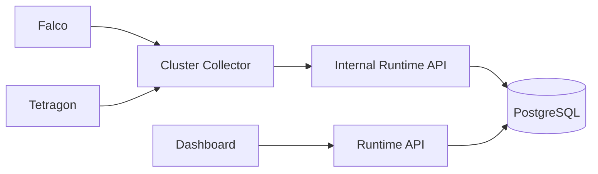

# API 명세

기준: [PRD](../01-requirements/PRD.md), [ADR](adr.md), [규칙 명세](../02-functional-design/rule-spec.md). Dashboard 코드와 2026-10-10 AWS·Re:Used 검증 결과를 반영했다.

## 1. 문서 목적

이 문서는 런타임 센서에서 Event를 받는 내부 API와 대시보드가 사용하는 조회·조사 API의 v1 계약을 정의한다. 구현 위치는 기존 `Logssey/dashboard-backend`이며 Spring Session, CSRF, 공통 오류 응답과 BIGINT ID 규칙을 그대로 사용한다.

## 2. API 구분

| 구분 | Base Path | 사용자 | 용도 |
|---|---|---|---|
| 대시보드 API | `/api/v1/runtime` | Logssey 사용자 | 개요, Finding, Event, Sensor, Rule 조회 |
| 내부 수집 API | `/internal/v1/runtime` | Falco·Tetragon Collector | 원본 Event와 Sensor 상태 전달 |



## 3. 공통 규칙

### 요청과 응답

- Content Type: `application/json`
- 시간: ISO 8601 UTC 형식
- API Version: URL의 `/v1`
- 목록 Pagination: Cursor 방식
- 추적 ID: 선택 요청 Header `X-Request-Id`, 응답 Header와 Server Log에 기록
- ID 형식: 기존 Schema와 같은 PostgreSQL BIGINT Identity
- 사용자용 식별자: `RTF-000042` 형태의 `displayId`

| Resource | ID 예시 |
|---|---|
| Raw Event | `991` |
| RuntimeEvent | `734` |
| Finding | `42`, 화면 표시 `RTF-000042` |
| 공통 Asset | `18` |
| Sensor | `3` |

### 목록 응답

```json
{
  "items": [],
  "page": {
    "nextCursor": null,
    "hasNext": false,
    "limit": 50
  }
}
```

### 오류 응답

```json
{
  "code": "RUNTIME_FINDING_NOT_FOUND",
  "message": "런타임 Finding을 찾을 수 없습니다."
}
```

| HTTP | Code 예시 | 의미 |
|---:|---|---|
| 400 | `INVALID_FILTER` | Filter 또는 요청 값 오류 |
| 401 | `UNAUTHENTICATED` | 인증 정보 없음 또는 만료 |
| 403 | `RUNTIME_ACCESS_DENIED` | 조회·변경 권한 없음 |
| 404 | `RUNTIME_FINDING_NOT_FOUND` | 대상 없음 |
| 409 | `FINDING_VERSION_CONFLICT` | 동시에 변경되어 Version 충돌 |
| 422 | `EVENT_NORMALIZATION_FAILED` | 지원하지 않는 Event 구조 |
| 429 | `INGEST_RATE_LIMITED` | 수집 허용량 초과 |
| 500 | `RUNTIME_INTERNAL_ERROR` | 처리 중 내부 오류 |

## 4. 인증과 권한

### Dashboard API

- 기존 `JSESSIONID` 기반 Spring Session을 사용한다.
- GET이 아닌 요청은 `XSRF-TOKEN` Cookie 값을 `X-XSRF-TOKEN` Header로 보낸다.
- 현재 Dashboard Schema와 코드가 `ADMIN`만 지원하므로 MVP의 모든 Runtime 화면과 변경 API는 로그인한 `ADMIN`만 사용한다.
- Raw Event 조회와 Finding 변경은 별도 Audit Log를 남긴다.
- `VIEWER`·`ANALYST` 분리는 사용자 Role Migration과 함께 후속 적용한다.

### 내부 수집 API

- Cluster Collector의 mTLS Client Certificate로 인증한다.
- 인증 주체는 Certificate에 매핑된 자신의 `clusterId`로만 Event를 보낼 수 있다.
- Dashboard Session으로 내부 수집 API를 호출할 수 없다.

## 5. 공통 Enum

### Review Status

```text
UNREVIEWED
REVIEWED
```

### Action Status

```text
OPEN
IN_PROGRESS
RESOLVED
RISK_ACCEPTED
```

### Disposition

```text
UNDECIDED
EXPECTED
ACTION_REQUIRED
```

### Evaluation Status

```text
PENDING_CONTEXT
EVALUATED
INSUFFICIENT_CONTEXT
EVALUATION_FAILED
```

### Asset Resolution Status

```text
PENDING
RESOLVED
UNRESOLVED
```

### Event Processing Status

```text
RECEIVED
NORMALIZED
ASSET_RESOLVED
ASSET_UNRESOLVED
GROUPED
FAILED
```

### Sensor Status

```text
HEALTHY
DEGRADED
OFFLINE
UNKNOWN
```

## 6. 주요 데이터 구조

### RuntimeEvent

```json
{
  "eventId": 734,
  "source": "FALCO",
  "sourceEventId": "falco-173...",
  "eventType": "PROCESS_EXEC",
  "occurredAt": "2026-10-08T01:00:00Z",
  "receivedAt": "2026-10-08T01:00:01Z",
  "ruleKey": "RUN-001",
  "ruleVersion": "0.1.0",
  "sourcePriority": "WARNING",
  "evaluationStatus": "PENDING_CONTEXT",
  "finalSeverity": null,
  "normalizationStatus": "COMPLETE",
  "missingFields": [],
  "asset": {
    "clusterId": "logssey-prod",
    "namespace": "reused",
    "workloadKind": "Deployment",
    "workloadName": "reused-api",
    "podUid": "0d94...",
    "podName": "reused-api-b85779f6-...",
    "containerId": "containerd://56ab...",
    "containerName": "api",
    "image": "logssey/reused-api:<git-sha>",
    "imageDigest": "sha256:...",
    "nodeName": "worker-a",
    "serviceAccountName": "reused-api"
  },
  "process": {
    "processId": 2451,
    "parentProcessId": 2390,
    "executable": "/bin/bash",
    "arguments": ["-c", "id"],
    "parentExecutable": "/usr/bin/runc",
    "userId": 0
  },
  "file": null,
  "network": null,
  "assetResolutionStatus": "RESOLVED",
  "resolutionConfidence": "HIGH",
  "rawEventRef": 991
}
```

민감한 Argument는 저장 전 마스킹한다. API 응답에서는 원본 값이 아니라 마스킹된 값을 반환한다.

### RuntimeFinding

```json
{
  "findingId": 42,
  "displayId": "RTF-000042",
  "rule": {
    "key": "RUN-001",
    "title": "컨테이너 셸 실행",
    "version": "0.1.0"
  },
  "reviewStatus": "UNREVIEWED",
  "actionStatus": "OPEN",
  "disposition": "UNDECIDED",
  "sourcePriority": "WARNING",
  "evaluationStatus": "PENDING_CONTEXT",
  "finalSeverity": null,
  "firstSeenAt": "2026-10-08T01:00:00Z",
  "lastSeenAt": "2026-10-08T01:03:00Z",
  "occurrenceCount": 3,
  "sensors": ["FALCO", "TETRAGON"],
  "assetSummary": {
    "clusterId": "logssey-prod",
    "namespace": "reused",
    "workloadKind": "Deployment",
    "workloadName": "reused-api",
    "podUid": "0d94...",
    "podName": "reused-api-b85779f6-...",
    "containerName": "api",
    "assetDeleted": false
  },
  "processSummary": {
    "executable": "/bin/bash",
    "parentExecutable": "/usr/bin/runc",
    "userId": 0
  },
  "assignee": null,
  "note": null,
  "version": 1
}
```

### 저장 모델

| Table | 목적 | 주요 Key |
|---|---|---|
| `runtime_raw_events` | 마스킹한 Sensor 원본과 처리 상태 | `raw_event_id BIGINT`, Source Idempotency Unique Key |
| `runtime_assets` | Kubernetes UID·Container ID별 유효 기간과 Snapshot | `runtime_asset_id BIGINT`, `cluster_id + k8s_uid` 또는 `cluster_id + container_id` |
| `runtime_events` | 정규화 Event와 Asset 연결 | `runtime_event_id BIGINT`, `raw_event_id`, `runtime_asset_id` |
| `runtime_findings` | 조사 단위, 평가 상태, 담당자, Version | `finding_id BIGINT`, `display_id`, 선택 `asset_id` |
| `runtime_finding_events` | Finding과 RuntimeEvent N:M 연결 | `finding_id + runtime_event_id` |
| `runtime_sensors` | Node별 Sensor Heartbeat와 Version | `sensor_id BIGINT`, `cluster_id + node_name + type` |
| `runtime_finding_history` | 상태·담당자·메모 변경 Audit | `history_id BIGINT`, `finding_id` |

공통 `assets.asset_id`는 Deployment처럼 장기간 유지되는 자산과 연결한다. Pod·Container처럼 재생성되는 자산은 `runtime_assets`에서 Kubernetes UID와 유효 기간으로 구분한다.

`finalSeverity`가 `null`인 Finding은 Runtime Table에만 존재한다. 평가가 끝나면 `domain=RUNTIME`인 공통 `detection_events`로 Projection해 통합 현황에 포함한다. 공통 Schema의 필수 Severity를 우회하기 위해 임의의 `LOW` 값을 넣지 않는다.

## 7. 대시보드 API

### API-RT-001. 런타임 개요 조회

```http
GET /api/v1/runtime/overview?clusterId=logssey-prod&from=2026-10-09T00:00:00Z&to=2026-10-10T00:00:00Z
```

**관련 요구사항:** FR-RT-009, FR-RT-011
**사용 화면:** UI-201

```json
{
  "period": {
    "from": "2026-10-07T00:00:00Z",
    "to": "2026-10-08T00:00:00Z"
  },
  "summary": {
    "runtimeEventCount": 0,
    "unreviewedFindingCount": 0,
    "affectedWorkloadCount": 0,
    "unresolvedAssetEventCount": 0
  },
  "findingsByRule": [
    {"ruleKey": "RUN-001", "title": "컨테이너 셸 실행", "count": 0}
  ],
  "eventsTrend": [
    {"bucket": "2026-10-10T00:00:00Z", "count": 0}
  ],
  "sensorSummary": {
    "healthy": 0,
    "degraded": 0,
    "offline": 0,
    "unknown": 6
  },
  "collectionState": "NOT_INSTALLED",
  "generatedAt": "2026-10-10T01:05:00Z"
}
```

### API-RT-002. Finding 목록 조회

```http
GET /api/v1/runtime/findings?clusterId=logssey-prod&namespace=reused&reviewStatus=UNREVIEWED&ruleKey=RUN-001&cursor=&limit=50
```

**관련 요구사항:** FR-RT-009
**사용 화면:** UI-210

| Query | 형식 | 설명 |
|---|---|---|
| `clusterId` | string | Cluster Filter |
| `namespace` | string | Namespace Filter |
| `workload` | string | Workload 이름 검색 |
| `reviewStatus` | enum, 반복 가능 | 검토 상태 |
| `actionStatus` | enum, 반복 가능 | 조치 상태 |
| `disposition` | enum, 반복 가능 | 정상 행위·조치 필요 판정 |
| `ruleKey` | string, 반복 가능 | 규칙 ID |
| `sourcePriority` | enum, 반복 가능 | 센서 등급 |
| `evaluationStatus` | enum, 반복 가능 | 평가 상태 |
| `sensor` | enum, 반복 가능 | Falco·Tetragon |
| `from`, `to` | datetime | 마지막 발생 시각 범위 |
| `cursor` | string | 다음 Page Cursor |
| `limit` | integer | 기본 50, 최대 200 |
| `sort` | string | `lastSeenAt:desc` 기본 |

### API-RT-003. Finding 상세 조회

```http
GET /api/v1/runtime/findings/{findingId}
```

**관련 요구사항:** FR-RT-009, FR-RT-012
**사용 화면:** UI-220

응답에는 `RuntimeFinding`, 자산 Context, Process 계보, 최근 Event 20개, 상태 변경 이력을 포함한다. 전체 Event는 API-RT-005로 Page 처리한다.

### API-RT-004. Finding 조사 정보 변경

```http
PATCH /api/v1/runtime/findings/{findingId}
If-Match: "1"
```

**관련 요구사항:** FR-RT-010
**사용 화면:** UI-220

```json
{
  "reviewStatus": "REVIEWED",
  "actionStatus": "IN_PROGRESS",
  "disposition": "ACTION_REQUIRED",
  "assigneeUserId": 1,
  "note": "배포 직후 운영자 exec 여부 확인 중"
}
```

- `If-Match`에는 현재 Finding Version을 보낸다.
- 변경 성공 시 Version이 증가한 Finding을 반환한다.
- 충돌 시 `409 FINDING_VERSION_CONFLICT`와 최신 Version을 반환한다.
- 변경자, 변경 전후 값, 시각을 Audit Log에 남긴다.

### API-RT-005. Finding의 Event 목록 조회

```http
GET /api/v1/runtime/findings/{findingId}/events?sensor=FALCO&cursor=&limit=50
```

**관련 요구사항:** FR-RT-003, FR-RT-008, FR-RT-009
**사용 화면:** UI-220

RuntimeEvent 목록을 시간 역순으로 반환한다. Sensor Filter를 제거하면 같은 Finding에 연결된 모든 Sensor Event를 반환한다.

### API-RT-006. RuntimeEvent 상세 조회

```http
GET /api/v1/runtime/events/{eventId}
```

**관련 요구사항:** FR-RT-003, FR-RT-009
**사용 화면:** UI-221

RuntimeEvent와 정규화 상태, Asset Resolution 결과를 반환한다. `rawEventRef`의 원문은 포함하지 않는다.

### API-RT-007. Raw Event 조회

```http
GET /api/v1/runtime/events/{eventId}/raw
```

**권한:** MVP `ADMIN`
**사용 화면:** UI-221

```json
{
  "rawEventId": 991,
  "source": "FALCO",
  "contentType": "application/json",
  "payload": {},
  "maskedFields": ["output_fields.proc.cmdline"],
  "receivedAt": "2026-10-08T01:00:01Z",
  "processingStatus": "GROUPED"
}
```

Raw Event 조회 자체를 Audit Log로 기록한다.

### API-RT-008. 자산의 런타임 Context 조회

```http
GET /api/v1/runtime/assets/{assetId}/context
```

**관련 요구사항:** FR-RT-006, FR-RT-013
**사용 화면:** UI-230

현재 자산 상태와 발생 당시 Snapshot, 연결된 Workload·ServiceAccount·Image, 최근 Finding을 반환한다. 삭제 자산은 `deletedAt`과 마지막 Snapshot을 함께 제공한다.

### API-RT-009. Sensor 상태 조회

```http
GET /api/v1/runtime/sensors?clusterId=logssey-prod
```

**관련 요구사항:** FR-RT-011
**사용 화면:** UI-240

```json
{
  "items": [
    {
      "sensorId": 3,
      "clusterId": "logssey-prod",
      "nodeName": "worker-a",
      "type": "FALCO",
      "version": "sensor-reported-version",
      "driver": "modern_ebpf",
      "status": "HEALTHY",
      "lastHeartbeatAt": "2026-10-08T01:04:55Z",
      "lastEventAt": "2026-10-08T01:04:40Z",
      "ruleSetVersion": "runtime-rules-0.1.0",
      "error": null
    }
  ],
  "page": {"nextCursor": null, "hasNext": false, "limit": 50},
  "collectionState": "NOT_INSTALLED"
}
```

### API-RT-010. 규칙 목록 조회

```http
GET /api/v1/runtime/rules?status=enabled&sensor=FALCO
```

**사용 화면:** UI-250

규칙 ID, 제목, Version, Sensor, Event Type, Sensor Priority, 상태, 마지막 배포 시각을 반환한다. MVP에서는 화면에서 Rule을 직접 편집하지 않는다.

### API-RT-011. 규칙 운영 지표 조회

```http
GET /api/v1/runtime/rules/{ruleId}/metrics?clusterId=logssey-prod&from=2026-10-03T00:00:00Z&to=2026-10-10T00:00:00Z&bucket=1h
```

**관련 요구사항:** FR-RT-014, NFR-RT-009
**사용 화면:** UI-250

```json
{
  "ruleId": "RUN-001",
  "period": {
    "from": "2026-10-01T00:00:00Z",
    "to": "2026-10-08T00:00:00Z"
  },
  "summary": {
    "rawEventCount": 1832,
    "findingCount": 42,
    "expectedFindingCount": 31,
    "actionRequiredFindingCount": 2,
    "unreviewedFindingCount": 9,
    "suppressedEventCount": 145
  },
  "eventsByBucket": [],
  "topWorkloads": []
}
```

이 응답은 탐지율을 의미하지 않는다. 규칙의 Event 양과 담당자의 조사 결과를 보고 튜닝할 수 있도록 제공한다.

## 8. 내부 수집 API

### API-RT-I01. Falco Event 수신

```http
POST /internal/v1/runtime/events/falco
Content-Type: application/json
Idempotency-Key: falco-{sourceEventId}
```

**관련 요구사항:** FR-RT-001, FR-RT-003, NFR-RT-002

```json
{
  "clusterId": "logssey-prod",
  "sensorId": 3,
  "schemaVersion": "falco-json-v1",
  "event": {}
}
```

Falcosidekick은 별도 Envelope을 만들지 않고 아래 Adapter로 Falco JSON을 그대로 보낸다.
Cluster와 Schema 정보는 고정 Header로 전달하며, `sensorId`가 없으면 Event의
`output_fields.k8s.node.name`으로 Sensor를 자동 등록한다.

```http
POST /internal/v1/runtime/events/falco/raw
X-Runtime-Cluster-Id: logssey-prod
X-Runtime-Schema-Version: falco-json-0.1
X-Runtime-Collector-Token: {collector-token}
Content-Type: application/json
```

```json
{
  "rawEventId": 991,
  "accepted": true,
  "duplicate": false,
  "receivedAt": "2026-10-08T01:00:01Z"
}
```

### API-RT-I02. Tetragon Event 수신

```http
POST /internal/v1/runtime/events/tetragon
Content-Type: application/json
Idempotency-Key: tetragon-{sourceEventId}
```

**관련 요구사항:** FR-RT-002, FR-RT-003, NFR-RT-002

Payload Envelope은 API-RT-I01과 같고 `schemaVersion`과 `event`만 Tetragon 형식을 사용한다.

### API-RT-I03. Sensor Heartbeat 수신

```http
POST /internal/v1/runtime/sensors/heartbeat
X-Runtime-Collector-Token: {collector-token}
Content-Type: application/json
```

```json
{
  "clusterId": "logssey-prod",
  "nodeName": "worker-a",
  "sensorType": "FALCO",
  "version": "0.45.0",
  "driver": "modern_ebpf",
  "ruleSetVersion": "runtime-rules-0.1.0",
  "status": "HEALTHY",
  "queueDepth": 0,
  "error": null
}
```

서버 수신 시각을 Heartbeat 시각으로 사용한다. 마지막 Heartbeat가 2분을 넘으면
`DEGRADED`, 5분을 넘으면 `OFFLINE`으로 조회한다. 임계값은 환경 변수로 조정한다.

## 9. 중복 방지와 재처리

### 수집 중복 Key

1. `clusterId + source + sourceEventId`
2. Source Event ID가 없으면 정규화 전 Payload의 안정적인 Hash
3. `Idempotency-Key`는 동일 요청 재전송을 식별하는 보조 값

동일 Event가 다시 들어오면 기존 `rawEventId`와 `duplicate=true`를 반환한다.

### 처리 실패

- 원본 저장이 끝난 뒤 정규화를 비동기로 수행한다.
- Parsing 실패 Event는 `FAILED` 상태와 오류 Code를 저장한다.
- Adapter Version이 바뀌면 선택한 Raw Event를 재처리할 수 있게 한다.
- Asset 연결 실패는 Event를 삭제하지 않고 `ASSET_UNRESOLVED`로 유지한다.

## 10. 보안과 마스킹

- 운영 환경의 내부 수집 API는 Cluster별 Client Certificate를 사용한 mTLS로 인증한다.
- 로컬 개발 환경에서만 별도 Sensor Token을 허용하며 운영 Profile에서는 Token 인증을 비활성화한다.
- Sensor Credential은 다른 Cluster의 Event를 전송할 수 없다.
- Kubernetes Secret 값과 ServiceAccount Token은 저장하지 않는다.
- 환경변수, Authorization Header, Token 형태 Argument는 Collector에서 우선 마스킹하고 중앙 수집 API에서 다시 검증한다.
- Raw Event 접근과 Finding 변경은 사용자, 시각, 대상, 결과를 Audit Log에 남긴다.
- 목록 API에는 Raw Payload를 포함하지 않는다.

## 11. 성능과 보존

| 항목 | 기준 |
|---|---|
| 수집 응답 | 원본 저장 후 `202 Accepted` |
| 화면 반영 | 정상 상태에서 발생 후 10초 이내 |
| 목록 기본 크기 | 50개 |
| 목록 최대 크기 | 200개 |
| 수집 최대 Payload | 단건 1 MiB, 초과 시 `413 PAYLOAD_TOO_LARGE` |
| Overview 집계 | 30초 Cache, `generatedAt` 표시 |
| Raw Event 보존 | 기본 30일 |
| RuntimeEvent 보존 | 기본 90일 |
| Finding·감사 이력 보존 | 기본 365일 |

## 12. 화면 연결 표

| 화면 | 사용하는 API |
|---|---|
| UI-201 런타임 개요 | API-RT-001, API-RT-002, API-RT-009 |
| UI-210 Finding 목록 | API-RT-002 |
| UI-220 Finding 상세 | API-RT-003, API-RT-004, API-RT-005 |
| UI-221 Event 원문 | API-RT-006, API-RT-007 |
| UI-230 자산 Context | API-RT-008 |
| UI-240 Sensor 상태 | API-RT-009 |
| UI-250 규칙 | API-RT-010, API-RT-011 |

## 13. 구현 계약

1. Dashboard API는 기존 Logssey Session·CSRF 인증을 그대로 사용한다.
2. Falco Event는 Falcosidekick Webhook으로 단건 전송하며 중앙 API는 원본 저장 후 `202 Accepted`를 반환한다.
3. Source Event ID나 `Idempotency-Key`가 없으면 중앙 API가 마스킹한 원본 Payload의 SHA-256 Hash로 중복 Key를 만든다.
4. Falcosidekick은 Collector Token, Cluster ID, Schema Version을 고정 Header로 전달한다. Token은 Git에 저장하지 않고 Kubernetes Secret으로 주입한다.
5. Tetragon은 JSON Export의 `process_exec.exec_id`를 우선 Source Event ID로 사용하고, 없는 Event는 Payload Hash를 사용한다.
6. Raw Event 재처리는 내부 Admin Job으로만 제공하며 Dashboard 공개 API에는 포함하지 않는다.
7. 모든 상태 변경 API는 Audit Log를 남기고 낙관적 Lock Version을 사용한다.
8. MVP 사용자 권한은 기존 Dashboard의 `ADMIN`만 사용한다. `VIEWER`·`ANALYST`는 DB Check Constraint, User Model, API 인가, 화면 노출을 한 Migration으로 추가한다.
9. Runtime Table은 Flyway 신규 Migration으로 추가하고 기존 V1 파일을 수정하지 않는다.
10. `runtime_findings.final_severity`가 채워진 시점에만 공통 `detection_events`로 Projection한다.
11. 공통 `assets`에는 Deployment 수준 자산을 연결하고 Pod·Container 이력은 `runtime_assets`에서 관리한다.
12. 현재 Sensor가 설치되지 않았으므로 Overview와 Sensor API는 `collectionState=NOT_INSTALLED`를 반환해야 한다.

## 14. 코드 반영 전 Migration Checklist

- [ ] Runtime Table과 Index를 신규 Flyway Migration으로 추가
- [ ] `domain=RUNTIME` Projection의 중복 방지 Key 추가
- [ ] 기존 `{code, message}` 오류 형식 유지
- [ ] 기존 Session·CSRF 통합 Test에 Runtime PATCH 추가
- [ ] Frontend 숫자 ID와 `displayId` Type 반영
- [ ] `NOT_INSTALLED`, `HEALTHY`, `DEGRADED`, `OFFLINE` 화면 상태 연결
- [ ] Raw Event 조회와 Finding 변경 Audit 저장 검증
- [ ] 미평가 Finding이 통합 보안 점수에 포함되지 않는지 검증

| 항목 | 내용 |
|---|---|
| 작성자 | 김진호 |
| 작성일 | 2026-10-10 |
| 수정일 | 2026-10-14 |
