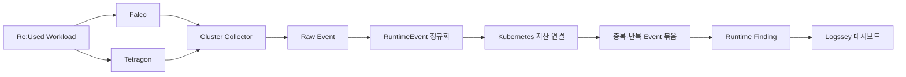

# 런타임 보안 설계문서

**Re:Used 컨테이너에서 실제로 일어난 프로세스·파일·네트워크 행위를 수집하고, Kubernetes 자산과 연결해 조사 가능한 Finding으로 만드는 모듈.** Falco로 규칙 기반 탐지를 먼저 연결하고 Tetragon으로 프로세스 계보와 세부 행위를 보강한다.

- **첫 대상**: 자체 관리 Kubernetes의 `reused-api`, `reused-chat`, `reused-web`
- **첫 데모**: 테스트 Pod에서 셸 실행 → Falco 탐지 → Raw Event 저장 → RuntimeEvent 변환 → Pod·Container·Deployment 연결 → Finding 목록·상세 확인
- **운영 방식**: 초기 2~3개월은 탐지만 수행한다. 자동 차단은 MVP에서 제외한다.
- **심각도**: 센서의 우선순위는 원본 값으로 보존한다. Logssey 최종 심각도는 설정·권한·외부 노출·취약점·시크릿 Context가 연결된 뒤 별도로 계산한다.
- **검증 기준일**: 2026-10-10. Falco·Tetragon은 아직 설치되지 않았으며 문서의 센서 구성과 화면 수치는 구현 목표다.

## 처리 흐름

## 문서

| 문서 | 담는 내용 | 주요 ID |
|---|---|---|
| [PRD](01-requirements/PRD.md) | 문제와 근거, 범위, 사용자, 기능·비기능·보안 요구사항, 성공 지표와 개발 순서 | G, S, FR, NFR, SR, M |
| [규칙 명세](02-functional-design/rule-spec.md) | Re:Used 정상 기준, RUN-001~008, Sensor Mapping, Finding 묶음, 예외와 테스트 기준 | RUN |
| [화면 설계](02-functional-design/dashboard-flow.md) | 런타임 개요, Finding 목록·상세, Event 원문, 자산 Context, Sensor와 규칙 화면 | UI |
| [ADR](03-architecture/adr.md) | Falco·Tetragon, Event 모델, 자산 수집, 저장소와 운영 방식에 관한 결정 16건 | ADR-RT |
| [API 명세](03-architecture/api-contract.md) | 대시보드·내부 수집 API, 데이터 구조, 인증, 중복 방지, 보존과 화면 연결 | API-RT |

권장 열람 순서: PRD → ADR → 규칙 명세 → API 명세 → 화면 설계

## MVP 범위

| 포함 | 제외 |
|---|---|
| Falco Event 수집과 원본 보존 | 최종 심각도 자동 판정 |
| 공통 RuntimeEvent 변환 | Pod·Process 자동 종료·격리 |
| Kubernetes LIST·WATCH와 Event 자산 연결 | 모든 Falco 기본 규칙 지원 |
| 반복·중복 Event의 Finding 묶음 | 모든 네트워크 연결의 정상·비정상 자동 판정 |
| 목록·상세·Sensor 상태·규칙 화면 | Re:Used 외 환경의 실제 호환성 보장 |
| Tetragon `process_exec` 연결과 Sensor 중복 검증 | Tetragon Enforcement |

## 구현 위치

| 구성 | 위치 |
|---|---|
| 대시보드 API | [dashboard-backend](https://github.com/Logssey/dashboard-backend)의 `runtime` 모듈, `/api/v1/runtime` |
| 내부 수집 API | [dashboard-backend](https://github.com/Logssey/dashboard-backend)의 `/internal/v1/runtime` |
| 화면 | [dashboard-frontend](https://github.com/Logssey/dashboard-frontend)의 기존 `/runtime` Route |
| Sensor·Collector | [gitops](https://github.com/Logssey/gitops)에 DaemonSet·Collector 배포 구성 추가 |
| 결과 저장 | 대시보드 PostgreSQL의 `runtime_` Schema와 공통 `assets`·`detection_events` 연결 |

## 확정이 남은 것

- 현재 Kernel·Kubernetes 조합에서 사용할 Falco·Tetragon Version과 실제 지원 Field
- Sensor DaemonSet의 Host Mount, Capability, RBAC 최소 권한
- 정상 트래픽 7일 관찰 뒤 Workload별 외부 연결 Baseline
- Raw Event 보존 기간과 Event량 Guardrail의 실측값
- 공통 Asset·Finding·OCSF Projection의 팀 공통 계약

| 항목 | 내용 |
|---|---|
| 작성자 | 김진호 |
| 작성일 | 2026-10-10 |
| 수정일 | 2026-10-14 |
