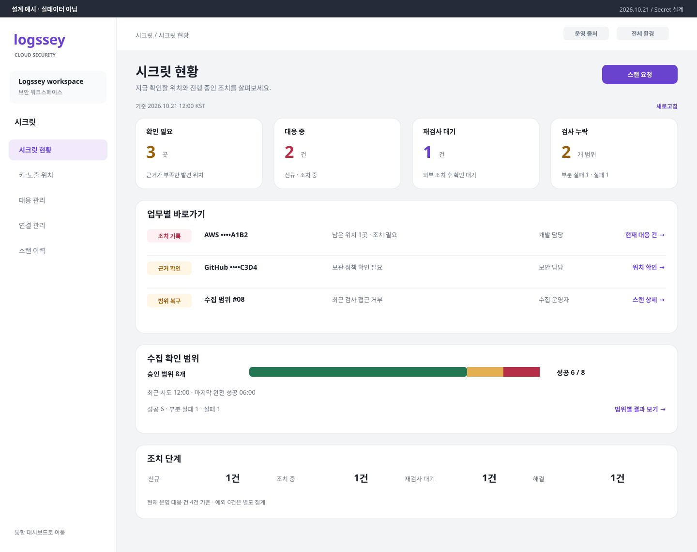
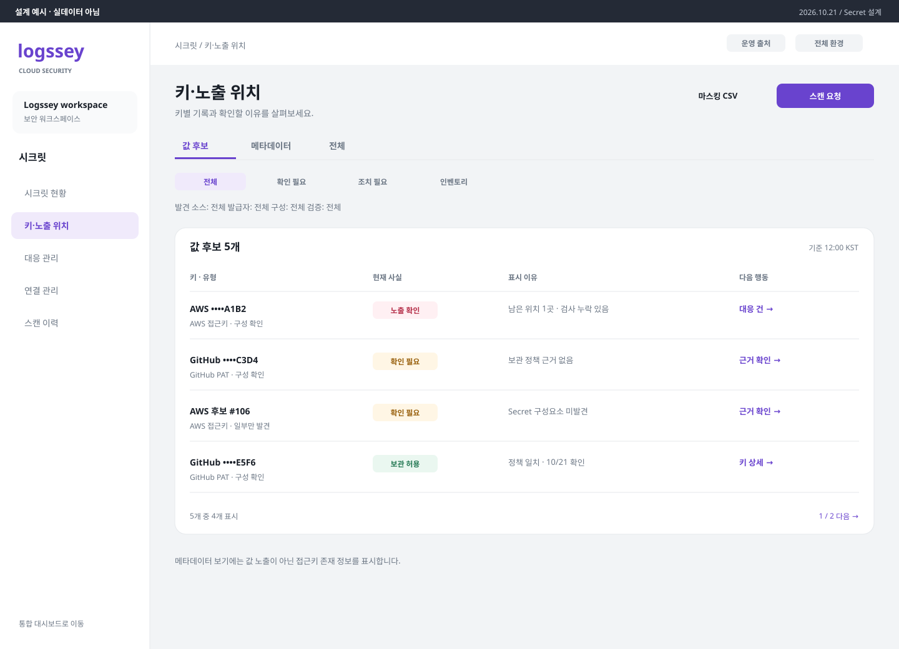
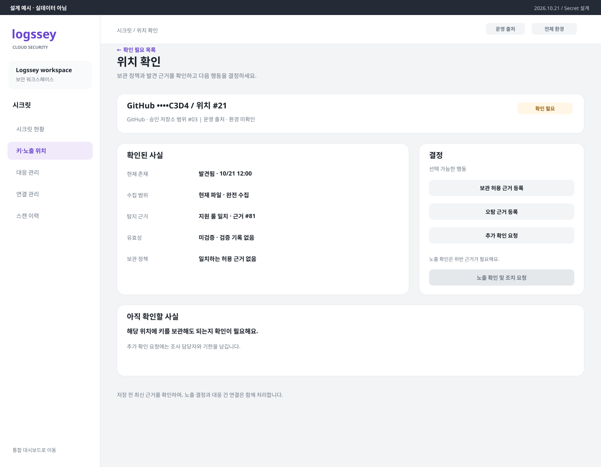
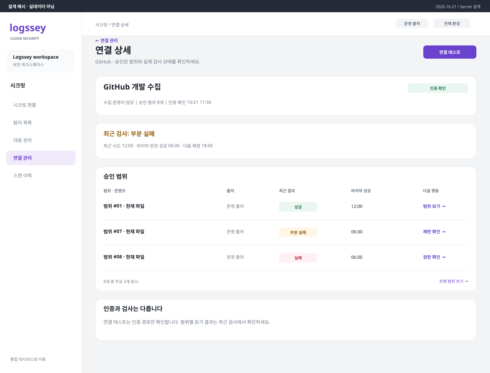
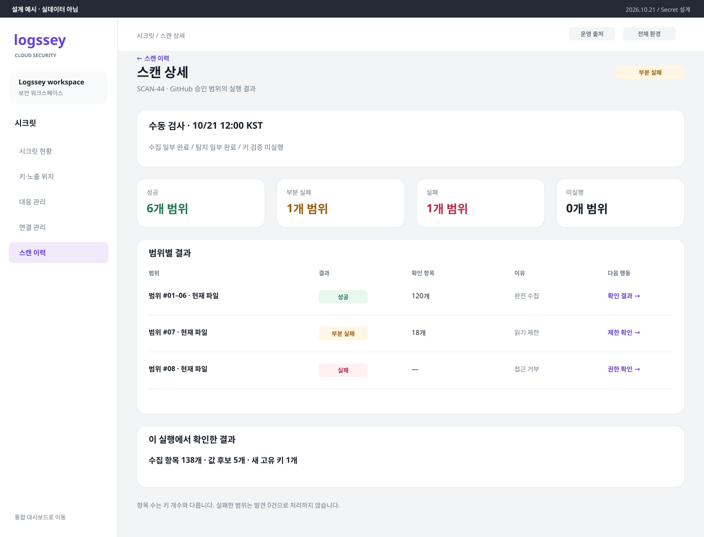

# 시크릿 화면과 사용자 흐름

개정일: 2026-10-21. 시크릿 현황·인벤토리·위치 확인·대응·연결·스캔의 화면 구성과 동작을 정의한다. 업무 규칙은 각 정책 문서, 데이터와 권한은 API 계약을 따른다.

## 1. 정보 구조와 공통 규칙

시크릿 하위 메뉴는 **현황 / 탐지 목록 / 대응 관리 / 연결 관리 / 스캔 이력**을 유지한다. 확인 대기열은 현황·목록에서 진입하는 업무 경로이며 메뉴를 계속 늘리지 않는다. 키 인벤토리, 위치 판정, 대응 건, 실행 이력은 다른 객체다. 같은 객체의 독립 상세와 다음 행동 링크로 연결한다.

| 화면 | 주소 | 사용자 질문과 주요 행동 |
|---|---|---|
| 현황 S01 | `/secrets` | 지금 무엇을 확인할까? → 근거가 있는 업무 목록 열기 |
| 탐지 목록 S02 | `/secrets/findings` | 어떤 키 후보·접근키 정보가 있는가? → 키 상세, 조건부 확인/대응 |
| 키 상세 S03 | `/secrets/:secretId` | 같은 키가 어디에 있고 어디가 남았는가? → 위치별 근거·대응·검사 |
| 확인 대기열 S04 | `/secrets/triage` | 판단이 필요한 위치와 부족한 근거는? → 위치 근거 확인 |
| 위치 확인 S05 | `/secrets/triage/:secretId?occurrence=:id` | 이 위치에 조치가 필요한가? → 근거에 맞는 단일 결정 |
| 대응 목록·상세 S06 | `/secrets/cases`, `/secrets/cases/:caseId` | 누가 어떤 조치를 진행하는가? → 내 현재 작업과 해결 근거 |
| 연결·범위 S07 | `/secrets/connections`, `/secrets/connections/:connectionId` | 무엇을 읽도록 승인했고 실제 읽혔는가? → 범위·최근성·설정 확인 |
| 스캔 목록·상세 S08 | `/secrets/history`, `/secrets/history/:runId` | 언제 어디까지 검사했는가? → 누락 범위·원인·결과 확인 |

URL의 고정 경로(`/findings`, `/cases`, `/triage`, `/connections`, `/history`)를 동적 키 경로보다 우선한다. ID는 양의 정수만 허용한다. 키 미리보기는 요약 조회이며 판정·조치 입력을 누적하지 않는다. 새로고침·직접 주소·뒤로 가기가 가능해야 한다.

공통 선택은 운영/시험 **출처**와 PROD/DEV/UNKNOWN **환경**을 분리한다. 기본 출처는 운영, 시험 보기는 명시적으로 전환하고 머리말에 `시험 출처`를 유지한다. 시험 실키 의심 경고와 미분류 범위 안내는 운영 담당자가 볼 별도 항목으로 남긴다. 같은 키에 운영·시험 위치가 같이 있어도 대응·집계의 출처를 섞지 않는다.

서버가 허용 범위와 전체 필터를 적용한 후 페이지를 나눈다. 브라우저 현재 페이지에서 전체 건수를 추정하거나 분류하지 않는다. snapshot·필터가 있는 카드에서 이동하면 그대로 전달하며 만료 시 새 기준을 명시적으로 선택한다. 상세를 열고 돌아오면 출처·환경·필터·페이지·선택 행을 복원한다. 복귀 경로는 허용된 내부 경로로 제한한다.

## 2. S01 현황: 지금 확인할 일

| 순서 | 정보와 동작 | 데이터 기준 |
|---|---|---|
| 상단 | 제목, 출처/환경, 기준시각, 새로고침. 수동 스캔은 연결을 명시적으로 고른 후 요청 | 처음 연결을 조용히 선택해 외부 스캔하지 않음 |
| 주 카드 | `확인 필요` 위치, `대응 중` 건, `재검사 대기` 건, `검사 누락` 범위. 카드 선택은 해당 필터 목록으로 이동 | 단위·정의가 다르므로 합계/총 위험 없음. 대응 중=OPEN+IN_PROGRESS. 재검사 대기 별도 |
| 업무별 바로가기 | 대응·확인·검사 영역마다 해당 bucket의 우선 항목과 이유·담당을 최대 3개씩 미리보기. 각 영역에서 전체 목록 이동 | 서로 다른 단위를 섞어 전체 순위를 매기지 않음. 정렬은 각 대기열의 서버 규칙을 사용. 하나의 mixed feed API를 요구하지 않음 |
| 수집 신뢰 범위 | 승인 범위 수, 최근 시도, 마지막 완전 성공, 부분 실패/실패/미실행, 다음 예정·지연 | 범위별 원인과 스캔 상세 연결. 값 미수집 목록 검사를 본문 검사로 표현하지 않음 |
| 보조 현황 | 실제 지원되는 조치 네 단계와 별도 예외. 인벤토리 키·연결 수는 참고 | 근거를 제공하지 못한 지표는 0이나 장식 막대로 채우지 않음 |

조치 단계 분포는 같은 현재 대응 건의 `신규 및 분석 / 조치 중 / 재검사 대기 / 해결`을 표시한다. 예외·교정 종료는 별도다. 네 막대는 업무 완료 비율이나 시간 순서 전환율이 아니다. 심각도 분포·매트릭스는 평가 근거가 있는 때만 보조 보기로 제공하고 모든 미평가를 임의 LOW로 바꾸지 않는다.

상단 카드의 예시 수치는 서로 더하지 않는다. 카드별 조회 권한이 다르면 `— / 접근 제한`을 보여주고 다른 카드의 합으로 숨겨진 수를 복원하지 않는다. 운영 건이 없어도 검사 누락·미분류·시험 실키 경고가 있으면 별도로 보인다.

필터가 적용되지 않는 지표는 `환경 필터 미적용`처럼 카드 옆에 명시한다. 아직 읽지 못한 승인 범위에는 키 발급자·사용 환경·조치 담당자 근거가 없으므로 이 필터로 검사 누락 범위를 임의 제외하지 않는다. 적용 여부는 API의 지표별 `appliedFilters`·`notApplicableFilters`를 따른다.

유효한 ABNORMAL 판정이 현재 대응 건에 연결되지 않은 위치가 있으면 `노출 확인 · 건 연결 필요` 무결성 확인 안내를 별도로 보여준다. NEEDS_CASE_LINK 위치 대기열로 이동하며 기존 판정 근거를 보존한 채 최신 권한·범위를 확인해 건을 연결한다. 이를 미판정·정상 인벤토리로 낮추거나 동일 노출을 다시 확정하게 하지 않는다.

## 3. S02 탐지 목록: 인벤토리와 업무를 연결

목록의 객체 단위는 **고유 키 인벤토리**이며 기본은 `값 후보` 보기(`contentKind=VALUE_FINDINGS`)다. 노출 확정 목록이라는 뜻은 아니다. `메타데이터`는 별도 보기이고 `전체`로 두 종류를 함께 찾을 수 있다. 그 안의 `확인 필요 / 조치 필요 / 인벤토리 / 전체`는 서버의 표시용 작업 묶음이며 현재 페이지의 집계가 아니다. 일부 후보·승인 보관·과거 기록을 보조 필터로 구별한다. 메타데이터 수를 노출 건수로 표시하지 않는다.

| 항목 | 표시 기준 |
|---|---|
| 행 식별 | 마스킹 키, 발급자·유형·구성. 동일 마스킹 suffix만으로 다른 키 합치기 금지 |
| 현재 사실 | 노출 확인 또는 미확인, 최신 검증 결과·시각, 열람 가능한 위치 수, 커버리지 경고. `미평가`를 모든 행의 주 제목으로 쓰지 않음 |
| 이유 | `보관 정책 확인 필요`, `조치 후 재검사 필요`, `접근키 존재 정보` 등 해당 분류의 한 줄 근거 |
| 다음 행동 | 근거 확인 / 현재 대응 건 / 키 상세 / 범위 확인 중 서버가 허용한 주 행동 |
| 필터 | 발견 소스와 발급자 분리, 구성·검증·현재 존재·작업 묶음·운영/시험·환경. 목록 URL에 조건 보존 |
| 내보내기 | 현재 조건의 마스킹 인벤토리 요약. 단위·기준시각·출처 명시. 원문·보호 위치·숨겨진 수 미포함 |

목록에는 사실 배지가 함께 있을 수 있다. 이미 노출이 확인된 위치의 최근 검사가 실패해도 노출 사실을 없애고 인벤토리로 내리지 않는다. 파생 주 행동의 우선순위와 충돌 처리는 [판정 정책](triage-policy.md)을 따른다.

유효한 ABNORMAL 무건 위치가 있는 키는 `건 연결 필요`와 기존 결정 근거를 표시한다. 새 판정을 요구하는 `확인 필요`와 구별하고 NEEDS_CASE_LINK 경로로 안내한다. 일반 bucket 필터에서 숨겨져도 무결성 확인 안내와 전체 조회로 다시 찾을 수 있어야 한다.

목록 필터는 스캔 요청 대상이 아니다. 수동 스캔은 별도 연결과 승인 범위 요약 확인을 거쳐 비동기 요청하고, 등록된 실행 번호·대기 상태·스캔 상세로 안내한다. 수집 작업 등록을 탐지 완료로 표시하지 않는다.

## 4. S03 키 상세: 위치별 증거의 중심

상단은 마스킹 키·유형·구성·최신 유효성·검사시각, 현재 대응 링크를 짧게 표시한다. 본문 기본은 **발견 위치**다. 보조 영역은 키 정보·권한/영향·기록으로 나누고 미지원 영향 그래프를 빈 장식으로 두지 않는다.

위치별 안전 별칭·발견 소스·존재·보관 판단·조치·최근 정상 확인·최근 시도·다음 행동을 비교한다. `현재 발견`, `조치 후 미발견`, `현재 확인 불가`를 분리한다. 마지막 발견 시각이 오래됐다는 이유로 제거됐다고 표시하지 않는다. 긴 정책·엔진·오류 이력은 해당 위치 근거를 열어 확인한다.

모든 관계·집계·색상·권한·필터의 기준은 [위치 시각화](location-visualization.md)에 둔다. 상세 API의 조회 가능한 위치와 필드 권한은 [API 계약](../03-architecture/api-contract.md)을 따른다. 조치 담당자는 자신에게 할당되고 열람 가능한 위치의 업무를 수행하며 다른 위치의 전체 수·경로는 얻을 수 없다. 일부 제한이 있으면 `열람 가능한 위치 기준`을 표시하며 제한 위치를 숨겨 해결 버튼을 열지 않는다.

## 5. S04–S05 확인 대기열과 위치 결정

대기열은 키로 묶어 읽을 수 있어도 대상 단위는 **판단이 필요한 위치**다. 행은 부족 이유·소유자·기한·마지막 근거 시각을 보여준다. 이미 승인 정책에 맞춰 정상 보관으로 입증된 항목과 단순 메타데이터를 일괄 수동 판정 대상으로 올리지 않는다. 불완전 키에는 구성 보완의 이유를 표시하며 완전한 키의 노출 확정 절차로 강제하지 않는다.

위치 확인 순서는 `선택 위치 → 확인된 사실 → 부족한 사실 → 가능한 결정`이다. 선택 위치·연결·키가 일치하지 않거나 근거를 불러오지 못하면 정상적인 판정 폼을 보이지 않고 오류·복귀·재조회 상태로 남긴다. 범위 정보를 읽지 못한 상태를 분류 완료로 간주하지 않는다.

확인할 근거는 위치·현재 존재·검사 범위·보관 정책·탐지 룰/버전·검증 결과/시각·기존 판정·현재 대응 건이다. 현재 사실과 옛 기록을 구분한다. 결정은 보관 허용 / 오탐 / 추가 확인 / 노출 확인 및 조치 요청이며 근거별 허용 조건과 감사는 [판정 정책](triage-policy.md)을 따른다.

비정상 판정은 같은 요청에서 현재 대응 건을 만들거나 기존 건에 위치를 연결한다. 확인 대화에는 대상·근거·예상 결과만 요약하며 원문 입력을 요구하지 않는다. 저장 직전 최신 버전·권한을 검사하고 충돌이면 근거를 다시 읽게 한다. 출처 미분류는 연결 범위 확인으로 안내하되 조사 과제까지 막지 않는다. 자동 안전 판정·자동 비정상 판정은 정책에서 명시한 범위만 허용한다.

## 6. S06 대응 관리: 현재 할 일과 해결 근거

목록은 현재 대응 건 단위로 운영/시험·단계·담당 여부·최근 변경을 서버에서 필터한다. 안전한 키·발견 소스·남은 작업·담당·다음 행동을 표시한다. OPEN과 IN_PROGRESS만 더한 `대응 중` 주 카드와 전체 네 단계 분포의 모수가 다름을 명시한다. 기한이 설정되지 않은 항목은 기한 초과 집계에서 제외한다.

독립 상세 상단에는 현재 단계·담당 조정자·열람 가능한 위치 수와 **지금 할 일** 하나를 둔다. 본문은 `현재 처리 / 발견 위치 / 기록`으로 나눈다. 상태 전환과 허용 행동은 대응 정책과 서버 capability를 따른다.

- 최초 노출 결정을 같은 내용으로 재승인하지 않는다. 추가 자료 요청은 필요한 때 별도 과제로 남긴다.
- 지정되고 위치 권한이 있는 담당자의 첫 실질 조치 기록이 조치를 시작할 수 있다. 빈 시작 버튼만 누르게 하지 않는다.
- 외부 수행 종류·대상 위치·실제 시각·안전한 증거 참조를 기록한다. 여러 조치를 기록한 뒤 위치별 기록 마침과 재검사를 별도로 진행한다.
- 위치별 담당·잔여 작업·최근 검사 시도와 마지막 성공을 보여준다. 한 위치만 미발견이어도 다른 위치가 남거나 미확인이면 전체 해결이 아니다.
- 해결 근거는 `외부 수행 기록 / 위치 재검사 / 공급자 상태 / 검사 범위`로 구분하고 부족 항목과 담당자를 표시한다. FULL/LIMITED/SIMULATION의 사용자 표시는 [문구](content-and-labels.md)를 따른다.
- 가이드·체크리스트는 보조 도구다. AI 생성 여부와 기본 가이드를 구별하되 업무 완료 조건으로 삼지 않는다. 자동 키 변경은 수행하지 않는다.

기록 탭은 감사 이력이며 현재 처리 영역에 계속 누적하지 않는다. 목록은 서버 페이지 나눔을 사용하고 새 기록 후 최신 요약만 갱신한다. 담당자 지정·외부 조치 기록 대화는 포커스 복귀와 입력 근처 오류를 제공한다. 새로고침·탭 전환에서 저장된 결과는 유지하고 저장하지 않은 입력의 이탈은 알려준다.

## 7. S07 연결 관리: 인증과 범위 검사 분리

연결 목록은 등록된 활성 공급자와 해당 연결의 capability를 보여준다. 미등록 연결이나 확인되지 않은 인증 상태를 성공 카드로 표시하지 않는다. 카드에는 소유자·용도·승인 범위 수·최근 검사 요약과 `연결 테스트`, `범위 보기`를 둔다.

연결 테스트 결과는 `인증 확인 / 인증 실패 / 확인 불가`로 표시하며 시간과 제한 범위를 설명한다. GitHub의 첫 승인 저장소 또는 AWS 계정 신원만 확인한 결과를 모든 승인 범위의 읽기 성공으로 표현하지 않는다. 실제 스캔과 키 유효성 검사는 별개다.

독립 연결 상세에서 승인 범위별 안전 별칭·콘텐츠/이력 범위·운영/시험 출처·소유자·활성 여부·최근 시도·마지막 완전 성공·누락 이유·다음 예정이 보인다. 범위 분류는 연결 관리의 승인 동작이며 개별 위치 판정 때 반복하지 않는다. 신규 범위·수정·오분류 교정은 권한·버전·감사·과거 결과 영향 확인을 요구한다. 보호 자격 증명이나 AWS ARN을 일반 화면에 그대로 쓰지 않는다.

연결 자격 증명과 보호된 원천 참조의 등록은 승인된 운영 관리 경로를 사용한다. 일반 화면에는 범위별 표시 별칭·분류·검사 상태와 허용된 관리 행동만 제공한다. 실행할 권한이나 capability가 없는 버튼은 동작 가능한 주 행동처럼 노출하지 않는다.

## 8. S08 스캔 이력: 범위별 성공과 누락

목록은 기간·수집 플랫폼·연결·트리거(수동/예약/재검사)·실행 결과로 필터한다. 실행 API의 `provider`는 수집 연결 플랫폼이며 키 목록의 발급자 필터와 구별한다. 요청·시작·종료 시각, 소요시간, 성공/부분 실패/실패/미실행 범위를 표시한다. 현재 페이지 통계를 전체 지표처럼 배치하지 않는다. 전체 기간 통계를 제공하지 못하면 단순 페이지 설명으로 낮추거나 숨긴다.

독립 상세는 실행 당시 승인 scope revision·단계 적용 여부·배타적 범위 상태·항목/후보/새 키 수를 각각 보여준다. 성공 범위 수와 종료 범위 수를 별도 표시한다. 승인 범위 8개가 성공6/부분1/실패1이면 8/8 성공이 아니다. 메타데이터 목록 개수는 비밀 값 검사 개수가 아니다.

범위 행에서 원인·최근 시도·해당 실행의 확인 결과·다음 행동으로 이동한다. 필터를 유지한 목록 복귀와 권한에 맞는 실행 결과 링크를 제공한다. 재검사는 예약 검사로 오표시하지 않는다. 재검사 요청 전 실행할 연결과 승인 범위 요약을 확인하며 표시한 범위와 실제 실행 범위를 일치시킨다. 세부 규칙은 [스캔 이력 정책](scan-history-policy.md)을 따른다.

## 9. 통합 대시보드와 확장

공통 `/overview`에는 같은 권한·운영 출처·기준시점의 시크릿 요약을 연결한다. 공통 셸·인증·디자인 토큰은 dashboard-design-docs와 frontend를 유지한다. 시크릿 판단 규칙·상세 설계를 공통 문서에 다시 복제하지 않는다. 통합 화면의 100점 점수를 이 기능의 임의 점수로 확장하지 않는다.

권한·자산·공격 경로는 증거가 확보된 후 선택 관계도로 확장한다. severity-v2의 입력이 부족하면 미평가와 이유를 보인다. 수집원별 지원 범위는 연결 capability로 식별하며 공급자 키 자동 변경은 제품 범위에서 제외한다.

## 10. 공통 UI·접근성·상태

공통 토큰: 240px 사이드바, 76px 상단 바, Pretendard, 흰 카드, primary #7a56df. 공통 대시보드의 반응형 규격을 따른다. 1200px 이하 요약을 2열, 700px 이하 1열로 배치하고 표는 열 이름을 유지한 가로 스크롤 또는 행 카드로 전환한다. 독립 상세를 목록 아래로 밀어 놓지 않는다.

문구·시험 보기·상태명·도움말은 [content-and-labels](content-and-labels.md)를 따른다. 색만으로 상태를 구별하지 않고 텍스트·아이콘·단위를 함께 표시한다. 키보드로 필터·표 행·탭·모달·도움말에 접근하고 상세 복귀 시 원래 행으로 포커스를 돌린다. 자동 갱신은 작업 위치를 바꾸거나 입력 중인 폼을 덮지 않는다.

로딩 / 실제 0건 / 미지원 / 집계 실패 / 부분 데이터 / 접근 제한 / 항목 없음 / 버전 충돌 / 스냅샷 만료를 각각 구별한다. 403·404·500에도 헤더·복귀·재시도 경로를 유지하며 화면 전체가 사라지지 않는다. 자료를 읽는 중에는 판정 버튼을 활성화하지 않는다. 상세 에러 경계와 null 검사를 필수로 둔다.

## 11. 설계 이미지와 수용 기준

이 문서의 SVG 7장은 화면 구성의 기준이다. 수치는 합성 예시이며 제품의 시험 출처 데이터가 아니다. 이미지의 배치와 본문을 함께 읽고 상태·권한·집계 규칙은 각 정책과 API 계약을 따른다.

핵심 사용자 시험은 `현황 → 확인할 위치 → 한 번의 노출 결정 → 위치 담당 조치 → 재검사 → 부족 근거 확인 또는 해결`이다. 다중 위치 중 일부 실패, 제한 권한, 불완전 키, 시험 실키 경고, 새 위치 재발, 필터 복귀를 포함한 합격 기준은 [수용 기준](../01-requirements/acceptance-criteria.md)에 둔다.
