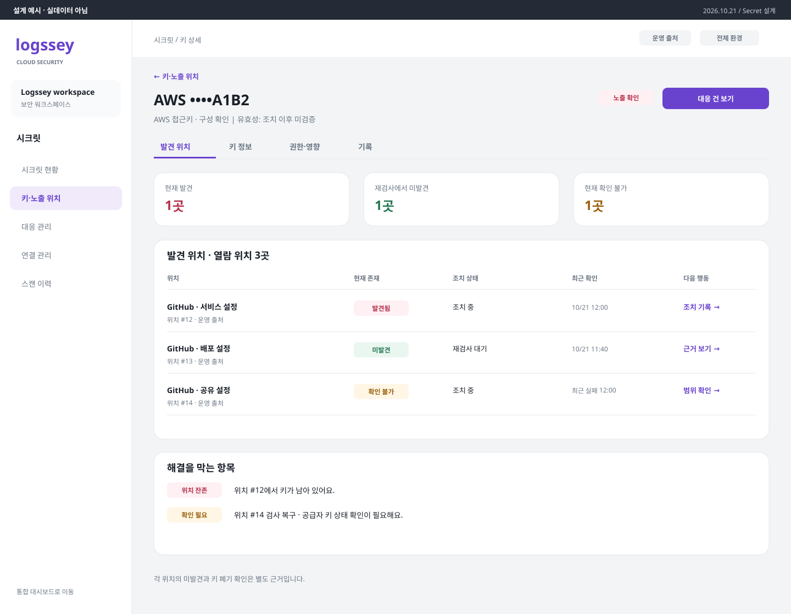
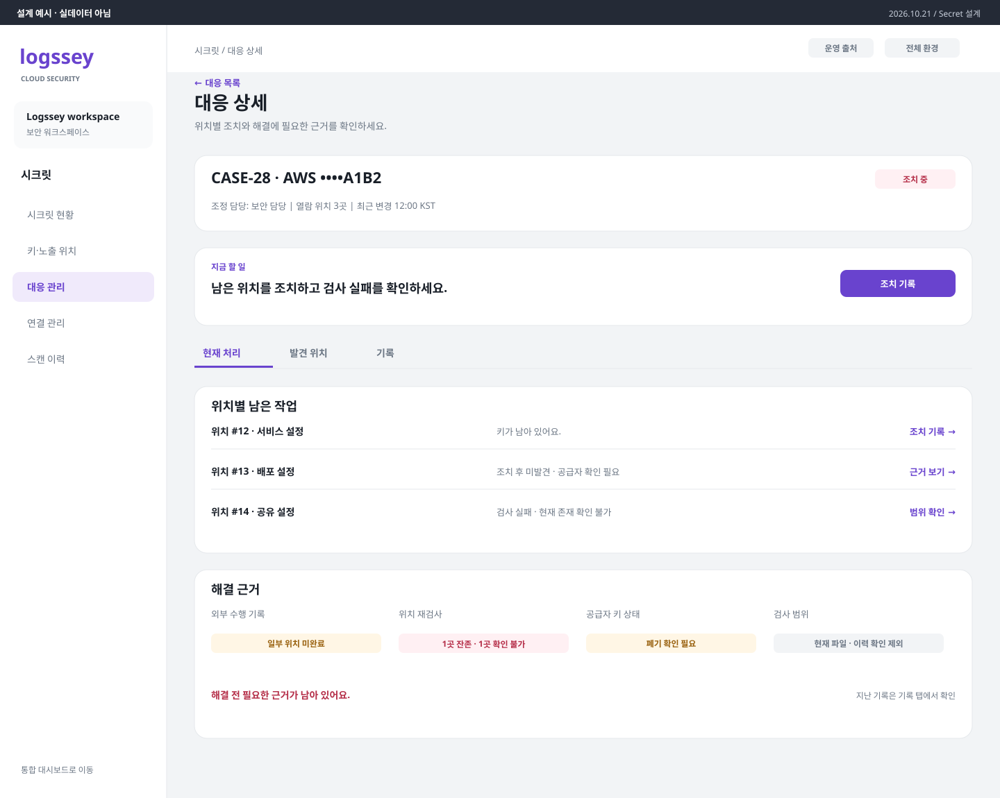

# 시크릿 화면과 사용자 흐름

개정일 2026-11-11. 시크릿 현황·인벤토리·위치 확인·대응·연결·스캔의 화면 구성과 동작을 정의한다. 업무 규칙은 각 정책 문서, 데이터와 권한은 API 계약을 따른다.

## 1. 정보 구조와 공통 규칙

시크릿 하위 메뉴는 **현황 / 키·노출 위치 / 대응 관리 / 연결 관리 / 스캔 이력**이다. 확인 대기열은 현황·키 목록에서 진입하고, 범위 설정은 연결 관리의 작업으로 연다. 키 인벤토리, 위치 판정, 대응 건, 실행 이력은 다른 객체다. 각 객체의 독립 상세와 다음 행동 링크로 연결하며 범위 설정을 대응의 첫 단계로 표시하지 않는다.

| 화면 | 주소 | 사용자 질문과 주요 행동 |
|---|---|---|
| 현황 S01 | `/secrets` | 지금 무엇을 확인할까? → 근거가 있는 업무 목록 열기 |
| 키·노출 위치 S02 | `/secrets/findings` | 같은 키가 어디에 있고 무엇을 해야 하는가? → 키 상세와 위치별 확인·대응 |
| 키 상세 S03 | `/secrets/:secretId` | 같은 키가 어디에 있고 어디가 남았는가? → 위치별 근거·대응·검사 |
| 확인 대기열 S04 | `/secrets/triage` | 판단이 필요한 위치와 부족한 근거는? → 위치 근거 확인 |
| 위치 확인 S05 | `/secrets/triage/:secretId?occurrence=:id` | 이 위치에 조치가 필요한가? → 근거에 맞는 단일 결정 |
| 대응 목록·상세 S06 | `/secrets/cases`, `/secrets/cases/:caseId` | 누가 어떤 조치를 진행하는가? → 내 현재 작업과 해결 근거 |
| 연결·범위 S07 | `/secrets/connections`, `/secrets/connections/:connectionId` | 무엇을 읽도록 승인했고 실제 읽혔는가? → 범위·최근성·설정 확인 |
| 범위 설정 S07-1 | `/secrets/connections/:connectionId/scopes/:scopeId` | 현재 검사 대상·권한·보관 정책은 무엇인가? → 정책 보완·독립 검토·검사 복구 |
| 스캔 목록·상세 S08 | `/secrets/history`, `/secrets/history/:runId` | 언제 어디까지 검사했는가? → 누락 범위·원인·결과 확인 |

URL의 고정 경로(`/findings`, `/cases`, `/triage`, `/connections`, `/history`)를 동적 키 경로보다 우선한다. ID는 양의 정수만 허용한다. 키 미리보기는 요약 조회이며 판정·조치 입력을 누적하지 않는다. 새로고침·직접 주소·뒤로 가기가 가능해야 한다.

일반 화면의 기본 읽기는 `origin=ALL`이다. 현재 열람 가능한 원천의 자료를 함께 보여주며 자료 모드 선택과 시험 표시를 제공하지 않는다. 검색·필터·이동·실행 패널은 [조회와 검사 실행 화면](source-query-and-scan-experience.md)을 따른다. 내부 자료 분류·합성 여부와 객체별 정책·대응 근거는 각 원장에 보존한다.

서버가 허용 범위와 전체 필터를 적용한 후 페이지를 나눈다. 브라우저 현재 페이지에서 전체 건수를 추정하거나 분류하지 않는다. snapshot·필터가 있는 카드에서 이동하면 그대로 전달하며 만료 시 새 기준을 명시적으로 선택한다. 상세를 열고 돌아오면 출처·환경·필터·페이지·선택 행을 복원한다. 복귀 경로는 허용된 내부 경로로 제한한다.

업무별 진입·완료·차단과 승인 방식은 [사용자 작업과 승인 기준](task-and-approval-policy.md)을 따른다. 각 화면은 필요한 정보·주 행동·처리 후 화면·남은 이유를 제공한다. 명령 성공을 전체 업무 완료로 표시하지 않는다.

## 2. S01 현황

현황은 연결된 모든 허용 자료의 확인 필요·대응 중·재검사 대기 카드로 시작한다. 원천·환경 선택을 먼저 요구하지 않는다. 카드는 흰 배경과 동일한 두께의 전체 테두리, 제목·숫자·단위·짧은 행동 안내로 구성한다. 색상은 양수 업무 수에 사용하고 미집계와 실제 0을 구별한다.

확인 필요는 검토 대상과 대응 생성 대상의 occurrenceId 합집합이다. 대응 중은 OPEN·IN_PROGRESS, 재검사 대기는 REVALIDATION_PENDING의 실제 대응 건이다. 카드를 선택하면 같은 업무 목록을 교체하고 URL의 view에 선택을 기록한다. 첫 진입은 처리할 항목이 있는 업무를 우선 선택한다. 목록은 대상·발견 위치·확인할 이유·담당자·다음 행동을 최대 3개 미리 보여주며 같은 조회 기준의 전체 목록으로 연결한다.

목록 옆의 최근 검사 상태는 플랫폼별 검사 성공·전체 대상, 실제 최근 시도와 실행 상세를 짧게 보여준다. 누락·지연은 해당 범위의 원인·복구 목록으로 연결한다. 보관 정책 설정과 운영 상태는 접힌 상세로 제공한다. 자격증명 확인 경고는 실제 허용된 경고 건수와 확인 경로를 제공하고 발견 위치 수에 단순 합산하지 않는다.

대응 건 위험도는 하나의 카드로 제공한다. 유효성 교차표는 같은 카드의 기본 접힌 상세이며 양수 건수에서 동일 필터·스냅샷의 대응 목록으로 이동한다. 집계할 대응이 없으면 빈 차트를 크게 그리지 않고 확인 필요 목록을 안내한다.

기준시각과 열람 범위를 표시한다. 연결 없음·대상 없음·현재 대상 미검사·조건에 맞는 업무 없음·조회 오류는 다른 안내와 행동을 제공한다. 부분 실패와 미평가는 확인된 근거 범위 안에서 설명한다. 지표의 적용 한계는 API의 appliedFilters·notApplicableFilters를 따른다.

## 3. S02 키·노출 위치: 같은 키의 분포와 남은 작업

목록의 객체 단위는 **고유 키 인벤토리**이며 기본은 `값 후보` 보기(`contentKind=VALUE_FINDINGS`)다. 노출 확정 목록이라는 뜻은 아니다. `메타데이터`는 별도 보기이고 `전체`로 두 종류를 함께 찾을 수 있다. 그 안의 `확인 필요 / 조치 필요 / 인벤토리 / 전체`는 서버의 표시용 작업 묶음이며 현재 페이지의 집계가 아니다. 일부 후보·승인 보관·과거 기록을 보조 필터로 구별한다. 메타데이터 수를 노출 건수로 표시하지 않는다.

| 항목 | 표시 기준 |
|---|---|
| 행 식별 | 마스킹 키, 발급자·유형·구성. 동일 마스킹 suffix만으로 다른 키 합치기 금지 |
| 현재 사실 | 노출 확인 또는 미확인, 최신 검증 결과·시각, 열람 가능한 위치 수, 커버리지 경고. `미평가`를 모든 행의 주 제목으로 쓰지 않음 |
| 이유 | `보관 정책 확인 필요`, `조치 후 재검사 필요`, `접근키 존재 정보` 등 해당 분류의 한 줄 근거 |
| 다음 행동 | 근거 확인 / 현재 대응 건 / 키 상세 / 범위 확인 중 서버가 허용한 주 행동 |
| 필터 | 검색과 접힌 필터, 적용 조건 칩·개별 해제·초기화. 발견 플랫폼·키 발급 서비스·구성·검증·환경·업무를 제공하고 서버 전체 결과에 적용 |
| 내보내기 | 현재 조건·검색의 같은 스냅샷 전체 페이지에서 마스킹 요약 생성. 단위·기준시각·조회 범위 명시 |

목록에는 사실 배지가 함께 있을 수 있다. 이미 노출이 확인된 위치의 최근 검사가 실패해도 노출 사실을 없애고 인벤토리로 내리지 않는다. 파생 주 행동의 우선순위와 충돌 처리는 [판정 정책](triage-policy.md)을 따른다.

유효한 ABNORMAL 무건 위치가 있는 키는 `건 연결 필요`와 기존 결정 근거를 표시한다. 새 판정을 요구하는 `확인 필요`와 구별하고 NEEDS_CASE_LINK 경로로 안내한다. 일반 bucket 필터에서 숨겨져도 무결성 확인 안내와 전체 조회로 다시 찾을 수 있어야 한다.

목록 필터는 스캔 요청 대상이 아니다. 수동 스캔은 별도 연결과 승인 범위 요약 확인을 거쳐 비동기 요청하고, 등록된 실행 번호·대기 상태·스캔 상세로 안내한다. 수집 작업 등록을 탐지 완료로 표시하지 않는다.

## 4. S03 키 상세: 위치별 증거의 중심

키 유효성·위치별 심각도·자료 보완과 탭/패널의 세부 구성은 [검증·심각도 확인 화면](validation-and-risk-experience.md)을 따른다. 발견 위치·탐지 이유는 검증 미지원이나 심각도 미평가 상태에서도 유지한다. 검증 시각을 시도 종료 시각으로 대체하지 않고, 상세를 페이지 하단에 중복 누적하지 않는다.

상단은 마스킹 키·발급자·유형·구성·최신 유효성/검사시각, 이 키를 확인할 이유, 현재 대응과 **다음 행동 하나**를 표시한다. 본문 기본은 소스별 **발견 위치**다. 바로 위에 필수 대응 위치의 현재 발견·조치 후 미발견·현재 확인 불가와 키 사용 종료 확인을 요약한다. 승인 보관·메타데이터는 대응 잔여 위치 수에 합치지 않는다. 보조 영역은 키 정보·권한/영향·기록으로 나누고 미지원 영향 그래프를 빈 장식으로 두지 않는다.

위치별 안전 별칭·발견 소스·존재·보관 판단·조치·최근 정상 확인·최근 시도·다음 행동을 비교한다. `현재 발견`, `조치 후 미발견`, `현재 확인 불가`를 분리한다. 마지막 발견 시각이 오래됐다는 이유로 제거됐다고 표시하지 않는다. 긴 정책·엔진·오류 이력은 해당 위치 근거를 열어 확인한다.

위치 행에서 처리할 대상과 현재 대응·범위·실행으로 직접 이동한다. 위치를 선택해도 다른 위치의 입력 폼이 함께 늘어나지 않는다. 값 발견 위치와 발급처 메타데이터 관측을 분리하고, 지원·권한이 있는 관계만 키→소스→위치로 보여준다. 새 발견·재발견·확인 불가가 왜 현재 행동을 요구하는지 한 줄로 설명한다.

모든 관계·집계·색상·권한·필터의 기준은 [위치 시각화](location-visualization.md)에 둔다. 상세 API의 조회 가능한 위치와 필드 권한은 [API 계약](../03-architecture/api-contract.md)을 따른다. 조치 담당자는 자신에게 할당되고 열람 가능한 위치의 업무를 수행하며 다른 위치의 전체 수·경로는 얻을 수 없다. 일부 제한이 있으면 `열람 가능한 위치 기준`을 표시하며 제한 위치를 숨겨 해결 버튼을 열지 않는다.

## 5. S04–S05 확인 대기열과 위치 결정

대기열은 키로 묶어 읽을 수 있어도 대상 단위는 **판단이 필요한 위치**다. 행은 부족 이유·소유자·기한·마지막 근거 시각을 보여준다. 이미 승인 정책에 맞춰 정상 보관으로 입증된 항목과 단순 메타데이터를 일괄 수동 판정 대상으로 올리지 않는다. 불완전 키에는 구성 보완의 이유를 표시하며 완전한 키의 노출 확정 절차로 강제하지 않는다.

위치 확인 순서는 `선택 위치 → 확인된 사실 → 부족한 사실 → 가능한 결정`이다. 선택 위치·연결·키가 일치하지 않거나 근거를 불러오지 못하면 정상적인 판정 폼을 보이지 않고 오류·복귀·재조회 상태로 남긴다. 범위 정보를 읽지 못한 상태를 분류 완료로 간주하지 않는다.

확인할 근거는 위치·현재 존재·검사 범위·보관 정책·탐지 룰/버전·검증 결과/시각·기존 판정·현재 대응 건이다. 현재 사실과 옛 기록을 구분한다. 결정은 보관 허용 / 오탐 / 추가 확인 / 노출 확인 및 조치 요청이며 근거별 허용 조건과 감사는 [판정 정책](triage-policy.md)을 따른다.

비정상 판정은 같은 요청에서 현재 대응 건을 만들거나 기존 건에 위치를 연결한다. 확인 대화에는 대상·근거·예상 결과만 요약하며 원문 입력을 요구하지 않는다. 저장 직전 최신 버전·권한을 검사하고 충돌이면 근거를 다시 읽게 한다. 분류 원장 부재만으로 판정·대응을 막지 않고 실제 활성 수집 승인·current Finding·권한·근거를 검사한다. 자동 안전 판정·자동 비정상 판정은 정책에서 명시한 범위만 허용한다.

## 6. S06 대응 관리: 현재 할 일과 해결 근거

목록은 ALL의 현재 대응 건 단위로 단계·담당 여부·최근 변경·검색을 서버에서 필터한다. 안전한 키·발견 소스·남은 작업·담당·다음 행동을 표시한다. OPEN과 IN_PROGRESS만 더한 `대응 중` 요약과 전체 네 단계 분포의 모수가 다름을 명시한다. 기한이 설정되지 않은 항목은 기한 초과 집계에서 제외한다.

독립 상세 상단에는 **문제와 근거 / 담당 / 필요한 조치 / 남은 해결 조건**을 요약하고 현재 단계·담당 조정자·열람 가능한 위치 수와 **지금 할 일** 하나를 둔다. 조정 담당자는 건의 진행 관리, 위치 담당자는 실제 키 교체·파일 조치를 담당한다. 한쪽 배정이 다른 쪽 배정을 대신하지 않으며 미지정 위치에서 해당 위치 담당 지정으로 직접 이어진다. 본문은 `현재 작업 / 위치별 현황 / 재검사·해결 / 활동 기록`으로 나누고 선택 탭의 제목·내용이 화면에서 바로 보이게 한다. 상태 전환과 허용 행동은 대응 정책과 서버 capability를 따른다.

- 최초 노출 결정을 같은 내용으로 재승인하지 않는다. 추가 자료 요청은 필요한 때 별도 과제로 남긴다.
- 지정되고 위치 권한이 있는 담당자의 첫 실질 조치 기록이 조치를 시작할 수 있다. 빈 시작 버튼만 누르게 하지 않는다.
- 외부 수행 종류·대상 위치·실제 시각·안전한 증거 참조를 기록한다. 여러 조치를 기록한 뒤 위치별 기록 마침과 재검사를 별도로 진행한다.
- 위치별 담당·잔여 작업·최근 검사 시도와 마지막 성공을 보여준다. 한 위치만 미발견이어도 다른 위치가 남거나 미확인이면 전체 해결이 아니다.
- 해결 근거는 `외부 수행 기록 / 위치 재검사 / 공급자 상태 / 검사 범위`로 구분하고 부족 항목과 담당자를 표시한다. FULL/LIMITED/SIMULATION의 사용자 표시는 [문구](content-and-labels.md)를 따른다.
- 가이드·체크리스트는 보조 도구다. AI 생성 여부와 기본 가이드를 구별하되 업무 완료 조건으로 삼지 않는다. 자동 키 변경은 수행하지 않는다.

현재 작업에서 위치를 선택하면 하단의 **Claude 대응 가이드**를 연다. 기본 절차를 먼저 제공하고 **Claude로 가이드 생성**을 누르면 현재 키 유형·인증 상태·대응 단계에 맞는 점검 항목과 순서를 구성한다. 생성 정보에는 공급자·모델·원래 생성 시각과 재사용 여부를 표시한다. 가이드 상태 새로고침은 현재 설정·사용 조건을 조회한다. 호출 실패에는 원인별 안내와 기본 절차를 제공한다.

기록 탭은 감사 이력이며 현재 처리 영역에 계속 누적하지 않는다. 목록은 서버 페이지 나눔을 사용하고 새 기록 후 최신 요약만 갱신한다. 담당자 지정·외부 조치 기록 대화는 포커스 복귀와 입력 근처 오류를 제공한다. 새로고침·탭 전환에서 저장된 결과는 유지하고 저장하지 않은 입력의 이탈은 알려준다.

## 7. S07 연결 관리

연결 목록에서 플랫폼·표시 이름·검사 대상 수·현재 사용 설정과 연결 테스트 결과를 제공한다. 현재 연결의 실제 인증 결과와 검사 결과를 각각 표시한다. 연결 상태 조건은 공통 필터 안에 둔다. 검사 대상·수집 승인·보관 규칙을 연결별로 확인하며 자료 분류 입력을 일반 사용자에게 요구하지 않는다.

스캔은 사용자가 연결과 검사 대상 수를 확인한 후 비동기로 요청한다. 요청된 runId를 URL에 기록하고 연결 목록 옆의 단일 검사 진행 패널로 연다. 다른 연결이나 실행을 고르면 패널 내용을 교체한다. 모바일은 단일 열로 제공한다. 기존 활성 실행이 있으면 해당 진행 화면을 연다.

활성 실행이 있는 버튼은 **검사 진행 중**으로 표시한다. 처리 종료 결과가 SUCCEEDED·PARTIAL·SKIPPED이면 전체 실행을 **검사 완료**로 표시하고, 미검증 수·구성 부족·생략 사유와 범위별 결과를 함께 제공한다. 실제 FAILED·CANCELLED는 실패·취소로 표시한다. 인증 확인 요약은 새 요청 수·이전 결과 재사용 수·구성 부족 수를 제공하며 재사용한 결과의 원래 판정·검증 시각·실행을 확인할 수 있다.

패널은 요청·작업 대기, 원천 수집, 탐지·정규화, 유효성 확인, 결과 정리의 다섯 단계로 구성한다. 실제 파일별 처리가 겹치면 여러 단계를 동시에 진행 중으로 표시한다. 단계를 선택하면 같은 패널의 터미널 형태 실행 내역에서 실제 API·SDK·도구 동작, 응답 코드·처리량·안전한 사유를 확인한다. 모션은 현재 진행 단계의 아이콘에 적용하고 reduced-motion을 지원한다.

등록·진행·생략·부분 실패·실패·재시도와 내역 미기록·만료를 구별한다. 종료 후 해당 실행의 발견 결과·실패 대상·이력으로 연결한다. 단계·cursor·권한·원문 보호의 구현 계약은 [스캔 실행 계약](../03-architecture/scan-execution-contract.md)을 따른다.

현재 활성 승인 범위의 같은 revision에서 실제 수집된 세 actual origin의 발견은 담당자가 근거를 검토하고 대응을 생성할 수 있다. 보관 정책 변경은 원본 내부 분류를 그대로 사용하는 정책 승인으로 처리하고, 정책 근거가 없으면 보관 판단을 미확인으로 제공한다. 실제 수집 승인과 독립 검토가 필요한 정책 변경은 서버가 검증한다.

## 8. S08 스캔 이력: 범위별 성공과 누락

목록은 기간·수집 플랫폼·연결·트리거(수동/예약/재검사)·실행 결과로 필터한다. 실행 API의 `provider`는 수집 연결 플랫폼이며 키 목록의 발급자 필터와 구별한다. 요청·시작·종료 시각, 소요시간, 성공/부분 실패/실패/미실행 범위를 표시한다. 현재 페이지 통계를 전체 지표처럼 배치하지 않는다. 전체 기간 통계를 제공하지 못하면 단순 페이지 설명으로 낮추거나 숨긴다.

독립 상세는 실행 당시 승인 scope revision·단계 적용 여부·배타적 범위 상태·항목/후보/새 키 수를 각각 보여준다. 성공 범위 수와 종료 범위 수를 별도 표시한다. 승인 범위 8개가 성공6/부분1/실패1이면 8/8 성공이 아니다. 메타데이터 목록 개수는 비밀 값 검사 개수가 아니다.

실행 상태·시각 바로 다음에는 실제 수집 항목·고유 키 후보·탐지 근거와 결과 링크를 표시한다. 부분 실패·실패라면 영향 범위와 복구 행동을 같은 구역에서 먼저 알린다. 전체 성공인 경우 상세 범위 표는 펼쳐 볼 수 있게 하고 단계 상태는 간결한 요약으로 제공한다. 과거 자료의 단계 적용 여부·시각이 없는 경우 기술 기록에서 한계를 설명하며 같은 `적용 여부 미확인` 문장을 큰 카드마다 반복하지 않는다. 새 키 수를 산출할 수 없으면 `—`와 이유를 제공하고 0을 만들지 않는다. 실행 결과에서 키 목록으로 이동할 때 선택 출처를 유지하고 운영으로 고정하지 않는다.

범위 행에서 원인·최근 시도·해당 실행의 확인 결과·다음 행동으로 이동한다. 필터를 유지한 목록 복귀와 권한에 맞는 실행 결과 링크를 제공한다. 재검사는 예약 검사로 오표시하지 않는다. 재검사 요청 전 실행할 연결과 승인 범위 요약을 확인하며 표시한 범위와 실제 실행 범위를 일치시킨다. 세부 규칙은 [스캔 이력 정책](scan-history-policy.md)을 따른다.

## 9. 통합 대시보드와 확장

공통 `/overview`에는 같은 권한·운영 출처·기준시점의 시크릿 요약을 연결한다. 공통 셸·인증·디자인 토큰은 dashboard-design-docs와 frontend를 유지한다. 시크릿 판단 규칙·상세 설계를 공통 문서에 다시 복제하지 않는다. 통합 화면의 100점 점수를 이 기능의 임의 점수로 확장하지 않는다.

권한·자산·공격 경로는 증거가 확보된 후 선택 관계도로 확장한다. severity-v2의 입력이 부족하면 미평가와 이유를 보인다. 수집원별 지원 범위는 연결 capability로 식별하며 공급자 키 자동 변경은 제품 범위에서 제외한다.

## 10. 공통 UI·접근성·상태

공통 토큰: 240px 사이드바, 76px 상단 바, Pretendard, 흰 카드, primary #7a56df. 공통 대시보드의 반응형 규격을 따른다. 강조 카드는 넓은 화면에서 상단 4열·하단 3열, 1100px 이하에서 2열, 650px 이하에서 1열로 배치한다. 넓은 화면에서는 카드 아래 실제 업무와 검사 상태를 함께 볼 수 있고 좁아지면 한 열로 전환한다. 표는 열 이름을 유지한 가로 스크롤 또는 행 카드로 전환한다. 독립 상세를 목록 아래로 밀어 놓지 않는다. 문서·화면의 긴 내부 사유 코드, 기본 연결의 개발용 이름은 핵심 작업명보다 앞세우지 않는다.

문구·상태명·도움말은 [content-and-labels](content-and-labels.md)를 따른다. 색만으로 상태를 구별하지 않고 텍스트·아이콘·단위를 함께 표시한다. 키보드로 필터·표 행·탭·모달·도움말에 접근하고 상세 복귀 시 원래 행으로 포커스를 돌린다. 자동 갱신은 작업 위치를 바꾸거나 입력 중인 폼을 덮지 않는다.

로딩 / 실제 0건 / 미지원 / 집계 실패 / 부분 데이터 / 접근 제한 / 항목 없음 / 버전 충돌 / 스냅샷 만료를 각각 구별한다. 403·404·500에도 헤더·복귀·재시도 경로를 유지하며 화면 전체가 사라지지 않는다. 자료를 읽는 중에는 판정 버튼을 활성화하지 않는다. 상세 에러 경계와 null 검사를 필수로 둔다.

## 11. 설계 이미지와 수용 기준

이 문서의 SVG 8장은 화면의 정보 관계와 상태를 설명하는 예시다. 수치는 합성 예시이며 제품의 시험 출처 데이터가 아니다. 실제 배치·기본 펼침·빈 상태는 이 문서의 화면별 명세, 상태·권한·집계 규칙은 각 정책과 API 계약을 따른다.

핵심 사용자 시험은 `현황 → 확인할 위치 → 한 번의 노출 결정 → 위치 담당 조치 → 재검사 → 부족 근거 확인 또는 해결`이다. 다중 위치 중 일부 실패, 제한 권한, 불완전 키, 시험 실키 경고, 새 위치 재발, 필터 복귀를 포함한 합격 기준은 [수용 기준](../01-requirements/acceptance-criteria.md)에 둔다.
