# 대시보드 화면 설계

기준: [PRD](../01-requirements/PRD.md), [대시보드 디자인 문서](https://github.com/Logssey/dashboard-design-docs/blob/3bac546/02-functional-design/README.md), [프런트엔드 공통 레이아웃](https://github.com/Logssey/dashboard-frontend/blob/3602e575c79342a2421724fdd8cff1f66892bf06/src/layout/AppLayout.tsx), [디자인 토큰](https://github.com/Logssey/dashboard-frontend/blob/3602e575c79342a2421724fdd8cff1f66892bf06/src/styles/tokens.css). 화면 이미지 71~75는 기능 참고 자료다.

아래 SVG 여섯 장은 **구현 목표 와이어프레임**이다. 2026-10-13 프런트엔드 `cafca5c`의 `/secrets`에는 기본 목록과 수동 스캔 버튼이 있지만 정식 분리 모델·비동기 실행 계약은 아직 연결되지 않았다. 통합 현황에는 100점 카드가 남아 있다. 와이어프레임은 PRD에 따른 목표 배치이며 구현 완료나 실제 검사 결과를 뜻하지 않는다. 현재 구현과 목표의 차이는 [구현 연동 현황](../04-integration/current-implementation-and-gaps.md)에 기록한다. 그림의 수치와 시각은 집계 관계를 설명하기 위한 예시다.

## 1. 통합 화면의 위치

기존 통합 현황 `/overview`에서 시크릿 관련 요약을 제공하고, `/secrets`에서 탐지 결과, 분류, 조치, 담당자 흐름을 연결한다. 로그인, 공통 레이아웃, 세션 인증은 기존 구현과 연동한다. 새 요청과 응답은 [API 계약](../03-architecture/api-contract.md)을 따른다.

통합 현황의 100점 보안 점수는 Critical/High/Medium/Low 심각도 분포와 건수 표시로 전환한다. 대응 건의 대표 등급은 [심각도 정책](severity-policy.md)을 따르며 전체 제품의 대표 등급은 임의로 만들지 않는다. 심각도 4등급과 조치 4단계는 서로 다른 축이다.

통합 현황에서 시크릿 요약을 열고 결과 목록을 필터링한다. 상세 화면에서 탐지 근거와 영향 범위를 확인한 뒤 검토, 담당자 지정, 외부 조치 기록, 재검증을 진행한다. 아래 이미지 71~75는 각 화면 영역의 참고 자료다. 개별 위젯의 수치는 동일 필터와 동일 집계 기준시점에서 계산한다.

## 2. 공통 화면 정보

| 영역 | 표시, 동작 |
|---|---|
| 범위 | 발견 소스와 키 발급자를 별도 필터로 제공. 환경이 확인되지 않으면 미확인 표시 |
| 최신성 | 마지막 수집 성공, 마지막 유효성 판정, 최근 검사 시도, 다음 예정, 지연, 실패 |
| 집계 단위 | 기본 범위는 각 key set의 최신 대응 건 한 건. 노출 위치 수와 엔진 탐지 수는 상세에서 분리 |
| 값 보호 | 전체 비밀 값은 표시하지 않음. 식별용 마스킹과 내부 ID 사용 |
| 상태 | 로딩, 빈 결과, 연결 미설정, 일부 수집 실패, 권한 부족을 구별 |
| 행동 | 검토, 담당자 지정, 기록 저장, 재검증 요청. 외부 키 변경은 실행하지 않음 |

## 3. 목표 화면 와이어프레임

기존 프런트엔드의 240px 사이드바, 76px 상단 바, 환경 선택, 흰 카드, 표, 우측 520px 상세 패널을 따른다. 글꼴, 색상, 여백과 배지는 프런트엔드의 공통 토큰과 컴포넌트 규격을 사용한다. 현재 기본 목록 화면을 정식 Secret 화면과 계약으로 단계적으로 전환한다.

수동 스캔 버튼은 비동기 작업을 등록하고 받은 실행 ID로 대기·진행·결과를 조회한다. 화면의 작업 등록 성공과 수집·탐지 완료를 구분하며 부분 실패도 별도로 표시한다. 현재 API 직접 스캔 버튼은 전환 대상이고 정식 계약은 [API 설계](../03-architecture/api-contract.md)를 따른다.

| 화면 | 위치 | 핵심 연결 |
|---|---|---|
| 통합 현황의 시크릿 요약 | `/overview` | 심각도 분포와 현재 대응 건에서 `/secrets`로 이동 |
| 시크릿 현황 | `/secrets` | 심각도, 조치, 매트릭스, 최신성과 목록에 동일한 필터와 기준시점 적용 |
| 대응 건 상세 | `/secrets`의 우측 패널 | 발견 위치, 근거, 담당자, 외부 조치와 재검증 |
| 담당자 지정 | 상세의 지정 버튼 | 팀, 개인, 사유를 저장하고 감사 이력에 반영 |
| 외부 조치 기록 | 상세의 기록 버튼 | 수행 종류, 대상 위치, 실제 시각과 근거를 저장 |
| 위험 수용 예외 | 권한 있는 사용자의 예외 동작 | 승인 범위, 사유, 승인자, 만료와 재검토 시각 |

### 3.1. 통합 현황의 시크릿 요약

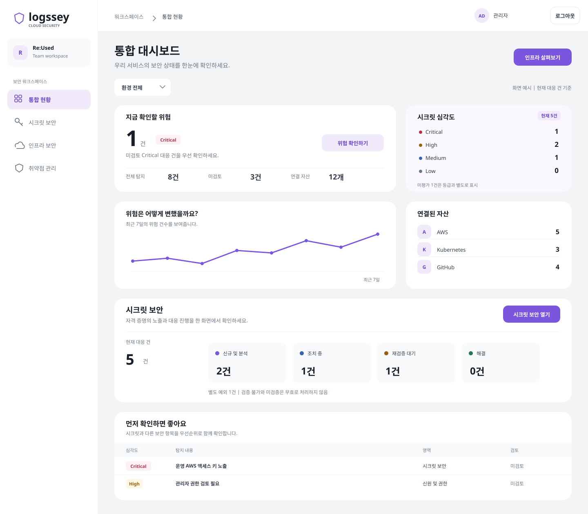

기존의 `지금 확인할 위험`, 위험 추이, 연결 자산, `먼저 확인하면 좋아요` 목록과 공통 셸은 유지하는 배치다. 시크릿 요약 카드는 기존 목록 위에 추가하고, 우선 확인 목록에는 같은 현재 대응 건의 시크릿 항목을 중복 없이 연결한다. 100점 보안 점수 카드 자리에는 현재 대응 건의 Critical, High, Medium, Low 분포를 놓고 미평가 수를 따로 보인다. 시크릿 보안 카드는 네 조치 단계와 별도 예외를 보여준다. 카드나 버튼을 누르면 같은 환경과 기준시점을 넘겨 `/secrets`의 해당 목록을 연다. 기존 점수 API 필드를 심각도 값으로 재해석하지 않고 [API 계약](../03-architecture/api-contract.md)에 따라 새 요약을 연결한다.

### 3.2. 시크릿 현황

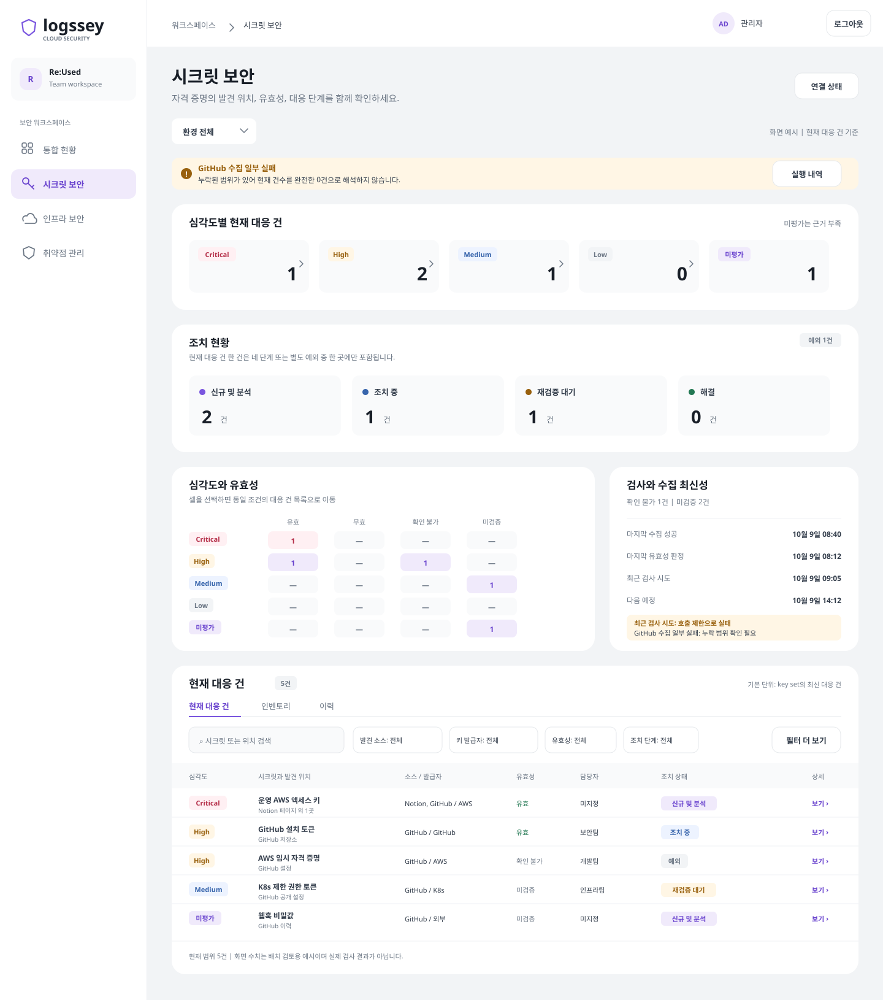

| 영역 | 화면 동작과 데이터 기준 |
|---|---|
| 상단과 환경 | 공통 환경 선택을 사용하고 발견 소스, 키 발급자, 유형, 유효성, 조치 단계와 담당자는 별도 필터로 둔다. 환경 미확인은 운영으로 추정하지 않는다. |
| 수집 경고와 최신성 | 일부 실패, 마지막 성공, 최근 시도, 다음 예정과 지연을 구별한다. 읽지 못한 범위의 0건은 정상 0건으로 취급하지 않는다. |
| 심각도 | 네 등급과 미평가를 별도로 표시한다. 카드 선택 시 같은 기준시점의 목록을 연다. |
| 조치 현황 | 신규 및 분석, 조치 중, 재검증 대기, 해결 네 단계와 별도 예외를 배타적으로 집계한다. 예외는 별도 필터로 열고 일부 위치만 예외인 건은 남은 조치 단계에 둔다. |
| 매트릭스 | 심각도 다섯 행과 유효성 네 열의 대응 건 수를 표시한다. 셀 선택 시 동일 필터, 범위, `snapshotId`를 목록에 전달한다. |
| 목록 | 각 key set의 최신 대응 건 한 건을 표시한다. 발견 소스와 키 발급자를 함께 보여주고, 인벤토리와 과거 이력은 탭과 집계 범위를 분리한다. |

그림의 현재 대응 건 5건은 조치 네 단계 4건과 예외 1건, 심각도 네 등급 4건과 미평가 1건으로 각각 일치한다. 매트릭스 셀도 총 5건이다. K8s 예시는 정상 Secret 객체 보관이 아니라 GitHub의 공개 설정에서 토큰을 발견하고, 별도 승인된 권한 조회로 제한 범위를 확인한 가상 사례다. 수치와 사례는 실제 API 응답이 아니다. 그림의 시각은 한국 표준시 예시이며 API는 UTC 시각을 반환한다.

### 3.3. 대응 건 상세 패널

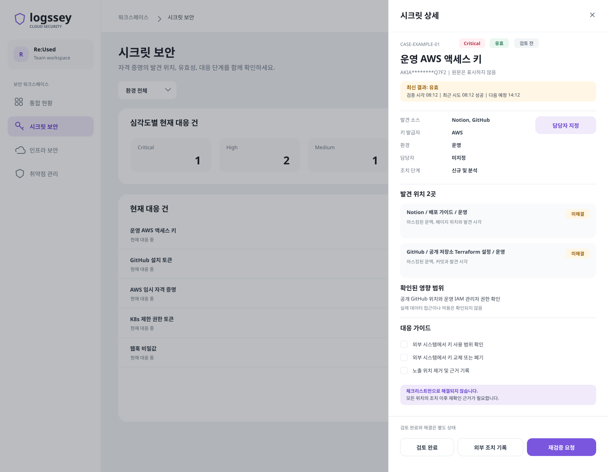

목록 행을 누르면 기존 대시보드의 우측 패널 형식으로 연다. 마스킹한 식별자, 발급자와 발견 소스, 마지막 확정 판정과 최근 시도, 담당자, 조치 단계를 분리해 표시한다. 같은 키의 여러 발견 위치는 위치별 근거와 해결 상태를 각각 보여준다. 확인된 영향 범위만 표시하고 실제 데이터 접근이나 악용은 증거 없이 단정하지 않는다. 공급자별 대응 가이드와 체크리스트는 외부 수행을 돕는다. 검토 완료, 체크리스트 완료 또는 재검증 요청만으로 해결되지 않는다.

`외부 조치 기록`은 수행 종류, 대상 위치, 실제 수행 시각과 비밀을 제거한 근거를 받는다. `재검증 요청`은 작업 상태와 최근 시도에 연결한다. 권한 있는 사용자의 해결 요청은 모든 비정상 노출 위치의 조치 이후 재확인 근거를 서버가 확인한 뒤 처리한다. 실제 키 교체, 폐기와 권한 변경은 이 화면에서 실행하지 않는다.

### 3.4. 담당자 지정

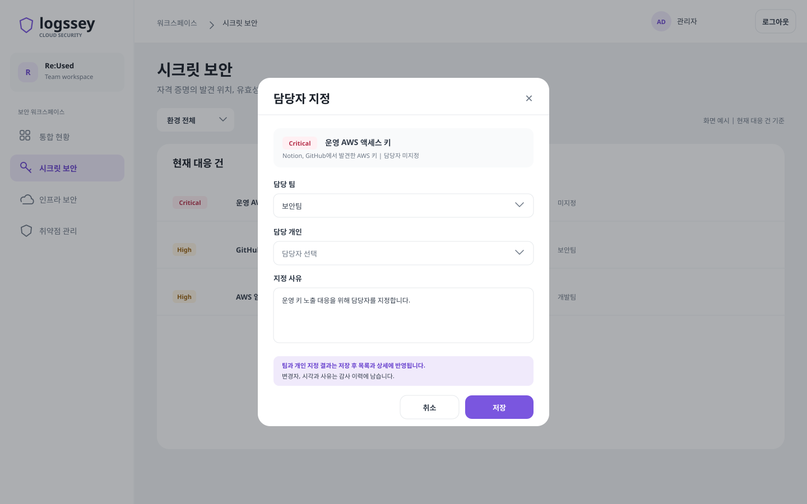

팀, 개인과 지정 사유를 입력하고 저장한다. 지정 가능한 대상과 변경 권한은 서버가 확인한다. 저장 성공 후 목록과 상세의 담당자가 함께 바뀌고 수행자, 시각, 변경 전후와 사유를 감사 이력에 남긴다. 실패하거나 버전이 충돌하면 저장 전 값을 유지하고 현재 상태를 다시 읽는다. 담당자 지정은 검토 완료나 해결을 자동으로 뜻하지 않는다.

### 3.5. 외부 조치 기록

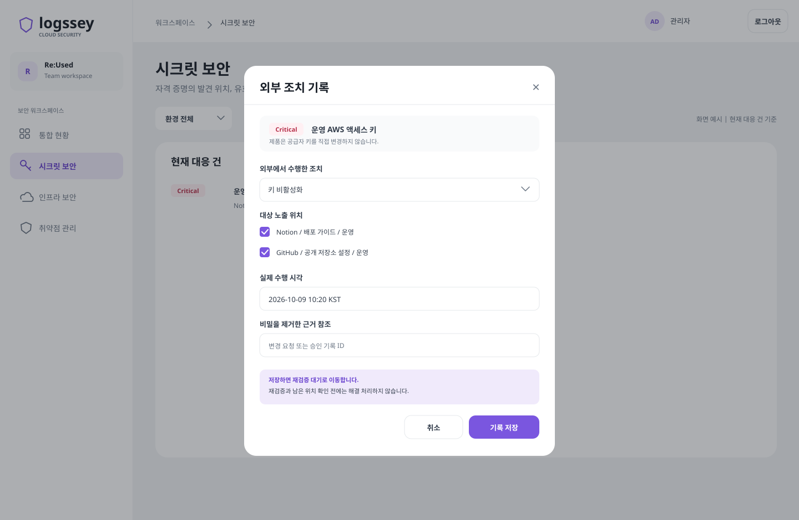

담당자가 외부 시스템에서 실제로 수행한 조치의 종류, 영향을 받은 발견 위치, 실제 수행 시각과 비밀을 제거한 증거 참조를 입력한다. 저장하면 조치 단계는 재검증 대기로 이동하지만 해결로 바꾸지 않는다. 화면은 공급자 키 변경 API를 호출하지 않는다. 기록 시각보다 앞선 유효성 결과는 조치 이후 판정으로 보이지 않게 표시하고, 재검증의 최근 시도와 마지막 성공은 별도로 남긴다.

### 3.6. 위험 수용 예외

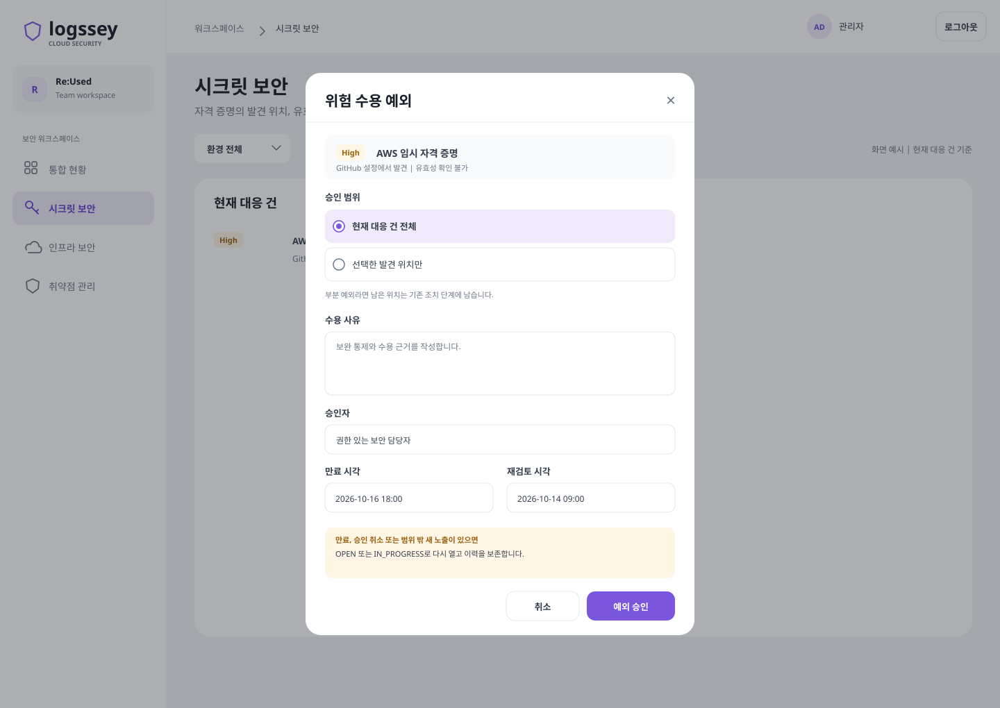

권한 있는 보안 담당자가 전체 대응 건 또는 선택한 발견 위치의 위험을 수용한다. 사유, 승인 범위, 서버가 확인한 승인자, 만료 시각과 재검토 시각을 기록한다. 일부 위치만 승인하고 다른 미해결 위치가 남으면 대응 건은 기존 조치 단계에 계속 집계한다. 전체 남은 위험이 승인 범위에 포함되면 별도 예외에 한 번 집계한다. 만료, 승인 취소 또는 범위 밖 새 노출이 발생하면 남은 위험에 따라 신규 및 분석 또는 조치 중으로 다시 열고 이력을 보존한다. 예외는 해결이나 오탐을 뜻하지 않는다.

### 3.7. 반응형과 예외 상태

1200px 이하에서는 사이드바와 본문 여백을 기존 규칙대로 줄이고, 980px 이하에서는 카드가 한 열로 흐른다. 700px 이하에서는 기존 햄버거 메뉴와 16px 본문 여백을 사용한다. 매트릭스와 목록은 좁은 화면에서 열 이름을 유지한 채 가로 스크롤하고, 상세 패널은 화면 폭 이내에서 열린다. 색상만으로 상태를 구별하지 않고 배지 텍스트와 사유를 함께 표시한다.

로딩, 정상 0건, 연결 미설정, 일부 수집 실패, 검사 실패, 권한 부족을 각각 다른 문구로 표시한다. 재검증 실패는 이전 성공 결과를 최신 성공으로 바꾸지 않는다. 화면의 원천 링크는 서버 권한 검사 후 허용된 경로만 연다. 예시 데이터와 실제 운영 결과는 구분해 표시한다.

## 4. 참고 이미지와 해석

아래 기존 이미지는 세부 기능을 설명하는 자료다. 위 목표 와이어프레임과 충돌하면 PRD, 상태 정책과 목표 와이어프레임을 따른다.

### 4.1. image 71 — 상세, 영향 경로, 조치

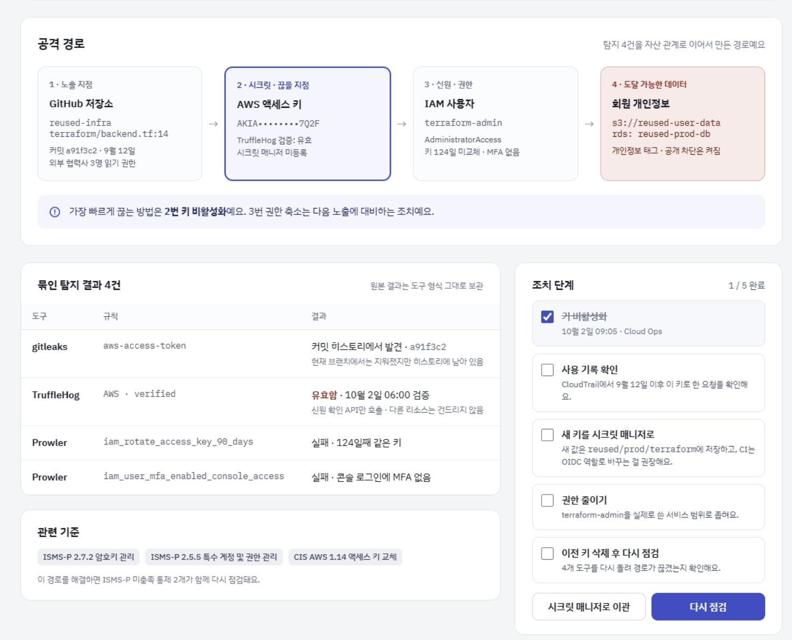

- 상단: 제목, 발견 위치, 발급자, 키 유형, 심각도, 유효성 및 검사 시각, 검토, 조치 상태, 담당자.
- 탐지 근거: 엔진, 룰, 버전, 마스킹한 문맥, 커밋, 페이지, 리소스 위치, 최초, 최근 발견 시각. 원문 링크도 사용자 접근 권한을 확인한다.
- 유효성: 검사 방법, 결과, 실패, 제한 사유. ‘유효’와 ‘실제 사용 중’을 구분한다.
- 영향 범위: 확인한 IAM 주체, 권한, 대상 리소스. 확인된 연결과 추정 연결을 구분하고 근거 시각을 표시한다.
- 대응: 공급자별 절차와 체크리스트, 외부에서 수행한 조치 기록, 재검증 요청.
- 검토 완료는 검토 이력만 변경하며 해결 상태를 자동 변경하지 않는다.

이미지의 GitHub→AWS 키→IAM 사용자→S3/RDS 경로는 예시다. 실제 접근 가능성을 확인하지 못하면 완성된 공격 경로로 표시하지 않는다. Prowler 결과는 선택적 보강 근거이며 키 유효성, 실제 침해를 증명하지 않는다. 그림의 규정 태그는 검증된 준수 판정으로 승계하지 않는다.

‘Secret Manager로 이관’ 같은 버튼은 **이관 가이드 열기**로 설계한다. 새 키 발급, 기존 키 폐기, 권한 변경은 수행하지 않는다. 이미지의 06:00 검사와 09:05 비활성화 기록처럼 시점이 다르면 ‘조치 이후 미검증’을 함께 표시한다.

### 4.2. image 72 — 탐지에서 검토까지 진행 지표

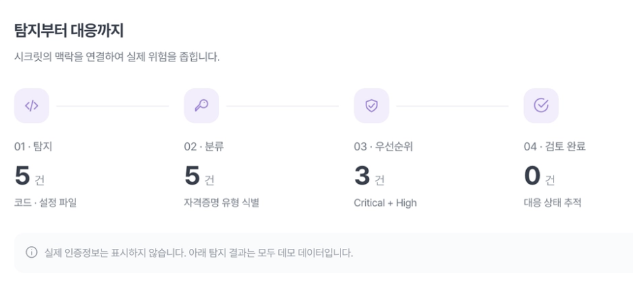

| 카드 | 정의 | 클릭 후 |
|---|---|---|
| 탐지 | 현재 범위의 대응 건 수. 전체 인벤토리는 별도 범위로 조회 | 현재 대응 건 목록 |
| 분류 | 키 유형과 유효성 상태가 기록된 현재 대응 건. UNKNOWN과 UNCHECKED를 포함 | 분류 결과 목록 |
| 우선순위 | CRITICAL/HIGH로 평가된 대응 대상 | 해당 심각도 필터 |
| 검토 완료 | REVIEWED 항목 | 검토 완료 목록 |

네 값은 서로 겹친다. 합계가 전체 탐지 수와 같아야 하는 조치 상태 막대가 아니다. 각 카드는 같은 현재 대응 건을 분모로 사용하고 필터와 기준시점을 표시한다.

### 4.3. image 73 — 조치 현황: 확정 4단계 + 별도 예외

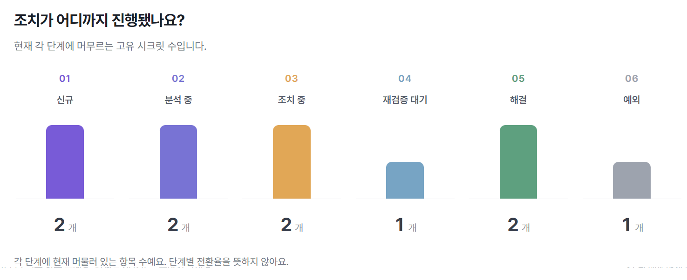

**원본 이미지는 이전 6단계 참고안이다. 실제 화면은 아래 PRD 기준을 적용한다.**

| 막대 | 포함 상태 | 표시 원칙 |
|---|---|---|
| 1. 신규 및 분석 | OPEN | 신규와 분석을 합산 |
| 2. 조치 중 | IN_PROGRESS | 담당자가 외부에서 대응 중 |
| 3. 재검증 대기 | REVALIDATION_PENDING | 조치 이후 결과를 다시 확인해야 함 |
| 4. 해결 | RESOLVED | 해결 근거가 기록됨 |
| 별도 표시: 예외 | 승인된 위험 수용 등 | 네 막대에 중복 집계하지 않음. 사유, 승인자, 재검토 시점 |

막대 클릭은 해당 목록으로 이동한다. 예외는 네 막대와 중복 집계하지 않는다. 각 key set의 최신 대응 건 한 건을 세고 위치별 일부 예외는 남은 조치 단계에 포함한다. 오탐과 대상 제외는 위험 수용과 구별한다. 만료 또는 폐기 기록 전체를 ‘해결’로 넣지 않으며 대응 사례가 생성되지 않은 보존 이력은 조치 막대 분모 밖이다.

### 4.4. image 74 — 심각도 × 유효성

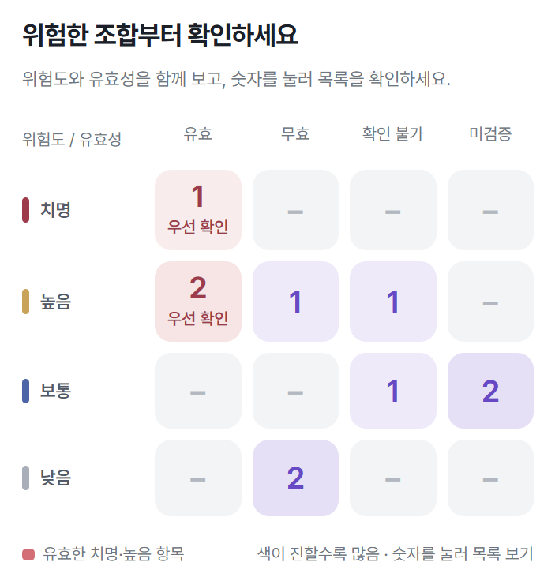

행은 CRITICAL/HIGH/MEDIUM/LOW, 열은 유효/무효/확인 불가/미검증이다. 심각도 **미평가**는 별도 행과 필터로 제공한다. 확인 불가를 낮은 심각도로 간주하지 않는다. 기본 모수는 현재 대응 건이고 셀 선택 시 같은 범위, 조건과 기준시점이 목록에 적용된다.

무효 건이 매트릭스에 보이는 것은 이력 조회다. 신규 사고, 미해결 대응 건수는 별도 정책으로 계산한다. 색상만으로 의미를 전달하지 않고 등급, 상태 텍스트를 병기한다.

### 4.5. image 75 — 미지정 목록과 담당자 지정

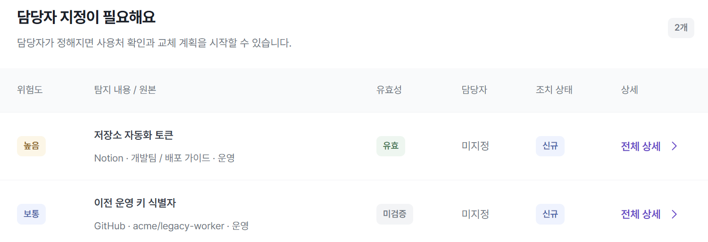

목록 열은 심각도, 제목, 발견 위치, 유효성, 담당 팀, 개인, 조치 상태, 상세 보기로 구성한다. 미지정은 현재 대응 건에 담당 팀과 개인이 모두 없거나 필수 개인 지정이 빠진 상태로 표시한다. 팀과 개인의 권한은 API에서 확인한다.

담당자 지정 화면은 제공 이미지에 없으므로 다음 동작을 구현한다.

1. 선택한 항목 요약과 현재 담당 팀, 개인을 표시한다.
2. 권한 있는 사용자가 지정 가능한 담당자를 선택하고 필요시 메모를 작성한다.
3. 저장 결과와 변경 이력을 표시한다. 저장 실패 시 화면에서만 변경된 것처럼 보이지 않게 한다.
4. 검토 완료, 담당자 지정, 조치 상태 변경은 각각 별도 동작으로 기록한다.

## 5. 선택 기능 및 수용 기준

공격 경로는 근거 확보가 가능한 경우에 추가한다. AI 요약은 비밀 제거 데이터만 사용할 수 있도록 정책을 먼저 정하며, 탐지, 유효성 판정, 자동 조치를 맡기지 않는다.

- 같은 집계 단위에서 4단계 막대와 별도 예외의 합은 명시된 조치 추적 대상 수와 일치한다.
- 같은 필터의 카드, 목록, 매트릭스가 동일 기준시점과 단위를 사용한다.
- 검토, 지정, 조치 기록을 저장한 뒤 새로고침해도 상태와 이력이 유지된다.
- 실패한 재검증은 기존 성공 시각을 갱신하지 않는다. 마지막 확정 결과와 최근 시도를 구분한다.
- 원문 비밀 값이 화면, 브라우저 API 응답, 프론트 로그에 포함되지 않는다.

관련: [상태, 집계](workflow-and-states.md), [현재 코드 차이](../04-integration/current-implementation-and-gaps.md).
