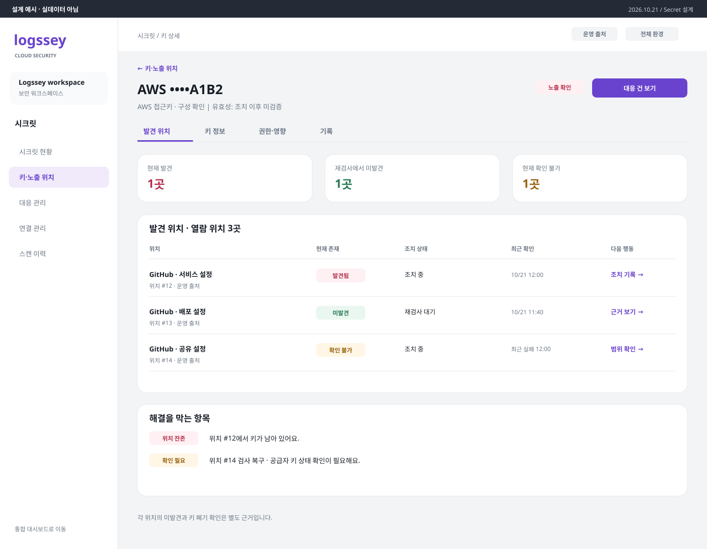

# 키와 발견 위치의 시각화

개정일: 2026-10-21. [데이터 계약](../03-architecture/data-contract.md)의 키·발견 위치·대응 건을 사용하며 새로운 위험 점수를 만들지 않는다.

## 1. 기본 표현과 탐색

기본 시각화는 **키 한 개에 연결된 위치별 증거 표**다. 현황에서 확인할 항목을 선택하고, 키 독립 상세에서 모든 열람 가능한 위치를 비교한 뒤 해당 위치의 근거 확인·대응·검사 이력으로 이동한다. 짧은 미리보기는 선택적으로 유지하되 상세 작업을 패널 안에 누적하지 않는다.

위 그림은 합성 배치 예시다. 같은 키의 열람 가능한 위치 3곳 중 1곳은 발견됨, 1곳은 조치 후 미발견, 1곳은 검사 실패로 현재 확인 불가다. 따라서 `1곳 잔존, 1곳 확인 불가`를 구분하고 전체 해결로 표시하지 않는다. 권한상 보이지 않는 위치는 정확한 전체 수를 표시하지 않는다.

## 2. 표와 관계의 의미

| 표현 | 포함할 정보 | 추론하지 않을 사실 |
|---|---|---|
| 키 요약 | 마스킹한 식별자·발급자·유형·구성·최신 검증 결과/시각·미확인 근거 | 인증 성공만으로 실제 사용·악용·관리자 권한 |
| 위치 행 | 위치 ID·안전한 표시 별칭·발견 소스·출처 구분·환경·처음/최근 발견 | 경로나 이름만으로 운영·시험·중요도 |
| 현재 존재 | 발견됨/비교 가능한 재검사에서 미발견/현재 확인 불가, 마지막 정상 확인과 최근 시도 | lastSeenAt이 오래됐다는 이유만으로 제거됨 |
| 보관 판단 | 노출 확인/보관 허용/노출 미확인, 정책·판정 근거·관측 시각 | 수집 승인만으로 보관 허용 |
| 대응 | 연결된 현재 건·위치 담당·위치 조치 단계·다음 행동 | 체크 완료만으로 위치 제거 |
| 검사의 신뢰 범위 | 승인 scope revision·콘텐츠/이력 범위·완전성·최근 성공·오류 | Git 현재 파일 검사로 과거 이력·다른 원천까지 확인 |
| 키 수명주기 | 외부 수행 기록과 별도 공급자 확인·근거 시각·확인 수준 | 사용 불가를 원인 확인 없이 폐기로 단정 |

열 이름과 상태를 유지하고 좁은 화면에서 행별 카드 또는 가로 스크롤로 전환한다. 모바일에서 핵심 상태를 생략하거나 색상만 남기지 않는다. 상세 확장은 한 위치의 근거·시각·관련 기록을 보여주고 다른 위치의 입력 양식을 함께 늘리지 않는다.

## 3. 집계·필터

키 전체 요약과 화면 필터 결과를 구분한다. 위치 필터는 소스·현재 존재·노출 판단·조치 상태를 사용하고 서버에서 권한과 전체 필터를 적용한 뒤 페이지를 나눈다. `표시 20곳 / 조회 가능 54곳`처럼 단위를 적는다. 위치 필터로 다른 미해결 위치를 숨겨도 건 전체의 해결 버튼을 열지 않는다.

미발견 수는 비교 가능한 성공 수집·탐지의 근거를 갖춘 위치만 센다. 검사 실패 뒤 이전 미발견 기록이 있으면 `이전 미발견 · 현재 확인 불가`로 분리한다. 최신성은 시각과 해당 콘텐츠/이력 범위로 보여주며 6시간 주기라는 설정만으로 최신 확인을 주장하지 않는다.

서로 다른 키 ID를 같은 마스킹 suffix나 AWS 접근키 ID만으로 합치지 않는다. 완전한 키의 fingerprint 동일성은 서버에서 처리하고 불완전 후보는 자기 위치에 한정해 식별한다. IAM 메타데이터와 값 후보의 발급 주체 연결은 별도 증거가 있을 때만 표시한다.

## 4. 색상과 강조

색은 긴급성 추정 대신 명시된 사실을 보조한다. 노출 확인은 경고, 확인 필요·검사 누락은 주의, 비교 가능한 미발견은 성공, 미지원/메타데이터는 중립으로 표현한다. 노출 위험이 남아 있는 건 전체를 위치 한 곳의 녹색만으로 안전하게 보이게 하지 않는다. 같은 행에 `노출 확인`과 `검사 실패`가 동시에 있으면 둘 다 보여준다.

유효성·심각도·조치 단계는 서로 다른 축이므로 배지 제목과 도움말을 분리한다. 미평가에는 낮은 위험 색을 사용하지 않는다. 차트의 모수·단위·기준시각은 인접 텍스트로 제공한다.

## 5. 선택형 관계도

키→위치 선은 현재 허용된 occurrence 관계를 뜻한다. 키→발급 주체→권한→자산 선은 확인된 증거 ID·관측 시각·어댑터 버전을 가진 관계에만 허용한다. 선의 존재는 접근 성공이나 데이터 유출을 뜻하지 않는다. 확인하지 못한 주체·권한은 `미확인` 항목으로 두고 임의의 자산 노드에 연결하지 않는다.

관계도는 선택 보조 보기이며 동일 데이터를 표로 읽을 수 있어야 한다. 기본 보기는 위치 증거 표다. 선택형 관계도는 실제 권한·자산 증거와 사용자 열람 권한을 갖춘 연결만 표시한다.

## 6. 수용 기준

1. 같은 키의 3개 위치가 발견됨/미발견/확인 불가일 때 한눈에 구별되고 전체 해결로 표시되지 않는다.
2. 위치 한 행에서 다음 행동과 그 행동을 막는 근거를 확인할 수 있다.
3. 새 위치가 현재 대응 건에 연결되면 목록·상세·해결 차단 조건이 같은 상태를 반영한다.
4. 제한 위치의 경로·개수·담당자·상태를 다른 위치 응답으로 유추하지 못한다. 일부 제한이 있으면 허용된 제한 안내만 보인다.
5. 경로·별칭에 비신뢰 문자열이 있어도 HTML·자동 링크·키 원문으로 표시되지 않는다. 승인된 별칭이 없으면 위치 ID를 사용한다.
6. 위치의 소스·존재·판정·조치 필터와 페이지를 복원한다. 진입한 목록·활동 이력의 기간은 복귀 조건으로만 유지하고 현재 위치 집합을 과거 기간으로 잘라 해결 조건을 약화하지 않는다. 만료된 스냅샷은 명시적으로 갱신한다.
7. 표·상태·다음 행동을 키보드와 스크린리더로 이용할 수 있다.
