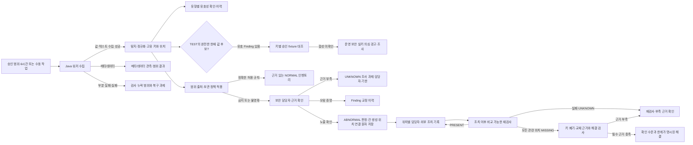
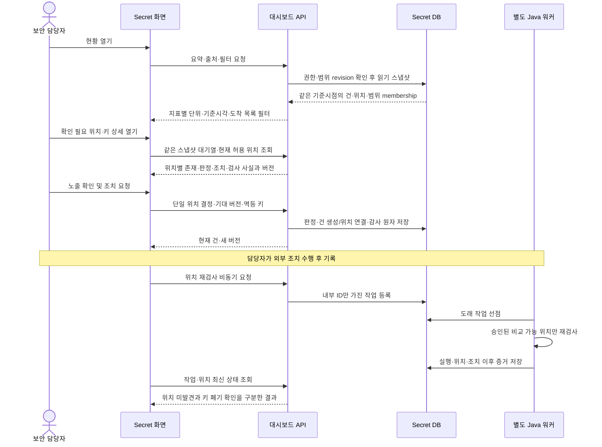

# 탐지에서 대응까지의 처리 흐름

기준: [PRD](../01-requirements/PRD.md), [전체 시스템 구성](system-overview.md), [ADR-S010](adr/ADR-S010.md).

유효성 검사와 노출 판정은 독립된 축이다. VALID는 보관 정책 위반의 증거가 아니며 UNCHECKED도 부적절한 저장 위치의 판단을 자동으로 막지 않는다. 메타데이터 관측은 값 탐지와 별도 분기로 처리한다.

## 범위 설정과 위치 업무

연결 관리의 검사 대상 설정은 읽을 대상과 운영·시험 분류를 보여준다. 일반 분류는 SECURITY가 직접 저장하고 source-label-v2 변경 이력을 자동 생성한다. 연결 테스트·스캔과 독립적이며 외부 티켓이나 다른 승인자를 요구하지 않는다. 보관 규칙 변경은 별도 고급 검토 작업이다. 분류 변경은 정책·노출·해결을 자동 확정하지 않고 기존 대응 기록을 보존한다.

범위 설정·위치·대응 상세는 같은 [사용자 작업 계약](../02-functional-design/task-and-approval-policy.md)의 포함 이유·주 행동·차단·남은 일을 반환한다. 직접 수행할 수 없으면 허용된 내부 담당 요청을 기존 조사 과제로 등록·재사용한다. 요청 접수나 출처 변경을 위치 제거·키 폐기·해결로 표현하지 않는다. 사람에게는 업무 맥락과 불확실성의 판단을 요청하고 중복 묶기·동일 근거 재사용·비교 가능한 재발견·검사 실패는 시스템이 계산한다.

## 수집·판정·대응

시험 출처의 완전한 현재 값 후보가 합성으로 확인되지 않으면 운영 보안 담당자에게 실키 의심 경고를 연결한다. 불완전 후보·메타데이터·모두 오탐으로 교정된 Finding은 경고 대상에서 제외한다. 정확한 fixture로 확인된 합성 건의 시험 종료는 실제 키 폐기와 구분한다. 실행 누락은 기존 발견을 MISSING으로 바꾸지 않는다.

## 단계별 입력과 기록

| 단계 | 처리 | 기록 |
|---|---|---|
| 수집 | 승인된 파일·문서·설정·Secret 및 지원 메타데이터를 읽음 | 실행 ID, 승인 범위·revision, 위치·버전, 시각, 성공·실패·누락 |
| IAM 메타데이터 | 현재 IAM 사용자 접근키·최근 사용을 읽고 ID를 보호키 HMAC으로 변환. 루트 키 존재·확인 불가는 누락 표시 | METADATA_ONLY 인벤토리와 실행별 관측, 마스킹 표지. 탐지·검증 SKIPPED. 비밀 값·노출·심각도는 판정하지 않음 |
| AWS 목록 개수 | 승인 범위의 Secrets Manager·SSM 목록과 S3 버킷 목록을 페이지별로 집계하고 자원 이름·ARN·설명·태그는 버림 | 범위별 항목 수·상태·안전한 사유. CredentialSet·발견 위치·검증 시도는 생성하지 않음 |
| AWS 정확한 값 | 별도 활성화·단일 자원 승인·STS 계정 일치 확인 후 현재 UTF-8 값만 제한 크기로 읽고 동기 탐지 | 도구·규칙 버전, 정규화 후보, 내부 범위 ID 위치, 안전한 상태·사유. 원문·자원명은 결과에 싣지 않음 |
| 탐지·정규화 | 유형·구성요소·동일성 근거에 따라 키와 위치를 연결 | 엔진·규칙 버전, 유형·구성, 마스킹 근거, 최초·최근 발견 |
| 검증 가능성 | 유형 지원·필수 구성요소·원문 접근·승인 설정 확인 | 미지원·불완전·원문 부재·비활성 등 미검증 사유 |
| 유효성 검증 | 발급자별 승인 엔드포인트에 제한된 요청 | VALID·INVALID·UNKNOWN·UNCHECKED, 사유·방법·시도·마지막 성공 시각 |
| 보관·영향 판단 | 위치별 보관 정책과 확인된 권한·환경·자원·사용 근거를 별도 평가 | 정책·평가 버전, 확인과 추정의 구분, 노출 판단, 심각도 또는 미평가 |
| 대응 | 비정상 위치의 담당자 지정·외부 조치 기록·재검사·해결 근거 확인 | 위치별 작업, 수행자·시각·근거, 건 상태·확인 수준, 감사 |

## 검증 결과별 경로

- **미지원·구성요소 부족:** 미검증 사유를 남기고 필요한 수동 검토와 연결한다.
- **유효:** 확인된 권한·노출 근거를 별도로 확인한다. 정상 보관은 인벤토리로 유지하고 비정상 노출은 대응으로 연결한다.
- **만료·폐기 확인:** 기록은 보존하고 신규 사고로 자동 개설하지 않는다. 기존 대응 건의 과거 악용·잔여 노출 검토는 생략하지 않는다.
- **무효이나 사유 불명:** 무효 근거를 보존하고 만료·폐기로 추정하지 않는다.
- **판정 불가:** 공급자 오류·호출 제한·권한 부족·통신 실패는 UNKNOWN이며 과거 성공 시각을 갱신하지 않는다.

## 행동 중심 조회와 위치 비교

요약의 대응 중·재검사 대기는 대응 건, 확인 필요는 위치, 검사 누락은 범위 단위다. 합계 하나로 합치지 않는다. 현황 카드와 도착 목록은 같은 사용자·필터·권한 revision의 15분 스냅샷을 사용하고 상세는 현재 사실을 읽는다. 변경 후 스냅샷이 낡으면 이를 알리며 변경 명령은 최신 기대 버전으로 검사한다. GET 조회는 외부 수집·검증을 시작하지 않는다.

키별 위치 비교는 현재 존재, 마지막 정상 검사·최근 시도, 보관·노출 근거, 담당자·조치, 조치 이후 재검사, 키 폐기·교체 근거를 독립적으로 제공한다. 누락은 기존 비정상 판정을 삭제하지 않는다. 권한·자산 관계가 확인되지 않으면 추정 관계선을 추가하지 않는다. 위치 표시는 안전한 별칭과 원천 이동 capability 규칙을 따른다.

## 위치별 조치와 건 전체 해결

| 책임 | 선행 사실 | 완료·통제 조건 |
|---|---|---|
| 연결 운영자 | 승인 범위·revision·권한 참조·출처·보관 정책 | 신원 테스트와 범위 수집 성공을 구분. 실패·새 revision·중지를 복구하고 마지막 성공은 보존 |
| 보안 담당자 | 해당 위치 열람·판정 권한과 최신 Finding·존재·정책·범위 버전 | 비정상 확인과 건 연결을 원자적으로 수행. 오탐·정상 보관·부족 근거를 구분하며 같은 결정을 재승인하지 않음 |
| 위치 조치 담당자 | 본인 할당·해당 연결 REMEDIATOR 권한 | 첫 실질 외부 조치부터 기록. 기록 마침과 재검사 요청을 구분하며 다른 위치를 자동 완료하지 않음 |
| 워커 | 현재 지원·승인 범위, 내부 작업 ID, 조치 이후 비교 조건 | 새 실행으로 원천·탐지 검사. 요청 수락·작업 종료·파일 미발견·키 폐기를 구분 |
| 건 전체 보안 조정자 | 모든 관련 위치·미연결 현재 노출의 SECURITY 권한과 최신 해결 검사 | 모든 위치의 비교 검사, 키 수명주기·커버리지 증거 확인. 부분 열람 목록만으로 전체 해결 승인 금지 |

외부 조치는 같은 위치에 여러 번 기록할 수 있다. 첫 실질 기록은 건을 OPEN에서 IN_PROGRESS로 전환한다. 위치별 기록 마침은 해당 위치를 재검사 대기로 표시하며 모든 연결 위치가 대기일 때만 건도 REVALIDATION_PENDING이다. 이 상태에서 새 비정상 위치가 연결되면 건은 IN_PROGRESS로 돌아가고 기존 조치 기록은 보존한다.

재검사는 요청한 지원 위치를 비동기로 다시 읽는다. 작업 성공·필수 탐지 성공·조치 이후 시각·원천 및 탐지 설정 일치 등 비교 조건을 충족할 때만 미발견을 MISSING으로 확정한다. 공급자 키 폐기·Git 과거 이력·다른 원천까지 확인한 것으로 확대하지 않는다.

해결 검사는 서버가 FULL·LIMITED·SIMULATION과 근거를 산출한다. 사용자는 확인 수준을 낮춰 통과시키지 못한다. LIMITED는 지원 밖 이력 등의 한계를 명시하며 알려진 미해결 노출·필수 검사 실패의 예외 경로가 아니다. 실제 키 수명주기 근거를 여러 위치에서 참조할 수 있지만 위치별 제거·재검사 증거를 대체하지 않는다. 재발 건에서는 키 동일성·조치 이후 시각·적용 범위를 다시 확인한다. UNKNOWN 위치는 단순 범위 제외로 해결 조건에서 빼지 않는다.

권한 취소·담당자 변경·정책 만료·새 위치 연결은 열려 있는 화면의 capability를 낡게 만든다. 서버는 모든 변경 명령에서 권한과 최신 사실을 다시 검사한다.

## 실행 분모와 범위 변경

전체 스캔의 분모는 요청·실행 당시 승인 범위 revision이고 수동 위치 재검사의 분모는 요청한 지원 위치다. 새 범위를 추가해도 과거 분모를 소급 변경하지 않는다. 현재 연결·현황에는 새 revision의 검사 전 또는 REVISION_UNCHECKED를 표시한다. 취소·부분 실패·필수 탐지 실패는 성공과 구분하고 종료됐다는 이유로 성공률 분자에 넣지 않는다.

연결 신원 테스트는 전체 범위 읽기를 보장하지 않는다. 최신 전체 시도와 같은 revision의 마지막 성공을 별도로 유지한다. 여러 실행의 범위별 성공을 한 번의 연결 전체 성공으로 합성하지 않는다. 정상 진행 중인 범위는 최종 실패로 세지 않지만 이전 누락·기한 초과를 숨기지 않는다.

정기 예약은 기본 6시간이며 워커는 영속 작업을 기본 30초마다 확인한다. 수동 요청 수락·선점·실제 시작은 다른 시각이고 수동 작업은 정기 예정 시각을 바꾸지 않는다. 원문은 작업 큐·현황 스냅샷·일반 응답·로그에 들어가지 않는다. 워커 중단 후 재시작 시 과거 지연 슬롯을 한 번 예약하고, 다음 예정은 실제 예약 시각에서 6시간 후로 둔다. 중단 기간의 슬롯을 연속 재생하지 않는다.

상태·집계는 [워크플로](../02-functional-design/workflow-and-states.md), 유형별 검증은 [수집원과 검증기 계약](source-and-validator-contract.md)을 따른다.
