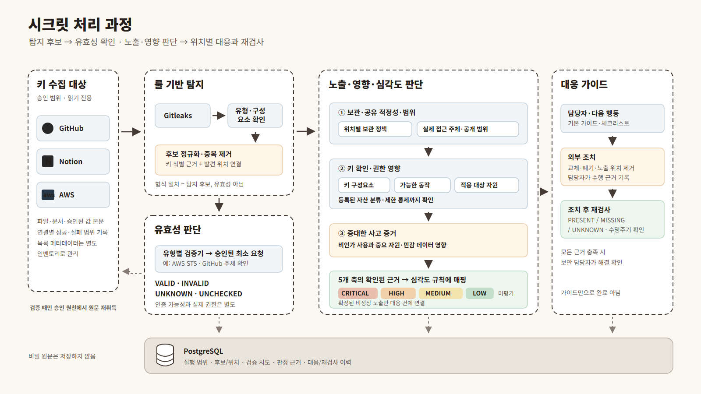
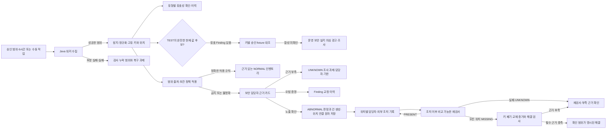

# 탐지에서 대응까지의 처리 흐름

기준: [PRD](../01-requirements/PRD.md), [전체 시스템 구성](system-overview.md)

위 그림은 수집부터 대응까지의 **이전 개략 참고 자료**다. 최신 판정·경고·해결 분기는 아래 Mermaid 도식과 [ADR-S010](adr/ADR-S010.md)을 따른다. 구현은 승인된 GitHub 현재 커밋의 수집·탐지, AWS IAM 접근키 메타데이터와 Secrets Manager·SSM·S3 목록 개수 수집, 별도 opt-in이 필요한 정확한 AWS 단일 자원 값의 수집·탐지 경로, 비동기 실행 등록·조회와 고유 인벤토리 목록·상세 조회를 포함한다. V7–V9는 수동 노출 판정에 따른 대응 건 개설, 담당자·검토·체크리스트·외부 조치 기록을 연결한다. V10은 승인 GitHub 위치 재검증과 해결을 `develop`에 연결했다. IAM 메타데이터는 값 발견이 아니므로 탐지·검증 경로를 거치지 않고 `METADATA_ONLY` 인벤토리와 실행별 관측으로 저장한다. 다른 세 AWS 목록은 항목 수·상태·누락 코드만 실행 범위에 남기며 고유 키 인벤토리를 만들지 않는다. 정확한 값 경로만 본문을 제한된 작업 메모리에서 탐지기로 보내고 결과를 내부 범위 ID 별칭과 연결한다. 분리된 개발 DB의 실계정 시험에서는 Secret·Parameter 값 경로를 확인했고 S3 후보는 비텍스트로 제외했다. 검증된 실행 범위와 한계는 [구현 연동 현황](../04-integration/current-implementation-and-gaps.md)에 둔다. STS 검증 호출은 기본 비활성이고 합성 실험 저장소에는 설정과 관계없이 호출하지 않는다. 심각도·영향 평가는 후속이다. 기본 주기는 6시간이고 예약기와 실행기는 각각 명시적으로 활성화해야 동작한다.

## 근거 중심 목표 분기

아래는 [ADR-S010](adr/ADR-S010.md)의 **미구현 목표 흐름**이다. 유효성 검사와 노출 판정은 별도 축이다. 키가 `VALID`여도 승인 보관 정책을 위반했다는 뜻은 아니고, `UNCHECKED`여도 부적절한 저장 위치의 판단을 자동 막지 않는다.

정확한 합성 fixture로 확인된 `TEST` 건은 시험 종료를 실제 키 폐기와 구분한다. 시험 범위에서 완전한 현재 값 후보가 합성으로 확인되지 않으면 운영 보안 담당자에게 실키 의심 경고를 올리고, 실제 키 근거가 나오면 경고를 승격한다. 불완전 후보·메타데이터·오탐은 이 경고에서 제외한다. 실행의 누락 범위는 기존 발견을 `MISSING`으로 바꾸지 않으며 스캔 이력에서 재시도와 영향을 받는 판정을 연결한다. 과거 V8–V12의 분리된 판정·개설·확정 검토 API는 전환 기간에만 남고 이 도식의 단일 목표 명령을 대체하지 않는다.

## 단계별 입력과 기록

| 단계 | 입력과 처리 | 남길 정보 |
|---|---|---|
| 수집 | 승인된 연결의 파일, 문서, 설정, Secret 및 지원 메타데이터를 읽는다 | 실행 ID, 수집 위치와 범위, 시각, 성공, 실패, 누락 |
| IAM 메타데이터 분기 | 승인된 계정의 현재 IAM 사용자 접근키 목록과 최근 사용 메타데이터를 읽고 ID를 보호키 HMAC으로 바꾼다. 루트 키가 있거나 확인이 불가능하면 범위 누락으로 표시한다 | `METADATA_ONLY` 인벤토리, 실행별 관측, 마스킹 표지, 탐지·검증 `SKIPPED`. 비밀 값·노출·유효성·심각도는 기록하지 않음 |
| AWS 목록 개수 분기 | 승인된 리전의 Secrets Manager·SSM 목록 또는 계정의 S3 버킷 목록을 페이지별로 읽고 항목 수만 센다. 자원 이름·ARN·설명·태그는 버린다 | 범위별 개수·수집 상태·안전한 누락 코드, 탐지·검증 `SKIPPED`. `CredentialSet`·발견 위치·검증 시도를 만들지 않음 |
| AWS 정확한 값 분기 | 별도 활성화와 `CURRENT_VALUE_ONLY` 승인 범위·STS 계정 일치가 확인된 한 Secret·Parameter 또는 S3 객체의 UTF-8 본문만 제한 크기로 읽고 동기 탐지 후 소유 바이트 배열을 지운다 | V4 도구 실행·정규화된 키 후보·내부 범위 ID 기반 위치, 선택적인 V5 검증 시도, 범위별 안전한 상태·사유. 원문과 자원명은 결과에 싣지 않음 |
| 탐지와 정규화 | 룰로 후보를 찾고 키 유형과 구성요소를 식별해 key set 및 발견 위치를 연결한다 | 엔진과 룰 버전, 유형, 마스킹된 근거, 최초와 최근 발견 시각 |
| 검증 가능성 판단 | 유형별 검증 지원, 필수 구성요소, 원문 접근 가능 여부를 확인한다 | 미지원, 불완전 키, 원문 부재 등 미검증 사유 |
| 유효성 검증 | 발급자별 승인된 엔드포인트에서 제한된 요청을 수행한다 | VALID, INVALID, UNKNOWN, UNCHECKED, 사유, 시도 및 성공 시각 |
| 영향 평가 | 확인된 권한, 자원, 환경, 노출과 지원되는 사용 메타데이터를 연결한다 | 확인과 추정의 구분, 심각도 또는 미평가, 근거 시각 |
| 대응 | 비정상 노출이면 담당자를 지정하고 가이드, 외부 조치 기록, 재검증 요청을 제공한다 | 담당자, 조치 단계, 수행자, 변경 내용, 증거와 감사 이력 |

## 판정별 경로

- **검증 미지원 또는 구성요소 부족:** 미검증 또는 확인 불가 사유를 기록하고 수동 검토 대상으로 남긴다.
- **유효:** 권한과 노출 근거를 확인한다. 정상 보관 위치는 인벤토리와 탐지 이력으로 유지하고, 대응이 필요한 노출은 심각도를 평가해 담당자를 지정한다.
- **만료 또는 폐기 확인:** 근거와 발견 이력을 보존하고 신규 사고에서 제외한다. 기존 대응 건은 과거 악용이나 잔여 노출의 해결 근거 없이 자동 종결하지 않는다.
- **무효이나 사유 불명:** 무효 근거를 남기고 사고 정책에 따라 검토한다. 만료나 폐기로 추정하지 않는다.
- **판정 불가:** 공급자 오류, 호출 제한, 권한 부족 또는 통신 실패를 UNKNOWN으로 남긴다. 이전 성공 판정의 시각을 갱신하지 않는다.

담당자가 외부 시스템에서 수행한 조치는 같은 위치에 여러 번 기록할 수 있다. 목표 흐름에서 첫 실질 기록은 `OPEN→IN_PROGRESS`로 전환하고, 위치별 기록 마침을 별도로 요청할 때 그 위치를 재검증 대기로 표시한다. 모든 연결 위치가 재검증 대기인 경우에만 건 전체를 재검증 대기로 표시하며 그 뒤 새 비정상 위치가 붙으면 건을 조치 중으로 되돌린다. 정기 검사는 승인된 수집 범위를 기본 6시간 주기로 읽는다. V10의 별도 수동 재검증은 요청한 GitHub 위치의 단일 승인 범위만 비동기 작업으로 다시 읽으며, 작업 성공·탐지 설정 일치·조치 이후 시각 등 비교 조건이 맞을 때만 미발견을 `MISSING`으로 확정한다. 재검증 요청이나 대응 버튼은 외부 키 변경 API를 호출하지 않는다.

화면에 표시할 독립 상태와 집계 규칙은 [기능 설계](../02-functional-design/workflow-and-states.md), 수집원과 유형별 검증 계약은 [수집원과 검증기 계약](source-and-validator-contract.md)을 따른다.
