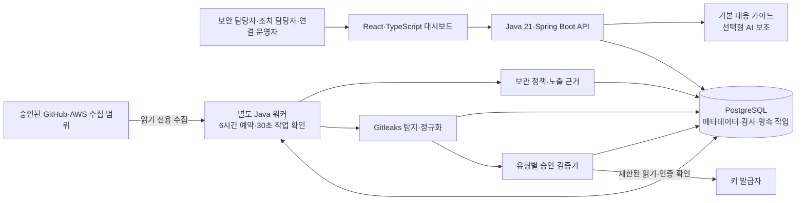

# 전체 시스템 구성

기준: [PRD](../01-requirements/PRD.md), [ADR-S008](adr/ADR-S008.md).

사용자는 대시보드에서 승인 범위의 검사 결과와 키별 발견 위치를 조회하고, 위치 판정·외부 조치 기록·재검사 요청을 수행한다. API는 인증·인가와 작업 등록을 담당하고, 수집·탐지·유효성 검사는 별도 Java 워커가 실행한다.

Notion 승인 페이지·블록과 Kubernetes Secret 객체는 별도 수집기 capability의 확장 경계다. 플랫폼 enum이나 화면 연결 카드만으로 수집을 지원한다고 간주하지 않는다. GitHub도 현재 승인 파일과 별도 계약인 과거 커밋 이력을 구별하며 지원하지 않는 범위는 실행을 거부한다.

상자는 논리 책임을 나타내며 독립 서비스나 물리 저장소의 수를 의미하지 않는다. PostgreSQL의 물리 배포 위치와 워커의 네트워크 배치는 환경별 설정으로 정하되 API·워커의 실행 권한과 원문 접근 경계를 유지한다.

## 구성요소와 책임

| 구성요소 | 책임 | 경계 |
|---|---|---|
| 수집 연결·수집기 | 승인된 계정·저장소·페이지·네임스페이스의 콘텐츠와 지원 메타데이터를 읽고 범위별 성공·실패·누락을 기록 | 플랫폼 이름만으로 값·이력·로그의 읽기 권한을 확대하지 않는다. K8s Secret은 Kubernetes API와 별도 RBAC로 읽는다. |
| 예약기·작업 실행기 | 기본 6시간마다 정기 작업을 예약하고 영속 작업을 기본 30초마다 확인·선점해 실행 | 수동 요청은 독립 작업이며 정기 예정 시각을 바꾸지 않는다. 서버 시작·DB 수정 자체는 외부 스캔을 시작하지 않는다. |
| 탐지·정규화 | Gitleaks 8.30.1로 후보를 찾고 유형·구성요소·고유 키·발견 위치를 연결 | 형식 탐지는 노출·유효성·심각도 판정이 아니다. 불완전 구성요소와 공개 식별자는 완전한 키와 구별한다. |
| 유형별 검증기 | 발급자·키 유형에 승인된 최소 요청으로 인증 가능성을 확인 | 검증 불가는 무효가 아니다. 외부 키·권한을 변경하지 않고 업무 사용 여부를 추정하지 않는다. |
| 보관 정책·검토 대기열 | 수집 출처와 별도 보관 정책의 버전·근거를 적용해 확인이 필요한 위치와 조사 과제를 도출 | 정확한 허용 규칙에만 근거 있는 자동 NORMAL을 허용한다. 금지·불명확은 검토 대상으로 남긴다. TEST 표시는 안전의 증거가 아니다. |
| 영향 평가 입력 계약 | 확인된 주체·권한·자원·환경·사용 메타데이터가 있을 때만 평가 정책에 전달 | 공급자별 권한 분석 capability와 근거가 없으면 UNASSESSED를 유지하고 영향 그래프·등급을 생성하지 않는다. 인증 성공만으로 권한·업무 사용·침해를 단정하지 않는다. |
| 대응 사례·가이드 | 위치별 담당자, 외부 조치 기록, 체크리스트, 재검사와 해결 증거를 연결 | 키 교체·폐기·재발급·권한 변경은 담당자가 외부 시스템에서 수행한다. 기본 가이드는 AI 없이 제공한다. |
| 대시보드 API·저장소 | 권한에 맞는 현황·위치·이력을 제공하고 변경 명령·감사를 원자적으로 저장 | 조회는 외부 스캔을 시작하지 않는다. 발견한 원문은 일반 DB·큐·응답·로그·AI에 전달하지 않는다. |

## 데이터와 권한 경계

수집용 연결 자격 증명, 공급자 검증용 연결 자격 증명과 발견된 비밀은 접근 권한을 분리한다. 원문은 승인된 워커의 제한된 프로세스·메모리에서만 다루고 영속 보관하지 않는다. 식별과 중복 제거에는 보호키 기반 HMAC을 사용하며, 화면에는 마스킹된 식별값과 권한·승인 범위를 확인한 저장소·브랜치·파일·줄 등 구조화된 위치 좌표를 반환한다. 원천 본문·키 원문·인증 참조는 제공하지 않고 자격 증명처럼 보이는 이름은 마스킹한다.

현황은 대응 건·위치·범위를 서로 다른 단위로 집계하고 같은 권한·필터·기준시점으로 목록과 연결한다. 키 상세는 허용된 위치별 존재·노출·검사·조치 증거를 비교한다. 공급자 키 폐기와 원천 파일의 미발견은 별개 사실이다. 조회 결과의 일부만 볼 수 있는 사용자는 그 부분 목록만으로 건 전체를 해결하지 못한다.

처리 분기는 [처리 흐름](processing-flow.md), 연결별 범위는 [수집원과 검증기 계약](source-and-validator-contract.md), 원문 보호와 작업 통제는 [보안과 실행 정책](security-and-runtime.md)을 따른다.
